# Agent 框架总设计

> **地位**：本文件是框架的唯一权威总设计（Single Source of Truth）。所有模块详设、实现、评测都从本文派生，冲突时以本文为准。
> **公式**：`Agent 应用 = LLM + Harness`。Harness = 一个微内核（R1）+ 算子核心（组合层）+ 可组合的工具层（R3~R9）+ 内置架构 + 四组对外 API。
> **主线**：唯一执行循环解释 Program 产出的 Effect；框架核心是**算子**——A 类组合算子把工具层装配成 Program 并构造注入 R1 的 `call`；能力按**二维分类**承载——能力（做什么，169 项）≠ 承载形态（怎么实现，7 种）；一切架构是 A 类算子的预设配方；一切外部系统经 Port 契约接入。
> **配套**：模块详设 `docs/02-模块详设/Agent/`（由本文按 R1~R13 拆分派生，每模块模块内闭环、含 API/字段/门禁）；能力全集见[《能力域全景》](./能力域全景.md)（含自查补齐内容，见附录 B.1 待办清单）。
> **状态**：设计定稿——**算子核心架构**（依据 `docs/01-总览与设计/组合式工具层重构规格-20261121.md` P1~P9 / D-1~D-10）。R1 一行不改；R2 取消（文档《算子与装配》承接其能力）；组合层 = 算子核心；工具层 R3~R9 可挑选可组合；对外 API 不变。依赖方向恒为 **工具层 → 组合层（算子 + call） → 内核 R1**，R1 零依赖上层。
> **版本记录**：
> - 2026-11-21（意图识别默认四级级联路由）：意图策略默认实现由单级"规则/LLM 分类"改为**四级级联 `CascadeIntentStrategy`**（L1 关键词→L2 语义/采样库→L3 便宜模型→L4 主模型，逐级置信度阈值短路 + 兜底）；四个部件 `KeywordMatcher`/`IntentSampleStore`/`CheapIntentModel`/`PrimaryIntentModel` 各自可按接口注入，`strategy=` 整体注入则整包替换默认级联（两级注入共存）；修 R12 Router/RouterSkill 裂缝——统一经 `intent_as_program()` 单入口消费 `IntentResult`，不再把 classifier 塞进 prompt 解析。IntentResult 加可选 trace（观察语义，不下沉内核）。同步 R8/R12/R13/总设/能力域全景；纯文档变更无代码改动。
> - 2026-11-21（R7 D4/D5 新增方案）：R7 上下文管理补两项正交增强——**D4 大 tool 结果落盘而非截断**（`OffloadPolicy` 阈值判定 + BlobPort 句柄，`mode="truncate"` 构造即拒绝，不留兼容层）；**D5 KV cache 命中率一等可观测指标**（`CacheTelemetry` hits/misses/label/hit_rate 挂 `ContextMemoryManager.cache_telemetry` 观测面，可进 R10 trace、无访问 0.0 不产 NaN）。同步 R7 详设 §11.6/§12.5/§4 与总设 §R7。9 个 TDD 测试 + gate r7 15/15，全量绿、R1 零改动。
> - 2026-11-21（算子核心架构重构）：框架核心由 AOP 五角色容器改为**算子核心**。核心定性——能力（169 项，做什么）与承载形态（7 种，怎么实现）二维分类，"算子"专指 ① 组合算子（`Program → Program`）；A 类算子恰好 10 个（seq/par/branch/race/loop/map_state/map_effect/fallback/gate/retry 流程级），纯函数、状态进 `State.scratch` 的 `x-*`，resume 靠 program_factory 重建；②有状态守卫 + ③call 装饰器取代原 AOP 五角色固定链（③在调用前后驱动②的 check/observe）；④notify 是 R1 既有回调；⑤Port/⑥组件可插拔；⑦内核机制不进算子层。R1 零改动（代价：call 拦不到 Spawn/Suspend/Terminate，靠 notify 观察，D-7）；领域字段净化登记技术债（D-9）；整体替换不留兼容层（D-10），R6 先试点。本次重写总纲 §1.2/§2/§5、R1（加定位节）、R2（《算子与装配》）、R12（10 算子 + 装配期边界）、R13（ToolLayer + Port 归位），R3~R7 按 7 承载形态归位。
> - 2026-11-20（扩展体系重构，已被上条取代）：三体系正交——Port（what）/ AOP 增强器（how，五角色固定链）/ Lifecycle 通知（when，16 通知点）；Effect 拆为 `Invoke|Spawn|Suspend|Terminate` tagged union。AOP 五角色固定链本次已被"call 装饰器链 + 有状态守卫"取代，16 通知相位保留为 R1 notify 回调。
> - 更早版本：历史架构（已作废，不再兼容）。

---

## 目录

- [第一篇 总纲](#第一篇-总纲)
  - [1 设计目标与原则](#1-设计目标与原则)
  - [2 总体架构](#2-总体架构)
  - [3 能力全景与模块划分](#3-能力全景与模块划分)
  - [4 贯穿全框架的元数据与字段规范](#4-贯穿全框架的元数据与字段规范)
  - [5 算子核心与 7 承载形态（how）](#5-算子核心与-7-承载形态how)
  - [6 Lifecycle 通知体系（when）](#6-lifecycle-通知体系when)
- [第二篇 模块详设](#第二篇-模块详设)
  - [R1 核心运行时](#r1-核心运行时)
  - [R2 插件总线与协议](#r2-插件总线与协议)
  - [R3 可靠性](#r3-可靠性)
  - [R4 模型与推理](#r4-模型与推理)
  - [R5 工具·MCP·技能](#r5-工具mcp技能)
  - [R6 RAG 检索增强](#r6-rag-检索增强)
  - [R7 上下文与记忆](#r7-上下文与记忆)
  - [R8 认知与多 Agent 编排](#r8-认知与多-agent-编排)
  - [R9 安全与 HITL](#r9-安全与-hitl)
  - [R10 可观测·评测·持久化](#r10-可观测评测持久化)
  - [R11 集成接入与治理](#r11-集成接入与治理)
- [第三篇 全局附录](#第三篇-全局附录)

---

# 第一篇 总纲

## 1. 设计目标与原则

### 1.1 要解决什么问题

现有框架（m0-m3 + M4~M11）验证了三个正确洞见，也暴露了三个结构性问题。本设计保留洞见、解决问题：

**保留的洞见**：
1. **Effect 解释器**：Program 只 `yield Effect` 不执行；运行时是唯一解释循环；架构 = 脚本，运行时对架构无知。
2. **不可变 State + 事件溯源 + checkpoint**：确定性回放、跨周期恢复、评测重放免费获得。
3. **Port 契约 + 注册表**：运行时只认协议不认实现。

**解决的问题**：
| 问题 | 表现 | 本设计的解法 |
|------|------|-------------|
| 四套扩展 API 并列 | middleware/filter/pipe/拦截器四种心智模型 | 收敛为**7 承载形态**，算子是其中①类（组合算子）——见 §1.2 铁律二 |
| 内核被可选插件需求绑架 | 降级/重试/追踪等编排穿透内核契约（`扩展体系重构规格-20261120.md:15`） | 复杂度在**组合层（算子）吸收**，不下沉 R1；R1 零领域语义 |
| AOP 把三类东西塞进固定链 | A 类前后插逻辑 / B 类跨调用状态机 / C 类广播（`src/aop/protocols.py:49-86`） | A 类→算子吸收、B 类→②领域策略（R3 `ReliabilityExecutor` 显式编排）、C 类→④notify；固定角色链取消 |
| 能力无统一层 | harness 能力散落 M4~M9，各自找挂载点 | 独立 **L1 工具层**（可挑选可组合） |
| API 不分层 | 应用开发者/平台/插件作者用同一套低层 API | **四组 API 面**按使用者投影 |

> 根因与推导演化详见 `overviews/2026-11-21/94783b60-意图识别级联路由默认策略影响面分析.md` 追问 3~7。

### 1.2 七条铁律

1. **依赖只向下**：R1 零依赖上层；依赖方向恒为 **工具层（R3~R9）→ 组合层（算子 + call）→ 内核 R1**，下层永不感知上层。组合层是唯一知道"有哪些工具层"的地方；工具层互不直连。
2. **7 承载形态，算子只是其一**：169 项能力落到实现只有 7 种承载形态（见 §2.4）——①组合算子（`Program→Program`，狭义算子、框架核心）/ ②有状态守卫 / ③call 装饰器 / ④notify 观察 / ⑤Port 接入 / ⑥组件 / ⑦内核机制。**能力（做什么）≠ 承载形态（怎么实现）**；"算子"专指①类，retry/timeout/熔断/降级/沙箱/工具/追踪都是**能力**，不是算子。②+③取代原 AOP 五角色固定链。
3. **算子是纯函数**：A 类算子装配期 `Program→Program`，不改原对象（compile 幂等）；运行期状态进 `State.scratch` 的 `x-*` 键，禁止算子实例持有流程进度——resume 靠 `program_factory` 重建（`src/runtime/types.py:521-531` 的 Spawn 同构机制），否则 resume 丢状态。
4. **强制在内核**：预算、终止、挂起、checkpoint 在 R1 硬强制，不靠插件自觉。轮次/跳数交 Budgets（`R12:55-56` 红线），架构 generator 内禁 `for i in range(max)` 自数。
5. **一切外部输入不可信**：工具/检索/网页/技能正文都必须过注入检测（③ `injection_guard` 装饰器 / ⑥组件）；引用溯源不可关。
6. **一切可插拔需四要素**：协议定义 + 默认实现 + 替换入口 + 履约校验，缺一是假可插拔。默认实现由对应能力模块提供（R4 给 LLMPort、R5 给 ToolPort……）并由组合层装配器在用户未注入时注册；R1 只定协议不内置实现。
7. **R1 零改动、复杂度不上浮**：R1 的 `CallFn=(effect,ctx)->Awaitable[Result]`（`src/runtime/types.py:724-725`）是唯一 call 注入点（`src/runtime/runner.py:190-212`/`:322`）；call 只覆盖 `Invoke`，`Spawn` 在入口被截走（`runner.py:312-313`）、`Suspend`/`Terminate` 走批次快路径（`runner.py:491-509`），这三类只能经 ④notify 观察（看不改，D-7）。领域字段净化（PortName/Port 契约成员/双相位枚举）登记技术债（D-9），本次 R1 只核验不改。

### 1.3 三层可插拔模型（框架的核心卖点）

```
① 能力级 Capability —— 用不用这个功能
   .capability(RAG(...))  装了生效，不装缺席降级
        ↓
② 策略级 Provider —— 用什么算法/模型
   实现 Protocol 即可替换；不传用框架默认
        ↓
③ 实例级 Instance —— 接入什么工具/技能
   本地@tool / MCP工具 / Skill 正文 → 统一合集，运行时无差别
```

**注入只有三条路**（不为任何模块另开）：协议替换 / 算子组合或 call 装饰器 / 构造参数。外加 L3 对外接入契约（Port / Event Stream / Projection）。

**可插拔四要素**（每个注入点框架都必须给齐）：① 协议定义 ② 默认实现 ③ 替换入口 ④ 装配期履约校验。

> **承载形态落点**：能力级 Capability 装配成工具层（`build() -> Program`）；策略级 Provider 经 ⑤Port 契约替换；实例级 Instance 经 Registry 注册。"想要哪个用哪个"靠挑选层（四要素校验），"通过组合使用"靠 A 类算子（§2.4①）。二者都要，以组合算子为主，provides/requires 降级为挑选期可选声明、不进运行时内核（追问 5 拍板）。

---

## 2. 总体架构

### 2.1 分层架构图

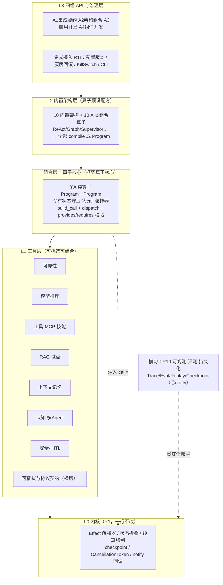

> **层级纪律**：L0 内核 R1（机制，零领域语义、一行不改）← L1 工具层（可挑选可组合，各自 `build() -> Program`）← 组合层（算子核心：A 类算子装配 Program + B/C 类构造 call + 挑选期校验）← L2 内置架构（算子预设配方）← L3 四组 API。R10 观测评测与 R13 可插拔是横切关注点，不占独立层。依赖方向恒为 **工具层 → 组合层 → R1**，R1 零依赖上层（§2.6）。
> **组合层（原 R2 位置，已重写）**：不再有 `AOPContainer`/五角色固定链/`LifecycleBus` 总线模块（历史：五角色语义已彻底删除，不得复辟）。取而代之——①A 类算子（`src/compose/program.py`）、③call 装饰器（`src/compose/call.py`：函数式 `retry_call`/`timeout`/`danger_route`/`injection_guard`，`build_call(base, *, decorators=())`）、`dispatch`/`make_dispatch`（`src/compose/dispatch.py`）+ 具名协作 DTO（`src/compose/guards.py`：`FaultRecord`/`RoutingTarget`/`CallState`）。原承载形态②（有状态守卫）的物理载体 `Guard`/`with_guard`/`Verdict`/`DegradationGuard`/`degrade_retry` 已删除；其职责在 R3 由 `ReliabilityExecutor` + 9 领域策略显式编排实现（见 §R3），不再走任何角色链或 check/observe 协议。R1 只认注入的 `call` 和 Program，不认识任何领域。7 承载形态与算子契约见 §2.4 / §5；16 notify 相位保留为 R1 回调见 §6。

### 2.2 一次 Effect 的完整执行流（全局主干）

执行流由 Runner 驱动（R1，零改动）：唯一解释循环 + 纯函数 fold；`Invoke` 类 Effect 走注入的 `call`（由组合层 `build_call(base, *, decorators=())` 构造：③call 装饰器链 + `dispatch` 分派；R3 可靠性链另由 `ReliabilityExecutor.as_call()` 显式编排注入），其余 Effect（`Spawn`/`Suspend`/`Terminate`）走内核快路径，call 拦不到（D-7）；notify 在对应相位由 R1/能力层发出、返回值不被消费。

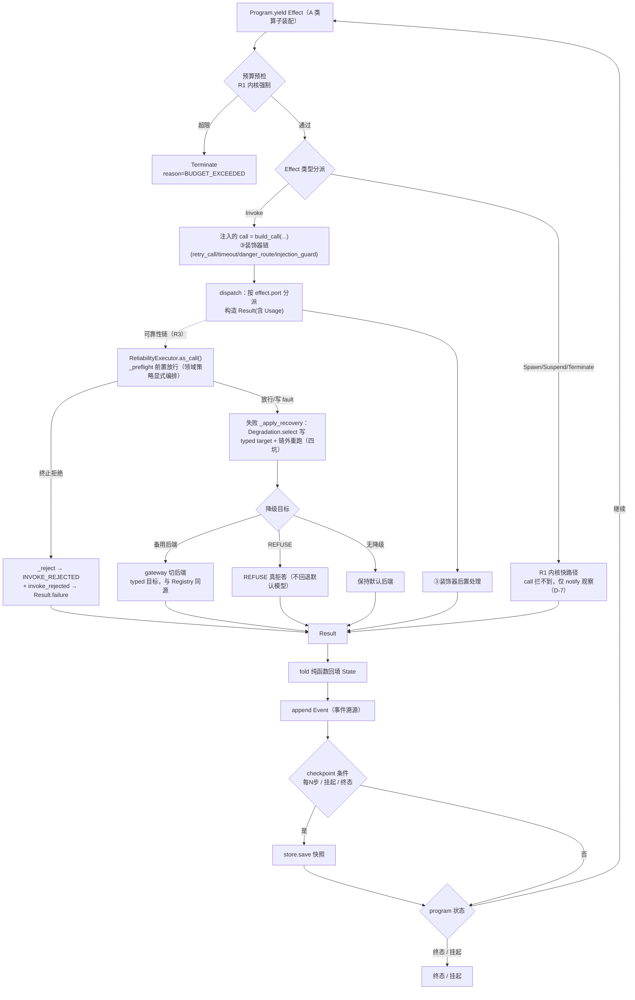

> **降级接力（P3/P9，R3 `ReliabilityExecutor` 显式编排）**：原 AOP 降级重路由状态机（`src/aop/container.py:275-317`）移出，由执行器的 `_apply_recovery` 调 `Degradation.select` 统一裁决（保四坑语义）+ `ReliabilityExecutor.as_call()` 驱动的链外重跑承接。执行器/领域策略只负责"发现故障并报告失败上下文"，`Degradation.select` 裁决目标；失败上下文的 `failed_target` 是降级阶梯里的**后端注册名**（非 `("provider", name)` 维度二元组）。四个历史修复点的语义必须逐条复现（原文保留、只换宿主）：①按 `session_id` 隔离目标状态（`Degradation` 实例内 `dict[session_id, 状态]`，禁容器级单值）；②`failed_target` 用后端注册名，网关未注册目标 `TargetUnresolved` 不静默回退；③R3-6 故障目标**永久从 `available` 剔除并写回**（非局部副本），否则 backup 故障后会重新选回 primary、永远到不了 REFUSE；④R3-7 retry 耗尽/timeout 的故障记录必须携带 `failed_target`（由构造注入的失败目标提取函数产出）。网关侧 REFUSE 真拒答、未注册目标不回退全部保留（R4 红线）；降级目标经 `write_routing_target` 写 typed 路径（与 Registry 同源，R4 `dispatch` 唯一读取来源），不再经裸降级桥接字段。端到端降级用例断言不许放水（规格 §3 P3 门禁红线）。

---

### 2.3 四组 API 面（同一内核的四个投影）

| API | 面向 | 内容 |
|-----|------|------|
| **A1 集成契约** | 平台/工具集成者 | Port 契约 + Event Stream + Projection 三类契约 |
| **A2 架构组合** | 选型用户 | 10 内置架构 + 10 A 类组合算子（seq/par/branch/race/loop/map_state/map_effect/fallback/gate/retry 流程级）——用户无感其内部是算子 |
| **A3 应用开发** | 普通开发者 | `Agent(arch=...).profile(...).capability(...).run()` |
| **A4 组件开发** | 插件作者 | A 类算子（`Program→Program`）/ ②领域策略（R3 执行器显式编排）/ ③call 装饰器 / `State.scratch x-*` / Port / Program / fold 全部低层接口 |

---

## 3. 能力全景与模块划分

### 3.1 能力域 → 模块映射

框架完整能力 = 18 域 / 169 项（完整清单见[《能力域全景》](./能力域全景.md)）。按"内聚能力合并、避免一域一模块"原则聚合为 13 个模块：

| 模块 | 层 | 覆盖能力域 | 能力项数 |
|------|----|-----------|---------|
| R1 核心运行时 | L0（内核，零改动） | A 执行控制（内核部分）、O 持久化（内核部分） | 10 原语 |
| R2 算子与装配（原插件总线） | 组合层 | 7 承载形态、A 类算子、③call 装饰器、装配器（②领域策略归 R3） | 10 算子 + call 装饰器 + build_call/dispatch/make_dispatch + 协作 DTO |
| R3 可靠性 | L1（工具层） | B 可靠性全域 | 11（按 7 承载形态重分类：7 守卫 + 2 装饰器 + 2 算子） |
| R4 模型与推理 | L1（工具层） | C 模型推理全域 | 10 |
| R5 工具·MCP·技能 | L1（工具层） | D 工具执行 + E 技能 | 20 |
| R6 RAG（首个试点） | L1（工具层） | H 检索增强全域 | 20 |
| R7 上下文与记忆 | L1（工具层） | F 上下文工程 + G 记忆 | 17 |
| R8 认知与多 Agent | L1/L2 | I 认知 + J 编排 | 19 |
| R9 安全与 HITL | L1（横切） | K 安全 + L 人机协作 | 17 |
| R10 可观测·评测·持久化 | L2/L3 | M 可观测 + N 评测 + O 持久化 | 23 |
| R11 集成接入与治理 | L3 | P 工程化 + Q 集成 + R 治理 | 23 |
| R12 内置架构与组合 | L2（算子核心载体） | J 架构（10 内置架构 + 10 A 类算子） | 20 |
| R13 可插拔与协议契约 | 横切 | 三层插拔 + 四要素 + ToolLayer + 协议全集 + 装配例子 | 横切 |

### 3.2 模块依赖关系

```
工具层 R3~R9（各自 build()→Program）
    ↓ 装配期
组合层（R2《算子与装配》+ R12：①A 类算子装配 Program + ②③构造 call + provides/requires 校验）
    ↓ 注入 call=（src/compose/build_call）
内核 R1（一行不改，只解释 Program）
    ↑
R8(认知编排) ──→ R10(观测评测持久化，④notify) ──→ R11(集成治理) ──↑（消费/装配）
```

- **依赖不变量**：R1 零依赖上层；组合层是唯一知道"有哪些工具层"的地方；工具层互不直连（§2.6 规格不变量）。R1 执行循环只认注入的 `call`（签名 `(effect,ctx)->Awaitable[Result]`，`src/runtime/types.py:724-725`）与 Program，不感知组合层内部编排。
- 工具层能力可挑选可组合：挑选靠四要素 + provides/requires 装配期校验（不进运行时内核）；组合靠 A 类算子（`Program→Program`，可任意嵌套）；②领域策略实例持有跨调用策略状态（R3 执行器显式编排）、③无状态 call 装饰器为纯函数组合（不再驱动 check/observe）；协同经 `FaultRecord`/`RoutingTarget` 具名协作状态与 `State.scratch x-*`（流程进度），不经裸键容器。
- R10/R11 消费全框架事件（④notify），不被 L1 依赖。

---

## 4. 贯穿全框架的元数据与字段规范

### 4.1 统一信封与类型别名

| 类型 | 定义 | 用途 |
|------|------|------|
| `DynamicValue` | `Any` 的具名别名 | 跨 Port 无法预知形态的值，集中表达"为何动态" |
| `EffectPayload` | `Mapping[str, DynamicValue]` | `Invoke` 的参数负载（只读）；`x-*` 扩展键保留（D-2） |
| `Scratchpad` | `Mapping[str, DynamicValue]` | State 用户自定义键（只读） |
| `Result` | `{ok, data, usage, error}` | Port 调用统一信封 |
| `PortError` | `{code, message, retryable}` | 结构化错误，`retryable` 驱动重试 |
| `Usage` | `{prompt_tokens, completion_tokens, cost_usd}` | 成本/token 元数据 |

### 4.2 全局元数据字段（进 trace，贯穿所有模块）

| 字段 | 类型 | 生成方 | 含义 |
|------|------|--------|------|
| `session_id` | str | Runner | 会话唯一标识 |
| `run_id` | str | Runner | 单次 run 标识 |
| `trace_id` | str | 内核注入 | 全链路追踪 ID，格式 `session:step:index` |
| `step` | int | Runner | 逻辑步序号（逻辑时钟，非墙钟） |
| `seq` | int | Runner | 事件序号，单调递增 |
| `version` | str | 装配期 | program+prompt+架构版本，回放对齐 |
| `name` | str | 每个组件 | 组件留名（强制，拒绝黑盒） |
| `fingerprint` | str | checkpoint | 事件日志 SHA256，确定性校验 |

### 4.3 确定性纪律

- 逻辑时钟（step/seq/attempt）由内核生成，**墙钟由外壳注入**，绝不进运行时状态。
- 同一 State + 同一事件日志 → 同一批 Effect（Program 纯函数，AST 扫描拒绝 `datetime.now()`/random/网络）。
- 成本用 `round(x, 10)` 避免浮点累积误差。
- 所有快照可确定性 JSON 序列化（sort_keys + 紧凑分隔符）。

---

## 5. 算子核心与 7 承载形态（how）

> 回答"怎么实现"。源码包 `src/compose/`（`program.py` / `call.py` / `dispatch.py`）+ `src/archs/`。组合层是框架真正核心：用算子把工具层装配成 Program，并构造注入 R1 的 `call`。原 `src/aop/` 已删除，AOP 五角色固定链取消（规格 §3 P2 / D-3）。

### 5.1 二维分类：能力 ≠ 承载形态

能力域全景 18 域 169 项是**需求侧清单**（做什么），一项不删不改名。169 项能力落到实现只有 **7 种承载形态**（怎么实现），这是重构的锚（规格 §2.1/§2.2）：

| # | 承载形态 | 签名/接口 | 运行期位置 | 代表能力 | 是不是算子 |
|---|---------|----------|-----------|---------|-----------|
| ① | **组合算子** | `Program → Program` | 装配期 | seq/par/branch/race/loop/fallback/gate/map_state/map_effect/retry(流程级) | ✅ **狭义算子就是这类，框架核心** |
| ② | **领域策略（原"有状态守卫"）** | 执行器显式编排领域方法（`is_tripped`/`acquire`/`permit`/`select` 等），无统一协议 | 策略实例（跨调用存活） | 熔断/限流/舱壁/幂等/降级阶梯/watchdog/killswitch（R3） | ❌ 不是算子（由 R3 `ReliabilityExecutor` 编排） |
| ③ | **call 装饰器** | `CallFn → CallFn` | 运行期 call 层 | 重试(调用级)/timeout(调用级)/危险路由/注入检测 | ❌ 装饰器；链式组合取代原 AOP 五角色 |
| ④ | **通知观察** | `notify(phase, payload)` 只读 | 旁路 | 链路追踪/审计/指标/成本归因 | ❌ R1 既有 notify 回调 |
| ⑤ | **Port 接入** | `Protocol` + Registry | 被 call 调用 | 工具系统/沙箱/LLM/记忆/RAG/Store | ❌ 能力契约 |
| ⑥ | **组件** | 普通类/函数 | 装配或调用期 | 切分/嵌入/重排/改写/规划器/上下文四链 | ❌ 无横切无状态机的算法 |
| ⑦ | **内核机制** | R1 内部 | R1 | 预算/终止/挂起/checkpoint/取消 | ❌ 不进算子层 |

**关键定性**："算子"专指①；retry/timeout/熔断/降级/沙箱/工具/追踪**都是能力，不是算子**——"算子"字样只出现在描述承载形态时。②+③取代原 AOP：③是无状态 call 装饰器链（函数式组合）；②的落地形态已演进——原 `Guard.check/observe` 拦截协议已删除，现由 R3 `ReliabilityExecutor` 显式编排 9 领域策略的领域方法实现，不再由③在调用前后驱动。④就是 R1 现有 notify 回调，⑤⑥本就可插拔。

### 5.2 A 类组合算子（10 个，框架核心）

| 算子 | 签名 | 语义 |
|------|------|------|
| seq | `seq(a, b)` | a.output 作 b 初始输入 |
| par | `par([...], join=all)` | 扇出并行 + join 聚合 |
| branch | `branch(fn, arms, default?)` | fn(state)→key 选 arm（级联路由 = 嵌套 branch，不加算子） |
| race | `race([...])` | 首个完成胜出，取消其余（依赖 A5 取消传播） |
| map_state | `map_state(lens)` | State 视图变换，纯函数 |
| retry | `retry(p, *, attempts, backoff)` | **流程级**重放：失败按 program_factory 重建重跑 |
| fallback | `fallback(p, *, ladders, refuse)` | 按序尝试 arms，失败切下一个，全失败走 refuse |
| loop | `loop(body, *, cond, max_rounds)` | 显式循环（轮次交 Budgets，禁自数） |
| map_effect | `map_effect(fn)` | 改写 Effect payload（脱敏/参数规范化/注入标记），取代 AOP Refiner |
| gate | `gate(p, policy)` | 可 `yield Suspend(question,options)` 等审批，resume 后续跑 |

共 10 个（D-4）。**预算治理不是算子**（硬限在 R1 `Budgets`/`fold`，软限是文本提示用 map_effect 注入 `payload['budget']`）。**gate 必须是算子**：call 装饰器 `(effect,ctx)->Result` 不能 yield Effect，挂起/审批只能 A 类 Program 变换（D-6）。

**A 类统一约束**（R1 不变前提）：装配期 `Program→Program` 纯变换不改原对象（compile 幂等）；必须纯函数，运行期状态进 `State.scratch` 的 `x-*` 键，禁止实例持有流程进度（resume 靠 program_factory 重建，`src/runtime/types.py:521-531`）；轮次/跳数交 Budgets（`R12:55-56` 红线）；State 只读（`src/runtime/types.py:321-369` MappingProxyType，唯一写入点 `runner.py:535`）；gate 的 Suspend / race 的取消走 R1 设施，算子只编排不重实现。

### 5.3 B/C 类：call 装饰器 + 领域策略（②的落地演进）

**③ call 装饰器**（签名是 R1 既有 `CallFn`，`src/runtime/types.py:724-725`）：

```python
def retry_call(base: CallFn, *, attempts: int, backoff: float) -> CallFn: ...       # 调用级重试
def timeout(base: CallFn, *, seconds: float) -> CallFn: ...                          # 调用级超时
def danger_route(base: CallFn, registry) -> CallFn: ...                             # 按 danger 进沙箱
def injection_guard(base: CallFn, detector) -> CallFn: ...                          # 注入检测
# 组装：call = retry_call(timeout(danger_route(base_port_call)))
```

用函数组合表达，无固定角色链、不叫 AOP；只覆盖 `Invoke`（§1.3 / D-7 边界）。

**② 领域策略（原"有状态守卫"，落地形态已演进）**：承载形态②在 R3 由 `ReliabilityExecutor` + 9 领域策略实现（`src/harness/resilience/`），以各自领域方法显式编排，不再是统一拦截协议：

```python
# 9 领域策略，各自领域方法，无统一 check/observe 协议：
# KillSwitch.is_tripped / Watchdog.detect / Idempotency.check_and_mark /
# RateLimit.acquire→RatePermit / Bulkhead.run_in_slot /
# CircuitBreaker.permit + observe_outcome / RetryPolicy.run_with_retries /
# Timeout.run_with_deadline / Degradation.select
executor = ReliabilityExecutor(core, ..., degradation=Degradation(...))  # 具名 opt-in 注入
call = executor.as_call()                                                  # 产出符合 R1 的 CallFn
```

承载：熔断（三态+滑窗+store）、限流（令牌桶）、舱壁（池计数）、幂等（去重表+TTL）、降级阶梯（available 永久剔除+session 隔离）、watchdog（滑窗）、killswitch（外部 flag）。由执行器按可靠性工程语义显式编排：`_preflight` 前置放行 → `_budgeted_call` 预算内执行 → `observe_outcome` 熔断记数 → 失败 `_apply_recovery` 调 `Degradation.select` 裁决目标。状态存在领域策略实例上，跨调用存活、按 session 隔离；策略只持有跨调用策略状态（熔断计数等），不持有单次流程进度。原 `Guard`/`with_guard`/`Verdict`/`DegradationGuard`/`degrade_retry` 已删除。

### 5.4 call 注入链与依赖方向

```python
base = make_dispatch(ports)                                    # 按 effect.port 分派，构造 Result(含 usage)
call = build_call(base, decorators=(retry_call, timeout))      # ③函数式装饰器链（内层先注册）
# Runner(call=call) —— R1 一行不改
```

`dispatch`/`make_dispatch` 按 `effect.port` 取 payload 参数（`src/ports/adapters/`、`gateway.py` 口径），构造 `Result.success/failure` 含 `Usage`/`PortError`（`src/runtime/types.py:211-243`）；不构造 Invocation（R1 明确不构造，`R1-核心运行时.md:172`）。typed target 消费仅降级场景需要，由 R3 执行器 `_apply_recovery` 调 `Degradation.select` 写入 `RoutingTarget` 后交网关完成。

**依赖方向不变量**：工具层（R3~R9 + 用户自定义，产出 Program）→ 装配期 → 组合层（算子编排 + 构造 call + 校验）→ 注入 call → R1（只解释 Program）。R1 零依赖上层，组合层是唯一知道"有哪些工具层"的地方，工具层互不直连。

> 完整 A/B/C 契约与装配器见《R2：算子与装配》；算子逐个详设见 R12；可靠性插件重分类见 R3。

---

## 6. 通知观察 notify（when，④承载形态）

> 回答"发生了什么"。这是 **R1 既有的 notify 回调**（R1 一行不改），不再有 `LifecycleBus` 总线模块（`src/hooks/lifecycle.py` 的 16 相位枚举保留为 notify 的相位口径）。通知型语义——**不拦截、不改写、返回值不消费、异常就地隔离**。承载链路追踪/审计/指标/成本归因（④）。

### 6.1 定位（R1 既有回调，不是拦截通道）

notify 是**通知型**观察口：订阅者收到相位 + payload，框架不消费其返回值，通知不能拦截或改写执行流；订阅者抛异常就地吞掉并记 trace，不影响主流程。它是 ④ 承载形态，不是拦截通道，也不承载"怎么执行"（那是②③算子/call 装饰器）。

**R1 不改动的关键边界（§1.3 / D-7）**：`call` 只覆盖 `Invoke`；`Spawn` 在 `_execute` 入口被截走（`src/runtime/runner.py:312-313`），`Suspend`/`Terminate` 在 step 批次层走快路径（`runner.py:491-509`）。call 层算子拦不到这三类，只能经 notify 观察（看不改）。审计/追踪若需覆盖它们，登记为未来 R1 微改可选项（D-8）。

### 6.2 notify 接口（R1 既有，不新建总线）

```python
# R1 Runner 已在对应相位调用注入的 notify 回调，签名沿用，本次不改
def notify(phase: str, payload: Mapping[str, object]) -> None: ...   # 同步；异常就地隔离；返回值不消费
```

插件契约（④观察方）：`name` + 订阅若干相位；订阅方实例自身持有跨调用观察状态。链路追踪/审计/指标/成本归因均挂此口，不再经 `LifecycleBus.on/emit`。

### 6.3 16 个相位（口径保留，不得增删）

| 组 | 相位 | 触发方 |
|----|------|--------|
| 会话/轮次（5） | `session_start` / `user_prompt` / `session_end` / `state_fold` / `budget_check` | Runner |
| 能力调用（5） | `before_model` / `after_model` / `before_tool` / `after_tool` / `tool_error` | R4（model 系列）/ R5（tool 系列） |
| 子 Agent（2） | `child_spawn` / `child_done` | Runner |
| 控制流（3） | `cancelled` / `wait_human` / `resumed` | Runner |
| 拒绝（1） | `invoke_rejected` | R3 执行器 `_reject`/`_emit_rejected`（终止类策略拒绝 / 降级拒答时发） |

流式结算的多次 before/after_model 是预期行为（16 相位够用，不增删，P4）。compact 系列是 R7 内部步骤、原调用级扩展点由②③承接，均非 notify 相位。

### 6.4 触发权与纪律

- **触发权**：R4 发 model 系列、R5 发 tool 系列、R7 发记忆相关、R1 Runner 发会话/轮次/控制流系列、组合层 call 装饰器发 `invoke_rejected`。
- **顺序确定性**：notify 不承诺业务语义顺序；需要严格顺序的逻辑走 A 类算子显式编排（如 R7 压缩）或③call 装饰器。
- **审计覆盖**：`invoke_rejected` 保证被守卫拒绝的调用也进 trace；对 Spawn/Suspend/Terminate 的观察只能经此口（D-7 代价）。

---

# 第二篇 模块详设

> 每个模块按统一结构撰写：**职责边界 → 设计架构 → 流程图 → API 接口 → 元数据/核心字段 → 可插拔契约 → 验收门禁**。

## R1 核心运行时

> 层：L0 · 依赖：无（自包含）· 源码包：`runtime/` · 对应原 M1

### R1.1 职责与边界

**做**：定义三大原语（State/Effect/Program）；实现唯一解释循环与 Runner；预算硬强制；事件溯源与 checkpoint 挂点；notify 回调（④观察口）。
**不做**：任何具体 IO（不 import LLM SDK/数据库）；算子编排与 call 装饰器（组合层）；Port 实现（R4~R11）；任何领域语义。
**依赖注入**：`call`（`CallFn=(effect,ctx)->Awaitable[Result]`，`src/runtime/types.py:724-725`）由组合层 `build_call` 构造、在 `Runner(call=...)`（`runner.py:190-212`）注入——测试时注入 fake。`Invoke` 类 Effect 走注入的 call，其余 Effect（Spawn/Suspend/Terminate）走内核快路径；R1 不感知组合层内部编排。

#### R1 在算子核心架构下的定位（本次新增，P1）

R1 按 port 分支是**消息回注语义**（`src/runtime/fold.py:100-129`），属于⑦内核机制；领域语义由工具层/组合层承接。本次 **R1 一行不改**（D-7），只明确边界与代价：

- **四类 Effect**：`Invoke|Spawn|Suspend|Terminate`（tagged union + `Disposition`）。
- **call 注入点**：`CallFn` 定义 `src/runtime/types.py:724-725`，注入 `runner.py:190-212`，唯一调用点 `runner.py:322`。
- **快路径边界**：call 只覆盖 `Invoke`；`Spawn` 在 `_execute` 入口被截走（`runner.py:312-313`），`Suspend`/`Terminate` 在 step 批次层走快路径（`runner.py:491-509`）。
- **notify 是唯一观察口**：对 call 拦不到的三类 Effect 只能经 notify 观察（看不改）。
- **零改动的代价**：审计/追踪若需覆盖 Spawn/Suspend/Terminate，登记为未来 R1 微改可选项（D-8）；领域字段净化（PortName/双相位枚举/DTO 领域成员）登记技术债（D-9），本次只核验不改。

### R1.2 设计架构

内核是**纯解释器 + 唯一 async IO 编排点**：
- `InterpreterImpl` 只做确定性推进（`program.send()` → EffectBatch | DONE），无 IO。
- `Runner` 是唯一的 async 汇聚点：预算预检 → 驱动 → batch 展开 → 并发 dispatch/call → fold → event → checkpoint。
- State 全部 frozen，任何"修改"产生新对象；`fold` 是唯一状态变更入口。
- Program 用工厂（generator 不可序列化），恢复时重建并重放事件到断点。

### R1.3 流程图

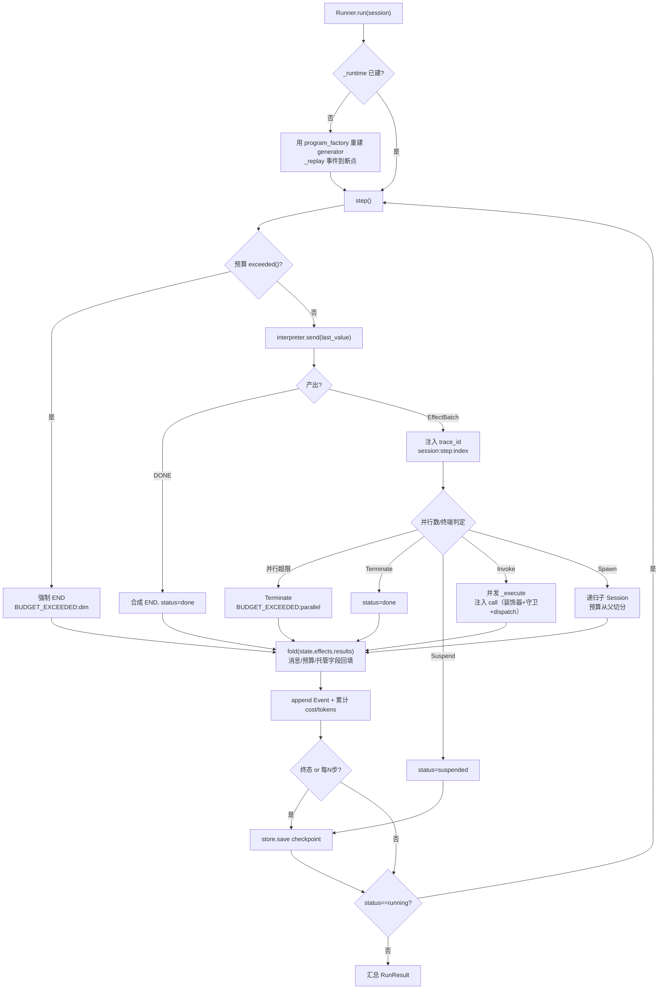

### R1.4 API 接口

```python
# ---- 原语：Effect 为 tagged union（P5） ----
class Disposition(str, Enum):
    INVOKE="invoke"; SPAWN="spawn"; SUSPEND="suspend"; TERMINATE="terminate"

@dataclass(frozen=True)
class Invoke:                          # 唯一走注入的 call（其余三类走内核快路径）
    port: str                          # ∈ PORT_PROTOCOLS，装配期校验；新增种类属框架改动
    payload: EffectPayload = field(default_factory=_empty_payload)
    batch: bool = False
    trace_id: str | None = None
    def with_payload(self, **extra) -> Invoke: ...

@dataclass(frozen=True)
class Spawn:
    program_factory: Callable[[], Program]; state: AgentState
@dataclass(frozen=True)
class Suspend:
    question: str; options: tuple[str, ...]
@dataclass(frozen=True)
class Terminate:
    output: object; reason: str

Effect = Invoke | Spawn | Suspend | Terminate

@dataclass(frozen=True)
class Budgets:
    max_turns=30; max_hops=5; max_rounds=3; max_cost_usd=5.0
    max_tokens=100_000; max_parallel_children=8
    used_* 同上
    def exceeded(self) -> str | None: ...
    def consume(self, **deltas) -> Budgets: ...

@dataclass(frozen=True)
class AgentState:
    messages: tuple[Message, ...]
    scratch: Mapping[str, DynamicValue]
    budgets: Budgets
    version: str
    output / last_skill / last_child / last_wait_human: DynamicValue
    last_step_kinds: tuple[str, ...]; last_tokens: int; last_reason: str
    def get(self, key, default=None) -> DynamicValue: ...
    def set(self, key, value) -> AgentState: ...
    def with_(self, **changes) -> AgentState: ...

Program = Generator[Effect, DynamicValue, None]
DONE = _Done()

# ---- 执行器 ----
class Runner:
    def __init__(self, call: CallFn, *,
                 store: EventStore|None=None,
                 ctx_factory=None, checkpoint_every=1, max_steps=1000,
                 cancellation: CancellationToken | None = None,
                 notify: NotifyFn | None = None): ...
    # 主调用链只有 call（组合层 build_call 注入）；Invoke 走 call，其余三类走内核快路径。
    # notify 为 R1 既有通知回调 (相位名, 只读投影)，缺省 no-op；④观察口。
    def cancel(self, reason: str) -> None: ...   # 运行期取消，下一 step 生效（内部 _CancellationHolder）
    async def run(self, session: Session) -> RunResult: ...
    async def step(self, session: Session) -> StepReport: ...
    async def resume(self, session: Session, answer: DynamicValue) -> RunResult: ...
    def replay(self, session: Session, initial: AgentState) -> AgentState: ...
    def load(self, session_id: str, program_factory) -> Session: ...

# ---- 纯函数 ----
def fold(state, effects, results, reason="") -> AgentState: ...
def checkpoint(session) -> JsonSnapshot: ...
def restore_checkpoint(snapshot, program_factory) -> Session: ...
def fingerprint(events) -> str: ...

NotifyFn = Callable[[str, Mapping[str, object]], None]   # R1 既有通知回调（相位名, 只读投影），④观察口
CallFn = Callable[[Effect, DynamicValue], Awaitable[Result]]            # 组合层 build_call 注入
```

> **执行契约（命脉）**：R1 一行不改，主调用链只有 `call`（组合层 `build_call(base, *, decorators=())` 或 R3 `ReliabilityExecutor.as_call()` 构造、`Runner(call=...)` 注入），会话/轮次/控制流及 tool 相位通知经 R1 既有 `notify` 回调发出。`Invoke` 类 Effect 走 call：③call 装饰器链（retry_call 调用级/timeout/danger_route/injection_guard）+ `dispatch` 按 port 分派；R3 可靠性链的终止类策略（KillSwitch/Watchdog/Idempotency/RateLimit REJECT）经执行器 `_reject` 发 `invoke_rejected` 并产出拒绝 Result；降级由执行器 `_apply_recovery` 调 `Degradation.select` 统一裁决（保四坑语义），失败上下文经 `FaultRecord` 具名直传，R1 内核不解释装饰器与降级目标。`Spawn`/`Suspend`/`Terminate` 走内核快路径，**不进 call**——call 层算子拦不到这三类，只能经 notify 观察（D-7 代价）。

### R1.5 元数据与核心字段

**AgentState 核心字段**：

| 字段 | 类型 | 说明 |
|------|------|------|
| messages | tuple[Message,...] | 对话历史，只增不减（裁剪是视图层的事，R7）；**短期记忆主体** |
| scratch | Mapping | 用户/插件自定义键（phase/cursor/steps…），冻结只读；**短期记忆组成** |
| budgets | Budgets | 多维预算，每 fold 由 Runner 强制扣减 |
| version | str | program+prompt+架构版本，进 trace 供回放对齐；**压缩视图重建规则随 fingerprint 对齐（R7）** |
| output | DynamicValue | Terminate Effect 最终产出（框架托管字段） |
| last_* | DynamicValue | 最近一次 Invoke(port=skill)/Spawn/Suspend 结果（框架托管）；**短期记忆组成** |

> **【变更·2026-11-20 晚 · 短期记忆权威口径】** 短期记忆 = `messages` + `scratch` + `last_*`，归 **R1 内核持有、R10 checkpoint 可恢复**；R7 对其**只读投影**产短期视图，不另建 SessionBuffer、不改 messages。长期记忆（跨 session、双轴分类）归 R7 MemoryPort。二者边界见 R7.1 与 [R7 详设 §12.1](../02-模块详设/Agent/R7-上下文与记忆.md)。

**Event 核心字段**：

| 字段 | 类型 | 说明 |
|------|------|------|
| seq / step | int | 逻辑时钟，保证确定性回放 |
| state_snapshot | AgentState | fold 后的完整状态快照 |
| effects / results | tuple | 本步声明与结果，一一对应 |
| cost_usd / tokens | float/int | 审计与预算扣减依据 |
| status / reason | str | running/done/suspended/error 与迁移原因 |

**EffectPayload 已知键**（TypedDict total=False）：`messages/tools/model/temperature/max_tokens`（`Invoke(port="llm")`）、`task_hint`（LLM 任务提示，R4 路由）、`meta`（扩展元数据容器，如 max_cost_per_call）、`call/calls/call_id`（`Invoke(port="tool")`）、`budget/port`（通用）、`name/part`（`Invoke(port="skill")`）、`program_factory/program/state`（Spawn）、`question/options`（Suspend）、`output/reason`（Terminate）。`x-*` 扩展键继续允许（D-2）；Port 注册名不可新增（必须 ∈ PORT_PROTOCOLS），但新增能力（如 RAG/Memory）只需 `Invoke(port="rag"/"memory")`，内核零改动。

### R1.6 可插拔契约

| 注入点 | 协议 | 默认 | 入口 |
|--------|------|------|------|
| call | CallFn（Port 调用） | 无（必注入） | `Runner(call=...)` |
| checkpoint 存储 | EventStore | InMemoryEventStore | `Runner(store=...)` |
| 上下文工厂 | ctx_factory | RuntimeCtx | `Runner(ctx_factory=...)` |
| 通知观察（④） | notify | NotifyFn | `Runner(notify=...)`（R1 既有回调，④观察口） |

### R1.7 验收门禁

| 门禁 | 条目 | 达标标准 | 级别 |
|------|------|---------|------|
| R1-G1 | 覆盖率 | interpreter/fold/budget 单测 ≥90%，mypy strict 通过 | G1 |
| R1-G2 | 确定性 | 同输入两次 run 事件日志哈希逐字节一致 | G2 |
| R1-G2 | 回放 | 事件重放恢复 State 与终态全等 | G2 |
| R1-G2 | 预算 | 6 维预算各有超限强制 END 用例 | G2 |
| R1-G3 | 集成 | fake dispatch/call 跑通主流程；wait_human 挂起→恢复→续跑 | G3 |
| R1-红线 | 纯函数 | Program 内出现时间/随机/网络调用 → AST 拒绝 | 红线 |

---

## R2 算子与装配（原插件总线与协议）

> 层：组合层 · 依赖：R1 · 源码包：`src/compose/`（`program.py`/`call.py`/`dispatch.py`）+ `src/archs/`；原 `src/aop/` 已删除 · 详见《R2：算子与装配》模块详设

### R2.1 职责与边界

**做**：框架真正核心——①A 类组合算子（`Program→Program`）把工具层装配成 Program；③call 装饰器构造注入 R1 的 `call`；`build_call` + `dispatch`/`make_dispatch`；provides/requires 挑选期校验；ToolLayer 装配器。②领域策略（原"有状态守卫"）落地在 R3 执行器，不在本层。
**不做**：具体能力实现（R3~R9）；执行循环（R1，一行不改）；任何领域语义。
**核心变化（规格 P2）**：R2 取消——AOP 五角色容器、`LifecycleBus`、Registry 不再作为独立模块/框架概念存在。能力按下表分流：AOP 五角色固定链 → ③call 装饰器链 + ②领域策略（R3 `ReliabilityExecutor` 显式编排）；降级重路由状态机（`src/aop/container.py:275-317`）→ R3 执行器 `_apply_recovery` + ①fallback 算子；LifecycleBus 16 相位 → 保留为 R1 的 notify 相位（④）；`PORT_PROTOCOLS`/Registry → 并入组合层装配器；`Invocation`/`FaultRecord`/`RoutingTarget` → 移入组合层做协作 DTO；DTO 领域字段 → 归位各能力模块；`aop/protocols.py FailureClass` 删除。依赖方向恒为 工具层 → 组合层 → R1。

### R2.2 设计架构

组合层是唯一注册与装配入口，由三类算子 + 装配器组成（7 承载形态见 §5）：

- **①A 类组合算子（10 个，`src/compose/program.py`）**：seq/par/branch/race/loop/map_state/map_effect/fallback/gate/retry（流程级）；装配期 `Program→Program` 纯变换、compile 幂等；运行期状态进 `State.scratch` 的 `x-*`，禁止实例持有流程进度（resume 靠 program_factory 重建）。
- **②领域策略（原"有状态守卫"，已演进到 R3）**：拦截协议与 `DegradationGuard`/`degrade_retry` 已删除；现由 R3 `ReliabilityExecutor`（`src/harness/resilience/executor.py`）+ 9 领域策略显式编排，承载熔断/限流/舱壁/幂等/降级阶梯/watchdog/killswitch；状态在领域策略实例（跨调用存活、按 session 隔离），不持有单次流程进度。
- **③call 装饰器（`src/compose/call.py`）**：`CallFn→CallFn`，`retry_call`（调用级）/timeout（调用级）/danger_route/injection_guard；函数组合无固定角色链、不叫 AOP；只覆盖 `Invoke`。装饰器是纯函数组合，不再驱动任何 check/observe 协议。
- **装配器与 dispatch（`src/compose/dispatch.py`）**：`make_dispatch(ports)` 产出 base，`build_call(base, *, decorators=())` 构造 call 注入 `Runner(call=...)`；`dispatch` 按 `effect.port` 分派到 Port、构造 `Result`（含 Usage）；不构造 Invocation（R1 明确不构造）。
- **④notify**：R1 既有回调，16 相位口径保留（见 §6），承载追踪/审计/指标；总线模块取消。

### R2.3 流程图

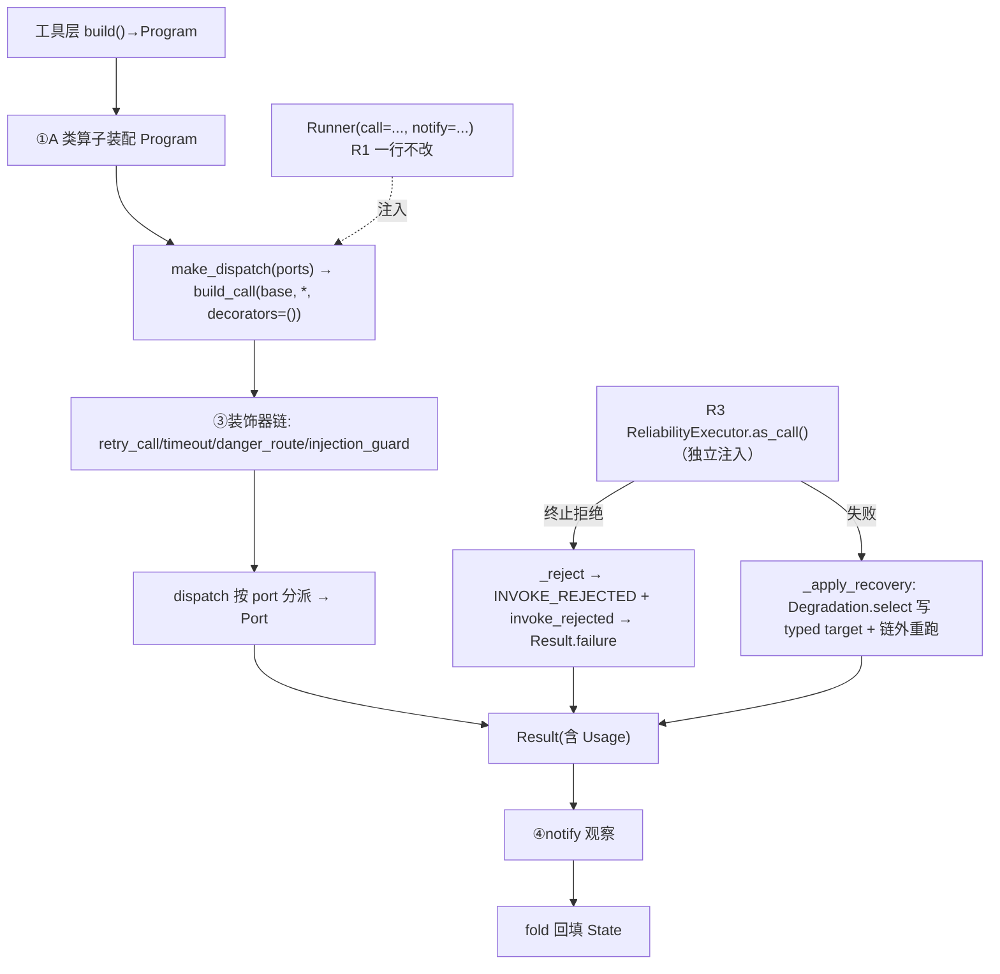

### R2.4 API 接口

```python
# ---- ①A 类组合算子（src/compose/program.py）----
# 10 个：seq/par/branch/race/loop/map_state/map_effect/fallback/gate/retry(流程级)
# 统一签名：Program → Program，装配期纯变换、不改原对象（compile 幂等）
def gate(p: Program, policy) -> Program: ...              # 唯一可 yield Suspend 的 A 类算子
def retry(p: Program, *, attempts, backoff) -> Program: ... # 流程级：失败按 program_factory 重建重跑

# ---- ②领域策略（R3，src/harness/resilience/；原拦截协议已删除）----
# ReliabilityExecutor + 9 领域策略显式编排，领域方法如：
# KillSwitch.is_tripped / Watchdog.detect / Idempotency.check_and_mark /
# RateLimit.acquire / Bulkhead.run_in_slot / CircuitBreaker.permit+observe_outcome /
# RetryPolicy.run_with_retries / Timeout.run_with_deadline / Degradation.select
# call = ResilienceCapability(...).install(core).as_call()

# ---- ③call 装饰器（src/compose/call.py）----
CallFn = Callable[[Effect, DynamicValue], Awaitable[Result]]   # R1 既有签名 types.py:724-725
def retry_call(base: CallFn, *, attempts, backoff) -> CallFn: ...  # 调用级重试
def timeout(base: CallFn, *, seconds) -> CallFn: ...
def danger_route(base: CallFn, registry) -> CallFn: ...
def injection_guard(base: CallFn, detector) -> CallFn: ...

# ---- 装配器与 dispatch（src/compose/dispatch.py）----
def build_call(base: CallFn, *, decorators: Sequence[Callable[[CallFn], CallFn]] = ()) -> CallFn: ...
def make_dispatch(ports: PortMap) -> CallFn: ...   # 按 effect.port 分派，构造 Result(含 Usage)
async def dispatch(ports, effect: Effect, ctx) -> Result: ...  # 便捷形态

# ---- 能力级/策略级/注册表（挑选期）----
class Capability(Protocol):
    name: str; version: str; requires: tuple[str,...] = (); provides: tuple[str,...] = ()
    def build(self) -> Program: ...                         # ToolLayer 外壳
class Provider(Protocol):
    name: str
class Registry:                                             # 装配期 provides/requires 校验
    def register(self, name: str, provider: Provider) -> None: ...
    def resolve(self, name: str) -> Provider: ...
```

### R2.5 相位清单与元数据

16 个 notify 相位（口径保留，不得增删；见 §6）：会话/轮次 5 + 能力调用 5 + 子 Agent 2 + 控制流 3 + 拒绝 1（`invoke_rejected` 由 R3 可靠性执行器 `_reject`/`_emit_rejected` 在终止类策略拒绝或降级拒答时发）。相位枚举留在 `src/hooks/lifecycle.py`，不再是总线模块。

**裁决返回**：通用 `Guard.check → Verdict` 协议已删除；R3 终止类策略经执行器 `_reject` 产出 `INVOKE_REJECTED` 拒绝 Result，降级由 `_apply_recovery` 调 `Degradation.select` 写 typed `RoutingTarget`（保四坑语义）；R9 安全域仍用 `SafetyVerdict`（ask→Suspend + `wait_human`/`resumed`，与通用裁决不同物）；RETRY/TIMEOUT 调用级由③装饰器实现、流程级由①算子实现。

**跨调用状态**：②领域策略实例持有跨调用策略状态（熔断三态机、降级 ladder+available 按 session 隔离，在 R3 执行器编排下）；流程进度进 `State.scratch x-*`（A 类算子纯函数）；无容器级单槽目标、无信号层。

### R2.6 可插拔契约

| 注入点 | 协议 | 默认 | 入口 | 校验 |
|--------|------|------|------|------|
| ①算子 | `Program→Program` | 10 内置 | `seq/par/...` | compile 幂等 + 纯函数 AST |
| ②领域策略 | R3 领域策略实例（无统一协议） | 无（按需） | `ResilienceCapability(...)` 具名构造注入 | 方法缺失即不装配该领域能力 |
| ③call 装饰器 | `CallFn→CallFn` | 无（按需） | 函数组合 | 只覆盖 Invoke（D-7） |
| 能力组件 | Capability（build→Program） | 各内置工具层 | `.capability()` | provides/requires 装配期校验 |
| 策略/端口 | Provider/Port | 内置默认 | `registry.register()` | 缺方法/缺 name → 拒绝；Port 种类不可新增 |
| 观察（④） | notify | no-op | `Runner(notify=...)` | 相位名合法；异常就地隔离 |

### R2.7 验收门禁

| 门禁 | 条目 | 达标标准 | 级别 |
|------|------|---------|------|
| R2-G1 | 覆盖 | 10 算子 + call 装饰器矩阵用例全过，≥90%（可靠性策略覆盖归 R3） | G1 |
| R2-G2 | 算子纯度 | compile 幂等、不改原 Program；状态进 `State.scratch x-*`；gate 可 yield Suspend | G2 |
| R2-G2 | 可靠性边界 | ②领域策略由 R3 `ReliabilityExecutor` 显式编排（演进项，R2 不再有 check/observe 协议）；终止拒绝由执行器发 `invoke_rejected`（在 R3 验证） | G2 |
| R2-G2 | call 边界 | 装饰器链只覆盖 Invoke；build_call 注入 R1 后主流程跑通 | G2 |
| R2-G3 | 留名 | 一次 invoke 后 trace 含全部算子/守卫/装饰器 name | G3 |
| R2-红线 | 无残留 | **五角色/AOPContainer 不得复辟**（历史已取消；出现五角色/AOPContainer/`LifecycleBus`/旧扩展体系原语 → 拒绝） | 红线 |

## R3 可靠性

> 层：L1 工具层 · 依赖：R1 + 组合层 · 源码包：`src/harness/resilience/` · 详见《R3：可靠性》模块详设

### R3.1 职责与边界

**做**：重试、熔断、降级、限流、舱壁、幂等、watchdog/killswitch——以 **9 领域策略**实现，由 `ReliabilityExecutor` 按可靠性工程语义显式编排：**前置放行 → 预算内中心调用（超时/重试/舱位）→ 熔断记数 → 失败降级选级 + 重路由**。每个策略以自身领域方法参与（`is_tripped`/`detect`/`check_and_mark`/`acquire`/`run_in_slot`/`permit`+`observe_outcome`/`run_with_retries`/`run_with_deadline`/`select`），无统一角色协议、无 Role 枚举、无槽位列表。
**不做**：不碰 R1 预算硬强制（⑦内核机制）；不做结构化输出修复（R4）。**BudgetGuard 删除**——软限是文本提示用 map_effect 注入、硬限在 R1（预算治理不是算子，D-4）。
**共享设施**：失败分类表 `FailureClassifier` + 维度键 `DimensionKey`（按 provider/model/tool/tenant 隔离计数）。

### R3.2 设计架构

可靠性是**五道防线叠加**，每道防不同故障，由 `ReliabilityExecutor` 显式编排（领域语义，非角色链）：
- 重试防瞬态错误（429/超时），熔断防持续宕机，降级给兜底出口，watchdog 防空转循环，killswitch 兜住成本失控。
- **9 领域策略**（`src/harness/resilience/`）：KillSwitch `is_tripped` / Watchdog `detect` / Idempotency `check_and_mark` / RateLimit `acquire→RatePermit` / Bulkhead `run_in_slot` / CircuitBreaker `permit`+`observe_outcome` / RetryPolicy `run_with_retries` / Timeout `run_with_deadline` / Degradation `select`。状态在策略实例（熔断三态机、ladder+available 按 session 隔离），跨调用存活。
- **装配**：`ResilienceCapability(...)` 具名构造注入 9 策略，`.install(core, *, registry, bus, notify)` 返回 `ReliabilityExecutor`，`.as_call()` 注入 R1；`extra_plugins` 只收函数式 `(CallFn)->CallFn` 变换器。
- **降级重路由**：执行器 `_apply_recovery` 调 `Degradation.select` 写 typed target + 链外重跑；**四坑语义（B1 串味/B2 标识/R3-6 写回/R3-7 带目标）原文保留、断言不放水**（见 R3 §2.3 / 门禁红线）。

### R3.3 流程图

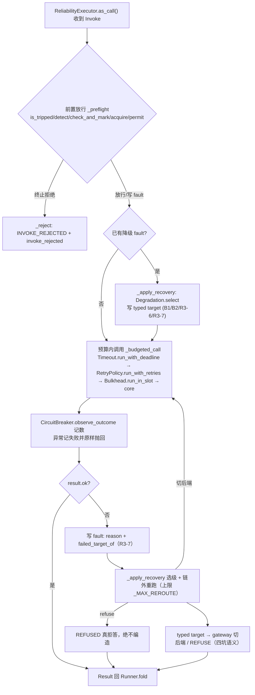

### R3.4 API 接口

```python
@dataclass(frozen=True)
class FailureClass:
    retryable: bool; count_toward_breaker: bool
    suggested_delay: float|None; code: str
class FailureClassifier(Protocol):
    def classify(self, result: Result, effect: Effect) -> FailureClass: ...

@dataclass(frozen=True)
class RetrySpec:                          # 重试参数归 R3 自身
    max_attempts: int = 3; base_delay: float = 0.5; multiplier: float = 2.0
    max_delay: float = 30.0
    jitter: Literal["none","full","equal","decorrelated"] = "full"
    respect_retry_after: bool = True
    idempotency_required: bool = True

# ---- 9 领域策略（各自领域方法，无统一角色协议）----
class KillSwitch:      def is_tripped(self, session_id) -> bool: ...
class Watchdog:        def detect(self, inv) -> bool: ...; def inspect(self, kind) -> bool: ...
class Idempotency:     def check_and_mark(self, key) -> bool: ...
class RateLimit:       def acquire(self) -> RatePermit: ...   # ADMIT/REJECT/DEGRADE
class Bulkhead:        async def run_in_slot(self, inv, next) -> Result: ...
class CircuitBreaker:  async def permit(self, inv) -> str | None: ...; async def observe_outcome(self, inv, result) -> None: ...
class RetryPolicy:     async def run_with_retries(self, inv, next) -> Result: ...
class Timeout:         async def run_with_deadline(self, inv, next) -> Result: ...
class Degradation:     def select(self, fault: FaultRecord, *, session_id: str) -> str: ...
    # 实例内状态：available（故障目标永久剔除并写回）+ dict[session_id, 目标状态]（跨 Effect 隔离，B1）

# ---- 显式编排 + 装配 ----
class ReliabilityExecutor:
    def __init__(self, core, *, registry=None, bus=None, notify=None,
                 kill_switch=None, watchdog=None, idempotency=None, rate_limit=None,
                 bulkhead=None, breaker=None, retry=None, timeout=None,
                 degradation=None, transformers=()): ...
    def as_call(self) -> CallFn: ...; async def run_invocation(self, inv) -> Result: ...
class ResilienceCapability:
    def __init__(self, *, breaker=None, retry=None, rate_limit=None, bulkhead=None,
                 watchdog=None, killswitch=None, idempotency=None,
                 degradation=None, timeout=None, extra_plugins=()): ...
    def install(self, core, *, registry=None, bus=None, notify=None) -> ReliabilityExecutor: ...
# BudgetGuard 已删除：软限用 map_effect 注入 payload['budget']，硬限在 R1
```

### R3.5 元数据与核心字段

| 字段 | 类型 | 说明 |
|------|------|------|
| DimensionKey | tuple[str,str] | (维度类型, 目标名)，如 ("provider","openai") |
| attempt | int | 当前重试次数，由 `RetryPolicy.run_with_retries` 内部携带 |
| RatePermit | 领域枚举 | `ADMIT`/`REJECT`/`DEGRADE`，限流裁决（非通用 Verdict） |
| BreakerState.status | closed/open/half_open | 熔断三态 |
| failure_rate | float | 滑窗内失败率，达阈值触发 open |
| DegradeStep.quality | float | 质量分（1.0 最优 → 0.0 拒答），进 trace |
| idempotency_key | str | 副作用操作幂等键 |

**降级矩阵**：主模型→备模型→便宜模型→语义缓存→明确拒答（禁止编造）。降级链必须无环（static_check）。

### R3.6 可插拔契约

| 注入点 | 协议 | 默认 | 校验 |
|--------|------|------|------|
| 9 领域策略 | `ResilienceCapability` 具名构造参数 | 不装（opt-in） | 缺席即跳过；`extra_plugins` 仅函数变换器（非 callable → ValueError） |
| 失败分类 | FailureClassifier | 默认分类表 | code 覆盖完整 |
| 退避策略 | RetrySpec.jitter | full | base_delay=0 且 none 拒绝 |
| 降级阶梯 | DegradeLadder | LLM 默认阶梯 | 无拒答兜底/成环 → 拒绝 |
| 熔断器存储 | BreakerStore（异步 load/save，R3 导出） | InMemoryBreakerStore | 缺省进程内；多实例部署注入 Redis/DB 实现 |

### R3.7 验收门禁

| 门禁 | 条目 | 达标标准 | 级别 |
|------|------|---------|------|
| R3-G1 | 覆盖 | 各守卫/装饰器/算子单测 ≥90% | G1 |
| R3-G2 | 重试 | 退避区间/上限/幂等拦截/预算拦截各有用例（调用级+流程级） | G2 |
| R3-G2 | 熔断 | 三态迁移/半开探测/样本不足不 open/跨调用状态各有用例 | G2 |
| R3-G2 | 降级 | 全不可用→明确拒答；降级链成环装配期报错 | G2 |
| R3-G3 | 协同 | `ReliabilityExecutor` 显式编排 9 领域策略（前置放行→预算执行→熔断记数→降级选级+重路由），trace 可见 | G3 |
| R3-G2 | 降级四坑 | B1 会话隔离/B2 failed_target=后端注册名/R3-6 available 写回/R3-7 故障记录带 failed_target 各有单测；端到端断言不放水 | G2 |
| R3-红线 | 幂等/预算 | 无幂等键的副作用重试 → 拒绝；出现 BudgetGuard → 拒绝 | 红线 |
| R3-静态 | 无角色复辟 | 五角色符号与角色方法协议在 R3 零命中（仅"已删除/历史"语境可出现）；`observe_outcome` 是领域方法，允许 | 静态 |

## R4 模型与推理

> 层：L1 · 依赖：R1+R2 · 源码包：`harness/model/` · 详见 R4 模块详设

### R4.1 职责与边界

**做**：多 Provider 接入、模型路由、跨 provider 降级、语义/KV 缓存、结构化输出与修复重试、流式、token 计数与成本归因。
**不做**：工具执行（R5）。降级链的执行逻辑在 R3，R4 提供"模型维度"的路由与缓存。

### R4.2 设计架构

LLM 调用（`Invoke(port="llm")`）走组合层构造的 call（③装饰器 + dispatch），R1/能力层在调用前后发 `before_model`/`after_model` notify：缓存命中直接返回（省钱省延迟）→ 路由选模型 → 调用 → `after_model` 后结构化校验（不合法则由⑥组件产修复提示重试）→ 成本归因。`as_call()` 改为 dispatch 形态：直接吃 `(effect, ctx)`，不再构造 Invocation（P4）。模型降级矩阵由 R3 执行器 `_apply_recovery` 调 `Degradation.select`（统一裁决者，保四坑），降级 target 走与 Registry 同源的 typed 路径进网关，不再经裸降级桥接。

### R4.3 流程图

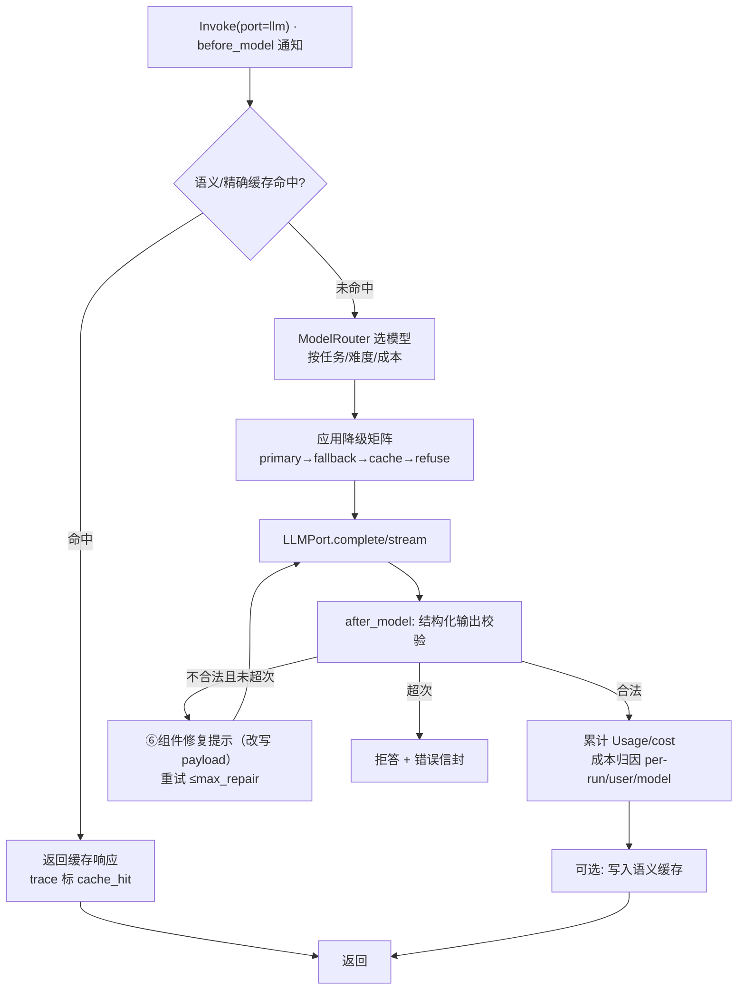

### R4.4 API 接口

```python
class LLMPort(Protocol):                              # 已在 ports/protocols.py
    async def complete(self, req: LLMRequest, ctx: PortCtx) -> LLMResponse: ...
    last_usage: Usage | None   # 流式结算口，末块后写入；网关不估算不兜零
    def stream(self, req: LLMRequest, ctx: PortCtx) -> AsyncIterator[str]: ...  # PEP525：async gen 用 def 声明

class ModelRouter(Protocol):
    name: str
    def route(self, effect: Effect, ctx: StrategyCtx) -> str: ...   # 返回 model 名

class CachePort(Protocol):                         # 缓存策略（异步）
    name: str
    async def get(self, request: LLMRequest, *, version: str = "current") -> LLMResponse|None: ...
    async def put(self, request: LLMRequest, resp: LLMResponse, *, version: str = "current") -> None: ...
    async def invalidate(self, request: LLMRequest, *, version: str = "current") -> None: ...
class CacheStore(Protocol):                        # 存储工具（可换 Redis/DB）
    async def get(self, key: str) -> str|None: ...
    async def put(self, key: str, value: str, *, ttl: int|None = None) -> None: ...
    async def delete(self, key: str) -> None: ...
    async def scan(self, prefix: str) -> list[tuple[str, str]]: ...
class CacheEmbedder(Protocol):                     # embedding（可换向量模型）
    async def embed(self, text: str) -> tuple[float, ...]: ...
class HashCacheEmbedder:                           # 默认 embedding（字符 bigram 哈希，零依赖确定性）
    async def embed(self, text: str) -> tuple[float, ...]: ...

@runtime_checkable
class SchemaValidator(Protocol):               # 结构化校验器协议（可注入）
    name: str                                  # 履约校验/进 trace
    def validate(self, value: object, schema: dict) -> list[str]: ...   # 错误列表；空=合法
class MinimalSchemaValidator: ...              # 默认：现有最小 JSON Schema（type/required/properties/enum/minimum）

@dataclass(frozen=True)
class StructuredOutputSpec:
    schema: dict                                   # JSON Schema
    mode: Literal["constrained","prompt","repair"] = "repair"
    max_repair: int = 2
    strict: bool = True
```

### R4.5 元数据与核心字段

| 字段 | 说明 |
|------|------|
| LLMRequest | messages / tools_catalog / model / temperature / max_tokens |
| LLMResponse | content / tool_calls / usage / model |
| Usage | prompt_tokens / completion_tokens / cost_usd |
| cache key | hash(messages + model + params + prompt_version) |
| 成本归因维度 | per-run / per-agent / per-user / per-model |

**降级矩阵模型维度**：强模型→中模型→便宜模型→语义缓存答案→明确拒答；每级带 quality 分与延迟预算。

### R4.6 可插拔契约

| 注入点 | 协议 | 默认 | 校验 |
|--------|------|------|------|
| LLM 后端 | LLMPort | OpenAI-compat | 实现 complete/stream |
| 路由 | ModelRouter | 规则路由 | 返回目标已注册 |
| 缓存 | CachePort | ExactCache + SimilarityCache | 异步；收 request；可换 store/embedder |
| 结构化输出 | StructuredOutputSpec | repair 模式 | schema 合法 |
| 结构化校验器 | SchemaValidator | MinimalSchemaValidator | 实现 validate(value,schema)→错误列表；换实现后修复循环同步生效 |

### R4.7 验收门禁

| 门禁 | 条目 | 达标标准 | 级别 |
|------|------|---------|------|
| R4-G1 | 覆盖 | 路由/缓存/结构化输出单测 ≥85% | G1 |
| R4-G2 | 结构化 | 未过 schema 校验的输出不进业务逻辑 | G2 |
| R4-G2 | 缓存 | 语义误命中率评测达标；键含版本 | G2 |
| R4-G3 | 集成 | 换 LLMPort 实现上层零改动 | G3 |
| R4-红线 | 成本 | 路由/重试不得绕过 Budgets | 红线 |

---

## R5 工具·MCP·技能

> 层：L1 · 依赖：R1+R2 · 源码包：`harness/tools/` + skills/ · 详见 R5 模块详设

### R5.1 职责与边界

**做**：工具定义（@tool/pydantic）、统一 ToolRegistry、MCP 发现并合并进同一合集、技能 manifest/正文、tools+skills 三级渐进披露、danger 四级路由、代码/shell/文件执行（经沙盒）、WebFetchTool 工具封装（D13，浏览器/Web 访问，正文一律过注入检测）。
**不做**：沙盒实现细节（R9 提供 SandboxPort，R5 只做路由）；R9 三 Port 的实现本体。

> **权威 danger 四级路由语义**（R9 §5 / 本设计 §R9.5）：`SAFE`=直接执行 / `LOW`=AuditPort.record 审计后直执行 / `HIGH`=SandboxPort 沙盒执行 / `CRITICAL`=HumanPort.ask 审批通过后再 SandboxPort。外部 danger 经 `DangerLevel.coerce()` 归一，未知值/None 回退 CRITICAL（fail closed）。

### R5.2 设计架构

**统一合集**是核心：本地 @tool 工具、MCP 工具（`mcp__<server>__<tool>`）、Skill 正文都进同一个 Registry，运行时无差别。三级披露对统一合集投影：L1 目录常驻 / L2 schema 按需 / L3 正文按需。danger 分级驱动沙盒与审批路由。

R9 三 Port（SandboxPort/HumanPort/AuditPort）经 ToolRegistry 构造注入、缺席即拒绝；`DisclosureIndex` 归 R2 `protocols.py` 协议清单与 `PORT_PROTOCOLS["disclosure"]`，默认 ToolIndex 在 R5；装配类 ToolsCapability 把工具/MCP/技能/披露与 R9 三 Port 组装为可插拔能力。

### R5.3 流程图

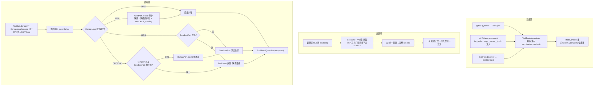

### R5.4 API 接口

```python
# R2 权威 DTO：DangerLevel(str, Enum)+coerce（未知→CRITICAL fail closed）；
# ToolCall.danger / ToolSpec.danger / make_call(danger=...) 均为 DangerLevel
def tool(*, name: str | None = None, danger: DangerLevel,   # danger 必填关键字
         sandbox: SandboxPolicy = SandboxPolicy.AUTO, timeout: float = 30.0,
         retries: int = 2) -> Callable[[Callable[..., DynamicValue]], ToolFn]: ...  # pydantic model 即 schema

# ---- ToolPort：以 R2 protocols.py 协议为基础 ----
class ToolPort(Protocol):
    name: str
    def register(self, spec: ToolSpec, fn: Callable[..., DynamicValue]) -> None: ...
    def catalog(self, level: int = 1) -> list[ToolSpec]: ...
    async def call(self, call: ToolCall, ctx: PortCtx) -> ToolResult: ...

class ToolRegistry:                             # ToolPort 默认实现
    def __init__(self, *, sandbox: SandboxPort | None = None,
                 human: HumanPort | None = None,
                 audit: AuditPort | None = None) -> None: ...   # 构造注入，缺席即拒绝
    def register(self, spec: ToolSpec, fn: Callable[..., DynamicValue]) -> None: ...
    def catalog(self, level: int = 1) -> list[ToolSpec]: ...
    async def call(self, call: ToolCall, ctx: PortCtx) -> ToolResult: ...
    # 超出协议的公共 API（不破坏 LSP）
    def bind(self, name: str, fn: Callable[..., DynamicValue]) -> None: ...
    def schema_of(self, name: str) -> dict[str, DynamicValue]: ...
    def static_check(self) -> list[str]: ...
    def freeze(self) -> Self: ...
    def register_pending(self) -> list[str]: ...   # 【v2.2 增量 2026-11-19】装配期批量注册 @tool 待注册项（pending），成功即清空；install() 自动调用。详见 R5 模块详设 §4

# ---- MCP：以 R2 MCPPort 为准（list_tools/call_tool 均带 ctx）----
class MCPPort(Protocol):                        # R2 protocols.py
    name: str
    async def list_tools(self, server: str, ctx: PortCtx) -> list[ToolSpec]: ...
    async def call_tool(self, server: str, tool: str,
                        args: dict[str, DynamicValue], ctx: PortCtx) -> DynamicValue: ...
    async def ping(self, server: str, ctx: PortCtx) -> bool: ...   # 新增

class MCPTransport(Protocol):                   # R5 本地协议；用户注入 stdio/http 客户端
    async def list_tools(self, server: str) -> list[ToolSpec]: ...
    async def call_tool(self, server: str, tool: str, args: dict[str, DynamicValue]) -> DynamicValue: ...
    async def ping(self, server: str) -> bool: ...

class MCPManager:                               # 实现 MCPPort；transport 构造注入
    name: str
    def __init__(self, registry: ToolRegistry, transport: MCPTransport) -> None: ...
    async def list_tools(self, server: str, ctx: PortCtx) -> list[ToolSpec]: ...
    async def call_tool(self, server: str, tool: str,
                        args: dict[str, DynamicValue], ctx: PortCtx) -> DynamicValue: ...
    async def ping(self, server: str, ctx: PortCtx) -> bool: ...
    async def connect(self, server: str, ctx: PortCtx) -> list[ToolSpec]: ...   # fqname=mcp__<server>__<tool>
    async def health(self, ctx: PortCtx) -> dict[str, bool]: ...

class SkillPort(Protocol):
    name: str
    def discover(self) -> list[SkillManifest]: ...
    def catalog(self) -> list[SkillManifest]: ...
    def body(self, name: str) -> str: ...        # L3 正文，须过注入检测
class DisclosureIndex(Protocol):                # R2 protocols.py + PORT_PROTOCOLS["disclosure"]
    name: str
    def disclose(self, names: list[str], skills: list[SkillManifest]) -> DisclosurePacket: ...   # {l1,l2,l3,token_cost}

# 技能正文注入检测：R5 本地 InjectionDetector 协议 + KeywordInjectionDetector 默认实现
class InjectionDetector(Protocol):
    name: str
    def detect(self, text: str) -> InjectionVerdict: ...   # 与 src/harness/skills/provider.py 一致
```

### R5.5 元数据与核心字段

| 字段 | 说明 |
|------|------|
| ToolSpec.name | 全局唯一；MCP 为 `mcp__<server>__<tool>`；用户工具 `x-*` 前缀 |
| ToolSpec.danger | `DangerLevel`，装配期必填；经 `coerce()` 归一，未知→CRITICAL（fail closed） |
| ToolSpec.source | local/mcp/skill，审计用 |
| ToolResult.meta | danger/source/sandbox/duration_ms/approved/retryable/audit_missing |
| DisclosurePacket | L1/L2/L3/token_cost，披露成本进 trace |
| SkillManifest | name/version/description/triggers（定义于 R2 dto.py） |
| InjectionVerdict | clean/injected；技能与 WebFetchTool 抓取正文的注入检测结果 |

**WebFetchTool（D13）**：R5 提供 WebFetchTool 工具封装（浏览器/Web 访问），抓取正文视为不可信输入，L3 披露前过注入检测，命中即拒载并记审计。

### R5.6 可插拔契约

| 注入点 | 协议 | 默认 | 校验 |
|--------|------|------|------|
| 工具实现 | ToolPort/@tool | ToolRegistry | danger 必填/schema 合法/高危配沙盒 |
| MCP 客户端 | MCPTransport | stdio/http | 三方法齐全；MCP 工具 L1 只进目录（红线） |
| MCP 能力 | MCPPort（R2，含 ping） | MCPManager(reg, transport) | fqname 注册；health 逐 server |
| 技能 | SkillPort | 文件技能(FileSkillProvider) | 正文过注入检测 |
| 披露策略 | DisclosureIndex（R2 协议 + PORT_PROTOCOLS["disclosure"]） | ToolIndex（R5） | token 预算；>20 条强制披露 |
| 正文注入检测 | InjectionDetector（R5 本地） | KeywordInjectionDetector | 技能/WebFetch 正文必过 |
| 沙盒（R9） | SandboxPort | 构造注入，缺席即拒绝 | HIGH/CRITICAL 缺 sandbox → ToolResult 失败 |
| 审批（R9） | HumanPort | 构造注入，缺席即拒绝 | CRITICAL 缺 human → ToolResult 失败 |
| 审计（R9） | AuditPort | 构造注入，LOW 缺席降级 | LOW 缺 audit → 直执行 + meta.audit_missing |

### R5.7 验收门禁

| 门禁 | 条目 | 达标标准 | 级别 |
|------|------|---------|------|
| R5-G1 | 覆盖 | 注册/披露/调用三期单测 ≥95%（tools+skills 双包） | G1 |
| R5-G2 | 合并 | 本地与 MCP 工具同一 Registry，catalog/call 无差别 | G2 |
| R5-G2 | 披露 | L1 不含完整 schema；超预算报错 | G2 |
| R5-G3 | 路由 | danger 四级路由（直执行/审计/沙盒/审批+沙盒）各有用例；coerce 未知→CRITICAL | G3 |
| R5-红线 | 安全 | CRITICAL 未审批执行 / HIGH 缺 sandbox 放行；MCP schema 全量进 L1 → 拒绝 | 红线 |

---

## R6 RAG 检索增强

> 层：L1 · 依赖：R1+R2 · 源码包：`harness/rag/` · 详见 R6 模块详设

### R6.1 职责与边界

**做**：20 项链路优化（离线入库 5 层 + 在线检索 9 层 + 横切 6 层 = 20），每段是 Protocol + 默认实现，可单独替换与评测（8 个注入点）。
**不做**：把检索结果当指令执行；记忆的语义（R7 复用本模块的 Embedder/VectorStore）；不重复定义注入检测器（复用 R5 `InjectionDetector`/`KeywordInjectionDetector`，R6 负责检索正文入 context 前的检测接入与 fail-closed）。

### R6.2 设计架构

RAG 不是一个组件，是**可分层评测、逐层优化**的流水线。分层是"链路优化"的前提——能定位是哪一层掉了指标。核心纪律：**召回是上限，重排是逼近上限**，先修召回再修排序。

### R6.3 流程图

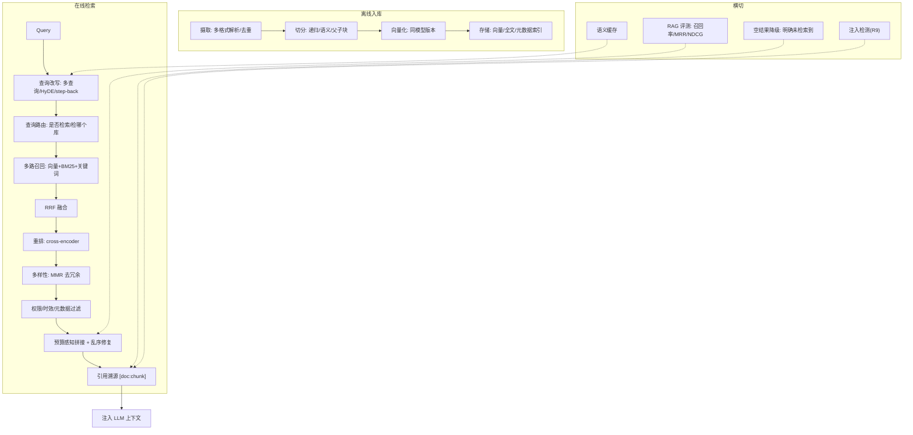

### R6.4 API 接口

```python
class Splitter(Protocol):
    name: str
    def split(self, doc: Document) -> list[Chunk]: ...
class Embedder(Protocol):
    name: str
    async def embed(self, texts: list[str]) -> list[Vector]: ...
class VectorStore(Protocol):
    name: str
    async def upsert(self, chunks: list[Chunk]) -> None: ...
    async def search(self, vec, top_k, filters) -> list[Hit]: ...
class Retriever(Protocol):
    name: str
    async def retrieve(self, query: Query) -> list[Hit]: ...
class Reranker(Protocol):
    name: str
    def rerank(self, hits: list[Hit], query: Query) -> list[Hit]: ...
class QueryRewriter(Protocol):
    name: str
    async def rewrite(self, query: Query) -> list[Query]: ...
class PostProcessor(Protocol):
    name: str
    def filter(self, hits: list[Hit]) -> list[Hit]: ...
    def assemble(self, hits: list[Hit], budget: TokenBudget) -> RAGResult: ...

class RAGPipeline:                      # 履约 RAGPort（PORT_PROTOCOLS['rag']）
    name: str = "rag_pipeline"
    def __init__(self, splitter, embedder, store, retriever, post, *,
                 rewrite=None, rerank=None, cache=None, detector=None): ...
    async def ingest(self, documents: list[DynamicValue], ctx: PortCtx) -> int: ...    # RAGPort 入口
    async def retrieve(self, query: str, ctx: PortCtx) -> list[DynamicValue]: ...      # RAGPort 入口
    async def query(self, q: Query) -> RAGResult: ...    # 模块富入口（内部委托）
    def with_(self, **replacements) -> RAGPipeline: ...  # 不可变替换
```

> **R6.4 补注（2026-11-19）**：`ingest`/`retrieve` 签名必须与 `src/hooks/protocols.py:RAGPort` 逐字一致，装配期 `isinstance(p, PORT_PROTOCOLS["rag"])` 校验；`query()` 为富入口返回 `RAGResult`。注入检测复用 R5 `InjectionDetector`（非第 9 个替换点）。
> **R6.4 补注（2026-11-20）**：缓存失效改为按 key 精准失效——`RAGPipeline` 记账自身写入的缓存 key，`ingest` 后逐个 `invalidate(key)`，不再无参全表清空（避免共享 CachePort 误伤他人条目）；详见 R6 模块详设 §12（缓存按 key 精准失效）。

### R6.5 元数据与核心字段

| 字段 | 结构 | 说明 |
|------|------|------|
| Chunk | {chunk_id, doc_id, text, tokens, meta} | meta 含标题/页码/权限标签 |
| Hit | {chunk, score, source, ts} | 检索命中 |
| Query | {text, filters, top_k, token_budget, purpose} | purpose 区分问答/记忆召回 |
| RAGResult | {context, citations, hits, empty, tokens_used} | empty=True 时固定提示文本 |
| TokenBudget | int | 从 R1 Budgets 派生 |
| RRF 常数 k | 60 | RRF(d)=Σ weight/(k+rank) |

**内置优化**：查询改写(multi-query/HyDE)、混合检索 RRF、cross-encoder 重排、MMR 去冗余、预算贪心拼接+乱序修复、引用溯源、语义缓存、空结果降级、注入防御。

### R6.6 可插拔契约

| 注入点 | 协议 | 默认 | 校验 |
|--------|------|------|------|
| 五段 | Splitter/Embedder/... | 递归/OpenAI-compat/内存... | 方法齐全；DTO 对齐；维度匹配 |
| 重排 | Reranker | cross-encoder | 返回 Hit 结构 |
| 改写 | QueryRewriter | 规则改写（同义词替换+子查询分解，无模型、词表可注入；详见 R6 模块详设 §11） | 不引入原问题没有的实体（同义词映射视为等价词） |

### R6.7 验收门禁

| 门禁 | 条目 | 达标标准 | 级别 |
|------|------|---------|------|
| R6-G1 | 覆盖 | 五段替换用例，换任一段上层零改动 | G1 |
| R6-G2 | 预算 | 拼接永不超 TokenBudget（含边界） | G2 |
| R6-G2 | 降级 | 空结果/检索异常确定性降级用例 | G2 |
| R6-G3 | 质量 | 混合检索召回高于纯向量基线 | G3 |
| R6-红线 | 安全 | 无引用溯源/空结果编造/检索文本未过注入检测 → 拒绝 | 红线 |

---

## R7 上下文与记忆

> 层：L1 · 依赖：R1 + 组合层 · 源码包：`harness/context/` + memory/ · 详见 [R7 模块详设](../02-模块详设/Agent/R7-上下文与记忆.md)
> **【变更·2026-11-20 晚 · 完整性修订】** 用户拍板后本章权威口径：短期记忆归 R1/R10（R7 只读投影）；长期记忆双轴分类（温度三层 × 内容七类）；四条优化链全覆盖。原「hot=会话内 / 三类 kind」表述作废，以本章 + R7 详设 §12 为准。
> **【变更·2026-11-21 · D4/D5 新增方案】** ①**D4 大 tool 结果落盘而非截断**：`OffloadPolicy` 按阈值判定，超阈值交 BlobPort 存 `store://` 句柄 + 摘要、按需回读，`mode="truncate"` 构造即 ValueError（截断静默丢尾部数据/错误/证据，明确否决、不留兼容层）；②**D5 KV cache 命中率一等可观测指标**：`CacheTelemetry`（hits/misses/label/hit_rate）挂 `ContextMemoryManager.cache_telemetry` 观测面，可进 R10 trace、可按模型/前缀归因，无访问 hit_rate=0.0 不产 NaN。详见 R7 详设 §11.6 D4/D5。

### R7.1 职责与边界

**做**：① 上下文工程——分段组装、统一 Token 预算、相关性筛选、压缩 compaction、语义摘要、重注入、大结果卸载（**D4：落盘而非截断**）、可重放视图、**KV cache 命中率一等可观测（D5）**；② **长期记忆**——温度三层（hot 近期热层 / warm 结构化 / cold 全文归档）× 内容七类（episodic/semantic/procedural/profile/preference/entity/journal），含写入提炼/去重/冲突消解/评分/召回重排/遗忘/晋升降级的完整优化链。
**不做**：
- **短期记忆不属于 R7**——短期记忆 = `State.messages`（只增）+ `scratch` + `last_*`，归 R1 内核持有、R10 checkpoint 可恢复；R7 只读投影、不改 messages、不另建 SessionBuffer。
- 披露执行（R5，R7 提供上下文段）；checkpoint 语义（R10）；生产装配（R12 阶段 A）。

### R7.2 设计架构

上下文窗口是稀缺 RAM（context rot），本模块像 OS 管理内存：分段组装 + 配额 + 相关性筛选 + 阈值压缩 + 语义摘要 + 重注入 + 大结果卸载，全程视图层投影（不改 messages，保证回放确定性）。

记忆**双轴模型**（解决原 hot 归属打架）：**温度轴 tier** = hot 近期热层（短 TTL、高频）/ warm 结构化主检索 / cold 全文归档（长 TTL），**三层均属长期记忆**；**内容轴 kind** = 七类（原三类 + profile 画像 / preference 偏好 / entity 实体 / journal 工作日志决策），各类独立提炼规则与召回场景。两轴正交：一条 MemoryItem 必属某 tier × 某 kind。

**四条优化链**（缺一不可）：写入链（规范化→递归脱敏/注入→去重→冲突消解→评分→分层落库→增量 upsert）、召回链（scope/ACL 过滤→混合召回→rerank→MMR→预算裁剪→注入检测）、上下文链（统一 token→预算贪心→相关性筛选→压缩钉住→语义摘要→重注入→卸载→可重放）、安全与接线链（tenant 双向校验 + R12 装配 + 回放一致性）。逐链契约见 R7 详设 §12.3~§12.6。

**D4 大结果处理决策**：`OffloadPolicy(threshold=8192)` 按阈值判定——超阈值交 BlobPort 落盘回 `store://` 句柄 + 摘要（原文完整可读），低于阈值原样返回；**截断被明确否决**（`mode="truncate"` 构造即 ValueError，不留兼容层），因截断会静默丢掉工具结果尾部的数据/错误/证据。阈值是 R7 编排策略（⑥组件），不进 R1 Budgets。

**D5 KV cache 可观测决策**：命中率不是零散 trace 字符串，而是一等 DTO `CacheTelemetry`（hits/misses/label/`hit_rate`），挂 `ContextMemoryManager.cache_telemetry`；`record_cache_hit/record_miss` 按维度标签（模型/前缀）记录，`hit_rate` 无访问时为 0.0（不产 NaN，trace 安全），可进 R10 trace、可单测断言；`with_()` 不可变替换保留观测历史。属 ⑥组件，不进 `PORT_PROTOCOLS`。

> **触发方式（保留 11-20 结论）**：压缩相关节点（原 after_compact 等）为 R7 内部步骤、非通知点；`before_model`/`after_tool`/`session_end` 是真实 Lifecycle 通知点（纯通知、异常隔离、返回值不消费）。压缩与记忆写入由 `ContextMemoryManager` 显式编排，`commit_and_compact()` 内固定"先写 cold 全文再压缩"，代码结构保证顺序、trace 快照锁定；框架不声明 priority。

### R7.3 流程图

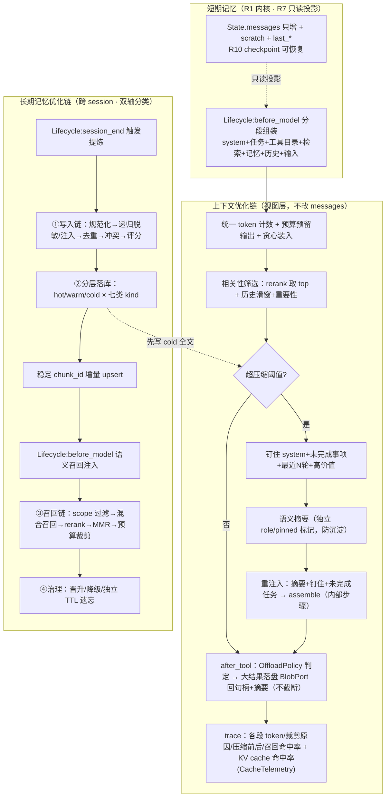

### R7.4 API 接口

```python
class ContextAssembler(Protocol):
    name: str
    def assemble(self, sections: list[ContextSection], budget: TokenBudget) -> list[Message]: ...
class CompactionPolicy(Protocol):
    name: str
    def should_compact(self, state: AgentState) -> bool: ...
    def compact(self, messages: tuple[Message,...]) -> tuple[Message,...]: ...
class Reinjector(Protocol):                       # 【新增】重注入（内部步骤，无通知点；不进 PORT_PROTOCOLS）
    name: str
    def reinject(self, view: tuple[Message,...], summary: Message | None, tasks: tuple[str,...], budget: TokenBudget) -> tuple[Message,...]: ...  # 按 budget 二次装入，不绕过预算
class TokenCounter(Protocol):                     # 【新增】统一 token 计数（assemble/compaction 共用）
    name: str
    def count(self, text: str) -> int: ...
class BlobPort(Protocol):
    name: str
    async def put(self, value: DynamicValue) -> str: ...
    async def get(self, handle: str) -> DynamicValue | None: ...
    async def delete(self, handle: str) -> None: ...
class Offloader(Protocol):
    name: str
    async def offload(self, value: DynamicValue, store: BlobPort) -> str: ...
@dataclass(frozen=True, slots=True)
class OffloadPolicy:                              # 【D4 新增】落盘而非截断
    threshold: int = 8192
    mode: str = "offload"                         # 仅 "offload"；"truncate" 构造即 ValueError
    def should_offload(self, value: DynamicValue) -> bool: ...
    async def apply(self, value: DynamicValue, store: BlobPort) -> DynamicValue: ...
@dataclass(frozen=True, slots=True)
class CacheTelemetry:                             # 【D5 新增】KV cache 命中率一等指标
    hits: int = 0; misses: int = 0; label: str = "default"
    @property
    def hit_rate(self) -> float: ...              # 无访问时 0.0，不产 NaN
    def record_hit(self) -> CacheTelemetry: ...
    def record_miss(self) -> CacheTelemetry: ...
# ContextMemoryManager.cache_telemetry: CacheTelemetry  # 一等观测面 + record_cache_hit/miss
class MemoryPort(Protocol):
    name: str
    async def read(self, namespace: str, key: str, ctx: PortCtx) -> DynamicValue: ...
    async def write(self, namespace: str, key: str, value: DynamicValue, ctx: PortCtx) -> None: ...
    async def forget(self, namespace: str, key: str, ctx: PortCtx) -> None: ...
    async def recall(self, query: "MemoryQuery", ctx: PortCtx) -> list["MemoryItem"]: ...

@dataclass(frozen=True)
class MemoryScope:                                # 【新增】tenant 必填 + user/session 可选，双向校验
    tenant: str; user: str | None = None; session: str | None = None
@dataclass(frozen=True)
class MemoryItem:
    item_id: str; kind: MemoryKind; content: str  # 稳定 id；七类 kind
    importance: float; confidence: float          # 评分/置信，参与 rerank（非恒定 1.0）
    ts: int; tier: MemoryTier; scope: MemoryScope; source: str; access_count: int = 0
```

### R7.5 元数据与核心字段

| 字段 | 说明 |
|------|------|
| ContextSection | section 名/内容/配额/优先级/裁剪策略 |
| CompactionPolicy 参数 | trigger_tokens(窗口70%)/trigger_turns(12)/keep_recent(4)/pin_patterns；摘要独立 role/pinned 标记，禁止沉淀 |
| TokenCounter | assemble/compaction 共用唯一 token 计数口径 |
| Reinjector | 摘要+钉住片段+未完成任务的回注契约 |
| MemoryTier | hot 近期热层(短TTL) / warm 结构化主检索 / cold 全文归档(长TTL)——**三层均长期记忆**；目标后端 Redis/PG+pgvector/对象存储，当前默认内存 |
| MemoryKind | **七类**：episodic 情节 / semantic 事实 / procedural 流程 / profile 画像 / preference 偏好 / entity 实体 / journal 工作日志决策 |
| MemoryItem | item_id / importance / confidence / ts 真实时刻 / tier / scope / access_count |
| MemoryScope | tenant 必填 + user/session 可选；写入与召回双向校验 |
| offload 句柄 | store://id + 摘要，模型按需再读 |
| OffloadPolicy | D4：threshold=8192，超阈值落盘回句柄、小值原样返回；`mode="truncate"` 构造即拒绝（否决截断） |
| CacheTelemetry | D5：hits/misses/label/hit_rate 一等观测；挂 ContextMemoryManager，无访问 0.0 不产 NaN |

### R7.6 可插拔契约

| 注入点 | 协议 | 默认 | 校验 |
|--------|------|------|------|
| 组装 | ContextAssembler | 默认分段 | system 不可覆盖；超预算降级裁剪 |
| 压缩 | CompactionPolicy | 阈值语义摘要 | 钉住进度与未完成任务；不改 messages；摘要不沉淀 |
| 重注入 | Reinjector | 默认回注 | 摘要+钉住+未完成任务按预算装入 |
| token 计数 | TokenCounter | 统一口径 | assemble/compaction 同口径 |
| 卸载 | Offloader → BlobPort | OffloadPolicy 阈值落盘 / InMemoryBlobStore | 句柄必须可读（put/get/delete）；截断模式构造即拒绝 |
| KV cache 观测 | CacheTelemetry（⑥组件，非 Port） | ContextMemoryManager.cache_telemetry | hit_rate 一等字段、无访问 0.0、可进 R10 trace |
| 记忆 | MemoryPort | MemoryStore（双轴分层 + 七类） | 递归注入/secret 检测；tenant/ACL 双向校验；完整召回链 |
| 快照 | StorePort | InMemoryStorePort | save/load round-trip；与 memory 分离（短期 vs 长期） |
| 编排 | ContextMemoryManager | 默认装配 | 显式调用；先 cold 后 compact；视图可重放 |

> **R12 装配点（登记）**：生产装配必须显式构造 `ContextMemoryManager`，并挂 `session_end`（提交：写 cold + 提炼）、`before_model`（召回注入 + 组装）、`after_tool`（工具结果返回时大结果卸载）三个通知点；通知点纯通知（返回值不消费），副作用在订阅者内经 `ContextMemoryManager` 显式方法完成。
>
> **tenant 传递（路径唯一，R1/R2 零改）**：`MemoryScope.tenant` 经 `PortCtx.meta["scope"]` 传入（dto.py 已有 `meta`，符合 D-2 扩展口径），由 R12 装配层构造 PortCtx 时强制注入；R7 的 `ScopeResolver.resolve(ctx)` 缺省或 tenant 为空即 fail-closed。不改 PortCtx 结构。

### R7.7 验收门禁

> 门禁分级沿用工具实际语义（G5 已删，不另造级别）；新增四链用例与符号属场景6 coding 阶段同步补 `gate_check.py`/`ast_scan.py`，详见 R7 详设 §9/§10。

| 门禁 | 条目 | 达标标准 | 级别 |
|------|------|---------|------|
| R7-G0 | 契约符号 | 既有符号 + Reinjector/TokenCounter/MemoryScope/ScopeResolver（场景6补符号表） | G0 |
| R7-G1 | 覆盖 | 组装/压缩/卸载/记忆/四链单测 ≥85% | G1 |
| R7-G2 | 压缩/记忆/四链 | 超阈值触发；钉住保留；摘要不沉淀；七类×三层独立 TTL；写入/召回/上下文链行为用例（场景6补） | G2 |
| R7-G3 | 集成 | 先写 cold 再压缩顺序确定；压缩视图纯函数可重放；跨 tenant 串味拒绝（场景6补） | G3 |
| R7-G4 | 装配文档 | demo_r7 PASS；文档八要素完整；R12 装配点已登记（文档断言） | G4 |
| R7-红线 | 一致 | 压缩改 messages / secret 进记忆（含嵌套）/ 注入串放行 / 跨 tenant 串味 → 拒绝 | 红线 |

## R8 认知与多 Agent 编排

> 层：L1/L2 · 依赖：R1+R2 · 源码包：`harness/cognition/` + archs/ · 详见 R8 模块详设
> **注**：10 内置架构与 7 组合算子的逐个详设见 [R12](../02-模块详设/Agent/R12-内置架构与组合.md)；三层可插拔与协议全集见 [R13](../02-模块详设/Agent/R13-可插拔与协议契约.md)。本章仅给认知服务与架构归约。

### R8.1 职责与边界

**做**：认知服务（意图识别/澄清/规划/重规划/执行器/反思/任务追踪）；多 Agent 编排（child 派生/并发上限/join/预算分账/通信/黑板/handoff/supervisor）；10 内置架构与组合算子。
**不做**：执行循环（R1）——所有架构与编排的终态都是 Program，运行时对其一无所知。

### R8.2 设计架构

认知模块是**可独立调用的服务**（内部走 Effect 与组合层 call/算子），内置架构只是它们的装配品。多 Agent 与单 Agent 共用同一解释器：`Spawn(program_factory, state)` → Runner 递归创建子 Session，子 trace 挂父 span，预算从父切分。铁律：**架构即 Program，可任意嵌套**。

### R8.3 流程图

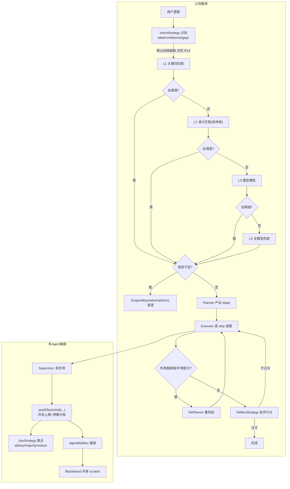

### R8.4 API 接口

```python
class IntentStrategy(Protocol):                     # 整体意图策略；默认四级级联，注入即整包替换
    name: str
    async def recognize(self, text, ctx) -> IntentResult: ...   # label/confidence/gaps[/trace]
# 默认四级级联 CascadeIntentStrategy 的四个可注入部件（详见 R13 §4/§4.1）：
#   KeywordMatcher(L1 关键词) / IntentSampleStore(L2 采样库) / CheapIntentModel(L3) / PrimaryIntentModel(L4)
#   build() -> Program 逐级 yield Effect，命中阈值即停；经 intent_as_program 供 Router 单入口消费
class ReflectStrategy(Protocol):
    name: str
    async def critique(self, draft, goal, ctx) -> Critique: ...  # passed/score/comments
class Planner(Protocol):
    name: str
    async def plan(self, goal, ctx) -> tuple[Step,...]: ...
class RePlanner(Protocol):
    name: str
    async def replan(self, goal, steps, failures, ctx) -> tuple[Step,...]: ...
class Executor(Protocol):
    name: str
    async def execute(self, step, ctx) -> StepResult: ...

class Arch(Protocol):                              # 架构统一协议
    name: str
    version: str
    def static_check(self) -> StaticCheckReport: ...
    def compile(self) -> Program: ...

# 10 内置架构（全部返回 Program）
ReAct(tools); ToolUse(tools); PlanExecute(planner, executor, replanner=None)
Reflection(reflector, max_rounds=3); Router(classifier, arms, default=None)
RouterSkill(classifier, routes); Supervisor(planner, child_spec, join)
Handoff(roles, max_hops=5); Blackboard(agents, rounds=3); Graph()  # 声明式编译
# 组合算子
seq(a,b); par([...]); branch(fn, arms); race([...]); retry(n,backoff); map_state(lens); budget(**limits)
```

> **落地细化以 R12 详设为准**：上述签名是概要。完整构造签名（§4）、Terminate 等 Effect 真实语法（§4.0）、
> StaticCheckReport schema + 错误码（R12 §5.1）、10 架构 compile 骨架 + state 契约 + 边界行为 +
> A5 取消/R3 容错接线（R12 §6.1）均在[《R12 内置架构与组合》](../02-模块详设/Agent/R12-内置架构与组合.md)。
> Graph 条件边语义：`cond(state) -> 目标节点 id | None`（多路分支），非布尔。

### R8.5 元数据与核心字段

| 字段 | 说明 |
|------|------|
| IntentResult | label / confidence(0~1) / gaps（信息缺口，触发澄清）；可选 trace（命中级 + 逐级置信度，观察语义、非内核必填） |
| Critique | passed / score / comments（修订意见） |
| Step | 可执行步骤（明确动作 + 校验条件） |
| ChildHandle | child_session_id / budget 分账 / trace 父 span |
| JoinStrategy | all / any / majority / reduce + timeout |
| StaticCheckReport | errors / arch / version / ports_required |

**10 架构归约**：ToolUse=并行 Effect；ReAct=自循环；PlanExecute=状态机游标；Reflection=budget 轮换；Router=branch；RouterSkill=分流+skill 正文；Supervisor=par(child)+join；Handoff=换 program+hops；Blackboard=共享 scratch；Graph=声明式编译+static_check；+（7 组合算子支撑嵌套）。

### R8.6 可插拔契约

| 注入点 | 协议 | 默认 | 校验 |
|--------|------|------|------|
| 意图 | `IntentStrategy`（整体替换）/ 四部件 `KeywordMatcher`·`IntentSampleStore`·`CheapIntentModel`·`PrimaryIntentModel`（仅默认级联内可注入） | 默认四级级联 `CascadeIntentStrategy`（关键词→语义→便宜模型→主模型，R13 §4.1） | 返回结构完整；缺 name 拒绝 |
| 反思/规划 | ReflectStrategy/Planner 等 | LLM critic/分解 | 返回结构完整；缺 name 拒绝 |
| 子 Agent | ChildSpec | ReAct 子 | 并发上限/预算分账 |
| 架构 | Arch | 10 内置 | static_check 查悬空边/环/缺 port |

### R8.7 验收门禁

| 门禁 | 条目 | 达标标准 | 级别 |
|------|------|---------|------|
| R8-G1 | 覆盖 | 认知服务 + 10 架构各有端到端用例 | G1 |
| R8-G2 | 装配检查 | 悬空边/环/不可达/缺port/预算冲突 装配期报错 | G2 |
| R8-G2 | 幂等 | 同 Arch 多次 compile 行为一致；算子不改原对象 | G2 |
| R8-G3 | 嵌套 | Router→Graph→ReAct 三层嵌套跑通；换架构零改动 | G3 |
| R8-红线 | 纪律 | 架构内直接 IO/自数轮次 → 拒绝 | 红线 |

---

## R9 安全与 HITL

> 层：L1（横切）· 依赖：R1+R2 · 源码包：`harness/security/` · 详见 R9 模块详设

### R9.1 职责与边界

**做**：身份授权、凭据隔离、两级护栏、提示注入防御、沙盒、审计、数据隔离/PII、合规；HITL 审批流、澄清、计划干预、通知、接管。
**不做**：沙盒内的具体执行环境（由外部 SandboxPort 实现，R9 定义契约与路由）。

### R9.2 设计架构

**纵深防御**：模型级安全是必要不充分条件，harness 提供独立执行期强制层。每层独立强制，一道防御的 allow 不能覆盖另一道的 deny（取最严格；安全四态用 `SafetyVerdict`）。核心原则：**工具/检索/网页/技能正文一律不可信**，注入防御在进上下文前（R9 安全域 / ③ `injection_guard` 装饰器）。审计覆盖全部事件且与事件日志同源可回放（④notify）。

### R9.3 流程图

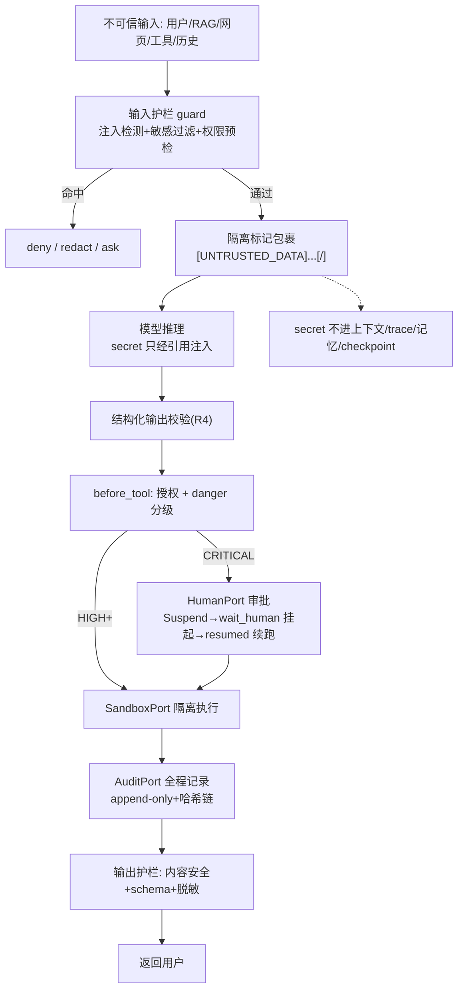

### R9.4 API 接口

```python
class Guardrail(Protocol):
    name: str; direction: Literal["input","output"]
    def check(self, data: DynamicValue, ctx: object) -> SafetyVerdict: ...   # allow/redact/deny/ask；ask→Suspend（R9 安全域，非通用拦截协议）

class InjectionDetector(Protocol):
    name: str
    def inspect(self, text: str, ctx: SecurityCtx) -> SafetyReport: ...  # safe/suspicious/malicious
class SandboxPort(Protocol):
    async def run(self, fn, args, ctx) -> DynamicValue: ...
class AuditPort(Protocol):
    def record(self, event: AuditEvent, ctx: PortCtx) -> None: ...
class HumanPort(Protocol):
    async def ask(self, question, options, ctx) -> str: ...
class ApprovalFlow:                                # HITL 审批流
    def __init__(self, trigger_danger="CRITICAL", timeout=300, resume_strategy="exact"): ...
```

### R9.5 元数据与核心字段

| 字段 | 说明 |
|------|------|
| DangerLevel | SAFE/LOW/HIGH/CRITICAL → 直执行/审计/沙盒/沙盒+审批 |
| SafetyReport | safe / suspicious / malicious + 命中规则 |
| AuditEvent | who / when / action / cost / data_touched / rationale（append-only+哈希链） |
| secret_refs | 引用（如 `${API_KEY}`），绝不存明文 |
| PII 字段 | patterns / direction(input/output/log) / strategy(mask/redact/hash) |

### R9.6 可插拔契约

| 注入点 | 协议 | 默认 | 校验 |
|--------|------|------|------|
| 护栏 | Guardrail | 规则库+模型判别 | 命中策略明确 |
| 注入检测 | InjectionDetector | 规则+启发式 | 不可信输入必过 |
| 沙盒 | SandboxPort | 进程隔离 | 资源限额/网络白名单 |
| 审批 | HumanPort | 终端 | 挂起态跨周期有效 |
| 审计 | AuditPort | 本地日志 | 不可旁路/防篡改 |

### R9.7 验收门禁

| 门禁 | 条目 | 达标标准 | 级别 |
|------|------|---------|------|
| R9-G1 | 覆盖 | 护栏/注入/沙盒/审批/审计单测 ≥85% | G1 |
| R9-G2 | 注入 | 检索/工具/技能正文含指令串时被拦截 | G2 |
| R9-G2 | 审批 | 挂起→跨周期恢复→精确续跑 | G2 |
| R9-G3 | 审计 | 覆盖率 100%，哈希链可验证 | G3 |
| R9-红线 | 安全 | secret 明文进上下文/trace/记忆；CRITICAL 未审批执行；审计可旁路 → 拒绝 | 红线 |

## R10 可观测·评测·持久化

> 层：L2/L3 · 依赖：R1+R2 · 源码包：`harness/observability/` + eval/ + durability/ · 详见 R10 模块详设

### R10.1 职责与边界

**做**：全链路 trace、metric、事件流/读模型投影；eval（golden 集/LLM-as-judge/确定性断言/CI gate/生产采样/回放）；checkpoint 快照/事件溯源/断点恢复/状态版本迁移。
**不做**：checkpoint 的写入时机（R1 内核）；记忆的长期语义（R7）。

### R10.2 设计架构

**质量飞轮**：运行期产事件 → trace/metric/事件流 → eval（CI gate + 生产采样）→ 失败回流测试集 → 改进 prompt/模型/架构 → 重新评测。持久化与记忆分离：**checkpoint 是短期 thread 内恢复（State.messages + scratch + last_*），memory 是长期跨 thread 知识（R7 双轴分类）**。回放底座 = 事件溯源 + 录制 LLMPort 重放。

> **【变更·2026-11-20 晚】短期记忆边界**：短期记忆归 R1 状态 + R10 checkpoint，长期记忆归 R7；R7 压缩视图为 `state → view` 纯函数投影，**不写进 checkpoint 状态**，但重建规则随 `State.version` fingerprint 对齐——同 fingerprint 回放必得同视图（R7-G3 断言）。禁止把 memory 混入 checkpoint，也禁止 R7 另建会话缓冲冒充短期记忆。

### R10.3 流程图

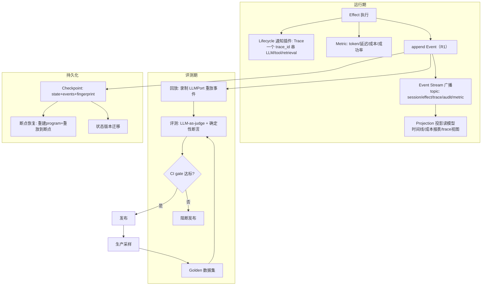

### R10.4 API 接口

```python
class TelemetryPort(Protocol):
    def span(self, name, ctx) -> AbstractContextManager: ...
    def metric(self, name, value, tags=None) -> None: ...
    def log(self, event) -> None: ...
class EventStream(Protocol):                          # L3 接入契约
    def subscribe(self, topic: str, since: int|None=None) -> AsyncIterator[Event]: ...
    def topics(self) -> list[str]: ...
class Projection(Protocol):
    name: str
    def project(self, events: Iterable[Event]) -> ReadModel: ...
class EvalPort(Protocol):
    async def run_case(self, case: EvalCase) -> EvalResult: ...
    async def regression(self, suite: str) -> SuiteReport: ...
class Judge(Protocol):
    name: str
    async def score(self, case, output: Trace, ctx) -> Score: ...
class EventStore(Protocol):                           # checkpoint 存储
    def save(self, session_id: str, snapshot: JsonSnapshot) -> None: ...
    def load(self, session_id: str) -> JsonSnapshot|None: ...
def replay_events(events, initial: AgentState) -> AgentState: ...
```

### R10.5 元数据与核心字段

| 字段 | 说明 |
|------|------|
| TraceSpan | trace_id / span_id / parent_id / name / 耗时 / token / cost / 组件 name |
| topic | session.* / effect.* / trace.* / audit.* / metric.* / state.* |
| EvalCase | input / expected / expected_trajectory / should_refuse |
| Judge | LLM-as-judge + 位置偏差打乱 + 冗长偏差长度归一化 |
| CheckpointSnapshot | session_id / version / state / events / fingerprint |
| 评测三层 | 确定性不变量 / 黄金轨迹场景 / 生产采样 |

### R10.6 可插拔契约

| 注入点 | 协议 | 默认 | 校验 |
|--------|------|------|------|
| 日志平台 | TelemetryPort | JSONL/OTel | 故障不影响主流程 |
| 事件源 | EventStream | 内存流 | 只读；从 seq 续读 |
| 读模型 | Projection | 时间线/成本 | 可从事件重建 |
| 评测/Judge | EvalPort/Judge | 本地回归/LLM-judge | CI gate 阈值 |
| checkpoint 存储 | EventStore | 内存/Postgres | 快照结构兼容 |

### R10.7 验收门禁

| 门禁 | 条目 | 达标标准 | 级别 |
|------|------|---------|------|
| R10-G1 | 覆盖 | trace/eval/checkpoint 单测 ≥85% | G1 |
| R10-G2 | 回放 | 录制重放后 State 与终态全等 | G2 |
| R10-G2 | checkpoint | 挂起/每N步/终态必存；跨进程恢复一致 | G2 |
| R10-G3 | 留名 | trace 含全部组件 name；事件流可续读 | G3 |
| R10-红线 | 一致 | 未记录的决策视为不可上线；checkpoint 与 memory 混用 → 拒绝 | 红线 |

---

## R11 集成接入与治理

> 层：L3 · 依赖：全部 · 源码包：`api/` + cli/ · 详见 R11 模块详设

### R11.1 职责与边界

**做**：四组 API 面（A1 集成契约/A2 架构组合/A3 应用开发/A4 组件开发）；Agent 装配器与 profile 预设；配置版本/热更新/灰度回滚/feature flag；全局 killswitch/成本限额/限流；CLI（脚手架/评测/回放/门禁）；触发调度（webhook/cron）与交付通道。
**不做**：任何具体能力实现——本模块只做投影、装配、治理。

### R11.2 设计架构

四组 API 是**同一内核面向四类使用者的四个投影**，底层都归约到 ①A 类算子 / ②领域策略（R3）/ ③call 装饰器 / ④notify / ⑤Port / Program。外部系统（可视化平台、存储工具、日志 SDK）只经三类契约（Port/Event Stream/Projection）接入，不得 import 内核内部对象或直接写事件日志。装配期统一 `static_check`（provides/requires 校验）把错误挡在运行前。

### R11.3 流程图

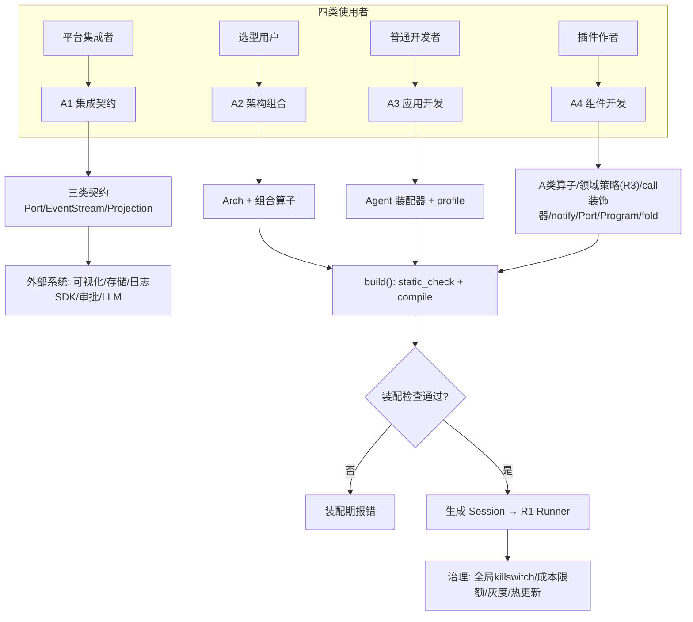

### R11.4 API 接口

```python
# A3 应用开发（最常用）
agent = (Agent(arch=ReAct(tools=tools))          # 选架构
    .profile("production")                       # 一键加载 L1 默认插件预设
    .capability(RAG(pipeline=rag))               # 开能力 + 换策略
    .capability(IntentRecognition(strategy=MyIntent()))
    .rag(PostgresStore(...)).memory(RedisMemory())
    .telemetry(LangfusePort())
    .event_stream(KafkaStream(topics=["trace.*"]))
    .build())                                    # static_check + compile
result = await agent.run("...", session_id="s-1")

# A1 集成契约
class PortRegistry:
    def register(self, name, adapter) -> None: ...
# 命名空间：内置 llm/tool/memory/store/... ；用户自定义 x-<name>

# A2 架构组合
agent2 = Agent(arch=budget(max_cost_usd=2)(branch(intent_fn, {"qa": rag, "act": ReAct(tools)})))

# A4 组件开发（②领域策略 + ③call 装饰器 + ④notify 观察 + ①算子）
cap = ResilienceCapability(rate_limit=my_rate_limit, ...)  # ②9 领域策略具名 opt-in 注入
call = cap.install(core).as_call()                          # 执行器显式编排，无统一 check/observe 协议
class MyAudit:                               # ④notify 观察方：订阅相位，返回值不消费
    name = "my-audit"
    def observe(self, phase: str, payload: Mapping[str, object]) -> None: ...  # 异常就地隔离
def my_operator(p: Program) -> Program: ...  # ①A 类算子：Program→Program 纯变换
base = make_dispatch(ports)
decorated = build_call(base, decorators=[retry_call, timeout])      # ③函数组合，无固定角色链
```

> 用户无感差异：对外 API（`seq/par/branch/...` + 10 内置架构）不变，它们都是 A 类算子；AOP 五角色/总线不再作为插件作者的接口面。

### R11.5 元数据与核心字段

| 字段 | 说明 |
|------|------|
| AgentSpec | program_version/arch_version/ports_version/optional_modules[]（进 trace） |
| StaticCheckReport | errors/arch/version/ports_required/budgets_resolved |
| profile | dev/production/regulated 三档插件预设 |
| port 命名空间 | 内置固定名；用户自定义须 `x-` 前缀 |
| 触发入口 | webhook / cron / 事件；鉴权 + 幂等 + 限流 |

**profile 预设**：dev（最小插件+本地存储）、production（全套可靠性+RAG+安全+OTel）、regulated（+强制审计+审批+数据隔离）。

### R11.6 可插拔契约

| 注入点 | 协议 | 默认 | 校验 |
|--------|------|------|------|
| 外部能力 | Port | 内置默认 | 履约检查；缺 port 装配期报错 |
| 事件消费 | EventStream/Projection | 内存 | 只读；不侵入内核 |
| profile | 插件预设 | 三档内置 | 可自定义预设 |
| CLI | 命令 | init/eval/replay/gate | 扩展命令注册 |

### R11.7 验收门禁

| 门禁 | 条目 | 达标标准 | 级别 |
|------|------|---------|------|
| R11-G1 | 覆盖 | 四组 API 各有集成用例 | G1 |
| R11-G2 | 装配检查 | 缺port/非法架构/预算冲突 装配期报错 | G2 |
| R11-G2 | 接入 | 换外部实现上层零改动；事件流只读可续读 | G2 |
| R11-G3 | 治理 | 全局killswitch/成本限额/灰度回滚各有用例 | G3 |
| R11-红线 | 边界 | 外部系统 import 内核内部对象/写事件日志 → 拒绝 | 红线 |

---

# 第三篇 全局附录

## 附录 A 核心字段字典（全框架唯一定义）

> 所有模块共用这些字段，禁止各模块另起别名。字段只增不改语义；废弃字段先标记 deprecated 至少一个 minor 版本。

### A.1 数据与信封

| 字段/类型 | 结构 | 定义模块 | 说明 |
|-----------|------|---------|------|
| Message | {role, content, name, tool_calls} | R1 | 对话最小单元，只增不减 |
| Effect | {kind, payload, batch, trace_id} | R1 | 对外部世界的声明 |
| Result | {ok, data, usage, error} | R1 | Port 调用统一信封 |
| PortError | {code, message, retryable} | R1 | 结构化错误，retryable 驱动重试 |
| Usage | {prompt_tokens, completion_tokens, cost_usd} | R1 | 成本/token 元数据 |
| Budgets | 6 max_* + 6 used_* | R1 | 多维预算，内核强制 |
| Event | {seq, step, state_snapshot, effects, results, cost_usd, tokens, status, reason} | R1 | 事件溯源原子 |
| JsonSnapshot | {session_id, version, state, events, fingerprint} | R1/R10 | checkpoint 顶层 |

### A.2 元数据（进 trace）

| 字段 | 生成方 | 格式/取值 |
|------|--------|----------|
| session_id | Runner | 调用方给定 |
| run_id | Runner | uuid |
| trace_id | 内核 | `session:step:index` |
| step / seq / attempt | 内核 | 逻辑时钟，单调递增 |
| version | 装配期 | semver 或内容 hash |
| name | 每个组件 | 非空字符串，强制留名 |
| fingerprint | checkpoint | sha256(canonical(events)) |
| cost_usd | fold 累计 | round(x, 10) |

### A.3 各模块专属字段速查

| 模块 | 专属字段 |
|------|---------|
| R3 | DimensionKey / RetrySpec / BreakerState / DegradeStep.quality / idempotency_key |
| R4 | LLMRequest/Response / cache key / 成本归因维度 |
| R5 | ToolSpec{danger,source} / ToolResultMeta / DisclosurePacket{L1,L2,L3,token_cost} |
| R6 | Chunk / Hit / Query / RAGResult{empty,citations} / TokenBudget / RRF k=60 |
| R7 | ContextSection / MemoryTier / MemoryKind(七类) / MemoryItem{item_id,kind,tier,importance,confidence,scope} / MemoryScope(tenant) / Reinjector / TokenCounter / offload 句柄 |
| R8 | IntentResult{label,confidence,gaps,trace?} / Critique / Step / ChildHandle / JoinStrategy / StaticCheckReport |
| R9 | DangerLevel / SafetyReport / AuditEvent / secret_refs / PII 字段 |
| R10 | TraceSpan / topic / EvalCase / CheckpointSnapshot |
| R11 | AgentSpec / profile / port 命名空间 / 触发入口 |

## 附录 B 框架对外协议索引（可插拔的前提）

> 完整签名与四要素见 R2 模块详设与本文 §1.3。这里给索引。

| 组 | 协议 | 默认实现 | 用户接入 |
|----|------|---------|---------|
| 扩展/装配 | ①A 类算子（10）/ ②领域策略（R3 9 策略，无统一协议）/ ③call 装饰器（CallFn→CallFn）/ ④notify / Capability（build→Program）/ Provider | 无（按需）/ 内置能力 | `seq/par/...` / `build_call(base, *, decorators=())` / `Runner(notify=...)` / `.capability()` |
| 认知 | IntentStrategy（+ 级联四部件 KeywordMatcher/IntentSampleStore/CheapIntentModel/PrimaryIntentModel）/ ReflectStrategy / Planner / RePlanner / Executor / Judge / ModelRouter / SchemaValidator | 意图默认四级级联 CascadeIntentStrategy（R13 §4.1）；其余 LLM 默认 / MinimalSchemaValidator | 构造参数 `strategy=`（整体替换）/ `CascadeIntentStrategy(keyword=,samples=,cheap=,primary=)`（部件级）/ `validator=` |
| RAG | Splitter / Embedder / VectorStore / Retriever / Reranker / QueryRewriter / PostProcessor | 见 R6 | `RAGPipeline(...=)` |
| 工具 | ToolPort/@tool / MCPTransport / SkillPort / DisclosureIndex | 见 R5 | `register()` / 构造参数 |
| Port | LLMPort / MemoryPort / StorePort / SandboxPort / TelemetryPort / HumanPort / AuditPort / EvalPort | 见各模块 | `registry.register()` |
| 接入 | EventStream / Projection | 内存流 | `.event_stream()` / `.project()` |

**可插拔四要素检查表**（每个协议都必须满足）：① 协议定义 ✓ ② 默认实现 ✓ ③ 替换入口 ✓ ④ 装配期履约校验 ✓。
**注入三形态**：协议替换 / 算子组合或 call 装饰器（+ R3 领域策略具名构造注入）/ 构造参数；L3 另有 Port/EventStream/Projection 三类接入契约。

## 附录 B.1 默认实现状态与回头实现清单（2026-11-18）

> 本表是**权威追踪清单**：凡接口体中 `...`（Protocol 语法占位）或标注"见各模块"的默认实现，
> 都在此登记归属、状态与回头动作。**不得把"文档标注了归属"当成"已实现"**——必须按本表状态列推进。
> 协议定义在 `src/hooks/protocols.py`；本表是它的设计侧追踪镜像，两处须一致。

### B.1.1 已实现模块（R1~R6）：默认实现全部落地 ✅

| 协议 | 默认实现 | 源码位置 | 状态 |
|------|---------|---------|------|
| EventStore | InMemoryEventStore | `src/runtime/runner.py` | ✅ 已实现 |
| Interpreter | InterpreterImpl | `src/runtime/interpreter.py` | ✅ 已实现 |
| FailureClassifier | _DefaultClassifier | `src/harness/resilience/types.py` | ✅ 已实现 |
| DegradeLadder | _default_ladder() | `src/harness/resilience/capability.py` | ✅ 已实现 |
| ModelRouter | RuleRouter | `src/harness/model/router.py` | ✅ 已实现 |
| CachePort | ExactCache + SimilarityCache | `src/harness/model/cache.py` | ✅ 已实现（异步+可换 store/embedder） |
| StructuredOutputSpec | repair 模式 | `src/harness/model/structured.py` | ✅ 已实现 |
| SchemaValidator | MinimalSchemaValidator | `src/harness/model/structured.py` | ✅ 已实现（可注入） |
| LLMPort | OpenAICompatLLM | `src/ports/adapters/llm.py` | ✅ 已实现（R4 §6.1） |
| ToolPort | ToolRegistry | `src/harness/tools/registry.py` | ✅ 已实现（R5，@tool/注册/披露/四路路由） |
| MCPPort | MCPManager | `src/harness/tools/mcp.py` | ✅ 已实现（R5，fqname 注入/health） |
| SkillPort | FileSkillProvider | `src/harness/skills/provider.py` | ✅ 已实现（R5，manifest/正文/注入检测） |
| DisclosureIndex | ToolIndex | `src/harness/tools/index.py` | ✅ 已实现（R5，三级披露+预算） |
| RAGPort | RAGPipeline | `src/harness/rag/pipeline.py` | ✅ 已实现（R6，五段+三增强+横切，履约 ingest/retrieve，2026-11-19 勾销） |

### B.1.2 待实现模块：回头实现清单 ⏳

> 下列默认实现**必须**在对应模块开发时落地（四要素②）。协议已在 R2 定齐、归属在此锁定，
> 模块开发验收时须逐项勾销。**在模块实现前，这些 `...` 是合法的接口占位，不是遗漏。**

> **2026-11-19 勾销（R6 实现完成，非静默删除）**：原 `RAGPort→RAGPipeline` 行已移入 B.1.1。
> 证据：`src/harness/rag/pipeline.py` 履约 `ingest(documents,ctx)->int` / `retrieve(query,ctx)->list[DynamicValue]`，
> `isinstance(p, PORT_PROTOCOLS["rag"])` 经 `tests/r6/test_pipeline.py` 断言；20 项链路五段+三增强+横切落地，
> 覆盖率 94%、R6 门禁 14/14 全绿、demo PASS。

| 协议（接口体 `...`） | 默认实现类 | 归属模块 | 源码位置（模块开发时创建） | 回头动作 |
|------|------|---------|------|------|
| MemoryPort | MemoryStore | R7 记忆 | `src/harness/memory/` | 已实现骨架（2026-11-20）；完整性修订待补双轴七类 + 四链优化（R7 详设 §12） |
| StorePort | InMemoryStorePort | R7 记忆 | `src/harness/memory/` | 已实现 save/load（短期 checkpoint 用，与 memory 分离） |
| SandboxPort | LocalSandbox | R9 安全 | `src/harness/security/` | R9 开发时实现 run（进程/容器隔离） |
| AuditPort | AuditLogger | R9 安全 | `src/harness/security/` | R9 开发时实现 record（不可篡改留痕） |
| HumanPort | ConsoleHumanPort | R9 HITL | `src/harness/security/` | R9 开发时实现 ask（审批/挂起/resume） |
| EvalPort | RuleEval | R10 评测 | `src/harness/eval/` | R10 开发时实现 score（golden 集 + LLM-as-judge） |
| TelemetryPort | NoopTelemetry | R10 可观测 | `src/harness/observability/` | R10 开发时实现 span/metric/log（兼容 OTel） |
| EventStreamPort | InMemoryEventStream | R10 事件流 | `src/harness/observability/` | R10 开发时实现 subscribe/publish（R10 §4.1 schema） |

**回头实现纪律**：
1. 每完成一个模块，把 B.1.2 对应行移到 B.1.1，状态改 ✅，并更新 `src/hooks/protocols.py` 模块 docstring 的归属表（两处同步）。
2. 模块验收门禁（G0 契约符号）必须包含该模块的默认实现类，缺失即不绿。
3. 装配层（R12/R13）在用户未注入时注册这些默认实例；模块未实现前，registry 无默认可注册属预期状态。

### B.1.3 框架能力待办清单（原审查文档待办归并，2026-11-18）

> 以下是框架视角审查发现的、尚未落地的能力。**审查文档已删除，本表是这些待办的唯一权威记录。**
> 已修项不在此列（流式事件模型、默认实现归属、设计数字/签名矛盾等均已修复）。

| 待办 | 现状 | 归属模块 | 处理方向 |
|------|------|---------|---------|
| 用户可定义 reducer（状态合并扩展） | R1 fold 是固定逻辑，不可扩展 | R1 增强 | 设计 reducer 注入点（`fold` 接受可选 reducer 表），不改默认行为 |
| 图编排 execute 代码（Graph/branch/par/race 等） | R12 设计已完整，代码未实现 | R12 | 按 R12 §6.1 骨架实现 `src/archs/`+`src/compose/` |
| 群聊/swarm 多 Agent 编排 | Handoff/Supervisor/Blackboard 设计有，群聊/swarm 无 | R8 增强 | 评估是否为必备；若是则补 Arch 第 11 种（需同步总设计"10 内置"口径） |
| OTel/OTLP 接入规范 | profile 提"OTel"字样，无规范 | R10 | 设计时补 OTel span/metric 映射与导出契约 |
| output parser / prompt 模板抽象 | 无独立抽象（结构化校验已有） | R4 增强 | 评估是否需要独立协议；结构化校验已覆盖大部分场景 |
| 7 项设计缺失（B10/B11/G9/J10/N8/Q10/D13） | 设计态待补 | R5~R11 | 各模块开发前补齐设计到可写代码深度 |
| R5~R13 剩余能力代码（约 82 项设计充分项） | 设计有、代码无 | R5~R13 | 按模块整块推进，每次完成一个模块 100% 项 |
| **R1↔R2 / R3→R2 接线未装配**：函数已就绪（ctx_factory/_bind/ResilienceCapability.install）但无生产代码调用 | 接口就绪、无人串接 | R12 装配层 | composition root（Agent 装配器）统一注册，非模块遗漏 |
| **M1-M6 构造参数生产注入**：dimension_of/idempotency_key/pool/pools/kinds/budgets/available+add_backend/failed_target_of 在 R1-R4 已实现读取端，但无生产装配者 | 读取端就绪、注入端缺位 | R12 装配层 | `Agent.build()` 从用户后端注册表/预算/池配置投影后构造注入（详见 R12 §6.1.3 注入表）；测试手填不算生产装配，非 R1-R4 遗漏 |
| **SandboxPort.run(fn: Callable) 不可序列化** | 签名只够同进程执行，真进程/容器隔离拿不到可序列化代码 | R9 | 实现前改签名为可序列化 spec（code+entrypoint+args），否则沙盒承诺不可达 |
| **AuditPort.record 收裸 dict** | 防篡改哈希链字段（prev_hash/hash）无处放 | R9 | 实现时签名改收 `AuditEvent` 具名类型 |
| **EvalPort.score 只给 case_id** | 评测器拿不到 expected/should_refuse，需自己查库 | R10 | 实现时签名改收 `EvalCase` 具名类型 |
| **Telemetry 归因维度藏 meta / HumanPort resume 点不显式** | agent_id/user_id 靠 coerce 边界读；ask 无挂起 id | R9/R10 | 实现时显式化到协议字段 |

> **2026-11-19 勾销（拷问复核，非静默删除）**：本表原有两行经代码复核已不属待办，移出并留证——
> ①「工具 decorator 运行期实现（R5）」：`src/harness/tools/decorator.py:60` `tool()` 已实现，`tests/r5/test_decorator.py` 覆盖，R5 详设头部已标实现状态。
> ②「R4→R1 接线断链，缺 Effect→LLM 适配器」：`src/harness/model/gateway.py:141` `as_call()` 已提供该适配器，`tests/r4/test_e2e_wiring.py` 已接线。二者仍属 R12 装配层调用问题，已归并入上一行「R1↔R2 / R3→R2 接线未装配」，不重复列待办。
>
> **协议可达性纪律**：新增/修改 Port 协议时，必须自问"实现者拿到的输入够不够兑现协议承诺的能力"，
> 避免再次出现 SemanticCache 那种"协议名承诺语义、参数只给哈希"的名实分离。
> 详见[《协议可达性审查》](./协议可达性审查-20261118.md)。
>
> **协议可插拔三维度纪律**（2026-11-18 已对 47 协议全查，见[《协议可插拔完备性审查》](./协议可插拔完备性审查-20261118.md)）：
> ① 每个自定义协议必须标默认实现（四要素②）；② 涉及 IO 的协议方法必须 async
> （已修：CachePort/StorePort/EventStore/AuditPort；TelemetryPort 采集保持同步=OTel 惯例）；
> ③ 需要外部系统的协议必须抽象可注入 client/store（已加 CacheStore/CacheEmbedder/AuditStore/TelemetryExporter）。
> 新增协议一律按此三维自检。

**2026-11-18 已修（当前模块 R1/R2/R4，从本表勾销）**：
- EventStore / Runner.load 异步化（checkpoint 可落 DB/Redis）；StorePort / AuditPort 异步化；
- 新增 AuditStore / TelemetryExporter 后端协议；CachePort 三层可插拔（CacheStore/CacheEmbedder）；
- SemanticCache 别名彻底删除（统一 CachePort）。

**纪律**：本表项在对应模块开发验收时逐项勾销；新增框架能力必须先入本表再动手，避免遗漏。

## 附录 C 元数据与版本规范

- **语义化版本**：框架、架构、prompt 模板、技能、Port 实现全部带版本，进 `version` 与 trace。
- **版本锁定**：运行中的会话用启动时版本，配置热更新不影响在途会话（防行为漂移）。
- **回放对齐**：Event 记录 version，回放时用同版本 program/prompt，否则拒绝对齐。
- **状态迁移**：checkpoint schema 带 version，缺字段回退默认值（兼容旧快照）。

## 附录 D 从旧体系迁移到算子核心（整体替换，不留兼容层，D-10）

> 本路线已被 2026-11-21 规格 D-10 更新：**整体替换、不留兼容层**（取代原"渐进双跑 + 适配层"策略）。R6 先试点。

| 阶段 | 动作 | 纪律 |
|------|------|------|
| B1 | `src/compose/` 立算子核心（A 类 10 算子 + call 装饰器 + build_call/dispatch/make_dispatch + 协作 DTO） | 先立核心；TDD 先写失败测试 |
| B2 | R6 套 ToolLayer 外壳、试点端到端 | 跑不通先修算子契约，不动 R1 |
| B3 | R3 去角色化（9 领域策略 + `ReliabilityExecutor`；删 BudgetGuard 与旧拦截协议） | **最高风险**：四坑单测先绿再删旧链，断言不放水 |
| B4 | 删 `src/aop/`、R4/R5/R7 领域字段归位、hooks 拆分 | 整体替换不留兼容层 |
| B5 | R1 零改动核验 + gate_check 登记 + 链路图 | `git diff src/runtime/` 必须为空 |

**风险**：① A 类算子纯度（实例不得持有流程进度，否则 resume 丢状态）；② ③装饰器 retry_call 重跑受预算与幂等约束；③ ②领域策略实例持有跨调用策略状态（熔断/降级按 session 隔离），但不持有单次流程进度；④ R3 四坑语义换宿主后任何回归停下重审。

## 附录 E 全局验收总表

| 模块 | G1 质量 | G2 语义/隔离 | G3 集成 | 红线 |
|------|--------|-------------|---------|------|
| R1 | ≥90% 覆盖 | 确定性/回放/6维预算 | 主流程+挂起恢复 | Program 纯函数 |
| R2 | 10 算子 + call 装饰器覆盖 | 算子纯函数/compile 幂等 + call 只覆盖 Invoke + 16 相位（②领域策略归 R3 验证） | 组件留名 | 无 AOP/总线残留 |
| R3 | ≥90% | 重试/熔断/降级语义 + 降级四坑 | 五道防线由 `ReliabilityExecutor` 显式编排 9 领域策略 | 幂等键；无 BudgetGuard |
| R4 | ≥85% | 结构化/缓存 | 换 Port 零改动 | 预算不绕过 |
| R5 | ≥95% | 合并/披露 | danger 四级路由 | 审批/披露红线 |
| R6 | 五段替换 | 预算/降级 | 召回基线 | 引用/注入红线 |
| R7 | ≥85% | 压缩/七类×三层/四链 | 顺序确定性+视图可重放 | 不改messages/secret(含嵌套)/跨tenant |
| R8 | 端到端 | 装配检查/幂等 | 嵌套/换架构 | 无直接IO/自数轮次 |
| R9 | ≥85% | 注入/审批 | 审计100% | secret/CRITICAL/审计 |
| R10 | ≥85% | 回放/checkpoint | 留名/续读 | 一致性/memory分离 |
| R11 | 四组API | 装配检查/接入 | 治理用例 | 边界隔离 |

## 附录 F 术语表

| 术语 | 含义 |
|------|------|
| Harness | 围绕模型的控制与反馈系统 = R1 微内核 + 算子核心（组合层）+ 工具层 + 架构 + API |
| Effect | `Invoke|Spawn|Suspend|Terminate` tagged union，Program 对外部世界的声明，只声明不执行；仅 `Invoke` 走注入的 call |
| 承载形态（7 种） | 能力（169 项，做什么）≠ 承载形态（怎么实现）：①组合算子 ②领域策略（原"有状态守卫"，落地于 R3 执行器）③call 装饰器 ④notify ⑤Port ⑥组件 ⑦内核机制 |
| A 类组合算子 | `Program→Program` 装配期纯变换（10 个：seq/par/branch/race/loop/map_state/map_effect/fallback/gate/retry 流程级）；狭义"算子"只指此类，纯函数、状态进 `State.scratch x-*` |
| ②领域策略（原"有状态守卫"） | R3 `ReliabilityExecutor` + 9 领域策略显式编排领域方法（`is_tripped`/`acquire`/`permit`/`select` 等），无统一 check/observe 协议；跨调用状态在策略实例（熔断/限流/舱壁/幂等/降级/watchdog/killswitch） |
| ③call 装饰器 | `CallFn→CallFn`（retry 调用级/timeout/danger_route/injection_guard）；函数组合替代原 AOP 五角色固定链，只覆盖 `Invoke` |
| SafetyVerdict | R9 安全域四态裁决（allow/redact/deny/ask；ask→Suspend + `wait_human`/`resumed`），与已删除的通用 `Verdict` 不同物 |
| notify 相位（④） | R1 既有回调的 16 个 when 相位；返回值不消费、异常就地隔离；追踪/审计/指标挂此口 |
| Capability | 能力级开关（用不用） |
| Provider | 策略级契约（用什么算法/模型） |
| DimensionKey | 按目标隔离计数/熔断/限流的键 |
| 缺席即降级 | 未装能力时功能降级而非崩溃 |
| context rot | 上下文越长召回与推理质量越差 |
| 短期记忆 | `State.messages` + `scratch` + `last_*`，R1 内核持有、R10 checkpoint 可恢复；R7 只读投影（非 R7 实体） |
| 长期记忆 | 跨 session 持久记忆，R7 MemoryPort 持有；双轴分类＝温度三层 hot/warm/cold × 内容七类 episodic/semantic/procedural/profile/preference/entity/journal |
| MemoryScope | 记忆隔离域：tenant 必填 + user/session 可选；写入与召回双向校验 |
| Durable Execution | 长任务 checkpoint + 断点续跑 + 幂等 |

---

*AGENT 总设计 · 2026-11-21 · 唯一权威设计文档 · 算子核心架构（R1 零改动 + 10 A 类算子 + 7 承载形态；原 AOP/Lifecycle 已取消）+ R7 D4/D5（大结果落盘不截断 + KV cache 命中率一等可观测）· 配套模块详见 docs/02-模块详设/Agent/*
