# Agent 框架总设计（v5.0）

> **地位**：本文件是框架的唯一权威总设计（Single Source of Truth）。所有模块详设、实现、评测都从本文派生，冲突时以本文为准。
> **公式**：`Agent 应用 = LLM + Harness`。Harness = 一个微内核 + 一组可插拔能力插件 + 内置架构 + 四组对外 API。
> **主线**：唯一执行循环解释 Program 产出的 Effect；一切能力是挂在 Hook 上的插件；一切架构是插件的装配脚本；一切外部系统经契约接入。
> **配套**：模块详设 `docs/02-模块详设/Agent/`（由本文按 R1~R13 拆分派生，每模块模块内闭环、含 API/字段/门禁）；能力全集见[《能力域全景》](./能力域全景.md)（含自查补齐内容，见附录 B.1 待办清单）。
> **状态**：v5.0 设计定稿——R2 插件宿主已按 tapable 式 Hook 原语重构（架构基线 `.workbuddy/specs/ARCH-v5.md`，唯一真相源）；R1/R2/R3/R4 已落地且各有门禁，其余为设计态。
> **版本记录**：
> - v5.0（2026-11-18）：**架构重构**。R2 由「HookMode 四 mode + HookBus.emit + ControlState + DEGRADER」彻底重构为 tapable 式原语——5 种 `HookKind`（`Bail`/`Waterfall`/`Loop`/`Parallel`/`Around`）+ `Host`/`RequestScope` 两层模型 + `Plugin.apply(host)`（跨调用状态由插件实例自身持有，无独立 Policy 层）。旧概念（HookMode 五泳道/四 mode、ControlState、DEGRADER、`bus.emit`、`degrade_target` 构造参数、Signal 冒泡）全部作废、不做兼容。R1 `Runner(dispatch, call, ...)` 签名与 `_settle` 四 action 消费保持不变（四模块命脉）。本次重写 §2、§3、R1、R2 章节，其余章节不变。
> - v5.1（2026-11-18）：**参数直送回调签名**。`Hook.call(scope, effect, ...)` 把当前 `Effect` 作为请求期输入直送每个 tap（BAIL/LOOP/PARALLEL `fn(scope, effect)`；WATERFALL `fn(value, effect)`；AROUND `fn(next, scope, effect)`），装配期配置走插件构造参数私有注入；`RequestScope` 删除 `meta`，改为 typed 协作字段（`signals/target/last_result/trace/value/releases`）；R4 降级桥接由 `ctx.meta` 裸键改为 `RuntimeCtx.degrade_target` 具名字段，Effect 幂等键改为具名 `idempotency_key`。配套修复 B1（`_sticky_targets: dict[session_id, str]` 按会话隔离的跨 Effect 继承）、B2（`failed_target_of`）、E1~E4。
> - v5.2（2026-11-18）：**断点修复 + 并发硬闸**。R1：usage token/cost 同口径扣预算、幂等键恢复/展开、运行期 `Runner.cancel()`、构造期异常不抛穿、混合批次等长、set 确定性序列化；R2/R3：degrade 信号改用 `SignalKind.DEGRADE`、`Degradation.select` 累积收缩到 REFUSE、`failed_target_of`、熔断按维度 asyncio.Lock、`_sticky_targets` 按会话隔离；R4：singleflight 防击穿、`CostGuard.reserve/commit/cancel` 调用前预留、strict 校验失败返回 `SCHEMA_INVALID` error；类型收敛（`HookContextArg`/`TapReturn`/`Result|None`）、魔法串消除、docstring 补齐。详见 `.workbuddy/specs/BREAKPOINT-FIX-PLAN.md`。
> - v2.x：历史版本（架构已作废，不再兼容）。

---

## 目录

- [第一篇 总纲](#第一篇-总纲)
  - [1 设计目标与原则](#1-设计目标与原则)
  - [2 总体架构](#2-总体架构)
  - [3 能力全景与模块划分](#3-能力全景与模块划分)
  - [4 贯穿全框架的元数据与字段规范](#4-贯穿全框架的元数据与字段规范)
- [第二篇 模块详设](#第二篇-模块详设)
  - [R1 核心运行时](#r1-核心运行时)
  - [R2 插件总线与协议](#r2-插件总线与协议)
  - [R3 可靠性](#r3-可靠性)
  - [R4 模型与推理](#r4-模型与推理)
  - [R5 工具·MCP·技能](#r5-工具mcp技能)
  - [R6 RAG 检索增强](#r6-rag-检索增强)
  - [R7 上下文与记忆](#r7-上下文与记忆)
  - [R8 认知与多 Agent 编排](#r8-认知与多-agent-编排)
  - [R9 安全与 HITL](#r9-安全与-hitl)
  - [R10 可观测·评测·持久化](#r10-可观测评测持久化)
  - [R11 集成接入与治理](#r11-集成接入与治理)
- [第三篇 全局附录](#第三篇-全局附录)

---

# 第一篇 总纲

## 1. 设计目标与原则

### 1.1 要解决什么问题

现有框架（m0-m3 + M4~M11）验证了三个正确洞见，也暴露了三个结构性问题。本设计保留洞见、解决问题：

**保留的洞见**：
1. **Effect 解释器**：Program 只 `yield Effect` 不执行；运行时是唯一解释循环；架构 = 脚本，运行时对架构无知。
2. **不可变 State + 事件溯源 + checkpoint**：确定性回放、跨周期恢复、评测重放免费获得。
3. **Port 契约 + 注册表**：运行时只认协议不认实现。

**解决的问题**：
| 问题 | 表现 | 本设计的解法 |
|------|------|-------------|
| 四套扩展 API 并列 | middleware/filter/pipe/hook 四种心智模型 | 收敛为**一种 Hook + 一种 Decision** |
| 能力无统一层 | harness 能力散落 M4~M9，各自找挂载点 | 独立 **L1 能力插件层** |
| API 不分层 | 应用开发者/平台/插件作者用同一套低层 API | **四组 API 面**按使用者投影 |

### 1.2 七条铁律

1. **依赖只向下**：L0 不 import 任何插件/架构/API；下层永不感知上层。
2. **唯一扩展点 = Hook**：宿主 `Host.define(name, kind)` 定义扩展点，插件 `Plugin.apply(host)` 经 `hook.tap()` 注册，没有 filter/pipe/middleware 三套 API。
3. **最小内核**：能做成插件的绝不进 L0；L0 只保留"要做成插件就无法实现"的机制。
4. **强制在内核**：预算、终止、挂起、checkpoint 在内核硬强制，不靠插件自觉。
5. **一切外部输入不可信**：工具/检索/网页/技能正文都必须过注入检测；引用溯源不可关。
6. **一切可插拔需四要素**：协议定义 + 默认实现 + 替换入口 + 履约校验，缺一是假可插拔。默认实现由对应能力模块提供（R4 给 LLMPort、R5 给 ToolPort……）并由装配层（R12/R13）在用户未注入时注册；内核模块只定协议不内置实现。
7. **参数直送、公共通道只放协作数据**（v5.1）：请求期输入参数（`Effect`）经回调签名直送每个 tap，装配期配置由插件构造参数私有持有；`RequestScope` 只放框架与各插件产生/消费的协作数据，没有 `meta` 裸键容器。理由：裸键放在公共对象上，任何先执行的插件都能篡改后执行插件的输入，破坏隔离与可追溯性；直送使每个 tap 收到同一份不可变 `Effect`，构造注入使私有配置不进公共通道。

### 1.3 三层可插拔模型（框架的核心卖点）

```
① 能力级 Capability —— 用不用这个功能
   .capability(RAG(...))  装了生效，不装缺席降级
        ↓
② 策略级 Provider —— 用什么算法/模型
   实现 Protocol 即可替换；不传用框架默认
        ↓
③ 实例级 Instance —— 接入什么工具/技能
   本地@tool / MCP工具 / Skill 正文 → 统一合集，运行时无差别
```

**注入只有三条路**（不为任何模块另开）：协议替换 / Hook 插件 / 构造参数。外加 L3 对外接入契约（Port / Event Stream / Projection）。

**可插拔四要素**（每个注入点框架都必须给齐）：① 协议定义 ② 默认实现 ③ 替换入口 ④ 装配期履约校验。

---

## 2. 总体架构

### 2.1 分层架构图

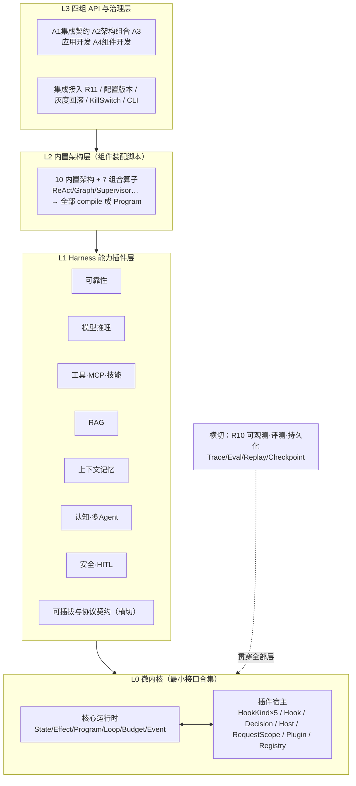

> **四层纪律**：L0 最小内核（能做成插件的不进内核）→ L1 能力插件（一切皆插件）→ L2 内置架构（架构即 Program 装配脚本）→ L3 四组 API（面向四类使用者的投影）。R10 观测评测与 R13 可插拔是横切关注点，不占独立层。
> **R2 新原语（v5）**：宿主 `Host` 用 `define(name, kind)` 定义扩展点（`kind` 取 5 种 `HookKind`），插件 `apply(host)` 只 `tap`、不声明 mode/priority；请求内状态走 `RequestScope`（typed 协作字段，无 `meta`），跨调用状态由插件实例自身持有（无独立 Policy 层）。`Hook.call(scope, effect, ...)` 把 `effect` 直送每个回调，装配期配置走构造注入。R1 只认 `host.dispatch` / `host.call` 两个注入函数，不感知 R2 内部实现。

### 2.2 一次 Effect 的完整执行流（全局主干）

v5 起执行流由 `Host` 编排，Runner 只保留唯一解释循环与纯函数 fold，所有判决经 `host.dispatch` 回传 R1。

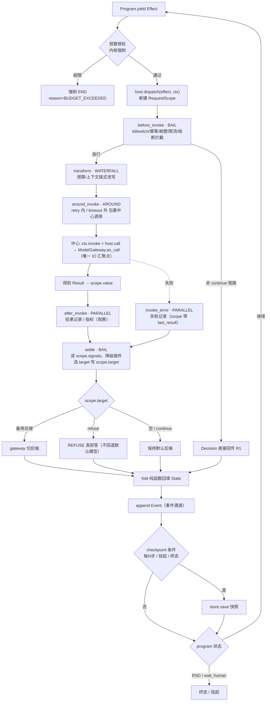

> **信号与降级（v5.2）**：守卫/重试/超时检测到故障 → `scope.emit(Signal(SignalKind.DEGRADE, reason, failed_target))`；`settle` 扩展点读 `scope.signals`，由降级插件（Degradation）选 target 写入 `scope.target`（失败目标按 failed_target 从 available 累积剔除，全剔除落 REFUSE）；Host `_settle` 把它刷新到 `ctx.degrade_target` 具名字段与 `_sticky_targets[session_id]`（经 `_session_of(ctx)` 取键，按会话隔离的跨 Effect 继承）→ R4 `as_call()` 从 `ctx.degrade_target` 读目标并切后端或 REFUSE 拒答；本轮结束 `scope.release_all()` 逆序释放资源。无独立 Signal 层、无 ControlState、无 `scope.meta` / `ctx.meta` 裸键桥接。

---

### 2.3 四组 API 面（同一内核的四个投影）

| API | 面向 | 内容 |
|-----|------|------|
| **A1 集成契约** | 平台/工具集成者 | Port 契约 + Event Stream + Projection 三类契约 |
| **A2 架构组合** | 选型用户 | 10 内置架构 + 7 组合算子（seq/par/branch/race/retry/map_state/budget） |
| **A3 应用开发** | 普通开发者 | `Agent(arch=...).profile(...).capability(...).run()` |
| **A4 组件开发** | 插件作者 | Hook / Decision / Port / Program / fold 全部低层接口 |

---

## 3. 能力全景与模块划分

### 3.1 能力域 → 模块映射

框架完整能力 = 18 域 / 169 项（完整清单见[《能力域全景》](./能力域全景.md)）。按"内聚能力合并、避免一域一模块"原则聚合为 13 个模块：

| 模块 | 层 | 覆盖能力域 | 能力项数 |
|------|----|-----------|---------|
| R1 核心运行时 | L0 | A 执行控制（内核部分）、O 持久化（内核部分） | 10 原语 |
| R2 插件总线与协议 | L0 | P7 插件管理、全部协议契约 | 5 HookKind + Host/RequestScope + ~30 协议 |
| R3 可靠性 | L1 | B 可靠性全域 | 11 |
| R4 模型与推理 | L1 | C 模型推理全域 | 10 |
| R5 工具·MCP·技能 | L1 | D 工具执行 + E 技能 | 20 |
| R6 RAG | L1 | H 检索增强全域 | 20 |
| R7 上下文与记忆 | L1 | F 上下文工程 + G 记忆 | 17 |
| R8 认知与多 Agent | L1/L2 | I 认知 + J 编排 | 19 |
| R9 安全与 HITL | L1（横切） | K 安全 + L 人机协作 | 17 |
| R10 可观测·评测·持久化 | L2/L3 | M 可观测 + N 评测 + O 持久化 | 23 |
| R11 集成接入与治理 | L3 | P 工程化 + Q 集成 + R 治理 | 23 |
| R12 内置架构与组合 | L2 | J 架构（10 内置架构 + 7 组合算子） | 17 |
| R13 可插拔与协议契约 | 横切 | 三层插拔 + 四要素 + 协议全集 + 装配例子 | 横切 |

### 3.2 模块依赖关系

```
R1(核心) ←—— R2(Host) ——→ 所有 L1 插件（Plugin.apply）
   ↑                           │
   └───────────────────────────┘
                                ↓
R8(认知编排) ──→ R10(观测评测持久化) ──→ R11(集成治理)
```

- R1 与 R2 是**双向紧耦合的内核**：R1 执行循环调用 `host.dispatch` 驱动 Hook 扩展点，`host.call` 指回 R1 注入的 Port 调用（`ctx.invoke`）；签名固定，R1 不感知 R2 内部实现。
- 所有 L1 插件只依赖 R1+R2；插件经 `Plugin.apply(host)` 在宿主定义的扩展点上 `tap`，彼此不直接依赖——协同经 `RequestScope.signals`，跨调用状态由插件实例自身持有，而非事件优先级。
- R10/R11 消费全框架事件，不被 L1 依赖。

---

## 4. 贯穿全框架的元数据与字段规范

### 4.1 统一信封与类型别名

| 类型 | 定义 | 用途 |
|------|------|------|
| `DynamicValue` | `Any` 的具名别名 | 跨 Port 无法预知形态的值，集中表达"为何动态" |
| `Payload` | `Mapping[str, DynamicValue]` | Effect 参数负载（只读） |
| `Scratchpad` | `Mapping[str, DynamicValue]` | State 用户自定义键（只读） |
| `Result` | `{ok, data, usage, error}` | Port 调用统一信封 |
| `PortError` | `{code, message, retryable}` | 结构化错误，`retryable` 驱动重试 |
| `Usage` | `{prompt_tokens, completion_tokens, cost_usd}` | 成本/token 元数据 |

### 4.2 全局元数据字段（进 trace，贯穿所有模块）

| 字段 | 类型 | 生成方 | 含义 |
|------|------|--------|------|
| `session_id` | str | Runner | 会话唯一标识 |
| `run_id` | str | Runner | 单次 run 标识 |
| `trace_id` | str | 内核注入 | 全链路追踪 ID，格式 `session:step:index` |
| `step` | int | Runner | 逻辑步序号（逻辑时钟，非墙钟） |
| `seq` | int | Runner | 事件序号，单调递增 |
| `version` | str | 装配期 | program+prompt+架构版本，回放对齐 |
| `name` | str | 每个组件 | 组件留名（强制，拒绝黑盒） |
| `fingerprint` | str | checkpoint | 事件日志 SHA256，确定性校验 |

### 4.3 确定性纪律

- 逻辑时钟（step/seq/attempt）由内核生成，**墙钟由外壳注入**，绝不进运行时状态。
- 同一 State + 同一事件日志 → 同一批 Effect（Program 纯函数，AST 扫描拒绝 `datetime.now()`/random/网络）。
- 成本用 `round(x, 10)` 避免浮点累积误差。
- 所有快照可确定性 JSON 序列化（sort_keys + 紧凑分隔符）。

---

# 第二篇 模块详设

> 每个模块按统一结构撰写：**职责边界 → 设计架构 → 流程图 → API 接口 → 元数据/核心字段 → 可插拔契约 → 验收门禁**。

## R1 核心运行时

> 层：L0 · 依赖：无（自包含）· 源码包：`runtime/` · 对应原 M1

### R1.1 职责与边界

**做**：定义三大原语（State/Effect/Program）；实现唯一解释循环与 Runner；预算硬强制；事件溯源与 checkpoint 挂点。
**不做**：任何具体 IO（不 import LLM SDK/数据库）；Hook 编排（R2）；Port 实现（R4~R11）。
**依赖注入**：`dispatch`（即 R2 `host.dispatch`）、`call`（Port 函数，由 R4~R11 提供）在构造时注入——测试时注入 fake。R1 只认这两个函数签名，不感知 R2 内部实现（5 种 HookKind、Host/RequestScope 全部封在 R2 内）。

### R1.2 设计架构

内核是**纯解释器 + 唯一 async IO 编排点**：
- `InterpreterImpl` 只做确定性推进（`program.send()` → EffectBatch | DONE），无 IO。
- `Runner` 是唯一的 async 汇聚点：预算预检 → 驱动 → batch 展开 → 并发 dispatch/call → fold → event → checkpoint。
- State 全部 frozen，任何"修改"产生新对象；`fold` 是唯一状态变更入口。
- Program 用工厂（generator 不可序列化），恢复时重建并重放事件到断点。

### R1.3 流程图

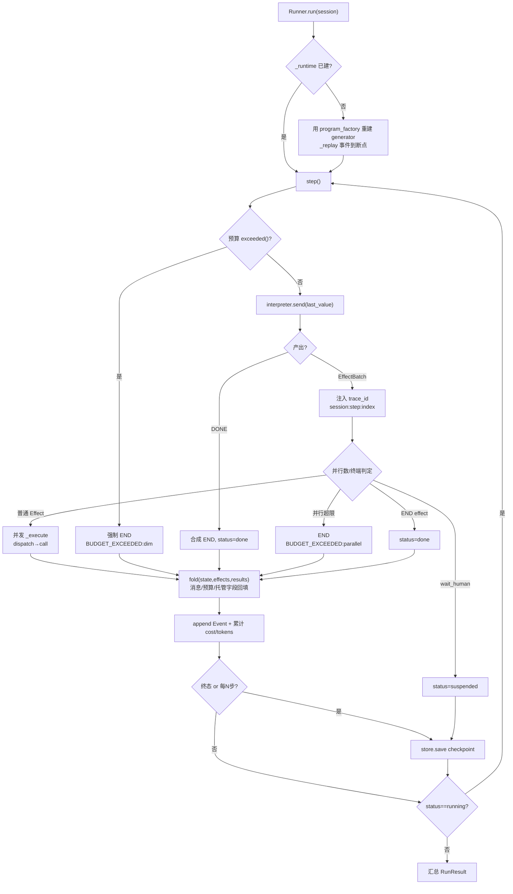

### R1.4 API 接口

```python
# ---- 原语 ----
class EffectKind(str, Enum):
    LLM="llm"; TOOL="tool"; CHILD="child"; SKILL="skill"
    WAIT_HUMAN="wait_human"; END="end";  # 自定义 port: "x-*"

@dataclass(frozen=True)
class Effect:
    kind: EffectKind
    payload: EffectPayload = field(default_factory=_empty_payload)
    batch: bool = False
    trace_id: str | None = None
    def with_payload(self, **extra) -> Effect: ...

@dataclass(frozen=True)
class Budgets:
    max_turns=30; max_hops=5; max_rounds=3; max_cost_usd=5.0
    max_tokens=100_000; max_parallel_children=8
    used_* 同上
    def exceeded(self) -> str | None: ...
    def consume(self, **deltas) -> Budgets: ...

@dataclass(frozen=True)
class AgentState:
    messages: tuple[Message, ...]
    scratch: Mapping[str, DynamicValue]
    budgets: Budgets
    version: str
    output / last_skill / last_child / last_wait_human: DynamicValue
    last_step_kinds: tuple[str, ...]; last_tokens: int; last_reason: str
    def get(self, key, default=None) -> DynamicValue: ...
    def set(self, key, value) -> AgentState: ...
    def with_(self, **changes) -> AgentState: ...

Program = Generator[Effect, DynamicValue, None]
DONE = _Done()

# ---- 执行器 ----
class Runner:
    def __init__(self, dispatch: DispatchFn, call: CallFn, *,
                 store: EventStore|None=None,
                 ctx_factory=None, checkpoint_every=1, max_steps=1000,
                 cancellation: CancellationToken | None = None): ...
    def cancel(self, reason: str) -> None: ...   # 运行期取消，下一 step 生效（内部 _CancellationHolder）
    async def run(self, session: Session) -> RunResult: ...
    async def step(self, session: Session) -> StepReport: ...
    async def resume(self, session: Session, answer: DynamicValue) -> RunResult: ...
    def replay(self, session: Session, initial: AgentState) -> AgentState: ...
    def load(self, session_id: str, program_factory) -> Session: ...

# ---- 纯函数 ----
def fold(state, effects, results, reason="") -> AgentState: ...
def checkpoint(session) -> JsonSnapshot: ...
def restore_checkpoint(snapshot, program_factory) -> Session: ...
def fingerprint(events) -> str: ...

DispatchFn = Callable[[Effect, DynamicValue], Awaitable[DynamicValue]]  # R2 host.dispatch 注入（签名不变）
CallFn = Callable[[Effect, DynamicValue], Awaitable[Result]]            # Port 注入
```

> **判决消费契约（命脉，不变）**：R1 经 `dispatch` 收到 Decision 后由 `_settle` 消费 4 类终止型 action——CONTINUE 放行 / ABORT、DENY 失败 / FALLBACK 兜底值；DEGRADE 由注入的 `host.dispatch` / `host.call` 适配器消费（`scope.target` → `ctx.degrade_target` → gateway 切后端 / REFUSE 拒答），R1 内核不解释降级目标。`ctx.invoke` 注入保持不变；`_coerce_verdict` 对未知 action 回退 CONTINUE 的边界保留。RETRY 由 R2/R3 的 AROUND 扩展点实现，R1 不感知 R2 内部实现。

### R1.5 元数据与核心字段

**AgentState 核心字段**：

| 字段 | 类型 | 说明 |
|------|------|------|
| messages | tuple[Message,...] | 对话历史，只增不减（裁剪是视图层的事，R7） |
| scratch | Mapping | 用户/插件自定义键（phase/cursor/steps…），冻结只读 |
| budgets | Budgets | 多维预算，每 fold 由 Runner 强制扣减 |
| version | str | program+prompt+架构版本，进 trace 供回放对齐 |
| output | DynamicValue | END Effect 最终产出（框架托管字段） |
| last_* | DynamicValue | 最近一次 SKILL/CHILD/WAIT_HUMAN 结果（框架托管） |

**Event 核心字段**：

| 字段 | 类型 | 说明 |
|------|------|------|
| seq / step | int | 逻辑时钟，保证确定性回放 |
| state_snapshot | AgentState | fold 后的完整状态快照 |
| effects / results | tuple | 本步声明与结果，一一对应 |
| cost_usd / tokens | float/int | 审计与预算扣减依据 |
| status / reason | str | running/done/suspended/error 与迁移原因 |

**EffectPayload 已知键**（TypedDict total=False）：`messages/tools/model/temperature/max_tokens`（LLM）、`task_hint`（LLM 任务提示，R4 路由）、`meta`（扩展元数据容器，如 max_cost_per_call）、`call/calls/call_id`（TOOL）、`budget/port`（通用）、`name/part`（SKILL）、`program_factory/program/state`（CHILD）、`question/options`（HUMAN）、`output/reason`（END）。自定义 `x-*` port 可写未声明键。

### R1.6 可插拔契约

| 注入点 | 协议 | 默认 | 入口 |
|--------|------|------|------|
| dispatch | DispatchFn（R2 `host.dispatch`） | 无（必注入） | `Runner(dispatch=...)` |
| call | CallFn | 无（必注入） | `Runner(call=...)` |
| checkpoint 存储 | EventStore | InMemoryEventStore | `Runner(store=...)` |
| 上下文工厂 | ctx_factory | RuntimeCtx | `Runner(ctx_factory=...)` |

### R1.7 验收门禁

| 门禁 | 条目 | 达标标准 | 级别 |
|------|------|---------|------|
| R1-G1 | 覆盖率 | interpreter/fold/budget 单测 ≥90%，mypy strict 通过 | G1 |
| R1-G2 | 确定性 | 同输入两次 run 事件日志哈希逐字节一致 | G2 |
| R1-G2 | 回放 | 事件重放恢复 State 与终态全等 | G2 |
| R1-G2 | 预算 | 6 维预算各有超限强制 END 用例 | G2 |
| R1-G3 | 集成 | fake dispatch/call 跑通主流程；wait_human 挂起→恢复→续跑 | G3 |
| R1-红线 | 纯函数 | Program 内出现时间/随机/网络调用 → AST 拒绝 | 红线 |

---

## R2 插件总线与协议

> 层：L0 · 依赖：R1 · 源码包：`hooks/` · 对应原 M2 重构

### R2.1 职责与边界

**做**：定义 5 种 HookKind 原语（Bail/Waterfall/Loop/Parallel/Around）与统一返回 Decision；实现 Host（define/plugin/freeze/dispatch/call）+ RequestScope 两层模型；Capability/Provider/Registry 抽象；全部对外协议契约（Port/DTO）。
**不做**：具体能力实现（R3~R9）；执行循环（R1）。
**核心变化**：原 HookBus 四 mode + DEGRADER + ControlState → 5 种 HookKind；插件不自声明 mode/priority/events，统一经 `Plugin.apply(host)` 注册；每次调用新建 `RequestScope` 承载 typed 协作字段（无 `meta`），跨调用状态由插件实例自身持有（无独立 Policy 层）。v5.1 起 `Hook.call(scope, effect, ...)` 把 `effect` 直送回调、装配期配置走构造注入（参数不进公共容器）。R1 的 `dispatch`/`call` 签名保持不变。

### R2.2 设计架构

Host 是**唯一装配与分发入口**：`define(name, kind)` 定义扩展点并选定 kind；插件 `apply(host)` 只用 `hook.tap(name, fn)` 订阅；`freeze()` 做装配期校验；每次调用新建 RequestScope，扩展点按 kind 语义执行并写信号/目标，最终 Decision 交 R1 `_settle`。`Hook.call(scope, effect, ...)` 把 effect 作为参数直送每个 tap（BAIL/LOOP/PARALLEL `fn(scope, effect)`；WATERFALL `fn(value, effect)`；AROUND `fn(next, scope, effect)`），装配期配置由插件构造参数私有持有——公共通道只放协作数据，防止入参被任意插件篡改。总线不碰 IO，AROUND 的中心指回 R1 注入的 `call`。

**5 种 HookKind 语义**：
- **Bail**：按 tap 序执行，首个非 `None` / 非 continue 返回即停（拦截）。
- **Waterfall**：上次返回值作下次首参，链式改写。
- **Loop**：任一 tap 返回非 `None` 则重跑整链（带上限，防死循环）。
- **Parallel**：`gather` 全执行、异常隔离、返回 `None`（或首个结果）。
- **Around**：fn 收到 `next` 回调，包裹中心调用（retry 内、timeout 外）。

**两层模型**：`Host` 持有扩展点与每次调用新建的 `RequestScope`（signals/target/last_result/trace/value/releases，无 `meta`）；跨调用状态由插件实例自身持有（熔断三态机在 `CircuitBreaker`、ladder+available 在 `Degradation`）；无独立 Policy 层、无 Signal 层、无 ControlState。Host 内部用 `_scope_bridge[id(ctx)]` 关联 dispatch 与 call 阶段的 scope，`_sticky_targets: dict[session_id, str]` 按会话隔离承担降级目标的跨 Effect 继承（替代全局单槽，消除多会话串味）。

### R2.3 流程图

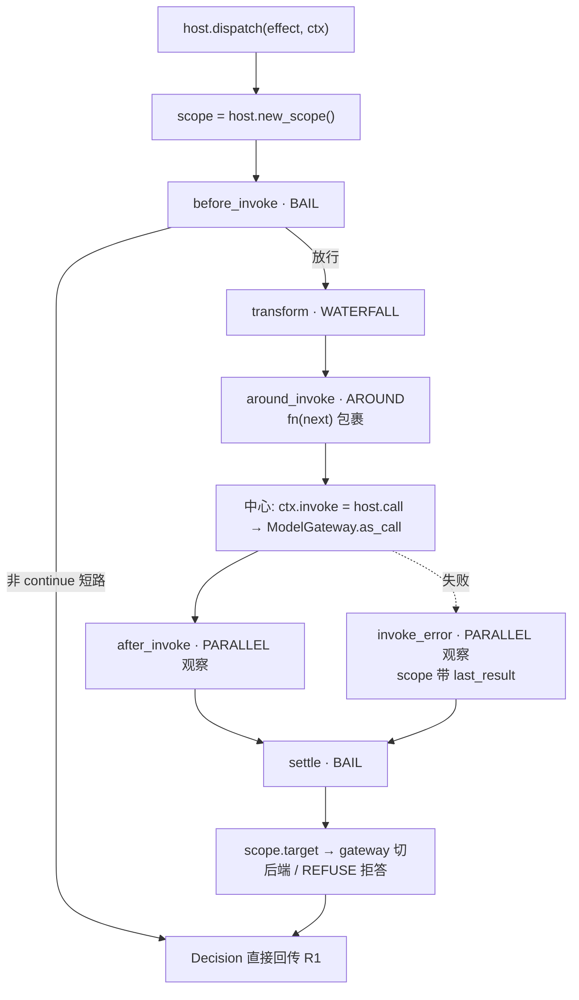

### R2.4 API 接口

```python
class HookKind(str, Enum):
    BAIL="bail"; WATERFALL="waterfall"; LOOP="loop"
    PARALLEL="parallel"; AROUND="around"

class SignalKind(str, Enum):
    DEGRADE="degrade"; ABORT="abort"     # 代码内一律用枚举，禁裸串

class Signal:
    kind: SignalKind | str   # SignalKind.DEGRADE / SignalKind.ABORT（无 budget 取值）
    reason: str
    failed_target: str|None = None

@dataclass(frozen=True)
class Decision:
    action: DecisionAction
    payload_patch: Mapping|None = None; context_inject: str|None = None
    state_patch: Mapping|None = None; target: str|None = None
    value: DynamicValue = None; retry: RetrySpec|None = None; reason: str = ""
    @classmethod
    def continue_(cls) -> Decision: ...
    @classmethod
    def deny(cls, reason) -> Decision: ...
    @classmethod
    def rewrite(cls, *, context=None, payload=None) -> Decision: ...

class RequestScope:                      # 每次 call 新建；替代 ControlState；只放协作数据，无 meta
    signals: list[Signal] = field(default_factory=list)
    target: str|None = None              # settle 写入，供 R4 经 ctx.degrade_target 读取
    last_result: Result | None = None    # host.call 写入本次 Result，观察插件只读（_coerce_result 归一化）
    trace: list[str] = field(default_factory=list)
    value: Result | None = None          # settle 兜底判决载体（Result|None，非 Any）
    releases: list[Callable[[], None]] = field(default_factory=list)   # 资源释放回调，Host 每轮结束逆序执行
    def emit(self, signal: Signal) -> None: ...
    def release_all(self) -> None: ...   # LIFO、幂等

class Hook:                              # 宿主定义时选定 kind；插件只 tap
    name: str; kind: HookKind
    def tap(self, plugin_name: str, fn: Callable[..., Awaitable[Any]|Any]) -> Hook: ...
    async def call(self, scope: RequestScope, effect: Any = None, *args, **kwargs) -> Any: ...
    # effect 直送回调，不进任何共享容器：
    #   BAIL/LOOP/PARALLEL → fn(scope, effect)
    #   WATERFALL          → fn(value, effect)
    #   AROUND             → fn(next, scope, effect)

class Plugin(Protocol):                  # 唯一扩展点：apply(host)，不自声明 mode/priority/events
    name: str
    def apply(self, host: Host) -> None: ...
class Host:                              # 替代 HookBus（无 Policy 注册表）
    hooks: dict[str, Hook]
    def define(self, name: str, kind: HookKind) -> Hook: ...
    def plugin(self, plugin: Plugin) -> Host: ...       # 调 plugin.apply(self)
    def freeze(self) -> Host: ...
    def new_scope(self, session_id: str = "") -> RequestScope: ...   # 继承该会话 sticky target
    @staticmethod
    def _session_of(ctx: RuntimeCtx | HookCtx) -> str: ...
    def sticky_target_of(self, session_id: str) -> str | None: ...
    def set_sticky_target(self, session_id: str, target: str) -> None: ...
    async def dispatch(self, effect, ctx) -> Decision: ...   # R1 注入点，签名不变
    def call(self) -> Callable: ...                          # R1 注入点，签名不变

class Capability(Protocol):                              # 能力级开关
    name: str; version: str = "1.0.0"; requires: tuple[str,...] = ()
    def install(self, host: Host, reg: Registry) -> None: ...
class Provider(Protocol):                                # 策略级契约（基）
    name: str
class Registry:                                          # 注册表
    def register(self, name: str, provider: Provider) -> None: ...
    def resolve(self, name: str) -> Provider: ...        # 缺失→HostError
    def replace(self, name: str, provider: Provider) -> None: ...
```

### R2.5 扩展点清单与元数据

宿主定义、四模块共用的 6 个扩展点：

| 名称 | kind | 作用 |
|------|------|------|
| `before_invoke` | BAIL | killswitch/幂等/舱壁/限流/熔断 拦截 |
| `transform` | WATERFALL | 预算/上下文改写 |
| `around_invoke` | AROUND | retry/timeout 包裹真实 Port 调用（内 retry、外 timeout） |
| `after_invoke` | PARALLEL | 观察类：结果记录、指标 |
| `invoke_error` | PARALLEL | 观察类：失败记录（scope 带 last_result） |
| `settle` | BAIL | 降级裁决：读 scope.signals，降级插件选 target 写 scope.target |

**Decision.action → R1 行为**：continue→继续；rewrite→改写；deny→拒绝；ask→挂起；retry→重放；degrade→换目标；fallback→兜底；abort→终止。
**Signal → 降级链**：守卫/重试/超时 → `scope.emit(Signal(SignalKind.DEGRADE, reason, failed_target))`；`settle` 读 signals 由降级插件（Degradation.select）选 target 写 `scope.target` → Host `_settle` 刷新 `ctx.degrade_target` 具名字段与 `_sticky_targets[session_id]`（按会话隔离）→ R4 `as_call()` 从 `ctx.degrade_target` 切后端或 REFUSE 真拒答；本轮结束 `scope.release_all()` 逆序释放资源。

### R2.6 可插拔契约

| 注入点 | 协议 | 默认 | 入口 | 校验 |
|--------|------|------|------|------|
| 横切行为 | Plugin.apply(host) → hook.tap | 无（按需） | `host.plugin(p)` | 缺 name/非法 kind/缺依赖 → 拒绝 |
| 能力组件 | Capability | 各内置能力 | `.capability()` | requires 未装 → 拒绝 |
| 策略/端口 | Provider/Port | 内置默认 | `registry.register()` | 缺方法/缺 name → 拒绝 |
| 返回 | Decision | — | hook 返回 | retry 无幂等键 → 运行期拒绝 |

### R2.7 验收门禁

| 门禁 | 条目 | 达标标准 | 级别 |
|------|------|---------|------|
| R2-G1 | 覆盖 | 5 种 HookKind × 扩展点矩阵用例全过，≥90% | G1 |
| R2-G2 | 原语语义 | HookKind/Host/RequestScope/Signal 齐全；R1 消费 4 类终止 action，未知回退 CONTINUE | G2 |
| R2-G2 | 隔离 | hook 抛异常不影响主流程且记 trace | G2 |
| R2-G2 | 顺序 | 扩展点 tap 序确定（快照测试） | G2 |
| R2-G3 | 留名 | 一次 dispatch 后 trace 含全部 plugin name | G3 |
| R2-红线 | 唯一扩展点 | 出现 middleware/filter/pipe/HookMode/ControlState/DEGRADER/bus.on 独立 API → 拒绝 | 红线 |

## R3 可靠性

> 层：L1 · 依赖：R1+R2 · 源码包：`harness/resilience/` · 详见 R3 模块详设

### R3.1 职责与边界

**做**：重试、熔断、降级、限流、舱壁、幂等、预算策略、watchdog/killswitch——全部是 Hook 插件，返回 Decision。
**不做**：不碰内核预算硬强制（R1）、不做结构化输出的修复（R4）。
**共享设施**：失败分类表 `FailureClassifier` + 维度键 `DimensionKey`（按 provider/model/tool/tenant 隔离计数）。

### R3.2 设计架构

可靠性是**五道防线叠加**，每道防不同的故障，由不同插件实现，通过事件联动：
- 重试防瞬态错误（429/超时），熔断防持续宕机，降级给兜底出口，watchdog 防空转循环，预算+killswitch 兜住成本失控。
- 插件经 `Plugin.apply(host)` 在宿主扩展点上 `tap`，执行顺序由宿主定义与 tap 注册序保证确定性：`before_invoke`(BAIL): killswitch→bulkhead→ratelimit→breaker→degrade；`invoke_error`(PARALLEL): retry 判定→breaker 计数。

### R3.3 流程图

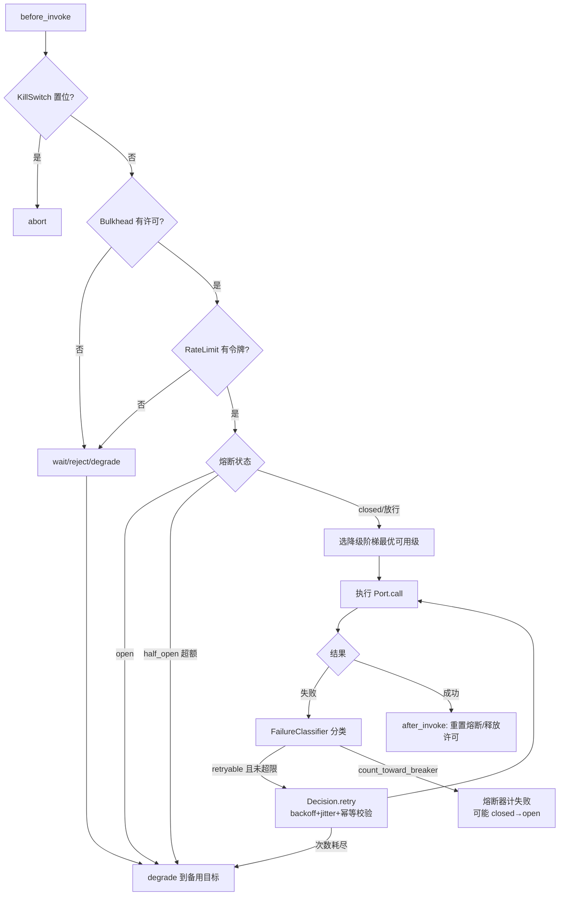

### R3.4 API 接口

```python
@dataclass(frozen=True)
class FailureClass:
    retryable: bool; count_toward_breaker: bool
    suggested_delay: float|None; code: str
class FailureClassifier(Protocol):
    def classify(self, result: Result, ctx: HookCtx) -> FailureClass: ...

@dataclass(frozen=True)
class RetrySpec:
    max_attempts: int = 3; base_delay: float = 0.5; multiplier: float = 2.0
    max_delay: float = 30.0
    jitter: Literal["none","full","equal","decorrelated"] = "full"
    respect_retry_after: bool = True
    idempotency_required: bool = True

class CircuitBreaker:
    def __init__(self, failure_rate=0.5, minimum_samples=5, window_size=20,
                 open_cooldown_s=30, half_open_max_probes=3, per_dimension=True): ...
class Degradation:
    def __init__(self, ladder: DegradeLadder): ...
class RateLimit:
    def __init__(self, algorithm="token_bucket", rate=60, burst=10, on_exceed="wait"): ...
class Bulkhead:
    def __init__(self, pools: dict, acquire_timeout=5, on_full="reject"): ...
class Idempotency:
    def __init__(self, dedup_store: StorePort, ttl=86400): ...
class Watchdog:
    def __init__(self, window=10, repeat_k=3, detect_abab=True): ...
class KillSwitch:
    def __init__(self, flag_store, scope="session"): ...
class BudgetGuard(Hook):  # 软阈值 rewrite 收尾
    def __init__(self, soft=0.8): ...
```

### R3.5 元数据与核心字段

| 字段 | 类型 | 说明 |
|------|------|------|
| DimensionKey | tuple[str,str] | (维度类型, 目标名)，如 ("provider","openai") |
| attempt | int | 当前重试次数，由 HookCtx 携带（RequestScope 不持有该字段） |
| BreakerState.status | closed/open/half_open | 熔断三态 |
| failure_rate | float | 滑窗内失败率，达阈值触发 open |
| DegradeStep.quality | float | 质量分（1.0 最优 → 0.0 拒答），进 trace |
| idempotency_key | str | 副作用操作幂等键 |

**降级矩阵**：主模型→备模型→便宜模型→语义缓存→明确拒答（禁止编造）。降级链必须无环（static_check）。

### R3.6 可插拔契约

| 注入点 | 协议 | 默认 | 校验 |
|--------|------|------|------|
| 失败分类 | FailureClassifier | 默认分类表 | code 覆盖完整 |
| 退避策略 | RetrySpec.jitter | full | base_delay=0 且 none 拒绝 |
| 降级阶梯 | DegradeLadder | LLM 默认阶梯 | 无拒答兜底/成环 → 拒绝 |
| 熔断器存储 | BreakerStore（异步 load/save，R3 导出） | InMemoryBreakerStore | 缺省进程内；多实例部署注入 Redis/DB 实现 |

### R3.7 验收门禁

| 门禁 | 条目 | 达标标准 | 级别 |
|------|------|---------|------|
| R3-G1 | 覆盖 | 各插件单测 ≥90% | G1 |
| R3-G2 | 重试 | 退避区间/上限/幂等拦截/预算拦截各有用例 | G2 |
| R3-G2 | 熔断 | 三态迁移/半开探测/样本不足不 open 各有用例 | G2 |
| R3-G2 | 降级 | 全不可用→明确拒答；降级链成环装配期报错 | G2 |
| R3-G3 | 协同 | 五插件按 tap 注册顺序执行，trace 可见 | G3 |
| R3-红线 | 幂等 | 无幂等键的副作用重试 → 拒绝 | 红线 |

---

## R4 模型与推理

> 层：L1 · 依赖：R1+R2 · 源码包：`harness/model/` · 详见 R4 模块详设

### R4.1 职责与边界

**做**：多 Provider 接入、模型路由、跨 provider 降级、语义/KV 缓存、结构化输出与修复重试、流式、token 计数与成本归因。
**不做**：工具执行（R5）。降级链的执行逻辑在 R3，R4 提供"模型维度"的路由与缓存。

### R4.2 设计架构

LLM 调用经 before_invoke 链：缓存命中直接返回（省钱省延迟）→ 路由选模型 → 调用 → after_model 结构化校验（不合法则修复重试）→ 成本归因。模型降级矩阵复用 R3 的 Degradation 插件，目标从 provider 维度取。

### R4.3 流程图

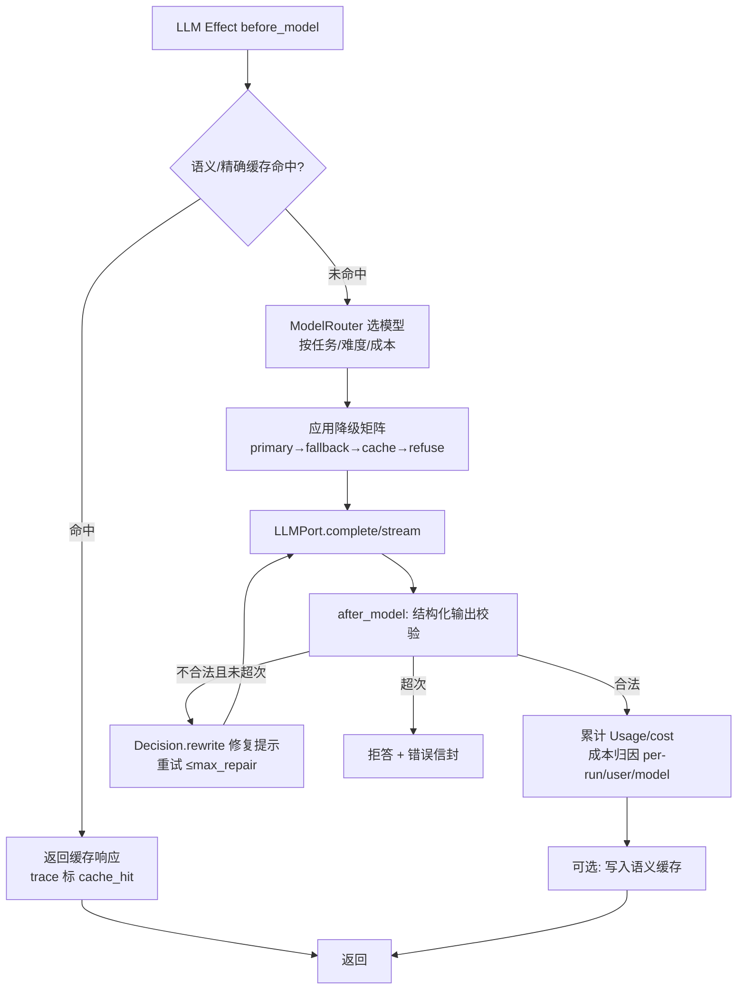

### R4.4 API 接口

```python
class LLMPort(Protocol):                              # 已在 ports/protocols.py
    async def complete(self, req: LLMRequest, ctx: PortCtx) -> LLMResponse: ...
    last_usage: Usage | None   # 流式结算口，末块后写入；网关不估算不兜零
    def stream(self, req: LLMRequest, ctx: PortCtx) -> AsyncIterator[str]: ...  # PEP525：async gen 用 def 声明

class ModelRouter(Protocol):
    name: str
    def route(self, effect: Effect, ctx: StrategyCtx) -> str: ...   # 返回 model 名

class CachePort(Protocol):                         # 缓存策略（异步）
    name: str
    async def get(self, request: LLMRequest, *, version: str = "v1") -> LLMResponse|None: ...
    async def put(self, request: LLMRequest, resp: LLMResponse, *, version: str = "v1") -> None: ...
    async def invalidate(self, request: LLMRequest, *, version: str = "v1") -> None: ...
class CacheStore(Protocol):                        # 存储工具（可换 Redis/DB）
    async def get(self, key: str) -> str|None: ...
    async def put(self, key: str, value: str, *, ttl: int|None = None) -> None: ...
    async def delete(self, key: str) -> None: ...
    async def scan(self, prefix: str) -> list[tuple[str, str]]: ...
class CacheEmbedder(Protocol):                     # embedding（可换向量模型）
    async def embed(self, text: str) -> tuple[float, ...]: ...

@runtime_checkable
class SchemaValidator(Protocol):               # 结构化校验器协议（可注入，R4 v1.6）
    name: str                                  # 履约校验/进 trace
    def validate(self, value: object, schema: dict) -> list[str]: ...   # 错误列表；空=合法
class MinimalSchemaValidator: ...              # 默认：现有最小 JSON Schema（type/required/properties/enum/minimum）

@dataclass(frozen=True)
class StructuredOutputSpec:
    schema: dict                                   # JSON Schema
    mode: Literal["constrained","prompt","repair"] = "repair"
    max_repair: int = 2
    strict: bool = True
```

### R4.5 元数据与核心字段

| 字段 | 说明 |
|------|------|
| LLMRequest | messages / tools_catalog / model / temperature / max_tokens |
| LLMResponse | content / tool_calls / usage / model |
| Usage | prompt_tokens / completion_tokens / cost_usd |
| cache key | hash(messages + model + params + prompt_version) |
| 成本归因维度 | per-run / per-agent / per-user / per-model |

**降级矩阵模型维度**：强模型→中模型→便宜模型→语义缓存答案→明确拒答；每级带 quality 分与延迟预算。

### R4.6 可插拔契约

| 注入点 | 协议 | 默认 | 校验 |
|--------|------|------|------|
| LLM 后端 | LLMPort | OpenAI-compat | 实现 complete/stream |
| 路由 | ModelRouter | 规则路由 | 返回目标已注册 |
| 缓存 | CachePort | ExactCache + SimilarityCache | 异步；收 request；可换 store/embedder |
| 结构化输出 | StructuredOutputSpec | repair 模式 | schema 合法 |
| 结构化校验器 | SchemaValidator | MinimalSchemaValidator | 实现 validate(value,schema)→错误列表；换实现后修复循环同步生效 |

### R4.7 验收门禁

| 门禁 | 条目 | 达标标准 | 级别 |
|------|------|---------|------|
| R4-G1 | 覆盖 | 路由/缓存/结构化输出单测 ≥85% | G1 |
| R4-G2 | 结构化 | 未过 schema 校验的输出不进业务逻辑 | G2 |
| R4-G2 | 缓存 | 语义误命中率评测达标；键含版本 | G2 |
| R4-G3 | 集成 | 换 LLMPort 实现上层零改动 | G3 |
| R4-红线 | 成本 | 路由/重试不得绕过 Budgets | 红线 |

---

## R5 工具·MCP·技能

> 层：L1 · 依赖：R1+R2 · 源码包：`harness/tools/` + skills/ · 详见 R5 模块详设

### R5.1 职责与边界

**做**：工具定义（@tool/pydantic）、统一 ToolRegistry、MCP 发现并合并进同一合集、技能 manifest/正文、tools+skills 三级渐进披露、danger 四级路由、代码/shell/文件执行（经沙盒）。
**不做**：沙盒实现细节（R9 提供 SandboxPort，R5 只做路由）。

### R5.2 设计架构

**统一合集**是核心：本地 @tool 工具、MCP 工具（`mcp__server__tool`）、Skill 正文都进同一个 Registry，运行时无差别。三级披露对统一合集投影：L1 目录常驻 / L2 schema 按需 / L3 正文按需。danger 分级驱动沙盒与审批路由。

### R5.3 流程图

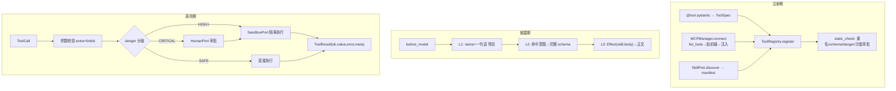

### R5.4 API 接口

```python
def tool(name=None, danger=DangerLevel, sandbox=SandboxPolicy.AUTO,
         timeout=30, retries=2): ...           # 装饰器；pydantic model 即 schema

@dataclass(frozen=True)
class ToolSpec:
    name: str; description: str; parameters_schema: dict
    danger: DangerLevel|None; source: Literal["local","mcp","skill"]

class ToolPort(Protocol):                       # 已实现
    def register(self, spec, fn, *, bind=False) -> None: ...
    def catalog(self, level=1) -> list[ToolSpec]: ...
    def schema_of(self, name) -> dict: ...
    async def call(self, call: ToolCall, ctx: PortCtx) -> ToolResult: ...

class MCPTransport(Protocol):                   # 用户可接入自己的 MCP 客户端
    async def list_tools(self, server) -> list[ToolSpec]: ...
    async def call_tool(self, server, tool, args, ctx) -> DynamicValue: ...
    async def ping(self, server) -> bool: ...

class SkillPort(Protocol):
    def discover(self) -> list[SkillManifest]: ...
    def catalog(self) -> list[SkillManifest]: ...
    def body(self, name) -> str: ...            # L3 正文

class DisclosureIndex(Protocol):
    def disclose(self, names, skills) -> DisclosurePacket: ...   # {L1,L2,L3,token_cost}
```

### R5.5 元数据与核心字段

| 字段 | 说明 |
|------|------|
| ToolSpec.name | 全局唯一；MCP 为 `mcp__<server>__<tool>`；用户工具 `x-*` 前缀 |
| ToolSpec.danger | SAFE/LOW/HIGH/CRITICAL，必填 |
| ToolSpec.source | local/mcp/skill，审计用 |
| ToolResult.meta | danger/source/sandbox/duration_ms/approved/retryable |
| DisclosurePacket | L1/L2/L3/token_cost，披露成本进 trace |
| SkillManifest | name/version/描述/触发词 |

### R5.6 可插拔契约

| 注入点 | 协议 | 默认 | 校验 |
|--------|------|------|------|
| 工具实现 | ToolPort/@tool | ToolRegistry | danger 必填/schema 合法/高危配沙盒 |
| MCP 客户端 | MCPTransport | stdio/http | 三方法齐全；MCP 工具 L1 只进目录（红线） |
| 技能 | SkillPort | 文件技能 | 正文过注入检测 |
| 披露策略 | DisclosureIndex | ToolIndex | token 预算；>20 条强制披露 |

### R5.7 验收门禁

| 门禁 | 条目 | 达标标准 | 级别 |
|------|------|---------|------|
| R5-G1 | 覆盖 | 注册/披露/调用三期单测 ≥85% | G1 |
| R5-G2 | 合并 | 本地与 MCP 工具同一 Registry，catalog/call 无差别 | G2 |
| R5-G2 | 披露 | L1 不含完整 schema；超预算报错 | G2 |
| R5-G3 | 路由 | danger 四级路由（审批/沙盒/直执行）各有用例 | G3 |
| R5-红线 | 安全 | CRITICAL 未审批执行；MCP schema 全量进 L1 → 拒绝 | 红线 |

---

## R6 RAG 检索增强

> 层：L1 · 依赖：R1+R2 · 源码包：`harness/rag/` · 详见 R6 模块详设

### R6.1 职责与边界

**做**：20 项链路优化（离线入库 5 层 + 在线检索 12 层 + 横切 3 层），每段是 Protocol + 默认实现，可单独替换与评测。
**不做**：把检索结果当指令执行（注入检测在 R9）；记忆的语义（R7 复用本模块的 Embedder/VectorStore）。

### R6.2 设计架构

RAG 不是一个组件，是**可分层评测、逐层优化**的流水线。分层是"链路优化"的前提——能定位是哪一层掉了指标。核心纪律：**召回是上限，重排是逼近上限**，先修召回再修排序。

### R6.3 流程图

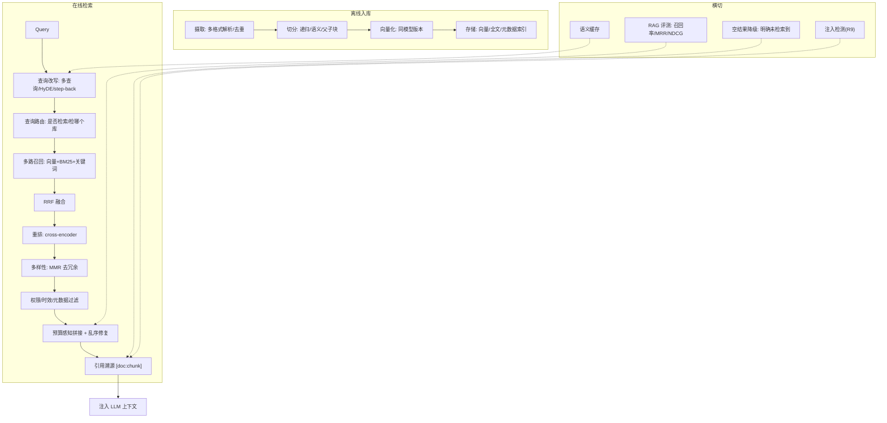

### R6.4 API 接口

```python
class Splitter(Protocol):
    name: str
    def split(self, doc: Document) -> list[Chunk]: ...
class Embedder(Protocol):
    name: str
    async def embed(self, texts: list[str]) -> list[Vector]: ...
class VectorStore(Protocol):
    name: str
    async def upsert(self, chunks: list[Chunk]) -> None: ...
    async def search(self, vec, top_k, filters) -> list[Hit]: ...
class Retriever(Protocol):
    name: str
    async def retrieve(self, query: Query) -> list[Hit]: ...
class Reranker(Protocol):
    name: str
    def rerank(self, hits: list[Hit], query: Query) -> list[Hit]: ...
class QueryRewriter(Protocol):
    name: str
    async def rewrite(self, query: Query) -> list[Query]: ...
class PostProcessor(Protocol):
    name: str
    def filter(self, hits: list[Hit]) -> list[Hit]: ...
    def assemble(self, hits: list[Hit], budget: TokenBudget) -> RAGResult: ...

class RAGPipeline:
    def __init__(self, splitter, embedder, store, retriever, post, *,
                 rewrite=None, rerank=None, cache=None): ...
    async def ingest(self, docs: list[Document]) -> None: ...
    async def query(self, q: Query) -> RAGResult: ...
    def with_(self, **replacements) -> RAGPipeline: ...    # 不可变替换
```

### R6.5 元数据与核心字段

| 字段 | 结构 | 说明 |
|------|------|------|
| Chunk | {chunk_id, doc_id, text, tokens, meta} | meta 含标题/页码/权限标签 |
| Hit | {chunk, score, source, ts} | 检索命中 |
| Query | {text, filters, top_k, token_budget, purpose} | purpose 区分问答/记忆召回 |
| RAGResult | {context, citations, hits, empty, tokens_used} | empty=True 时固定提示文本 |
| TokenBudget | int | 从 R1 Budgets 派生 |
| RRF 常数 k | 60 | RRF(d)=Σ weight/(k+rank) |

**内置优化**：查询改写(multi-query/HyDE)、混合检索 RRF、cross-encoder 重排、MMR 去冗余、预算贪心拼接+乱序修复、引用溯源、语义缓存、空结果降级、注入防御。

### R6.6 可插拔契约

| 注入点 | 协议 | 默认 | 校验 |
|--------|------|------|------|
| 五段 | Splitter/Embedder/... | 递归/OpenAI-compat/内存... | 方法齐全；DTO 对齐；维度匹配 |
| 重排 | Reranker | cross-encoder | 返回 Hit 结构 |
| 改写 | QueryRewriter | 多查询 | 不引入原问题没有的实体 |

### R6.7 验收门禁

| 门禁 | 条目 | 达标标准 | 级别 |
|------|------|---------|------|
| R6-G1 | 覆盖 | 五段替换用例，换任一段上层零改动 | G1 |
| R6-G2 | 预算 | 拼接永不超 TokenBudget（含边界） | G2 |
| R6-G2 | 降级 | 空结果/检索异常确定性降级用例 | G2 |
| R6-G3 | 质量 | 混合检索召回高于纯向量基线 | G3 |
| R6-红线 | 安全 | 无引用溯源/空结果编造/检索文本未过注入检测 → 拒绝 | 红线 |

---

## R7 上下文与记忆

> 层：L1 · 依赖：R1+R2 · 源码包：`harness/context/` + memory/ · 详见 R7 模块详设

### R7.1 职责与边界

**做**：上下文组装/压缩 compaction/大结果卸载 offloading/渐进披露（披露执行在 R5）；长期记忆 hot/warm/cold 三层 × episodic/semantic/procedural 三类、写入提炼/召回/遗忘/晋升。
**不做**：改 State.messages（裁剪是视图层，messages 只增不减）。

### R7.2 设计架构

上下文窗口是稀缺 RAM（context rot：越长质量越差），本模块像 OS 管理内存：分段组装 + 配额 + 阈值压缩 + 大结果卸载。记忆分三层（hot 会话内/warm 结构化摘要/cold 全文归档），写入与压缩都在会话边界触发，**顺序必须是先写 cold 全文再压缩**（否则细节丢失无法提炼）。

### R7.3 流程图

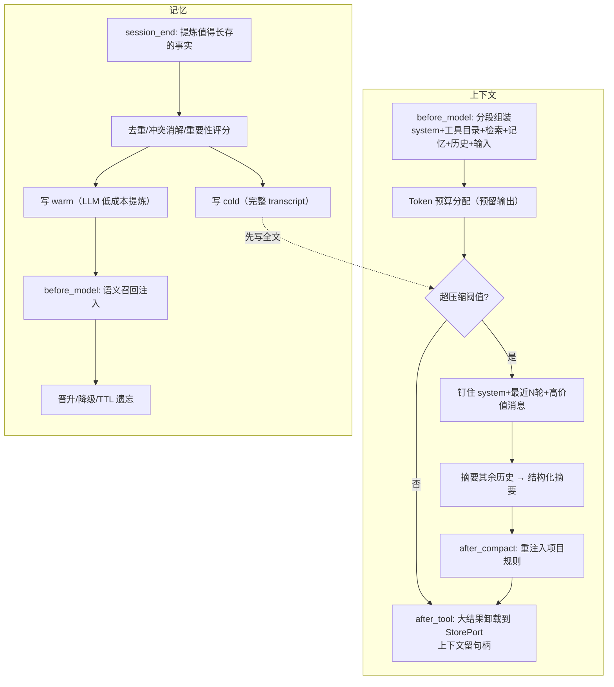

### R7.4 API 接口

```python
class ContextAssembler(Protocol):
    name: str
    def assemble(self, sections: list[ContextSection], budget: TokenBudget) -> list[Message]: ...

class CompactionPolicy(Protocol):
    name: str
    def should_compact(self, state: AgentState) -> bool: ...
    def compact(self, messages: tuple[Message,...]) -> tuple[Message,...]: ...

class Offloader(Protocol):
    name: str
    async def offload(self, value: DynamicValue, store: StorePort) -> str: ...  # 返回句柄

class MemoryPort(Protocol):                       # 已定义
    async def read(self, ns, key, ctx) -> DynamicValue: ...
    async def write(self, ns, key, value, ctx) -> None: ...
    async def forget(self, ns, key, ctx) -> None: ...

@dataclass(frozen=True)
class MemoryItem:
    kind: Literal["episodic","semantic","procedural"]
    content: str; importance: float; ts: int; source: str
```

### R7.5 元数据与核心字段

| 字段 | 说明 |
|------|------|
| ContextSection | section 名/内容/配额/优先级/裁剪策略 |
| CompactionPolicy 参数 | trigger_tokens(窗口70%)/trigger_turns(12)/keep_recent(4)/pin_patterns |
| MemoryTier | hot(Redis/短TTL) / warm(PG+pgvector/结构化) / cold(对象存储/全文) |
| MemoryItem.kind | episodic 情节 / semantic 事实 / procedural 流程 |
| offload 句柄 | store://id + 摘要，模型按需再读 |

### R7.6 可插拔契约

| 注入点 | 协议 | 默认 | 校验 |
|--------|------|------|------|
| 组装 | ContextAssembler | 默认分段 | system 段不可被覆盖 |
| 压缩 | CompactionPolicy | 阈值摘要 | 压缩后保留进度与未完成任务 |
| 卸载 | Offloader | 阈值卸载 | 句柄必须可读 |
| 记忆 | MemoryPort | 内存/向量 | 写入内容过注入检测；secret 不写 |

### R7.7 验收门禁

| 门禁 | 条目 | 达标标准 | 级别 |
|------|------|---------|------|
| R7-G1 | 覆盖 | 组装/压缩/卸载/记忆单测 ≥85% | G1 |
| R7-G2 | 压缩 | 超阈值触发；钉住消息保留；after_compact 重注入规则 | G2 |
| R7-G2 | 记忆 | 分层晋升/降级/遗忘各有用例 | G2 |
| R7-G3 | 集成 | 先写 cold 再压缩的顺序确定性 | G3 |
| R7-红线 | 一致 | 压缩不改 messages；secret 进记忆 → 拒绝 | 红线 |

## R8 认知与多 Agent 编排

> 层：L1/L2 · 依赖：R1+R2 · 源码包：`harness/cognition/` + archs/ · 详见 R8 模块详设
> **注**：10 内置架构与 7 组合算子的逐个详设见 [R12](../02-模块详设/Agent/R12-内置架构与组合.md)；三层可插拔与协议全集见 [R13](../02-模块详设/Agent/R13-可插拔与协议契约.md)。本章仅给认知服务与架构归约。

### R8.1 职责与边界

**做**：认知服务（意图识别/澄清/规划/重规划/执行器/反思/任务追踪）；多 Agent 编排（child 派生/并发上限/join/预算分账/通信/黑板/handoff/supervisor）；10 内置架构与组合算子。
**不做**：执行循环（R1）——所有架构与编排的终态都是 Program，运行时对其一无所知。

### R8.2 设计架构

认知模块是**可独立调用的服务**（内部走 Effect/Hook），内置架构只是它们的装配品。多 Agent 与单 Agent 共用同一解释器：`Effect(child)` → Runner 递归创建子 Session，子 trace 挂父 span，预算从父切分。铁律：**架构即 Program，可任意嵌套**。

### R8.3 流程图

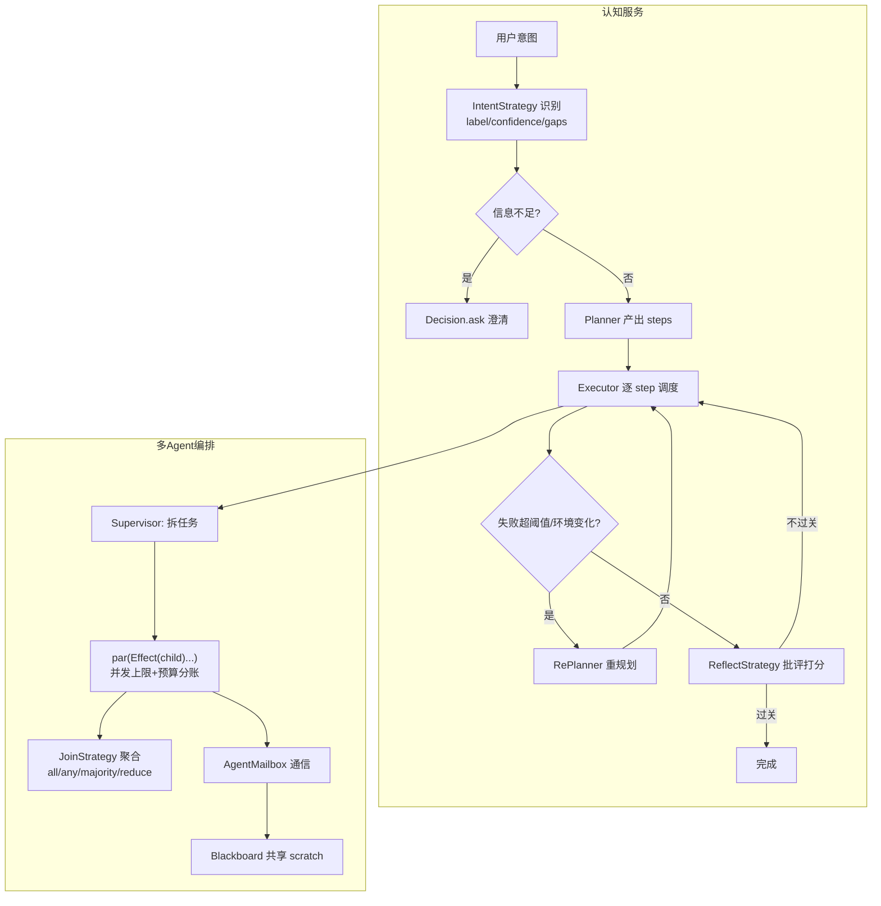

### R8.4 API 接口

```python
class IntentStrategy(Protocol):
    name: str
    async def recognize(self, text, ctx) -> IntentResult: ...   # label/confidence/gaps
class ReflectStrategy(Protocol):
    name: str
    async def critique(self, draft, goal, ctx) -> Critique: ...  # passed/score/comments
class Planner(Protocol):
    name: str
    async def plan(self, goal, ctx) -> tuple[Step,...]: ...
class RePlanner(Protocol):
    name: str
    async def replan(self, goal, steps, failures, ctx) -> tuple[Step,...]: ...
class Executor(Protocol):
    name: str
    async def execute(self, step, ctx) -> StepResult: ...

class Arch(Protocol):                              # 架构统一协议
    name: str
    version: str
    def static_check(self) -> StaticCheckReport: ...
    def compile(self) -> Program: ...

# 10 内置架构（全部返回 Program）
ReAct(tools); ToolUse(tools); PlanExecute(planner, executor, replanner=None)
Reflection(reflector, max_rounds=3); Router(classifier, arms, default=None)
RouterSkill(classifier, routes); Supervisor(planner, child_spec, join)
Handoff(roles, max_hops=5); Blackboard(agents, rounds=3); Graph()  # 声明式编译
# 组合算子
seq(a,b); par([...]); branch(fn, arms); race([...]); retry(n,backoff); map_state(lens); budget(**limits)
```

> **落地细化以 R12 v1.1 为准**：上述签名是概要。完整构造签名（§4）、END 等 Effect 真实语法（§4.0）、
> StaticCheckReport schema + 错误码（R12 §5.1）、10 架构 compile 骨架 + state 契约 + 边界行为 +
> A5 取消/R3 容错接线（R12 §6.1）均在[《R12 内置架构与组合》](../02-模块详设/Agent/R12-内置架构与组合.md)。
> Graph 条件边语义：`cond(state) -> 目标节点 id | None`（多路分支），非布尔。

### R8.5 元数据与核心字段

| 字段 | 说明 |
|------|------|
| IntentResult | label / confidence(0~1) / gaps（信息缺口，触发澄清） |
| Critique | passed / score / comments（修订意见） |
| Step | 可执行步骤（明确动作 + 校验条件） |
| ChildHandle | child_session_id / budget 分账 / trace 父 span |
| JoinStrategy | all / any / majority / reduce + timeout |
| StaticCheckReport | errors / arch / version / ports_required |

**10 架构归约**：ToolUse=并行 Effect；ReAct=自循环；PlanExecute=状态机游标；Reflection=budget 轮换；Router=branch；RouterSkill=分流+skill 正文；Supervisor=par(child)+join；Handoff=换 program+hops；Blackboard=共享 scratch；Graph=声明式编译+static_check；+（7 组合算子支撑嵌套）。

### R8.6 可插拔契约

| 注入点 | 协议 | 默认 | 校验 |
|--------|------|------|------|
| 意图/反思/规划 | IntentStrategy 等 | LLM 分类/critic/分解 | 返回结构完整；缺 name 拒绝 |
| 子 Agent | ChildSpec | ReAct 子 | 并发上限/预算分账 |
| 架构 | Arch | 10 内置 | static_check 查悬空边/环/缺 port |

### R8.7 验收门禁

| 门禁 | 条目 | 达标标准 | 级别 |
|------|------|---------|------|
| R8-G1 | 覆盖 | 认知服务 + 10 架构各有端到端用例 | G1 |
| R8-G2 | 装配检查 | 悬空边/环/不可达/缺port/预算冲突 装配期报错 | G2 |
| R8-G2 | 幂等 | 同 Arch 多次 compile 行为一致；算子不改原对象 | G2 |
| R8-G3 | 嵌套 | Router→Graph→ReAct 三层嵌套跑通；换架构零改动 | G3 |
| R8-红线 | 纪律 | 架构内直接 IO/自数轮次 → 拒绝 | 红线 |

---

## R9 安全与 HITL

> 层：L1（横切）· 依赖：R1+R2 · 源码包：`harness/security/` · 详见 R9 模块详设

### R9.1 职责与边界

**做**：身份授权、凭据隔离、两级护栏、提示注入防御、沙盒、审计、数据隔离/PII、合规；HITL 审批流、澄清、计划干预、通知、接管。
**不做**：沙盒内的具体执行环境（由外部 SandboxPort 实现，R9 定义契约与路由）。

### R9.2 设计架构

**纵深防御**：模型级安全是必要不充分条件，harness 提供独立执行期强制层。每层独立强制，一个 hook 的 allow 不能覆盖 deny（取最严格）。核心原则：**工具/检索/网页/技能正文一律不可信**，注入防御在进上下文前（before_model guard）。审计覆盖全部事件且与事件日志同源可回放。

### R9.3 流程图

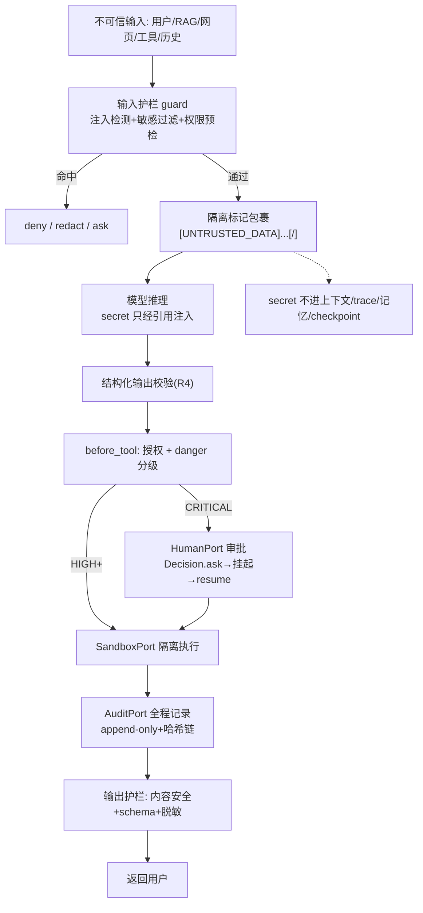

### R9.4 API 接口

```python
class Guardrail(Protocol):
    name: str; direction: Literal["input","output"]
    def check(self, data: DynamicValue, ctx: RequestScope) -> Verdict: ...   # allow/redact/deny/ask

class InjectionDetector(Protocol):
    name: str
    def inspect(self, text: str, ctx: SecurityCtx) -> SafetyReport: ...  # safe/suspicious/malicious
class SandboxPort(Protocol):
    async def run(self, fn, args, ctx) -> DynamicValue: ...
class AuditPort(Protocol):
    def record(self, event: AuditEvent, ctx: PortCtx) -> None: ...
class HumanPort(Protocol):
    async def ask(self, question, options, ctx) -> str: ...
class ApprovalFlow:                                # HITL 审批流
    def __init__(self, trigger_danger="CRITICAL", timeout=300, resume_strategy="exact"): ...
```

### R9.5 元数据与核心字段

| 字段 | 说明 |
|------|------|
| DangerLevel | SAFE/LOW/HIGH/CRITICAL → 直执行/审计/沙盒/沙盒+审批 |
| SafetyReport | safe / suspicious / malicious + 命中规则 |
| AuditEvent | who / when / action / cost / data_touched / rationale（append-only+哈希链） |
| secret_refs | 引用（如 `${API_KEY}`），绝不存明文 |
| PII 字段 | patterns / direction(input/output/log) / strategy(mask/redact/hash) |

### R9.6 可插拔契约

| 注入点 | 协议 | 默认 | 校验 |
|--------|------|------|------|
| 护栏 | Guardrail | 规则库+模型判别 | 命中策略明确 |
| 注入检测 | InjectionDetector | 规则+启发式 | 不可信输入必过 |
| 沙盒 | SandboxPort | 进程隔离 | 资源限额/网络白名单 |
| 审批 | HumanPort | 终端 | 挂起态跨周期有效 |
| 审计 | AuditPort | 本地日志 | 不可旁路/防篡改 |

### R9.7 验收门禁

| 门禁 | 条目 | 达标标准 | 级别 |
|------|------|---------|------|
| R9-G1 | 覆盖 | 护栏/注入/沙盒/审批/审计单测 ≥85% | G1 |
| R9-G2 | 注入 | 检索/工具/技能正文含指令串时被拦截 | G2 |
| R9-G2 | 审批 | 挂起→跨周期恢复→精确续跑 | G2 |
| R9-G3 | 审计 | 覆盖率 100%，哈希链可验证 | G3 |
| R9-红线 | 安全 | secret 明文进上下文/trace/记忆；CRITICAL 未审批执行；审计可旁路 → 拒绝 | 红线 |

## R10 可观测·评测·持久化

> 层：L2/L3 · 依赖：R1+R2 · 源码包：`harness/observability/` + eval/ + durability/ · 详见 R10 模块详设

### R10.1 职责与边界

**做**：全链路 trace、metric、事件流/读模型投影；eval（golden 集/LLM-as-judge/确定性断言/CI gate/生产采样/回放）；checkpoint 快照/事件溯源/断点恢复/状态版本迁移。
**不做**：checkpoint 的写入时机（R1 内核）；记忆的长期语义（R7）。

### R10.2 设计架构

**质量飞轮**：运行期产事件 → trace/metric/事件流 → eval（CI gate + 生产采样）→ 失败回流测试集 → 改进 prompt/模型/架构 → 重新评测。持久化与记忆分离：**checkpoint 是短期 thread 内恢复，memory 是长期跨 thread 知识**。回放底座 = 事件溯源 + 录制 LLMPort 重放。

### R10.3 流程图


### R10.4 API 接口

```python
class TelemetryPort(Protocol):
    def span(self, name, ctx) -> AbstractContextManager: ...
    def metric(self, name, value, tags=None) -> None: ...
    def log(self, event) -> None: ...
class EventStream(Protocol):                          # L3 接入契约
    def subscribe(self, topic: str, since: int|None=None) -> AsyncIterator[Event]: ...
    def topics(self) -> list[str]: ...
class Projection(Protocol):
    name: str
    def project(self, events: Iterable[Event]) -> ReadModel: ...
class EvalPort(Protocol):
    async def run_case(self, case: EvalCase) -> EvalResult: ...
    async def regression(self, suite: str) -> SuiteReport: ...
class Judge(Protocol):
    name: str
    async def score(self, case, output: Trace, ctx) -> Score: ...
class EventStore(Protocol):                           # checkpoint 存储
    def save(self, session_id: str, snapshot: JsonSnapshot) -> None: ...
    def load(self, session_id: str) -> JsonSnapshot|None: ...
def replay_events(events, initial: AgentState) -> AgentState: ...
```

### R10.5 元数据与核心字段

| 字段 | 说明 |
|------|------|
| TraceSpan | trace_id / span_id / parent_id / name / 耗时 / token / cost / 组件 name |
| topic | session.* / effect.* / trace.* / audit.* / metric.* / state.* |
| EvalCase | input / expected / expected_trajectory / should_refuse |
| Judge | LLM-as-judge + 位置偏差打乱 + 冗长偏差长度归一化 |
| CheckpointSnapshot | session_id / version / state / events / fingerprint |
| 评测三层 | 确定性不变量 / 黄金轨迹场景 / 生产采样 |

### R10.6 可插拔契约

| 注入点 | 协议 | 默认 | 校验 |
|--------|------|------|------|
| 日志平台 | TelemetryPort | JSONL/OTel | 故障不影响主流程 |
| 事件源 | EventStream | 内存流 | 只读；从 seq 续读 |
| 读模型 | Projection | 时间线/成本 | 可从事件重建 |
| 评测/Judge | EvalPort/Judge | 本地回归/LLM-judge | CI gate 阈值 |
| checkpoint 存储 | EventStore | 内存/Postgres | 快照结构兼容 |

### R10.7 验收门禁

| 门禁 | 条目 | 达标标准 | 级别 |
|------|------|---------|------|
| R10-G1 | 覆盖 | trace/eval/checkpoint 单测 ≥85% | G1 |
| R10-G2 | 回放 | 录制重放后 State 与终态全等 | G2 |
| R10-G2 | checkpoint | 挂起/每N步/终态必存；跨进程恢复一致 | G2 |
| R10-G3 | 留名 | trace 含全部组件 name；事件流可续读 | G3 |
| R10-红线 | 一致 | 未记录的决策视为不可上线；checkpoint 与 memory 混用 → 拒绝 | 红线 |

---

## R11 集成接入与治理

> 层：L3 · 依赖：全部 · 源码包：`api/` + cli/ · 详见 R11 模块详设

### R11.1 职责与边界

**做**：四组 API 面（A1 集成契约/A2 架构组合/A3 应用开发/A4 组件开发）；Agent 装配器与 profile 预设；配置版本/热更新/灰度回滚/feature flag；全局 killswitch/成本限额/限流；CLI（脚手架/评测/回放/门禁）；触发调度（webhook/cron）与交付通道。
**不做**：任何具体能力实现——本模块只做投影、装配、治理。

### R11.2 设计架构

四组 API 是**同一内核面向四类使用者的四个投影**，底层都归约到 Hook/Port/Program。外部系统（可视化平台、存储工具、日志 SDK）只经三类契约（Port/Event Stream/Projection）接入，不得 import 内核内部对象或直接写事件日志。装配期统一 `static_check` 把错误挡在运行前。

### R11.3 流程图

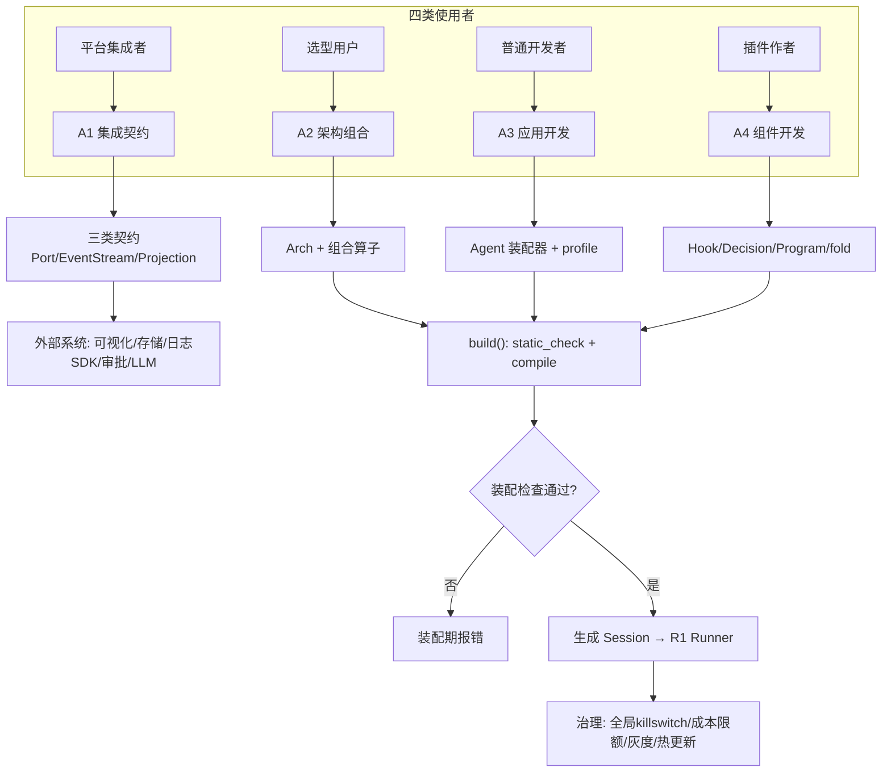

### R11.4 API 接口

```python
# A3 应用开发（最常用）
agent = (Agent(arch=ReAct(tools=tools))          # 选架构
    .profile("production")                       # 一键加载 L1 默认插件预设
    .capability(RAG(pipeline=rag))               # 开能力 + 换策略
    .capability(IntentRecognition(strategy=MyIntent()))
    .rag(PostgresStore(...)).memory(RedisMemory())
    .telemetry(LangfusePort())
    .event_stream(KafkaStream(topics=["trace.*"]))
    .build())                                    # static_check + compile
result = await agent.run("...", session_id="s-1")

# A1 集成契约
class PortRegistry:
    def register(self, name, adapter) -> None: ...
# 命名空间：内置 llm/tool/memory/store/... ；用户自定义 x-<name>

# A2 架构组合
agent2 = Agent(arch=budget(max_cost_usd=2)(branch(intent_fn, {"qa": rag, "act": ReAct(tools)})))

# A4 组件开发
class MyGuard(Plugin):                       # v5：Plugin.apply(host)
    name="my-guard"
    def apply(self, host: Host) -> None:
        host.hook("before_invoke").tap(self.name, self.fn)   # BAIL 扩展点
    async def fn(self, scope: RequestScope, effect: Effect) -> Decision: ...   # effect 直送，不读 meta
host.plugin(MyGuard())
```

### R11.5 元数据与核心字段

| 字段 | 说明 |
|------|------|
| AgentSpec | program_version/arch_version/ports_version/optional_modules[]（进 trace） |
| StaticCheckReport | errors/arch/version/ports_required/budgets_resolved |
| profile | dev/production/regulated 三档插件预设 |
| port 命名空间 | 内置固定名；用户自定义须 `x-` 前缀 |
| 触发入口 | webhook / cron / 事件；鉴权 + 幂等 + 限流 |

**profile 预设**：dev（最小插件+本地存储）、production（全套可靠性+RAG+安全+OTel）、regulated（+强制审计+审批+数据隔离）。

### R11.6 可插拔契约

| 注入点 | 协议 | 默认 | 校验 |
|--------|------|------|------|
| 外部能力 | Port | 内置默认 | 履约检查；缺 port 装配期报错 |
| 事件消费 | EventStream/Projection | 内存 | 只读；不侵入内核 |
| profile | 插件预设 | 三档内置 | 可自定义预设 |
| CLI | 命令 | init/eval/replay/gate | 扩展命令注册 |

### R11.7 验收门禁

| 门禁 | 条目 | 达标标准 | 级别 |
|------|------|---------|------|
| R11-G1 | 覆盖 | 四组 API 各有集成用例 | G1 |
| R11-G2 | 装配检查 | 缺port/非法架构/预算冲突 装配期报错 | G2 |
| R11-G2 | 接入 | 换外部实现上层零改动；事件流只读可续读 | G2 |
| R11-G3 | 治理 | 全局killswitch/成本限额/灰度回滚各有用例 | G3 |
| R11-红线 | 边界 | 外部系统 import 内核内部对象/写事件日志 → 拒绝 | 红线 |

---

# 第三篇 全局附录

## 附录 A 核心字段字典（全框架唯一定义）

> 所有模块共用这些字段，禁止各模块另起别名。字段只增不改语义；废弃字段先标记 deprecated 至少一个 minor 版本。

### A.1 数据与信封

| 字段/类型 | 结构 | 定义模块 | 说明 |
|-----------|------|---------|------|
| Message | {role, content, name, tool_calls} | R1 | 对话最小单元，只增不减 |
| Effect | {kind, payload, batch, trace_id} | R1 | 对外部世界的声明 |
| Result | {ok, data, usage, error} | R1 | Port 调用统一信封 |
| PortError | {code, message, retryable} | R1 | 结构化错误，retryable 驱动重试 |
| Usage | {prompt_tokens, completion_tokens, cost_usd} | R1 | 成本/token 元数据 |
| Budgets | 6 max_* + 6 used_* | R1 | 多维预算，内核强制 |
| Event | {seq, step, state_snapshot, effects, results, cost_usd, tokens, status, reason} | R1 | 事件溯源原子 |
| JsonSnapshot | {session_id, version, state, events, fingerprint} | R1/R10 | checkpoint 顶层 |

### A.2 元数据（进 trace）

| 字段 | 生成方 | 格式/取值 |
|------|--------|----------|
| session_id | Runner | 调用方给定 |
| run_id | Runner | uuid |
| trace_id | 内核 | `session:step:index` |
| step / seq / attempt | 内核 | 逻辑时钟，单调递增 |
| version | 装配期 | semver 或内容 hash |
| name | 每个组件 | 非空字符串，强制留名 |
| fingerprint | checkpoint | sha256(canonical(events)) |
| cost_usd | fold 累计 | round(x, 10) |

### A.3 各模块专属字段速查

| 模块 | 专属字段 |
|------|---------|
| R3 | DimensionKey / RetrySpec / BreakerState / DegradeStep.quality / idempotency_key |
| R4 | LLMRequest/Response / cache key / 成本归因维度 |
| R5 | ToolSpec{danger,source} / ToolResultMeta / DisclosurePacket{L1,L2,L3,token_cost} |
| R6 | Chunk / Hit / Query / RAGResult{empty,citations} / TokenBudget / RRF k=60 |
| R7 | ContextSection / MemoryTier / MemoryItem{kind,importance} / offload 句柄 |
| R8 | IntentResult / Critique / Step / ChildHandle / JoinStrategy / StaticCheckReport |
| R9 | DangerLevel / SafetyReport / AuditEvent / secret_refs / PII 字段 |
| R10 | TraceSpan / topic / EvalCase / CheckpointSnapshot |
| R11 | AgentSpec / profile / port 命名空间 / 触发入口 |

## 附录 B 框架对外协议索引（可插拔的前提）

> 完整签名与四要素见 R2 模块详设与本文 §1.3。这里给索引。

| 组 | 协议 | 默认实现 | 用户接入 |
|----|------|---------|---------|
| 内核 | HookKind / Hook / Host / Plugin / Decision / Capability / Provider | 内置插件 | `host.plugin()` / `.capability()` |
| 认知 | IntentStrategy / ReflectStrategy / Planner / RePlanner / Executor / Judge / ModelRouter / SchemaValidator | LLM 默认 / MinimalSchemaValidator | 构造参数 `strategy=` / `validator=` |
| RAG | Splitter / Embedder / VectorStore / Retriever / Reranker / QueryRewriter / PostProcessor | 见 R6 | `RAGPipeline(...=)` |
| 工具 | ToolPort/@tool / MCPTransport / SkillPort / DisclosureIndex | 见 R5 | `register()` / 构造参数 |
| Port | LLMPort / MemoryPort / StorePort / SandboxPort / TelemetryPort / HumanPort / AuditPort / EvalPort | 见各模块 | `registry.register()` |
| 接入 | EventStream / Projection | 内存流 | `.event_stream()` / `.project()` |

**可插拔四要素检查表**（每个协议都必须满足）：① 协议定义 ✓ ② 默认实现 ✓ ③ 替换入口 ✓ ④ 装配期履约校验 ✓。
**注入三形态**：协议替换 / Hook 插件 / 构造参数；L3 另有 Port/EventStream/Projection 三类接入契约。

## 附录 B.1 默认实现状态与回头实现清单（2026-11-18）

> 本表是**权威追踪清单**：凡接口体中 `...`（Protocol 语法占位）或标注"见各模块"的默认实现，
> 都在此登记归属、状态与回头动作。**不得把"文档标注了归属"当成"已实现"**——必须按本表状态列推进。
> 协议定义在 `src/hooks/protocols.py`；本表是它的设计侧追踪镜像，两处须一致。

### B.1.1 已实现模块（R1~R4）：默认实现全部落地 ✅

| 协议 | 默认实现 | 源码位置 | 状态 |
|------|---------|---------|------|
| EventStore | InMemoryEventStore | `src/runtime/runner.py` | ✅ 已实现 |
| Interpreter | InterpreterImpl | `src/runtime/interpreter.py` | ✅ 已实现 |
| FailureClassifier | _DefaultClassifier | `src/harness/resilience/types.py` | ✅ 已实现 |
| DegradeLadder | _default_ladder() | `src/harness/resilience/capability.py` | ✅ 已实现 |
| ModelRouter | RuleRouter | `src/harness/model/router.py` | ✅ 已实现 |
| CachePort | ExactCache + SimilarityCache | `src/harness/model/cache.py` | ✅ 已实现（异步+可换 store/embedder） |
| StructuredOutputSpec | repair 模式 | `src/harness/model/structured.py` | ✅ 已实现 |
| SchemaValidator | MinimalSchemaValidator | `src/harness/model/structured.py` | ✅ 已实现（v1.6，可注入） |
| LLMPort | OpenAICompatLLM | `src/ports/adapters/llm.py` | ✅ 已实现（R4 §6.1） |

### B.1.2 待实现模块：回头实现清单 ⏳

> 下列默认实现**必须**在对应模块开发时落地（四要素②）。协议已在 R2 定齐、归属在此锁定，
> 模块开发验收时须逐项勾销。**在模块实现前，这些 `...` 是合法的接口占位，不是遗漏。**

| 协议（接口体 `...`） | 默认实现类 | 归属模块 | 源码位置（模块开发时创建） | 回头动作 |
|------|------|---------|------|------|
| ToolPort | ToolRegistry | R5 工具 | `src/harness/tools/` | R5 开发时实现 @tool + 注册 + catalog/call |
| MCPPort | MCPManager | R5 工具 | `src/harness/tools/` | R5 开发时实现 stdio/http transport + list_tools |
| SkillPort | FileSkillProvider | R5 技能 | `src/harness/skills/` | R5 开发时实现 discover/catalog/body |
| RAGPort | RAGPipeline | R6 RAG | `src/harness/rag/` | R6 开发时实现 ingest/retrieve（20 项链路） |
| MemoryPort | MemoryStore | R7 记忆 | `src/harness/memory/` | R7 开发时实现 read/write/forget（hot/warm/cold） |
| StorePort | InMemoryStorePort | R7 记忆 | `src/harness/memory/` | R7 开发时实现 save/load（可复用 InMemoryEventStore） |
| SandboxPort | LocalSandbox | R9 安全 | `src/harness/security/` | R9 开发时实现 run（进程/容器隔离） |
| AuditPort | AuditLogger | R9 安全 | `src/harness/security/` | R9 开发时实现 record（不可篡改留痕） |
| HumanPort | ConsoleHumanPort | R9 HITL | `src/harness/security/` | R9 开发时实现 ask（审批/挂起/resume） |
| EvalPort | RuleEval | R10 评测 | `src/harness/eval/` | R10 开发时实现 score（golden 集 + LLM-as-judge） |
| TelemetryPort | NoopTelemetry | R10 可观测 | `src/harness/observability/` | R10 开发时实现 span/metric/log（兼容 OTel） |
| EventStreamPort | InMemoryEventStream | R10 事件流 | `src/harness/observability/` | R10 开发时实现 subscribe/publish（R10 §4.1 schema） |

**回头实现纪律**：
1. 每完成一个模块，把 B.1.2 对应行移到 B.1.1，状态改 ✅，并更新 `src/hooks/protocols.py` 模块 docstring 的归属表（两处同步）。
2. 模块验收门禁（G0 契约符号）必须包含该模块的默认实现类，缺失即不绿。
3. 装配层（R12/R13）在用户未注入时注册这些默认实例；模块未实现前，registry 无默认可注册属预期状态。

### B.1.3 框架能力待办清单（原审查文档待办归并，2026-11-18）

> 以下是框架视角审查发现的、尚未落地的能力。**审查文档已删除，本表是这些待办的唯一权威记录。**
> 已修项不在此列（流式事件模型、默认实现归属、设计数字/签名矛盾等均已修复）。

| 待办 | 现状 | 归属模块 | 处理方向 |
|------|------|---------|---------|
| 用户可定义 reducer（状态合并扩展） | R1 fold 是固定逻辑，不可扩展 | R1 增强 | 设计 reducer 注入点（`fold` 接受可选 reducer 表），不改默认行为 |
| 图编排 execute 代码（Graph/branch/par/race 等） | R12 设计 v1.1 已完整，代码未实现 | R12 | 按 R12 §6.1 骨架实现 `src/archs/`+`src/compose/` |
| 群聊/swarm 多 Agent 编排 | Handoff/Supervisor/Blackboard 设计有，群聊/swarm 无 | R8 增强 | 评估是否为必备；若是则补 Arch 第 11 种（需同步总设计"10 内置"口径） |
| OTel/OTLP 接入规范 | profile 提"OTel"字样，无规范 | R10 | 设计时补 OTel span/metric 映射与导出契约 |
| 工具 decorator 运行期实现 | R5 设计有 `@tool`，代码未实现 | R5 | R5 开发时实现 decorator+ToolSpec 生成 |
| output parser / prompt 模板抽象 | 无独立抽象（结构化校验已有） | R4 增强 | 评估是否需要独立协议；结构化校验已覆盖大部分场景 |
| 5 项设计缺失（B10/B11/G9/J10/N8/Q10/D13） | 设计态待补 | R5~R11 | 各模块开发前补齐设计到可写代码深度 |
| R5~R13 剩余能力代码（约 82 项设计充分项） | 设计有、代码无 | R5~R13 | 按模块整块推进，每次完成一个模块 100% 项 |
| **R4→R1 接线断链**：R1 `call(Effect,ctx)->Result` 与 R4 `ModelGateway.complete(LLMRequest,PortCtx)->LLMResponse` 签名不同，缺 Effect→LLM 适配器 | 两模块各自闭环，无生产接线 | R12 装配层 | composition root 实现时补适配器；这是 R1~R4 间唯一真缺代码的一环 |
| **R1↔R2 / R3→R2 接线未装配**：函数已就绪（ctx_factory/_bind/ResilienceCapability.install）但无生产代码调用 | 接口就绪、无人串接 | R12 装配层 | composition root（Agent 装配器）统一注册，非模块遗漏 |
| **M1-M6 构造参数生产注入**：dimension_of/idempotency_key/pool/pools/kinds/budgets/available+add_backend/failed_target_of 在 R1-R4 已实现读取端，但无生产装配者 | 读取端就绪、注入端缺位 | R12 装配层 | `Agent.build()` 从用户后端注册表/预算/池配置投影后构造注入（详见 R12 §6.1.3 注入表）；测试手填不算生产装配，非 R1-R4 遗漏 |
| **SandboxPort.run(fn: Callable) 不可序列化** | 签名只够同进程执行，真进程/容器隔离拿不到可序列化代码 | R9 | 实现前改签名为可序列化 spec（code+entrypoint+args），否则沙盒承诺不可达 |
| **AuditPort.record 收裸 dict** | 防篡改哈希链字段（prev_hash/hash）无处放 | R9 | 实现时签名改收 `AuditEvent` 具名类型 |
| **EvalPort.score 只给 case_id** | 评测器拿不到 expected/should_refuse，需自己查库 | R10 | 实现时签名改收 `EvalCase` 具名类型 |
| **Telemetry 归因维度藏 meta / HumanPort resume 点不显式** | agent_id/user_id 靠 coerce 边界读；ask 无挂起 id | R9/R10 | 实现时显式化到协议字段 |

> **协议可达性纪律**：新增/修改 Port 协议时，必须自问"实现者拿到的输入够不够兑现协议承诺的能力"，
> 避免再次出现 SemanticCache 那种"协议名承诺语义、参数只给哈希"的名实分离。
> 详见[《协议可达性审查》](./协议可达性审查-20261118.md)。
>
> **协议可插拔三维度纪律**（2026-11-18 已对 47 协议全查，见[《协议可插拔完备性审查》](./协议可插拔完备性审查-20261118.md)）：
> ① 每个自定义协议必须标默认实现（四要素②）；② 涉及 IO 的协议方法必须 async
> （已修：CachePort/StorePort/EventStore/AuditPort；TelemetryPort 采集保持同步=OTel 惯例）；
> ③ 需要外部系统的协议必须抽象可注入 client/store（已加 CacheStore/CacheEmbedder/AuditStore/TelemetryExporter）。
> 新增协议一律按此三维自检。

**2026-11-18 已修（当前模块 R1/R2/R4，从本表勾销）**：
- EventStore / Runner.load 异步化（checkpoint 可落 DB/Redis）；StorePort / AuditPort 异步化；
- 新增 AuditStore / TelemetryExporter 后端协议；CachePort 三层可插拔（CacheStore/CacheEmbedder）；
- SemanticCache 别名彻底删除（统一 CachePort）。

**纪律**：本表项在对应模块开发验收时逐项勾销；新增框架能力必须先入本表再动手，避免遗漏。

## 附录 C 元数据与版本规范

- **语义化版本**：框架、架构、prompt 模板、技能、Port 实现全部带版本，进 `version` 与 trace。
- **版本锁定**：运行中的会话用启动时版本，配置热更新不影响在途会话（防行为漂移）。
- **回放对齐**：Event 记录 version，回放时用同版本 program/prompt，否则拒绝对齐。
- **状态迁移**：checkpoint schema 带 version，缺字段回退默认值（兼容旧快照）。

## 附录 D 从 m0-m3 迁移路线（渐进、双跑、不推倒重来）

| 阶段 | 动作 | 兼容策略 |
|------|------|---------|
| P0 | R1/R2 引入 HookKind/Host/Decision，与现有 Chains 并存 | 旧扩展点适配成 Host 扩展点（薄封装），老代码零改 |
| P1 | R3~R9 能力逐个改写为插件，影子双跑 + 快照对比 | 差异告警，行为一致才切换 |
| P2 | R8 十架构迁移到"组件装配"写法 | 旧 Arch 接口保留为别名 |
| P3 | R11 切出四组 API，装配器加 profile | 旧 Agent 门面保留为 A3 子集 |
| P4 | 下线旧扩展 API | 给足 deprecation 周期，仅移除适配层 |

**风险**：① Hook kind 编排顺序确定性（否则破坏 R1-G2）；② around/retry 重跑受预算与幂等约束；③ 插件不得持有会话态。

## 附录 E 全局验收总表

| 模块 | G1 质量 | G2 语义/隔离 | G3 集成 | 红线 |
|------|--------|-------------|---------|------|
| R1 | ≥90% 覆盖 | 确定性/回放/6维预算 | 主流程+挂起恢复 | Program 纯函数 |
| R2 | 矩阵覆盖 | 8 action 定义齐全；R1 当前消费 continue/deny/abort/fallback 4 种，rewrite/ask/retry/degrade 待 R3/R4/R9 接线 | 组件留名 | 唯一扩展点 |
| R3 | ≥90% | 重试/熔断/降级语义 | 五插件协同顺序 | 幂等键 |
| R4 | ≥85% | 结构化/缓存 | 换 Port 零改动 | 预算不绕过 |
| R5 | ≥85% | 合并/披露 | danger 四级路由 | 审批/披露红线 |
| R6 | 五段替换 | 预算/降级 | 召回基线 | 引用/注入红线 |
| R7 | ≥85% | 压缩/记忆分层 | 顺序确定性 | 不改messages/secret |
| R8 | 端到端 | 装配检查/幂等 | 嵌套/换架构 | 无直接IO/自数轮次 |
| R9 | ≥85% | 注入/审批 | 审计100% | secret/CRITICAL/审计 |
| R10 | ≥85% | 回放/checkpoint | 留名/续读 | 一致性/memory分离 |
| R11 | 四组API | 装配检查/接入 | 治理用例 | 边界隔离 |

## 附录 F 术语表

| 术语 | 含义 |
|------|------|
| Harness | 围绕模型的控制与反馈系统 = 微内核 + 能力插件 + 架构 + API |
| Effect | Program 对外部世界的声明，只声明不执行 |
| Hook | 唯一扩展点，kind 定义调用语义，返回 Decision |
| Decision | Hook 统一返回，action 驱动内核行为 |
| Capability | 能力级开关（用不用） |
| Provider | 策略级契约（用什么算法/模型） |
| DimensionKey | 按目标隔离计数/熔断/限流的键 |
| 缺席即降级 | 未装能力时功能降级而非崩溃 |
| context rot | 上下文越长召回与推理质量越差 |
| Durable Execution | 长任务 checkpoint + 断点续跑 + 幂等 |

---

*AGENT 总设计 v5.0 · 2026-11-18 · 唯一权威设计文档 · 架构基线 .workbuddy/specs/ARCH-v5.md · 配套模块详见 docs/02-模块详设/Agent/*
