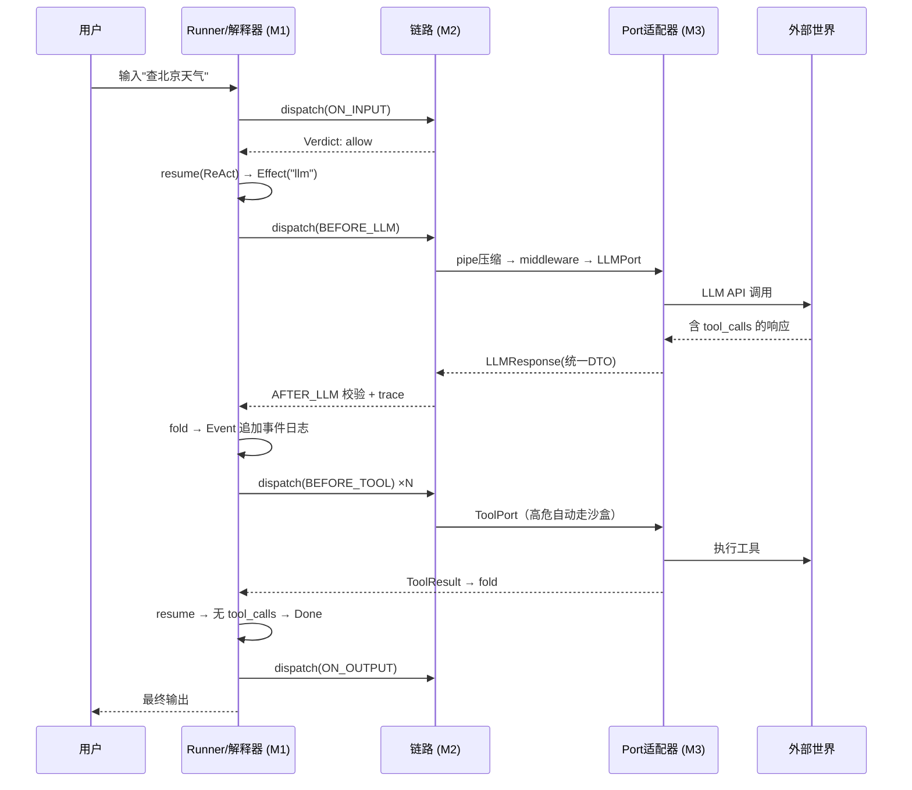
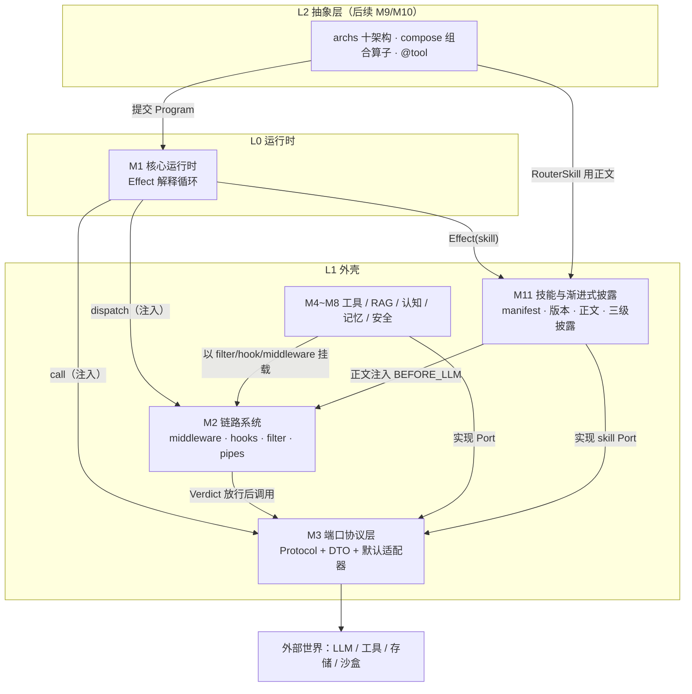

# 大纲：模块拆分全景（M0）

> 前置阅读：[《Agent框架设计方案》](./Agent框架设计方案.md)；配套：[《门禁体系》](../03-流程与规范/门禁体系.md)、[《模块协作与场景适用指南》](./模块协作与场景适用指南.md)。
> 本文档是设计方案的**工程化拆分大纲**：模块全景、依赖关系、里程碑与总验收。
> 各模块详设见 M1~M6 独立文档。目标：**不了解本项目的读者读完本文档即可理解全部架构。**

---

## 1. 新人阅读指南

**推荐阅读顺序**：

1. 本文档 §2 项目一页纸 —— 3 分钟明白这个项目是什么
2. 本文档 §3 模块全景 —— 依赖关系与构建顺序
3. [门禁体系](../03-流程与规范/门禁体系.md) —— 开发流程强管控（所有模块适用）
4. [M1 核心运行时](../02-模块详设/M1-核心运行时.md) → [M2 链路系统](../02-模块详设/M2-链路系统.md) → [M3 端口协议层](../02-模块详设/M3-端口协议层.md) → [M4 工具系统](../02-模块详设/M4-工具系统.md) → [M5 RAG](../02-模块详设/M5-RAG子系统.md) → [M6 认知模块集](../02-模块详设/M6-认知模块集.md) → [M11 技能系统与渐进式披露](../02-模块详设/M11-技能系统与渐进式披露.md)
5. §5 待拆分清单 —— 后续路线

**术语表**（全套文档统一，不再重复解释）：

| 术语 | 含义 |
|------|------|
| Effect | 程序对外部世界的"声明"：我要调一次 LLM / 工具 / 子代理。只声明，不执行 |
| Program | 用户写的 Agent 逻辑，generator 函数：读 State → yield Effect |
| State | 一次会话的全部进度（消息、黑板、预算），不可变对象 |
| 链路（Chains） | Effect 从"被产出"到"被执行"之间经过的管道（middleware/hooks/filter/pipes） |
| 挂载点（Mount） | 链路上的固定插槽位置，共 7 个 |
| Port | 外部能力的接口契约（LLM、工具、存储……），外壳负责提供适配器 |
| 事件溯源 | 每次状态转移都追加一条不可变事件，恢复/回放/评测全部基于事件日志 |

---

## 2. 项目一页纸

### 2.1 这是什么

**AgentKit**：一个构建 Agent 应用的框架。核心公式 `Agent 应用 = LLM + Harness`。

- **核心运行时**只做一件事：解释执行 Program 产出的 Effect（一个解释循环）。
- **外壳**提供一切工程能力（RAG、记忆、沙盒、可观测……），全部以 Port 接口暴露，可替换。
- **抽象层**提供函数式组合 API 与 10 种内置架构（ReAct / PlanExecute / Supervisor / Graph…）。

**它不是**：提示词集合、LangChain 的替代品、单一架构的 Agent 库。它是一套"解释器 + 协议"，任何 Agent 架构都能在上面搭出来。

### 2.2 分层与模块归属

```
┌────────────────────────────────────────────────────────────┐
│ L2 抽象层    archs(十架构) · compose(组合算子) · @tool        │
│              → 模块 M9 / M10（后续拆分）                     │
├────────────────────────────────────────────────────────────┤
│ L1 外壳      ports(接口契约 M3) + harness(默认实现           │
│              M4~M8) + chains(链路 M2)                       │
├────────────────────────────────────────────────────────────┤
│ L0 运行时    runtime(解释循环) → 模块 M1                     │
└────────────────────────────────────────────────────────────┘
```

### 2.3 一个例子跑通全链路（新人必读）

用户说"查一下北京天气"。使用内置 ReAct 架构，**完整数据流**如下（括号内为负责模块）：

```
 1. 用户输入进入会话
 2. ON_INPUT filter：注入检测、权限预检          → 判决 allow      [M2 链路]
 3. Runner.step()：解释器 resume(ReAct program)                   [M1 运行时]
 4. program 读 State → yield Effect("llm", tools_catalog)         [M1 原语]
 5. BEFORE_LLM：pipe 上下文压缩 → middleware 超时/重试 → 调 LLMPort [M2→M3]
 6. 响应回程：AFTER_LLM filter 校验 tool_calls schema → hook 写 trace [M2→M3]
 7. fold：assistant 消息(含 tool_calls) 追加进 State（新不可变对象）  [M1]
 8. 事件溯源：Event(state, effects, results) append 进事件日志       [M1]
 9. program 再 resume：解析 tool_calls → yield Effect("tool", batch) [M1]
10. BEFORE_TOOL：filter 按 danger 分级判决；HIGH 自动改走 SandboxPort [M2→M3]
11. ToolPort.call 执行 get_weather → AFTER_TOOL pipe 裁剪大结果       [M2→M3]
12. fold 回填工具结果 → program 再 resume → 模型无 tool_calls → Done  [M1]
13. ON_OUTPUT filter：内容安全 + schema 校验 → 返回用户               [M2]
```

**读懂这 13 步，就读懂了整个框架。** M1 决定"循环怎么转"，M2 决定"每一步经过什么"，M3 决定"落到什么实现"。



---

## 3. 拆分原则与模块全景

### 3.1 拆分原则

1. **依赖单向**：M1 → M2 → M3 只允许自上而下 import，禁止反向与循环。
2. **契约先行**：每个模块先定 Protocol（接口），再给默认实现；默认实现可整体替换。
3. **模块可独立测试**：每个模块都能用 fake 依赖单独跑通测试，不要求其他模块完成。
4. **纯函数内核**：M1 的解释器对输入完全确定（同 State 必产同 Effect），是可回放性的根基。
5. **模块单独闭环（强约束）**：每个模块必须满足《门禁体系》的闭环五条件（CL-1~CL-5），不闭环不算完成。
6. **门禁强约束（强约束）**：每个模块都有验证标准与门禁清单——**门禁不绿不得合入；违反门禁冻结该模块迭代更新，先修复再继续**。

### 3.2 模块全景（11 个模块）与依赖图

| 模块 | 一句话职责 | 文档 |
|------|-----------|------|
| M1 核心运行时 | Effect 解释循环、State/Program/Budgets、事件溯源 | [M1](../02-模块详设/M1-核心运行时.md) ✅ |
| M2 链路系统 | 七挂载点、四泳道、Verdict 判决 | [M2](../02-模块详设/M2-链路系统.md) ✅ |
| M3 端口协议层 | Port 协议族 + DTO + 注册表 + 最小适配器 | [M3](../02-模块详设/M3-端口协议层.md) ✅ |
| M4 工具系统 | @tool(pydantic)、ToolRegistry、渐进式披露、MCP | [M4](../02-模块详设/M4-工具系统.md) ✅ |
| M5 RAG 子系统 | 五段流水线 + 内置优化策略 | [M5](../02-模块详设/M5-RAG子系统.md) ✅ |
| M6 认知模块集 | 意图/规划/重规划/执行器/反思/子agent管理 | [M6](../02-模块详设/M6-认知模块集.md) ✅ |
| M7 记忆与会话 | 长短期记忆、上下文压缩、断点恢复 | [M7](../02-模块详设/M7-记忆与会话.md) ✅ |
| M8 安全体系 | 两级护栏、沙盒、审计、prompt 安全策略 | [M8](../02-模块详设/M8-安全体系.md) ✅ |
| M9 可观测评测 | Telemetry/Eval 实现、回归重放 | [M9](../02-模块详设/M9-可观测与评测.md) ✅ |
| M10 架构与组合 | 内置十架构、函数式算子、Agent 装配器 | [M10](../02-模块详设/M10-架构与组合.md) ✅ |
| M11 技能系统与渐进式披露 | 技能清单/发现/版本/正文、三级披露、Effect(skill) 履约 | [M11](../02-模块详设/M11-技能系统与渐进式披露.md) ✅ |

**M1~M11 已全部拆分完成**，每个模块文档均含八要素 + 流程图 + 门禁清单 + §9 功能验证矩阵；
统一验证契约见[《验证执行手册》](../03-流程与规范/验证执行手册.md)。



### 3.3 里程碑映射

| 里程碑 | 包含模块 | 目标 |
|--------|---------|------|
| **M0（本文档）** | 拆分规划 + 门禁制度 | 定契约 |
| P0 | M1 + M2 + M3 | 解释循环跑通，ReAct/ToolUse/Router 可运行 |
| P1 | M3 默认实现补全 + M8 | 持久化、断点恢复、护栏、沙盒路由 |
| P2 | M4 + M5 + M6 + M7 | MCP、RAG、认知模块、记忆 |
| P2.5 | M11 | 技能清单/发现/版本、三级披露、Effect(skill) 正文加载（依赖 M3/M4/M6） |
| P3 | M9 + M10 | 评测回归、多 Agent、Graph、组合算子全家桶；RouterSkill 与 M11 联调 |

---

## 4. 模块拆分文档模板（后续模块必须遵守）

每个模块文档固定八要素，缺一不合格、不开工：

**职责与边界 / 完整链路描述（+流程图）/ 设计原语 / 接口实现 / API 规范 / 关键字段 / 依赖关系 / 验收标准与门禁（含红线 + 闭环核对）**

---

## 5. 模块清单状态（全部完成）

M1~M11 全部有独立文档，且每个文档自带 §9 功能验证矩阵（功能点 → 用例 ID → 验证命令 → 通过标准）。
验证执行方式、证据要求与 CI 配置见[《验证执行手册》](../03-流程与规范/验证执行手册.md)。

| 里程碑 | 覆盖模块 | 状态 |
|--------|---------|------|
| P0 | M1 + M2 + M3 | 文档完成，待实现与门禁验证 |
| P1 | M3 默认实现补全 + M8 | 文档完成，待实现与门禁验证 |
| P2 | M4 + M5 + M6 + M7 | 文档完成，待实现与门禁验证 |
| P2.5 | M11 | 文档完成，待实现与门禁验证 |
| P3 | M9 + M10 | 文档完成，待实现与门禁验证 |

---

## 6. 总验收标准（P0 = M1+M2+M3 完成）

**前提**：M1/M2/M3 三模块门禁全绿（各模块文档 §8），任一门禁未绿则 P0 不算完成、不进入 P1。

1. 用真实 LLM 端点跑通 **ReAct** 全流程（§2.3 的 13 步每步可在 trace 中找到）。
2. 同输入重复运行，M1 事件日志逐字节一致（确定性）。
3. `wait_human` 挂起后从 checkpoint 恢复继续执行。
4. 五种 Verdict（allow/redact/retry/skip/degrade）+ abort 全部生效。
5. 替换任意一个默认适配器（如换 LLMPort），上层代码零改动。

---
*M0 大纲版本：v0.2 · 2026-11-16 · 新增 M11 技能系统与渐进式披露（P2.5 里程碑）*
