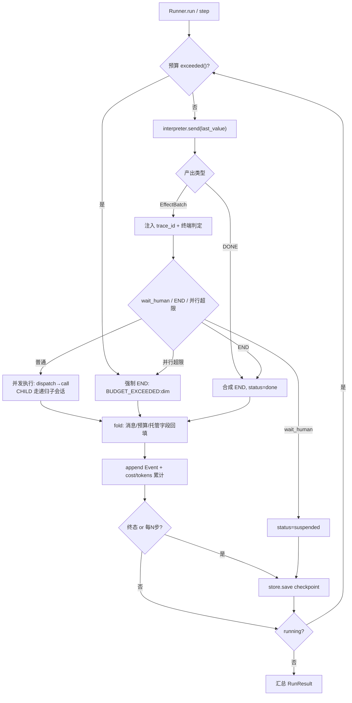

# R1：核心运行时（runtime）

> **权威来源**：[《AGENT 总设计》](../../01-总览与设计/AGENT-总设计.md) §R1。本文是其模块级拆分详设，模块内闭环。
> 层：L0 微内核 · 依赖：无（types 自包含）· 源码包：`src/runtime/` · 门禁 key：`m1`
> 状态：设计定稿（v2.0），对应已实现代码需按本文复核。
>
> ⚠️ **自查标注（2026-11-17，待修正）**：头部门禁 key 写 `m1` 是旧体系残留，实际已用 `r1`（见 `tests/tools/gate_check.py`）。详见[《设计完整性重新自查》](../../设计完整性重新自查-20261117.md) §2。

---

## 1. 职责与边界

**做**：定义三大原语（State/Effect/Program）；实现唯一解释循环与 Runner；预算硬强制；事件溯源与 checkpoint 挂点。
**不做**：任何具体 IO（不 import LLM SDK/数据库）；Hook 分发（R2）；Port 实现（R4~R11）。
**依赖注入**：`dispatch`（R2）、`call`（Port 函数）在构造时注入——测试注入 fake 即可闭环。

## 2. 设计架构

纯解释器 + 唯一 async IO 编排点：
- `InterpreterImpl` 只做确定性推进，无 IO；non-generator 直接 `ProgramInvalid`。
- `Runner` 是唯一 async 汇聚点，10 步：预算预检→驱动→batch 展开→trace_id 注入→终端判定→并发 dispatch/call→fold→event→checkpoint→继续/挂起/结束。
- State 全 frozen，`fold` 是唯一状态变更入口；托管字段提升为显式字段，scratch 只留用户键。
- Program 用工厂（generator 不可序列化），恢复时重建并重放事件到断点。
- 自定义 port 用 `x-` 前缀，Effect 的 kind 只做固定枚举 + 透传。

## 3. 流程图



## 4. API 规范（完整接口）

```python
# ---- 类型别名 ----
DynamicValue = Any
Payload = Mapping[str, DynamicValue]       # Effect 参数负载（只读）
Scratchpad = Mapping[str, DynamicValue]    # State 用户键（只读）

# ---- 枚举与原语 ----
class EffectKind(str, Enum):
    LLM="llm"; TOOL="tool"; CHILD="child"; SKILL="skill"
    WAIT_HUMAN="wait_human"; END="end"

@dataclass(frozen=True)
class Effect:
    kind: EffectKind
    payload: EffectPayload = field(default_factory=_empty_payload)
    batch: bool = False
    trace_id: str|None = None
    def with_payload(self, **extra) -> Effect: ...

@dataclass(frozen=True)
class Budgets:
    max_turns=30; max_hops=5; max_rounds=3; max_cost_usd=5.0
    max_tokens=100_000; max_parallel_children=8
    used_turns=0; used_hops=0; used_rounds=0
    used_cost_usd=0.0; used_tokens=0; used_parallel_children=0
    def exceeded(self) -> str|None: ...
    def check_parallel(self, count: int) -> str|None: ...
    def consume(self, **deltas) -> Budgets: ...

@dataclass(frozen=True)
class AgentState:
    messages: tuple[Message,...] = ()
    scratch: Scratchpad = field(default_factory=dict)
    budgets: Budgets = field(default_factory=Budgets)
    version: str = "0.0.0"
    output: DynamicValue = None
    last_skill / last_child / last_wait_human: DynamicValue = None
    last_step_kinds: tuple[str,...] = ()
    last_tokens: int = 0; last_reason: str = ""
    def get(self, key, default=None) -> DynamicValue: ...
    def set(self, key, value) -> AgentState: ...
    def with_(self, **changes) -> AgentState: ...

@dataclass(frozen=True)
class Message:
    role: str; content: str = ""; name: str|None = None
    tool_calls: tuple[DynamicValue,...] = ()
    def to_dict(self) -> dict: ...

@dataclass(frozen=True)
class Result:
    ok: bool; data: DynamicValue = None
    usage: Usage|None = None; error: PortError|None = None
    @classmethod success(cls, data, usage=None) -> Result: ...
    @classmethod failure(cls, code, message, retryable=False) -> Result: ...

Program = Generator[Effect, DynamicValue, None]
DONE = _Done()

# ---- 解释器 ----
@dataclass(frozen=True)
class EffectBatch:
    effects: tuple[Effect,...]; batched: bool = False
type SendResult = EffectBatch | DoneSentinel
class Interpreter(Protocol):
    def send(self, value: DynamicValue) -> SendResult: ...
class InterpreterImpl:
    def __init__(self, program: Program): ...
    def send(self, value) -> SendResult: ...

# ---- Runner ----
class Runner:
    def __init__(self, dispatch: DispatchFn, call: CallFn, *,
                 store: EventStore|None=None, ctx_factory=None,
                 checkpoint_every=1, max_steps=1000): ...
    async def run(self, session: Session) -> RunResult: ...
    async def step(self, session: Session) -> StepReport: ...
    async def resume(self, session, answer) -> RunResult: ...
    def replay(self, session, initial: AgentState) -> AgentState: ...
    def load(self, session_id, program_factory) -> Session: ...

# ---- 纯函数 ----
def fold(state, effects, results, reason="") -> AgentState: ...
def checkpoint(session) -> JsonSnapshot: ...
def restore_checkpoint(snapshot, program_factory) -> Session: ...
def fingerprint(events) -> str: ...
def canonical(obj) -> str: ...

DispatchFn = Callable[[Effect, DynamicValue], Awaitable[DynamicValue]]
CallFn = Callable[[Effect, DynamicValue], Awaitable[Result]]

class EventStore(Protocol):
    def save(self, session_id, snapshot: JsonSnapshot) -> None: ...
    def load(self, session_id) -> JsonSnapshot|None: ...
class InMemoryEventStore(EventStore): ...
```

## 5. 元数据与关键字段（核心字段）

| 类型 | 字段 | 说明 |
|------|------|------|
| AgentState | messages/scratch/budgets/version/output/last_* | messages 只增；托管字段显式化；scratch 冻结只读 |
| Effect | kind/payload/batch/trace_id | trace_id 格式 `session:step:index`，内核注入 |
| Event | seq/step/session_id/state_snapshot/effects/results/batched/ts/cost_usd/tokens/status/reason | 逻辑时钟 ts=step，墙钟由外壳注入 |
| Budgets | 6 max_* + 6 used_* | 6 维：turns/hops/rounds/cost/tokens/parallel |
| Session | session_id/program_factory/state/events/version | program 是工厂，非 generator 实例 |
| Result | ok/data/usage/error | 业务失败 ok=True+业务码；Port 异常 ok=False |
| PortError | code/message/retryable | retryable 驱动 R3 重试判决 |

**EffectPayload 已知键**（TypedDict total=False）：LLM=messages/tools/model/temperature/max_tokens；TOOL=call/calls/call_id；通用=budget/port；SKILL=name/part；CHILD=program_factory/program/state；HUMAN=question/options；END=output/reason。自定义 `x-*` port 可写未声明键。

**确定性序列化**：`canonical()` = sort_keys + 紧凑分隔符；`fingerprint()` = sha256。

## 6. 可插拔契约

| 注入点 | 协议 | 默认 | 入口 |
|--------|------|------|------|
| 链路判决 | DispatchFn | 无（必注入） | `Runner(dispatch=...)` |
| Port 调用 | CallFn | 无（必注入） | `Runner(call=...)` |
| checkpoint | EventStore | InMemoryEventStore | `Runner(store=...)` |
| 上下文 | ctx_factory | RuntimeCtx | `Runner(ctx_factory=...)` |

## 7. 模块内闭环核对（CL-1~CL-5）

| 条件 | 实现 | 证据 |
|------|------|------|
| CL-1 契约自足 | types 自包含，不 import 任何 IO/其他模块实现 | import 扫描 |
| CL-2 自带 fake | tests/fakes 提供 fake_dispatch/fake_call | fake 用例 |
| CL-3 自带测试 | tests/r1/ 覆盖全部门禁清单条目 | 覆盖率报告 |
| CL-4 独立 demo | `make demo-r1` 一条命令跑通 | demo 冒烟 |
| CL-5 文档自足 | 本文 + AGENT-总设计对应章节 | 文档评审 |

## 8. 验收标准

1. 用 fake dispatch/call 跑通 program 全流程（ReAct 脚本）；
2. 同输入两次 run 事件日志逐字节一致；
3. 6 类预算超限强制 END；
4. wait_human 挂起→checkpoint 恢复→继续执行；
5. 事件重放恢复的 State 与终态全等；
6. 错误（BudgetExceeded/ProgramInvalid/PortMissing/ProgramCrashed）进 StepReport 不抛穿。

## 9. 功能验证矩阵

| 功能点 | 用例 ID | 验证方式 | 通过标准 |
|--------|---------|---------|---------|
| 解释循环单步 | R1-T01 | `pytest tests/r1/test_runner.py -q` | resume→dispatch→call→fold→Event 顺序正确 |
| 确定性 | R1-T02 | `pytest tests/r1/test_determinism.py -q` | 两次 run 事件日志哈希一致 |
| 回放恢复 | R1-T03 | `pytest tests/r1/test_replay.py -q` | 重放后 State 与终态全等 |
| 6 类预算 | R1-T04 | `pytest tests/r1/test_budgets.py -q` | 6 维超限强制 END |
| batch 并行 | R1-T05 | `pytest tests/r1/test_batch.py -q` | 并行执行、结果按序回填 |
| 挂起/断点恢复 | R1-T06 | `pytest tests/r1/test_suspend.py -q` | wait_human→checkpoint→续跑 |
| 错误分类 | R1-T07 | `pytest tests/r1/test_errors.py -q` | 4 类错误进报告不抛穿 |
| 纯函数红线 | R1-T08 | `python tests/tools/ast_scan.py --module r1` | Program 内无时间/随机/网络 |
| 独立闭环 | R1-D01 | `python tests/demos/demo_r1.py` + gate_check --module r1 | demo 通过 + G0~G4 全绿 |

## 10. 门禁清单

| 门禁 | 条目 | 达标标准 | 级别 |
|------|------|---------|------|
| R1-G1 | 覆盖率 | interpreter/fold/budget 单测 ≥90%，mypy strict 通过 | G1 |
| R1-G2 | 确定性 | 同输入两次 run 事件哈希逐字节一致（CI 比对） | G2 |
| R1-G2 | 回放 | 事件重放恢复 State 与终态全等 | G2 |
| R1-G2 | 预算 | 6 维各有超限强制 END 用例 | G2 |
| R1-G3 | 集成 | fake dispatch/call 跑通；wait_human 挂起→恢复→续跑 | G3 |
| R1-红线 | 纯函数 | Program 内时间/随机/网络调用 → AST 拒绝 | 红线 |

---
*R1 模块详设 v2.0 · 派生自 AGENT-总设计 · 门禁 key=r1*
