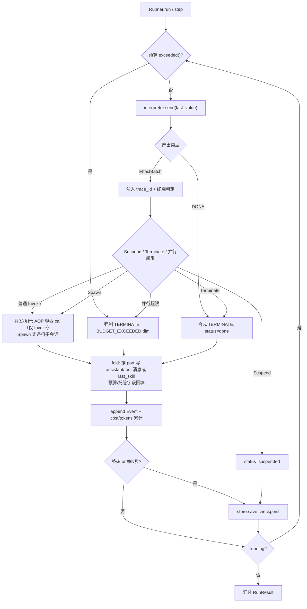

# R1：核心运行时（runtime）

> **权威来源**：[《AGENT 总设计》](../../01-总览与设计/AGENT-总设计.md) §R1；`docs/01-总览与设计/扩展体系重构规格-20261120.md` P5；统一口径见 `overviews/2026-11-20/扩展体系重构-口径卡.md`。本文是其模块级拆分详设，模块内闭环。
> 层：L0 微内核 · 依赖：无（types 自包含）· 源码包：`src/runtime/` · 门禁 key：`r1`
> 状态：按规格 P5 完成 Effect 体系重构——`Effect` 改为 tagged union（`Invoke | Spawn | Suspend | Terminate`）+ `Disposition` 枚举；`fold` 按 `Invoke.port` 三分支；Runner 用 `match` 分派，仅 `Invoke` 进 AOP 链，其余三类走内核快路径。不做运行时兼容层，提供离线快照迁移工具一次性把旧 `kind` 字段转为新形态。取消（frozen `CancellationToken` + `Runner.cancel()` + 内部 `_CancellationHolder` + `cancelled` 通知 + `RunResult.reason`）、usage token/cost 同口径扣预算、幂等键恢复/展开、`Usage.from_mapping` 忽略额外键、set 确定性序列化、构造期异常折叠为 error、混合批次等长回填均保持不变。

---

## 1. 职责与边界

**做**：定义三大原语（State/Effect/Program）；实现唯一解释循环与 Runner；预算硬强制；事件溯源与 checkpoint 挂点。
**不做**：任何具体 IO（不 import LLM SDK/数据库）；AOP 增强器编排与生命周期通知（R2）；Port 实现（R4~R11）。
**依赖注入**：`call`（Port 调用函数，由装配层的 AOP 容器提供）、`EventStore`、`ctx_factory`、`CancellationToken` 在构造时注入——测试注入 fake 即可闭环。R1 只认 `CallFn` 签名与返回契约，**不感知 AOP 五角色、16 个生命周期通知点、Registry 的内部实现**（全部封在装配层 R2/R12/R13）。原 `dispatch` 注入槽已移除：上层判决改由 AOP 容器在 `call` 槽内完成（Warden 的 `Verdict` 与 `invoke_rejected` 通知），主调用链只剩 `call`。

## 2. 设计架构

纯解释器 + 唯一 async IO 编排点：
- `InterpreterImpl` 只做确定性推进，无 IO；non-generator 直接 `ProgramInvalid`。
- `Runner` 是唯一 async 汇聚点，步骤：预算预检 → 驱动 → batch 展开 → trace_id 注入 → 终端判定 → `match` 分派（`Invoke` 经 AOP 容器 `call`；`Spawn` 递归子会话、`Suspend` 挂起、`Terminate` 结束，均走内核快路径）→ `fold` → event → checkpoint → 继续/挂起/结束。
- State 全 frozen，`fold` 是唯一状态变更入口；托管字段提升为显式字段，scratch 只留用户键。
- Program 用工厂（generator 不可序列化），恢复时重建并重放事件到断点。
- `Effect` 是类型级 tagged union：`Invoke` 携带 `port`（∈ PORT_PROTOCOLS，装配期校验）+ `payload`，新增 RAG/Memory 等能力只需 `Invoke(port="rag")`，内核零改动。
- 不做运行时兼容：旧快照的 `kind` 字段由离线迁移工具一次性转换（P5 自身交付），运行期只读新形态。

## 3. 流程图



## 4. API 规范（完整接口）

> 本节全部为 R1 命脉契约。Effect 体系按 P5 重构；其余签名与语义保持不变。

```python
# ---- 类型别名 ----
DynamicValue = Any
EffectPayload = Mapping[str, DynamicValue]         # Effect 参数负载（只读）
Scratchpad = Mapping[str, DynamicValue]            # State 用户键（只读）

# ---- Effect 体系：tagged union + Disposition（P5）----
class Disposition(str, Enum):
    INVOKE = "invoke"; SPAWN = "spawn"
    SUSPEND = "suspend"; TERMINATE = "terminate"

@dataclass(frozen=True)
class Invoke:                             # 唯一走 AOP 链的 Effect
    port: str                             # ∈ PORT_PROTOCOLS，装配期校验
    payload: EffectPayload
    trace_id: str | None = None           # 内核注入，格式 session:step:index
    idempotency_key: str | None = None    # 副作用幂等键（具名字段，R3 幂等/重试红线读此字段，非 payload/meta 动态键）
    batch: bool = False                   # 批量标记；payload['calls'] 由解释器展开为多个独立 Invoke
    def with_payload(self, **extra) -> Invoke: ...

@dataclass(frozen=True)
class Spawn:
    program_factory: Callable[[], Program]
    state: AgentState
    trace_id: str | None = None

@dataclass(frozen=True)
class Suspend:
    question: str
    options: tuple[str, ...]
    trace_id: str | None = None

@dataclass(frozen=True)
class Terminate:
    output: object
    reason: str
    trace_id: str | None = None

Effect = Invoke | Spawn | Suspend | Terminate

@dataclass(frozen=True)
class Budgets:
    max_turns=30; max_hops=5; max_rounds=3; max_cost_usd=5.0
    max_tokens=100_000; max_parallel_children=8
    used_turns=0; used_hops=0; used_rounds=0
    used_cost_usd=0.0; used_tokens=0; used_parallel_children=0
    def exceeded(self) -> str|None: ...
    def check_parallel(self, count: int) -> str|None: ...
    def consume(self, **deltas) -> Budgets: ...

@dataclass(frozen=True)
class AgentState:
    messages: tuple[Message,...] = ()
    scratch: Scratchpad = field(default_factory=dict)
    budgets: Budgets = field(default_factory=Budgets)
    version: str = "0.0.0"
    output: DynamicValue = None
    last_skill / last_child / last_wait_human: DynamicValue = None
    last_step_kinds: tuple[str,...] = ()
    last_tokens: int = 0; last_reason: str = ""
    def get(self, key, default=None) -> DynamicValue: ...
    def set(self, key, value) -> AgentState: ...
    def with_(self, **changes) -> AgentState: ...

@dataclass(frozen=True)
class Message:
    role: str; content: str = ""; name: str|None = None
    tool_calls: tuple[DynamicValue,...] = ()
    def to_dict(self) -> dict: ...

@dataclass(frozen=True)
class Result:
    ok: bool; data: DynamicValue = None
    usage: Usage|None = None; error: PortError|None = None
    @classmethod success(cls, data, usage=None) -> Result: ...
    @classmethod failure(cls, code, message, retryable=False) -> Result: ...

Program = Generator[Effect, DynamicValue, None]
DONE = _Done()

# ---- 解释器 ----
@dataclass(frozen=True)
class EffectBatch:
    effects: tuple[Effect,...]; batched: bool = False
type SendResult = EffectBatch | DoneSentinel
class Interpreter(Protocol):
    def send(self, value: DynamicValue) -> SendResult: ...
class InterpreterImpl:
    def __init__(self, program: Program): ...
    def send(self, value) -> SendResult: ...

# ---- Runner（命脉：Effect 分派方式变更，对外职责不变）----
class Runner:
    def __init__(self, call: CallFn, *,
                 store: EventStore|None=None, ctx_factory=None,
                 checkpoint_every=1, max_steps=1000,
                 cancellation: CancellationToken | None = None): ...
    def cancel(self, reason: str) -> None: ...   # 运行期取消，下一 step 生效（内部 _CancellationHolder）
    async def run(self, session: Session) -> RunResult: ...   # 构造期 ProgramInvalid/Crashed 折叠为 error RunResult，不抛穿
    async def step(self, session: Session) -> StepReport: ...
    async def resume(self, session, answer) -> RunResult: ...
    def replay(self, session, initial: AgentState) -> AgentState: ...
    async def load(self, session_id, program_factory) -> Session: ...

# ---- 纯函数 ----
def fold(state, effects, results, reason="") -> AgentState: ...
def checkpoint(session) -> JsonSnapshot: ...
def restore_checkpoint(snapshot, program_factory) -> Session: ...
def fingerprint(events) -> str: ...
def canonical(obj) -> str: ...
# 离线迁移工具位于 tools/migrate_snapshot.py（旧 kind→新 Effect 形态，一次性、不做运行时兼容），非 runtime 导出 API

# ---- 注入契约 ----
# call：唯一主链注入点，由 AOP 容器装配；R4 ModelGateway.as_call() 产出该签名。
# Invocation 由装配层 AOPContainer.as_call() 构造（口径卡 §3 / 规格 P3）；Runner 只传 (effect, ctx)，不构造 Invocation、不感知 AOP。
CallFn = Callable[[Effect, DynamicValue], Awaitable[Result]]

class EventStore(Protocol):                    # 异步，支持 DB/Redis checkpoint
    async def save(self, session_id, snapshot: JsonSnapshot) -> None: ...
    async def load(self, session_id) -> JsonSnapshot|None: ...
class InMemoryEventStore(EventStore): ...
```

### 4.1 `match` 分派与 `fold` 三分支（P5）

Runner 对 `effect` 做类型分派，只有 `Invoke` 进入 AOP 容器：

```python
match effect:
    case Invoke(port=p, payload=pl, ...):
        result = await call(effect, ctx)   # AOP 适配器(as_call)内部构造 Invocation 后跑增强链：Prelude→Warden→Envelope(前)→Refiner→Port call→Envelope(后)→Salvage
    case Spawn(program_factory=pf, state=st, ...):
        result = await run_child(pf, st, token)   # 内核快路径，不经 AOP
    case Suspend(question=q, options=opts, ...):
        return suspend_session(q, opts)            # 内核快路径；发 wait_human 通知
    case Terminate(output=o, reason=r, ...):
        result = Result.success(o)                 # 内核快路径
```

`fold` 按 `Invoke.port` 决定回写形态（决定写什么消息，不解释降级目标）：

| port | 回写 |
|------|------|
| `llm` | 追加 `role="assistant"` 消息（含 tool_calls） |
| `tool` | 追加 `role="tool"` 消息（call_id 对齐） |
| `skill` | 写 `AgentState.last_skill`，不追加消息 |
| 其他已注册 port（rag/memory/disclosure 等） | 不追加消息、不写托管字段；由消费模块从 `Result.data` 自行取用 |

`fold` 仅消费 `Result` 与 port；降级目标由 Degradation 实例裁决并经 `Invocation.meta` 具名故障记录 typed 传给网关（P9），R1 不读、不解释任何降级目标，保持微内核不依赖模型概念。

### 4.2 取消与中断传播（A5）

设计背景：能力域 A5「Cancellation 信号向子 effect/流递归传播」此前无设计，但 R12 的 race 算子、R9 的人工接管（L5）、R4 的流式输出（C7）都依赖它。本节定义内核级取消机制。

**核心抽象**：

```python
@dataclass(frozen=True, slots=True)
class CancellationToken:
    """取消令牌：显式注入，不用全局状态；frozen，cancel() 返回新对象。"""
    cancelled: bool = False
    reason: str = ""
    def cancel(self, reason: str) -> CancellationToken: ...

@dataclass
class _CancellationHolder:            # Runner 内部可变取消态
    """承载运行期 Runner.cancel() 的置位；对外 token 仍 frozen。"""
    cancelled: bool = False
    reason: str = ""
    def cancel(self, reason: str) -> None: ...   # 原地置位

class Runner:
    def cancel(self, reason: str) -> None: ...   # 外部/增强器请求取消，下一 step 生效
    # 构造参数：cancellation: CancellationToken | None = None（初值注入 holder）
```

传播规则：
1. **每步检查**：`Runner.step()` 每步开头检查内部 `_CancellationHolder`（承载运行期 `Runner.cancel()` 置位，不只读构造期冻结 token）；已取消则本步不执行任何 Effect，写 `Event(status="cancelled", reason)` 并把 reason 记入 `_reasons`。`Interpreter` 不做取消检查。
2. **子 Agent 继承**：`Spawn` 派生 Session 时把父 token 传给子 Runner（递归传播）。
3. **流式协作**：R4 `stream()` 的 async generator 与 token 协作——取消时由消费方调 `aclose()`；token 本身不直接关闭后端连接（Port 实现责任，见 R4 §4.1）。
4. **运行期取消入口**：外部（或增强器经装配层）调用 `Runner.cancel(reason)` 原地置位内部 holder；`CancellationToken` 对外仍 frozen，不被就地改写。代码中无独立预算扩展点；`budget_check` 由 Runner 在预算预检处发通知（P2）。
5. **终止语义**：取消 ≠ 错误——事件溯源记 `cancelled` 状态，checkpoint 落断点，可恢复（O 域）；`RunResult.reason` 同步取取消 reason。

实现状态：已实现——frozen `CancellationToken` 在 types.py，`_CancellationHolder`/`Runner.cancel()` 在 runner.py，`step()` 每步检查并以 reason 写事件与 `_reasons`；取消用例已纳入 R1 门禁。

## 5. 元数据与关键字段（核心字段）

| 类型 | 字段 | 说明 |
|------|------|------|
| AgentState | messages/scratch/budgets/version/output/last_* | messages 只增；托管字段显式化；scratch 冻结只读 |
| Effect | `Invoke`: port/payload/trace_id/idempotency_key；`Spawn`: program_factory/state；`Suspend`: question/options；`Terminate`: output/reason | trace_id 格式 `session:step:index`，内核注入；idempotency_key 是具名幂等键，R3 幂等去重与副作用重试红线读此字段（不塞进 payload/meta） |
| Event | seq/step/session_id/state_snapshot/effects/results/batched/ts/cost_usd/tokens/status/reason | 逻辑时钟 ts=step，墙钟由外壳注入 |
| Budgets | 6 max_* + 6 used_* | 6 维：turns/hops/rounds/cost/tokens/parallel |
| Session | session_id/program_factory/state/events/version | program 是工厂，非 generator 实例 |
| Result | ok/data/usage/error | 业务失败 ok=True+业务码；Port 异常 ok=False |
| PortError | code/message/retryable | retryable 驱动 R3 失败分类与增强器判决 |

**EffectPayload 已知键**（TypedDict total=False）：LLM=messages/tools/model/temperature/max_tokens/task_hint（任务提示，R4 路由消费）/meta（扩展元数据容器，如 max_cost_per_call）；TOOL=call/calls/call_id；通用=budget/port；SKILL=name/part；CHILD（现 `Spawn`）=program_factory/program/state；HUMAN（现 `Suspend`）=question/options；END（现 `Terminate`）=output/reason。`x-*` 扩展键（x-retry/x-budget/x-&lt;name&gt;）继续允许，属 Effect payload 的动态扩展键；该约定只针对 payload 扩展键，Port 种类本身不可新增（必须 ∈ PORT_PROTOCOLS）。

**确定性序列化**：`canonical()` = sort_keys + 紧凑分隔符；`fingerprint()` = sha256。

## 6. 可插拔契约

| 注入点 | 协议 | 默认 | 入口 |
|--------|------|------|------|
| Port 调用（唯一主链） | `CallFn`（AOP 容器装配） | 无（必注入） | `Runner(call=...)` |
| checkpoint | EventStore | InMemoryEventStore | `Runner(store=...)` |
| 上下文 | ctx_factory | RuntimeCtx | `Runner(ctx_factory=...)` |
| 取消 | CancellationToken | None | `Runner(cancellation=...)` |

**增强与通知归属**：AOP 五角色（Prelude/Warden/Envelope/Refiner/Salvage）由装配层（R2/R12/R13）注册；Runner 经注入的 `notify: NotifyFn` 回调发会话/轮次/控制流及 tool 三相位通知（装配层用 `runner_notifier(bus)` 桥接到 LifecycleBus），R1 内核只认 notify 回调、不感知总线。只有 `Invoke` 进 AOP 链；Warden 返回 `Verdict(allowed=False)` 时由容器发 `invoke_rejected` 通知并产出拒绝 Result，Envelope 包裹 Port 调用、Salvage 在异常时兜底。跨 Effect 的降级目标状态由 Degradation 实例内 `dict[session_id, 状态]` 持有（P9 B1），经 `Invocation.meta` 具名故障记录 typed 传给网关；R1 不解释降级目标。

**离线快照迁移**（不做运行时兼容）：`migrate_snapshot(old_snapshot)` 把旧 `kind` 字段一次性映射——`LLM/TOOL/SKILL` → `Invoke(port="llm"/"tool"/"skill", payload=...)`；`CHILD` → `Spawn`；`WAIT_HUMAN` → `Suspend`；`END` → `Terminate`。迁移后的快照只含新形态，运行期不对旧字段做兼容分支。

## 7. 模块内闭环核对（CL-1~CL-5）

| 条件 | 实现 | 证据 |
|------|------|------|
| CL-1 契约自足 | types 自包含，不 import 任何 IO/其他模块实现 | import 扫描 |
| CL-2 自带 fake | tests/fakes 提供 fake_call（经 AOP 容器装配） | fake 用例 |
| CL-3 自带测试 | tests/r1/ 覆盖全部门禁清单条目 | 覆盖率报告 |
| CL-4 独立 demo | `make demo-r1` 一条命令跑通 | demo 冒烟 |
| CL-5 文档自足 | 本文 + AGENT-总设计对应章节 | 文档评审 |

## 8. 验收标准

1. 用 fake call 跑通 program 全流程（ReAct 脚本）；
2. 同输入两次 run 事件日志逐字节一致；
3. 6 类预算超限强制 TERMINATE；
4. Suspend 挂起→checkpoint 恢复→继续执行；
5. 事件重放恢复的 State 与终态全等；
6. 错误（BudgetExceeded/ProgramInvalid/PortMissing/ProgramCrashed）进 StepReport 不抛穿；
7. `fold` 三分支：llm/tool 写消息、skill 写 `last_skill`，其他 port 不写消息；
8. 离线迁移工具把旧 `kind` 快照一次性转为新 Effect 形态，迁移后无旧字段兼容分支。

## 9. 功能验证矩阵

| 功能点 | 用例 ID | 验证方式 | 通过标准 |
|--------|---------|---------|---------|
| 解释循环单步 | R1-T01 | `pytest tests/r1/test_runner.py -q` | resume→match 分派→call→fold→Event 顺序正确 |
| 确定性 | R1-T02 | `pytest tests/r1/test_determinism.py -q` | 两次 run 事件日志哈希一致 |
| 回放恢复 | R1-T03 | `pytest tests/r1/test_replay.py -q` | 重放后 State 与终态全等 |
| 6 类预算 | R1-T04 | `pytest tests/r1/test_budgets.py -q` | 6 维超限强制 TERMINATE |
| batch 并行 | R1-T05 | `pytest tests/r1/test_batch.py -q` | 并行执行、结果按序回填 |
| 挂起/断点恢复 | R1-T06 | `pytest tests/r1/test_suspend.py -q` | Suspend→checkpoint→续跑 |
| 错误分类 | R1-T07 | `pytest tests/r1/test_errors.py -q` | 4 类错误进报告不抛穿 |
| fold 三分支 | R1-T08 | `pytest tests/r1/test_fold.py -q` | llm/tool 写消息、skill 写 last_skill、其他 port 不写消息 |
| 快照迁移 | R1-T09 | `pytest tests/r1/test_snapshot_migration.py -q` | 旧 kind 快照一次性转新形态，无残留旧字段 |
| 纯函数红线 | R1-T10 | `python tests/tools/ast_scan.py --module r1` | Program 内无时间/随机/网络 |
| 独立闭环 | R1-D01 | `python tests/demos/demo_r1.py` + gate_check --module r1 | demo 通过 + G0~G4 全绿 |

## 10. 门禁清单

| 门禁 | 条目 | 达标标准 | 级别 |
|------|------|---------|------|
| R1-G1 | 覆盖率 | interpreter/fold/budget 单测 ≥90%，mypy strict 通过 | G1 |
| R1-G2 | 确定性 | 同输入两次 run 事件哈希逐字节一致（CI 比对） | G2 |
| R1-G2 | 回放 | 事件重放恢复 State 与终态全等 | G2 |
| R1-G2 | 预算 | 6 维各有超限强制 TERMINATE 用例 | G2 |
| R1-G3 | 集成 | fake call 跑通；Suspend 挂起→恢复→续跑；fold 三分支正确 | G3 |
| R1-G3 | 迁移 | 旧快照迁移工具一次性转换后无旧字段兼容分支 | G3 |
| R1-红线 | 纯函数 | Program 内时间/随机/网络调用 → AST 拒绝 | 红线 |

---
*R1 模块详设 · 派生自 AGENT-总设计与《扩展体系重构规格（2026-11-20）》P5 · 门禁 key=r1 · 本次变更：旧 Effect 六值枚举 → tagged union（Invoke/Spawn/Suspend/Terminate）+ Disposition；fold 按 port 三分支；Runner 用 match 分派、仅 Invoke 进 AOP 链；dispatch 槽移除、上层判决归 AOP 容器；新增离线快照迁移工具（不做运行时兼容）；idempotency_key 保留为 Invoke 具名字段。取消/预算/确定性序列化契约不变*
