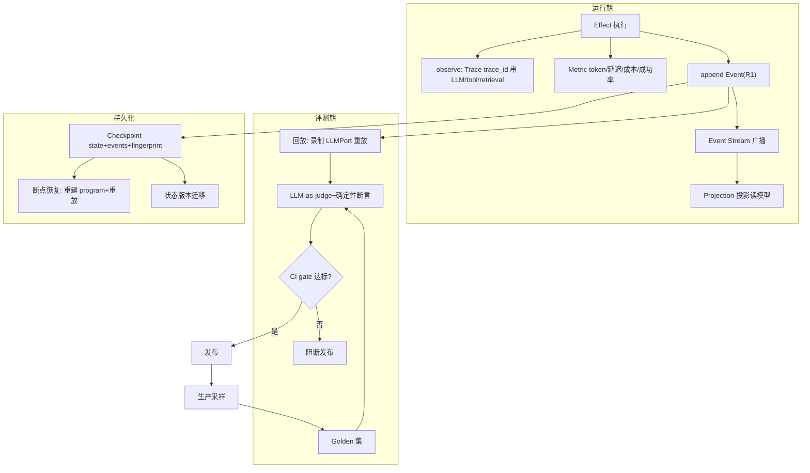

# R10：可观测·评测·持久化（observability）

> **实现状态**：设计定稿，代码待实现（当前仓库仅 R1/R2 已实现）。验证矩阵中的 tests/rN/ 为预留路径。


> **权威来源**：[《AGENT 总设计》](../../01-总览与设计/AGENT-总设计.md) §R10。本文为模块级拆分详设。
> 层：L2/L3 · 依赖：R1+R2 · 源码包：`src/harness/observability/` + eval/ + durability/（原 M9）· 门禁 key：无（设计态）

> **⏳ 回头实现清单**：本模块负责 EvalPort→RuleEval、TelemetryPort→NoopTelemetry、EventStreamPort→InMemoryEventStream 三个默认实现（总设计[附录 B.1.2](../../01-总览与设计/AGENT-总设计.md)）。开发时须落地并勾销。

---

## 1. 职责与边界

**做**：全链路 trace、metric、事件流/读模型投影；eval（golden 集/LLM-as-judge/确定性断言/CI gate/生产采样/回放）；checkpoint 快照/事件溯源/断点恢复/状态版本迁移。
**不做**：checkpoint 写入时机（R1 内核）；长期记忆语义（R7）。

## 2. 设计架构

质量飞轮：运行期产事件 → trace/metric/事件流 → eval（CI gate + 生产采样）→ 失败回流测试集 → 改进 prompt/模型/架构 → 重新评测。持久化与记忆分离：**checkpoint 是短期 thread 内恢复，memory 是长期跨 thread 知识**。回放底座 = 事件溯源 + 录制 LLMPort 重放。

## 3. 流程图



## 4. API 规范（完整接口）

```python
class TelemetryPort(Protocol):
    def span(self, name, ctx) -> AbstractContextManager: ...
    def metric(self, name, value, tags=None) -> None: ...
    def log(self, event) -> None: ...
class EventStream(Protocol):                          # L3 接入契约
    def subscribe(self, topic, since=None) -> AsyncIterator[Event]: ...
    def topics(self) -> list[str]: ...
class Projection(Protocol):
    name: str
    def project(self, events: Iterable[Event]) -> ReadModel: ...
class EvalPort(Protocol):
    async def run_case(self, case: EvalCase) -> EvalResult: ...
    async def regression(self, suite: str) -> SuiteReport: ...
class Judge(Protocol):
    name: str
    async def score(self, case, output: Trace, ctx) -> Score: ...
class EventStore(Protocol):                           # checkpoint 存储
    def save(self, session_id, snapshot: JsonSnapshot) -> None: ...
    def load(self, session_id) -> JsonSnapshot|None: ...
def replay_events(events, initial: AgentState) -> AgentState: ...
```

### 4.1 事件流（M4）语义补齐（v1.1，2026-11-18）

设计背景：§4 只给了 `subscribe(topic, since)` 读侧签名，缺事件 schema、背压与投递保证（三层对齐报告 M4 项）。

**Event schema（所有 topic 通用信封）**：

```python
@dataclass(frozen=True, slots=True)
class StreamEvent:
    seq: int            # 全局单调序号，用于 since 续读
    topic: str          # session / effect / trace / audit / metric
    ts: float           # 注入时钟（墙钟由适配器决定，内核不隐式取）
    type: str           # 事件类型（如 effect_started / trace_written）
    data: DynamicValue  # 载荷形态由 topic 决定（规则 4 动态边界）
```

**投递语义**：
1. **只读**：EventStream 是 R1 append-only event log 的只读投影，订阅者不得写内核事件。
2. **at-least-once**：同一 seq 可能重复投递（重连场景），消费方须按 seq 去重。
3. **从 seq 续读**：`subscribe(topic, since=n)` 从第 n 条之后开始；断线重连用最后处理的 seq 恢复。
4. **背压**：内存默认实现用有界队列（默认容量 1000）；满时**丢弃最旧**并标 `trace=event_dropped`，不阻塞内核执行。
5. **topic 命名**：`session.*` / `effect.*` / `trace.*` / `audit.*` / `metric.*`，与 R11 接入契约对齐。

实现状态：协议签名在 `src/hooks/protocols.py:EventStreamPort`，发布端与内存实现待 R10 编码（代码待实现）。

## 5. 元数据与关键字段（核心字段）

| 字段 | 说明 |
|------|------|
| TraceSpan | trace_id/span_id/parent_id/name/耗时/token/cost/组件 name |
| topic | session.*/effect.*/trace.*/audit.*/metric.*/state.* |
| EvalCase | input/expected/expected_trajectory/should_refuse |
| Judge | LLM-as-judge + 位置偏差打乱 + 冗长偏差长度归一化 |
| CheckpointSnapshot | session_id/version/state/events/fingerprint |
| 评测三层 | 确定性不变量/黄金轨迹场景/生产采样 |

**checkpoint vs memory**：checkpoint=短期 thread 内崩溃/挂起恢复；memory=长期跨 thread 知识。两者分离存储。

## 6. 可插拔契约

| 注入点 | 协议 | 默认 | 校验 |
|--------|------|------|------|
| 日志平台 | TelemetryPort | JSONL/OTel | 故障不影响主流程 |
| 事件源 | EventStream | 内存流 | 只读；从 seq 续读 |
| 读模型 | Projection | 时间线/成本 | 可从事件重建 |
| 评测/Judge | EvalPort/Judge | 本地回归/LLM-judge | CI gate 阈值 |
| checkpoint | EventStore | 内存/Postgres | 快照结构兼容 |

## 7. 模块内闭环核对（CL-1~CL-5）

| 条件 | 实现 | 证据 |
|------|------|------|
| CL-1 契约自足 | 依赖 R1 types + R2 Hook + 观测协议 | import 扫描 |
| CL-2 自带 fake | fake Telemetry/EventStore | fake 用例 |
| CL-3 自带测试 | tests/r10/ | 覆盖率报告 |
| CL-4 独立 demo | `make demo-obs` | demo 冒烟 |
| CL-5 文档自足 | 本文 + AGENT-总设计对应章节 | 文档评审 |

## 8. 验收标准

1. 录制重放后 State 与终态全等；
2. 挂起/每 N 步/终态必存 checkpoint；跨进程恢复一致；
3. trace 含全部组件 name；事件流可续读；
4. 评测不调真实 LLM（用录制/假实现）。

## 9. 功能验证矩阵

| 功能点 | 用例 ID | 验证方式 | 通过标准 |
|--------|---------|---------|---------|
| 全链路 trace | R10-T01 | `pytest tests/r10/test_trace.py -q` | 一个 trace_id 串联+组件留名 |
| 事件流 | R10-T02 | `pytest tests/r10/test_stream.py -q` | 订阅+从 seq 续读 |
| 回放 | R10-T03 | `pytest tests/r10/test_replay.py -q` | 重放 State 与终态全等 |
| checkpoint | R10-T04 | `pytest tests/r10/test_checkpoint.py -q` | 跨进程恢复一致 |
| eval | R10-T05 | `pytest tests/r10/test_eval.py -q` | 三层评测，不调真实 LLM |
| 独立闭环 | R10-D01 | `make demo-obs` | demo 冒烟 |

## 10. 门禁清单

| 门禁 | 条目 | 达标标准 | 级别 |
|------|------|---------|------|
| R10-G1 | 覆盖 | trace/eval/checkpoint ≥85% | G1 |
| R10-G2 | 回放/checkpoint | 重放一致；挂起/终态必存 | G2 |
| R10-G3 | 留名/续读 | trace 含全部 name；事件流续读 | G3 |
| R10-红线 | 一致 | 未记录决策不可上线；checkpoint 与 memory 混用→拒绝 | 红线 |

---
*R10 模块详设 v2.0 · 派生自 AGENT-总设计 · 设计态*