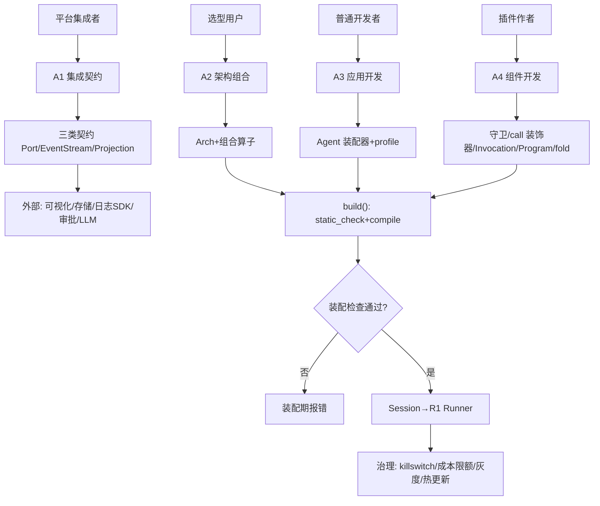

# R11：集成接入与治理（api + governance）

> **实现状态**：设计定稿，代码待实现（当前仓库已实现 R1~R4：runtime/hooks/resilience/model；本模块为设计态）。验证矩阵中的 tests/rN/ 为预留路径。


> **权威来源**：[《AGENT 总设计》](../../01-总览与设计/AGENT-总设计.md) §R11。本文为模块级拆分详设。
> 层：L3 · 依赖：全部 · 源码包：`src/api/` + cli/ · 门禁 key：无（设计态）

---

## 1. 职责与边界

**做**：四组 API 面（A1 集成契约/A2 架构组合/A3 应用开发/A4 组件开发）；Agent 装配器与 profile 预设；配置版本/热更新/灰度回滚/feature flag；全局 killswitch/成本限额/限流；CLI（脚手架/评测/回放/门禁）；触发调度（webhook/cron）与交付通道。
**不做**：任何具体能力实现——本模块只做投影、装配、治理。

## 2. 设计架构

四组 API 是同一内核面向四类使用者的四个投影，底层都归约到 ②有状态守卫 / ③call 装饰器 / ④notify 观察 / Port / Program / fold；R3 可靠性另由 `ReliabilityExecutor` 显式编排 9 领域策略（见 R3），不再是任何"增强器角色链"。外部系统（可视化平台、存储工具、日志 SDK）只经三类契约（Port/Event Stream/Projection）接入，不得 import 内核内部对象或直接写事件日志。装配期统一 `static_check` 把错误挡在运行前。

**可插拔四要素**：每个注入点框架给齐 ① 协议定义 ② 默认实现 ③ 替换入口 ④ 履约校验。注入三形态：协议替换 / ②守卫或③call 装饰器（可靠性用 `ResilienceCapability` 具名构造注入领域策略） / 构造参数。

## 3. 流程图



## 4. API 规范（完整接口）

```python
# A3 应用开发（最常用）
agent = (Agent(arch=ReAct(tools=tools))          # 选架构
    .profile("production")                       # 一键加载 L1 默认插件预设
    .capability(RAG(pipeline=rag))               # 开能力+换策略
    .capability(IntentRecognition(strategy=MyIntent()))
    .rag(PostgresStore(...)).memory(RedisMemory())
    .telemetry(LangfusePort())
    .event_stream(KafkaStream(topics=["trace.*"]))
    .build())                                    # static_check + compile
result = await agent.run("...", session_id="s-1")

# A1 集成契约
class PortRegistry:
    def register(self, name, adapter) -> None: ...
# Port 注册名固定（∈ PORT_PROTOCOLS，不可新增：llm/tool/memory/store/...）；
# 用户自定义工具/技能用 x- 前缀命名，Port 种类本身不新增（D-2）

# A2 架构组合
agent2 = Agent(arch=budget(max_cost_usd=2)(branch(intent_fn, {"qa": rag, "act": ReAct(tools)})))

# A4 组件开发 —— 方式一：可靠性领域策略（具名构造注入，无角色分派/无槽位列表）
from harness.resilience import Degradation, RateLimit, ResilienceCapability

class MyRateLimit(RateLimit):
    name = "my-rate-limit"        # 领域方法 acquire() -> RatePermit(ADMIT/REJECT/DEGRADE)
    ...                           # 不实现任何角色协议（guard/wrap/observe/recover）

reliability = ResilienceCapability(
    rate_limit=MyRateLimit(rate=60, burst=10, on_exceed="degrade"),
    degradation=Degradation(ladder),         # 可选：降级唯一裁决者（保四坑）
).install(core=my_gateway_call)              # → ReliabilityExecutor，注入 R1 Runner
# 终止拒绝由执行器 _reject 发 invoke_rejected；降级写 fault → Degradation.select → typed target

# 方式二：Lifecycle 插件（只做事、不拦截；name + register(bus)）
class MyLifecyclePlugin:
    name = "my-plugin"
    def register(self, bus: LifecycleBus) -> None:
        bus.on("before_tool", self.on_before_tool)
        bus.on("session_end", self.on_session_end)
    async def on_before_tool(self, notice: Notice) -> None: ...   # Notice 为 Invocation 只读投影，异常就地隔离
    async def on_session_end(self, notice: Notice) -> None: ...
MyLifecyclePlugin().register(bus)
```

## 5. 元数据与关键字段（核心字段）

| 字段 | 说明 |
|------|------|
| AgentSpec | program_version/arch_version/ports_version/optional_modules[]（进 trace） |
| StaticCheckReport | errors/arch/version/ports_required/budgets_resolved |
| profile | dev/production/regulated 三档插件预设 |
| Port 注册名 | 固定（∈ PORT_PROTOCOLS，不可新增）；用户工具/技能用 `x-` 前缀命名，不新增 Port 种类 |
| 触发入口 | webhook/cron/事件；鉴权+幂等+限流 |

**profile 预设**：dev（最小插件+本地存储）、production（全套可靠性+RAG+安全+OTel）、regulated（+强制审计+审批+数据隔离）。
**三类接入契约**：Q1 Port（能力替换）/ Q2 Event Stream（只读事件流）/ Q3 Projection（读模型）——是外层工具唯一官方接入路径。

## 6. 可插拔契约

| 注入点 | 协议 | 默认 | 校验 |
|--------|------|------|------|
| 外部能力 | Port | 内置默认 | 履约检查；缺 port 装配期报错 |
| 事件消费 | EventStream/Projection | 内存 | 只读；不侵入内核 |
| profile | 插件预设 | 三档内置 | 可自定义预设 |
| CLI | 命令 | init/eval/replay/gate | 扩展命令注册 |

## 7. 模块内闭环核对（CL-1~CL-5）

| 条件 | 实现 | 证据 |
|------|------|------|
| CL-1 契约自足 | 只做投影/装配，依赖各模块 Protocol | import 扫描 |
| CL-2 自带 fake | fake Port/EventStream | fake 用例 |
| CL-3 自带测试 | tests/api/ | 覆盖率报告 |
| CL-4 独立 demo | `make demo-api` | demo 冒烟 |
| CL-5 文档自足 | 本文 + AGENT-总设计对应章节 | 文档评审 |

## 8. 验收标准

1. 四组 API 各有集成用例；
2. 缺 port/非法架构/预算冲突装配期报错；
3. 换外部实现上层零改动；事件流只读可续读；
4. 全局 killswitch/成本限额/灰度回滚各有用例。

## 9. 功能验证矩阵

| 功能点 | 用例 ID | 验证方式 | 通过标准 |
|--------|---------|---------|---------|
| A3 装配器 | R11-T01 | `pytest tests/api/test_builder.py -q` | profile+capability 装配 |
| A2 架构组合 | R11-T02 | `pytest tests/api/test_compose.py -q` | 组合算子+嵌套 |
| A1 Port 接入 | R11-T03 | `pytest tests/api/test_ports.py -q` | 换实现上层零改 |
| 事件流接入 | R11-T04 | `pytest tests/api/test_stream.py -q` | 只读+续读 |
| 装配检查 | R11-T05 | `pytest tests/api/test_static.py -q` | 缺 port 装配期报错 |
| 治理 | R11-T06 | `pytest tests/api/test_governance.py -q` | killswitch/限额/灰度 |
| 独立闭环 | R11-D01 | `make demo-api` | demo 冒烟 |

## 10. 门禁清单

| 门禁 | 条目 | 达标标准 | 级别 |
|------|------|---------|------|
| R11-G1 | 覆盖 | 四组 API 集成用例 ≥85% | G1 |
| R11-G2 | 装配/接入 | 装配期报错；换实现零改动；事件流只读 | G2 |
| R11-G3 | 治理 | killswitch/成本限额/灰度回滚用例 | G3 |
| R11-红线 | 边界 | 外部 import 内核内部对象/写事件日志→拒绝 | 红线 |

## 11. 功能接线备注（R8/R9/R10 已实现，R11 装配时完成）

> 本节是按用户"与已完成代码直接接线；需未完成模块支持的留功能接线并在未完成模块备注"要求登记的接口契约，**不是实现**。R11 装配器实现时必须完成以下接线，禁止用假实现替代。

| 接线点 | 已实现侧（生产者） | R11 装配动作（消费者） | 契约/签名 | 验收 |
|--------|-------------------|----------------------|-----------|------|
| R9 三 Port → R5 工具链 | `SecurityCapability`（`src/harness/security/capability.py`）：`sandbox`/`audit`/`human` + `install(reg)` | 构造 `ToolsCapability(sandbox=sec.sandbox, human=sec.human, audit=sec.audit)`，把三 Port 注入 `ToolRegistry`；装配期 `reg.register("sandbox"/"audit"/"human", ...)` | `SandboxPort.run(fn,args,ctx) async` / `AuditPort.record(dict,ctx) async` / `HumanPort.ask(q,options,ctx) async`（`src/compose/ports.py`） | HIGH 工具走沙盒、CRITICAL 先审批；无注入保持 fail-closed（R5 现状不改） |
| R9 审批流接线 | `ApprovalFlow`（`should_approve(danger)`/`decide_timeout()`→deny） | 在 danger=CRITICAL 的 HumanPort 调用前 consult `flow.should_approve`；超时走 `flow.decide_timeout()`，不得静默放行 | R9 §4 API + R5 `registry.py:233-246` 的 CRITICAL 分支 | 挂起→resume 精确续跑（R1 `Suspend`/`resume`） |
| R9 审计哈希链 | `AuditLogger` + `verify_hash_chain(events)` | 装配期/回放期调用 `verify_hash_chain` 校验 append-only 链；审计事件与 R1 事件日志同源 | `src/harness/security/types.py` | R9-G3 覆盖率 100% + 链可验证 |
| R9 secret 脱敏 | `redact_secret(value, secrets)` + `RuleGuardrail.check`（`ctx.meta["secret_refs"]`） | 装配时把凭据引用注入 `SecurityCtx.meta["secret_refs"]`；输出护栏自动 redact | `SafetyVerdict(action="redact")` | secret 明文不进 trace/记忆/checkpoint |
| R10 事件流投影 | `InMemoryEventStream` + `TimelineProjection` | 订阅 `after_model`/`after_tool`/`session_end` 通知相位，发布 `EventEnvelope` 到 topic，注册 Projection | `EventStreamPort.subscribe(topic,since)` / `Projection.project(events)` | R10-G3 事件流可续读、读模型可重建 |
| R10 checkpoint 恢复 | `CheckpointManager`（复用 R1 `EventStore`） | 挂起/每 N 步/终态调 `mgr.save(snapshot)`；重启调 `load` + `replay_snapshot` | `src/runtime/types.py::EventStore`（唯一声明） | 跨进程恢复一致、State 与终态全等 |
| R10 评测 CI gate | `RuleEval.regression(suite,ctx)`（case.actual 录制回放） | 装配 CI 流程调用 regression，按 `SuiteReport.average` 判阈值；失败阻断发布 | `EvalPort.score` + `SuiteReport` | 评测不调真实 LLM；CI gate 阈值可配 |

备注：以上接线刻意不放在 R5/R9/R10 模块内部——依赖方向恒为工具层 → 组合层 → R1，工具层互不直连；跨模块装配只发生在 R11（组合层）。当前未实现属设计态，不是遗留缺陷。

---
*R11 模块详设 v2.0 · 派生自 AGENT-总设计 · 设计态（含 R8/R9/R10 接线备注）*