# R12：内置架构与组合（archs + compose）

> **权威来源**：[《AGENT 总设计》](../../01-总览与设计/AGENT-总设计.md) §R8；自查补齐（见[《设计自查报告》](../../04-审查与自查/设计自查报告.md) 遗漏项 #1/#2/#12）。
> 层：L1/L2 · 依赖：R1（Program/Budgets/Effect）+ R2（装配）+ R8（认知服务）· 源码包：`src/archs/` + `src/compose/`（待实现）
> 地位：**用户唯一入口**——所有架构、组合算子、Agent 装配器都在这里。

---

## 1. 职责与边界

**做**：10 种内置架构（预制 Program + 装配器 + 装配期 `static_check()`）；函数式组合算子（seq/par/branch/race/retry/map_state/budget）；`Agent` 装配器。
**不做**：执行循环（R1）；Hook 编排（R2）；外部能力实现（R4~R11）；把架构做成硬编码调度器。
**铁律**：所有架构的终态都是 `Program`（generator），因此**可任意嵌套**；运行时对架构一无所知。

## 2. 设计架构

架构 = 一个"产出 Program 的工厂"。`compile()` 生成一个 generator，它按该架构的控制流 yield Effect。`static_check()` 在装配期检查图结构合法性（悬空边/环/缺 port/预算冲突），问题在进运行期前报错。所有架构共用 R1 的解释循环，换架构时上层装配代码零改动——这是框架的核心卖点。

## 3. 流程图

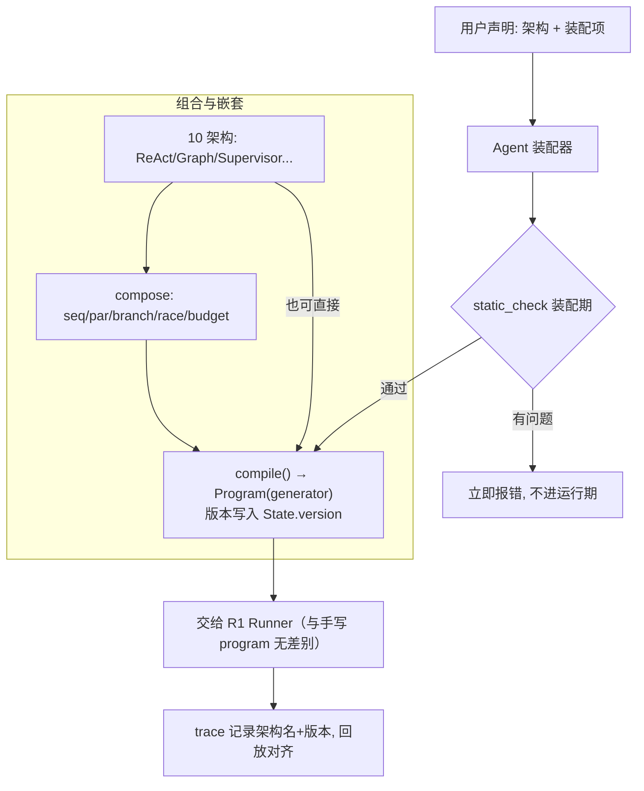

## 4. API 规范（完整）

### 4.0 语法约定（本文伪代码 → R1 真实 API 的严格对应）

本文 §6/§7 的程序结构用简写描述控制流，**实现时必须展开为 R1 真实 API**。
以下映射是唯一合法写法，不得 Invention 新语法：

| 本文简写 | R1 真实写法（唯一合法） | 依据 |
|---------|------------------------|------|
| `END(output=x)` | `yield Effect(EffectKind.END, {"output": x})` | `src/runtime/types.py` Effect(kind, payload)、EffectPayload.output |
| `END`（无输出） | `yield Effect(EffectKind.END, {})` | 同上 |
| `Effect(LLM, {...})` | `yield Effect(EffectKind.LLM, {"messages": [...], ...})` | EffectKind.LLM + EffectPayload.messages/tools/model |
| `Effect(TOOL, batch)` | `yield Effect(EffectKind.TOOL, {"calls": [...]}, batch=True)` | batch=True 时解释器按 payload['calls'] 展开 |
| `Effect(CHILD, {...})` | `yield Effect(EffectKind.CHILD, {"program_factory": ..., "budget": ...})` | EffectPayload.program_factory/budget |
| `Effect(SKILL, {name, part})` | `yield Effect(EffectKind.SKILL, {"name": ..., "part": ...})` | EffectPayload.name/part |
| `WAIT_HUMAN` | `yield Effect(EffectKind.WAIT_HUMAN, {"question": ..., "options": [...]})` | EffectPayload.question/options |
| `scratch.k = v` | `state = yield ...` 后用 `state.scratch["k"] = v` 的不可变副本 | AgentState.scratch 是 MappingProxyType（只读），须经 fold/with_ 产生新对象 |
| 预算 `max_rounds=3` | 构造 `Budgets(max_rounds=3)` 注入 Session，架构内只读不数数 | Budgets 六维上限，R1 强制扣减 |

**铁律重申**：架构内的"轮次/跳数/并行数"一律映射到 `Budgets` 维度（turns/hops/rounds/cost_usd/tokens/parallel_children），
由 R1 `fold` 扣减、`Budgets.exceeded()` 判定；架构 generator 内**不得**出现 `for i in range(max)` 自数轮次（红线）。

```python
# ---- 架构统一协议 ----
class Arch(Protocol):
    name: str
    version: str
    def static_check(self) -> StaticCheckReport: ...
    def compile(self) -> Program: ...

# ---- 10 内置架构构造签名 ----
ToolUse(tools: list[ToolSpec], *, parallel: bool = True)
ReAct(tools: list[ToolSpec], *, llm: str | None = None, max_turns: int = 30)
PlanExecute(planner: Planner, executor: Executor, *, replanner: RePlanner | None = None)
Reflection(reflector: ReflectStrategy, *, max_rounds: int = 3)   # 值交 Budgets
Router(classifier: IntentStrategy | Callable, arms: dict[str, Arch], *,
       default: str | None = None, min_confidence: float = 0.0)
RouterSkill(classifier, routes: dict[str, Arch | SkillSpec], default: str)
Supervisor(planner: Planner, child_spec: ChildSpec, *, max_children: int = 8,
           join: JoinStrategy = MajorityVote())
Handoff(roles: dict[str, Arch], *, max_hops: int = 5)
Blackboard(agents: list[Arch], *, rounds: int = 3)
Graph()   # 声明式图：.node()/.edge()/.exit()/.compile()，完整签名见下方 GraphAPI
class GraphAPI:
    def node(self, id: str, program: Program | Arch, *,
             inputs: tuple[str, ...] = (), outputs: tuple[str, ...] = ()) -> GraphAPI: ...
    def edge(self, src: str, dst: str, *,
             cond: Callable[[AgentState], str | None] | None = None) -> GraphAPI: ...
    def exit(self, id: str) -> GraphAPI: ...
    def compile(self) -> Program: ...

# ---- 7 组合算子（返回新 Program，不改原对象）----
seq(a: Program, b: Program) -> Program                       # 顺序
par(items: list[Program], *, join=all) -> Program            # 并行扇出+聚合
branch(fn: Callable[[AgentState], str], arms: dict) -> Program  # 条件分流
race(items: list[Program]) -> Program                        # 首个完成胜出
retry(n: int, *, backoff: float) -> Program                  # 包裹重试（交 R3 策略）
map_state(lens: Callable) -> Program                         # 状态视图变换
budget(**limits) -> Program                                  # 包裹预算上限

# ---- Agent 装配器（用户唯一入口）----
class Agent:
    def __init__(self, arch: Arch | Program): ...
    def capability(self, cap: Capability) -> Self: ...       # 能力级开关
    def rag(self, pipeline) -> Self: ...
    def memory(self, port: MemoryPort) -> Self: ...
    def telemetry(self, port: TelemetryPort) -> Self: ...
    def event_stream(self, stream) -> Self: ...
    def build(self) -> Session: ...                          # static_check + compile
```

## 5. 元数据与关键字段（核心字段）

| 字段 | 说明 |
|------|------|
| StaticCheckReport | errors / arch / version / ports_required / budgets_resolved（完整 schema 见 §5.1） |
| GraphNode | id / program / inputs / outputs |
| Edge | src / dst / cond: Callable[[AgentState], str \| None]：返回目标节点 id；None 表示走无条件的 dst。多路分支 = 多条带 cond 的边 |
| AgentSpec | program_version / arch_version / ports_version / optional_modules[]（进 trace） |
| ChildSpec | arch / budget 分账 / max_children |
| JoinStrategy | all / any / majority / reduce + timeout |

**版本纪律**：架构名 + 版本写入 `State.version` 并进 trace，回放可对齐。
**预算统一**：max_rounds/max_hops/max_children 一律映射到 R1 `Budgets`，架构内不许自带计数器。
**compile 幂等**：同一 Arch 多次 compile 产出的 Program 行为一致；compose 算子返回新对象不改原 program。

### 5.1 StaticCheckReport 完整 schema 与错误码（v1.1 补齐）

static_check 必须在**装配期**给出可断言的结构化报告，而非布尔值。完整 schema：

```python
@dataclass(frozen=True, slots=True)
class StaticCheckIssue:
    code: str            # 稳定错误码（下表），断言依据
    message: str         # 人类可读
    node: str | None     # 相关节点/参数名（无则 None）

@dataclass(frozen=True, slots=True)
class StaticCheckReport:
    errors: tuple[StaticCheckIssue, ...]
    arch: str            # 架构名
    version: str         # 架构版本
    ports_required: tuple[str, ...]        # 需要的 Port 名（装配期解析）
    budgets_resolved: dict[str, int | float]  # 解析后的预算上限（六维）

    @property
    def ok(self) -> bool: return not self.errors
```

**错误码表**（稳定标识，测试按 code 断言；前缀统一 `R12-`）：

| code | 含义 | 触发条件 | 适用架构 |
|------|------|---------|---------|
| R12-E01 | 悬空边 | edge 的 src/dst 不在已声明节点或 exit | Graph |
| R12-E02 | 环 | 检测到回边且未显式声明 `allow_cycle=True` | Graph/PlanExecute/Handoff |
| R12-E03 | 不可达节点 | 存在从入口不可达的 node | Graph |
| R12-E04 | 缺 exit | 无 exit 节点或多个 exit | Graph |
| R12-E05 | cond 目标非法 | cond 返回值不是已声明节点 id | Graph |
| R12-E06 | cond 目标重复 | 同一 src 的多条 cond 边返回同一目标 | Graph |
| R12-E07 | 空 arms/roles | arms 或 roles 为空 | Router/RouterSkill/Handoff |
| R12-E08 | default 不在 arms | 指定 default 但 arms 中无此键 | Router/RouterSkill |
| R12-E09 | 工具 schema 非法 | ToolSpec 缺 name/parameters_schema 非法 | ToolUse/ReAct |
| R12-E10 | 高危未配沙盒 | danger=HIGH/CRITICAL 但无 SandboxPort | ToolUse/ReAct |
| R12-E11 | 缺 Port | 声明的 llm/skill/memory port 未注册 | 全部 |
| R12-E12 | 预算冲突 | 局部上限 > 全局上限，或 max_parallel 越界 | budget/Supervisor/全部 |
| R12-E13 | join 未注册 | JoinStrategy 非 all/any/majority/reduce | Supervisor |
| R12-E14 | child_spec 非法 | 子 Agent 预算未分账或并发上限缺失 | Supervisor/Blackboard |
| R12-E15 | 策略未履约 | Planner/Reflector 等缺 name 或方法不全 | PlanExecute/Reflection/Router |
| R12-E16 | 共享键冲突 | 多 Agent 声明写同一 scratch 键且无仲裁 | Blackboard |
| R12-E17 | max 非法 | max_rounds/max_hops ≤ 0 | Reflection/Handoff/全部 |

**判定原则**：static_check 只读架构声明（node/edge/arm/port/budget），**不执行 program**；
发现任一 issue 即在 `build()` 阶段拒绝，不进运行期。多个 issue 全部收集进 errors（不短路），便于一次修完。

## 6. 十个内置架构逐个详设

### ① ToolUse —— 一次性并行工具调用
- **程序结构**：`yield Effect(TOOL, {calls: [...]}, batch=True)` → 收结果 → `END(output=results)`。
- **参数**：`tools`（工具集）、`parallel`（是否并行）。
- **适用**：明确知道要调哪些工具、无推理链的简单编排。
- **static_check**：工具 schema 合法、danger 已声明、高危已配沙盒。

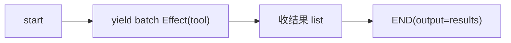

### ② ReAct —— 推理-行动自循环
- **程序结构**：loop → `yield Effect(LLM, {messages, tools})` → 有 tool_calls 则 `yield Effect(TOOL, batch)` 并把结果回注 messages → 无 tool_calls 则 `END(output=content)`。
- **参数**：`tools`、`llm`（模型覆盖）、`max_turns`（交 Budgets）。
- **适用**：通用 Agent 默认架构，边想边做。
- **static_check**：工具集非空、llm port 已注册。

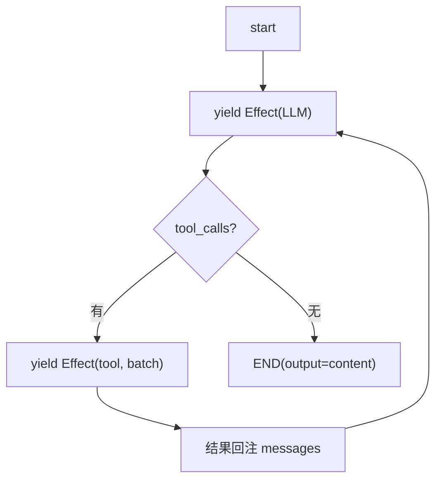

### ③ PlanExecute —— 规划-执行状态机
- **程序结构**：phase 游标机——`plan` 阶段 `yield Effect(LLM→steps)` 写 `scratch.steps` → `execute` 阶段逐 step 调度 → 失败/环境变化时 `yield Effect(LLM→replan)` → 全部完成 `END`。
- **参数**：`planner`、`executor`、`replanner`（可选）。
- **适用**：复杂多步任务，需要先规划再执行、支持中途重规划。
- **static_check**：planner/executor 履约、replanner 可选校验。

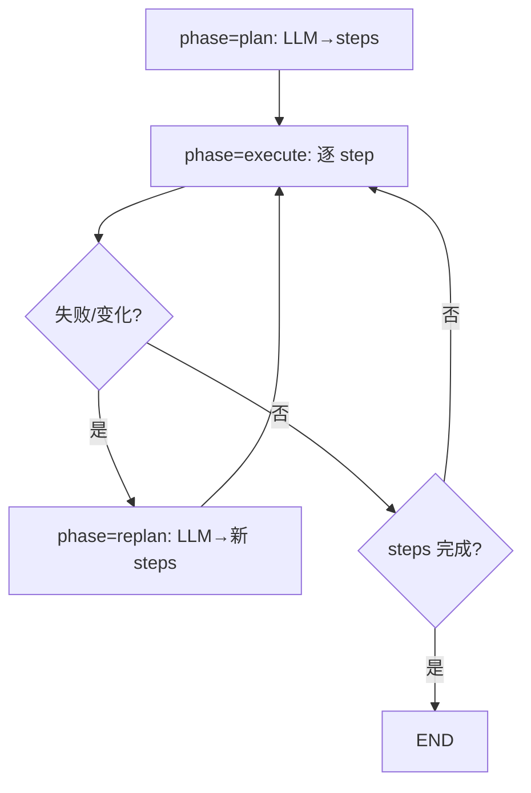

### ④ Reflection —— 起草-反思-修订
- **程序结构**：draft → `yield Effect(LLM→draft)` → `yield Effect(LLM→critique)` → passed 则 END，否则用 critique 修订重试，rounds 由 `Budgets.max_rounds` 强制。
- **参数**：`reflector`、`max_rounds`。
- **适用**：高质量写作/代码生成，需要多轮自我批评改进。
- **static_check**：reflector 履约、max_rounds > 0。

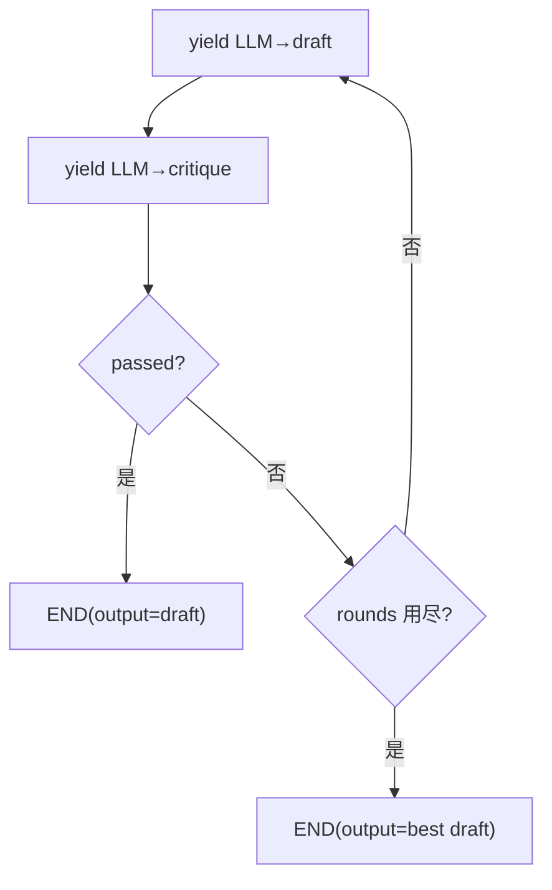

### ⑤ Router —— 意图分流
- **程序结构**：`yield Effect(LLM→intent)`（或调用 classifier）→ 按 label 选 arm → `yield from arm.compile()`；置信度 < min_confidence 走 default。
- **参数**：`classifier`、`arms`、`default`、`min_confidence`。
- **适用**：多能力客服、多领域助手，按意图路由到不同子架构。
- **static_check**：arms 非空、default 若指定必须在 arms 中、每个 arm 是 Arch/Program。

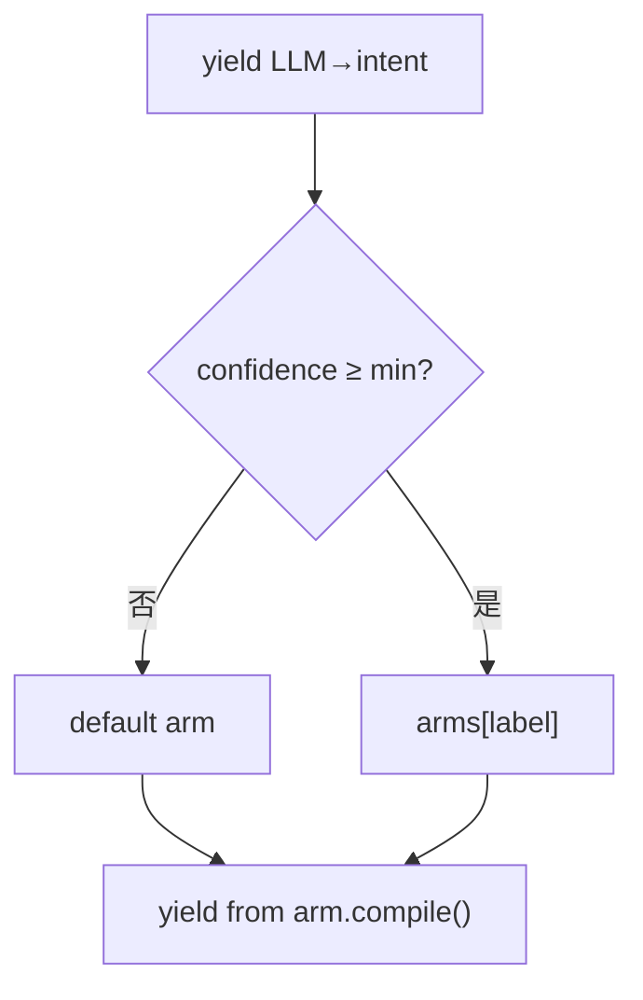

### ⑥ RouterSkill —— 分流 + 技能正文加载
- **程序结构**：同 Router，但命中 skill 路由时 `yield Effect(SKILL, {name, part:body})` 加载正文注入上下文，再执行选定 arm。
- **参数**：`classifier`、`routes`（Arch 或 SkillSpec）、`default`。
- **适用**：技能库场景——按意图加载不同技能正文（SOP/领域知识）再执行。
- **static_check**：skill 名在 SkillPort 中存在、正文履约（R5）；RouterSkill 只做分流+选中，正文加载由 R5 履约。
- **边界**：架构自身不实现技能注册。

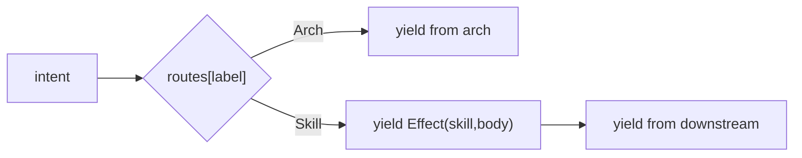

### ⑦ Supervisor —— 监督者-并行子 Agent
- **程序结构**：`yield Effect(LLM→拆任务)` → `yield Effect(CHILD, batch, {child_spec}×N)` 并行 → join 聚合 → END。
- **参数**：`planner`、`child_spec`、`max_children`、`join`。
- **适用**：可并行的复杂任务（如多文档分析、多视角评审）。
- **static_check**：max_children ≤ Budgets.max_parallel_children、child_spec 合法、join 策略已注册。

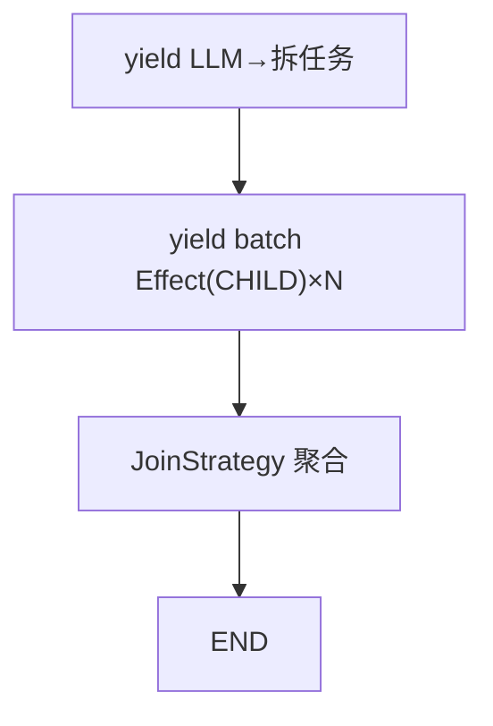

### ⑧ Handoff —— 角色交接
- **程序结构**：当前角色 program 执行 → 判断需换角色 → 切换 program 指针到 roles[next] → hops 由 `Budgets.max_hops` 强制。
- **参数**：`roles`、`max_hops`。
- **适用**：多专家接力（如客服→技术支持→退款专员）。
- **static_check**：roles 非空、每个 role 是 Arch/Program、交接消息结构合法。

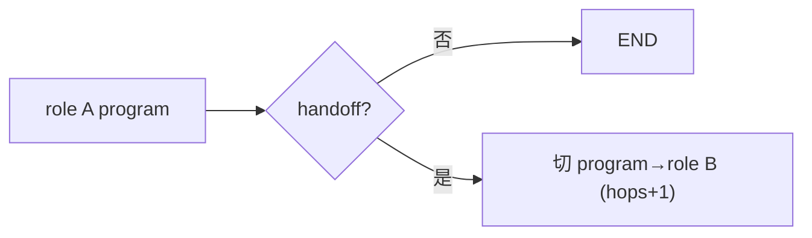

### ⑨ Blackboard —— 共享黑板多 Agent
- **程序结构**：初始化共享 `scratch` → 多轮 `par([Effect(child)])`，每轮子 Agent 读写共享黑板 → rounds 轮后 END。
- **参数**：`agents`、`rounds`。
- **适用**：多 Agent 协作求解（如辩论、逐步精化），需要共享中间结果。
- **static_check**：agents 非空、共享键不冲突、rounds 由 Budgets 约束。

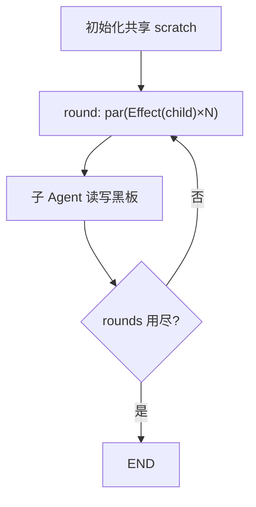

### ⑩ Graph/DAG —— 声明式图编译
- **程序结构**：用户声明 nodes + edges(cond) → `compile()` 生成一个 program，它按条件边在节点间跳转 → 到 exit 节点 yield `Effect(EffectKind.END, {"output": ...})`。`static_check` 检查悬空边/环/不可达节点。
- **参数**：`nodes`、`edges`、`exit`。
- **条件边语义**：`cond(state) -> str | None`，返回**下一个节点的 id**（支持多路分支）；返回 `None` 表示走该边的无条件 `dst`。每个 src 可挂多条 cond 边，static_check 须保证其 cond 返回值覆盖的目标不重复、且都能解析到已声明节点。
- **适用**：显式工作流、可视化编排、需要静态验证的复杂流程。
- **static_check**：无悬空边、无环（除非显式允许）、所有节点可达、exit 存在、cond 可调用且返回已在图中声明的节点 id（错误码见 §5.1）。

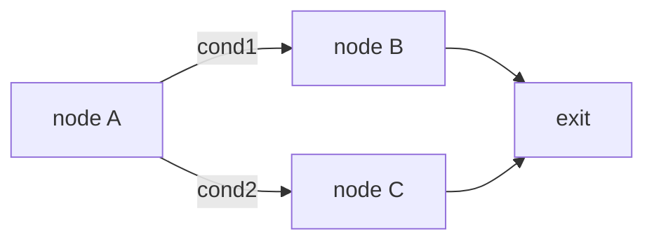

### 6.1 编译契约：10 架构的 compile() 骨架 + state 契约 + 边界（v1.1 补齐）

> 本节是 §6 每个架构的**可执行落地细化**：给出 `compile()` 产出 generator 的骨架（用 §4.0 真实语法）、
> 该架构读写的 state 契约、以及 static_check 判定与边界行为。实现 R12 代码时以本节为准。
> 所有骨架中 `state = yield effect` 收到的是 R1 执行完该 Effect 后的新 AgentState（由 fold 产生）。

#### 6.1.1 state 契约总表（键名锁定，防多架构冲突）

R1 `AgentState.scratch` 是全局动态命名空间。为避免架构间键冲突，**架构私有键统一前缀 `x-arch.<架构名>.`**：

| 架构 | 读 state | 写 scratch 键 | 输出（END payload.output） |
|------|---------|--------------|--------------------------|
| ToolUse | messages | `x-arch.tooluse.results` | results 列表 |
| ReAct | messages | `x-arch.react.{draft,tool_round}` | 最终 content |
| PlanExecute | messages | `x-arch.plan.{steps,phase,replans}` | 最后一步结果 |
| Reflection | messages | `x-arch.reflect.{draft,critique,best}` | best draft |
| Router | messages | `x-arch.router.{label,confidence}` | 选中 arm 的输出 |
| RouterSkill | messages | 同 Router + `x-arch.router.skill_body` | 下游输出 |
| Supervisor | messages | `x-arch.supervisor.{tasks,results}` | join 聚合结果 |
| Handoff | messages | `x-arch.handoff.{role,hops }` | 当前角色输出 |
| Blackboard | messages + 共享 scratch | `x-arch.bb.{round,board}` | board 快照 |
| Graph | messages + node 声明的 inputs | `x-arch.graph.{current,visited}` | exit 节点输出 |

**不可变纪律**：scratch 是 `MappingProxyType`（只读）；架构 generator 不直接改 state，
而是 `yield Effect` 后由 R1 `fold` 产生新 state。需要写入自定义键时，通过 Effect 的
`payload` 携带 `x-arch.*` 扩展键，由装配期约定的 fold 扩展消费（R1 §4 规则 4 动态边界）。

#### 6.1.2 各架构 compile() 骨架（真实 Effect 语法）

```python
# ① ToolUse
def compile(self) -> Program:
    def program():
        calls = [make_call(t.name, {}) for t in self.tools]   # 由工具集生成 calls
        yield Effect(EffectKind.TOOL, {"calls": calls}, batch=True)
        yield Effect(EffectKind.END, {"output": "results"})  # results 由 fold 回注
    return program

# ② ReAct
def compile(self) -> Program:
    def program():
        messages: list = []
        while True:   # 轮次由 Budgets.turns 强制，架构不自数
            # R1 fold 把 LLM 结果作为 assistant Message 追加到 state.messages（无 last_llm 字段）
            state = yield Effect(EffectKind.LLM, {"messages": messages, "tools": self.tools,
                                                   **({"model": self.llm} if self.llm else {})})
            assistant = state.messages[-1] if state.messages else None
            calls = list(assistant.tool_calls) if assistant and assistant.tool_calls else []
            if not calls:
                yield Effect(EffectKind.END, {"output": assistant.content if assistant else None})
                return
            state = yield Effect(EffectKind.TOOL, {"calls": calls}, batch=True)
            # fold 已把每条 TOOL 结果作为 tool Message 追加到 state.messages，下一轮直接带上
            messages = list(state.messages)

# ③ PlanExecute（phase 游标机）
def compile(self) -> Program:
    def program():
        state = yield Effect(EffectKind.LLM, {"messages": [{"role": "system", "content": self.planner.prompt}]})
        steps = _parse_steps(state)                      # 解析为 tuple[Step,...]
        for step in steps:                               # 步数由 Budgets.turns 约束
            state = yield Effect(self._kind_for(step), self._payload_for(step))
            if _failed(state) and self.replanner:
                state = yield Effect(EffectKind.LLM, {"messages": _replan_messages(self.replanner, steps, state)})
                steps = _parse_steps(state)
        yield Effect(EffectKind.END, {"output": state.scratch.get("x-arch.plan.last")})

# ④ Reflection（draft→critique→修订，rounds 由 Budgets.rounds 强制）
def compile(self) -> Program:
    def program():
        state = yield Effect(EffectKind.LLM, {"messages": [{"role": "system", "content": "draft"}]})
        best = _content(state)
        while True:                                      # Budgets.rounds 到顶由 R1 拒答退出
            state = yield Effect(EffectKind.LLM, _critique_req(self.reflector, best))
            critique = _parse_critique(state)
            if critique.passed:
                yield Effect(EffectKind.END, {"output": best}); return
            best = _content(yield Effect(EffectKind.LLM, _revise_req(best, critique)))

# ⑤ Router
def compile(self) -> Program:
    def program():
        state = yield Effect(EffectKind.LLM, _intent_req(self.classifier))
        label, conf = _parse_intent(state)
        target = label if conf >= self.min_confidence and label in self.arms else self.default
        if target is None:                               # 边界：无 default 且置信不足
            yield Effect(EffectKind.END, {"output": None, "reason": "no_route"}); return
        yield from self.arms[target].compile()           # arm 可是任意 Arch/Program（嵌套）

# ⑥ RouterSkill（命中 skill 路由时先加载正文）
def compile(self) -> Program:
    def program():
        state = yield Effect(EffectKind.LLM, _intent_req(self.classifier))
        label, conf = _parse_intent(state)
        route = self.routes.get(label) or self.routes.get(self.default)
        if route is None:
            yield Effect(EffectKind.END, {"output": None, "reason": "no_route"}); return
        if isinstance(route, SkillSpec):                 # 技能路由：加载正文再执行下游
            yield Effect(EffectKind.SKILL, {"name": route.name, "part": "body"})
        yield from (route.downstream or _passthrough).compile()

# ⑦ Supervisor
def compile(self) -> Program:
    def program():
        state = yield Effect(EffectKind.LLM, _split_req(self.planner))
        tasks = _parse_tasks(state)[: self.max_children]  # 并发上限由 Budgets.parallel_children 再校验
        yield Effect(EffectKind.CHILD, {"calls": [{"program_factory": _child_factory(self.child_spec, t)} for t in tasks]},
                     batch=True)
        yield Effect(EffectKind.END, {"output": _join(self.join, tasks)})  # 超时按 JoinStrategy.timeout

# ⑧ Handoff
def compile(self) -> Program:
    def program():
        role = next(iter(self.roles))                    # 起始角色
        while True:                                      # hops 由 Budgets.hops 强制
            state = yield from self.roles[role].compile()
            nxt = _want_handoff(state)
            if nxt is None or nxt not in self.roles:
                yield Effect(EffectKind.END, {"output": state.output}); return
            role = nxt                                   # 换 program 指针，hops+1 由 R1 fold 扣减

# ⑨ Blackboard
def compile(self) -> Program:
    def program():
        board = dict(_init_board())
        for _ in range(self.rounds):                     # rounds 由 Budgets.rounds 再校验
            yield Effect(EffectKind.CHILD,
                         {"calls": [{"program_factory": _bb_agent(a, board)} for a in self.agents]}, batch=True)
            board = _merge_board(board, _read_writes())  # 写冲突按 §6.1.3 仲裁
        yield Effect(EffectKind.END, {"output": board})

# ⑩ Graph
def compile(self) -> Program:
    def program():
        cur = self.entry
        visited = set()
        while cur != self.exit_id:
            if cur in visited:                           # 环（static_check 已拦截显式环，这里是防御）
                yield Effect(EffectKind.END, {"output": None, "reason": "cycle"}); return
            visited.add(cur)
            node = self.nodes[cur]
            state = yield from node.program.compile() if isinstance(node.program, Arch) else node.program()
            cur = self._next(cur, state)                 # 按 cond(state)->目标 id；无匹配走无条件 dst
        yield Effect(EffectKind.END, {"output": state.output})
    return program
```

> 骨架中 `_parse_steps`/`_join`/`_next` 等是架构内部纯函数（不进公共 API），
> 其确切行为见 §6.1.3 边界表。骨架从 `state.messages[-1]` 读 LLM 结果——R1 fold 把每次 LLM/TOOL
> 结果作为 Message 追加到 messages（LLM→assistant，TOOL→tool），这是唯一合法回注路径，
> **不存在 `last_llm` 字段**。若需新增折叠字段，须先在 R1 §5 元数据登记（跨模块契约，R12 不私自扩展）。

#### 6.1.3 边界行为与跨模块接线（v1.1 补齐）

**边界分支表**（每个架构在异常/终止路径上的确定行为）：

| 架构 | 边界条件 | 行为 | END reason |
|------|---------|------|-----------|
| ToolUse | 全部工具调用失败 | 输出失败列表（不抛） | `tool_all_failed` |
| ReAct | Budgets.turns 耗尽仍无结果 | 输出最后内容 | `turns_exhausted` |
| PlanExecute | replan 后再失败 | 拒答 | `replan_exhausted` |
| Reflection | Budgets.rounds 耗尽未 passed | 输出 best draft | `rounds_exhausted` |
| Router | 置信不足且无 default | 输出 None | `no_route` |
| RouterSkill | skill 正文加载失败 | 降级到无正文执行（trace 标 degrade） | `skill_body_missing` |
| Supervisor | join 超时 | 用已返回结果聚合（majority 按已到者） | `join_timeout` |
| Handoff | Budgets.hops 耗尽 | 输出当前角色结果 | `hops_exhausted` |
| Blackboard | 写冲突无法仲裁 | 本轮丢弃冲突键，继续下轮 | `bb_key_conflict` |
| Graph | 运行时不可达/环 | 拒答 | `graph_invalid` |

**与 R1 取消传播（A5）接线**：
- `race` 算子与 `Supervisor`/`Blackboard` 的并发子 Effect：Runner 的 `CancellationToken`
  经 `_bind` 注入子上下文（R1 §4.1）。主 program 取消 → token 置位 → 子 Runner 每步检查即停；
  流式子调用由消费方 `aclose()` 传播（R4 §4.1）。架构不自行实现取消，只保证**把 token 透传给子 Effect**。
- `race` 首个完成胜出后取消其余：向其余子 Program 的 token 发 cancel(reason="race_lost")，
  各子 Runner 在下一步检查点退出，写 `Event(status=cancelled)`。

**与 R3 容错接线**：
- `retry(n, backoff)` 算子：不自己实现重试，把重试策略交给 R3 `RetryPolicy`（AROUND hook）。
  契约：`retry()` 产出的 Program 在 Effect 上打 `x-retry` 扩展标记（次数/幂等键/退避），由 R3 装配的 hook 消费。
  无幂等键的副作用重放被 R3 运行期拒绝（R2 Decision 校验）。
- `budget(**limits)` 算子：局部上限与全局 `Budgets` **取较小者**（不得抬高全局）。
  实现为产出一个带 `x-budget` 扩展标记的 Program，装配期由 R12 把该标记并进 Session 的 Budgets。
- `Supervisor` 的 join 超时、`Blackboard` 的轮次由 Budgets 强制，超时降级走 R3 `Degradation` 阶梯。

**接线纪律**：架构通过 Effect payload 的 `x-*` 扩展键与 R1/R3 通信（R1 EffectPayload 允许扩展键），
不直接 import R3/R4 内部实现（CL-1 契约自足）。

## 7. 组合算子逐个详设

| 算子 | 签名 | 语义 | 嵌套规则 |
|------|------|------|---------|
| seq | `seq(a, b)` | 先跑 a 到 END，把 a.output 作为 b 初始输入 | 返回新 Program，可继续被 seq/par 包裹 |
| par | `par([...], join=all)` | 扇出并行执行，join 聚合结果（all/any/majority/reduce） | 每项可是任意 Program（含 Graph/Supervisor） |
| branch | `branch(fn, arms)` | `fn(state)` 返回 key，选 `arms[key]` 执行 | arm 可是任意 Program；default 兜底 |
| race | `race([...])` | 并行跑，首个完成者胜出，取消其余（走 R1 取消传播） | 取消要传播到子 effect：向其余子 Program 的 CancellationToken 发 cancel(reason="race_lost")，详见 §6.1.3 |
| retry | `retry(n, backoff)` | 包裹一个 Program，失败时重放（策略交 R3） | 受 Budgets.max_rounds 约束，副作用需幂等 |
| map_state | `map_state(lens)` | 对 Program 的输入/输出 State 做视图变换 | 纯函数，不改原 State |
| budget | `budget(**limits)` | 包裹一个 Program，覆盖局部 Budgets 上限 | 局部上限不得抬高全局上限（取较小者） |

**嵌套示例**（框架核心卖点）：
```python
# Router 的一个 arm 是整个 DAG，外层包预算
budget(max_cost_usd=2)(
    branch(intent_fn, {"report": graph.compile(), "chat": ReAct(tools=tools)})
)
# 换架构零成本：上层装配不变，只换 arch
Agent(arch=ReAct(tools=tools)).build()
Agent(arch=Graph().node(...).compile()).build()
```

## 8. 可插拔契约

| 注入点 | 协议 | 默认 | 校验 |
|--------|------|------|------|
| 架构 | Arch | 10 内置 | static_check 查悬空边/环/缺 port/预算冲突 |
| 认知策略 | IntentStrategy/Planner/ReflectStrategy 等 | LLM 默认 | 履约+缺 name 拒绝 |
| 子 Agent | ChildSpec | ReAct 子 | 并发上限/预算分账 |
| join | JoinStrategy | MajorityVote | 策略已注册 |

**三类注入形态**：① 协议替换（Arch/认知服务整体换实现）；② Hook 插件（横切行为，`bus.on()`）；③ 构造参数（阈值/prompt 模板走构造器，`static_check()` 兜底）。不得另发明入口。

## 9. 模块内闭环核对（CL-1~CL-5）

| 条件 | 实现 | 证据 |
|------|------|------|
| CL-1 契约自足 | 只依赖 R1 Program/Budgets/Effect + R8 认知协议 | import 扫描 |
| CL-2 自带 fake | FakePlanner/FakeClassifier/FakeJudge | fake 用例 |
| CL-3 自带测试 | tests/r12/ 覆盖 10 架构+7 算子 | 覆盖率报告 |
| CL-4 独立 demo | `make demo-r12` 嵌套组合 | demo 冒烟 |
| CL-5 文档自足 | 本文十架构逐个详设 | 文档评审 |

## 10. 验收标准

1. 10 种架构各有端到端用例（fake port）跑通；
2. 换架构时上层装配代码零改动；
3. 嵌套组合（Router→Graph→ReAct）成功；
4. static_check 能检出悬空边/环/缺 port/预算冲突；
5. 同一 Arch 多次 compile 行为一致；compose 算子不改原对象；
6. State.version 与 trace 中架构版本一致。

## 11. 功能验证矩阵

| 功能点 | 用例 ID | 验证方式 | 通过标准 |
|--------|---------|---------|---------|
| ToolUse | R12-T01 | `pytest tests/r12/test_archs.py -q` | batch 并行收结果 |
| ReAct | R12-T02 | 同上 | 自循环，无 tool_calls 结束 |
| PlanExecute | R12-T03 | 同上 | plan→execute→replan 状态机 |
| Reflection | R12-T04 | 同上 | 反思修订，max_rounds 强制 |
| Router/RouterSkill | R12-T05 | 同上 | 意图分流+正文加载 |
| Supervisor/Blackboard | R12-T06 | 同上 | 并行子 Agent+黑板共享 |
| Handoff/Graph | R12-T07 | 同上 | 角色交接+DAG 编译 |
| 组合算子 | R12-T08 | `pytest tests/r12/test_compose.py -q` | 7 算子语义+嵌套 |
| static_check | R12-T09 | `pytest tests/r12/test_static.py -q` | 按 §5.1 错误码断言：悬空边 R12-E01/环 R12-E02/缺 port R12-E11/预算冲突 R12-E12，report.errors 含对应 code |
| 边界行为 | R12-T10 | `pytest tests/r12/test_edges.py -q` | 按 §6.1.3 边界表：no_route/turns_exhausted/join_timeout 等 reason 正确 |
| 跨模块接线 | R12-T11 | `pytest tests/r12/test_wiring.py -q` | race 取消走 A5 token；retry/budget 打 x-* 标记交 R3 |
| 独立闭环 | R12-D01 | `make demo-r12` | demo 冒烟 |

## 12. 门禁清单

| 门禁 | 条目 | 达标标准 | 级别 |
|------|------|---------|------|
| R12-G1 | 覆盖 | 10 架构+7 算子端到端 ≥85% | G1 |
| R12-G2 | 装配检查 | 悬空边/环/缺 port/预算冲突装配期报错 | G2 |
| R12-G2 | 幂等 | compile 幂等；算子不改原对象 | G2 |
| R12-G3 | 嵌套 | Router→Graph→ReAct 嵌套；换架构零改动 | G3 |
| R12-红线 | 纪律 | 架构内直接 IO/自带计数器/绕过 Budgets→拒绝 | 红线 |

---
*R12 模块详设 v1.1 · 自查补齐（遗漏项 #1/#2/#12）· 设计态（代码待实现）*
*v1.1（2026-11-18）：补 §4.0 语法约定（对齐 R1 真实 Effect API）、§5.1 StaticCheckReport schema+17 错误码、§6.1 十架构 compile 骨架+state 契约+边界行为+跨模块接线（A5/R3）。*
