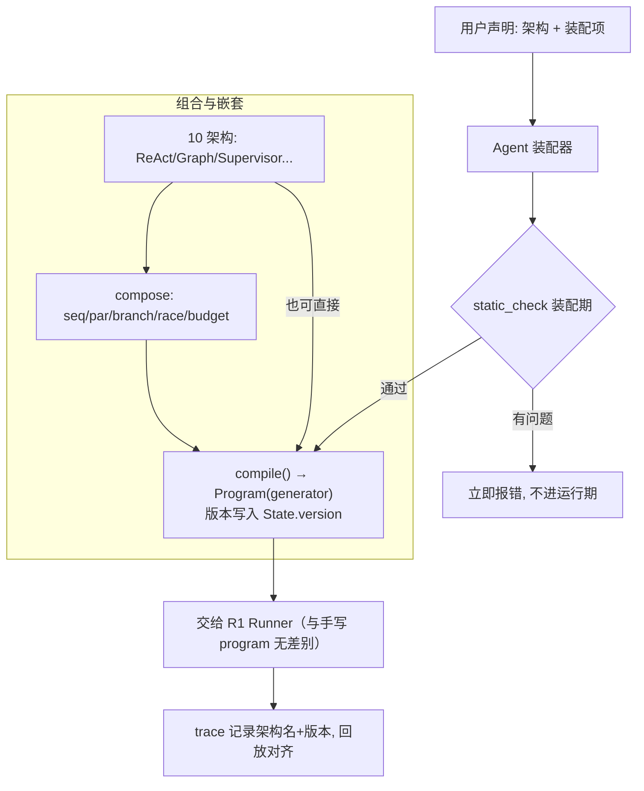
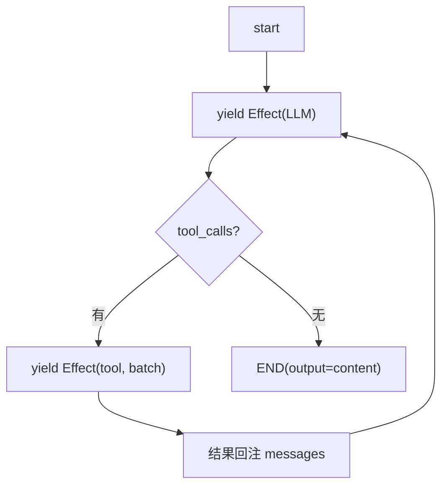
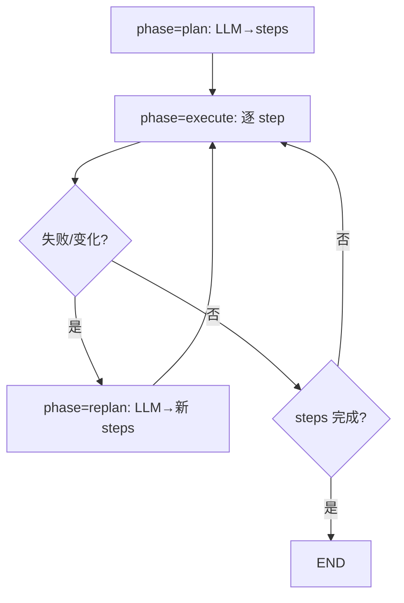
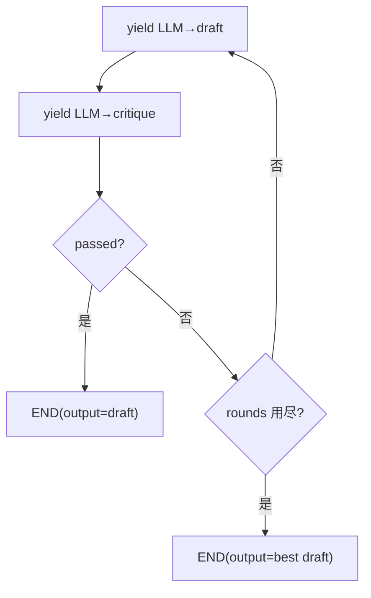
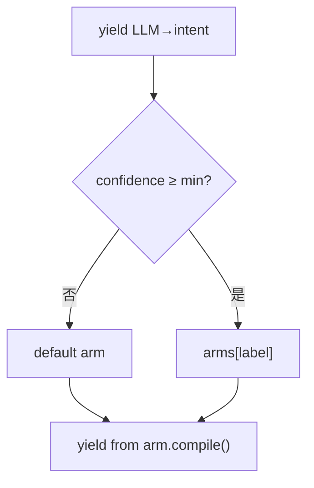
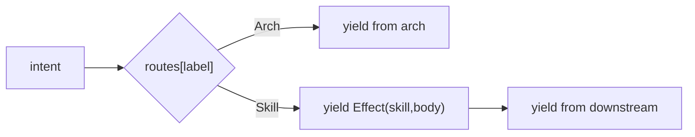
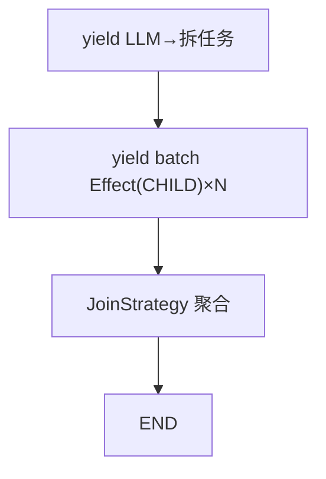
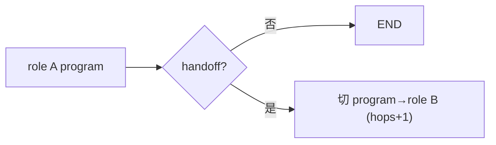
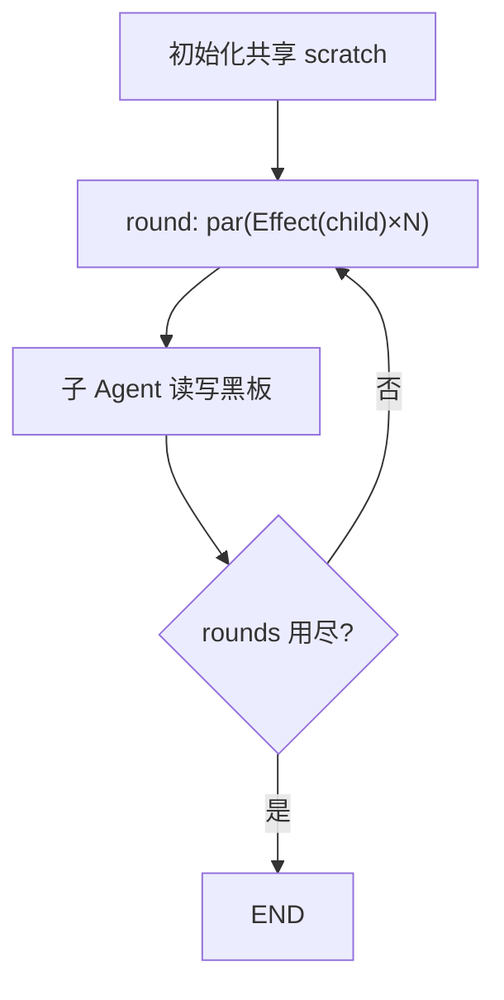
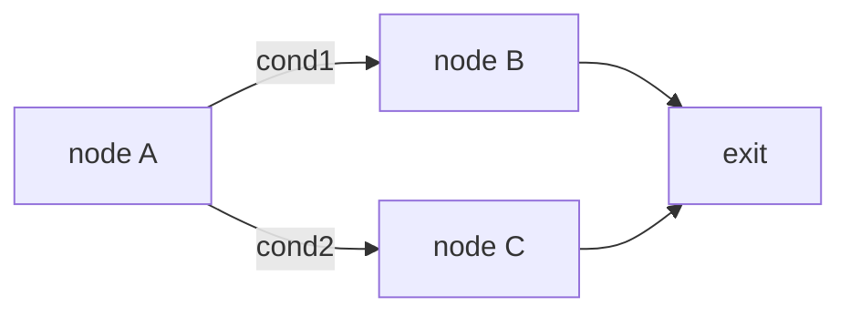

# R12：内置架构与组合（archs + compose）

> **权威来源**：[《AGENT 总设计》](../../01-总览与设计/AGENT-总设计.md) §R8；自查补齐（见[《设计自查报告》](../../01-总览与设计/设计自查报告.md) 遗漏项 #1/#2/#12）。
> 层：L1/L2 · 依赖：R1（Program/Budgets/Effect）+ R2（装配）+ R8（认知服务）· 源码包：`src/archs/` + `src/compose/`（待实现）
> 地位：**用户唯一入口**——所有架构、组合算子、Agent 装配器都在这里。

---

## 1. 职责与边界

**做**：10 种内置架构（预制 Program + 装配器 + 装配期 `static_check()`）；函数式组合算子（seq/par/branch/race/retry/map_state/budget）；`Agent` 装配器。
**不做**：执行循环（R1）；Hook 编排（R2）；外部能力实现（R4~R11）；把架构做成硬编码调度器。
**铁律**：所有架构的终态都是 `Program`（generator），因此**可任意嵌套**；运行时对架构一无所知。

## 2. 设计架构

架构 = 一个"产出 Program 的工厂"。`compile()` 生成一个 generator，它按该架构的控制流 yield Effect。`static_check()` 在装配期检查图结构合法性（悬空边/环/缺 port/预算冲突），问题在进运行期前报错。所有架构共用 R1 的解释循环，换架构时上层装配代码零改动——这是框架的核心卖点。

## 3. 流程图



## 4. API 规范（完整）

```python
# ---- 架构统一协议 ----
class Arch(Protocol):
    name: str
    version: str
    def static_check(self) -> StaticCheckReport: ...
    def compile(self) -> Program: ...

# ---- 10 内置架构构造签名 ----
ToolUse(tools: list[ToolSpec], *, parallel: bool = True)
ReAct(tools: list[ToolSpec], *, llm: str | None = None, max_turns: int = 30)
PlanExecute(planner: Planner, executor: Executor, *, replanner: RePlanner | None = None)
Reflection(reflector: ReflectStrategy, *, max_rounds: int = 3)   # 值交 Budgets
Router(classifier: IntentStrategy | Callable, arms: dict[str, Arch], *,
       default: str | None = None, min_confidence: float = 0.0)
RouterSkill(classifier, routes: dict[str, Arch | SkillSpec], default: str)
Supervisor(planner: Planner, child_spec: ChildSpec, *, max_children: int = 8,
           join: JoinStrategy = MajorityVote())
Handoff(roles: dict[str, Arch], *, max_hops: int = 5)
Blackboard(agents: list[Arch], *, rounds: int = 3)
Graph()   # .node(id, program, inputs, outputs) / .edge(src, dst, cond=...) / .exit(id) / .compile()

# ---- 7 组合算子（返回新 Program，不改原对象）----
seq(a: Program, b: Program) -> Program                       # 顺序
par(items: list[Program], *, join=all) -> Program            # 并行扇出+聚合
branch(fn: Callable[[AgentState], str], arms: dict) -> Program  # 条件分流
race(items: list[Program]) -> Program                        # 首个完成胜出
retry(n: int, *, backoff: float) -> Program                  # 包裹重试（交 R3 策略）
map_state(lens: Callable) -> Program                         # 状态视图变换
budget(**limits) -> Program                                  # 包裹预算上限

# ---- Agent 装配器（用户唯一入口）----
class Agent:
    def __init__(self, arch: Arch | Program): ...
    def capability(self, cap: Capability) -> Self: ...       # 能力级开关
    def rag(self, pipeline) -> Self: ...
    def memory(self, port: MemoryPort) -> Self: ...
    def telemetry(self, port: TelemetryPort) -> Self: ...
    def event_stream(self, stream) -> Self: ...
    def build(self) -> Session: ...                          # static_check + compile
```

## 5. 元数据与关键字段（核心字段）

| 字段 | 说明 |
|------|------|
| StaticCheckReport | errors / arch / version / ports_required / budgets_resolved |
| GraphNode | id / program / inputs / outputs |
| Edge | src / dst / cond: Callable[[AgentState], bool] \| None |
| AgentSpec | program_version / arch_version / ports_version / optional_modules[]（进 trace） |
| ChildSpec | arch / budget 分账 / max_children |
| JoinStrategy | all / any / majority / reduce + timeout |

**版本纪律**：架构名 + 版本写入 `State.version` 并进 trace，回放可对齐。
**预算统一**：max_rounds/max_hops/max_children 一律映射到 R1 `Budgets`，架构内不许自带计数器。
**compile 幂等**：同一 Arch 多次 compile 产出的 Program 行为一致；compose 算子返回新对象不改原 program。

## 6. 十个内置架构逐个详设

### ① ToolUse —— 一次性并行工具调用
- **程序结构**：`yield Effect(TOOL, {calls: [...]}, batch=True)` → 收结果 → `END(output=results)`。
- **参数**：`tools`（工具集）、`parallel`（是否并行）。
- **适用**：明确知道要调哪些工具、无推理链的简单编排。
- **static_check**：工具 schema 合法、danger 已声明、高危已配沙盒。


### ② ReAct —— 推理-行动自循环
- **程序结构**：loop → `yield Effect(LLM, {messages, tools})` → 有 tool_calls 则 `yield Effect(TOOL, batch)` 并把结果回注 messages → 无 tool_calls 则 `END(output=content)`。
- **参数**：`tools`、`llm`（模型覆盖）、`max_turns`（交 Budgets）。
- **适用**：通用 Agent 默认架构，边想边做。
- **static_check**：工具集非空、llm port 已注册。



### ③ PlanExecute —— 规划-执行状态机
- **程序结构**：phase 游标机——`plan` 阶段 `yield Effect(LLM→steps)` 写 `scratch.steps` → `execute` 阶段逐 step 调度 → 失败/环境变化时 `yield Effect(LLM→replan)` → 全部完成 `END`。
- **参数**：`planner`、`executor`、`replanner`（可选）。
- **适用**：复杂多步任务，需要先规划再执行、支持中途重规划。
- **static_check**：planner/executor 履约、replanner 可选校验。



### ④ Reflection —— 起草-反思-修订
- **程序结构**：draft → `yield Effect(LLM→draft)` → `yield Effect(LLM→critique)` → passed 则 END，否则用 critique 修订重试，rounds 由 `Budgets.max_rounds` 强制。
- **参数**：`reflector`、`max_rounds`。
- **适用**：高质量写作/代码生成，需要多轮自我批评改进。
- **static_check**：reflector 履约、max_rounds > 0。



### ⑤ Router —— 意图分流
- **程序结构**：`yield Effect(LLM→intent)`（或调用 classifier）→ 按 label 选 arm → `yield from arm.compile()`；置信度 < min_confidence 走 default。
- **参数**：`classifier`、`arms`、`default`、`min_confidence`。
- **适用**：多能力客服、多领域助手，按意图路由到不同子架构。
- **static_check**：arms 非空、default 若指定必须在 arms 中、每个 arm 是 Arch/Program。



### ⑥ RouterSkill —— 分流 + 技能正文加载
- **程序结构**：同 Router，但命中 skill 路由时 `yield Effect(SKILL, {name, part:body})` 加载正文注入上下文，再执行选定 arm。
- **参数**：`classifier`、`routes`（Arch 或 SkillSpec）、`default`。
- **适用**：技能库场景——按意图加载不同技能正文（SOP/领域知识）再执行。
- **static_check**：skill 名在 SkillPort 中存在、正文履约（R5）；RouterSkill 只做分流+选中，正文加载由 R5 履约。
- **边界**：架构自身不实现技能注册。



### ⑦ Supervisor —— 监督者-并行子 Agent
- **程序结构**：`yield Effect(LLM→拆任务)` → `yield Effect(CHILD, batch, {child_spec}×N)` 并行 → join 聚合 → END。
- **参数**：`planner`、`child_spec`、`max_children`、`join`。
- **适用**：可并行的复杂任务（如多文档分析、多视角评审）。
- **static_check**：max_children ≤ Budgets.max_parallel_children、child_spec 合法、join 策略已注册。



### ⑧ Handoff —— 角色交接
- **程序结构**：当前角色 program 执行 → 判断需换角色 → 切换 program 指针到 roles[next] → hops 由 `Budgets.max_hops` 强制。
- **参数**：`roles`、`max_hops`。
- **适用**：多专家接力（如客服→技术支持→退款专员）。
- **static_check**：roles 非空、每个 role 是 Arch/Program、交接消息结构合法。



### ⑨ Blackboard —— 共享黑板多 Agent
- **程序结构**：初始化共享 `scratch` → 多轮 `par([Effect(child)])`，每轮子 Agent 读写共享黑板 → rounds 轮后 END。
- **参数**：`agents`、`rounds`。
- **适用**：多 Agent 协作求解（如辩论、逐步精化），需要共享中间结果。
- **static_check**：agents 非空、共享键不冲突、rounds 由 Budgets 约束。



### ⑩ Graph/DAG —— 声明式图编译
- **程序结构**：用户声明 nodes + edges(cond) → `compile()` 生成一个 program，它按条件边在节点间跳转 → 到 exit 节点 END。`static_check` 检查悬空边/环/不可达节点。
- **参数**：`nodes`、`edges`、`exit`。
- **适用**：显式工作流、可视化编排、需要静态验证的复杂流程。
- **static_check**：无悬空边、无环（除非显式允许）、所有节点可达、exit 存在、cond 可调用。



## 7. 组合算子逐个详设

| 算子 | 签名 | 语义 | 嵌套规则 |
|------|------|------|---------|
| seq | `seq(a, b)` | 先跑 a 到 END，把 a.output 作为 b 初始输入 | 返回新 Program，可继续被 seq/par 包裹 |
| par | `par([...], join=all)` | 扇出并行执行，join 聚合结果（all/any/majority/reduce） | 每项可是任意 Program（含 Graph/Supervisor） |
| branch | `branch(fn, arms)` | `fn(state)` 返回 key，选 `arms[key]` 执行 | arm 可是任意 Program；default 兜底 |
| race | `race([...])` | 并行跑，首个完成者胜出，取消其余（走 R1 取消传播） | 取消要传播到子 effect |
| retry | `retry(n, backoff)` | 包裹一个 Program，失败时重放（策略交 R3） | 受 Budgets.max_rounds 约束，副作用需幂等 |
| map_state | `map_state(lens)` | 对 Program 的输入/输出 State 做视图变换 | 纯函数，不改原 State |
| budget | `budget(**limits)` | 包裹一个 Program，覆盖局部 Budgets 上限 | 局部上限不得抬高全局上限（取较小者） |

**嵌套示例**（框架核心卖点）：
```python
# Router 的一个 arm 是整个 DAG，外层包预算
budget(max_cost_usd=2)(
    branch(intent_fn, {"report": graph.compile(), "chat": ReAct(tools=tools)})
)
# 换架构零成本：上层装配不变，只换 arch
Agent(arch=ReAct(tools=tools)).build()
Agent(arch=Graph().node(...).compile()).build()
```

## 8. 可插拔契约

| 注入点 | 协议 | 默认 | 校验 |
|--------|------|------|------|
| 架构 | Arch | 10 内置 | static_check 查悬空边/环/缺 port/预算冲突 |
| 认知策略 | IntentStrategy/Planner/ReflectStrategy 等 | LLM 默认 | 履约+缺 name 拒绝 |
| 子 Agent | ChildSpec | ReAct 子 | 并发上限/预算分账 |
| join | JoinStrategy | MajorityVote | 策略已注册 |

**三类注入形态**：① 协议替换（Arch/认知服务整体换实现）；② Hook 插件（横切行为，`bus.on()`）；③ 构造参数（阈值/prompt 模板走构造器，`static_check()` 兜底）。不得另发明入口。

## 9. 模块内闭环核对（CL-1~CL-5）

| 条件 | 实现 | 证据 |
|------|------|------|
| CL-1 契约自足 | 只依赖 R1 Program/Budgets/Effect + R8 认知协议 | import 扫描 |
| CL-2 自带 fake | FakePlanner/FakeClassifier/FakeJudge | fake 用例 |
| CL-3 自带测试 | tests/r12/ 覆盖 10 架构+7 算子 | 覆盖率报告 |
| CL-4 独立 demo | `make demo-r12` 嵌套组合 | demo 冒烟 |
| CL-5 文档自足 | 本文十架构逐个详设 | 文档评审 |

## 10. 验收标准

1. 10 种架构各有端到端用例（fake port）跑通；
2. 换架构时上层装配代码零改动；
3. 嵌套组合（Router→Graph→ReAct）成功；
4. static_check 能检出悬空边/环/缺 port/预算冲突；
5. 同一 Arch 多次 compile 行为一致；compose 算子不改原对象；
6. State.version 与 trace 中架构版本一致。

## 11. 功能验证矩阵

| 功能点 | 用例 ID | 验证方式 | 通过标准 |
|--------|---------|---------|---------|
| ToolUse | R12-T01 | `pytest tests/r12/test_archs.py -q` | batch 并行收结果 |
| ReAct | R12-T02 | 同上 | 自循环，无 tool_calls 结束 |
| PlanExecute | R12-T03 | 同上 | plan→execute→replan 状态机 |
| Reflection | R12-T04 | 同上 | 反思修订，max_rounds 强制 |
| Router/RouterSkill | R12-T05 | 同上 | 意图分流+正文加载 |
| Supervisor/Blackboard | R12-T06 | 同上 | 并行子 Agent+黑板共享 |
| Handoff/Graph | R12-T07 | 同上 | 角色交接+DAG 编译 |
| 组合算子 | R12-T08 | `pytest tests/r12/test_compose.py -q` | 7 算子语义+嵌套 |
| static_check | R12-T09 | `pytest tests/r12/test_static.py -q` | 悬空边/环/缺 port 报错 |
| 独立闭环 | R12-D01 | `make demo-r12` | demo 冒烟 |

## 12. 门禁清单

| 门禁 | 条目 | 达标标准 | 级别 |
|------|------|---------|------|
| R12-G1 | 覆盖 | 10 架构+7 算子端到端 ≥85% | G1 |
| R12-G2 | 装配检查 | 悬空边/环/缺 port/预算冲突装配期报错 | G2 |
| R12-G2 | 幂等 | compile 幂等；算子不改原对象 | G2 |
| R12-G3 | 嵌套 | Router→Graph→ReAct 嵌套；换架构零改动 | G3 |
| R12-红线 | 纪律 | 架构内直接 IO/自带计数器/绕过 Budgets→拒绝 | 红线 |

---
*R12 模块详设 v1.0 · 自查补齐（遗漏项 #1/#2/#12）· 设计态（代码待实现）*
