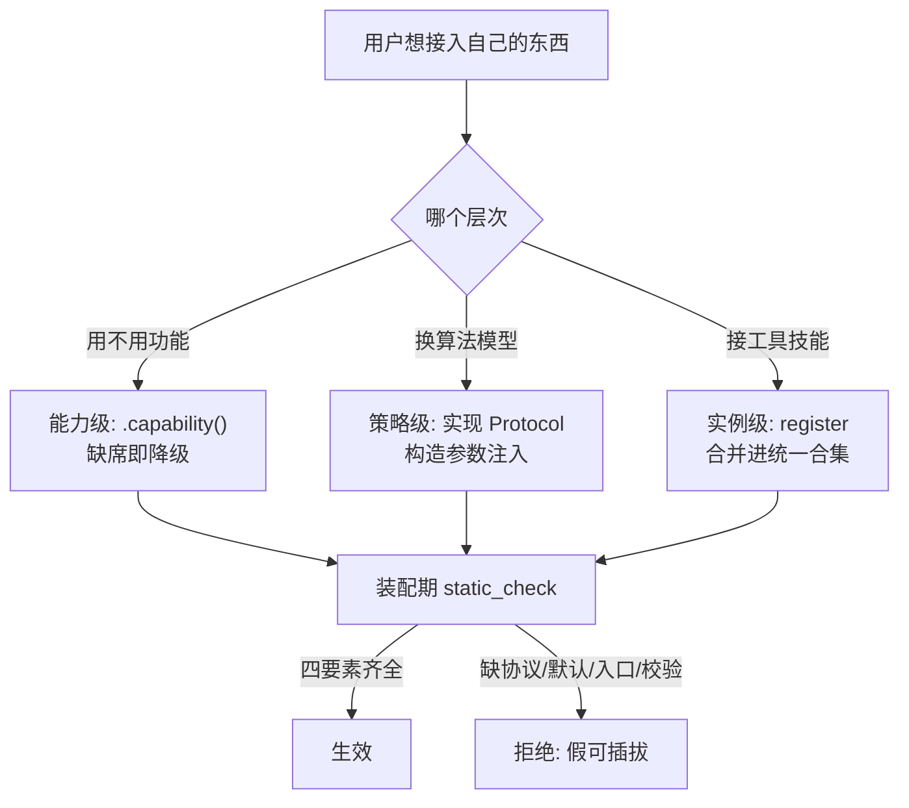

# R13：可插拔与协议契约（pluginability + contracts）

> **权威来源**：[《AGENT 总设计》](../../01-总览与设计/AGENT-总设计.md) §1.3 + §5；`docs/01-总览与设计/组合式工具层重构规格-20261121.md` §2/§3 P4/P5/P8/P9。
> 层：横切 · 依赖：R1 + 组合层（R2 算子与装配）· 源码包：`src/compose/` + 各模块 protocols（领域字段归位各能力模块）
> 地位：**"组合式 + 全可插拔"的统一契约**——回答"用户如何接入自己的策略/工具"。ToolLayer 是统一外壳（`build() -> Program`），provides/requires 是挑选期可选声明、不进运行时内核（追问 5）。

---

## 1. 职责与边界

**做**：三层可插拔模型（能力级/策略级/实例级）；可插拔四要素；框架对外协议全集（约 30 个）；tool 定义/MCP 合并/skill 载入/三级披露的统一；组合式装配 API。
**不做**：具体能力实现（R3~R11）；执行循环（R1）。
**核心命题**：可插拔 = 框架给齐四要素（协议定义 + 默认实现 + 替换入口 + 履约校验），缺一即假可插拔。

## 2. 设计架构

```
① 能力级 Capability —— 用不用这个功能（.capability() 开关，缺席即降级）
        ↓
② 策略级 Provider —— 用什么算法/模型（实现 Protocol 替换，不传用默认）
        ↓
③ 实例级 Instance —— 接入什么工具/技能（本地@tool/MCP/Skill 合并进统一合集）

注入只有三条路：协议替换 / 算子组合或 call 装饰器（+ 守卫注册）/ 构造参数
横切四要素：每个注入点框架给齐 ①协议 ②默认 ③入口 ④校验
ToolLayer 契约：每个工具层自包含、可独立 build() -> Program（"想要哪个用哪个"）；A 类算子 seq/par/branch/... 组合 layer（"通过组合使用"）；provides/requires 仅挑选期校验依赖齐备/冲突，不参与运行时强制装配
```

## 3. 流程图



## 4. API 规范（完整）

```python
# ---- 三层插拔抽象（已在 R2 实现）----
class Capability(Protocol):                          # 能力级：用不用（ToolLayer 外壳）
    name: str; version: str
    requires: tuple[str, ...] = ()                   # 挑选期可选声明，不进运行时内核
    provides: tuple[str, ...] = ()
    def build(self) -> Program: ...                  # 每个工具层自包含产出 Program
class Provider(Protocol):                            # 策略级：用什么
    name: str
class Registry:                                      # 实例级：接进来
    def register(self, name, provider) -> None: ...
    def resolve(self, name) -> Provider: ...
    def replace(self, name, provider) -> None: ...

# ---- 可插拔四要素（每个协议都要给齐）----
# ① 协议定义 Protocol  ② 默认实现 Default
# ③ 替换入口 Inject    ④ 履约校验 static_check

# ---- 代表性策略协议签名（完整目录见 §5）----
# 意图识别：整体策略可注入 + 默认四级级联（级联收在策略层，不进内核）
class IntentStrategy(Protocol):                  # 注入点① 整体策略：传入即整包替换默认级联
    name: str
    async def recognize(self, text: str, ctx) -> IntentResult: ...
class KeywordMatcher(Protocol):                 # 注入点②-L1 关键词匹配（零成本）
    name: str
    def match(self, text: str, ctx) -> IntentResult | None: ...
class IntentSampleStore(Protocol):              # 注入点②-L2 意图采样库（语义匹配的数据源）
    name: str
    def search(self, text: str, top_k: int = 5) -> tuple[IntentSample, ...]: ...
class CheapIntentModel(Protocol):               # 注入点②-L3 便宜模型判断
    name: str
    async def recognize(self, text: str, ctx) -> IntentResult: ...
class PrimaryIntentModel(Protocol):             # 注入点②-L4 主模型判断（兜底）
    name: str
    async def recognize(self, text: str, ctx) -> IntentResult: ...
class CascadeIntentStrategy:                    # 默认整体策略 = L1→L2→L3→L4 四级级联
    def __init__(self, *, keyword: KeywordMatcher | None = None, samples: IntentSampleStore | None = None,
                 cheap: CheapIntentModel | None = None, primary: PrimaryIntentModel | None = None,
                 thresholds: Mapping[str, float] | None = None): ...
    async def recognize(self, text: str, ctx) -> IntentResult: ...  # 逐级达阈值即停；全不满足走 default
    def build(self) -> Program: ...             # Program 化：逐级 yield Effect，末级写 x-intent.result
# 策略在 Program 架构（Router/RouterSkill）内的统一消费形态：
#   intent_as_program(strategy) -> Program —— 策略有 build() 用 build()；仅 recognize() 的策略由框架适配成
#   单次 Invoke(port="llm", payload=_intent_req(strategy)) + 解析回注（兼容旧路径），对 Router 仍是单入口。
# 四要素：协议(上) + 默认(内置实现) + 入口(CascadeIntentStrategy 构造参数) + 校验(§5.2 缺 name/缺方法拒绝)
# IntentResult DTO 见 R8 §5：label/confidence/gaps + 可选 trace（命中级/逐级置信度，观察语义，不进内核必填）
# L2 语义匹配算法框架内置（基于注入的采样库 + Embedder 做相似度）；用户注入的是采样库数据，非匹配算法
class Splitter(Protocol):
    name: str
    def split(self, doc: Document) -> list[Chunk]: ...
class Embedder(Protocol):
    name: str
    async def embed(self, texts: list[str]) -> list[Vector]: ...
class VectorStore(Protocol):
    name: str
    async def upsert(self, chunks) -> None: ...
    async def search(self, vec, top_k, filters) -> list[Hit]: ...
class Reranker(Protocol):
    name: str
    def rerank(self, hits: list[Hit], query) -> list[Hit]: ...
```

### 4.1 默认意图策略：四级级联路由（CascadeIntentStrategy）

不传 `strategy=` 时的默认实现。四级**按成本从低到高**串联，前一级给出达到该级阈值的 `confidence` 即短路返回，不再调用更贵的后续级；全部未达阈值则返回 `IntentResult(label=default|unknown)` 兜底。

| 级 | 部件协议 | 做法 | 默认实现 | 成本 | 可注入 |
|----|---------|------|---------|------|-------|
| L1 | `KeywordMatcher` | 关键词/词典/正则匹配 | 内置关键词表 | 零模型调用 | `keyword=` |
| L2 | `IntentSampleStore` | 语义相似度匹配（注入采样库作数据源，框架内置相似度算法） | 内置意图采样库 | 向量相似度 | `samples=` |
| L3 | `CheapIntentModel` | 便宜模型分类判断 | 小模型经 `LLMPort` | 低 | `cheap=` |
| L4 | `PrimaryIntentModel` | 主模型分类判断（兜底） | 主模型经 `LLMPort` | 高 | `primary=` |

**逐级判定**：`for stage in (L1,L2,L3,L4)`——调用该级得到 `IntentResult|None`；若 `result is not None and result.confidence >= thresholds[stage]`，返回该结果（把命中级写进 `trace`）；否则进入下一级。四级全过仍不满足 → 返回兜底结果（`label` 取 `default`，无 default 取 `unknown`）。`thresholds` 每级独立可覆写，缺省用内置默认值。

**`IntentResult.trace`**（可选观察字段，非内核必填）：记录逐级 `[(stage, label, confidence), ...]` 与最终 `hit_stage`，供可观测/调试；不进 R1 内核 DTO 必填结构，不新增 Lifecycle 相位（沿用 94783b60 追问3/4：复杂度留在策略层，不下沉内核）。

**两级注入共存语义**（关键）：
- **整体替换**：`IntentRecognition(strategy=AnyIntentStrategy)` —— 传入的任何 `IntentStrategy` **整条替换**默认级联，框架不做级联包装。用户若想保留级联，可在自己的策略内用四部件协议自建 `cascade`（策略层组合）。
- **部件级注入**：不传 `strategy=` 时用默认 `CascadeIntentStrategy`，其 L1~L4 四部件可经构造参数各自替换，未替换的级用内置默认。
- 两者互斥且完备：有 `strategy` 走用户策略；无 `strategy` 走默认级联（其内部四部件可再注入）。判定在装配期由 `IntentRecognition` 构造器完成（`strategy is None` → 实例化默认 `CascadeIntentStrategy(...部件参数)`）。

**成本与预算**：级联多级模型调用走各自 `LLMPort`，每级一次 Invoke 由 R1 内核逐 Effect 计预算（R4 模型路由按各级 `task_hint/cost_tier` 选模）；短路机制保证命中即停，避免无谓调用后续贵级。

**与 Router 的 Program 化衔接（裂缝修复，D-级联-1）**：`Program = Generator[Effect,...]` 是同步 generator（R1 §4），而 `recognize()` 是 async，二者不能直接 `await`。统一约定：`intent_as_program(strategy) -> Program` 是唯一桥梁——
- 默认 `CascadeIntentStrategy` 提供 `build()`：L1/L2 本地算（无需 Effect），L3/L4 `yield Invoke(port="llm", payload=...)`；每级结果写入 `state.scratch["x-intent.stages"]`（观察语义），最终 `IntentResult` 写 `x-intent.result`；**命中阈值即停止 yield 后续级**（短路在 generator 层兑现，不只是策略返回值）。
- 仅实现 `recognize()` 的注入策略由 `intent_as_program` 适配为单次 Invoke + 解析（兼容旧路径）。
- Router/RouterSkill 只 `yield from intent_as_program(self.classifier)` 再读 `x-intent.result` 分流，不感知级联级数/async 细节。这样级联复杂度留在策略/组合层，不下沉 R1 内核新增 Effect 种类或相位（沿用 94783b60 追问3/4 决策）。

## 5. 元数据与关键字段（核心字段）

### 5.1 框架对外协议全集（4 组 / 约 30 个）

| 组 | 协议 | 用户可实现自己的 | 默认实现 | 注入入口 |
|----|------|----------------|---------|---------|
| **组合算子** | ①A 类算子 `Program→Program`（10 个） | 装配期编排 Program（框架核心） | 10 内置 | `seq/par/branch/race/loop/map_state/map_effect/fallback/gate/retry` |
| ②③call 层 | 领域策略（R3 执行器编排）/ `CallFn→CallFn` | 运行期可靠性链 / 包裹调用（替代原 AOP 固定链） | 无（按需装） | `ResilienceCapability(...)` 具名构造注入 / `build_call(base, *, decorators=())`；只覆盖 Invoke |
| | ④notify（`phase, payload`） | 纯观察"发生了什么"（when），16 相位 | R1 既有回调 | `Runner(notify=...)`；返回值不消费、异常就地隔离 |
| | `SafetyVerdict` | R9 安全域四态裁决 | — | R9 安全域用 `SafetyVerdict`（allow/redact/deny/ask；ask→Suspend）；已删除的通用 `Verdict` 不再是返回类型 |
| | `Provider` | 所有策略基契约 | — | — |
| | `Capability` | 整套能力组件 | 各内置能力 | `.capability()` |
| **认知策略** | `IntentStrategy` | 整体意图策略（注入即替换默认级联） | `CascadeIntentStrategy`（默认四级级联） | `IntentRecognition(strategy=)` |
| | `KeywordMatcher` | 级联 L1 关键词匹配 | 内置规则/词典匹配 | `CascadeIntentStrategy(keyword=)` |
| | `IntentSampleStore` | 级联 L2 意图采样库（语义匹配数据源） | 内置采样库 | `CascadeIntentStrategy(samples=)` |
| | `CheapIntentModel` | 级联 L3 便宜模型判断 | 小模型（经 `LLMPort`） | `CascadeIntentStrategy(cheap=)` |
| | `PrimaryIntentModel` | 级联 L4 主模型判断（兜底） | 主模型（经 `LLMPort`） | `CascadeIntentStrategy(primary=)` |
| | `ReflectStrategy` | 反思评判 | LLM critic | `Reflection(strategy=)` |
| | `Planner` / `RePlanner` | 规划/重规划 | LLM 分解 | `PlanExecute(...=)` |
| | `Executor` | 步骤执行 | 默认执行器 | `PlanExecute(executor=)` |
| | `Judge` | 评测打分 | LLM-as-judge | `EvalPort`/`.judge()` |
| | `ModelRouter` | 模型路由 | 规则路由 | 插件 |
| **RAG 链路** | `Splitter` | 切分器 | 递归切分 | `RAGPipeline(splitter=)` |
| | `Embedder` | 嵌入模型 | OpenAI-compat | `RAGPipeline(embedder=)` |
| | `VectorStore` | 存储工具 | 内存/PgVector | `RAGPipeline(store=)` |
| | `Retriever` | 召回策略 | 混合检索 | `RAGPipeline(retriever=)` |
| | `Reranker` | 重排模型 | cross-encoder | `PostProcessor(rerank=)` |
| | `QueryRewriter` | 查询改写 | 多查询/HyDE | `RAGPipeline(rewrite=)` |
| | `PostProcessor` | 结果处理 | 默认后处理 | `RAGPipeline(post=)` |
| **工具技能** | `ToolPort`/`@tool`（以 R2 协议为基础；catalog(level=1)，另有 schema_of/bind/static_check/freeze） | 工具实现 | ToolRegistry | `registry.register()` |
| | `MCPTransport`（R5 本地协议） | MCP 客户端（用户实现自定义客户端的接口；模板与契约见 `docs/自定义MCP客户端.md`） | stdio/http | 构造注入：`MCPManager(reg, t)` |
| | `MCPPort`（R2 协议，list_tools/call_tool 均带 ctx + `ping`） | MCP 能力 | MCPManager | 构造注入 registry+transport；fqname 注册，`health()` 逐 server |
| | `SkillPort`（discover/catalog → `list[SkillManifest]`） | 技能提供者 | 文件技能(FileSkillProvider) | `.skill_provider()` |
| | `DisclosureIndex`（R2 `protocols.py` + `PORT_PROTOCOLS["disclosure"]`） | 披露策略 | ToolIndex（R5 `src/harness/tools/index.py`） | `.disclosure()` / `ToolsCapability.disclose()` |
| **外部 Port** | `LLMPort`/`MemoryPort`（+`recall`，R7）/ `StorePort`/`SandboxPort`/`TelemetryPort`/`HumanPort`/`AuditPort`/`EvalPort` | 各后端 | 见各模块 | `registry.register()` |
| | `BlobPort`（R7 context 内部协议，仿 R6 CachePort） | 大结果卸载存储 | InMemoryBlobStore（R7 `src/harness/context/`） | `Offloader(blob=...)`（`handle store://id` 可读） |
| **存储/导出后端** | `CacheStore` / `AuditStore` / `TelemetryExporter` | 可换 Redis/DB/OTLP | 内存/文件/in-process | 注入各 Port 构造器 |
| **缓存策略** | `CachePort` / `CacheEmbedder` | 缓存策略/向量模型 | ExactCache+SimilarityCache / `HashCacheEmbedder`（None 降级 difflib） | `ModelGateway(cache=)` |
| **接入契约** | `EventStream`/`Projection` | 事件源/读模型 | 内存 | `.event_stream()`/`.project()` |

### 5.2 共同履约约束（用户实现协议时的通用规则）

| 约束 | 含义 | 校验时机 |
|------|------|---------|
| 带 name | 一切可插拔物留名进 trace | 装配期 |
| 无会话状态 | 跨会话态走 port/store | 装配期 + AST |
| 异常不抛穿 | 折叠为 `Result`；由 R3 `ReliabilityExecutor` 显式编排领域策略兜底恢复（终止类拒绝发 `invoke_rejected`） | 运行期 |
| 预算交内核 | 不自己数轮次/成本 | 装配期 + AST |
| 不可信输入净化 | 工具/检索/技能正文过注入检测 | 运行期 ③ `injection_guard` / R9 安全域 |
| 副作用带幂等键 | 重试/恢复不重复 | 装配期 + 运行期 |
| DTO 结构对齐 | 上段输出 = 下段输入类型 | 装配期 |

## 6. 组合式装配 API（用户两个例子，完整可运行）

### 例子 A：意图识别（默认四级级联 / 自注入策略）+ 反思
```python
# --- 默认：不传 strategy，直接得到四级级联（关键词→语义→便宜模型→主模型）---
agent_default = (Agent(arch=ReAct(tools=tools))
    .capability(IntentRecognition())        # 内部 = CascadeIntentStrategy(四内置部件)
    .build())

# --- 只替换个别部件：其余级仍用内置，逐级阈值可覆写 ---
cascade = CascadeIntentStrategy(
    keyword=MyKeywordMatcher(),             # 换 L1；samples/cheap/primary 不传→用内置
    cheap=MyCheapModel(),                   # 换 L3 便宜模型
    thresholds={"l2": 0.75, "l3": 0.6},     # 覆写各级置信度阈值
)
agent_partial = Agent(arch=ReAct(tools=tools)).capability(IntentRecognition(strategy=cascade)).build()

# --- 整体替换：注入自己的策略，整条默认级联被替换（可在策略内自建 cascade 复用部件）---
class MyIntentStrategy:
    name = "my-intent"
    async def recognize(self, text, ctx) -> IntentResult:
        return IntentResult(label="qa", confidence=0.9, gaps=())

agent_custom = (Agent(arch=ReAct(tools=tools))
    .capability(IntentRecognition(strategy=MyIntentStrategy()))
    .capability(Reflection(strategy=MyReflectStrategy(), max_rounds=3))
    .build())

# 两级注入共存：① strategy= 整体替换默认级联；② 未注入时默认级联的四部件各自可注入。
# 框架只认 IntentStrategy 协议；未注入 strategy 时用默认 CascadeIntentStrategy。
```

### 例子 B：RAG 全链路自定义（切分器/存储/嵌入/重排全用用户的）
```python
rag = RAGPipeline(
    splitter=MySplitter(),      # 自己的切分器
    embedder=MyEmbedder(),      # 自己的嵌入
    store=MyVectorStore(),      # 自己的存储
    # retriever 不传 → 用默认混合检索
    post=PostProcessor(rerank=MyReranker()),  # 自己的重排
)
agent = Agent(arch=...).capability(RAG(pipeline=rag)).build()
# 只换要换的几段，其余用默认；靠统一 DTO 衔接
```

### 四件事收口
- **tool 定义**：`@tool(pydantic)` → ToolSpec（danger 为 `DangerLevel`，经 coerce 归一）；或 `registry.register(ToolSpec(...), fn)`；`x-*` 前缀用户工具。ToolRegistry 另提供 schema_of/bind/static_check/freeze。
- **MCP 合并**：`MCPPort`（R2，list_tools/call_tool 带 ctx + ping）以 transport 构造注入的 `MCPManager(reg, t)` 实现；`list_tools` → `mcp__<server>__<tool>` fqname → 注入同一 ToolRegistry，运行时无差别；`health()` 逐 server ping；L1 只进目录不进 schema（红线）。
- **skill 载入**：`SkillPort.discover/catalog` 返回 `list[SkillManifest]`（name/version/description/triggers），`body` 按需加载，正文过 R5 本地 `InjectionDetector`（默认 KeywordInjectionDetector）检测。
- **三级披露**：`DisclosureIndex`（R2 协议 + `PORT_PROTOCOLS["disclosure"]`，默认 ToolIndex 在 R5）对统一合集投影：L1 目录常驻 / L2 schema 按需 / L3 正文按需；>20 条强制披露；由装配层/R12 调 `disclose()` 触发，`disclose` 订阅 `before_model` Lifecycle 通知点。

## 7. 可插拔契约

| 注入点 | 协议/角色 | 默认 | 校验 |
|--------|------|------|------|
| ①算子（Program→Program） | 10 内置算子 | 10 内置 | compile 幂等/纯函数/状态进 x-* |
| ②③call 层 | 领域策略（R3）+ call 装饰器 | 无（按需） | `ResilienceCapability` 具名注入 / 函数组合；只覆盖 Invoke；终止拒绝由执行器发 `invoke_rejected` |
| ④观察（when） | notify（`phase, payload`） | R1 既有回调 | 相位名合法；异常就地隔离 |
| 能力组件 | Capability | 内置能力 | requires 未装→拒绝 |
| 策略/端口 | Provider/Port | 内置默认 | 缺方法/缺 name→拒绝；Port 种类不可新增（`x-*` payload 扩展键保留） |
| 意图整体策略 | `IntentStrategy`（`strategy=`） | `CascadeIntentStrategy` 四级级联 | 缺 recognize/缺 name→拒绝；注入即整包替换默认级联 |
| 意图级联部件 | `KeywordMatcher`/`IntentSampleStore`/`CheapIntentModel`/`PrimaryIntentModel` | 内置 L1~L4 | 缺方法/缺 name→拒绝；仅无 `strategy` 时部件注入生效 |

## 8. 模块内闭环核对（CL-1~CL-5）

| 条件 | 实现 | 证据 |
|------|------|------|
| CL-1 契约自足 | 只定义协议，不依赖具体实现 | import 扫描 |
| CL-2 自带 fake | 每协议有 fake 实现 | fake 用例 |
| CL-3 自带测试 | tests/r13/ 覆盖四要素与装配例子 | 覆盖率报告 |
| CL-4 独立 demo | `make demo-r13` 两个装配例子 | demo 冒烟 |
| CL-5 文档自足 | 本文协议全集+例子 | 文档评审 |

## 9. 验收标准

1. 三层插拔各有端到端用例（开关/替换/合集）；
2. 每个协议四要素齐全（协议/默认/入口/校验）；
3. 两个装配例子（意图+反思、RAG 全链路）可运行；
4. 缺任一要素的注入在装配期被拒。

## 10. 功能验证矩阵

| 功能点 | 用例 ID | 验证方式 | 通过标准 |
|--------|---------|---------|---------|
| 能力级开关 | R13-T01 | `pytest tests/r13/test_capability.py -q` | 缺席即降级 |
| 策略级替换 | R13-T02 | `pytest tests/r13/test_provider.py -q` | 换实现上层零改 |
| 实例级合并 | R13-T03 | `pytest tests/r13/test_instance.py -q` | MCP/工具同一合集 |
| 四要素校验 | R13-T04 | `pytest tests/r13/test_contract.py -q` | 缺要素装配期拒绝 |
| 装配例子 | R13-T05 | `pytest tests/r13/test_examples.py -q` | 两例子跑通 |
| 意图四级级联 | R13-T06 | `pytest tests/r13/test_intent_cascade.py -q` | 逐级短路/全不满足兜底/四部件可注入/threshold 可覆写/trace 记录 |
| 意图注入互斥 | R13-T07 | `pytest tests/r13/test_intent_cascade.py -q` | 注入 strategy 整包替换；无 strategy 走默认级联且部件注入生效 |
| 独立闭环 | R13-D01 | `make demo-r13` | demo 冒烟 |

## 11. 门禁清单

| 门禁 | 条目 | 达标标准 | 级别 |
|------|------|---------|------|
| R13-G1 | 覆盖 | 三层插拔+协议四要素 ≥85% | G1 |
| R13-G2 | 契约 | 每协议四要素齐全；缺要素拒绝 | G2 |
| R13-G3 | 装配 | 两个例子换实现零改动 | G3 |
| R13-红线 | 假可插拔 | 无默认/无校验/无入口的"可插拔"→拒绝 | 红线 |

---
*R13 模块详设 v2.0 · 设计态（代码待实现）*
*2026-11-21 修订（规格 P2/P4/P5/P8/P9）：ToolLayer 统一外壳（build→Program）；provides/requires 降为挑选期可选声明；AOP 五角色/Lifecycle 插件改为①算子/②守卫/③call 装饰器/④notify；LLMPort.last_usage 归位 R4、MemoryPort.recall 归位 R7（能力层 Port 扩展协议，不进 R2 基础 Port）；DangerLevel/coerce 归位 R5。*
