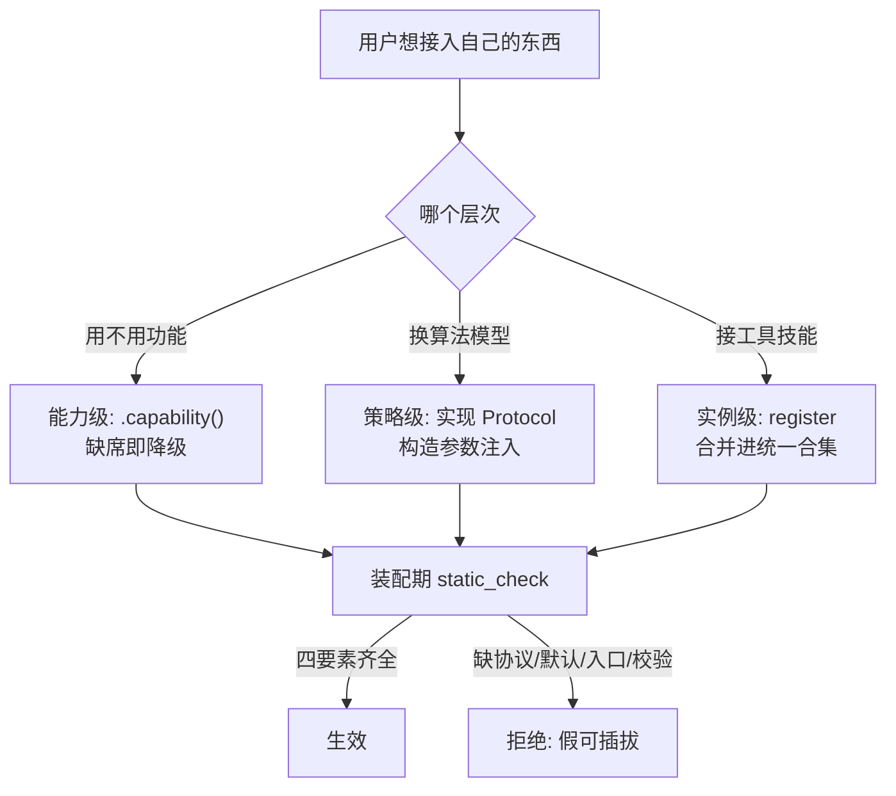

# R13：可插拔与协议契约（pluginability + contracts）

> **权威来源**：[《AGENT 总设计》](../../01-总览与设计/AGENT-总设计.md) §1.3（已按自查补齐）。
> 层：横切（贯穿 R1~R12）· 依赖：R1+R2 · 源码包：`src/hooks/types.py` + 各模块 protocols
> 地位：**"组合式 + 全可插拔"的统一契约**——回答"用户如何接入自己的策略/工具"。

---

## 1. 职责与边界

**做**：三层可插拔模型（能力级/策略级/实例级）；可插拔四要素；框架对外协议全集（约 30 个）；tool 定义/MCP 合并/skill 载入/三级披露的统一；组合式装配 API。
**不做**：具体能力实现（R3~R11）；执行循环（R1）。
**核心命题**：可插拔 = 框架给齐四要素（协议定义 + 默认实现 + 替换入口 + 履约校验），缺一即假可插拔。

## 2. 设计架构

```
① 能力级 Capability —— 用不用这个功能（.capability() 开关，缺席即降级）
        ↓
② 策略级 Provider —— 用什么算法/模型（实现 Protocol 替换，不传用默认）
        ↓
③ 实例级 Instance —— 接入什么工具/技能（本地@tool/MCP/Skill 合并进统一合集）

注入只有三条路：协议替换 / Hook 插件 / 构造参数
横切四要素：每个注入点框架给齐 ①协议 ②默认 ③入口 ④校验
```

## 3. 流程图



## 4. API 规范（完整）

```python
# ---- 三层插拔抽象（已在 R2 实现）----
class Capability(Protocol):                          # 能力级：用不用
    name: str; version: str; requires: tuple[str, ...]
    def install(self, bus, reg) -> None: ...
class Provider(Protocol):                            # 策略级：用什么
    name: str
class Registry:                                      # 实例级：接进来
    def register(self, name, provider) -> None: ...
    def resolve(self, name) -> Provider: ...
    def replace(self, name, provider) -> None: ...

# ---- 可插拔四要素（每个协议都要给齐）----
# ① 协议定义 Protocol  ② 默认实现 Default
# ③ 替换入口 Inject    ④ 履约校验 static_check

# ---- 代表性策略协议签名（完整目录见 §5）----
class IntentStrategy(Protocol):
    name: str
    async def recognize(self, text: str, ctx) -> IntentResult: ...  # label/confidence/gaps
class Splitter(Protocol):
    name: str
    def split(self, doc: Document) -> list[Chunk]: ...
class Embedder(Protocol):
    name: str
    async def embed(self, texts: list[str]) -> list[Vector]: ...
class VectorStore(Protocol):
    name: str
    async def upsert(self, chunks) -> None: ...
    async def search(self, vec, top_k, filters) -> list[Hit]: ...
class Reranker(Protocol):
    name: str
    def rerank(self, hits: list[Hit], query) -> list[Hit]: ...
```

## 5. 元数据与关键字段（核心字段）

### 5.1 框架对外协议全集（4 组 / 约 30 个）

| 组 | 协议 | 用户可实现自己的 | 默认实现 | 注入入口 |
|----|------|----------------|---------|---------|
| **内核扩展** | `Plugin` | 任意横切行为 | 无（按需装） | `host.plugin()` + `apply(host)` |
| | `Decision` | （返回类型） | — | 扩展点 tap 返回 |
| | `Provider` | 所有策略基契约 | — | — |
| | `Capability` | 整套能力组件 | 各内置能力 | `.capability()` |
| **认知策略** | `IntentStrategy` | 意图识别策略 | 规则/LLM 分类 | `IntentRecognition(strategy=)` |
| | `ReflectStrategy` | 反思评判 | LLM critic | `Reflection(strategy=)` |
| | `Planner` / `RePlanner` | 规划/重规划 | LLM 分解 | `PlanExecute(...=)` |
| | `Executor` | 步骤执行 | 默认执行器 | `PlanExecute(executor=)` |
| | `Judge` | 评测打分 | LLM-as-judge | `EvalPort`/`.judge()` |
| | `ModelRouter` | 模型路由 | 规则路由 | 插件 |
| **RAG 链路** | `Splitter` | 切分器 | 递归切分 | `RAGPipeline(splitter=)` |
| | `Embedder` | 嵌入模型 | OpenAI-compat | `RAGPipeline(embedder=)` |
| | `VectorStore` | 存储工具 | 内存/PgVector | `RAGPipeline(store=)` |
| | `Retriever` | 召回策略 | 混合检索 | `RAGPipeline(retriever=)` |
| | `Reranker` | 重排模型 | cross-encoder | `PostProcessor(rerank=)` |
| | `QueryRewriter` | 查询改写 | 多查询/HyDE | `RAGPipeline(rewrite=)` |
| | `PostProcessor` | 结果处理 | 默认后处理 | `RAGPipeline(post=)` |
| **工具技能** | `ToolPort`/`@tool` | 工具实现 | ToolRegistry | `registry.register()` |
| | `MCPTransport` | MCP 客户端 | stdio/http | `MCPManager(reg, t)` |
| | `SkillPort` | 技能提供者 | 文件技能 | `.skill_provider()` |
| | `DisclosureIndex` | 披露策略 | ToolIndex | `.disclosure()` |
| **外部 Port** | `LLMPort`/`MemoryPort`/`StorePort`/`SandboxPort`/`TelemetryPort`/`HumanPort`/`AuditPort`/`EvalPort` | 各后端 | 见各模块 | `registry.register()` |
| **存储/导出后端** | `CacheStore` / `AuditStore` / `TelemetryExporter` | 可换 Redis/DB/OTLP | 内存/文件/in-process | 注入各 Port 构造器 |
| **缓存策略** | `CachePort` / `CacheEmbedder` | 缓存策略/向量模型 | ExactCache+SimilarityCache / difflib | `ModelGateway(cache=)` |
| **接入契约** | `EventStream`/`Projection` | 事件源/读模型 | 内存 | `.event_stream()`/`.project()` |

### 5.2 共同履约约束（用户实现协议时的通用规则）

| 约束 | 含义 | 校验时机 |
|------|------|---------|
| 带 name | 一切可插拔物留名进 trace | 装配期 |
| 无会话状态 | 跨会话态走 port/store | 装配期 + AST |
| 异常不抛穿 | 折叠为 Result/Decision | 运行期 |
| 预算交内核 | 不自己数轮次/成本 | 装配期 + AST |
| 不可信输入净化 | 工具/检索/技能正文过注入检测 | 运行期 guard |
| 副作用带幂等键 | 重试/恢复不重复 | 装配期 + 运行期 |
| DTO 结构对齐 | 上段输出 = 下段输入类型 | 装配期 |

## 6. 组合式装配 API（用户两个例子，完整可运行）

### 例子 A：意图识别（自己的策略）+ 反思（自己的策略）
```python
class MyIntentStrategy:                      # 用户自己的策略
    name = "my-intent"
    async def recognize(self, text, ctx) -> IntentResult:
        return IntentResult(label="qa", confidence=0.9, gaps=())

agent = (Agent(arch=ReAct(tools=tools))
    .capability(IntentRecognition(strategy=MyIntentStrategy()))
    .capability(Reflection(strategy=MyReflectStrategy(), max_rounds=3))
    .build())
# 框架只认 IntentStrategy 协议，对实现无感知；不传 strategy 用默认
```

### 例子 B：RAG 全链路自定义（切分器/存储/嵌入/重排全用用户的）
```python
rag = RAGPipeline(
    splitter=MySplitter(),      # 自己的切分器
    embedder=MyEmbedder(),      # 自己的嵌入
    store=MyVectorStore(),      # 自己的存储
    # retriever 不传 → 用默认混合检索
    post=PostProcessor(rerank=MyReranker()),  # 自己的重排
)
agent = Agent(arch=...).capability(RAG(pipeline=rag)).build()
# 只换要换的几段，其余用默认；靠统一 DTO 衔接
```

### 四件事收口
- **tool 定义**：`@tool(pydantic)` → ToolSpec；或 `registry.register(ToolSpec(...), fn)`；`x-*` 前缀用户工具。
- **MCP 合并**：`list_tools` → `mcp__server__tool` 前缀 → 转发闭包 → 注入同一 ToolRegistry，运行时无差别；L1 只进目录不进 schema（红线）。
- **skill 载入**：`SkillPort.discover/catalog/body`，`Effect(skill, part=body)` 按需加载，正文过注入检测。
- **三级披露**：统一合集上 L1 目录常驻 / L2 schema 按需 / L3 正文按需；>20 条强制披露。

## 7. 可插拔契约

| 注入点 | 协议 | 默认 | 校验 |
|--------|------|------|------|
| 横切行为 | Hook | 无（按需） | 缺 name/缺依赖→拒绝 |
| 能力组件 | Capability | 内置能力 | requires 未装→拒绝 |
| 策略/端口 | Provider/Port | 内置默认 | 缺方法/缺 name→拒绝 |

## 8. 模块内闭环核对（CL-1~CL-5）

| 条件 | 实现 | 证据 |
|------|------|------|
| CL-1 契约自足 | 只定义协议，不依赖具体实现 | import 扫描 |
| CL-2 自带 fake | 每协议有 fake 实现 | fake 用例 |
| CL-3 自带测试 | tests/r13/ 覆盖四要素与装配例子 | 覆盖率报告 |
| CL-4 独立 demo | `make demo-r13` 两个装配例子 | demo 冒烟 |
| CL-5 文档自足 | 本文协议全集+例子 | 文档评审 |

## 9. 验收标准

1. 三层插拔各有端到端用例（开关/替换/合集）；
2. 每个协议四要素齐全（协议/默认/入口/校验）；
3. 两个装配例子（意图+反思、RAG 全链路）可运行；
4. 缺任一要素的注入在装配期被拒。

## 10. 功能验证矩阵

| 功能点 | 用例 ID | 验证方式 | 通过标准 |
|--------|---------|---------|---------|
| 能力级开关 | R13-T01 | `pytest tests/r13/test_capability.py -q` | 缺席即降级 |
| 策略级替换 | R13-T02 | `pytest tests/r13/test_provider.py -q` | 换实现上层零改 |
| 实例级合并 | R13-T03 | `pytest tests/r13/test_instance.py -q` | MCP/工具同一合集 |
| 四要素校验 | R13-T04 | `pytest tests/r13/test_contract.py -q` | 缺要素装配期拒绝 |
| 装配例子 | R13-T05 | `pytest tests/r13/test_examples.py -q` | 两例子跑通 |
| 独立闭环 | R13-D01 | `make demo-r13` | demo 冒烟 |

## 11. 门禁清单

| 门禁 | 条目 | 达标标准 | 级别 |
|------|------|---------|------|
| R13-G1 | 覆盖 | 三层插拔+协议四要素 ≥85% | G1 |
| R13-G2 | 契约 | 每协议四要素齐全；缺要素拒绝 | G2 |
| R13-G3 | 装配 | 两个例子换实现零改动 | G3 |
| R13-红线 | 假可插拔 | 无默认/无校验/无入口的"可插拔"→拒绝 | 红线 |

---
*R13 模块详设 v1.0 · 自查补齐（遗漏项 #3~#8）· 设计态（代码待实现）*
