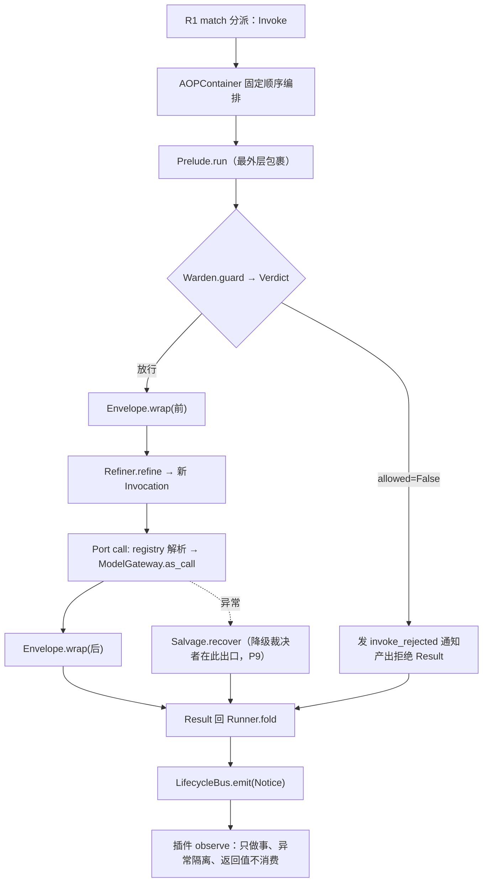

# R2：插件总线与协议（hooks → AOP + Lifecycle）

> **权威来源**：[《AGENT 总设计》](../../01-总览与设计/AGENT-总设计.md) §R2；`docs/01-总览与设计/扩展体系重构规格-20261120.md` P1/P2/P3/P6；统一口径见 `overviews/2026-11-20/扩展体系重构-口径卡.md`。本文是其模块级拆分详设，模块内闭环。
> 层：L0 微内核 · 依赖：R1 · 源码包：`src/aop/` + `src/hooks/` · 门禁 key：`r2`
> 状态：按规格 P1/P2/P3/P6 重写——删除旧宿主与扩展点原语，建立 **AOP 五角色容器**（how）+ **LifecycleBus 16 通知点**（when）+ **共用 Registry**（what 的注册载体）。三体系正交，依赖方向恒定：插件/增强器 → 装配层 → 内核；内核零依赖扩展组件。不做兼容、不打补丁、删除旧代码。

---

## 1. 职责与边界

**做**：定义 AOP 五角色（`Prelude/Warden/Envelope/Refiner/Salvage`）与统一上下文（`Invocation/Next/Verdict`），实现 `AOPContainer` 按固定顺序编排；定义 `LifecycleBus`/`Notice` 与 16 个通知点；维护 Capability/Provider/Registry 抽象；对外协议契约（`PORT_PROTOCOLS` 14 个 / DTO）。
**不做**：具体能力实现（R3~R11）；执行循环（R1）；Port 实现本体。
**三体系正交（口径卡 §1）**：

| 体系 | 回答 | 承载 | 返回值 |
|---|---|---|---|
| Port | what（什么能力） | 14 Protocol + Registry | 能力结果 |
| AOP Enhancer | how（怎么执行） | 5 角色增强器 | 被消费：放行/拒绝/改写/包裹 |
| Lifecycle 通知 | when（发生了什么） | 16 通知点 | 不消费，只做事，异常就地隔离 |

**三条设计铁律**：
1. **三体系各司其职**：网关调用链只有一条 `call` 主链；增强器只作用于 `Invoke` 类 Effect，通知点只做事且返回值框架不消费；不得把通知点做成拦截通道，也不得用增强器承担"发生了什么"的记录职责。
2. **单一上下文、单一 Registry**：`Notice` 是 `Invocation` 的只读投影，不另建状态；共用 Registry 指装配层与 `AOPContainer.registry` 与 Provider 注册表同源（一次装配、一个名字空间）。`LifecycleBus` 按相位广播通知、不承担按 port 解析 provider 职责，故不持有 Registry。
3. **增强器一等身份、固定顺序**：增强器保留 `name` + 实例状态 + 构造注入依赖，但不声明 priority；执行顺序由框架固定为 `Prelude → Warden → Envelope(前) → Refiner → Port call → Envelope(后) → Salvage(异常时)`。

**"内置默认"的归属**：R2 只定义"默认实现应满足的协议与履约校验"；默认实现类本身由对应能力模块提供（LLMPort 由 R4、ToolPort 由 R5、MemoryPort 由 R7、Sandbox/Audit 由 R9……），装配层（R12/R13）在用户未注入时注册进 Registry。R2 层不内置任何 Port 实现。

---

## 2. 设计架构

### 2.1 AOP 容器（how）

`AOPContainer` 按角色分组注册增强器、按固定顺序编排，只有 `Invoke` 进入这条链：

```
Prelude.run → Warden.guard → Envelope.wrap(前) → Refiner.refine
            → [Port call：registry 解析出的能力实现] 
            → Envelope.wrap(后) → (异常时) Salvage.recover
```

- `Warden.guard` 返回 `Verdict(allowed, reason)`；`allowed=False` 时容器短路、产出拒绝 Result，**强制发 `invoke_rejected` 通知**（堵审计盲区）。安全域四态用 `SafetyVerdict`（R9，D-1 已定）。
- `Envelope.wrap` 收到 `next: Next`，包裹其前后；`Refiner.refine` 产**新** `Invocation`（不改 State）。
- `Salvage.recover(exc, inv)` 是异常兜底出口；降级裁决者 Degradation 注册在此角色（P9，见 R3 §5.3），但容器只提供异常/失败上下文，不做选级。
- 增强器**不声明 priority**；顺序由角色固定，消除了旧的优先级冲突问题。
- 跨调用状态由增强器实例自身持有（注册一次、长期存活，天然跨调用）；请求内协作数据只放 `Invocation.meta` 的具名记录，不另建可变共享容器。

### 2.2 LifecycleBus（when）

`LifecycleBus` 提供 `on(name, fn)` / `emit(notice)`，**同步、异常就地隔离**：订阅者收到 `Notice`（`Invocation` 只读投影 + 通知点名 + 专属 payload），返回值框架不消费——不能拦截、不能改写。插件契约 `name + register(bus)` 订阅若干通知点，插件实例自身持有跨调用状态。

16 个通知点（最终口径，不得增删；见 §5）：

- 会话/轮次：`session_start` / `user_prompt` / `session_end` / `state_fold` / `budget_check`
- 能力调用：`before_model` / `after_model` / `before_tool` / `after_tool` / `tool_error`
- 子 Agent：`child_spawn` / `child_done`
- 控制流：`cancelled` / `wait_human` / `resumed`
- AOP 拒绝：`invoke_rejected`

触发权在**能力装配层**：R4 发 model 系列、R5 发 tool 系列、R7 发记忆/卸载相关、Runner 发会话/轮次/控制流系列、`AOPContainer` 发 `invoke_rejected`。已移除：`before_compact`/`after_compact`（P7，R7 内部步骤）、旧的 invoke 级扩展点与若干非内核相位（P2）。

### 2.3 共用 Registry（what 的注册载体）

`Registry` 是 Port 注册名的唯一注册表，由装配层持有并注入 `AOPContainer`（供 Port 解析，即 P6「两表统一」的载体）；`LifecycleBus` 按相位订阅、不持有 Registry。Port 注册名不可新增（必须 ∈ `PORT_PROTOCOLS`）；`Effect.payload` 的 `x-*` 扩展键（x-retry/x-budget/x-&lt;name&gt;）继续允许，两者分开定性（D-2 已定）。

### 2.4 端到端调用链（四模块零断点）

```
Runner.run (R1)
  ├─ match 分派：仅 Invoke 进 AOP 容器 (R1→R2)
  │    → AOPContainer：Prelude→Warden→Envelope(前)→Refiner
  │         → Port call = registry 解析 → ModelGateway.as_call (R2→R4)
  │         → Envelope(后) / Salvage(异常时)
  ├─ LifecycleBus.emit(before_model / before_tool / …)  ← 装配层按能力发通知
  │    → 插件 observe，仅做事，异常隔离，返回值不消费
  ├─ fold 按 port 回写 (R1)
  └─ LifecycleBus.emit(state_fold / budget_check / …)  ← Runner 发会话/控制流通知
```

降级链路（P9）按异常/失败出口接 `Salvage`，不在这条通用链里以信号方式传递：增强器只报告失败上下文到 `Invocation.meta` 具名故障记录，Degradation 实例是唯一裁决者，网关按 typed target 消费（见 R3 §2.3 / §6.8、R4 §2）。

---

## 3. 流程图



---

## 4. API 规范（完整接口）

### 4.1 AOP 核心（新建 `src/aop/`）

```python
@dataclass
class Invocation:           # 请求期上下文（源码可变；frozen 指注入绑定，meta 内容可写）
    effect: object          # 具体为 Invoke（见 P5 / R1 §4）
    ctx: object             # RuntimeCtx
    session: object         # Session
    meta: dict[str, object]     # 具名协作数据（FaultRecord/RoutingTarget，含 failed_target: str，语义见 P9）；写时用 write_fault/write_routing_target，订阅侧只拿 meta_view() 只读快照

Next = Callable[[Invocation], Awaitable[Result]]

@dataclass(frozen=True)
class Verdict:              # 通用增强器判决
    allowed: bool
    reason: str = ""

class Prelude(Protocol):    # 最外层包裹
    name: str
    async def run(self, inv: Invocation, next: Next) -> Result: ...

class Warden(Protocol):     # 准入
    name: str
    async def guard(self, inv: Invocation) -> Verdict: ...

class Envelope(Protocol):   # 环绕
    name: str
    async def wrap(self, inv: Invocation, next: Next) -> Result: ...

class Refiner(Protocol):    # 转换
    name: str
    async def refine(self, inv: Invocation) -> Invocation: ...

class Salvage(Protocol):    # 异常兜底
    name: str
    async def recover(self, exc: Exception, inv: Invocation) -> Result: ...

class AOPContainer:         # 按角色注册 + 固定顺序编排 + 共用 Registry + 发 invoke_rejected
    def __init__(self, core: Callable[[Invocation], Result], *, registry: Registry | None = None, bus: "LifecycleBus" | None = None): ...
    def register(self, role: str, enhancer: object) -> "AOPContainer": ...   # 统一按角色注册
    async def run_invocation(self, inv: Invocation) -> Result: ...   # 装配层/测试入口
    def as_call(self) -> CallFn: ...   # 产出注入 R1 的 (effect, ctx)->Result 适配器，内部构造 Invocation
```

### 4.2 Lifecycle 通知（`src/hooks/lifecycle.py`）

```python
class LifecyclePhase(str, Enum):      # 16 通知相位，见 §5（源码 src/hooks/lifecycle.py）
    SESSION_START = "session_start"; ... ; INVOKE_REJECTED = "invoke_rejected"
PHASE_COUNT = len(LifecyclePhase)     # 16，口径自证的单一来源

@dataclass(frozen=True)
class Notice:                         # Invocation 只读投影 + 相位名 + 专属 payload
    phase: LifecyclePhase
    session_id: str = ""
    port: str = ""
    payload: Mapping[str, object] = field(default_factory=dict)
    meta: Mapping[str, object] = field(default_factory=dict)   # inv.meta_view() 只读快照

class LifecyclePlugin(Protocol):      # 插件契约：name + register(bus)
    name: str
    def register(self, bus: "LifecycleBus") -> None: ...

class LifecycleBus:                   # on/emit；异常就地隔离；同步；不持有 Registry
    def __init__(self) -> None: ...   # 按相位订阅，无 Registry 参数（按 port 解析由 AOPContainer/装配层负责）
    def on(self, phase: LifecyclePhase, fn: Callable[[Notice], None], *, name: str = "") -> "LifecycleBus": ...
    def emit(self, notice: Notice) -> None: ...   # 同步；订阅者异常就地隔离、记 trace，不影响主流程
```

### 4.3 保留资产（原位，不改动）

```python
class Capability(Protocol):                              # 能力级开关（四模块契约，保留）
    name: str; version: str; requires: tuple[str,...] = ()
    def install(self, container: AOPContainer | None, reg: Registry) -> None: ...   # 生命周期插件另走 LifecycleBus.subscribe(name + register(bus))
class Provider(Protocol):                                # 策略级契约（基）（四模块契约，保留）
    name: str
class Registry:                                          # 注册表（四模块契约，保留；装配层与 AOPContainer 同源）
    def register(self, name, provider) -> None: ...   # 重名报错
    def resolve(self, name) -> Provider: ...          # 缺失→显式错误（装配期校验）
    def replace(self, name, provider) -> None: ...
    def has(self, name) -> bool: ...

# ---- 端口协议族（对外契约，一次定齐，14 个，不动）----
class LLMPort(Protocol):
    async def complete(self, req, ctx) -> LLMResponse: ...
    last_usage: Usage | None   # 流式结算口（SSE 末块后写入）
    def stream(self, req, ctx) -> AsyncIterator[str]: ...   # PEP525 签名；实现为 async gen
class ToolPort(Protocol): ...
class SkillPort(Protocol): ...
class RAGPort(Protocol): ...
class MemoryPort(Protocol): ...   # read/write/forget + recall(query,ctx)【R7 additive 2026-11-20；query 为 R7 自有 MemoryQuery，TYPE_CHECKING 前向引用】
class StorePort(Protocol): ...   # async save/load（可落 DB/Redis）
# 注：BlobPort（大结果卸载 put/get/delete）为 R7 context 包内部协议（仿 R6 CachePort），非 R2 Port，不进 PORT_PROTOCOLS。
class SandboxPort(Protocol): ...
class AuditPort(Protocol): ...   # async record；存储经 AuditStore 注入
class EvalPort(Protocol): ...
class TelemetryPort(Protocol): ...   # 同步采集(OTel惯例)；导出经 TelemetryExporter(async)
class HumanPort(Protocol): ...
class MCPPort(Protocol): ...
class EventStreamPort(Protocol): ... # 事件流只读订阅（seq 续读）
class DisclosureIndex(Protocol): ...     # 三级渐进披露（默认实现 ToolIndex 在 R5）
PORT_PROTOCOLS: dict[str, type] = {...}   # 装配期 isinstance 校验，14 个 port 名 → 协议类型（末位 disclosure）

# ---- DTO（pydantic，不动）----
LLMRequest / LLMResponse / ToolCall / ToolResult / ToolSpec / Usage / PortCtx
```

### 4.4 关键字段（核心数据契约）

| 字段 | 归属 | 语义 |
|------|------|------|
| `Invocation.meta` | 请求期 | 具名协作数据，含故障记录（`failed_target: str` 为降级阶梯的后端注册名，语义见 P9 B2）；不另建可变共享容器 |
| `Notice.invocation` | 通知期 | `Invocation` 的只读投影；通知点专属数据放 `payload` |
| `Verdict.allowed/reason` | AOP 判决 | Warden 放行/拒绝；安全域四态用 `SafetyVerdict`（D-1） |
| 增强器实例自身 | 长生命周期（注册一次） | 跨调用状态：熔断三态机在 CircuitBreaker、ladder+available 在 Degradation；装配期配置由构造参数注入 |
| `Registry` / `PORT_PROTOCOLS` / DTO | 保留资产 | 一份注册表、一套名字空间；Port 注册名不可新增，payload 的 x-* 扩展键继续允许 |

---

## 5. AOP 角色清单与 16 通知点

### 5.1 AOP 五角色（增强器入口）

| 角色 | 方法 | 语义 | 典型增强器（R3） |
|------|------|------|----------|
| `Prelude` | `run(inv, next)` | 最外层包裹 | （预留：链路级 trace/上下文） |
| `Warden` | `guard(inv) -> Verdict` | 准入，拒绝→`inv_rejected` | KillSwitch / Watchdog / Idempotency / RateLimit / CircuitBreaker.check |
| `Envelope` | `wrap(inv, next)` | 环绕包裹（前后 + 异常） | RetryPolicy / Timeout / Bulkhead / CircuitBreaker.observe；降级 target 消费并行（见 R4） |
| `Refiner` | `refine(inv) -> Invocation` | 转换，产新 Invocation（不改 State） | BudgetGuard |
| `Salvage` | `recover(exc, inv)` | 异常兜底；降级裁决者注册于此 | Degradation（P9：唯一裁决者，保四坑） |

> R3 九个插件的角色映射见规格 P4 表：KillSwitch/Watchdog/Idempotency/RateLimit/CircuitBreaker.check → Warden；Retry/Timeout/Bulkhead/CircuitBreaker.observe → Envelope；BudgetGuard → Refiner；Degradation → Salvage（按 P9，不得简单迁移）。

### 5.2 16 个 Lifecycle 通知点（最终口径，不得增删）

| 相位 | 通知点名 | 触发方 | 说明 |
|------|----------|--------|------|
| 会话/轮次 | `session_start` | Runner | 会话建立 |
| 会话/轮次 | `user_prompt` | Runner | 用户输入落定 |
| 会话/轮次 | `session_end` | Runner / 装配层 | 会话收尾（R7 记忆写入挂此点，待办交 R12） |
| 会话/轮次 | `state_fold` | Runner | fold 完成后 |
| 会话/轮次 | `budget_check` | Runner | 读 `state.budgets` 纯函数判定 |
| 能力调用 | `before_model` | R4 网关 | 模型调用前（披露/召回挂此点） |
| 能力调用 | `after_model` | R4 网关 | 模型调用后 |
| 能力调用 | `before_tool` | R5 | 工具调用前 |
| 能力调用 | `after_tool` | R5 | 工具调用后 |
| 能力调用 | `tool_error` | R5 | 工具调用失败 |
| 子 Agent | `child_spawn` | Runner | 子会话派生 |
| 子 Agent | `child_done` | Runner | 子会话结束 |
| 控制流 | `cancelled` | Runner | 取消 |
| 控制流 | `wait_human` | Runner | 挂起等待人工 |
| 控制流 | `resumed` | Runner | 恢复 |
| AOP 拒绝 | `invoke_rejected` | AOPContainer | Warden 拒绝时强制发 |

已移除：`before_compact`/`after_compact`（P7，R7 内部步骤）、旧的 invoke 级扩展点、若干非内核相位（P2）。以上 16 点为最终清单。

### 5.3 核心字段表

| 字段 | 类型 | 说明 |
|------|------|------|
| AOP 角色五接口 | name + 各自方法 | 固定顺序编排；不声明 priority；跨调用状态随实例 |
| `Invocation` / `Next` / `Verdict` | 统一上下文 | `Invocation(effect, ctx, session, meta)`；`Next = Callable[[Invocation], Awaitable[Result]]`；`Verdict(allowed, reason)` |
| `Notice` / `LifecyclePhase` | 只读投影 | `Notice(phase, session_id, port, payload, meta)`；`PHASE_COUNT=16`；返回值不消费 |
| `LifecycleBus` | on/emit | 同步；异常就地隔离；16 通知点 |
| `AOPContainer` | 按角色注册 | 固定顺序 + 共用 Registry + `register/run_invocation/as_call` + 发 `invoke_rejected` |
| `Registry` / `PORT_PROTOCOLS` / DTO | 保留资产 | 装配层与 AOPContainer 同源（LifecycleBus 不持有）；Port 种类不可新增，payload 的 x-* 扩展键保留 |

---

## 6. 可插拔契约

| 注入点 | 协议 | 默认 | 校验 |
|--------|------|------|------|
| 横切增强 | AOP 五角色注册（`add_*`） | 无（按需） | 缺 name / 非法接口 → 拒绝 |
| 生命周期订阅 | `LifecyclePlugin.name + register(bus)` | 无（按需） | 相位名合法、name 非空 |
| 能力组件 | Capability | 内置能力 | requires 未装 → 拒绝 |
| 策略/端口 | Provider/Port | 内置默认 | 缺方法/缺 name → 拒绝 |
| 跨调用状态 | 增强器/插件实例自身 | 无（按需） | 注册一次长期存活，状态随实例 |
| 返回 | AOP 用 `Verdict`；通知无返回 | — | 通知返回值框架不消费 |

---

## 7. 模块内闭环核对（CL-1~CL-5）

| 条件 | 实现 | 证据 |
|------|------|------|
| CL-1 契约自足 | 只依赖 R1 types + Protocol | import 扫描 |
| CL-2 自带 fake | tests/fakes 提供 fake port 函数 | fake 用例 |
| CL-3 自带测试 | tests/r2 覆盖门禁条目 | 覆盖率报告 |
| CL-4 独立 demo | `make demo-r2` | demo 冒烟 |
| CL-5 文档自足 | 本文 + AGENT-总设计对应章节 | 文档评审 |

---

## 8. 验收标准

1. AOP 五角色各自语义单测通过（Prelude 包裹 / Warden 拒绝短路并发 `invoke_rejected` / Envelope 前后包裹 / Refiner 产新 Invocation / Salvage 异常兜底）；
2. 固定执行顺序确定：Prelude → Warden → Envelope(前) → Refiner → Port call → Envelope(后) → Salvage(异常时)；增强器不声明 priority；
3. 16 通知点按契约触发，同步、返回值不消费、订阅者异常就地隔离、trace 可观察；
4. 装配层与 AOPContainer 持有同一 Registry（两表统一；LifecycleBus 按相位订阅、不持有）；拒绝时强制发 `invoke_rejected` 审计通知；
5. Port 缺注册装配期报错并给缺失清单；适配器异常折叠为 Result；
6. 三体系正交：通知点不做拦截、增强器不记录"发生了什么"、内核不依赖扩展组件。

---

## 9. 功能验证矩阵

| 功能点 | 用例 ID | 验证方式 | 通过标准 |
|--------|---------|---------|---------|
| AOP 五角色语义 | R2-T01 | `pytest tests/r2/test_aop_roles.py -q` | 五角色各自语义通过 |
| 固定顺序编排 | R2-T02 | `pytest tests/r2/test_container.py -q` | 顺序确定、不声明 priority |
| 拒绝审计通知 | R2-T11 | `pytest tests/r2/test_reject.py -q` | Warden 拒绝强制发 invoke_rejected |
| 通知点隔离 | R2-T04 | `pytest tests/r2/test_lifecycle.py -q` | 订阅者异常不影响主流程且记 trace；返回值不消费 |
| 顺序确定性 | R2-T05 | 快照测试 | role 顺序 = 执行序 |
| 组件留名 | R2-T06 | `pytest tests/r2/test_trace.py -q` | trace 含全部增强器/插件 name |
| 共用 Registry | R2-T12 | `pytest tests/r2/test_registry.py -q` | 装配层与 AOPContainer 同源、缺 port 装配报错 |
| Port 契约/DTO | R2-T07 | `pytest tests/r2/test_ports.py -q` | 14 端口协议可解析（含 disclosure）、DTO 校验通过 |
| 错误信封 | R2-T09 | `pytest tests/r2/test_errors.py -q` | 异常折叠、retryable 正确 |
| 独立闭环 | R2-D01 | `make demo-r2` + gate_check r2 | demo+门禁全绿 |

---

## 10. 门禁清单

| 门禁 | 条目 | 达标标准 | 级别 |
|------|------|---------|------|
| R2-G1 | 覆盖 | AOP 五角色 + 16 通知点矩阵用例全过 ≥90% | G1 |
| R2-G2 | 原语语义 | AOPContainer/LifecycleBus/五角色/Invocation/Verdict/Notice 齐全；R1 消费拒绝 Result | G2 |
| R2-G2 | 隔离/顺序 | 通知异常隔离；增强器顺序确定 | G2 |
| R2-G3 | 留名/Port | trace 含全部 name；缺 port 装配报错；14 个 PORT_PROTOCOLS 履约 | G3 |
| R2-红线 | 无残留/正交 | 出现旧宿主/扩展点原语残留，或通知点被做成拦截通道 → 拒绝 | 红线 |

**门禁符号（gate_check r2 必须出现）**：`AOPContainer` / `LifecycleBus` / `Notice` / `LifecyclePhase` / `PHASE_COUNT` / `Invocation` / `Next` / `Verdict` / `Prelude` / `Warden` / `Envelope` / `Refiner` / `Salvage` / `invoke_rejected` / `Registry` / `Capability` / `PORT_PROTOCOLS` / `LLMRequest` / `ToolSpec`。

---
*R2 模块详设 · 派生自 AGENT-总设计与《扩展体系重构规格（2026-11-20）》P1/P2/P3/P6 · 门禁 key=r2 · 本次变更：删除旧宿主与扩展点原语，建立 AOP 五角色容器（固定顺序、共用 Registry、发 invoke_rejected）+ LifecycleBus 16 通知点（纯通知、异常隔离、返回值不消费）；Registry/PORT_PROTOCOLS/DTO 原位保留；三体系正交，依赖方向 插件/增强器→装配层→内核*
