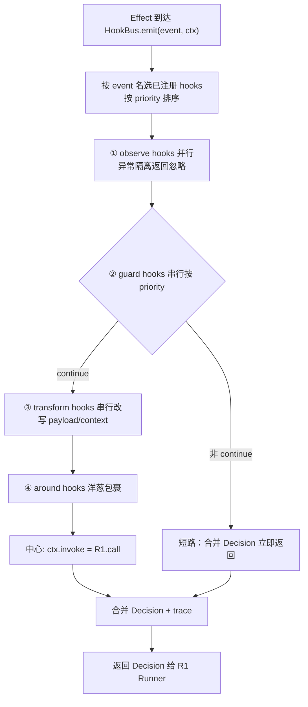

# R2：插件总线与协议（hooks）

> **权威来源**：[《AGENT 总设计》](../../01-总览与设计/AGENT-总设计.md) §R2。本文是其模块级拆分详设，模块内闭环。
> 层：L0 微内核 · 依赖：R1 · 源码包：`src/hooks/` · 门禁 key：`r2`

---

## 1. 职责与边界

**做**：定义唯一扩展点 Hook 与统一返回 Decision；实现 HookBus 编排（四 mode、生命周期事件、Decision 合并）；Capability/Provider/Registry 抽象；全部对外协议契约（Port/DTO）。
**不做**：具体能力实现（R3~R11）；执行循环（R1）。
**"内置默认"的归属**（澄清 §6 表的含义）：R2 只定义"默认实现应满足的协议与履约校验"，**默认实现类本身由对应能力模块提供**（如 LLMPort 默认由 R4 的 OpenAI-compat 适配器提供、ToolPort 默认由 R5 的 ToolRegistry 提供、MemoryPort 默认由 R7 提供、Sandbox/Audit 默认由 R9 提供）；装配层（R12/R13）在用户未注入时把默认实例注册进 Registry。R2 层不内置任何 Port 实现，故 §1"不做具体能力实现"与 §6"内置默认"不矛盾——前者说的是实现代码位置，后者说的是系统最终行为。
**核心变化**：原 middleware/hook/filter/pipe 四泳道 → 一种 Hook（mode 保留四语义）+ 一种 Decision（action 统一返回）。**对外只有 `bus.on()` 一个注册入口**。

## 2. 设计架构

HookBus 是单一分发管道：按 effect.kind 选生命周期事件组 → 按 mode 编排（observe 并行隔离 / guard 串行短路 / transform 串行改写 / around 包裹）→ 合并 Decision → 交 R1 执行 action。总线自己不碰 IO，洋葱中心指回 R1 注入的 `invoke`。Protocol/DTO 在此一次定齐，PortRegistry 按名解析适配器。（matcher 过滤属第二期设计，当前实现不提供。）

## 3. 流程图



## 4. API 规范（完整接口）

```python
class HookMode(str, Enum):
    OBSERVE="observe"; GUARD="guard"; TRANSFORM="transform"; AROUND="around"
class DecisionAction(str, Enum):
    CONTINUE="continue"; REWRITE="rewrite"; DENY="deny"; ASK="ask"
    RETRY="retry"; DEGRADE="degrade"; FALLBACK="fallback"; ABORT="abort"

@dataclass(frozen=True)
class Decision:
    action: DecisionAction
    payload_patch: Mapping|None = None; context_inject: str|None = None
    state_patch: Mapping|None = None; target: str|None = None
    value: DynamicValue = None; retry: RetrySpec|None = None; reason: str = ""
    @classmethod continue_(cls) -> Decision: ...
    @classmethod deny(cls, reason) -> Decision: ...
    @classmethod rewrite(cls, *, context=None, payload=None) -> Decision: ...

class Hook(Protocol):
    name: str; events: tuple[str,...]; mode: HookMode
    priority: int = 100
    requires_ports: tuple[str,...] = ()
    # 注：Matcher 是独立匹配器（第二期），当前 bus.on() 不按 matcher 过滤
    async def __call__(self, ctx: HookCtx) -> Decision: ...

class HookBus:
    def on(self, hook: Hook) -> Self: ...
    def freeze(self, required_ports=()) -> Self: ...
    async def emit(self, event: str, ctx: HookCtx) -> Decision: ...
    def ctx_factory(self) -> Callable: ...
    # v2.1 接线补齐：给 R1 Runner 的 dispatch 适配器，自动 emit 全套事件 + 回传判决
    def dispatch(self) -> Callable[[Effect, HookCtx], Awaitable[Decision]]: ...
    #   - LLM Effect → emit("before_model") → emit("before_invoke")（补齐 BudgetGuard 事件）
    #   - 非 LLM Effect → emit("before_invoke")
    #   - 把最终 Decision 原样回传 Runner（DEGRADE/DENY/REWRITE 等不再丢在总线里）
    #   - Tool Effect 执行后由 call() 侧 emit("after_invoke")/("invoke_error") 喂熔断计数
    def call(self, inner: Callable) -> Callable: ...   # 包装 R1 call，补 after_invoke/invoke_error emit

class Capability(Protocol):
    name: str; version: str; requires: tuple[str,...] = ()
    def install(self, bus: HookBus, reg: Registry) -> None: ...
class Provider(Protocol):
    name: str
class Registry:
    def register(self, name, provider) -> None: ...   # 重名报错
    def resolve(self, name) -> Provider: ...          # 缺失→HookBusError
    def replace(self, name, provider) -> None: ...
    def has(self, name) -> bool: ...

# ---- Port 协议族（对外契约，一次定齐）----
class LLMPort(Protocol):
    async def complete(self, req, ctx) -> LLMResponse: ...
    last_usage: Usage | None   # 流式结算口（SSE 末块后写入）
    def stream(self, req, ctx) -> AsyncIterator[str]: ...   # PEP525 签名；实现为 async gen
class ToolPort(Protocol): ...
class SkillPort(Protocol): ...
class RAGPort(Protocol): ...
class MemoryPort(Protocol): ...
class StorePort(Protocol): ...   # async save/load（可落 DB/Redis）
class SandboxPort(Protocol): ...
class AuditPort(Protocol): ...   # async record；存储经 AuditStore 注入
class EvalPort(Protocol): ...
class TelemetryPort(Protocol): ...   # 同步采集(OTel惯例)；导出经 TelemetryExporter(async)
class HumanPort(Protocol): ...
class MCPPort(Protocol): ...
PORT_PROTOCOLS: dict[str, type] = {...}   # 装配期 isinstance 校验

# ---- DTO（pydantic）----
LLMRequest / LLMResponse / ToolCall / ToolResult / ToolSpec / Usage / PortCtx
```

## 5. 元数据与关键字段（核心字段）

| 字段 | 类型 | 说明 |
|------|------|------|
| Hook | name/events/mode/priority/requires_ports | 强制留名；mode 决定编排；priority 决定顺序确定性 |
| Decision | action/payload_patch/context_inject/state_patch/target/value/retry/reason | 统一返回；action 驱动 R1 行为 |
| HookCtx | effect/state_view(只读)/session_id/event/mount/attempt/budget_left/trace/meta/invoke | invoke 回调指回 R1.call |
| DispatchResult | effect/verdict/data/trace/abort | 分发结果打包 |
| PortError | code/message/retryable | retryable 驱动重试 |

**生命周期事件表**：session(session_start/end)、turn(user_prompt/before_model/after_model/stop/stop_failure)、context(before_compact/after_compact)、invoke(before_invoke/after_invoke/invoke_error)、tool(before_tool/after_tool/tool_error)、state(state_fold/budget_check)、subagent(child_spawn/child_done)、external(config_change/file_change)。

**Decision.action → R1 行为**：continue→继续；rewrite→改写；deny→拒绝；ask→挂起；retry→重放；degrade→换目标；fallback→兜底；abort→终止。

## 6. 可插拔契约

| 注入点 | 协议 | 默认 | 校验 |
|--------|------|------|------|
| 横切行为 | Hook | 无（按需） | 缺 name/非法 mode/缺依赖→拒绝 |
| 能力组件 | Capability | 内置能力 | requires 未装→拒绝 |
| 策略/端口 | Provider/Port | 内置默认 | 缺方法/缺 name→拒绝 |
| 返回 | Decision | — | retry 无幂等键→运行期拒绝 |

## 7. 模块内闭环核对（CL-1~CL-5）

| 条件 | 实现 | 证据 |
|------|------|------|
| CL-1 契约自足 | 只依赖 R1 types + Protocol | import 扫描 |
| CL-2 自带 fake | tests/fakes 提供 fake port 函数 | fake 用例 |
| CL-3 自带测试 | tests/r2 覆盖门禁条目 | 覆盖率报告 |
| CL-4 独立 demo | `make demo-r2`/`demo-r2` | demo 冒烟 |
| CL-5 文档自足 | 本文 + AGENT-总设计对应章节 | 文档评审 |

## 8. 验收标准

1. 四 mode × 事件组合矩阵全部生效；
2. 8 种 action 定义齐全，R1 当前消费 continue/deny/abort/fallback 4 种，rewrite/ask/retry/degrade 待对应模块接线；
3. hook 抛异常不影响主流程且记 trace；
4. 同配置 emit 顺序确定（快照）；
5. 一次 emit 后 trace 含全部 hook name；
6. PortRegistry 缺 port 装配期报错并给缺失清单；适配器异常折叠为 Result。

## 9. 功能验证矩阵

| 功能点 | 用例 ID | 验证方式 | 通过标准 |
|--------|---------|---------|---------|
| 四 mode × 事件 | R2-T01 | `pytest tests/r2/test_hooks.py -q` | 组合矩阵全过 |
| 八种 action | R2-T02 | `pytest tests/r2/test_verdict.py -q` | 各自独立生效 |
| hook 故障隔离 | R2-T03 | `pytest tests/r2/test_trace.py -q` | 异常不影响主流程 |
| 顺序确定性 | R2-T04 | 快照测试 | 注册序=执行序 |
| 组件留名 | R2-T05 | `pytest tests/r2/test_trace.py -q` | trace 含全部 name |
| Port 契约/DTO | R2-T06 | `pytest tests/r2/test_ports.py -q` | 协议可解析、DTO 校验通过 |
| 缺 port 装配报错 | R2-T07 | `pytest tests/r2/test_registry.py -q` | 装配期报错+缺失清单 |
| 错误信封 | R2-T08 | `pytest tests/r2/test_errors.py -q` | 异常折叠、retryable 正确 |
| 独立闭环 | R2-D01 | `make demo-r2`/`demo-r2` + gate_check r2 | demo+门禁全绿 |

## 10. 门禁清单

| 门禁 | 条目 | 达标标准 | 级别 |
|------|------|---------|------|
| R2-G1 | 覆盖 | 四 mode × 事件矩阵用例全过 ≥90% | G1 |
| R2-G2 | action 语义 | 8 种 action 定义齐全，4 种由 R1 消费、4 种待接线 | G2 |
| R2-G2 | 隔离/顺序 | hook 异常隔离；emit 顺序确定 | G2 |
| R2-G3 | 留名/Port | trace 含全部 name；缺 port 装配报错 | G3 |
| R2-红线 | 唯一扩展点 | 出现 middleware/filter/pipe 独立 API→拒绝 | 红线 |

---
*R2 模块详设 v2.1 · 派生自 AGENT-总设计 · 门禁 key=r2 · v2.1: bus.dispatch/call 适配器补齐事件 emit 与降级透传*
