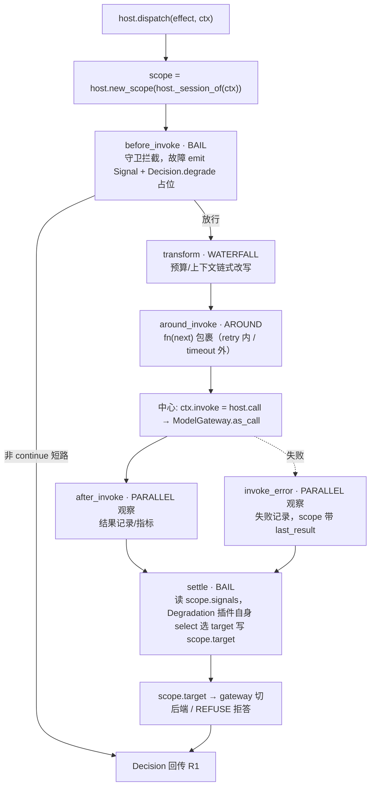

# R2：插件宿主与协议（hooks）

> **权威来源**：[《AGENT 总设计》](../../01-总览与设计/AGENT-总设计.md) §R2；架构基线 `.workbuddy/specs/ARCH-v5.md`（唯一真相源）。本文是其模块级拆分详设，模块内闭环。
> 层：L0 微内核 · 依赖：R1 · 源码包：`src/hooks/` · 门禁 key：`r2`
> 状态：v5.1 设计定稿——按 ARCH-v5 以 tapable 式 Hook 原语完整重写，并把输入参数改为回调直送；旧概念（HookMode/ControlState/DEGRADER/bus.emit/degrade_target 构造参数/Signal 冒泡/`scope.meta` 裸键）全部作废，不做兼容。

---

## 1. 职责与边界

**做**：定义 5 种 HookKind 原语（Bail/Waterfall/Loop/Parallel/Around）与统一返回 Decision；实现 Host（define/plugin/freeze/dispatch/call）+ RequestScope 两层模型；Capability/Provider/Registry 抽象；全部对外协议契约（PORT_PROTOCOLS 13 个 / DTO）。
**不做**：具体能力实现（R3~R11）；执行循环（R1）。
**四条设计铁律（ARCH-v5）**：
1. **原语即调用语义**：Hook 只有 5 种 kind，插件不声明 mode，宿主在定义扩展点时选 kind。
2. **两层而非三层**：`host` 持有扩展点与每次调用新建的 `RequestScope`（请求内 typed 协作容器）；跨调用状态由插件实例自身持有（插件注册一次、长期存活，天然跨调用）；没有独立 Signal 层、没有 ControlState、没有独立 Policy 层。
3. **四模块零断点**：R1 Runner ↔ R2 host ↔ R3 插件 ↔ R4 gateway 调用链完整可达；REFUSE 真拒答、不静默回退；invoke_error 带 last_result；生产装配有统一入口。
4. **参数直送、公共通道只放协作数据**（v5.1）：`effect` 经回调签名直送每个 tap（BAIL/LOOP/PARALLEL `fn(scope, effect)`；WATERFALL `fn(value, effect)`；AROUND `fn(next, scope, effect)`），装配期配置由插件构造参数私有持有；`RequestScope` 无 `meta` 容器，只放协作数据。理由：裸键挂在公共对象上会被任意插件篡改、来源不可追溯；直送参数保证每个 tap 看到同一份不可变 Effect。

**"内置默认"的归属**：R2 只定义"默认实现应满足的协议与履约校验"；默认实现类本身由对应能力模块提供（LLMPort 由 R4、ToolPort 由 R5、MemoryPort 由 R7、Sandbox/Audit 由 R9……），装配层（R12/R13）在用户未注入时注册进 Registry。R2 层不内置任何 Port 实现。

## 2. 设计架构

Host 是**唯一装配与分发入口**：宿主 `define(name, kind)` 定义扩展点并选定 kind；插件 `apply(host)` 只用 `hook.tap(name, fn)` 订阅，不自声明 mode/priority/events；`freeze()` 做装配期校验；每次 `dispatch` 新建 `RequestScope`，扩展点按 kind 语义执行并写信号/目标，最终 Decision 交 R1 `_settle`。`Hook.call(scope, effect, ...)` 把 `effect` 直送每个回调、不写进任何共享容器；装配期配置由插件构造参数私有持有。总线不碰 IO，AROUND 的中心指回 R1 注入的 `call`（→ `ModelGateway.as_call`）。

**5 种 HookKind 语义与回调签名**：
- **Bail**：按 tap 序执行，首个非 `None` / 非 continue 返回即停（`fn(scope, effect)`）。
- **Waterfall**：上次返回值作下次首参，链式改写（`fn(value, effect)`）。
- **Loop**：任一 tap 返回非 `None` 则重跑整链，带上限防死循环（`fn(scope, effect)`）。
- **Parallel**：`gather` 全执行、异常隔离、返回 `None`（`fn(scope, effect)`，观察类）。
- **Around**：fn 收到 `next` 回调，包裹中心调用（`fn(next, scope, effect)`，洋葱模型：retry 内、timeout 外）。

**两层模型**：`Host` 持有扩展点与每次调用新建的 `RequestScope`（signals/target/last_result/trace/value/releases 六个 typed 字段，无 `meta`，请求内协作容器）；跨调用状态由插件实例自身持有——熔断三态机 / 降级 ladder+available 直接放在 `CircuitBreaker` / `Degradation` 插件实例上，插件注册一次、长期存活，天然跨调用；没有独立 Signal 层、没有 ControlState、没有独立 Policy 层。Host 内部用 `_scope_bridge[id(ctx)]` 在 dispatch 与 call 阶段间接力 scope（不污染 ctx 与 scope），`_sticky_targets: dict[session_id, str]` 按会话隔离承担降级目标的跨 Effect 继承（替代全局单槽，消除多会话串味）。

**四模块零断点联通链（端到端测试）**：

```
Runner._execute
  → dispatch = host.dispatch                          (R1→R2)
  → host.hook("before_invoke").call(scope, effect)     (R2→R3 守卫，BAIL)
  → host.hook("transform").call(scope, effect, "")     (R2→R3 改写，WATERFALL)
  → host.hook("around_invoke").call(scope, effect, core=...)
                                                       (R2→R3 retry/timeout，AROUND)
      中心 = ctx.invoke = call = host.call → ModelGateway.as_call (R2→R4)
  → host.hook("settle").call(scope, effect)            (R2→R3 降级裁决，BAIL)
  → scope.target → Host._settle 按 session_id 写 _sticky_targets[session_id] 并刷新 ctx.degrade_target (B1)
  → gateway 从 ctx.degrade_target 读 → 切后端 / REFUSE 拒答 (R3→R4)
  → scope.release_all() 逆序释放本轮资源（舱壁槽位）
  → Decision → Runner._settle → Result                 (R2→R1)
```

## 3. 流程图



## 4. API 规范（完整接口）

```python
from enum import Enum
from dataclasses import dataclass
from typing import Callable, Awaitable, Protocol

class HookKind(str, Enum):
    BAIL="bail"; WATERFALL="waterfall"; LOOP="loop"
    PARALLEL="parallel"; AROUND="around"

class SignalKind(str, Enum):        # 代码内一律用枚举，禁裸串
    DEGRADE = "degrade"; ABORT = "abort"      # 仅两种，无 budget 取值

@dataclass(frozen=True)
class Signal:
    kind: SignalKind | str          # 优先 SignalKind.DEGRADE / .ABORT
    reason: str
    failed_target: str | None = None

@dataclass(frozen=True)
class Decision:                     # 统一返回，字段不变（action/target/value/reason/retry/...）
    action: DecisionAction
    payload_patch: Mapping|None = None; context_inject: str|None = None
    state_patch: Mapping|None = None; target: str|None = None
    value: DynamicValue = None; retry: RetrySpec|None = None; reason: str = ""
    @classmethod
    def continue_(cls) -> Decision: ...
    @classmethod
    def deny(cls, reason) -> Decision: ...
    @classmethod
    def degrade(cls, target) -> Decision: ...
    @classmethod
    def rewrite(cls, *, context=None, payload=None) -> Decision: ...

class RequestScope:                 # 每次 call 新建；替代 ControlState；只放协作数据，无 meta
    signals: list[Signal] = field(default_factory=list)   # 插件 emit，settle 消费
    target: str|None = None         # settle 裁决最终写入，供 R4 经 ctx.degrade_target 读取
    last_result: Result | None = None   # host.call 写入本次 Result，观察插件只读（_coerce_result 归一化）
    trace: list[str] = field(default_factory=list)
    value: Result | None = None     # settle 兜底判决载体（Result|None，非 Any）
    releases: list[Callable[[], None]] = field(default_factory=list)  # 资源释放回调，Host 每轮结束逆序执行
    def emit(self, signal: Signal) -> None: ...
    def release_all(self) -> None: ...    # LIFO、幂等、清空

class Hook:                         # 扩展点：宿主定义时选定 kind；插件只 tap
    name: str
    kind: HookKind
    def tap(self, plugin_name: str, fn: TapFn) -> Hook: ...
    async def call(self, scope: RequestScope, effect: Effect | None = None,
                   *args, **kwargs) -> TapReturn: ...
    # type HookContextArg = RuntimeCtx | HookCtx
    # type TapReturn = Decision | Result | str | None
    # type TapFn = Callable[..., Awaitable[TapReturn] | TapReturn]
    # effect 直送回调，不进任何共享容器：
    # Bail     → fn(scope, effect)          首个非 None / 非 continue 返回即停
    # Waterfall→ fn(value, effect)          上次返回值作下次首参
    # Loop     → fn(scope, effect)          非 None 返回则重跑整链（带上限，防死循环）
    # Parallel → fn(scope, effect)          gather 全执行，异常隔离，返回 None
    # Around   → fn(next, scope, effect)    fn 收到 next 回调，包裹中心调用

class Plugin(Protocol):             # 唯一扩展点：apply(host)，不自声明 mode/priority/events
    name: str
    def apply(self, host: Host) -> None: ...

class Host:                         # 替代 HookBus
    hooks: dict[str, Hook]
    _scope_bridge: dict[int, RequestScope]  # 内部按 id(ctx) 关联 dispatch/call，不写进 ctx 或 scope
    _sticky_targets: dict[str, str]        # 按 session_id 隔离的降级目标，替代全局单槽（B1 跨 Effect 接力）
    def define(self, name: str, kind: HookKind, *, max_loops: int = 100) -> Hook: ...
    def hook(self, name: str) -> Hook: ...                     # 取已定义扩展点供 tap
    def plugin(self, plugin: Plugin) -> Host: ...              # 调 plugin.apply(self)
    def freeze(self) -> Host: ...                              # 装配期校验
    def new_scope(self, session_id: str = "") -> RequestScope: ...  # 按会话继承 sticky target
    @staticmethod
    def _session_of(ctx: HookContextArg) -> str: ...           # 从 ctx 取 session_id
    def sticky_target_of(self, session_id: str) -> str | None: ...
    def set_sticky_target(self, session_id: str, target: str) -> None: ...
    def scope_of(self, ctx) -> RequestScope | None: ...        # 取回 dispatch 建的 scope
    async def dispatch(self, effect: Effect | None, ctx: HookContextArg) -> Decision: ...
    def call(self, inner: Callable[[Effect | None, HookContextArg], Awaitable[Result]]) -> Callable: ...

class Capability(Protocol):                              # 能力级开关（四模块契约，保留）
    name: str; version: str; requires: tuple[str,...] = ()
    def install(self, host: Host, reg: Registry) -> None: ...
class Provider(Protocol):                                # 策略级契约（基）（四模块契约，保留）
    name: str
class Registry:                                          # 注册表（四模块契约，保留）
    def register(self, name, provider) -> None: ...   # 重名报错
    def resolve(self, name) -> Provider: ...          # 缺失→HostError
    def replace(self, name, provider) -> None: ...
    def has(self, name) -> bool: ...

# ---- 端口协议族（对外契约，一次定齐，13 个，不动）----
class LLMPort(Protocol):
    async def complete(self, req, ctx) -> LLMResponse: ...
    last_usage: Usage | None   # 流式结算口（SSE 末块后写入）
    def stream(self, req, ctx) -> AsyncIterator[str]: ...   # PEP525 签名；实现为 async gen
class ToolPort(Protocol): ...
class SkillPort(Protocol): ...
class RAGPort(Protocol): ...
class MemoryPort(Protocol): ...
class StorePort(Protocol): ...   # async save/load（可落 DB/Redis）
class SandboxPort(Protocol): ...
class AuditPort(Protocol): ...   # async record；存储经 AuditStore 注入
class EvalPort(Protocol): ...
class TelemetryPort(Protocol): ...   # 同步采集(OTel惯例)；导出经 TelemetryExporter(async)
class HumanPort(Protocol): ...
class MCPPort(Protocol): ...
class EventStreamPort(Protocol): ... # 事件流只读订阅（seq 续读）
PORT_PROTOCOLS: dict[str, type] = {...}   # 装配期 isinstance 校验，13 个 port 名 → 协议类型

# ---- DTO（pydantic，不动）----
LLMRequest / LLMResponse / ToolCall / ToolResult / ToolSpec / Usage / PortCtx
```

## 4.1 关键字段（v5 核心数据契约）

| 字段 | 归属 | 语义 |
|------|------|------|
| `HookKind` | 扩展点 | Bail/Waterfall/Loop/Parallel/Around 五种调用语义，宿主定义时选定 |
| `Effect`（回调直送） | 请求期输入 | 当前 Effect 经 `Hook.call(scope, effect, ...)` 直送每个 tap，不进任何共享容器（防参数被任意插件篡改） |
| `RequestScope.signals` | 请求级 | 插件发的 `Signal(kind, reason, failed_target)`，无冒泡机制 |
| `RequestScope.target` | 请求级 | settle 阶段写入的降级目标，Host 刷新到 `ctx.degrade_target` 供 R4 网关读 |
| `RequestScope.last_result/trace/value/releases` | 请求级 | 本次 Result（观察只读）/执行轨迹/settle 判决载体/资源释放回调（Host 每轮逆序执行） |
| 插件实例自身 | 长生命周期（注册一次） | 跨调用状态：CircuitBreaker 持三态机、Degradation 持 ladder+available；装配期配置由构造参数注入，随插件实例存活 |
| `Decision.action/target/value` | 统一返回 | R1 `_settle` 与 R2 扩展点分层消费 |

## 5. 扩展点清单与元数据

**6 个扩展点（宿主定义，四模块共用）**：

| 名称 | kind | 回调签名 | 作用 | 订阅者（插件 tap） |
|------|------|----------|------|----------|
| `before_invoke` | BAIL | `fn(scope, effect)` | killswitch/幂等/舱壁/限流/熔断 拦截 | KillSwitch / Idempotency / Bulkhead / RateLimit / CircuitBreaker（守卫故障 → `scope.emit(Signal(SignalKind.DEGRADE, reason, failed_target))` + 返回 `Decision.degrade("")` 占位 → BAIL 短路） |
| `transform` | WATERFALL | `fn(value, effect)` | 预算/上下文改写 | BudgetGuard / 上下文改写插件 |
| `around_invoke` | AROUND | `fn(next, scope, effect)` | retry/timeout 包裹真实 Port 调用（洋葱：内 retry、外 timeout） | RetryPolicy（耗尽 → emit `Signal(SignalKind.DEGRADE,"retry_exhausted",failed_target)`）/ Timeout（超时 → emit `Signal(SignalKind.DEGRADE,"timeout",failed_target)`） |
| `after_invoke` | PARALLEL | `fn(scope, effect)` | 观察类：结果记录、指标 | Trace / Metric / 熔断成功计数 / 舱壁释放（注册到 `scope.releases`） |
| `invoke_error` | PARALLEL | `fn(scope, effect)` | 观察类：失败记录（scope 带 last_result） | 失败记录 / 重试判定 / 熔断失败计数 |
| `settle` | BAIL | `fn(scope, effect)` | 降级裁决：读 scope.signals，Degradation 插件自身 select 选 target 写 scope.target | Degradation（只订阅 settle：读 scope.signals → 实例自身 `select()` 选 target → `Decision.degrade(target)`，`scope.target = target`） |

**核心字段**：

| 字段 | 类型 | 说明 |
|------|------|------|
| Hook | name/kind | 强制留名；kind 由宿主定义时选定，决定调用语义 |
| Decision | action/payload_patch/context_inject/state_patch/target/value/retry/reason | 统一返回；action 驱动 R1 行为 |
| RequestScope | signals/target/last_result/trace/value/releases | 每次 call 新建的 typed 协作容器（无 meta）；signals 收信号、target 降级目标、releases 资源释放回调 |
| Signal | kind/reason/failed_target | 请求内信号；kind 为 SignalKind（DEGRADE/ABORT）或等价串，无 budget 取值 |
| 插件实例 | name + 自带跨调用状态 | 熔断三态机 / 降级 ladder+available 直接放插件实例上，注册一次长期存活，无独立 Policy 层 |
| Host | hooks | 装配入口；define/hook/plugin/freeze/dispatch/call（无独立 Policy 层） |
| PortError | code/message/retryable | retryable 驱动 R3 可靠性扩展点的判决 |

**Decision.action → R1 行为**：continue→继续；rewrite→改写；deny→拒绝；ask→挂起；retry→重放；degrade→换目标；fallback→兜底；abort→终止。
**Signal → 降级链**：守卫/重试/超时 → `scope.emit(Signal(SignalKind.DEGRADE, reason, failed_target))`；`settle` 读 signals 由 Degradation 插件实例自身 `select()` 选 target（失败目标从 available 累积剔除，全剔除落 REFUSE）→ R4 从 `scope.target` 切后端或 REFUSE 真拒答。

## 6. 可插拔契约

| 注入点 | 协议 | 默认 | 校验 |
|--------|------|------|------|
| 横切行为 | Plugin.apply(host) → hook.tap（effect 直送回调） | 无（按需） | 缺 name/非法 kind/缺依赖→拒绝 |
| 能力组件 | Capability | 内置能力 | requires 未装→拒绝 |
| 策略/端口 | Provider/Port | 内置默认 | 缺方法/缺 name→拒绝 |
| 跨调用状态 | 插件实例自身 | 无（按需） | 插件注册一次长期存活，状态随实例（无独立 Policy 层） |
| 返回 | Decision | — | retry 无幂等键→运行期拒绝 |

## 7. 模块内闭环核对（CL-1~CL-5）

| 条件 | 实现 | 证据 |
|------|------|------|
| CL-1 契约自足 | 只依赖 R1 types + Protocol | import 扫描 |
| CL-2 自带 fake | tests/fakes 提供 fake port 函数 | fake 用例 |
| CL-3 自带测试 | tests/r2 覆盖门禁条目 | 覆盖率报告 |
| CL-4 独立 demo | `make demo-r2`/`demo-r2` | demo 冒烟 |
| CL-5 文档自足 | 本文 + AGENT-总设计对应章节 | 文档评审 |

## 8. 验收标准

1. 5 种 HookKind 各自语义单测通过（Bail 短路 / Waterfall 传值 / Loop 重跑带上限 / Parallel 异常隔离 / Around next 包裹）；
2. Decision.action 定义齐全，R1 消费 continue/deny/abort/fallback 四类终止 action，未知 action 回退 CONTINUE；
3. 6 个扩展点按宿主定义 kind 执行，顺序确定、留名可见；
4. 守卫/限流/重试耗尽 → `scope.emit(Signal)` → `settle` 选 target → `scope.target` → gateway 切后端；REFUSE → 真拒答（不回退），端到端可达；
5. invoke_error 观察扩展点可读 scope.last_result；hook 抛异常不影响主流程且记 trace；
6. PortRegistry 缺 port 装配期报错并给缺失清单；适配器异常折叠为 Result。

## 9. 功能验证矩阵

| 功能点 | 用例 ID | 验证方式 | 通过标准 |
|--------|---------|---------|---------|
| 5 种 HookKind 语义 | R2-T01 | `pytest tests/r2/test_hook_kinds.py -q` | Bail/Waterfall/Loop/Parallel/Around 各自语义通过 |
| 扩展点编排 | R2-T02 | `pytest tests/r2/test_extensions.py -q` | 6 个扩展点按宿主 kind 执行 |
| 降级裁决链 | R2-T03 | `pytest tests/r2/test_settle.py -q` | scope.signals → Degradation 插件 select 选 target → scope.target |
| 端到端降级切后端 | R2-T10 | `pytest tests/r2/test_e2e_wiring.py -q` | 熔断/限流/重试耗尽 → 切后端；REFUSE → 真拒答不回退 |
| hook 故障隔离 | R2-T04 | `pytest tests/r2/test_trace.py -q` | 异常不影响主流程且记 trace |
| 顺序确定性 | R2-T05 | 快照测试 | tap 序=执行序 |
| 组件留名 | R2-T06 | `pytest tests/r2/test_trace.py -q` | trace 含全部 plugin name |
| Port 契约/DTO | R2-T07 | `pytest tests/r2/test_ports.py -q` | 13 端口协议可解析、DTO 校验通过 |
| 缺 port 装配报错 | R2-T08 | `pytest tests/r2/test_registry.py -q` | 装配期报错+缺失清单 |
| 错误信封 | R2-T09 | `pytest tests/r2/test_errors.py -q` | 异常折叠、retryable 正确 |
| 独立闭环 | R2-D01 | `make demo-r2`/`demo-r2` + gate_check r2 | demo+门禁全绿 |

## 10. 门禁清单

| 门禁 | 条目 | 达标标准 | 级别 |
|------|------|---------|------|
| R2-G1 | 覆盖 | 5 种 HookKind + 6 扩展点矩阵用例全过 ≥90% | G1 |
| R2-G2 | 原语语义 | HookKind/Host/RequestScope/Signal 齐全（跨调用状态由插件实例自身持有）；R1 消费 4 类终止 action，未知回退 CONTINUE | G2 |
| R2-G2 | 隔离/顺序 | hook 异常隔离；扩展点顺序确定 | G2 |
| R2-G3 | 留名/Port | trace 含全部 name；缺 port 装配报错；13 个 PORT_PROTOCOLS 履约 | G3 |
| R2-红线 | 唯一扩展点/无残留 | 出现 middleware/filter/pipe 独立 API，或 HookMode/ControlState/DEGRADER/bus.on/bus.emit 残留→拒绝 | 红线 |

**门禁符号（gate_check r2 必须出现）**：`HookKind` / `Host` / `RequestScope` / `Signal` / `Plugin` / `Hook` / `Decision` / `Registry` / `Capability` / `PORT_PROTOCOLS` / `LLMRequest` / `ToolSpec` / `make_call`。

---
*R2 模块详设 v5.2 · 派生自 AGENT-总设计与 ARCH-v5 · 门禁 key=r2 · v5.0: HookBus 四 mode + DEGRADER + ControlState + bus.emit 全部作废，重写为 5 种 HookKind + Host/RequestScope + Plugin.apply(host) 与 6 个扩展点；v5.1: Hook.call 参数直送 effect（回调带 effect）、RequestScope 删 meta 改 typed 字段、Host 加 _scope_bridge/_sticky_target；v5.2: 新增 SignalKind（魔法串 "degrade" → SignalKind.DEGRADE）、Host._sticky_target 改 _sticky_targets dict 按 session_id 隔离（新增 _session_of/sticky_target_of/set_sticky_target）、类型收敛（HookContextArg/TapReturn/TapFn、last_result/value 为 Result|None、_coerce_result 唯一边界）、删除 decision() 孤岛方法；PORT_PROTOCOLS 13 个、Registry、DTO 四模块契约不动*
