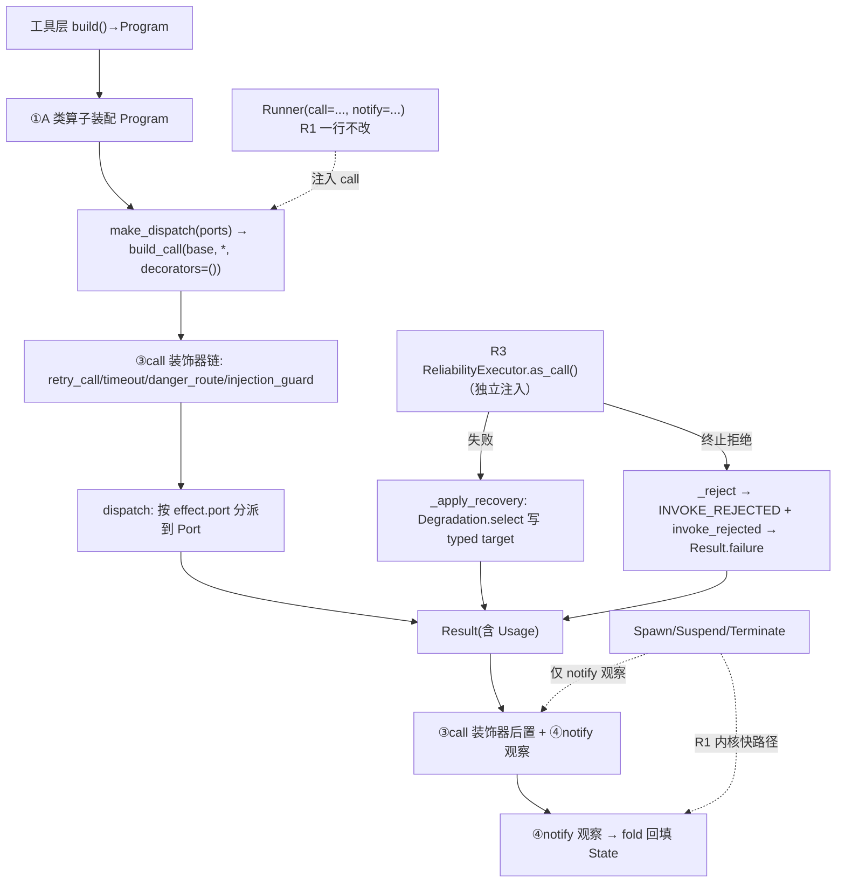

# R2：算子与装配（compose + archs）

> **权威来源**：[《AGENT 总设计》](../../01-总览与设计/AGENT-总设计.md) §5（算子核心与 7 承载形态）；`docs/01-总览与设计/组合式工具层重构规格-20261121.md` §2/§3 P2/P6/§8 D-1~D-10。细节推导见 `overviews/2026-11-21/94783b60-意图识别级联路由默认策略影响面分析.md` 追问 3~7。
> 层：组合层（框架真正核心） · 依赖：R1（Program/Effect/Result） · 源码包：`src/compose/`（`program.py`/`call.py`/`dispatch.py`）+ `src/archs/`；原 `src/aop/` 已删除 · 门禁 key：`r2`
> 状态：按规格 P2/P6 重写——**R2 取消** AOP 五角色容器 / LifecycleBus / Registry 独立模块概念，改为**算子核心**：①A 类组合算子装配 Program、③call 装饰器构造注入 R1 的 call、④notify 观察、⑤Port 接入、⑥组件、⑦内核机制。承载形态②的落地形态已演进：原 `Guard.check/observe` 拦截协议已删除，现由 R3 `ReliabilityExecutor` + 9 领域策略显式编排实现（见 R3 详设）。整体替换，不留兼容层（D-10）。R1 一行不改（D-7）。

---

## 1. 职责与边界

**做**：定义 7 种承载形态与"算子=①类"的定性；A 类组合算子契约（`Program→Program`，10 个）；③call 装饰器（`CallFn→CallFn`）；`build_call` + `dispatch`/`make_dispatch`；provides/requires 挑选期校验；ToolLayer 装配器。承载形态②（原"有状态守卫"）由 R3 执行器显式编排 9 领域策略落地，不在本层。
**不做**：具体能力实现（R3~R9）；执行循环（R1，一行不改）；任何领域语义；把预算治理做成算子。
**依赖不变量**：R1 零依赖上层；组合层是唯一知道"有哪些工具层"的地方；工具层互不直连（规格 §2.6）。

### 1.1 二维分类：能力 ≠ 承载形态（本篇最重要）

能力域全景 18 域 169 项是**需求侧清单**（做什么），本次一项不删、一项不改名。落到实现只有 **7 种承载形态**（怎么实现），按 agent 运行周期排列（规格 §2.2）：

| # | 承载形态 | 签名/接口 | 运行期位置 | 代表能力 | 是不是算子 |
|---|---------|----------|-----------|---------|-----------|
| ① | **组合算子** | `Program → Program` | 装配期 | seq/par/branch/race/loop/fallback/gate/map_state/map_effect/retry(流程级) | ✅ **狭义算子就是这类，框架核心** |
| ② | **领域策略（原"有状态守卫"）** | R3 `ReliabilityExecutor` 显式编排领域方法（`is_tripped`/`acquire`/`permit`/`select` 等），无统一协议 | 策略实例（跨调用存活） | 熔断/限流/舱壁/幂等/降级阶梯/watchdog/killswitch（R3） | ❌ 不是算子（R3 编排） |
| ③ | **call 装饰器** | `CallFn → CallFn` | 运行期 call 层 | 重试(调用级)/timeout(调用级)/危险路由/注入检测 | ❌ 装饰器；链式组合取代原 AOP 五角色 |
| ④ | **通知观察** | `notify(phase, payload)` 只读 | 旁路 | 链路追踪/审计/指标/成本归因 | ❌ R1 既有 notify 回调 |
| ⑤ | **Port 接入** | `Protocol` + Registry | 被 call 调用 | 工具系统/沙箱/LLM/记忆/RAG/Store | ❌ 能力契约 |
| ⑥ | **组件** | 普通类/函数 | 装配或调用期 | 切分/嵌入/重排/改写/规划器/上下文四链 | ❌ 无横切无状态机的算法 |
| ⑦ | **内核机制** | R1 内部 | R1 | 预算/终止/挂起/checkpoint/取消 | ❌ 不进算子层 |

**关键定性（规格 §2.2 / D-2）**："算子"专指①；retry/timeout/熔断/降级/沙箱/工具/追踪**都是能力，不是算子**——"算子"字样只出现在描述承载形态时。②+③取代原 AOP：③是无状态 call 装饰器函数组合；②的落地形态已演进——原 `Guard.check/observe` 拦截协议已删除，现由 R3 `ReliabilityExecutor` 显式编排 9 领域策略实现，不再由③在调用前后驱动。④就是 R1 现有 notify 回调，⑤⑥本就可插拔。

### 1.2 R2 原资产的去向（规格 P2 迁移表）

| R2 现有资产 | 去向 | 承载形态 |
|---|---|---|
| AOP 五角色固定链 | 拆成 call 装饰器链 + R3 领域策略 | ③（§3）+ ②（R3） |
| 降级重路由状态机（`src/aop/container.py:275-317`） | R3 执行器 `_apply_recovery` + A 类 fallback 算子 | ②（R3）+ ① |
| LifecycleBus 16 相位 | 保留为 R1 的 notify 相位（回调，不是总线模块） | ④（§4.4） |
| `PORT_PROTOCOLS` / Registry | 并入组合层装配器（挑选期校验） | ⑤ 装配期 |
| `Invocation` / `FaultRecord` / `RoutingTarget` | 移入组合层（协作 DTO），不进 R1 | ③ / R3 |
| DTO 领域字段（DangerLevel/task_hint/last_usage/recall） | 移回各能力模块（R4/R5/R7/R9） | ⑤⑥ |
| `aop/protocols.py FailureClass` | 删除（用 R3 的） | — |

---

## 2. 设计架构

### 2.1 组合层全貌

```
工具层 R3~R9 + 用户自定义（各自 build() -> Program）
    ↓ 装配期：①A 类算子编排 Program + provides/requires 校验
组合层（R2 算子核心 + R12 10 内置架构预设配方）
    ↓ 构造 call：③装饰器链 + dispatch（可靠性链由 R3 执行器独立注入）
    ↓ 注入 call=（Runner(call=build_call(...))，R1 一行不改）
核心层 R1（只解释 Program）
    ↑ ④notify 观察口（相位口径保留）
```

### 2.2 端到端调用链（四模块零断点）

```
Runner.run (R1，零改动)
  ├─ match 分派：仅 Invoke 走注入的 call
  │    → build_call(base, *, decorators=()) 产出：③装饰器链(retry_call/timeout/danger_route/injection_guard)
  │         → dispatch(ports, effect, ctx)：按 effect.port 取 Port、构造 Result(含 Usage)
  │         → ③装饰器后置处理
  │    （R3 可靠性链由 ReliabilityExecutor.as_call() 独立注入：_preflight 前置放行 →
  │      预算内执行 → observe_outcome → 失败 _apply_recovery / Degradation.select）
  ├─ Spawn/Suspend/Terminate → R1 内核快路径（call 拦不到，仅 notify 观察，D-7）
  ├─ notify(before_model / before_tool / …) ← R1/能力层按相位发（④，返回值不消费）
  ├─ fold 按 port 回写（R1）
  └─ notify(state_fold / budget_check / …) ← Runner 发
```

降级链路（P3/P9）由 R3 的 `ReliabilityExecutor` 显式编排（前置放行 → 预算执行 → 熔断记数 → `Degradation.select` 降级选级 + 链外重路由，保四坑语义），其 `as_call()` 注入 R1，不在通用 `build_call` 链里以信号方式传递——详见 R3 §2/§4。

### 2.3 A 类组合算子（①，10 个，框架核心）

| 算子 | 签名 | 语义 | 覆盖的能力/生命周期 |
|---|---|---|---|
| seq | `seq(a, b)` | a.output 作 b 初始输入 | 各类顺序链路 |
| par | `par([...], join=all)` | 扇出并行 + join 聚合（真并行，见下注） | A6/H8/J3 |
| branch | `branch(fn, arms, default?)` | fn(state)→key 选 arm | I1 级联（嵌套 branch，不加算子） |
| race | `race([...])` | 首个完成胜出，取消其余（真并行，见下注） | 竞速；依赖 A5 取消传播 |
| map_state | `map_state(lens)` | State 视图变换，纯函数 | F7/E5 |
| retry | `retry(p, *, attempts, backoff)` | **流程级**重放：失败按 program_factory 重建重跑 | 生命周期 T6 |
| fallback | `fallback(p, *, ladders, refuse)` | 按序尝试 arms，某 arm 失败切下一个，全失败走 refuse | B3/C3/H16 降级 |
| loop | `loop(body, *, cond, max_rounds)` | 显式循环（轮次交 Budgets，禁自数） | T2/T6 思考-工具循环 |
| map_effect | `map_effect(fn)` | 改写 Effect payload（脱敏/参数规范化/注入标记） | T0/T2；取代 AOP Refiner |
| gate | `gate(p, policy)` | 可 `yield Suspend(question,options)` 等审批/澄清，resume 后续跑 | T4；call 装饰器不能 yield Effect，挂起类横切只能 A 类 |

共 10 个（D-4）。**预算治理不是算子**：硬限在 R1 `Budgets`/`fold`，软限是文本提示用 map_effect 注入 `payload['budget']`。**级联路由 = 嵌套 branch，不加算子**。**gate 必须是算子**（D-6）：call 装饰器 `(effect,ctx)->Result` 不能 yield Effect，挂起/审批必须 A 类 Program 变换。

**par/race 真并行实现注记**（`src/compose/program.py`，2026-11-21 修复）：
- R1 无 `EffectBatch` 类型；并行靠 generator **一次 yield 一个 Effect 列表**（`src/runtime/interpreter.py:153-162` 认列表 → `EffectBatch(batched=True)` → `runner.py:515-526` gather 并发并按序回注 list）。
- par 采用 lockstep 调度：每个子 Program 一个独立 generator，每轮把各子当前 Effect 汇成一个列表一次 yield，回注 list 按序 send 回各子；子 yield Terminate 时拦截其 output（不转发 R1），全部完成后按 join 聚合（all=按序 list / any=首个非 None / majority=多数票平票取首现）。**聚合对象是子 Program 的 Terminate.output**，Port 的 Result.data 只作回注喂给子。
- race 同构，但首个 Terminate 产出即胜出、不再推进其余（**取消传播仍交 R1 CancellationToken，算子只做编排**）。
- 禁止退回假实现（只发一个 `Invoke(port="tool", batch=True)` 并丢弃 items、output 恒为 None）——那不是并行，是桩。门禁：真实 R1 Runner 端到端下两个子 Program 必须都执行且 output 正确聚合。

**A 类统一约束（R1 不变前提，规格 §2.3 / D-8）**：
- 装配期纯变换 `Program→Program`，不改原对象（compile 幂等）；
- **必须是纯函数**：resume 靠 program_factory 重建（`src/runtime/types.py:521-531` 的 Spawn 同构机制），任何运行期状态进 `State.scratch` 的 `x-*` 键，禁止算子实例持有流程进度（否则 resume 丢状态）；
- 轮次/跳数交 Budgets（`R12:55-56` 红线），架构 generator 内禁 `for i in range(max)` 自数；
- State 只读（`src/runtime/types.py:321-369` 的 MappingProxyType），改状态只能 yield Effect 让 fold 写（`src/runtime/runner.py:535` 是唯一写入点）；
- gate 的 Suspend 和 race 的取消走 R1 快路径/cancel 设施，算子只编排不重实现。

### 2.4 B/C 类：call 装饰器 + 领域策略（②的落地演进）

**③ call 装饰器**（签名是 R1 既有 `CallFn`，`src/runtime/types.py:724-725`）：

```python
def retry_call(base: CallFn, *, attempts: int, backoff: float) -> CallFn: ...       # 调用级重试
def timeout(base: CallFn, *, seconds: float) -> CallFn: ...                          # 调用级超时
def danger_route(base: CallFn, registry) -> CallFn: ...                             # 按 danger 进沙箱
def injection_guard(base: CallFn, detector) -> CallFn: ...                          # 注入检测
# 组装：call = retry(timeout(danger_route(base_port_call)))
```

用函数组合表达，无固定角色链、不叫 AOP；只覆盖 `Invoke`（R1 边界 D-7）。

**② 领域策略（原"有状态守卫"，落地形态已演进）**：承载形态②在 R3 由 `ReliabilityExecutor` + 9 领域策略实现，以各自领域方法显式编排，不再是统一拦截协议：

```python
# 9 领域策略（各自领域方法，无统一 check/observe 协议）：
# KillSwitch.is_tripped / Watchdog.detect / Idempotency.check_and_mark /
# RateLimit.acquire→RatePermit / Bulkhead.run_in_slot /
# CircuitBreaker.permit + observe_outcome / RetryPolicy.run_with_retries /
# Timeout.run_with_deadline / Degradation.select
executor = ReliabilityExecutor(core, ..., degradation=Degradation(...))
call = executor.as_call()                                    # 产出符合 R1 的 CallFn
```

承载：熔断（三态+滑窗+store）、限流（令牌桶）、舱壁（池计数）、幂等（去重表+TTL）、降级阶梯（available 永久剔除+session 隔离）、watchdog（历史滑窗）、killswitch（外部 flag）。由执行器按可靠性工程语义显式编排（`_preflight` → `_budgeted_call` → `observe_outcome` → `_apply_recovery`）。状态存在领域策略实例上（跨调用存活），**策略只能持有跨调用策略状态**（熔断计数等），**不能持有单次流程进度**（那是 A 类 + `State.scratch` 的职责）。原 `Guard`/`with_guard`/`Verdict`/`DegradationGuard`/`degrade_retry` 已删除。

### 2.5 call 注入链与 dispatch

```python
base = make_dispatch(ports)                                    # 按 effect.port 分派，构造 Result(含 usage)
call = build_call(base, decorators=(retry_call, timeout))      # ③函数式装饰器链（内层先注册）
# Runner(call=call) —— R1 一行不改
```

`dispatch`/`make_dispatch` 最小职责：签名 `async (effect,ctx)->Result`；按 `effect.port` 取 payload 参数；构造 `Result.success/failure` 含 `Usage`/`PortError`（`src/runtime/types.py:211-243`）。**不构造 Invocation**（R1 明确不构造，`R1-核心运行时.md:172`）；typed target 消费仅降级场景需要，由 R3 执行器 `_apply_recovery` 调 `Degradation.select` 写入 `RoutingTarget` 后交网关完成。

> **Why**：R1 的 `CallFn=(effect,ctx)->Awaitable[Result]`（`types.py:724-725`）注入点 `Runner(call=...)`（`runner.py:190-212`）、唯一调用点 `runner.py:322`，但 call 只覆盖 `Invoke`——`Spawn` 入口被截走（`runner.py:312-313`）、`Suspend`/`Terminate` 走快路径（`runner.py:491-509`）。所以 B/C 类拦不到这三类，只能经④notify 观察（D-7 代价）。

---

## 3. 流程图



---

## 4. API 规范（完整接口）

### 4.1 ①A 类算子（`src/compose/program.py`）

```python
Program = Generator[Effect, DynamicValue, None]

# 10 个算子：统一签名 Program → Program，装配期纯变换、不改原对象（compile 幂等）
def seq(a: Program, b: Program) -> Program: ...
def par(items: list[Program], *, join="all") -> Program: ...
def branch(fn: Callable[[AgentState], str], arms: dict, default: str | None = None) -> Program: ...
def race(items: list[Program]) -> Program: ...
def map_state(lens: Callable[[AgentState], AgentState]) -> Program: ...
def map_effect(fn: Callable[[Effect], Effect]) -> Program: ...
def loop(body: Program, *, cond: Callable[[AgentState], bool], max_rounds: int) -> Program: ...
def fallback(p: Program, *, ladders, refuse: Program) -> Program: ...
def retry(p: Program, *, attempts: int, backoff: BackoffSpec) -> Program: ...   # 流程级重放
def gate(p: Program, policy) -> Program: ...                                    # 唯一可 yield Suspend 的 A 类算子
```

### 4.2 ②领域策略（R3）+ ③call 装饰器（`src/compose/call.py`）

```python
CallFn = Callable[[Effect, DynamicValue], Awaitable[Result]]   # R1 既有签名 types.py:724-725

# ②领域策略在 R3（src/harness/resilience/），由 ReliabilityExecutor 显式编排：
# KillSwitch.is_tripped / Watchdog.detect / Idempotency.check_and_mark /
# RateLimit.acquire→RatePermit / Bulkhead.run_in_slot /
# CircuitBreaker.permit + observe_outcome / RetryPolicy.run_with_retries /
# Timeout.run_with_deadline / Degradation.select
# （原 Guard/with_guard/Verdict/DegradationGuard/degrade_retry 已删除）
# call = ResilienceCapability(...).install(core).as_call()

# ③call 装饰器（纯函数组合）：
def retry_call(base: CallFn, *, attempts, backoff) -> CallFn: ...  # 调用级重试（与 A 类 retry 区分：后者流程级）
def timeout(base: CallFn, *, seconds) -> CallFn: ...            # 调用级超时
def danger_route(base: CallFn, registry) -> CallFn: ...
def injection_guard(base: CallFn, detector) -> CallFn: ...
```

### 4.3 装配器与 dispatch（`src/compose/dispatch.py`）

```python
def build_call(base: CallFn, *, decorators: Sequence[Callable[[CallFn], CallFn]] = ()) -> CallFn: ...
def make_dispatch(ports: PortMap) -> CallFn: ...                # 按 effect.port 分派，构造 Result(含 Usage)
async def dispatch(ports, effect: Effect, ctx) -> Result: ...   # 便捷形态

# ---- 挑选期校验（provides/requires，不进运行时内核）----
class Capability(Protocol):                              # ToolLayer 外壳
    name: str; version: str
    requires: tuple[str, ...] = ()
    provides: tuple[str, ...] = ()
    def build(self) -> Program: ...
class Registry:
    def register(self, name: str, provider) -> None: ...
    def resolve(self, name: str): ...
def static_check(caps) -> "Report": ...                  # provides/requires 齐备/冲突检测
```

### 4.4 ④notify 相位（R1 既有，不新建总线）

```python
# 源码相位枚举 src/hooks/lifecycle.py 保留 16 相位口径；不再是 LifecycleBus 总线模块
NotifyFn = Callable[[str, Mapping[str, object]], None]   # (相位名, 只读投影)；异常就地隔离
# Runner(notify=...) 注入；追踪/审计/指标/成本归因挂此口
```

16 相位（不得增删）：会话/轮次 5（`session_start`/`user_prompt`/`session_end`/`state_fold`/`budget_check`）+ 能力调用 5（`before_model`/`after_model`/`before_tool`/`after_tool`/`tool_error`）+ 子 Agent 2（`child_spawn`/`child_done`）+ 控制流 3（`cancelled`/`wait_human`/`resumed`）+ 拒绝 1（`invoke_rejected`，由 R3 执行器 `_reject`/`_emit_rejected` 在终止类策略拒绝或降级拒答时发）。流式多次 before/after_model 是预期行为（P4）。

---

## 5. 元数据与关键字段（核心数据契约）

| 字段 | 归属 | 语义 |
|------|------|------|
| `State.scratch` 的 `x-*` 键 | 运行期（A 类算子） | 流程进度唯一存放处；算子实例不得持有（D-8，resume 靠 program_factory 重建） |
| `SafetyVerdict` | R9 安全域 | allow/redact/deny/ask 四态；ask→Suspend（与已删除的通用 `Verdict` 不同物） |
| 领域策略实例 | 长生命周期（R3 具名构造注入） | 跨调用策略状态：熔断三态机在 CircuitBreaker、ladder+available 按 session 隔离在 Degradation |
| `Result` | Port 调用统一信封 | `{ok, data, usage, error}`；含 `Usage`/`PortError`（`src/runtime/types.py:211-243`） |
| `Registry` / `PORT_PROTOCOLS` | 挑选期（⑤） | 装配期 provides/requires 校验；Port 注册名不可新增；payload 的 `x-*` 扩展键继续允许（D-2） |
| 16 相位 | ④notify | 相位枚举口径保留，返回值不消费、异常就地隔离 |

---

## 6. 可插拔契约

| 注入点 | 协议 | 默认 | 校验 |
|--------|------|------|------|
| ①算子 | `Program→Program` | 10 内置 | compile 幂等 + 纯函数 AST（禁实例持状态） |
| ②领域策略 | R3 领域策略实例（无统一协议） | 无（按需） | `ResilienceCapability` 具名构造注入；只持跨调用策略状态 |
| ③call 装饰器 | `CallFn→CallFn` | 无（按需） | 只覆盖 Invoke（D-7）；函数组合无固定角色链 |
| ④观察 | notify | no-op | 相位名合法；异常就地隔离 |
| 能力组件 | Capability（build→Program） | 各内置工具层 | provides/requires 装配期校验 |
| 策略/端口 | Provider/Port | 内置默认 | 缺方法/缺 name → 拒绝；Port 种类不可新增 |

---

## 7. 模块内闭环核对（CL-1~CL-5）

| 条件 | 实现 | 证据 |
|------|------|------|
| CL-1 契约自足 | 只依赖 R1 types + Protocol | import 扫描 |
| CL-2 自带 fake | tests/fakes 提供 fake port/guard | fake 用例 |
| CL-3 自带测试 | tests/r12 覆盖 10 算子 + call 装饰器 + build_call/dispatch（可靠性策略见 tests/r3） | 覆盖率报告 |
| CL-4 独立 demo | `make demo-r2` | demo 冒烟 |
| CL-5 文档自足 | 本文 + AGENT-总设计 §5 | 文档评审 |

---

## 8. 验收标准

1. A 类 10 算子各自语义单测通过；compile 幂等、不改原 Program；
2. A 类算子纯度：状态进 `State.scratch x-*`、实例不持流程进度；gate 可 yield Suspend、resume 后续跑；
3. ②领域策略由 R3 `ReliabilityExecutor` 显式编排（终止拒绝发 `invoke_rejected`、熔断跨调用状态、降级选级保四坑；在 R3 验证）；
4. ③call 装饰器链函数组合、只覆盖 Invoke；build_call 注入 R1 后主流程跑通；
5. dispatch 按 port 分派构造 Result（含 Usage）、不构造 Invocation；
6. 16 notify 相位按契约触发、返回值不消费、异常就地隔离；
7. **五角色/AOPContainer 不得复辟**（历史：R2 曾取消 AOP 五角色容器 / `LifecycleBus` / Registry 独立模块概念，本条是红线语境、非当前架构描述）；无旧扩展体系原语残留，R1 零改动（git diff src/runtime/ 为空）。

---

## 9. 功能验证矩阵

| 功能点 | 用例 ID | 验证方式 | 通过标准 |
|--------|---------|---------|---------|
| A 类 10 算子 | R2-T01 | `pytest tests/r12/test_compose.py -q` | 10 算子语义 + 嵌套 |
| 算子纯度/resume | R2-T02 | `pytest tests/r12/test_compose.py -q` | 状态进 scratch x-*、实例无流程进度；compile 幂等 |
| gate 挂起/resume | R2-T03 | `pytest tests/r12/test_gate.py -q` | Suspend→resume 精确续跑 |
| 可靠性链（归 R3） | — | 见 R3 详设功能验证矩阵 | `ReliabilityExecutor` 显式编排 9 领域策略；终止拒绝 + 降级四坑 |
| call 装饰器 | R2-T05 | `pytest tests/r12/test_call.py -q` | retry/timeout 调用级、只覆盖 Invoke |
| build_call/dispatch | R2-T06 | `pytest tests/r12/test_dispatch.py -q` | 按 port 分派、Result 含 Usage、不构造 Invocation |
| notify 相位 | R2-T07 | `pytest tests/r12/test_notify.py -q` | 16 相位、返回值不消费、异常隔离 |
| 独立闭环 | R2-D01 | `make demo-r2` + gate_check r2 | demo+门禁全绿 |

---

## 10. 门禁清单

| 门禁 | 条目 | 达标标准 | 级别 |
|------|------|---------|------|
| R2-G1 | 覆盖 | 10 算子 + call 装饰器矩阵用例全过 ≥90%（可靠性策略归 R3） | G1 |
| R2-G2 | 算子语义 | 纯函数/compile 幂等/状态进 x-*/gate 可 yield Suspend | G2 |
| R2-G2 | call 边界 | 装饰器只覆盖 Invoke；build_call 注入后主流程跑通 | G2 |
| R2-G2 | 可靠性边界 | ②领域策略由 R3 `ReliabilityExecutor` 显式编排（R2 不再有 check/observe 协议；在 R3 验证） | G2 |
| R2-G3 | 留名/Port | trace 含全部算子/装饰器 name；缺 port 装配报错 | G3 |
| R2-红线 | 无残留/R1 | **五角色/AOPContainer 不得复辟**（历史已取消；出现五角色/AOPContainer/LifecycleBus/旧原语，或 R1 有改动 → 拒绝） | 红线 |

**门禁符号（gate_check r2 必须出现）**：`seq`/`par`/`branch`/`race`/`loop`/`map_state`/`map_effect`/`fallback`/`gate`/`retry` / `retry_call` / `timeout` / `danger_route` / `injection_guard` / `build_call` / `dispatch` / `make_dispatch` / `CallFn` / `notify` / `invoke_rejected` / `Registry` / `Capability` / `PORT_PROTOCOLS`。

---
*R2 模块详设（算子与装配）· 派生自 AGENT-总设计 §5 与《组合式工具层重构规格-20261121》P2/P6 · 门禁 key=r2 · 本次变更：R2 取消 AOP 五角色容器/LifecycleBus，重写为算子核心——①A 类 10 算子（纯函数、状态进 scratch x-*）+ ③call 装饰器 + build_call/dispatch/make_dispatch + ④notify 相位；承载形态②已演进到 R3 执行器 + 9 领域策略（原拦截协议已删除）；R1 一行不改，整体替换不留兼容层*
