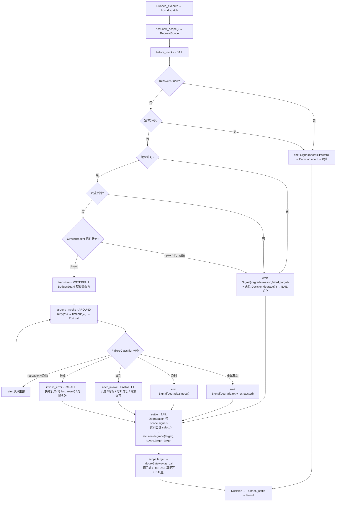

# R3：可靠性（resilience）

> **当前版本**：R3 v5.0 · 架构基准 [ARCH-v5](../../../.workbuddy/specs/ARCH-v5.md)（唯一真相源）· 源码 `src/harness/resilience/` · 测试 `tests/r3/` · 门禁 key `r3`。
> **权威来源**：[《AGENT 总设计》](../../01-总览与设计/AGENT-总设计.md) §R3 与 `ARCH-v5.md`；本文为模块级拆分详设。层：L1 能力插件 · 依赖：R1+R2。

---

## 1. 职责与边界

**做**：重试、熔断、降级、限流、舱壁、幂等、预算策略、watchdog/killswitch——全部是 Hook 插件，经 `apply(host)` 注册，返回 `Decision`。
**不做**：内核预算硬强制（R1）、结构化输出修复（R4）。共享设施：失败分类表 + DimensionKey（按 provider/model/tool/tenant 隔离）。

R3 遵守 `ARCH-v5` 四条铁律：

1. **原语即调用语义**：插件不声明 mode，语义由宿主定义扩展点时选定的 `HookKind` 决定（BAIL / WATERFALL / LOOP / PARALLEL / AROUND）。
2. **两层而非三层**：跨调用状态由插件实例自身持有（插件注册一次、长期存活，天然跨调用），请求内协作数据放每次调用新建的 `RequestScope`（无 `meta`）；没有独立 Signal 层、没有 ControlState、没有独立 Policy 层。
3. **四模块零断点**：R3 产出的 `scope.target` 必须经 Host 刷新到 `ctx.degrade_target` 被 R4 网关消费；REFUSE 真拒答；`invoke_error` 必须带 `last_result`。
4. **参数直送、公共通道只放协作数据**：`effect` 经回调签名直送每个 tap（BAIL/LOOP/PARALLEL `fn(scope, effect)`、WATERFALL `fn(value, effect)`、AROUND `fn(next, scope, effect)`），熔断维度/失败目标/舱壁池名/watchdog kind 等判定参数一律**构造注入**（装配期纯函数或配置），绝不塞进 `scope.meta` 裸键——否则先执行的插件能篡改后执行插件的输入，来源不可追溯。

---

## 2. 设计架构

### 2.1 插件形态

每个插件实现唯一扩展点 `apply(host)`：

```python
class XxxPlugin:
    name = "xxx"
    def __init__(self, *, config=...): ...       # 装配期配置私有持有（构造注入）
    def apply(self, host: Host) -> None:
        host.hook("before_invoke").tap(self.name, self.before)   # 可注册多个扩展点
        host.hook("after_invoke").tap(self.name, self.after)

    async def before(self, scope: RequestScope, effect: Effect) -> Decision | None: ...  # BAIL/观察：fn(scope, effect)
    async def after(self, scope: RequestScope, effect: Effect) -> None: ...              # PARALLEL：fn(scope, effect)
```

插件**不自声明** mode / priority / events 类属性；执行顺序与语义完全由扩展点的 `HookKind` 与 tap 先后决定。所有 tap 回调**不接收 ctx、不读 `scope.meta`**——请求期输入只有直送的 `effect`，装配期配置只有构造参数。

### 2.2 跨调用状态：插件实例自身持有

跨调用状态不抽独立策略层——插件注册一次、长期存活，状态直接放在插件实例上，天然跨调用：

| 插件 | 自身持有的状态 | 状态方法 |
|------|--------------|----------|
| `CircuitBreaker` | 异步 `BreakerStore` + 三态机（closed/open/half_open + 滑窗计数） | `state()` / `check()` / `record()` / `maybe_half_open()` |
| `Degradation` | `ladder` + `available` | `pick()` / `select()` |

`CircuitBreaker` 构造时注入 `store`（缺省 `InMemoryBreakerStore`）与两个纯函数 `dimension_of(effect)` / `failed_target_of(effect)`（替代旧 `scope.meta` 裸键读取，维度与失败目标都从直送的 effect 派生；失败目标必须是降级阶梯注册名，B2 修复），所有状态读写 `await store.load/save(dim)`；`Degradation` 构造时传入 `ladder`（可选 `available`）。`Bulkhead` 构造注入 `pool` 池名，占槽后把 `release(pool)` 注册到 `scope.releases`（Host 每轮结束逆序释放，E2 修复）；`Watchdog` 构造注入 `kinds` 白名单。插件经 `apply(host)` 注册后实例常驻，无需额外策略层装配。

### 2.3 守卫故障 → 降级裁决链路

1. `before_invoke` 守卫（killswitch/幂等/舱壁/限流/熔断）检测到故障：
   - `scope.emit(Signal("degrade", reason, failed_target))` —— 记录降级意图与失败目标（本请求内信号，非冒泡）；
   - 返回占位 `Decision.degrade("")` —— BAIL 短路，target 此时为空。
2. `RetryPolicy` 耗尽 → `scope.emit(Signal("degrade", "retry_exhausted"))`；`Timeout` 超时 → `scope.emit(Signal("degrade", "timeout"))`。
3. `settle` 阶段 `Degradation` 读 `scope.signals`（回调 `fn(scope, effect)`），调实例自身 `select()` 选出最终 `target`，返回 `Decision.degrade(target)` 并写 `scope.target`。
4. Host `_settle` 把 `scope.target` 刷新到 `ctx.degrade_target` 具名字段与 `_sticky_target`（B1：call 阶段的降级目标跨 Effect 继承），本轮结束 `scope.release_all()` 逆序释放资源。
5. R4 网关从 `ctx.degrade_target` 读降级目标：`"refuse"` → 真拒答；其余 → 切后端注册名。绝不回退默认模型。

killswitch / 幂等属于**终止类**守卫：emit `Signal("abort", reason)` 后返回 `Decision.abort(...)` 直接终止，不进入降级裁决。只有 `degrade` 信号才触发 `settle` 选级；`settle` 在无 `degrade` 信号时透传。

---

## 3. 扩展点订阅关系

宿主定义 6 个扩展点，R3 插件按下列关系订阅（`ARCH-v5` §2）：

| 扩展点 | HookKind | tap 回调签名 | R3 订阅插件 | 行为语义 |
|--------|----------|--------------|-------------|----------|
| `before_invoke` | **BAIL** | `fn(scope, effect)` | KillSwitch、Idempotency、Bulkhead、RateLimit、CircuitBreaker、Watchdog | 首个非 `None`/非 `continue` 返回即停；故障 emit signal + 占位 `Decision.degrade("")` 短路 |
| `transform` | **WATERFALL** | `fn(value, effect)` | BudgetGuard | 上次返回值作下次首参；软预算改写收尾提示 |
| `around_invoke` | **AROUND** | `fn(next, scope, effect)` | RetryPolicy（外）、Timeout（内） | fn 收到 `next` 回调包裹中心调用；retry 外层、timeout 内层（每次尝试独立计时） |
| `after_invoke` | **PARALLEL** | `fn(scope, effect)` | 观察类：结果记录、指标；熔断成功记录；舱壁通过 `scope.releases` 释放 | gather 全执行，返回 `None` |
| `invoke_error` | **PARALLEL** | `fn(scope, effect)` | 观察类：失败记录（scope 带 `last_result`）、熔断失败记录 | gather 全执行，返回 `None` |
| `settle` | **BAIL** | `fn(scope, effect)` | Degradation | 读 `scope.signals`，实例自身 `select()` 选 target 写 `scope.target` |

**洋葱顺序**：`around_invoke` 中 RetryPolicy 先 tap（外层），Timeout 后 tap（内层），故 retry 包裹 timeout，timeout 包裹真实 Port 调用；每一次 retry 尝试都有独立超时。

---

## 4. 流程图



**四模块联通链**（`ARCH-v5` §6，必须端到端测试）：

```
Runner._execute
  → dispatch = host.dispatch                          (R1→R2)
  → host.hook("before_invoke").call(scope, effect)     (R2→R3 守卫，BAIL，effect 直送)
  → host.hook("transform").call(scope, effect, "")     (R2→R3 改写，WATERFALL)
  → host.hook("around_invoke").call(scope, effect, core=...)
                                                       (R2→R3 retry/timeout，AROUND)
      中心 = ctx.invoke = call = host.call → ModelGateway.as_call (R2→R4)
  → host.hook("settle").call(scope, effect)            (R2→R3 降级裁决，BAIL)
  → scope.target → Host._settle 写 ctx.degrade_target + _sticky_target (B1)
  → gateway 从 ctx.degrade_target 读 → 切后端 / REFUSE 拒答 (R3→R4)
  → scope.release_all() 逆序释放本轮资源（舱壁槽位）
  → Decision → Runner._settle → Result                 (R2→R1)
```

---

## 4.1 关键字段（v5 核心数据契约）

| 字段 | 归属 | 语义 |
|------|------|------|
| `Signal.kind/reason/failed_target` | RequestScope | 守卫发的降级意图；failed_target 驱动 available 收缩 |
| `RequestScope.last_result/releases` | RequestScope | 观察插件只读的本次 Result / 本轮资源释放回调（Host 逆序统一执行） |
| `Effect.idempotency_key` | Effect 具名字段 | 幂等去重键与副作用重试红线读此字段（非 payload/meta 动态键） |
| `CircuitBreaker` 三态 | 插件实例自身（长生命周期） | closed/open/half_open + 滑窗失败率，跨调用 |
| `CircuitBreaker.dimension_of/failed_target_of` | 插件构造参数（纯函数） | 从直送 effect 派生熔断维度与降级目标注册名（替代 scope.meta 裸键；B2） |
| `Bulkhead.pool` / `Watchdog.kinds` | 插件构造参数 | 舱壁池名、watchdog 观察的 Effect kind 白名单 |
| `Degradation.available` | 插件实例自身（长生命周期） | 可用目标集；按 failed_target 逐级剔除，空集落 REFUSE |
| `RetrySpec` | 插件构造参数 | 退避/幂等红线/重试上限（领域逻辑，语义未变） |

## 5. API 规范

### 5.1 依赖的 R2 原语（契约引用，定义见 `ARCH-v5` §2 / `src/hooks/`）

```python
class HookKind(str, Enum):
    BAIL = "bail"; WATERFALL = "waterfall"; LOOP = "loop"
    PARALLEL = "parallel"; AROUND = "around"

class Signal:
    kind: str              # "degrade" / "abort" / "budget" ...
    reason: str
    failed_target: str | None = None

class Decision:            # 统一返回，字段不变：action/target/value/reason/retry/...
    ...

class RequestScope:        # 每次 call 新建；只放协作数据，无 meta
    signals: list[Signal] = field(default_factory=list)
    target: str | None = None      # 降级裁决最终写入，Host 刷新到 ctx.degrade_target 供 R4 读取
    last_result: Any = None        # host.call 写入本次 Result，观察插件只读
    trace: list[str] = field(default_factory=list)
    value: Any = None
    releases: list[Any] = field(default_factory=list)   # 资源释放回调，Host 每轮逆序执行
    def emit(self, signal: Signal) -> None: ...
    def release_all(self) -> None: ...

class Hook:                # 宿主定义时选定 kind；插件只 tap
    name: str
    kind: HookKind
    def tap(self, plugin_name: str, fn) -> Hook: ...
    async def call(self, scope: RequestScope, effect: Any = None, *args, **kwargs) -> Any: ...
    # effect 直送回调：BAIL/LOOP/PARALLEL fn(scope, effect)；
    # WATERFALL fn(value, effect)；AROUND fn(next, scope, effect)

class Plugin(Protocol):    # 唯一扩展点：apply(host)
    name: str
    def apply(self, host: Host) -> None: ...

class Host:
    hooks: dict[str, Hook]
    def define(self, name: str, kind: HookKind) -> Hook: ...
    def plugin(self, plugin: Plugin) -> Host: ...    # 调 plugin.apply(self)
    def freeze(self) -> Host: ...
    def new_scope(self) -> RequestScope: ...
    async def dispatch(self, effect, ctx) -> Decision: ...
    def call(self) -> Callable: ...
```

Hook 调用语义（R3 插件据此设计 tap 返回值与签名）：

- **Bail**：`fn(scope, effect)`；首个非 `None` / 非 `continue` 返回即停。
- **Waterfall**：`fn(value, effect)`；上次返回值作下次首参。
- **Loop**：`fn(scope, effect)`；非 `None` 返回则重跑整链（带上限，防死循环）。
- **Parallel**：`fn(scope, effect)`；gather 全执行，返回 `None`（或首个结果）。
- **Around**：`fn(next, scope, effect)`；fn 收到 `next` 回调，包裹中心调用。

### 5.2 R3 领域类型（保留的业务价值）

```python
@dataclass(frozen=True)
class FailureClass:
    retryable: bool
    count_toward_breaker: bool
    suggested_delay: float | None
    code: str

class FailureClassifier(Protocol):
    # ctx: HookCtx —— 分类器可读 effect/state/trace 做上下文相关分类
    def classify(self, result: Result, ctx: HookCtx) -> FailureClass: ...

@dataclass(frozen=True)
class RetrySpec:
    max_attempts: int = 3
    base_delay: float = 0.5
    multiplier: float = 2.0
    max_delay: float = 30.0
    jitter: Literal["none", "full", "equal", "decorrelated"] = "full"
    respect_retry_after: bool = True
    idempotency_required: bool = True

@dataclass(frozen=True)
class DegradeStep:
    target: str                    # ModelRegistry 注册名 / 网关约定名（无枚举）
    mode: Literal["reroute", "cache", "fallback_value", "refuse"]
    quality: float                 # 1.0 最优 → 0.0 拒答
    max_latency_ms: int | None
    condition: str | None

@dataclass(frozen=True)
class DegradeLadder:
    steps: tuple[DegradeStep, ...] # 主→备→便宜→缓存→拒答；无环、末级必须是 refuse

class BreakerStore(Protocol):      # 熔断共享态（异步，可落 Redis/DB）
    async def load(self, dim: tuple[str, str]) -> BreakerState | None: ...
    async def save(self, dim: tuple[str, str], state: BreakerState) -> None: ...

class InMemoryBreakerStore:        # 缺省实现（进程内）
    ...

@dataclass
class BreakerState:
    status: Literal["closed", "open", "half_open"]
    window: list[bool]
    half_open_probes: int = 0
    consecutive_successes: int = 0
```

### 5.3 插件（跨调用状态直接在插件实例上）

熔断三态机与降级阶梯不再抽成独立策略层，状态与方法直接并入插件实例（注册一次、长期存活，天然跨调用）：

```python
class CircuitBreaker:                   # before_invoke · BAIL + 观察记录（状态在实例）
    name = "r3_breaker"
    def __init__(self, *, failure_rate=0.5, minimum_samples=5, window_size=20,
                 open_cooldown_s=30, half_open_max_probes=3,
                 half_open_success_to_close=2, per_dimension=True,
                 store: BreakerStore | None = None, clock=None,
                 dimension_of: Callable[[Effect], Dimension | None] | None = None,
                 failed_target_of: Callable[[Effect], str | None] | None = None): ...
    # 状态直接在实例：await store.load/save(dim)，无独立策略层
    # dimension_of / failed_target_of 装配期注入：从直送 effect 派生维度与降级目标注册名
    # （替代旧 scope.meta 裸键；B2：failed_target 必须是阶梯注册名，不是维度二元组）
    async def state(self, key) -> BreakerState: ...                    # 读当前状态
    async def check(self, dimension) -> str | None: ...                # 返回降级原因，健康 None
    async def maybe_half_open(self, key) -> None: ...                  # OPEN 冷却届满 → HALF_OPEN
    async def record(self, result, dimension=None, *, count=True) -> None: ...  # 三态迁移
    def apply(self, host):
        host.hook("before_invoke").tap(self.name, self.check_and_signal)
        host.hook("after_invoke").tap(self.name, self.observe)
        host.hook("invoke_error").tap(self.name, self.observe_error)
    async def check_and_signal(self, scope: RequestScope, effect: Effect) -> Decision | None: ...  # fn(scope, effect)
    async def observe(self, scope: RequestScope, effect: Effect) -> None: ...                      # 读 scope.last_result
    async def observe_error(self, scope: RequestScope, effect: Effect) -> None: ...

class Degradation:                      # settle · BAIL（只订阅 settle，状态在实例）
    name = "r3_degrade"
    def __init__(self, ladder: DegradeLadder, available: set[str] | None = None): ...
    # ladder + available 直接在实例上
    def pick(self, available: set[str] | None = None) -> DegradeStep: ...
    def select(self, signals: list[Signal]) -> str: ...   # failed_target 逐集剔除 → target；空集 → "refuse"
    def apply(self, host): host.hook("settle").tap(self.name, self.settle)
```

`select()` 规则：依据 `degrade` 信号的 `failed_target` 与实例 `available` 收缩，沿 `ladder` 从高 quality 向低选可用 target；可用集为空或全失败 → `"refuse"`。

### 5.4 插件（全部 `apply(host)` 形态）

> 签名纪律：BAIL/PARALLEL 回调 `fn(scope, effect)`；WATERFALL `fn(value, effect)`；AROUND `fn(next, scope, effect)`。回调**不接收 ctx、不读 `scope.meta`**——请求期输入只有直送的 `effect`，判定参数一律构造注入。

```python
class KillSwitch:                       # before_invoke · BAIL（终止类）
    name = "r3_killswitch"
    def __init__(self, *, flag_store=None, scope="session"): ...
    def apply(self, host): host.hook("before_invoke").tap(self.name, self.check)
    async def check(self, scope: RequestScope, effect: Effect) -> Decision: ...
    # flag_store 置位 → scope.emit(Signal("abort","killswitch")) + Decision.abort，不进降级

class Idempotency:                      # before_invoke · BAIL（终止类）
    name = "r3_idempotency"
    def __init__(self, *, store=None, ttl=86400, clock=None): ...
    def apply(self, host): host.hook("before_invoke").tap(self.name, self.check)
    async def check(self, scope: RequestScope, effect: Effect) -> Decision: ...
    # 幂等键读 effect.idempotency_key（Effect 具名字段）；重复副作用 → Decision.deny("duplicate_side_effect")

class Bulkhead:                         # before_invoke · BAIL + scope.releases 统一释放
    name = "r3_bulkhead"
    def __init__(self, *, pools: dict | None = None, on_full="reject", pool: str = "default"): ...
    def apply(self, host): host.hook("before_invoke").tap(self.name, self.check)
    async def check(self, scope: RequestScope, effect: Effect) -> Decision:
        if self.acquire(self._pool):
            scope.releases.append(lambda: self.release(self._pool))   # E2：Host 每轮结束统一释放
            return Decision.continue_()
        ...                                            # 满 → Signal("degrade","bulkhead_full") + 占位 DEGRADE

class RateLimit:                        # before_invoke · BAIL
    name = "r3_ratelimit"
    def __init__(self, *, rate=60, burst=10, on_exceed="wait", clock=None): ...
    def apply(self, host): host.hook("before_invoke").tap(self.name, self.check)
    async def check(self, scope: RequestScope, effect: Effect) -> Decision: ...  # 不读 effect，配置构造期持有

class CircuitBreaker:                   # before_invoke · BAIL + 观察记录（状态与方法见 §5.3）
    name = "r3_breaker"
    def __init__(self, *, store: BreakerStore | None = None,
                 dimension_of=None, failed_target_of=None, **thresholds): ...
    def apply(self, host):
        host.hook("before_invoke").tap(self.name, self.check_and_signal)
        host.hook("after_invoke").tap(self.name, self.observe)
        host.hook("invoke_error").tap(self.name, self.observe_error)
    async def check_and_signal(self, scope: RequestScope, effect: Effect) -> Decision | None:
        dim = self._dimension_of(effect) if self._dimension_of else None
        if await self.check(dim):
            scope.emit(Signal("degrade", "breaker_open", self._failed_target_of(effect)))
            return Decision.degrade("")                 # 占位 → BAIL 短路
        return None
    async def observe(self, scope: RequestScope, effect: Effect) -> None: ...   # 读 scope.last_result

class BudgetGuard:                      # transform · WATERFALL
    name = "r3_budgetguard"
    def __init__(self, *, soft=0.8, budgets=None): ...
    def apply(self, host): host.hook("transform").tap(self.name, self.rewrite)
    def rewrite(self, value: str, effect: Effect) -> str: ...  # fn(value, effect)，软阈值追加收尾提示

class RetryPolicy:                      # around_invoke · AROUND（外层）
    name = "r3_retry"
    def __init__(self, *, spec: RetrySpec | None = None, rng=None, sleeper=None, **retry_kwargs): ...
    def apply(self, host): host.hook("around_invoke").tap(self.name, self.call)
    async def call(self, next_fn, scope: RequestScope, effect: Effect) -> Decision: ...  # 耗尽 → Signal("degrade","retry_exhausted")

class Timeout:                          # around_invoke · AROUND（内层）
    name = "r3_timeout"
    def __init__(self, *, timeout: float = 30.0): ...
    def apply(self, host): host.hook("around_invoke").tap(self.name, self.call)
    async def call(self, next_fn, scope: RequestScope, effect: Effect) -> Decision: ...  # 超时 → Signal("degrade","timeout")

class Watchdog:                         # before_invoke · BAIL（终止类）
    name = "r3_watchdog"
    def __init__(self, *, window=10, repeat_k=3, detect_abab=True, kinds=None): ...
    def apply(self, host): host.hook("before_invoke").tap(self.name, self.check)
    async def check(self, scope: RequestScope, effect: Effect) -> Decision: ...  # 观测标识由 effect.kind.value 派生

class MetricsObserver:                  # 观察类示例（after_invoke / invoke_error · PARALLEL）
    name = "metrics"
    def apply(self, host):
        host.hook("after_invoke").tap(self.name, self.on_ok)
        host.hook("invoke_error").tap(self.name, self.on_error)
    async def on_ok(self, scope: RequestScope, effect: Effect) -> None: ...     # 读 scope.last_result + 指标
    async def on_error(self, scope: RequestScope, effect: Effect) -> None: ...  # 失败记录 + 指标

class Degradation:                      # settle · BAIL（只订阅 settle，状态与方法见 §5.3）
    name = "r3_degrade"
    def __init__(self, ladder: DegradeLadder, *, available: set[str] | None = None): ...
    def apply(self, host): host.hook("settle").tap(self.name, self.settle)
    async def settle(self, scope: RequestScope, effect: Effect) -> Decision | None:
        if not any(s.kind == SignalKind.DEGRADE for s in scope.signals):
            return None                                   # 透传，无降级意图
        return Decision.degrade(self.select(scope.signals))   # 实例自身 select，见 §5.3
```

### 5.5 统一装配入口

```python
class ResilienceCapability:             # 生产装配统一入口（铁律 3）
    def __init__(self, *, killswitch=None, watchdog=None, idempotency=None,
                 bulkhead=None, rate_limit=None, breaker=None, retry=None,
                 timeout=None, budget_guard=None, degradation=None,
                 extra_plugins: tuple[object, ...] = ()): ...
    def install(self, host: Host) -> Host:
        # 插件 opt-in：不传（None）即不装；构造注入的配置与跨调用状态随插件实例注册、长期存活
        for p in (killswitch, watchdog, idempotency, bulkhead, rate_limit, breaker,
                  retry, timeout, degradation, budget_guard) + extra_plugins:
            if p is not None:
                host.plugin(p)          # 内部调 plugin.apply(self)，注册顺序即 tap 顺序
        return host
```

细调参数（clock/rng/ladder/soft/spec/store/dimension_of/failed_target_of/pool/kinds 等）由用户在**构造插件实例时**自行传入；capability 不代构造、不隐式装默认，因此不存在"配置传了但没生效"的死配置。装配期由 `host.freeze()` 校验：插件 `name` 非空、扩展点 kind 合法、settle 已订阅、ladder 末级为 refuse。

---

## 6. 领域逻辑（R3 业务价值）

### 6.1 失败分类表（共享给重试与熔断）

| 错误 | retryable | count_toward_breaker |
|------|-----------|---------------------|
| 429 / RATE_LIMITED | 是 | 否（对方正常保护） |
| 500/502/503/TIMEOUT/CONN_RESET | 是 | 是 |
| 400/401/403/PORT_MISSING | 否 | 否（确定性错误） |
| SCHEMA_INVALID | 是 | 否 |

### 6.2 退避算法

```
delay(n) = min(max_delay, base_delay × multiplier^(n-1))
  none:          raw
  full:          uniform(0, raw)            # 最常用，防重试风暴
  equal:         raw/2 + uniform(0, raw/2)
  decorrelated:  min(max_delay, prev × uniform(1,3))   # AWS 推荐
若服务端给 Retry-After：取 max(raw, server_hint)。
```

校验：`base_delay=0` 且 `jitter="none"` 装配期拒绝（退避退化为空）。

### 6.3 幂等红线

副作用操作必须有幂等键才允许重试；无幂等键的副作用在 `RetrySpec.idempotency_required=True` 下禁止重试（重复副作用由 `Idempotency.check` 读直送的 `effect.idempotency_key` 具名字段，返回 `Decision.deny("duplicate_side_effect")`）。`Idempotency` 用注入 clock 对 dedup store 做 TTL 真淘汰，避免键永留存。幂等键是 Effect 具名字段，不再是 payload/meta 动态键。

### 6.4 watchdog ABAB 检测

观测标识由直送的 `effect.kind.value` 派生（可用 `kinds` 构造参数限定只观察这些 kind，替代旧 `watchdog_kind` 裸键）。`detect_abab=True` 时，滑窗内出现 A-B-A-B 交替或同一结果重复 `repeat_k` 次 → `Decision.abort("watchdog:repeat"/"watchdog:abab")` 终止，防止无限重试/循环。

### 6.5 killswitch flag

`flag_store` 置位即 `before_invoke` 首判短路（终止类 abort），用于人工一键停服。scope 可为 session/global。

### 6.6 预算语义

软预算（`BudgetGuard`，`transform` WATERFALL，回调 `rewrite(value, effect)`）达 `soft` 阈值时在上下文文本尾部追加收尾提示（预算投影 `budgets` 装配期构造注入，因为 WATERFALL 回调只有 value 与 effect），提示模型收敛；**内核预算硬强制属 R1**，R3 不截断、不强制结束。两者分工：R3 软引导，R1 硬限制。

### 6.7 熔断三态机（状态在 CircuitBreaker 插件实例，异步 store）

```
   失败率≥阈值 且 样本≥minimum_samples
CLOSED ─────────────────────────────► OPEN
   ▲                                    │ 冷却期届满
   │ 探测失败                          ▼
   └──────── HALF_OPEN ◄───────────────┘
              │ 连续 N 次成功
              └──────────► CLOSED
```

- 滑窗 `failure_rate = failures/len(window)`；样本 < `minimum_samples` 时绝不 open（防误判）。
- HALF_OPEN 最多放行 `half_open_max_probes` 个探测；连续 `half_open_success_to_close` 次成功才回 CLOSED。
- OPEN / 半开超额 → `Signal("degrade", "breaker_open", failed_target)` + 占位 `Decision.degrade("")` → BAIL 短路；`failed_target` 由构造注入的 `failed_target_of(effect)` 从直送 effect 派生（默认 `effect.payload["model"]` 或 `"primary"`，B2 修复——不能用维度二元组当目标）；**"为何降级"只进 signal/trace，不作为 target**——target 由 Degradation 插件实例自身 `select()` 从 ladder 注册名选出，避免自造标签导致网关找不到后端而静默回退。
- 熔断状态跨会话共享 → 必须落共享 store（多实例部署不可用进程内存）；`load/save` 均为 async，避免阻塞事件循环。

### 6.8 降级矩阵

```
主模型 → 备模型 → 便宜模型 → 语义缓存 → 明确拒答
每级 DegradeStep 带 target(注册名) / quality(1.0→0.0) / max_latency_ms / condition；末级必须是 refuse（禁止编造）；链必须无环。
```

`target` 命名直接取 `DegradeStep.target` 字符串与 `ModelRegistry` 注册名约定，不使用任何枚举包装。

---

## 7. 可插拔契约

| 注入点 | 类型 | 默认 | 校验 |
|--------|------|------|------|
| 插件装配 | `host.plugin(Plugin)` → `plugin.apply(host)` | 不装（opt-in） | name 非空、扩展点存在 |
| 失败分类 | `FailureClassifier` | 内置分类表 | code 覆盖完整 |
| 退避 | `RetrySpec.jitter` | `full` | `base_delay=0` 且 `none` 拒绝 |
| 降级链 | `DegradeLadder` | LLM 阶梯 | 无 refuse 兜底 / 成环 → 装配期拒绝 |
| 熔断共享态 | `BreakerStore`（异步 load/save） | `InMemoryBreakerStore` | 多实例注入 Redis/DB 实现 |

**设计纪律**：新增防线插件时实现 `apply(host)` 并在 `ResilienceCapability` 构造签名加 `xxx | None = None` 参数；opt-in 不传不装，与其余插件对称。

**R4 衔接契约**（断点修复，必须满足）：

- `ModelGateway.as_call()` 从 `ctx.degrade_target` 读降级目标（Host `_settle` 从 `scope.target` 刷新到该 typed 字段，不从 `ctx.meta` / `scope.meta` 裸键读；`_sticky_target` 保证 call 阶段降级跨 Effect 继承）。
- `_resolve_llm`：`target == "refuse"` → 返回拒答执行器（产出拒答 Result），**绝不回退默认模型**。
- `ModelCapability.gateway()` 必须构造并传入 `ModelRegistry`（注册 llm/router/cache），使降级 target 可被解析。
- hook 总线 Registry 与 ModelRegistry 统一：`settle` 写出的 target 与网关注册名同源。

---

## 8. 模块内闭环核对（CL-1~CL-5）

| 条件 | 实现 | 证据 |
|------|------|------|
| CL-1 契约自足 | 只依赖 R1 types + R2 Hook/Decision | import 扫描 |
| CL-2 自带 fake | fake FailureClassifier / BreakerStore / flag_store | fake 用例 |
| CL-3 自带测试 | `tests/r3/` 覆盖门禁与端到端链路 | 覆盖率报告 |
| CL-4 独立 demo | `make demo-r3` 演示五道防线 + 降级链路 | demo 冒烟 |
| CL-5 文档自足 | 本文 + `ARCH-v5.md` + AGENT-总设计对应章节 | 文档评审 |

---

## 9. 验收标准

1. 退避区间/上限/幂等拦截/预算拦截各有用例；
2. 熔断三态迁移、半开探测、样本不足不 open、异步 store 真读写；
3. 全不可用 → 明确拒答；降级链成环装配期报错；
4. watchdog 检测重复 / A-B 交替并 abort；
5. 6 扩展点按注册 `HookKind` 语义执行，trace 可见；settle 读 signals 选 target 写 `scope.target`；
6. 端到端：熔断/限流/重试耗尽 → 降级 → 网关切后端；REFUSE → 真拒答（不回退）。

---

## 10. 功能验证矩阵

| 功能点 | 用例 ID | 验证方式 | 通过标准 |
|--------|---------|---------|---------|
| 重试成功 | R3-T01 | `pytest tests/r3/test_retry.py -q` | 429 后重试 1 次，退避在 jitter 区间 |
| 重试耗尽 | R3-T02 | 同上 | 到 max_attempts，emit `Signal("degrade","retry_exhausted")` |
| 幂等拦截 | R3-T03 | 同上 | 无幂等键副作用不重试 |
| 熔断三态 | R3-T04 | `pytest tests/r3/test_breaker.py -q` | closed→open→half_open→closed；store.load/save 被调用 |
| 样本不足 | R3-T05 | 同上 | 1 次失败不 open |
| 降级链 | R3-T06 | `pytest tests/r3/test_degrade.py -q` | 全失败→refuse；成环装配期报错 |
| 循环检测 | R3-T07 | `pytest tests/r3/test_watchdog.py -q` | ABAB 第 k 次 abort |
| 超时控制 | R3-T14 | `pytest tests/r3/test_timeout.py -q` | 超时 emit `Signal("degrade","timeout")`、未超时透传、可重试联动 |
| 熔断共享存储 | R3-T15 | `pytest tests/r3/test_breaker_store.py -q` | 异步 store load/save 真被调用、缺省内存实现可用 |
| **Bail 语义** | R3-K01 | `pytest tests/r3/test_hook_kinds.py -q` | 首个非 None 返回即停，后续 tap 不执行 |
| **Waterfall 语义** | R3-K02 | 同上 | 上次返回值作下次首参 |
| **Loop 语义** | R3-K03 | 同上 | 非 None 返回重跑整链，带上限防死循环 |
| **Parallel 语义** | R3-K04 | 同上 | gather 全执行，返回 None |
| **Around 语义** | R3-K05 | 同上 | fn 收到 next 回调包裹中心调用，retry 外 timeout 内 |
| **端到端降级：熔断** | R3-E01 | `pytest tests/r3/test_e2e_degrade.py -q` | 熔断 open → signal → settle → 网关切后端，trace 连贯 |
| **端到端降级：限流** | R3-E02 | 同上 | 限流超限 → 降级 → 网关切后端 |
| **端到端降级：重试耗尽** | R3-E03 | 同上 | 重试耗尽 → 降级 → 网关切后端 |
| **REFUSE 真拒答** | R3-E04 | 同上 | target=refuse → `_resolve_llm` 返回拒答执行器，绝不回退默认模型 |
| 独立闭环 | R3-D01 | `make demo-r3` + gate | demo + 门禁 |

---

## 11. 门禁清单

| 门禁 | 条目 | 达标标准 | 级别 |
|------|------|---------|------|
| R3-G1 | 覆盖 | 各插件单测 ≥90% | G1 |
| R3-G2 | 重试/熔断/降级 | 各自语义用例全过（含异步 store、ladder 选级） | G2 |
| R3-G3 | 协同 | 6 扩展点按 HookKind 语义执行，settle 写 `scope.target` trace 可见；四门禁各 13/13、4 demo PASS | G3 |
| R3-红线 | 幂等 / 无环 / 真拒答 | 无幂等键副作用不重试；降级成环→拒绝；REFUSE 不回退默认模型 | 红线 |
| R3-静态 | 无过时残留 | grep 无 `HookMode` / `ControlState` / `scope.meta` / `meta.get` / `breaker_dimension` / `bulkhead_pool` / `watchdog_kind` / `effect_kind` 裸键 / `_finalize` / `DEGRADER` / `bus.emit` / `DegradeTarget` / 独立 Policy 层（旧词仅在"删除/旧"语境出现） | 静态 |

---

*R3 模块详设 v5.1 · 派生自 ARCH-v5（唯一真相源）· 源码见 `src/harness/resilience/` · 测试见 `tests/r3/` · v5.1: 回调签名带 effect（无 ctx、无 meta）、构造注入 dimension_of/failed_target_of/pool/kinds、idempotency_key 读 Effect 具名字段、scope.releases 统一释放、R4 桥接改 ctx.degrade_target*
