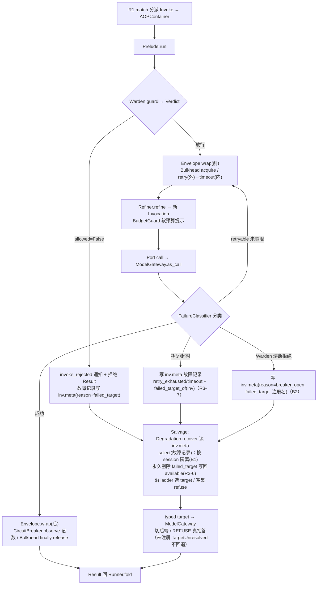

# R3：可靠性（resilience）

> **权威来源**：[《AGENT 总设计》](../../01-总览与设计/AGENT-总设计.md) §R3；`docs/01-总览与设计/扩展体系重构规格-20261120.md` P3/P4/P9；统一口径见 `overviews/2026-11-20/扩展体系重构-口径卡.md`。本文为模块级拆分详设。层：L1 能力插件 · 依赖：R1+R2 · 源码 `src/harness/resilience/` · 测试 `tests/r3/` · 门禁 key `r3`。
> **本次变更**：九个可靠性插件从旧扩展点迁入 AOP 五角色（P4）；降级链路单独按 P9 重构——删除旧信号链，但 **B1/B2/R3-6/R3-7 四个历史修复点的语义必须在 Degradation 实例上逐条复现**，不得简化为"贴个 Salvage 标签"。决策权集中 Degradation 实例（唯一裁决者）；先写单测锁四场景，再接 Salvage，最后才删旧实现。

---

## 1. 职责与边界

**做**：重试、熔断、降级、限流、舱壁、幂等、预算策略、watchdog/killswitch——全部是 AOP 增强器或 Lifecycle 插件，按角色注册进 `AOPContainer`，判决用 `Verdict`、通知用 `LifecycleBus`。
**不做**：内核预算硬强制（R1）、结构化输出修复（R4）。共享设施：失败分类表 + DimensionKey（按 provider/model/tool/tenant 隔离）。
**依赖方向**：插件/增强器 → 装配层 → 内核；内核零依赖扩展组件。R3 遵守三体系正交（Port/AOP/Lifecycle）：增强器只回答 how、通知只回答 when、降级目标消费由 R4 经 typed 路径完成（what 维度）。

**R3 角色映射（P4 表，CircuitBreaker 拆两角色仍算一个插件）**：

| 插件 | 新角色 | 说明 |
|------|--------|------|
| KillSwitch | Warden | 标志置位 → `Verdict(allowed=False)` |
| Watchdog | Warden | 循环命中 → 拒绝 + `invoke_rejected` 通知 |
| Idempotency | Warden | 幂等键命中 → 拒绝 |
| RateLimit | Warden | 令牌不足 → 拒绝 |
| CircuitBreaker.check | Warden | OPEN/半开超额 → 拒绝 |
| RetryPolicy | Envelope | 循环调 `next`，失败退避 |
| Timeout | Envelope | `wait_for` 包 `next` |
| Bulkhead | Envelope | acquire + `try/finally` release（替掉旧的 releases 回调） |
| CircuitBreaker.observe | Envelope | 后置记数，状态仍在实例 |
| BudgetGuard | Refiner | 不改 State，产新 `Invocation` |
| Degradation | Salvage | **见 P9，不得按本表简单迁移**：唯一裁决者，保四坑 |

---

## 2. 设计架构

### 2.1 增强器形态（AOP 五角色）

每个增强器实现对应 AOP 角色接口（定义见 `src/aop/protocols.py`，口径卡 §3）：

```python
class KillSwitch:                       # Warden
    name = "r3_killswitch"
    def __init__(self, *, flag_store=None, scope="session"): ...   # 构造注入配置与依赖
    async def guard(self, inv: Invocation) -> Verdict: ...
    # flag_store 置位 → Verdict(allowed=False, reason="killswitch")；容器发 invoke_rejected；不进降级

class RetryPolicy:                      # Envelope
    name = "r3_retry"
    async def wrap(self, inv: Invocation, next: Next) -> Result: ...
    # 循环调 next，失败退避；耗尽时把具名故障记录写入 inv.meta（含 failed_target，R3-7）

class BudgetGuard:                      # Refiner
    name = "r3_budgetguard"
    async def refine(self, inv: Invocation) -> Invocation: ...
    # 软阈值追加收尾提示，产新 Invocation，不改 State.messages
```

增强器**不自声明 priority**；执行顺序由容器固定（Prelude → Warden → Envelope(前) → Refiner → Port call → Envelope(后) → Salvage）。所有角色方法接收 `Invocation`（含 `meta` 具名数据），**不接收 ctx、不读裸键**——请求期协作数据只用 `Invocation.meta` 的具名记录，装配期配置由构造参数注入。

### 2.2 跨调用状态：增强器实例自身持有

跨调用状态不抽独立策略层——增强器注册一次、长期存活，状态直接放在实例上，天然跨调用：

| 增强器 | 自身持有的状态 | 状态方法 |
|--------|--------------|----------|
| `CircuitBreaker` | 异步 `BreakerStore` + 三态机（closed/open/half_open + 滑窗计数）+ 按维度 `asyncio.Lock`（C1） | `state()` / `check()` / `record()` / `maybe_half_open()` / `_lock_for()` |
| `Degradation` | `ladder` + `available` + **`dict[session_id, 状态]`（B1：按会话隔离的目标状态）** | `pick()` / `select(故障记录)` |

`CircuitBreaker` 构造时注入 `store`（缺省 `InMemoryBreakerStore`）与两个纯函数 `dimension_of(inv)` / `failed_target_of(inv)`（替代旧的裸键读取，维度与失败目标均从 `Invocation` 派生；失败目标必须是降级阶梯的后端注册名，B2 修复），所有状态读写 `await store.load/save(dim)`；`check`/`record` 经 `_lock_for(dim)` 加按维度 `asyncio.Lock`，把 load→decide→save 全临界区包住，异步 store（Redis/DB）并发不丢更新（C1；多进程部署需 store 端原子操作）。

`Degradation` 构造时传入 `ladder`（可选 `available`）并注入 `failed_target_of(inv)` 的等价来源——故障记录由上游增强器写入 `inv.meta`，其中 `failed_target` 必须是阶梯注册名（B2）。

`Bulkhead` 构造注入 `pool` 池名，用 `try/finally` 在 `wrap` 内成对的 acquire/release（E2 修复，不再依赖请求对象的释放回调表）；`Watchdog` 构造注入 `kinds` 白名单。

### 2.3 降级链路（P9 最高风险，四坑语义逐条保留）

> **铁律**：决策权集中到 `Degradation` 实例——它持有 `ladder` + `available` + 按会话隔离的目标状态，是降级的**唯一裁决者**。`Warden`/`Envelope` 只负责"发现故障并报告失败上下文"，**不做选级**。旧信号链删除，但四个坑的语义必须在 Degradation 实例上逐条复现。

**故障上下文直传，不经过多跳信号**：Warden/Envelope 检测到故障时，把一个**具名故障记录**写入 `Invocation.meta`，记录至少含 `reason: str` 与 `failed_target: str`（语义同 B2：降级阶梯里的**后端注册名**）。`Degradation.recover(exc, inv)` 读取该记录并调用实例内 `select(故障记录)` 选级。

**四个历史修复点（逐条不得简化、不得丢失）**：

1. **B1 · 按 `session_id` 隔离目标状态**：降级目标状态放在 `Degradation` 实例内的 `dict[session_id, 状态]`，按会话键隔离，跨 Effect 继承在同一会话内生效。**禁止退化为容器级单值 `current_target`**——否则多会话互相污染（全局单槽串味坑立刻重现）。
2. **B2 · `failed_target` 是后端注册名**：故障记录的 `failed_target` 必须是**降级阶梯里的后端注册名**，不是熔断维度二元组 `("provider", name)`，否则网关切不到后端、静默回退默认模型。`failed_target_of(inv)` 构造注入派生该值；网关侧未注册目标 → `TargetUnresolved`，绝不静默回退。
3. **R3-6 · `available` 永久剔除并写回**：选级时故障目标必须**永久从实例 `self.available` 剔除并写回实例状态**（非局部副本 discard），跨 Effect 累积收缩；否则 backup 故障后会重新选回 primary，永远到不了 REFUSE。全失败 → `"refuse"`。
4. **R3-7 · 故障记录携带 `failed_target`**：retry 耗尽 / timeout 的故障记录必须携带 `failed_target`（由构造注入的 `failed_target_of(inv)` 派生），`select()` 才能据此从 `available` 剔除；只写 reason 不选目标会剔除失败。

**链路步骤**：

1. `Warden`（killswitch/幂等/舱壁/限流/熔断）判定拒绝：终止类（killswitch/幂等）返回 `Verdict(allowed=False)` 直接终止；降级类故障把具名故障记录（`reason` + `failed_target`）写入 `inv.meta`，由容器短路（拒绝 Result + `invoke_rejected` 通知）。
2. `RetryPolicy` 耗尽 → 写 `inv.meta` 故障记录 `reason="retry_exhausted"` + `failed_target`；`Timeout` 超时 → `reason="timeout"` + `failed_target`（两者均由构造注入的 `failed_target_of(inv)` 派生，R3-7）。
3. `CircuitBreaker.check` 拒绝 → 故障记录 `reason="breaker_open"` + `failed_target`（注册名，非维度二元组，B2）。
4. `Degradation.recover(exc, inv)`（Salvage）读 `inv.meta` 故障记录 → 实例内 `select(故障记录)`：按 B1 取本会话状态、按 R3-6 永久剔除 `failed_target` 并写回 `available`、沿 ladder 由高 quality 向低选可用 target，空集 → `"refuse"`。返回带目标的结果，由 R4 经 typed 路径消费。
5. R4 网关从 typed 目标消费：`"refuse"` → 真拒答；后端注册名 → 切后端（未注册 → `TargetUnresolved`，不回退）。

**迁移执行顺序（规格 P9）**：① 先把旧链的三个语义（意图/选级/跨 Effect 继承）在 Degradation 实例上重新落点，写单测覆盖 B1/B2/R3-6/R3-7 四个历史场景；② 再把 Degradation 注册为 Salvage 接异常出口；③ 最后删旧实现，并保留端到端降级用例（R3-E01/E02/E03）作为回归门禁——**这些用例必须在新体系下继续通过，不许改断言放水**。

---

## 3. AOP 角色订阅关系

按容器固定顺序，R3 增强器落在以下角色（P4 表）：

| 角色 | R3 增强器 | 行为语义 |
|------|-----------|----------|
| `Prelude` | （预留：链路级 trace） | 最外层包裹 |
| `Warden` | KillSwitch / Watchdog / Idempotency / RateLimit / CircuitBreaker.check | 首个拒绝的 `Verdict(allowed=False)` 短路；故障写 `inv.meta` 具名记录（含 failed_target）→ 容器发 `invoke_rejected` |
| `Envelope` | RetryPolicy（外）、Timeout（内）、Bulkhead、CircuitBreaker.observe | 包裹 `next`；retry 外层、timeout 内层（每次尝试独立计时）；Bulkhead try/finally 释放；observe 后置记数 |
| `Refiner` | BudgetGuard | 软预算收尾提示，产新 Invocation，不改 State |
| `Salvage` | Degradation | 异常/失败出口读 `inv.meta` 故障记录 → 实例 `select()` 选 target（保 B1/B2/R3-6/R3-7） |

**洋葱顺序**：`Envelope` 中 RetryPolicy 先注册（外层），Timeout 后注册（内层），故 retry 包裹 timeout，timeout 包裹真实 Port 调用；每一次 retry 尝试都有独立超时。

---

## 4. 流程图



**四模块联通链**（必须端到端测试）：

```
Runner.run (R1)
  → match: Invoke → AOPContainer.call (R1→R2)
  → AOP: Prelude → Warden(拒绝→invoke_rejected) → Envelope(前) → Refiner → Port call → Envelope(后)
      中心 Port call = registry 解析 → ModelGateway.as_call (R2→R4)
  → 故障：Warden/Envelope 写 inv.meta 具名故障记录(reason + failed_target)
  → Salvage: Degradation.select(故障记录)（B1/B2/R3-6/R3-7）→ typed target
  → R4 消费 target：切后端 / REFUSE 真拒答 / TargetUnresolved 不回退 (R3→R4)
  → Result 回 Runner.fold (R2→R1)
```

### 4.1 关键字段（核心数据契约）

| 字段 | 归属 | 语义 |
|------|------|------|
| `Invocation.meta` 故障记录 | 请求期具名记录 | 含 `reason` + `failed_target`；failed_target 是降级阶梯后端注册名（B2），驱动 `available` 收缩与 R3-7 剔除 |
| `Effect.idempotency_key` | Invoke 具名字段 | 幂等去重键与副作用重试红线读此字段（非 payload/meta 动态键） |
| `CircuitBreaker` 三态 | 实例自身（长生命周期） | closed/open/half_open + 滑窗失败率，跨调用 |
| `CircuitBreaker.dimension_of/failed_target_of` | 构造参数（纯函数） | 从 `Invocation` 派生熔断维度与降级目标注册名（B2） |
| `CircuitBreaker._locks` | 实例自身 | 按维度 `asyncio.Lock`，保护 store 的 load→decide→save 临界区（C1） |
| `RetryPolicy/Timeout.failed_target_of` | 构造参数（纯函数） | 派生失败目标注册名写入故障记录，供 select 剔除（R3-7） |
| `Bulkhead.pool` / `Watchdog.kinds` | 构造参数 | 舱壁池名、watchdog 观察白名单 |
| `Degradation.available` / `dict[session_id, 状态]` | 实例自身（长生命周期） | 可用目标集（按 failed_target 永久剔除并写回，R3-6）+ 按会话隔离的目标状态（B1） |
| `RetrySpec` | 构造参数 | 退避/幂等红线/重试上限（领域逻辑，语义未变） |

---

## 5. API 规范

### 5.1 依赖的 AOP 原语（契约引用，定义见 `src/aop/` / 口径卡 §3）

```python
@dataclass(frozen=True)
class Invocation:
    effect: object; ctx: object; session: object
    meta: Mapping[str, object]      # 具名故障记录：{"fault": {"reason": str, "failed_target": str}}

Next = Callable[[Invocation], Awaitable[Result]]

@dataclass(frozen=True)
class Verdict:
    allowed: bool; reason: str = ""

class Warden(Protocol):
    name: str
    async def guard(self, inv: Invocation) -> Verdict: ...
class Envelope(Protocol):
    name: str
    async def wrap(self, inv: Invocation, next: Next) -> Result: ...
class Refiner(Protocol):
    name: str
    async def refine(self, inv: Invocation) -> Invocation: ...
class Salvage(Protocol):
    name: str
    async def recover(self, exc: Exception, inv: Invocation) -> Result: ...
# LifecycleBus/Notice 见 R2 §4；异常/拒绝时容器发 invoke_rejected 通知
```

### 5.2 R3 领域类型（保留的业务价值）

```python
@dataclass(frozen=True)
class FailureClass:
    retryable: bool
    count_toward_breaker: bool
    suggested_delay: float | None
    code: str

class FailureClassifier(Protocol):
    def classify(self, result: Result, inv: Invocation) -> FailureClass: ...   # 可读 inv.effect/ctx/meta 做上下文相关分类

@dataclass(frozen=True)
class RetrySpec:
    max_attempts: int = 3
    base_delay: float = 0.5
    multiplier: float = 2.0
    max_delay: float = 30.0
    jitter: Literal["none", "full", "equal", "decorrelated"] = "full"
    respect_retry_after: bool = True
    idempotency_required: bool = True

@dataclass(frozen=True)
class DegradeStep:
    target: str                    # 后端注册名 / 网关约定名（无枚举包装）
    mode: Literal["reroute", "cache", "fallback_value", "refuse"]
    quality: float                 # 1.0 最优 → 0.0 拒答
    max_latency_ms: int | None
    condition: str | None

@dataclass(frozen=True)
class DegradeLadder:
    steps: tuple[DegradeStep, ...] # 主→备→便宜→缓存→拒答；无环、末级必须是 refuse

class BreakerStore(Protocol):      # 熔断共享态（异步，可落 Redis/DB）
    async def load(self, dim: tuple[str, str]) -> BreakerState | None: ...
    async def save(self, dim: tuple[str, str], state: BreakerState) -> None: ...
class InMemoryBreakerStore: ...
@dataclass
class BreakerState:
    status: Literal["closed", "open", "half_open"]
    window: list[bool]
    half_open_probes: int = 0
    consecutive_successes: int = 0
```

### 5.3 Degradation 插件（Salvage，唯一裁决者；P9 四坑落点）

状态与方法直接在实例上（注册一次、长期存活），决策权集中此处：

```python
class Degradation:                      # Salvage
    name = "r3_degrade"
    def __init__(self, ladder: DegradeLadder,
                 available: set[str] | None = None,
                 *, session_state: dict[str, dict] | None = None): ...
    # ladder + available + 按会话隔离的目标状态 直接在实例上
    # B1：session_state: dict[session_id, 状态]，禁容器级单值；跨 Effect 在同一会话内继承

    def _session_state(self, session_id: str) -> dict: ...   # 取本会话状态切片（B1，缺失则建）

    def select(self, fault: FaultRecord, *, session_id: str) -> str:
        """唯一选级裁决：
        - 按 B1 取本会话状态（不读容器级单值）；
        - 按 R3-6 把 fault.failed_target 永久从 self.available 剔除并写回实例；
        - 沿 ladder 从高 quality 向低选 available 中仍可用且已注册的 target；
        - available 空 / 全失败 → 'refuse'。
        """
        ...

    async def recover(self, exc: Exception, inv: Invocation) -> Result:
        fault: FaultRecord = inv.meta["fault"]        # 具名故障记录（reason + failed_target）
        target = self.select(fault, session_id=inv.session.session_id)
        # typed 目标路径（替代旧的裸桥接字段）：与 Registry 同源的注册名写进具名 typed 记录，供 R4 消费
        inv.meta["routing_target"] = RoutingTarget(target=target, reason=fault.reason)
        return Result.success(target)
```

**typed 目标载体**（进网关的具名记录，替代旧裸桥接字段）：

```python
@dataclass(frozen=True)
class RoutingTarget:                # typed 降级目标（R3 产出 → R4 消费，与 Registry 同源）
    target: str                     # 后端注册名或 "refuse"
    reason: str
```

`FaultRecord` 具名记录（替代旧信号链，四坑语义载体）：

```python
@dataclass(frozen=True)
class FaultRecord:
    reason: str
    failed_target: str              # B2：降级阶梯后端注册名，非维度二元组；R3-7：retry/timeout 必须携带
```

> **B2 实现要点**：`failed_target` 由构造注入的 `failed_target_of(inv)` 派生为阶梯注册名；网关侧 `registry.resolve_llm(target)` 未命中 → `TargetUnresolved`，**绝不静默回退默认模型**。"为何降级"（reason）只进故障记录/trace，**不作为 target**——target 一律由 `select()` 从 ladder 注册名选出，避免自造标签导致网关找不到后端而静默回退。

### 5.4 其他插件（AOP 角色形态）

```python
class KillSwitch:                       # Warden（终止类）
    name = "r3_killswitch"
    def __init__(self, *, flag_store=None, scope="session"): ...
    async def guard(self, inv: Invocation) -> Verdict: ...
    # flag_store 置位 → Verdict(allowed=False, "killswitch")；不进降级

class Idempotency:                      # Warden（终止类）
    name = "r3_idempotency"
    def __init__(self, *, store=None, ttl=86400, clock=None): ...
    async def guard(self, inv: Invocation) -> Verdict: ...
    # 幂等键读 inv.effect.idempotency_key；重复副作用 → Verdict(allowed=False, "duplicate_side_effect")

class Watchdog:                         # Warden（终止类）
    name = "r3_watchdog"
    def __init__(self, *, window=10, repeat_k=3, detect_abab=True, kinds=None): ...
    async def guard(self, inv: Invocation) -> Verdict: ...   # 观测标识由 inv.effect 派生（port/type）

class RateLimit:                        # Warden
    name = "r3_ratelimit"
    def __init__(self, *, rate=60, burst=10, on_exceed="wait", clock=None): ...
    async def guard(self, inv: Invocation) -> Verdict: ...   # 令牌不足 → Verdict(allowed=False)；降级类故障写 inv.meta

class Bulkhead:                         # Envelope（acquire + try/finally release）
    name = "r3_bulkhead"
    def __init__(self, *, pools: dict | None = None, on_full="reject", pool: str = "default"): ...
    async def wrap(self, inv: Invocation, next: Next) -> Result:
        if not self.acquire(self._pool):
            self._write_fault(inv, "bulkhead_full", self._failed_target_of(inv))   # R3-7 带 failed_target
            return Result.failure("BULKHEAD_FULL", "bulkhead full")
        try:
            return await next(inv)
        finally:
            self.release(self._pool)

class CircuitBreaker:                   # Warden(check) + Envelope(observe)，状态在实例
    name = "r3_breaker"
    def __init__(self, *, store: BreakerStore | None = None,
                 dimension_of=None, failed_target_of=None, **thresholds): ...
    async def check(self, inv: Invocation) -> str | None: ...       # Warden：OPEN/半开超额 → 原因（健康 None）
    async def guard(self, inv: Invocation) -> Verdict: ...
    # check 返回原因 → 写 inv.meta 故障记录(reason="breaker_open", failed_target 注册名，B2) → Verdict(allowed=False)
    async def wrap(self, inv: Invocation, next: Next) -> Result: ...   # Envelope：后置记数 result
    async def observe(self, inv: Invocation, result: Result) -> None: ...
    # dimension_of/failed_target_of 构造注入：从 inv 派生维度与降级目标注册名（替代旧裸键；B2）

class BudgetGuard:                      # Refiner
    name = "r3_budgetguard"
    def __init__(self, *, soft=0.8, budgets=None): ...
    async def refine(self, inv: Invocation) -> Invocation: ...   # 软阈值追加收尾提示，产新 Invocation

class RetryPolicy:                      # Envelope（外层）
    name = "r3_retry"
    def __init__(self, *, max_attempts=3, base_delay=0.5, multiplier=2.0,
                 max_delay=30.0, jitter="full", respect_retry_after=True,
                 idempotency_required=True, rng=None, sleeper=None,
                 failed_target_of: Callable[[Invocation], str|None] | None = None): ...
    async def wrap(self, inv: Invocation, next: Next) -> Result: ...
    # 耗尽 → 写 inv.meta 故障记录(reason="retry_exhausted", failed_target=failed_target_of(inv))（R3-7）

class Timeout:                          # Envelope（内层）
    name = "r3_timeout"
    def __init__(self, *, timeout: float = 30.0,
                 failed_target_of: Callable[[Invocation], str|None] | None = None): ...
    async def wrap(self, inv: Invocation, next: Next) -> Result: ...
    # 超时 → 写 inv.meta 故障记录(reason="timeout", failed_target=failed_target_of(inv))（R3-7）
```

### 5.5 统一装配入口

```python
class ResilienceCapability:             # 生产装配统一入口
    def __init__(self, *, killswitch=None, watchdog=None, idempotency=None,
                 bulkhead=None, rate_limit=None, breaker=None, retry=None,
                 timeout=None, budget_guard=None, degradation=None,
                 extra_plugins: tuple[object, ...] = ()): ...
    def install(self, container: AOPContainer, bus: LifecycleBus, reg: Registry) -> None:
        # 插件 opt-in：不传（None）即不装；配置与跨调用状态随实例注册、长期存活
        # 按角色注册：Warden/Envelope/Refiner/Salvage 分别 add_*(p)；extra_plugins 契约从旧 Plugin 改为五角色之一
        ...
```

细调参数（clock/rng/ladder/soft/spec/store/dimension_of/failed_target_of/pool/kinds 等）由用户在**构造增强器实例时**自行传入；capability 不代构造、不隐式装默认。装配期校验：增强器 `name` 非空、角色接口齐全、Degradation 的 ladder 末级为 refuse。

---

## 6. 领域逻辑（R3 业务价值）

### 6.1 失败分类表（共享给重试与熔断）

| 错误 | retryable | count_toward_breaker |
|------|-----------|---------------------|
| 429 / RATE_LIMITED | 是 | 否（对方正常保护） |
| 500/502/503/TIMEOUT/CONN_RESET | 是 | 是 |
| 400/401/403/PORT_MISSING | 否 | 否（确定性错误） |
| SCHEMA_INVALID | 是 | 否 |

### 6.2 退避算法

```
delay(n) = min(max_delay, base_delay × multiplier^(n-1))
  none:          raw
  full:          uniform(0, raw)            # 最常用，防重试风暴
  equal:         raw/2 + uniform(0, raw/2)
  decorrelated:  min(max_delay, prev × uniform(1,3))   # AWS 推荐
若服务端给 Retry-After：取 max(raw, server_hint)。
```
校验：`base_delay=0` 且 `jitter="none"` 装配期拒绝。

### 6.3 幂等红线

副作用操作必须有幂等键才允许重试；无幂等键的副作用在 `RetrySpec.idempotency_required=True` 下禁止重试（Idempotency 读 `inv.effect.idempotency_key` 具名字段，返回 `Verdict(allowed=False, "duplicate_side_effect")`）。用注入 clock 对 dedup store 做 TTL 真淘汰。

### 6.4 watchdog 循环检测

观测标识由 `inv.effect` 派生（port/type；可用 `kinds` 构造参数限定）。`detect_abab=True` 时，滑窗内出现 A-B-A-B 交替或同一结果重复 `repeat_k` 次 → `Verdict(allowed=False, "watchdog:repeat"/"watchdog:abab")` 终止。

### 6.5 killswitch flag

`flag_store` 置位即 Warden 首判短路（终止类拒绝），用于人工一键停服。scope 可为 session/global。

### 6.6 预算语义

软预算（`BudgetGuard`，Refiner，产新 Invocation）达 `soft` 阈值时在上下文文本尾部追加收尾提示，提示模型收敛；**内核预算硬强制属 R1**，R3 不截断、不强制结束。两者分工：R3 软引导，R1 硬限制。

### 6.7 熔断三态机（状态在 CircuitBreaker 实例，异步 store）

```
   失败率≥阈值 且 样本≥minimum_samples
CLOSED ─────────────────────────────► OPEN
   ▲                                    │ 冷却期届满
   │ 探测失败                          ▼
   └──────── HALF_OPEN ◄───────────────┘
              │ 连续 N 次成功
              └──────────► CLOSED
```

- 滑窗 `failure_rate = failures/len(window)`；样本 < `minimum_samples` 时绝不 open。
- HALF_OPEN 最多放行 `half_open_max_probes` 个探测；连续 `half_open_success_to_close` 次成功才回 CLOSED。
- OPEN / 半开超额 → Warden 写故障记录 `reason="breaker_open"` + `failed_target`（由构造注入的 `failed_target_of(inv)` 从 inv 派生，默认取 port/模型注册名，**B2：不能用维度二元组当目标**）→ `Verdict(allowed=False)` 短路。"为何降级"只进故障记录/trace，不作为 target——target 由 Degradation 实例 `select()` 从 ladder 注册名选出。
- 熔断状态跨会话共享 → 必须落共享 store（多实例部署不可用进程内存）；`load/save` 均为 async；`check/record` 全程在按维度 `asyncio.Lock` 临界区内完成 load→decide→save（C1；多进程需 store 端原子操作）。

### 6.8 降级矩阵（P9 四坑落点复核）

```
主模型 → 备模型 → 便宜模型 → 语义缓存 → 明确拒答
每级 DegradeStep 带 target(后端注册名) / quality(1.0→0.0) / max_latency_ms / condition；末级必须是 refuse（禁止编造）；链必须无环。
```

`target` 直接取 `DegradeStep.target` 字符串与注册名约定，不使用任何枚举包装。四坑在本节的落点：

| 坑 | 落点 | 不可退化的约束 |
|----|------|----------------|
| B1 | `Degradation.session_state: dict[session_id, 状态]`，`select(fault, session_id)` | 禁容器级单值 current_target；按会话隔离跨 Effect 继承 |
| B2 | `FaultRecord.failed_target` = ladder 后端注册名；`failed_target_of` 注入 | 禁维度二元组；未注册目标 → `TargetUnresolved` 不回退 |
| R3-6 | `select()` 中 `self.available.discard(fault.failed_target)` 写回实例 | 禁局部副本 discard；全失败才 REFUSE |
| R3-7 | Retry/Timeout/Bulkhead/Breaker 写故障记录必带 `failed_target_of(inv)` | 禁只写 reason 不选目标 |

---

## 7. 可插拔契约

| 注入点 | 类型 | 默认 | 校验 |
|--------|------|------|------|
| 增强器装配 | AOP 五角色注册（`container.add_*`） | 不装（opt-in） | name 非空、角色接口齐全 |
| 失败分类 | `FailureClassifier` | 内置分类表 | code 覆盖完整 |
| 退避 | `RetrySpec.jitter` | `full` | `base_delay=0` 且 `none` 拒绝 |
| 降级链 | `DegradeLadder` | LLM 阶梯 | 无 refuse 兜底 / 成环 → 装配期拒绝 |
| 熔断共享态 | `BreakerStore`（异步 load/save） | `InMemoryBreakerStore` | 多实例注入 Redis/DB 实现 |

**设计纪律**：新增防线增强器时实现对应 AOP 角色接口并在 `ResilienceCapability` 构造签名加 `xxx | None = None` 参数；opt-in 不传不装。

**R4 衔接契约（断点修复，必须满足）**：

- `Degradation.select()` 产出的 target 写进 `Invocation.meta["routing_target"]`（`RoutingTarget` typed 记录，与 Registry 同源）并经 `Result` 交 R4；R4 从该 typed 记录按路径消费，不读任何裸键桥接字段。
- `_resolve_llm`：`target == "refuse"` → 返回拒答执行器，**绝不回退默认模型**；未注册目标 → `TargetUnresolved`，不回退。
- `ModelCapability` 必须构造并传入 `ModelRegistry`（注册 llm/router/cache），使降级 target 可被解析。
- AOP/Lifecycle 共用 Registry 与 ModelRegistry 同源：`select()` 写出的 target 与网关注册名一致。

---

## 8. 模块内闭环核对（CL-1~CL-5）

| 条件 | 实现 | 证据 |
|------|------|------|
| CL-1 契约自足 | 只依赖 R1 types + AOP 五角色接口 | import 扫描 |
| CL-2 自带 fake | fake FailureClassifier / BreakerStore / flag_store | fake 用例 |
| CL-3 自带测试 | `tests/r3/` 覆盖门禁、降级四坑与端到端链路 | 覆盖率报告 |
| CL-4 独立 demo | `make demo-r3` 演示五道防线 + 降级链路 | demo 冒烟 |
| CL-5 文档自足 | 本文 + AGENT-总设计对应章节 | 文档评审 |

---

## 9. 验收标准

1. 退避区间/上限/幂等拦截/预算拦截各有用例；
2. 熔断三态迁移、半开探测、样本不足不 open、异步 store 真读写；
3. 全不可用 → 明确拒答；降级链成环装配期报错；
4. watchdog 检测重复 / A-B 交替并拒绝；
5. 增强器按 AOP 固定角色顺序执行，trace 可见；Degradation.select 读故障记录选 target；
6. 端到端：熔断/限流/重试耗尽 → 降级 → 网关切后端；REFUSE → 真拒答（不回退）。
7. **降级四坑回归**：B1（两会话目标互不污染）、B2（failed_target 是注册名、未注册 TargetUnresolved 不回退）、R3-6（backup 故障后不回选 primary、全失败到 REFUSE）、R3-7（retry/timeout 故障记录带 failed_target）四场景单测全绿；
8. 端到端降级用例（E01/E02/E03）在新体系下继续通过，断言不放水。

---

## 10. 功能验证矩阵

| 功能点 | 用例 ID | 验证方式 | 通过标准 |
|--------|---------|---------|---------|
| 重试成功 | R3-T01 | `pytest tests/r3/test_retry.py -q` | 429 后重试 1 次，退避在 jitter 区间 |
| 重试耗尽 | R3-T02 | 同上 | 到 max_attempts，写 inv.meta 故障记录(retry_exhausted, failed_target) |
| 幂等拦截 | R3-T03 | 同上 | 无幂等键副作用不重试 |
| 熔断三态 | R3-T04 | `pytest tests/r3/test_breaker.py -q` | closed→open→half_open→closed；store.load/save 被调用 |
| 样本不足 | R3-T05 | 同上 | 1 次失败不 open |
| 降级链 | R3-T06 | `pytest tests/r3/test_degrade.py -q` | 全失败→refuse；成环装配期报错 |
| B1 会话隔离 | R3-T06b | `pytest tests/r3/test_degrade.py -q` | 两会话目标互不污染（dict[session_id] 隔离，非容器级单值） |
| R3-6 永久剔除 | R3-T06c | 同上 | backup 故障后不回选 primary；available 写回实例；全失败到 REFUSE |
| R3-7 带目标 | R3-T06d | 同上 | retry/timeout 故障记录携带 failed_target，据此剔除 |
| B2 注册名 | R3-T06e | `pytest tests/r3/test_e2e_degrade.py -q` | failed_target 是阶梯注册名；未注册→TargetUnresolved 不回退 |
| 循环检测 | R3-T07 | `pytest tests/r3/test_degrade.py -q` | ABAB 第 k 次拒绝 |
| 超时控制 | R3-T14 | `pytest tests/r3/test_timeout.py -q` | 超时写故障记录(timeout, failed_target)、未超时透传 |
| 熔断共享存储 | R3-T15 | `pytest tests/r3/test_breaker_store.py -q` | 异步 store load/save 真被调用、缺省内存实现可用 |
| 端到端降级：熔断 | R3-E01 | `pytest tests/r3/test_e2e_degrade.py -q` | 熔断/限流 → 故障记录 → Salvage → 网关切后端，trace 连贯 |
| 端到端降级：限流 | R3-E02 | 同上 | 限流超限 → 降级 → 网关切后端 |
| 端到端降级：重试耗尽 | R3-E03 | 同上 | 重试耗尽 → 降级 → 网关切后端 |
| REFUSE 真拒答 | R3-E04 | 同上 | target=refuse → 拒答执行器，绝不回退默认模型 |
| 独立闭环 | R3-D01 | `make demo-r3` + gate | demo + 门禁 |

---

## 11. 门禁清单

| 门禁 | 条目 | 达标标准 | 级别 |
|------|------|---------|------|
| R3-G1 | 覆盖 | 各增强器单测 ≥90% | G1 |
| R3-G2 | 重试/熔断/降级 | 各自语义用例全过（含异步 store、ladder 选级） | G2 |
| R3-G3 | 协同 | 增强器按固定角色顺序执行，Degradation.select 选级 trace 可见；四门禁各用例全过、demo PASS | G3 |
| R3-红线 | 幂等 / 无环 / 真拒答 | 无幂等键副作用不重试；降级成环→拒绝；REFUSE 不回退默认模型 | 红线 |
| R3-红线 | 降级四坑 | B1/B2/R3-6/R3-7 四场景单测全绿；端到端降级用例断言不放水 | 红线 |
| R3-静态 | 无过时残留 | grep 无旧信号链相关符号与裸键（旧词仅在"删除/旧"语境出现）；不得出现容器级单值降级目标 | 静态 |

**门禁符号（gate_check r3 必须出现）**：`Warden` / `Envelope` / `Refiner` / `Salvage` / `Invocation` / `Verdict` / `AOPContainer` / `invoke_rejected` / `Degradation` / `select` / `FaultRecord` / `failed_target` / `available` / `DegradeLadder` / `CircuitBreaker` / `RetryPolicy` / `Timeout` / `Bulkhead` / `BudgetGuard` / `KillSwitch` / `Watchdog` / `Idempotency` / `RateLimit` / `BreakerStore`。

---
*R3 模块详设 · 派生自 AGENT-总设计与《扩展体系重构规格（2026-11-20）》P3/P4/P9 · 门禁 key=r3 · 本次变更：九插件按 P4 迁入 AOP 五角色；降级链路按 P9 换宿主（Degradation=Salvage 唯一裁决者、故障上下文写 Invocation.meta 具名记录、删旧信号链），并逐条保留 B1（按 session_id 隔离、禁容器级单值）/B2（failed_target 为阶梯后端注册名、未注册 TargetUnresolved 不回退）/R3-6（available 永久剔除并写回实例）/R3-7（retry/timeout 故障记录携带 failed_target）四坑语义；先单测锁四场景→接 Salvage→最后删旧实现，端到端降级用例断言不放水*
