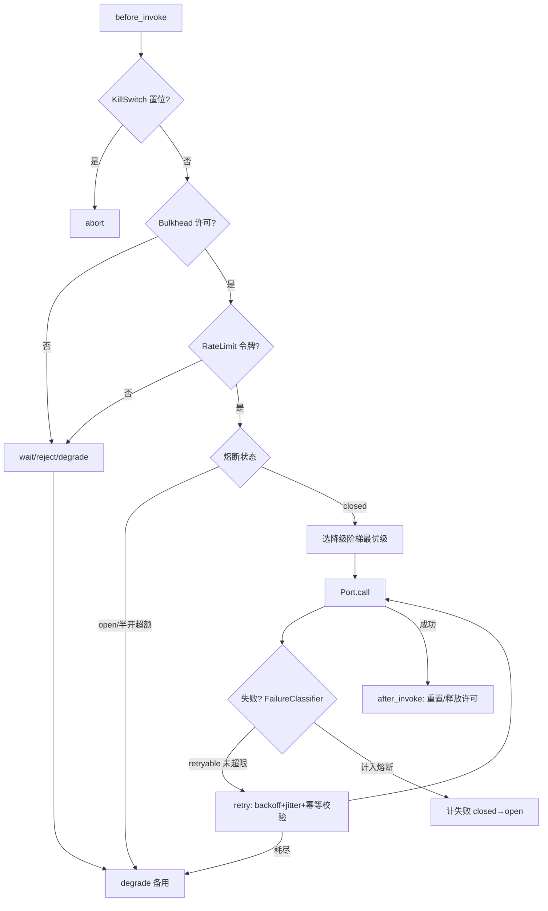

# R3：可靠性（resilience）

> **实现状态**：已实现（R3 v1.0）。源码 `src/harness/resilience/`，测试 `tests/r3/`（53 用例），门禁 key `r3`。
> 独立 demo：`tests/demos/demo_r3.py`。失败分类/退避/熔断三态/降级/限流/舱壁/幂等/watchdog/killswitch 全部落地。

> **权威来源**：[《AGENT 总设计》](../../01-总览与设计/AGENT-总设计.md) §R3。本文为模块级拆分详设。
> 层：L1 能力插件 · 依赖：R1+R2 · 源码包：`src/harness/resilience/`（已实现）· 门禁 key：r3

---

## 1. 职责与边界

**做**：重试、熔断、降级、限流、舱壁、幂等、预算策略、watchdog/killswitch——全部是 Hook 插件，返回 Decision。
**不做**：内核预算硬强制（R1）、结构化输出修复（R4）。共享设施：失败分类表 + DimensionKey（按 provider/model/tool/tenant 隔离）。

## 2. 设计架构

五道防线叠加，各防不同故障，通过事件联动。插件顺序由 priority 保证确定性：`before_invoke`: killswitch→bulkhead→ratelimit→breaker→degrade；`invoke_error`: retry 判定→breaker 计数。全部能力是插件，内核零策略。

## 3. 流程图



## 4. API 规范（完整接口）

```python
@dataclass(frozen=True)
class FailureClass:
    retryable: bool; count_toward_breaker: bool
    suggested_delay: float|None; code: str
class FailureClassifier(Protocol):
    # ctx: HookCtx —— 分类器可读 effect/state/trace 做上下文相关分类；
    # R3 本就依赖 R2（分层纪律允许），代码 src/harness/resilience/types.py 已对齐此签名。
    def classify(self, result: Result, ctx: HookCtx) -> FailureClass: ...

@dataclass(frozen=True)
class RetrySpec:
    max_attempts=3; base_delay=0.5; multiplier=2.0; max_delay=30.0
    jitter: Literal["none","full","equal","decorrelated"]="full"
    respect_retry_after=True; idempotency_required=True

class CircuitBreaker:   # Hook
    def __init__(self, failure_rate=0.5, minimum_samples=5, window_size=20,
                 open_cooldown_s=30, half_open_max_probes=3, per_dimension=True): ...
class Degradation:      # Hook
    def __init__(self, ladder: DegradeLadder): ...
class RateLimit:        # Hook
    def __init__(self, algorithm="token_bucket", rate=60, burst=10, on_exceed="wait"): ...
class Bulkhead:         # Hook
    def __init__(self, pools: dict, acquire_timeout=5, on_full="reject"): ...
class Idempotency:      # Hook
    def __init__(self, dedup_store: StorePort, ttl=86400): ...
class Watchdog:         # Hook
    def __init__(self, window=10, repeat_k=3, detect_abab=True): ...
class KillSwitch:       # Hook
    def __init__(self, flag_store, scope="session"): ...
class BudgetGuard(Hook):
    def __init__(self, soft=0.8): ...

@dataclass(frozen=True)
class DegradeLadder:
    steps: tuple[DegradeStep,...]   # 主→备→便宜→缓存→拒答（无环，带 quality 分）
@dataclass(frozen=True)
class DegradeStep:
    target: str; mode: Literal["reroute","cache","fallback_value","refuse"]
    quality: float; max_latency_ms: int|None; condition: str|None
```

**实现映射（v2.1）**：设计契约与落地类一一对应——默认失败分类 `FailureClass` / 可注入 `FailureClassifier`；
退避载体 `RetrySpec` + 重试插件 `RetryPolicy`（AROUND）；熔断 `CircuitBreaker`；阶梯 `DegradeLadder` + 降级插件 `Degradation`；
其余防线 `RateLimit` / `Bulkhead` / `Idempotency` / `Watchdog` / `KillSwitch`；一键装配 `ResilienceCapability`。

## 5. 元数据与关键字段（核心字段）

| 字段 | 说明 |
|------|------|
| DimensionKey | (维度类型, 目标名)，如 ("provider","openai") |
| attempt | 当前重试次数，HookCtx 携带，受 Budget.max_rounds 约束 |
| BreakerState.status | closed/open/half_open 三态 |
| failure_rate | 滑窗失败率，达阈值+样本足够才 open |
| DegradeStep.quality | 1.0 最优 → 0.0 拒答，进 trace 用于评测质量损失 |
| idempotency_key | 副作用操作幂等键，重试/恢复去重 |

**退避算法**：`delay(n)=min(max_delay, base_delay×multiplier^(n-1))` + jitter（full 最常用）；尊重 Retry-After。
**默认失败分类**：429 重试不算熔断；500/502/503/TIMEOUT/CONN_RESET 重试且算熔断；400/401/403/PORT_MISSING 不重试。

## 5.5 关键算法与状态机（自查补齐）

### 退避算法（重试）
```
delay(n) = min(max_delay, base_delay × multiplier^(n-1))
  none:        raw
  full:        uniform(0, raw)          # 最常用，防重试风暴
  equal:       raw/2 + uniform(0, raw/2)
  decorrelated: min(max_delay, prev × uniform(1,3))   # AWS 推荐
若服务端给 Retry-After：取 max(raw, server_hint)。
```
### 失败分类表（共享给重试与熔断）
| 错误 | retryable | count_toward_breaker |
|------|-----------|---------------------|
| 429 / RATE_LIMITED | 是 | 否（是对方正常保护） |
| 500/502/503/TIMEOUT/CONN_RESET | 是 | 是 |
| 400/401/403/PORT_MISSING | 否 | 否（确定性错误） |
| SCHEMA_INVALID | 是 | 否 |

### 熔断三态机
```
   失败率≥阈值 且 样本≥minimum_samples
CLOSED ─────────────────────────────► OPEN
   ▲                                    │ 冷却期届满
   │ 探测失败                          ▼
   └──────── HALF_OPEN ◄───────────────┘
              │ 连续 N 次成功
              └──────────► CLOSED
```
- 滑窗 `failure_rate = failures/len(window)`；样本 < minimum_samples 时绝不 open（防误判）。
- HALF_OPEN 最多放行 `half_open_max_probes` 个探测；连续 `half_open_success_to_close` 次成功才回 CLOSED。
- 熔断状态跨会话共享 → 必须落共享 store（多实例部署不能用进程内存）。

### 降级矩阵
```
主模型 → 备模型 → 便宜模型 → 语义缓存 → 明确拒答
每级带 quality 分(1.0→0.0)与 max_latency_ms；末级必须是拒答（禁止编造）；链必须无环。
```

## 6. 可插拔契约

| 注入点 | 协议 | 默认 | 校验 |
|--------|------|------|------|
| 失败分类 | FailureClassifier | 默认表 | code 覆盖完整 |
| 退避 | RetrySpec.jitter | full | base_delay=0 且 none 拒绝 |
| 降级链 | DegradeLadder | LLM 阶梯 | 无拒答兜底/成环→拒绝 |
| 熔断共享态 | store | 进程内 | 多实例部署必须共享存储 |

## 7. 模块内闭环核对（CL-1~CL-5）

| 条件 | 实现 | 证据 |
|------|------|------|
| CL-1 契约自足 | 只依赖 R1 types + R2 Hook/Decision | import 扫描 |
| CL-2 自带 fake | fake FailureClassifier/StorePort | fake 用例 |
| CL-3 自带测试 | tests/r3/ 覆盖门禁 | 覆盖率报告 |
| CL-4 独立 demo | `make demo-r3` 演示五道防线 | demo 冒烟 |
| CL-5 文档自足 | 本文 + AGENT-总设计对应章节 | 文档评审 |

## 8. 验收标准

1. 退避区间/上限/幂等拦截/预算拦截各有用例；
2. 熔断三态迁移、半开探测、样本不足不 open；
3. 全不可用→明确拒答，降级链成环装配期报错；
4. watchdog 检测重复/A-B 交替并 abort；
5. 五插件按 priority 顺序执行，trace 可见。

## 9. 功能验证矩阵

| 功能点 | 用例 ID | 验证方式 | 通过标准 |
|--------|---------|---------|---------|
| 重试成功 | R3-T01 | `pytest tests/r3/test_retry.py -q` | 429 后重试 1 次，退避在 jitter 区间 |
| 重试耗尽 | R3-T02 | 同上 | 到 max_attempts，触发 exhausted |
| 幂等拦截 | R3-T03 | 同上 | 无幂等键副作用不重试 |
| 熔断三态 | R3-T04 | `pytest tests/r3/test_breaker.py -q` | closed→open→half_open→closed |
| 样本不足 | R3-T05 | 同上 | 1 次失败不 open |
| 降级链 | R3-T06 | `pytest tests/r3/test_degrade.py -q` | 全失败→拒答；成环装配期报错 |
| 循环检测 | R3-T07 | `pytest tests/r3/test_watchdog.py -q` | ABAB 第 k 次 abort |
| 协同顺序 | R3-T08 | trace 快照 | 五插件按 priority 留名 |
| 独立闭环 | R3-D01 | `make demo-r3` + gate | demo+门禁 |

## 10. 门禁清单

| 门禁 | 条目 | 达标标准 | 级别 |
|------|------|---------|------|
| R3-G1 | 覆盖 | 各插件单测 ≥90% | G1 |
| R3-G2 | 重试/熔断/降级 | 各自语义用例全过 | G2 |
| R3-G3 | 协同 | 五插件 priority 顺序 trace 可见 | G3 |
| R3-红线 | 幂等/无环 | 无幂等键副作用重试/降级成环→拒绝 | 红线 |

---
*R3 模块详设 v2.1 · 派生自 AGENT-总设计 · 已实现（代码见 src/harness/resilience/）*