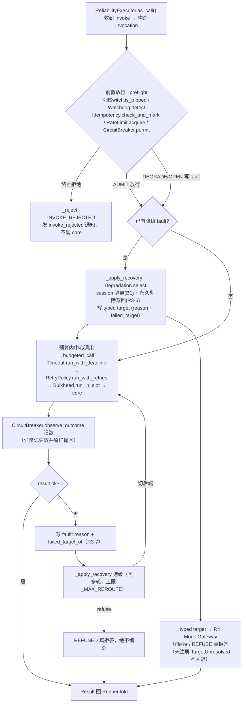

# R3：可靠性（resilience）

> **权威来源**：[《AGENT 总设计》](../../01-总览与设计/AGENT-总设计.md) §R3；`.conductor/ledgers/2026-11-22-r3-derole-migration-card.md`（去角色化迁移卡，含新 API 契约与映射）；已迁移全绿测试 `tests/r3/test_e2e_degrade.py`、`tests/r3/test_capability.py`。层：L1 工具层 · 依赖：R1 + 组合层 · 源码 `src/harness/resilience/` · 测试 `tests/r3/` · 门禁 key `r3`。
> **本次变更（2026-11-22 去角色化重写，推翻而非打补丁）**：用户审计确认 CompositeCall 只是 AOPContainer 改名，要求五角色语义（名字 + 相似逻辑）从代码与文档**彻底消失**。R3 现为 **9 领域策略 + `ReliabilityExecutor` 显式编排 + `ResilienceCapability` 具名构造注入**：`src/compose/chain_roles.py`/`call_chain.py`/`adapters.py` 与 `AOPContainer` 别名已物理删除；`compose.call` 的 `Guard`/`with_guard`/`Verdict` 与 `compose.guards` 的 `DegradationGuard`/`degrade_retry` 等拦截协议/DTO **亦已删除**（不再有"仅 R12 依赖、保留"的旧边界），`build_call(base, *, decorators=())`/`dispatch`/`make_dispatch` 保留为函数式装饰器装配入口，只收函数式装饰器。每个策略以**自身的领域方法**参与（如 `KillSwitch.is_tripped` / `RateLimit.acquire` / `CircuitBreaker.permit` / `Degradation.select`），**没有统一 `guard()/wrap()/recover()/observe()` 协议、没有 Role 枚举、没有角色槽位列表**。
> **门禁红线**：既有 R3 端到端降级用例（四坑）**原样通过、不许改断言放水**（迁移卡 §四坑断言不放水）。任何回归停下重审。

---

## 1. 职责与边界

**做**：重试、熔断、降级、限流、舱壁、幂等、watchdog/killswitch——以 9 个领域策略实现，由 `ReliabilityExecutor` 按可靠性工程语义显式编排：

```
前置放行 → 预算内中心调用（超时/重试/舱位）→ 熔断记数 → 失败降级选级 + 重路由
```

**不做**：R1 内核预算硬强制（⑦）、结构化输出修复（R4）。共享设施：失败分类表 `FailureClass` + `DimensionKey`（按 provider/model/tool/tenant 隔离）。
**依赖方向**：工具层 → 组合层（call）→ R1；R1 零依赖上层。降级目标由 `ReliabilityExecutor` 写入 `Invocation` 的 `routing_target`，由 R4 经 typed 路径消费（⑤Port）。

### 1.1 9 领域策略 → 领域方法映射（去角色化后的真实 API）

| 领域策略 | 执行器调用的领域方法 | 领域语义 | 保留的领域方法/构造（测试直接用，勿删） |
|---------|---------------------|---------|----------------------------------------|
| `KillSwitch` | `is_tripped(session_id) -> bool` | 置位即终止拒绝 | — |
| `Watchdog` | `detect(inv) -> bool` | 命中重复 / A-B 交替即终止拒绝 | `inspect(kind) -> bool` |
| `Idempotency` | `check_and_mark(key) -> bool` | 窗口内重复副作用即终止拒绝 | — |
| `RateLimit` | `acquire() -> RatePermit` | ADMIT 放行 / REJECT 终止 / DEGRADE 写 fault | 构造 `on_exceed`/`rate`/`burst`/`clock` |
| `Bulkhead` | `run_in_slot(inv, next) -> Result` | 占槽 → 下一跳 → `finally` 释放 | `acquire(pool)` / `release(pool)` |
| `CircuitBreaker` | `permit(inv) -> str \| None` + `observe_outcome(inv, result)` | OPEN/半开超额写 fault 交降级；调用后记数 | `check(dim)` / `record(result, dim)` / `state` / `maybe_half_open` |
| `RetryPolicy` | `run_with_retries(inv, next) -> Result` | 退避重放；耗尽写 fault（R3-7） | 构造参数（原 `failed_target_of` 改名 `target_of`） |
| `Timeout` | `run_with_deadline(inv, next) -> Result` | 调用级超时；超时写 fault（R3-7） | 构造参数（原 `failed_target_of` 改名 `target_of`） |
| `Degradation` | 执行器内联 `_apply_recovery` 调 `select(fault, session_id) -> str` | 唯一选级裁决，保四坑 | `select` / `pick` |

- **`RatePermit`** 是 `harness.resilience` 的领域枚举：`ADMIT` / `REJECT` / `DEGRADE`（从 `harness.resilience` 或 `.defenses` 导入）。
- **`failed_target_of(inv) -> str`** 是 `defenses.py` 的公开领域纯函数，取代各插件私有 `_failed_target_of`；产出降级阶梯后端注册名（B2）。
- **`Verdict` 不再是 R3 插件的返回类型**；R3 测试中的 `from compose.context import Verdict` 一律删除。

---

## 2. 设计架构

### 2.1 ReliabilityExecutor：显式编排（无角色协议）

`ReliabilityExecutor` 持具名领域策略字段，全部 opt-in——传实例才参与，`None` 即该领域能力缺席（**不写空实现/占位策略**）。执行器用显式代码把领域方法按可靠性工程语义串成一次可靠调用：

```python
class ReliabilityExecutor:
    def __init__(self, core, *, registry=None, bus=None, notify=None,
                 kill_switch=None, watchdog=None, idempotency=None,
                 rate_limit=None, bulkhead=None, breaker=None,
                 retry=None, timeout=None, degradation=None,
                 transformers=()): ...
    def as_call(self) -> CallFn: ...                       # 注入 R1 Runner（构造 Invocation，R1 零感知）
    async def run_invocation(self, inv: Invocation) -> Result: ...   # 测试入口
```

一次调用的显式步骤（源码 `executor.py`）：

1. `_preflight(inv)`：`KillSwitch.is_tripped` → `Watchdog.detect` → `Idempotency.check_and_mark` 任一命中即 `_reject`（`INVOKE_REJECTED` + `invoke_rejected` 通知，不调 core）；`RateLimit.acquire` 为 REJECT 终止 / DEGRADE 写 fault；`CircuitBreaker.permit` 返回 reason 写 fault。
2. 前置已写 fault（限流/熔断降级类）但尚无 typed target → `_apply_recovery` 先选级写 target，让中心调用直接用降级目标（保 B1/B2）。
3. `_budgeted_call(inv)`：按 **超时（最内）→ 重试（中）→ 舱位（最外）** 包裹 core；函数式变换器 `extra_plugins` 包在最外层；有 `breaker` 时用 `observe_outcome` 记数，**异常按失败记数并原样抛回（不吞异常）**。
4. 失败则写 fault → `_apply_recovery` 选级 → 清 fault → 再跑 `_budgeted_call`，最多 `_MAX_REROUTE=8` 轮（防阶梯成环/异常配置死循环）。
5. `result` 非 ok 时发一次 `invoke_rejected`（`meta["_rejected_emitted"]` 去重）。

> **无角色分派**：没有 `guard()/wrap()/recover()` 统一协议，没有 `Role` 枚举或五槽位列表，策略不声明 priority。装配由 `ResilienceCapability.install()` 用 opt-in 构造注入完成。

### 2.2 跨调用状态：领域策略实例自身持有

跨调用策略状态不抽独立策略层——策略实例注册一次、长期存活，状态直接放实例上；**单次流程进度不进策略实例**（那是 A 类算子 + `State.scratch x-*` 的职责）：

| 领域策略 | 自身持有的状态（跨调用策略状态） | 领域方法 |
|---------|--------------------------------|---------|
| `CircuitBreaker` | 异步 `BreakerStore` + 三态机（closed/open/half_open + 滑窗计数）+ 按维度 `asyncio.Lock` | `permit` / `observe_outcome` / `state` / `check` / `record` / `maybe_half_open` |
| `Degradation` | `ladder` + `available` + `dict[session_id, 状态]`（B1：按会话隔离的目标状态） | `select(fault, session_id)` / `pick` |
| `RateLimit` | 令牌桶 tokens + 注入 `clock` | `acquire()` |
| `Bulkhead` | `pools` 池计数 + `pool` 名 | `acquire(pool)` / `release(pool)` / `run_in_slot` |
| `Idempotency` | 去重 store + TTL | `check_and_mark(key)` |
| `Watchdog` | 观察历史滑窗 + `kinds` 白名单 | `detect(inv)` / `inspect(kind)` |
| `KillSwitch` | 外部 `flag_store` + `scope` | `is_tripped(session_id)` |

`CircuitBreaker` 构造时注入 `store`（缺省 `InMemoryBreakerStore`）与纯函数 `dimension_of` / `target_of`（维度与失败目标均从 inv 派生；失败目标必须是降级阶梯后端注册名，B2），`check`/`record` 在按维度 `asyncio.Lock` 内完成 load→decide→save（C1；多进程部署需 store 端原子操作）。`Degradation` 构造时传入 `ladder`（可选 `available` / `session_state`）。时钟/存储显式注入，墙钟/随机不隐式进入，保证可测试、可回放。

### 2.3 降级链路（P9 最高风险，四坑语义逐条保留）

> **铁律**：决策权集中到 `Degradation` 实例——它持有 `ladder` + `available` + 按会话隔离的目标状态，是降级的**唯一裁决者**。执行器/其他策略只负责"发现故障并报告失败上下文"，**不做选级**。四坑语义必须在 `Degradation.select` 上逐条复现（原文保留、不放水）。

**故障上下文直传，不经过多跳信号**：执行器与各策略检测到故障时，调用 `inv.write_fault(FaultRecord(reason, failed_target))` 写具名故障记录；`_apply_recovery` 读 `inv.fault()` 并调用 `Degradation.select(fault, session_id=...)` 选级，再用 `inv.write_routing_target(RoutingTarget(target, reason))` 写 typed target。

**四个历史修复点（逐条不得简化、不得丢失）**：

1. **B1 · 按 `session_id` 隔离目标状态**：降级目标状态放在 `Degradation` 实例内的 `dict[session_id, 状态]`，按会话键隔离，跨 Effect 继承在同一会话内生效。**禁止退化为容器级单值 `current_target`**——否则多会话互相污染（全局单槽串味坑立刻重现）。
2. **B2 · `failed_target` 是后端注册名**：故障记录的 `failed_target` 必须是**降级阶梯里的后端注册名**，不是熔断维度二元组 `("provider", name)`，否则网关切不到后端、静默回退默认模型。`failed_target_of(inv)` 派生该值；网关侧未注册目标 → `TargetUnresolved`，绝不静默回退。
3. **R3-6 · `available` 永久剔除并写回**：选级时故障目标必须**永久从本会话 `available` 切片剔除并写回实例状态**（非局部副本 discard），跨 Effect 累积收缩；否则 backup 故障后会重新选回 primary，永远到不了 REFUSE。全失败 → `"refuse"`。
4. **R3-7 · 故障记录携带 `failed_target`**：retry 耗尽 / timeout / bulkhead / breaker 的故障记录必须携带 `failed_target`（由 `failed_target_of(inv)` 或构造注入的 `target_of` 派生），`select()` 才能据此从 `available` 剔除；只写 reason 不选目标会剔除失败。

**链路步骤**：

1. `_preflight` 判定终止类拒绝（`killswitch` / `watchdog:loop` / `duplicate_side_effect` / `rate_limited` REJECT）→ `_reject`（`INVOKE_REJECTED` + `invoke_rejected`）。
2. `_preflight` 降级类故障：`RateLimit.acquire` 为 DEGRADE → 写 `reason="rate_limited"` + `failed_target`；`CircuitBreaker.permit` 非 None → 写 `reason="breaker_open"` + `failed_target`（注册名，非维度二元组，B2）。
3. `_apply_recovery`：`Degradation.select(fault, session_id)` 按 B1 取本会话状态、按 R3-6 永久剔除 `failed_target` 并写回 `available`、沿 ladder 由高 quality 向低选可用 target，空集 → `"refuse"`；写 `RoutingTarget(target, reason=fault.reason)`。
4. `_budgeted_call`：`RetryPolicy.run_with_retries` 耗尽 → 写 `reason="retry_exhausted"` + `failed_target`；`Timeout.run_with_deadline` 超时 → `reason="timeout"` + `failed_target`（R3-7）；`CircuitBreaker.observe_outcome` 后置记数。
5. 失败 → 循环重跑：`_apply_recovery` 选级 → 清 fault → 重跑；`target == "refuse"` → `Result.failure("REFUSED", ...)` 真拒答，绝不编造。
6. R4 网关从 typed target 消费：`"refuse"` → 真拒答；后端注册名 → 切后端（未注册 → `TargetUnresolved`，不回退）。

**状态同源（B3）**：`_as_invocation` 在 ctx 已是 `Invocation` 时复用，否则用 `CallContext(meta=ctx.meta)` 共享同一 dict——前置策略写出的 fault / typed target 与网关从 `ctx.meta` 读取的是同一份，重路由不会静默失效。

---

## 3. 领域策略协作关系

`ReliabilityExecutor` 按阶段显式调用领域方法（无角色分派、无固定槽位链）：

| 阶段 | 执行器方法 | 参与策略 | 领域方法 |
|------|-----------|---------|---------|
| 前置放行 | `_preflight` | KillSwitch / Watchdog / Idempotency / RateLimit / CircuitBreaker | `is_tripped` / `detect` / `check_and_mark` / `acquire` / `permit` |
| 预算内中心调用 | `_budgeted_call` | Timeout / RetryPolicy / Bulkhead | `run_with_deadline` / `run_with_retries` / `run_in_slot` |
| 熔断记数 | `_budgeted_call` | CircuitBreaker | `observe_outcome`（异常记失败并原样抛回） |
| 降级选级 | `_apply_recovery` | Degradation | `select`（保 B1/B2/R3-6/R3-7） |
| 链外重路由 | `_invoke` 循环 | Degradation + 全部预算策略 | 写 typed target → 再跑 `_budgeted_call`（上限 `_MAX_REROUTE`） |

**包裹顺序**：`_budgeted_call` 内 Timeout 最内（紧贴 core）、Retry 居中、Bulkhead 最外，`extra_plugins` 函数式变换器最后包在最外层——与原装配顺序等价。

---

## 4. 流程图



**四模块联通链**（必须端到端测试）：

```
Runner.run (R1，零改动)
  → match: Invoke → 注入的 call = ReliabilityExecutor.as_call() (R3→R1)
  → _as_invocation: 共享 ctx.meta（fault / typed target 与网关同源）
  → _preflight: 5 个前置领域策略放行/拒绝 → 必要时 _apply_recovery 写 typed target
  → _budgeted_call: Timeout → Retry → Bulkhead → core（ModelGateway.as_call）
  → CircuitBreaker.observe_outcome 记数（异常按失败记数）
  → 失败：写 fault(reason + failed_target) → Degradation.select（B1/B2/R3-6/R3-7）→ typed target → 再跑
  → R4 消费 target：切后端 / REFUSE 真拒答 / TargetUnresolved 不回退 (R3→R4)
  → Result 回 Runner.fold (R3→R1)
```

### 4.1 关键字段（核心数据契约）

| 字段 | 归属 | 语义 |
|------|------|------|
| `inv.fault()` / `inv.write_fault()` | `Invocation.meta["fault"]`（具名 `FaultRecord`） | 含 `reason` + `failed_target`；`failed_target` 是阶梯后端注册名（B2），驱动 `available` 收缩与 R3-7 剔除 |
| `inv.routing_target()` / `inv.write_routing_target()` | `Invocation.meta["routing_target"]`（具名 `RoutingTarget`） | typed 降级目标，与 Registry 同源，供 R4 消费 |
| `RatePermit` | `harness.resilience` 枚举 | `ADMIT`/`REJECT`/`DEGRADE`，限流领域裁决（非通用 Verdict） |
| `CircuitBreaker` 三态 | 实例自身（长生命周期） | closed/open/half_open + 滑窗失败率，跨调用 |
| `CircuitBreaker.dimension_of` / `target_of` | 构造参数（纯函数） | 从 inv 派生熔断维度与降级目标注册名（B2） |
| `RetryPolicy.target_of` / `Timeout.target_of` | 构造参数（纯函数） | 派生失败目标注册名写入 fault，供 select 剔除（R3-7） |
| `Degradation.session_state` | 实例自身（`dict[session_id, 状态]`） | 按会话隔离的目标状态与可用目标集（按 failed_target 永久剔除并写回，R3-6；禁容器级单值，保 B1） |
| `RetrySpec` | 构造参数 | 退避/幂等红线/重试上限（领域逻辑，语义未变） |

---

## 5. API 规范

### 5.1 编排边界（去角色化澄清）

```python
from compose.context import Invocation, FaultRecord, RoutingTarget   # DTO，无编排角色
from runtime import CallFn, Result
from harness.resilience import ReliabilityExecutor, ResilienceCapability
```

> **原 `compose.call` 的 `Guard`/`with_guard`/`Verdict` 与 `compose.guards` 的 `DegradationGuard`/`degrade_retry` 已删除**（它们曾是规格 D-3 定义的通用 call 原语，承载形态②/③，仅 R12 单测依赖）；`build_call(base, *, decorators=())`/`dispatch`/`make_dispatch` 保留，只收函数式装饰器。R3 已无"仅 R12 依赖、保留"的旧边界，可靠性链改由 `ReliabilityExecutor` 显式编排领域方法。这不是"五角色改名"——是五角色语义被删除后，可靠性链改用领域语义的直接实现。

### 5.2 R3 领域类型（保留的业务价值）

```python
@dataclass(frozen=True)
class FailureClass:                 # 从 compose.failure 导出（仍从 compose 可用）
    retryable: bool
    count_toward_breaker: bool
    suggested_delay: float | None
    code: str

class FailureClassifier(Protocol):
    def classify(self, result: Result, effect: Effect) -> FailureClass: ...

@dataclass(frozen=True)
class RetrySpec:
    max_attempts: int = 3; base_delay: float = 0.5; multiplier: float = 2.0
    max_delay: float = 30.0
    jitter: Literal["none","full","equal","decorrelated"] = "full"
    respect_retry_after: bool = True; idempotency_required: bool = True

@dataclass(frozen=True)
class DegradeStep:
    target: str; mode: DegradeMode; quality: float
@dataclass(frozen=True)
class DegradeLadder:
    steps: tuple[DegradeStep, ...]          # 无环、末级 REFUSE、quality 严格递减

class BreakerStore(Protocol):               # 异步，可落 Redis/DB
    async def load(self, dim) -> BreakerState | None: ...
    async def save(self, dim, state: BreakerState) -> None: ...
```

### 5.3 Degradation 领域策略（唯一裁决者；P9 四坑落点）

```python
class Degradation:
    name = "r3_degrade"
    def __init__(self, ladder: DegradeLadder, *,
                 available: set[str] | None = None,
                 session_state: dict[str, dict[str, object]] | None = None): ...
    def pick(self, available: set[str] | None = None) -> DegradeStep: ...
    def select(self, fault: FaultRecord, *, session_id: str) -> str:
        """按 B1 取本会话状态；按 R3-6 把 fault.failed_target 永久从本会话 available 剔除并写回；
        沿 ladder 从高 quality 选可用 target；空集 → DegradeMode.REFUSE.value（'refuse'）。"""
```

```python
@dataclass(frozen=True)
class FaultRecord:
    reason: str
    failed_target: str = ""          # B2：阶梯后端注册名，非维度二元组；R3-7：retry/timeout 必带

@dataclass(frozen=True)
class RoutingTarget:
    target: str                      # 后端注册名或 "refuse"
    reason: str = ""                 # 只进 trace，不参与选后端
```

> **B2 实现要点**：`failed_target` 由 `failed_target_of(inv)` 派生为阶梯注册名；网关侧 `registry.resolve_llm(target)` 未命中 → `TargetUnresolved`，**绝不静默回退默认模型**。"为何降级"（reason）只进故障记录/trace，**不作为 target**——target 一律由 `select()` 从 ladder 注册名选出。

### 5.4 其余 8 个领域策略

```python
class KillSwitch:
    name = "r3_killswitch"
    def __init__(self, *, flag_store=None, scope="session"): ...
    def is_tripped(self, session_id: str) -> bool: ...          # 置位 → 执行器 _reject("killswitch")

class Watchdog:
    name = "r3_watchdog"
    def __init__(self, *, window=10, repeat_k=3, detect_abab=True, kinds=None): ...
    def inspect(self, kind: str) -> bool: ...                   # 记录观测点并检测循环
    def detect(self, inv: Invocation) -> bool: ...              # 执行器入口（由 Invoke.port 派生 kind）

class Idempotency:
    name = "r3_idempotency"
    def __init__(self, *, store=None, ttl=86400, clock=None): ...
    def check_and_mark(self, key: str) -> bool: ...             # True=窗口内已见过（命中去重）

class RateLimit:
    name = "r3_ratelimit"
    def __init__(self, *, rate=60.0, burst=10, on_exceed="wait", clock=None): ...
    def acquire(self) -> RatePermit: ...                        # ADMIT / REJECT / DEGRADE

class Bulkhead:
    name = "r3_bulkhead"
    def __init__(self, *, pools=None, on_full="reject", pool="default"): ...
    def acquire(self, pool: str) -> bool: ...
    def release(self, pool: str) -> None: ...
    async def run_in_slot(self, inv, next) -> Result: ...       # 占槽 → next → finally 释放

class CircuitBreaker:
    name = "r3_breaker"
    def __init__(self, *, store=None, dimension_of=None, target_of=None, **thresholds): ...
    async def check(self, dimension) -> str | None: ...
    async def record(self, result: Result, dimension) -> None: ...
    async def state(self, key) -> BreakerState: ...
    async def maybe_half_open(self, key) -> None: ...
    async def permit(self, inv: Invocation) -> str | None: ...              # 非 None → 写 fault
    async def observe_outcome(self, inv: Invocation, result: Result) -> None:  # 记数（异常记失败）

class RetryPolicy:
    name = "r3_retry"
    def __init__(self, *, max_attempts=3, base_delay=0.5, multiplier=2.0,
                 max_delay=30.0, jitter="full", respect_retry_after=True,
                 idempotency_required=True, rng=None, sleeper=None, target_of=None): ...
    async def run_with_retries(self, inv, next) -> Result: ...   # 耗尽写 fault(retry_exhausted, failed_target)

class Timeout:
    name = "r3_timeout"
    def __init__(self, *, timeout=30.0, target_of=None): ...
    async def run_with_deadline(self, inv, next) -> Result: ...  # 超时写 fault(timeout, failed_target)
```

### 5.5 统一装配入口

```python
class ResilienceCapability:
    name = "resilience"; version = "6.0.0"
    def __init__(self, *, breaker=None, retry=None, rate_limit=None, bulkhead=None,
                 watchdog=None, killswitch=None, idempotency=None,
                 degradation=None, timeout=None,
                 extra_plugins: tuple[Callable[[CallFn], CallFn], ...] = ()): ...
    def install(self, core: CallFn, *, registry=None, bus=None, notify=None) -> ReliabilityExecutor: ...
    def plugins(self) -> tuple[object, ...]: ...
```

- **具名构造注入**：9 个领域策略各有专属构造参数；`install(core)` 按领域把它们注入 `ReliabilityExecutor` 的具名字段。**缺席即跳过**，无占位实现、无角色分派、无槽位列表。
- `extra_plugins` **只接受函数式 `(CallFn) -> CallFn` 变换器**（非角色插件）；非 callable 装配期 `ValueError` fail-closed。
- `plugins()` 保留，顺序确定：`killswitch/watchdog/idempotency/rate_limit/bulkhead/breaker/retry/timeout/degradation` + extra。
- `install` 参数：`core`（中心 Port 调用，如 `ModelGateway.as_call`）、`registry`（共用 Provider 注册表，可选）、`bus`（`LifecycleBus`，`invoke_rejected` 经它广播，可选）、`notify`（观察回调，可选）。
- `.as_call()` 注入 R1 `Runner(call=...)`；`.run_invocation(inv)` 是测试入口。
- 细调参数（clock/rng/ladder/spec/store/dimension_of/target_of/pool/kinds 等）由用户在**构造领域策略实例时**自行传入；capability 不代构造、不隐式装默认。

**装配实例（与 `tests/r3/test_e2e_degrade.py` 一致）**：

```python
from harness.resilience import Degradation, RateLimit, ResilienceCapability, DegradeLadder, DegradeStep, DegradeMode

limit = RateLimit(rate=0.0, burst=0, on_exceed="degrade", clock=lambda: 0.0)
degradation = Degradation(
    DegradeLadder(steps=(
        DegradeStep(target="primary", mode=DegradeMode.REROUTE, quality=1.0),
        DegradeStep(target="backup",  mode=DegradeMode.REROUTE, quality=0.6),
        DegradeStep(target="",        mode=DegradeMode.REFUSE,   quality=0.0),
    )),
    available={"primary", "backup"},
)
reliability = ResilienceCapability(rate_limit=limit, degradation=degradation).install(
    cap.gateway().as_call())
runner = Runner(call=reliability.as_call())     # R1 零感知
```

---

## 6. 领域逻辑（R3 业务价值）

### 6.1 失败分类表（共享给重试与熔断）

| 错误 | retryable | count_toward_breaker |
|------|-----------|---------------------|
| 429 / RATE_LIMITED | 是 | 否（对方正常保护） |
| 500/502/503/TIMEOUT/CONN_RESET | 是 | 是 |
| 400/401/403/PORT_MISSING | 否 | 否（确定性错误） |
| SCHEMA_INVALID | 是 | 否 |

### 6.2 退避算法

```
delay(n) = min(max_delay, base_delay × multiplier^(n-1))
  none:          raw
  full:          uniform(0, raw)            # 最常用，防重试风暴
  equal:         raw/2 + uniform(0, raw/2)
  decorrelated:  min(max_delay, prev × uniform(1,3))   # AWS 推荐
若服务端给 Retry-After：取 max(raw, server_hint)。
```
校验：`base_delay=0` 且 `jitter="none"` 装配期拒绝。

### 6.3 幂等红线

副作用操作必须有幂等键才允许重试；无幂等键的副作用在 `RetrySpec.idempotency_required=True` 下禁止重试。执行器 `_preflight` 用 `Idempotency.check_and_mark(key)`（读 `Invoke.idempotency_key`）判定：窗口内重复 → `_reject("duplicate_side_effect")`。用注入 clock 对 dedup store 做 TTL 真淘汰。

### 6.4 watchdog 循环检测

观测标识由 `Invoke.port` 派生（可用 `kinds` 构造参数限定）。`detect_abab=True` 时，滑窗内出现 A-B-A-B 交替或同一结果重复 `repeat_k` 次 → `Watchdog.detect(inv)` 返回 True → 执行器 `_reject("watchdog:loop")`。`inspect(kind)` 是测试直接用的领域方法。

### 6.5 killswitch flag

`flag_store` 置位即执行器 `_preflight` 首判短路（`KillSwitch.is_tripped(session_id)` → `_reject("killswitch")`），用于人工一键停服。scope 可为 session/global。

### 6.6 预算语义（预算治理不是算子，D-4）

软预算用 **A 类 `map_effect` 算子**在 `Invoke.payload` 注入 `payload['budget']` 文本提示，提示模型收敛（原 `BudgetGuard` 已删除）；**硬限属 R1 `Budgets`/`fold`**，R3 不截断、不强制结束。

### 6.7 熔断三态机（状态在 CircuitBreaker 实例，异步 store）

```
   失败率≥阈值 且 样本≥minimum_samples
CLOSED ─────────────────────────────► OPEN
   ▲                                    │ 冷却期届满
   │ 探测失败                          ▼
   └──────── HALF_OPEN ◄───────────────┘
              │ 连续 N 次成功
              └──────────► CLOSED
```

- 滑窗 `failure_rate = failures/len(window)`；样本 < `minimum_samples` 时绝不 open。
- HALF_OPEN 最多放行 `half_open_max_probes` 个探测；连续 `half_open_success_to_close` 次成功才回 CLOSED。
- `permit(inv)` 返回非 None（OPEN/半开超额）→ 执行器写 fault `reason="breaker_open"` + `failed_target`（由 `dimension_of`/`target_of` 派生注册名，**B2：不能用维度二元组当目标**），交给 `Degradation.select` 切 backup/refuse。
- `observe_outcome(inv, result)` 后置记数；**中心抛异常时记一次失败并原样抛回**（不吞异常，交降级链处理）。
- 熔断状态跨会话共享 → 必须落共享 store（多实例部署不可用进程内存）；`load/save` 均为 async；`check/record` 全程在按维度 `asyncio.Lock` 临界区内完成 load→decide→save（C1；多进程需 store 端原子操作）。

### 6.8 降级矩阵（P9 四坑落点复核）

```
主模型 → 备模型 → 便宜模型 → 语义缓存 → 明确拒答
每级 DegradeStep 带 target(后端注册名) / quality(1.0→0.0) / max_latency_ms / condition；末级必须是 refuse（禁止编造）；链必须无环。
```

四坑在本节的落点：

| 坑 | 落点 | 不可退化的约束 |
|----|------|----------------|
| B1 | `Degradation.session_state: dict[session_id, 状态]`，`select(fault, session_id)` | 禁容器级单值 current_target；按会话隔离跨 Effect 继承 |
| B2 | `FaultRecord.failed_target` = ladder 后端注册名；`failed_target_of(inv)` 注入 | 禁维度二元组；未注册目标 → `TargetUnresolved` 不回退 |
| R3-6 | `select()` 中从本会话 available 切片永久 `discard(fault.failed_target)` 并写回 `session_state[session_id]` | 禁容器级单值/局部副本 discard；全失败才 REFUSE |
| R3-7 | Retry/Timeout/Bulkhead/Breaker 写 fault 必带 `failed_target_of(inv)` | 禁只写 reason 不选目标 |

---

## 7. 可插拔契约

| 注入点 | 类型 | 默认 | 校验 |
|--------|------|------|------|
| 9 领域策略 | `ResilienceCapability` 具名构造参数 | 不装（opt-in） | 非 callable 的 `extra_plugins` → ValueError；策略 name 非空 |
| 扩展变换器 | `(CallFn) -> CallFn` | 无 | callable 校验，fail-closed |
| 失败分类 | `FailureClassifier` | 内置分类表 | code 覆盖完整 |
| 退避 | `RetrySpec.jitter` | `full` | `base_delay=0` 且 `none` 拒绝 |
| 降级链 | `DegradeLadder` | LLM 阶梯 | 无 refuse 兜底 / 成环 → 装配期拒绝 |
| 熔断共享态 | `BreakerStore`（异步 load/save） | `InMemoryBreakerStore` | 多实例注入 Redis/DB 实现 |

**设计纪律**：新增防线时——实现为领域策略（暴露自身领域方法，不实现任何角色协议），在 `ResilienceCapability` 构造签名加 `xxx | None = None` 参数，并在 `ReliabilityExecutor` 编排流程中显式调用；opt-in 不传不装。

**R4 衔接契约（断点修复，必须满足）**：

- `Degradation.select()` 产出的 target 由执行器 `inv.write_routing_target(RoutingTarget(target, reason=fault.reason))` 写入 `inv.meta`，与网关 Registry 同源；R4 从 typed 记录按路径消费，不读任何裸键桥接字段。
- `_resolve_llm`：`target == "refuse"` → 返回拒答执行器，**绝不回退默认模型**；未注册目标 → `TargetUnresolved`，不回退。
- `ModelCapability` 必须构造并传入 `ModelRegistry`（注册 llm/router/cache），使降级 target 可被解析。
- 装配器 Registry 与 ModelRegistry 同源：`select()` 写出的 target 与网关注册名一致。

---

## 8. 模块内闭环核对（CL-1~CL-5）

| 条件 | 实现 | 证据 |
|------|------|------|
| CL-1 契约自足 | 只依赖 R1 types + `compose.context` DTO | import 扫描 |
| CL-2 自带 fake | fake FailureClassifier / BreakerStore / flag_store / clock | fake 用例 |
| CL-3 自带测试 | `tests/r3/` 覆盖门禁、降级四坑与端到端链路 | 覆盖率报告 |
| CL-4 独立 demo | `make demo-r3` 演示领域策略防线 + 降级链路 | demo 冒烟 |
| CL-5 文档自足 | 本文 + AGENT-总设计对应章节 | 文档评审 |

---

## 9. 验收标准

1. 退避区间/上限/幂等拦截各有用例；
2. 熔断三态迁移、半开探测、样本不足不 open、异步 store 真读写；
3. 全不可用 → 明确拒答；降级链成环装配期报错；
4. watchdog 检测重复 / A-B 交替并拒绝；
5. `ReliabilityExecutor` 按 `_preflight` → `_budgeted_call` → `observe_outcome` → `_apply_recovery` 顺序执行，trace 可见；
6. 端到端：熔断/限流/重试耗尽 → 降级 → 网关切后端；REFUSE → 真拒答（不回退）；
7. **降级四坑回归**：B1（两会话目标互不污染）、B2（failed_target 是注册名、未注册 TargetUnresolved 不回退）、R3-6（backup 故障后不回选 primary、全失败到 REFUSE）、R3-7（retry/timeout 故障记录带 failed_target）四场景单测全绿；
8. 端到端降级用例（E01/E02/E03）在新体系下继续通过，断言不放水。

---

## 10. 功能验证矩阵

| 功能点 | 用例 ID | 验证方式 | 通过标准 |
|--------|---------|---------|---------|
| 重试成功/耗尽 | R3-T01/T02 | `pytest tests/r3/test_retry.py -q` | 429 后重试；耗尽写 fault(retry_exhausted, failed_target) |
| 幂等拦截 | R3-T03 | `pytest tests/r3/test_retry.py -q` | 无幂等键副作用不重试；`check_and_mark` 命中拒绝 |
| 熔断三态/样本不足 | R3-T04/T05 | `pytest tests/r3/test_breaker.py -q` | closed→open→half_open→closed；`state`/`check`/`record` 真读写 |
| 降级链 | R3-T06 | `pytest tests/r3/test_degrade.py -q` | 全失败→refuse；成环装配期报错 |
| B1 会话隔离 | R3-T06b | `pytest tests/r3/test_degrade.py -q` | 两会话目标互不污染（dict[session_id] 隔离） |
| R3-6 永久剔除 | R3-T06c | 同上 | backup 故障后不回选 primary；available 写回实例；全失败到 REFUSE |
| R3-7 带目标 | R3-T06d | 同上 | retry/timeout fault 携带 failed_target，据此剔除 |
| B2 注册名 | R3-T06e | `pytest tests/r3/test_e2e_degrade.py -q` | failed_target 是阶梯注册名；未注册→TargetUnresolved 不回退 |
| 循环检测 | R3-T07 | `pytest tests/r3/test_degrade.py -q` | ABAB 第 k 次 `detect` 命中拒绝 |
| 超时控制 | R3-T14 | `pytest tests/r3/test_timeout.py -q` | 超时写 fault(timeout, failed_target)、未超时透传 |
| 熔断共享存储 | R3-T15 | `pytest tests/r3/test_breaker_store.py -q` | 异步 store load/save 真被调用 |
| 领域装配 | R3-T16 | `pytest tests/r3/test_capability.py -q` | 9 领域策略具名注入执行器字段；extra 仅函数变换器；缺席即跳过 |
| 端到端降级：限流 | R3-E02 | `pytest tests/r3/test_e2e_degrade.py -q` | 限流 DEGRADE → 选 backup，primary 零调用（断言不放水） |
| 端到端降级：重试耗尽 | R3-E03 | 同上 | primary 重试精确次数 → 切 backup；全故障真 REFUSE |
| 幂等 + 降级 | R3-E05 | 同上 | 重路由不被幂等自命中（calls == primary→backup） |
| 独立闭环 | R3-D01 | `make demo-r3` + gate | demo + 门禁 |

---

## 11. 门禁清单

| 门禁 | 条目 | 达标标准 | 级别 |
|------|------|---------|------|
| R3-G1 | 覆盖 | 各领域策略单测 ≥90% | G1 |
| R3-G2 | 重试/熔断/降级 | 各自领域语义用例全过（含异步 store、ladder 选级） | G2 |
| R3-G3 | 协同 | `ReliabilityExecutor` 显式编排顺序 trace 可见；四门禁各用例全过、demo PASS | G3 |
| R3-红线 | 幂等 / 无环 / 真拒答 | 无幂等键副作用不重试；降级成环→拒绝；REFUSE 不回退默认模型 | 红线 |
| R3-红线 | 降级四坑 | B1/B2/R3-6/R3-7 四场景单测全绿；端到端降级用例断言不放水 | 红线 |
| R3-静态 | 无过时残留 | 五角色符号（Prelude/Warden/Envelope/Refiner/Salvage/Role）与角色方法（guard/wrap/recover/observe 协议）在 R3 零命中；仅"已删除/历史"语境可出现；`observe_outcome` 是领域方法，允许 | 静态 |

**门禁符号（gate_check r3 口径，实现以 `tests/tools/gate_check.py` 为准）**：`ReliabilityExecutor` / `ResilienceCapability` / `install` / `as_call` / `run_invocation` / `KillSwitch.is_tripped` / `Watchdog.detect` / `Idempotency.check_and_mark` / `RateLimit.acquire` / `RatePermit` / `Bulkhead.run_in_slot` / `CircuitBreaker.permit` / `observe_outcome` / `RetryPolicy.run_with_retries` / `Timeout.run_with_deadline` / `Degradation.select` / `FaultRecord` / `failed_target` / `available` / `DegradeLadder`。**禁止出现（作为当前架构）**：`AOPContainer` / `CompositeCall` / `Prelude` / `Warden` / `Envelope` / `Refiner` / `Salvage` / `Role` / 统一 `guard()/wrap()/recover()` 协议。

---
*R3 模块详设 · 派生自 AGENT-总设计与《组合式工具层重构规格-20261121》P3/P9 · 门禁 key=r3 · 2026-11-22 去角色化重写：9 领域策略（KillSwitch/Watchdog/Idempotency/RateLimit/Bulkhead/CircuitBreaker/RetryPolicy/Timeout/Degradation）以自身领域方法参与，由 `ReliabilityExecutor` 显式编排（前置放行→预算执行→熔断记数→降级选级+重路由），`ResilienceCapability` 具名构造注入；AOP 五角色语义（名字+相似逻辑）彻底删除；四坑语义原文保留、断言不放水：B1（按 session_id 隔离、禁容器级单值）/B2（failed_target 为阶梯后端注册名、未注册 TargetUnresolved 不回退）/R3-6（available 永久剔除并写回）/R3-7（retry/timeout 故障记录携带 failed_target）*
