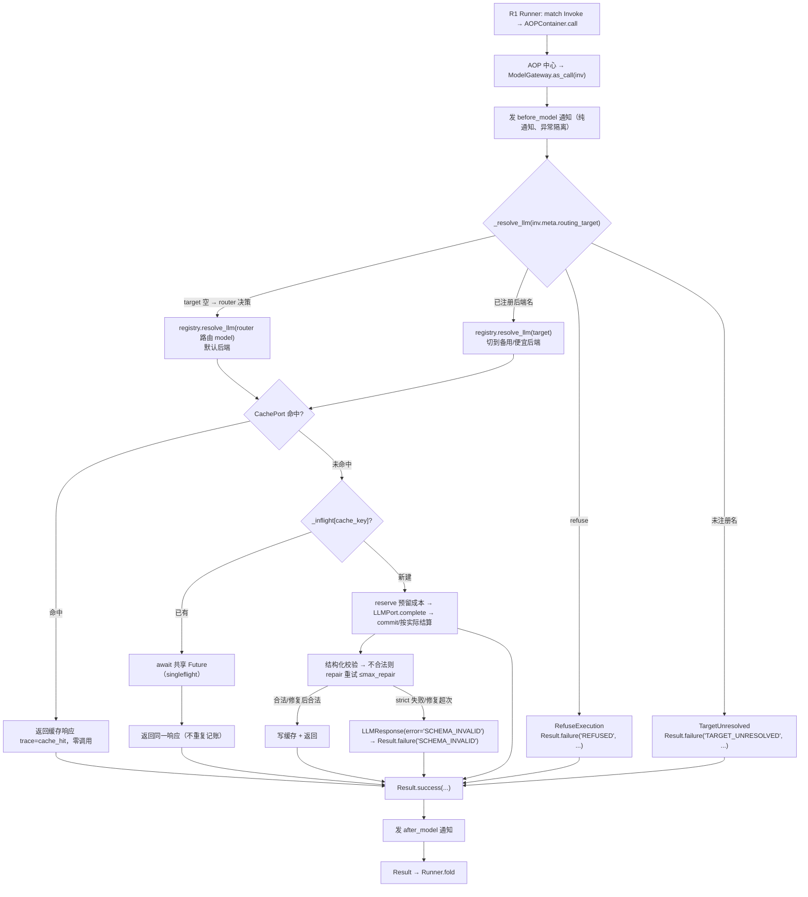

# R4：模型与推理（model）

> **权威来源**：[《AGENT 总设计》](../../01-总览与设计/AGENT-总设计.md) §R4 C 域；`docs/01-总览与设计/扩展体系重构规格-20261120.md` P2/P3/P9；统一口径见 `overviews/2026-11-20/扩展体系重构-口径卡.md`。本文是模块级拆分详设，模块内闭环。
> 层：L1 能力插件 · 依赖：R1+R2 · 源码包：`src/harness/model/` · 默认适配器：`src/ports/adapters/llm.py` · 测试：`tests/r4/` · 门禁 key：`r4`。
> 状态：按规格 P2/P3/P9 重写——`ModelGateway.as_call()` 适配 `Invocation`/`meta`；网关发 `before_model`/`after_model` 通知；删除旧的桥接字段链，降级目标改走 **typed 路径**（从 `Invocation.meta["routing_target"]` 的 `RoutingTarget` 消费，与 Registry 同源）。REFUSE 真拒答、未注册目标 `TargetUnresolved` 不回退两条红线原样保留。缓存/路由/结构化修复/成本归因/流式领域逻辑不变。

---

## 1. 职责与边界

**做**：多 Provider 接入、模型路由、按降级目标切后端、**REFUSE 真拒答**、语义/精确缓存、结构化输出与修复重试、流式、token 计数与成本归因；在模型调用前后发 `before_model` / `after_model` 通知。
**不做**：工具执行（R5）；降级裁决（R3）——R3 的 Degradation 是唯一裁决者，R4 只**执行**目标：切后端或拒答；内核预算硬强制（R1）。

**三体系定位**：
1. R4 是 Port（what）的 `LLMPort` 消费方与 `ModelGateway` 编排方，不定义扩展点。
2. 增强器（AOP）与通知点（Lifecycle）归属装配层：R4 只按契约发 model 系列通知、消费 typed 降级目标，不持有增强逻辑。
3. 依赖方向恒定：插件/增强器 → 装配层 → 内核；内核零依赖扩展组件。

---

## 2. 两个断点的修复（红线，原样保留）

> 两条实际 bug 的修复，不随扩展体系改动而回退。`tests/r4/test_refuse.py` 与 `tests/r4/test_registry_assembly.py` 是回归门禁。

### 2.1 断点一：`ModelCapability.gateway()` 未构造/传入 `ModelRegistry`

- **旧行为**：`gateway()` 只把 `llm/router/cache` 交给 `ModelGateway`，没有 `ModelRegistry`。`_resolve_llm` 拿到降级 target 后无注册表可查，必然失败并回退默认模型——降级链在 R4 断开。
- **新设计（必须）**：`gateway()` 确保存在一份 `ModelRegistry`（未注入时构造 `InMemoryModelRegistry`），把 `llm/model_router/model_cache` 以**统一注册名**注册进去，并作为 `registry=` 传入 `ModelGateway`。该注册表与 AOP/Lifecycle 共用的 Registry 是**同一实例**（见 §6），使 R3 选出的 target 与网关解析用的名字同源。装配完整性由 `R4-T08` 守护：缺 `registry`、缺 `llm/router/cache` 任一注册项即失败。

### 2.2 断点二：`_resolve_llm` 遇 `target == "refuse"` 静默回退默认模型

- **旧行为**：把"无法解析"和"特殊目标"一律折叠为回退默认模型，ladder 末级 `refuse` 被当成未注册名——拒答从未发生，既是安全红线突破，也违反"四模块零断点"。
- **新设计（必须）**：`_resolve_llm` 是降级执行的**唯一决策点**，返回三态 `BackendResolution`：

  | 解析结果 | 触发条件 | 网关行为 |
  |----------|----------|----------|
  | `LLMPort` | target 是已注册后端名，或 target 为空时按 router 决策 | 切到该后端实例发请求 |
  | `RefuseExecution` | `target == "refuse"` | 产出 `Result.failure("REFUSED", ...)`，**绝不调用任何 LLMPort** |
  | `TargetUnresolved` | target 非空、非保留名，且 `registry.resolve_llm(target) is None` | 产出 `Result.failure("TARGET_UNRESOLVED", ...)`，同样不回退 |

  `as_call()` 把该 Result 原样交回 R1；`R4-T09` 守护：`refuse` 场景下默认后端 `complete()` 调用计数必须为 0。

### 2.3 typed 降级目标消费路径（替代旧桥接，P9）

- **单一 typed 来源**：降级目标只有一条入口——`Invocation.meta["routing_target"]`（`RoutingTarget` typed 记录，由 R3 的 `Degradation.select()` 写入）。`as_call()` 从该记录读 `target`，不再读任何裸键桥接字段。
- **同源**：target 是 ladder 里的后端注册名，`registry.resolve_llm(target)` 直接解析；未注册 → `TargetUnresolved`，不回退。
- **reason 不作 target**：`RoutingTarget.reason` 只进 trace，不参与选后端；避免自造标签导致网关找不到后端后静默回退。
- **model 通知**：调用前后由网关发 `before_model` / `after_model` 通知（`LifecycleBus`，纯通知、异常隔离、返回值不消费）。

---

## 3. 设计架构与四模块联通链

`ModelGateway` 是 R4 唯一编排入口：缓存命中直接返回 → 解析 typed target 切后端/拒答 → 调用 `LLMPort` → 结构化校验（不合法走修复重试）→ 成本归因 → `Result`。

**四模块零断点联通链**（必须端到端测试）：

```
Runner.run (R1)
  → match: Invoke → AOPContainer.call (R1→R2)
  → AOP: Prelude → Warden → Envelope(前) → Refiner → Port call
      中心 Port call = registry 解析 → ModelGateway.as_call (R2→R4)
  → 网关发 before_model 通知；_resolve_llm(inv.meta["routing_target"]) 切后端/REFUSE/TargetUnresolved
    → 缓存→调用→校验修复→记账；发 after_model 通知 → Result
  → 故障：Warden/Envelope 写 inv.meta 具名故障记录 → Salvage: Degradation.select → typed target
  → Result 回 Runner.fold (R2→R1)
```

**逐跳职责**：

| 跳 | 模块 | 动作 |
|----|------|------|
| 1 | R1→R2 | `Runner` 用 `match` 分派 `Invoke` → `AOPContainer.call`；R1 只认 `CallFn`，签名不变 |
| 2 | R2→R4 | 中心调用 `ModelGateway.as_call(inv)`：`Invocation` 直送，`meta` 含 typed 降级目标 |
| 3 | R4 | 发 `before_model` 通知；`_resolve_llm(...)`：切后端 / `REFUSED` 拒答 / 未注册显式 `TargetUnresolved` |
| 4 | R4 | 缓存 → 调用 → 结构化校验修复 → 成本归因 → `Result`；发 `after_model` 通知 |
| 5 | R3→R4 |故障时 Degradation 选级产出 `RoutingTarget` 写进 `inv.meta`；R4 从 typed 记录消费，不裁决 |
| 6 | R2→R1 | `Result` 回到 `Runner.fold` |

**关键契约**：`as_call()` 读取的降级目标只有 `inv.meta["routing_target"]` 一个来源；R4 不解释"为何降级"（reason 只进 trace），target 一律来自 R3 ladder 的注册名。

---

## 4. 流程图



---

## 4.1 关键字段（核心数据契约）

| 字段 | 归属 | 语义 |
|------|------|------|
| `Invocation.meta["routing_target"]` | typed 具名记录 | `RoutingTarget(target, reason)`；as_call 唯一降级目标来源（替代旧裸桥接），与 Registry 同源 |
| `Notice` | 通知投影 | `before_model`/`after_model` 通知携带调用上下文只读投影 + 专属 payload |
| `LLMResponse.error` | DTO 具名字段 | 后端错误码/消息；as_call 折叠为 `Result.failure(code, msg)`，让 R3 看见（E3 修复） |
| `LLMRequest.task_hint` | DTO 具名字段 | 任务类型提示，由 `effect.payload["task_hint"]` 直送路由选模型（E4 修复） |
| `REFUSE_TARGET` | R4 模块常量 | `"refuse"` 触发真拒答 `Result.failure("REFUSED")`，绝不回退默认模型 |
| `ModelRegistry` | 长生命周期 | 降级目标名→LLMPort 实例映射，与共用 Registry 同一实例 |
| `ModelGateway._inflight` | 网关实例 | `dict[cache_key, Future[LLMResponse]]`，同 key 并发 miss 共享一次完整调用，防击穿与重复记账 |
| `Reservation` / `CostGuard._reserved` | 网关调用 / CostGuard 实例 | 调用前 reserve 预留、成功 commit 按实际结算、失败/异常 cancel |

---

## 5. API 规范（完整接口）

### 5.1 依赖的 AOP/Lifecycle 契约（定义见 `src/aop/`、`src/hooks/lifecycle.py`）

```python
@dataclass(frozen=True)
class Invocation:
    effect: object; ctx: object; session: object
    meta: Mapping[str, object]      # 含 "routing_target": RoutingTarget（typed 降级目标）；"fault": FaultRecord（故障时）
@dataclass(frozen=True)
class RoutingTarget:                # typed 目标（R3 产出 → R4 消费，与 Registry 同源）
    target: str                     # 后端注册名或 "refuse"
    reason: str                     # 只进 trace，不作 target
class Notice: ...                   # Invocation 只读投影 + 通知点名 + 专属 payload
class LifecycleBus:                 # 与 AOPContainer 共用 Registry
    def emit(self, notice: Notice) -> None: ...   # 同步、异常就地隔离
# as_call 不读任何裸键桥接字段，只读 inv.meta["routing_target"] typed 记录
```

**model 通知**：`as_call()` 在调用中心逻辑前发 `before_model` 通知、返回前发 `after_model` 通知（异常路径也发 after，payload 标 error）。通知返回值框架不消费，订阅者异常就地隔离记 trace。

### 5.2 R4 端口与领域协议

```python
class LLMPort(Protocol):                       # R2 PORT_PROTOCOLS 之一，不动
    name: str
    last_usage: Usage | None                   # 流式末块后写入，网关据此结算（缺失即拒绝）
    async def complete(self, req: LLMRequest, ctx: PortCtx) -> LLMResponse: ...
    def stream(self, req: LLMRequest, ctx: PortCtx) -> AsyncIterator[str]: ...
    def stream_events(self, req, ctx) -> AsyncIterator[StreamEvent]: ...  # 可选，缺省包装

class ModelRouter(Protocol):
    name: str
    def route(self, effect: Effect, ctx: PortCtx) -> RouteChoice: ...  # reason 进 trace

class CachePort(Protocol):                     # 异步；收 LLMRequest 原文，键策略归实现
    name: str
    async def get(self, request: LLMRequest, *, version: str = "1") -> LLMResponse | None: ...
    async def put(self, request: LLMRequest, resp: LLMResponse, *, version: str = "1") -> None: ...
    async def invalidate(self, request: LLMRequest, *, version: str = "1") -> None: ...
class CacheStore(Protocol): ...
class InMemoryCacheStore: ...
class CacheEmbedder(Protocol): ...
class HashCacheEmbedder: ...                   # 默认 embedding：字符 bigram 哈希（零依赖/确定性）
ExactCache(*, store: CacheStore | None = None, ttl: int | None = None)
SimilarityCache(*, threshold=0.85, store: CacheStore | None = None,
               embedder: CacheEmbedder | None = None, ttl: int | None = None)
class SchemaValidator(Protocol): ...
class MinimalSchemaValidator: ...              # 默认：最小 JSON Schema，零依赖
@dataclass(frozen=True)
class StructuredOutputSpec:
    schema: dict
    mode: Literal["constrained", "prompt", "repair"] = "repair"
    max_repair: int = 2
    strict: bool = True                        # 红线：未过校验的输出绝不标记为合法
# DTO（协议复用）：LLMRequest / LLMResponse / Usage / StreamEvent / PortCtx
```

### 5.3 统一注册表（模型维度协议视图）

```python
class ModelRegistry(Protocol):
    """与共用 Registry 同一实例、同一名字空间（见 §6）。
    注册语义：同名重复注册同一实例视为幂等；同名不同实例拒绝。"""
    name: str
    def register(self, name: str, provider: Provider) -> None: ...
    def register_llm(self, name: str, llm: LLMPort) -> None: ...   # 降级 target → 后端实例
    def resolve(self, name: str) -> Provider | None: ...
    def resolve_llm(self, name: str) -> LLMPort | None: ...
    def has(self, name: str) -> bool: ...
class InMemoryModelRegistry: ...              # 缺省实现：进程内字典，装配期注册、运行期解析
```

### 5.4 降级解析结果（三态）

```python
@dataclass(frozen=True, slots=True)
class RefuseExecution:
    reason: str
    def to_result(self) -> Result:
        return Result.failure("REFUSED", self.reason)   # ok=False, retryable=False
@dataclass(frozen=True, slots=True)
class TargetUnresolved:
    target: str
    def to_result(self) -> Result:
        return Result.failure("TARGET_UNRESOLVED", f"degrade target not registered: {self.target}")
BackendResolution = LLMPort | RefuseExecution | TargetUnresolved
```

### 5.5 `ModelGateway`（唯一编排入口）

```python
class ModelGateway:
    def __init__(self, *, llm: LLMPort, router: ModelRouter | None = None,
                 cache: CachePort | None = None, spec: StructuredOutputSpec | None = None,
                 validator: SchemaValidator | None = None, prompt_version: str = "1",
                 cost_guard: CostGuard | None = None, registry: ModelRegistry,
                 bus: LifecycleBus,   # 发 model 通知（与 AOPContainer 共用 Registry）
                 cost_estimator: Callable[[LLMRequest], float] | None = None) -> None: ...

    def _resolve_llm(self, request: LLMRequest, ctx: PortCtx, *, target: str | None) -> BackendResolution:
        """降级执行唯一决策点：
          target == "refuse"          → RefuseExecution（真拒答，绝不回退）
          target 已注册                → registry.resolve_llm(target)（切后端）
          target 非空且未注册          → TargetUnresolved（显式报错，不静默回退）
          target is None              → router 决策 → registry 解析，缺省默认 llm
        路由理由写入 ctx.meta["model_route"] 供 trace。"""

    def as_call(self) -> Callable[[Invocation], Awaitable[Result]]:
        """R1 注入的 call 适配器：Invocation → LLMRequest → _resolve_llm → Result。
        降级目标唯一来源：inv.meta["routing_target"].target（typed，与 Registry 同源）；
        发 before_model / after_model 通知；REFUSE → Result.failure("REFUSED")；
        后端 error → Result.failure(code, msg)；不读裸键桥接字段。"""

    async def complete(self, request: LLMRequest, ctx: PortCtx, *, target: str | None = None) -> LLMResponse: ...
        # 单次完整调用：拒答优先于缓存 → 缓存→调用→校验修复→记账
    async def stream(self, request, ctx, *, target: str | None = None) -> AsyncIterator[str]: ...
    def stream_events(self, request, ctx, *, target: str | None = None) -> AsyncIterator[StreamEvent]: ...
    def _record_cost(self, response, ctx, *, reservation: Reservation | None = None) -> None: ...
    async def _complete_with_repair(self, response, request, ctx, *, llm) -> LLMResponse: ...
```

### 5.6 `ModelCapability`（生产装配统一入口）

```python
class ModelCapability:
    name = "model"; requires: tuple[str, ...] = ()
    def __init__(self, *, llm: LLMPort, router=None, cache=None, spec=None,
                 validator=None, cost_guard=None, registry: ModelRegistry | None = None) -> None: ...
    def install(self, container: AOPContainer, bus: LifecycleBus, reg: Registry) -> None:
        """把 llm/model_router/model_cache 注册进统一注册表（与 bus/container 同一 Registry）。"""
    def gateway(self) -> ModelGateway:
        """1) registry = self._registry or InMemoryModelRegistry()   # 必须存在
           2) 注册 llm / model_router / model_cache（同名同实例幂等）
           3) return ModelGateway(..., registry=registry, bus=bus)    # 必须传入"""
```

### 5.7 默认 LLMPort 适配器：`OpenAICompatLLM`

```python
class OpenAICompatLLM:                        # src/ports/adapters/llm.py
    name = "openai_compat"
    last_usage: Usage | None
    def __init__(self, *, base_url: str, api_key: str, model: str,
                 client: httpx.AsyncClient | None = None) -> None: ...
    async def complete(self, req, ctx) -> LLMResponse: ...
    def stream(self, req, ctx) -> AsyncIterator[str]: ...
```

行为约定：`complete()` POST `{base_url}/chat/completions` 并写 `last_usage`；`stream()` SSE 逐块解析、末块写 `last_usage`（缺失即显式拒绝，绝不记假零成本）；错误折叠为 `Result` 语义，不抛裸异常；`api_key` 只进 Authorization 头，绝不进 trace/日志/快照（K3）；测试注入 fake `client`（MockTransport），全程离线。

---

## 6. 降级目标解析：Registry 与 ModelRegistry 的统一

**问题**：旧实现存在两份注册表——共用 Registry 与 R4 的 ModelRegistry。R3 选出的 target 来自 ladder 字符串，网关却去另一张空表解析，必然失败并静默回退。

**统一方案**：

1. **一份实例、一个名字空间**：`ModelCapability.install(container, bus, reg)` 让网关复用同一 Registry；`gateway()` 复用同一实例（未注入时构造 `InMemoryModelRegistry`）。
2. **协议视图而非第二张表**：`ModelRegistry` 是这份统一注册表的"模型维度协议视图"——`register` 收 `llm/model_router/model_cache` 等 provider，`register_llm` 收降级后端实例；同源查询。
3. **命名同源**：R3 `DegradeStep.target` 字符串直接作为注册名（无枚举包装）。`Degradation.select()` 写出的值必须已在统一注册表注册；ladder 末级 `refuse` 是网关内建保留名，不占用后端槽位。
4. **装配时序**：

```python
cap = ModelCapability(llm=primary, cache=ExactCache(), spec=...)   # 未注入 registry → 内部构造
container = AOPContainer(reg=reg, bus=bus)
cap.install(container, bus, reg)                 # 与 bus/container 同一 Registry 实例
reg.register_llm("llm_backup", backup)           # ladder target 与注册名同源
reg.register_llm("llm_cheap", cheap)
gw = cap.gateway()                               # 注入同一 registry + bus
runner = Runner(call=container.call(gw.as_call()), ...)
```

5. **解析优先级**：`inv.meta["routing_target"].target` 优先于 router 决策；target 为空时才由 `router.route()` 选模型。`refuse` 与未注册名分别走 `RefuseExecution` / `TargetUnresolved`，**任何分支都不回退默认模型**。

**保留名表**：

| 注册名 / target | 含义 | 解析结果 |
|-----------------|------|----------|
| `llm` | 默认后端 | `register_llm` 实例 |
| `model_router` | 路由策略 | `register` provider |
| `model_cache` | 缓存策略 | `register` provider |
| `llm_backup` / `llm_cheap` / ...（ladder 自定义） | 降级后端 | `register_llm` → 切后端 |
| `refuse` | ladder 末级拒答 | `RefuseExecution` → `Result.failure("REFUSED", ...)` |

---

## 7. R4 领域逻辑（保留的业务价值）

### 7.1 缓存（三层可插拔）
- `CachePort` 异步、收 `LLMRequest` 原文，key 策略归实现；缺省 `ExactCache`（sha256 精确匹配），可选 `SimilarityCache`。
- `CacheStore` 存 JSON 字符串、支持 `ttl/scan`，缺省 `InMemoryCacheStore`；用户可注入 Redis/DB 实现。
- `CacheEmbedder` 缺省 `HashCacheEmbedder`（字符 bigram 哈希向量，零依赖确定性）；可注入真向量模型；显式 `embedder=None` 时降级 difflib 文本相似度。
- 键含 `prompt_version`：`build_cache_key(request, prompt_version)`；`trace=cache_hit` 时零调用后端。
- **拒答优先于缓存**：`target == "refuse"` 时先产出 `REFUSED`，不返回任何命中缓存。

### 7.2 路由
- `ModelRouter.route(effect, ctx) -> RouteChoice(model, reason)`；缺省 `RuleRouter`：按 `task_hint` 映射，带 `max_cost_per_call` 时选不超预算的最便宜已注册模型，未知回退 `default` 哨兵。
- 装配期校验显式路由目标已注册；路由理由进 `ctx.meta["model_route"]` / trace。
- router 在 `_resolve_llm` 中**真调用**，`routing_target` 非空时以目标为准。

### 7.3 结构化输出与修复
- `StructuredOutputSpec(schema, mode, max_repair, strict)`；`SchemaValidator` + 默认 `MinimalSchemaValidator`；复杂 schema 由用户注入基于 `jsonschema` 的实现。
- 三处注入 `validator=`；履约校验：`isinstance(validator, SchemaValidator)` + `name` 非空。
- **校验与修复同一口径**：`_complete_with_repair` 走 `self._validator.check()`；`strict` 校验失败/修复超次 → 返回带 `error="SCHEMA_INVALID: ..."` 的 `LLMResponse`（N3：不抛穿透；`as_call()` 折叠为 `Result.failure("SCHEMA_INVALID")`）；坏 schema 非法 `type` 报校验错误（N4）。
- 流式路径禁用结构化校验（无法校验半截流）。

### 7.4 成本归因
- `CostRecord` → `UsageLedger` 多维累计 → `CostAttributor` 具名查询（`run_cost/user_cost/model_cost/snapshot`）。
- **结算**按 `LLMPort` 响应的 `usage` 入账；**调用前**先按 `cost_estimator` 预估 `CostGuard.reserve` 预留（缺省 `max_tokens×1e-5` 或 0.01 USD），成功后 `commit` 按实际结清、失败/断流/异常 `cancel` 释放。预算不足调用前即拒，后端零调用；硬闸不得绕过。
- **singleflight**：同 cache key 的并发 miss 共享一次完整调用（含记账/校验/缓存），异常传播所有等待者。
- 流式末块必须写 `last_usage`；缺失即显式拒绝，绝不记假零成本。

### 7.5 流式
- `stream()`：缓存命中按字符块吐缓存；否则逐块转发，`last_usage` 缺失即拒绝；消费方 `aclose()` 传播取消。
- `stream_events()`：`AsyncIterator[StreamEvent]`（TEXT_DELTA / TOOL_CALL_START / DELTA / END / HANDOFF / USAGE / DONE），USAGE 事件结算成本。

---

## 8. 可插拔契约

| 注入点 | 协议 | 默认 | 校验 |
|--------|------|------|------|
| LLM 后端 | `LLMPort` | `OpenAICompatLLM` | 实现 complete/stream，写 last_usage |
| 路由 | `ModelRouter` | `RuleRouter` | 目标已注册；reason 进 trace |
| 缓存策略 | `CachePort` | `ExactCache`（可选 `SimilarityCache`） | 收 request 原文、异步、键含版本 |
| 缓存存储 | `CacheStore` | `InMemoryCacheStore` | 可换 Redis/DB，存 JSON+ttl+scan |
| 缓存模型 | `CacheEmbedder` | `HashCacheEmbedder` | 可换向量 embedding；None 降级 difflib |
| 结构化输出 | `StructuredOutputSpec` | repair | schema 合法 |
| 结构化校验器 | `SchemaValidator` | `MinimalSchemaValidator` | validate→错误列表 |
| **统一注册/降级解析** | `ModelRegistry`（= 共用 `Registry`） | `InMemoryModelRegistry` | `gateway()` 必须构造并传入；llm/router/cache 三项必注册 |
| **拒答执行** | `RefuseExecution` | 网关内建 | `refuse` → `Result.failure("REFUSED", ...)`；默认后端零调用 |
| 成本硬闸 | `CostGuard`（+ `Reservation`） | 无（不限制） | 生产走 `reserve/commit/cancel`；`cost_estimator` 缺省 `max_tokens×1e-5` 或 0.01，不得绕过 Budgets |
| R1 接线适配 | `ModelGateway.as_call()` | — | 适配 `Invocation`，从 `inv.meta["routing_target"]` typed 读目标；发 model 通知；产出 `Result` 交 `fold` |

---

## 9. 模块内闭环核对（CL-1~CL-5）

| 条件 | 实现 | 证据 |
|------|------|------|
| CL-1 契约自足 | 依赖 R1 types + AOP/Lifecycle 契约 + DTO/Registry | import 扫描 |
| CL-2 自带 fake | `tests/r4/fakes.py`（RecordingLLM/StreamLLM，不进 src） | fake 用例 |
| CL-3 自带测试 | `tests/r4/` 覆盖门禁与端到端链路 | 覆盖率报告 |
| CL-4 独立 demo | `make demo-r4` / `demo_r4` | demo 冒烟 |
| CL-5 文档自足 | 本文 + AGENT-总设计对应章节 | 文档评审 |

---

## 10. 验收标准

1. `target == "refuse"` → `Result.failure("REFUSED", ...)`，默认模型 `complete()` 调用次数为 0（真拒答，不回退）；
2. 降级 target 为已注册后端名 → 真正切到该后端实例，主后端零调用；
3. `ModelCapability.gateway()` 构造并传入 `ModelRegistry`，`llm/router/cache` 与 ladder 后端名全部注册且与共用 Registry 同源；
4. typed 目标只从 `inv.meta["routing_target"]` 消费，无裸键桥接；未过 schema 校验的输出不进工具调用/业务；
5. 缓存键含 `prompt_version`；拒答优先于缓存命中；路由理由进 trace；
6. 发 `before_model`/`after_model` 通知（含异常路径），通知异常不影响主流程；
7. 换 `LLMPort` 实现上层零改动；成本按 per-run/user/model 正确归因；流式可中断且结算真实 usage。

---

## 11. 功能验证矩阵

| 功能点 | 用例 ID | 验证方式 | 通过标准 |
|--------|---------|---------|---------|
| 结构化校验 | R4-T01 | `pytest tests/r4/test_structured.py -q` | 非法输出触发修复，strict 失败/超次返回 SCHEMA_INVALID error |
| 结构化校验器可插拔 | R4-T02 | `pytest tests/r4/test_structured.py tests/r4/test_gateway.py -q` | 默认 MinimalSchemaValidator；注入后同步生效；非法注入拒绝 |
| 缓存（精确+语义） | R4-T03 | `pytest tests/r4/test_cache.py -q` | 命中/版本隔离/误命中率达标；`refuse` 场景不返回缓存 |
| 缓存后端可插拔 | R4-T04 | `pytest tests/r4/test_cache_backends.py -q` | 异步协议；自定义 store/embedder 注入生效 |
| 模型路由 | R4-T05 | `pytest tests/r4/test_router.py -q` | 按任务/成本选模型，决策进 trace，router 真调用 |
| 成本归因 | R4-T06 | `pytest tests/r4/test_cost.py -q` | 多维归因正确；CostGuard 真拦截 |
| 换 LLMPort | R4-T07 | `pytest tests/r4/test_adapter.py -q` | 换实现上层零改 |
| **Registry 装配完整性** | R4-T08 | `pytest tests/r4/test_registry_assembly.py -q` | `gateway()` 构造并传入 registry；llm/router/cache 三项注册齐全；与共用 Registry 同一实例；同名同实例幂等、异实例拒绝 |
| **REFUSE 真拒答** | R4-T09 | `pytest tests/r4/test_refuse.py -q` | `target="refuse"` → `Result.failure("REFUSED", ...)`；默认/备用 LLMPort 调用计数均为 0，绝不回退 |
| **未注册 target 不回退** | R4-T10 | 同上 | 非空未注册名 → `Result.failure("TARGET_UNRESOLVED", ...)`，不落回默认模型 |
| **model 通知** | R4-T12 | `pytest tests/r4/test_model_notices.py -q` | before_model/after_model 各触发一次；异常路径 also after；通知异常不影响主流程 |
| **typed 目标路径** | R4-T13 | `pytest tests/r4/test_routing_target.py -q` | as_call 只读 inv.meta["routing_target"]；reason 不参与选后端 |
| **降级切后端端到端** | R4-E01 | `pytest tests/r4/test_e2e_wiring.py tests/r3/test_e2e_degrade.py -q` | 熔断/限流/重试耗尽 → typed target → 网关切备用后端；主后端零调用，trace 连贯 |
| 流式与事件 | R4-T11 | `pytest tests/r4/test_stream.py tests/r4/test_stream_events.py -q` | 逐块转发、取消中断、USAGE 结算；缺 last_usage 显式拒绝 |
| 独立闭环 | R4-D01 | `make demo-r4` + `gate_check r4` | demo 冒烟 + 门禁全绿 |

---

## 12. 门禁清单

| 门禁 | 条目 | 达标标准 | 级别 |
|------|------|---------|------|
| R4-G1 | 覆盖 | 路由/缓存/结构化/网关单测 ≥90% | G1 |
| R4-G2 | 拒答/降级 | REFUSE 真拒答（默认后端零调用）；降级真切后端；未注册 target 不回退 | G2 |
| R4-G3 | 装配/集成 | `gateway()` 注入 `ModelRegistry`；llm/router/cache 注册完整且与共用 Registry 同源；换 LLMPort 上层零改动 | G3 |
| R4-G3 | 通知/typed | before_model/after_model 触发且不拦截；typed 目标只从 `inv.meta["routing_target"]` 消费 | G3 |
| R4-红线 | 断点零回退 | `refuse` 回退默认模型 → 拒绝；读裸键桥接字段（应读 typed 记录）→ 拒绝；strict 非法输出进业务 → 拒绝 | 红线 |
| R4-静态 | 无过时残留 | grep 无旧裸键桥接/旧 invoke 级符号（旧词仅在"删除/旧"语境出现） | 静态 |

**门禁符号（gate_check r4 必须出现）**：`ModelGateway` / `as_call` / `Invocation` / `routing_target` / `RoutingTarget` / `_resolve_llm` / `RefuseExecution` / `TargetUnresolved` / `Result.failure` / `REFUSED` / `ModelRegistry` / `InMemoryModelRegistry` / `ModelCapability` / `CachePort` / `ExactCache` / `SimilarityCache` / `CacheStore` / `CacheEmbedder` / `HashCacheEmbedder` / `ModelRouter` / `RouteChoice` / `SchemaValidator` / `StructuredOutputSpec` / `CostAttributor` / `CostGuard` / `Reservation` / `reserve` / `commit` / `cost_estimator` / `_inflight` / `SCHEMA_INVALID` / `LLMPort` / `OpenAICompatLLM` / `StreamEvent` / `before_model` / `after_model`。

---
*R4 模块详设 · 派生自 AGENT-总设计与《扩展体系重构规格（2026-11-20）》P2/P3/P9 · 门禁 key=r4 · 本次变更：`as_call` 适配 Invocation/meta；发 before_model/after_model 通知；删除旧桥接字段链，降级目标改走 typed 路径（inv.meta["routing_target"] RoutingTarget，与 Registry 同源）；REFUSE 真拒答与 TargetUnresolved 不回退两条红线原样保留；缓存/路由/结构化修复/成本归因/流式领域逻辑不变*
