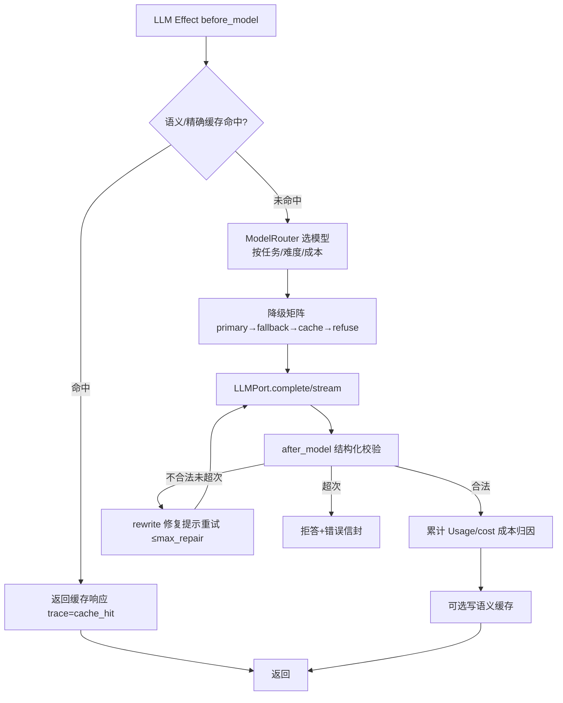

# R4：模型与推理（model）

> **实现状态**：已实现（R4 v1.0）。源码 `src/harness/model/`，测试 `tests/r4/`（53 用例），门禁 key `r4`。
> 独立 demo：`tests/demos/demo_r4.py`。复用 R2 的 LLMRequest/LLMResponse/Usage/LLMPort DTO 与协议。
> 路由/缓存/结构化校验修复/成本归因/成本硬闸全部落地；换 LLMPort 上层零改动。

> **权威来源**：[《AGENT 总设计》](../../01-总览与设计/AGENT-总设计.md) §R4 C 域。本文为模块级拆分详设。
> 层：L1 能力插件 · 依赖：R1+R2 · 源码包：`src/harness/model/`（已实现）· 门禁 key：r4

> ⚠️ **自查标注（2026-11-17，待修正）**：§4 的 `ModelRouter.route(...) -> str` 与实现不符——实际 `src/harness/model/router.py` 返回 `RouteDecision`（带 reason 进 trace）。另 §4 只给 `LLMPort.stream()` 签名，流式编排层（网关 stream 方法 / 缓存配合 / 取消结算）设计空白，详见[《流式输出设计说明》](../../流式输出设计说明.md)与[《设计完整性重新自查》](../../设计完整性重新自查-20261117.md) §2。

---

## 1. 职责与边界

**做**：多 Provider 接入、模型路由、跨 provider 降级、语义/KV 缓存、结构化输出与修复重试、流式、token 计数与成本归因。
**不做**：工具执行（R5）；降级执行逻辑（R3）。R4 提供"模型维度"的路由与缓存，降级链复用 R3 的 Degradation。

## 2. 设计架构

LLM 调用经 before_invoke 链：缓存命中直接返回（省成本）→ 路由选模型 → 调用 → after_model 结构化校验（不合法则修复重试）→ 成本归因。模型降级矩阵复用 R3，目标从 provider 维度取。

## 3. 流程图



## 4. API 规范（完整接口）

```python
class LLMPort(Protocol):
    async def complete(self, req: LLMRequest, ctx: PortCtx) -> LLMResponse: ...
    async def stream(self, req: LLMRequest, ctx: PortCtx) -> AsyncIterator[str]: ...

class ModelRouter(Protocol):
    name: str
    def route(self, effect: Effect, ctx: StrategyCtx) -> str: ...   # 返回 model 名
class SemanticCache(Protocol):
    name: str
    def get(self, key: str) -> LLMResponse|None: ...
    def put(self, key: str, resp: LLMResponse) -> None: ...
    def invalidate(self, key: str) -> None: ...

@dataclass(frozen=True)
class StructuredOutputSpec:
    schema: dict
    mode: Literal["constrained","prompt","repair"] = "repair"
    max_repair: int = 2
    strict: bool = True

# DTO（ports/dto.py）
LLMRequest: messages / tools_catalog / model / temperature / max_tokens
LLMResponse: content / tool_calls / usage / model
Usage: prompt_tokens / completion_tokens / cost_usd
```

**实现映射（v1.0）**：设计契约与落地类一一对应——结构化规格 `StructuredOutputSpec`（对外字段 `schema`，
内部属性 `json_schema` 以避免遮蔽 BaseModel.schema）+ 校验器 `StructuredOutputValidator`；
缓存键 `build_cache_key`（含 prompt_version）+ `CacheKey`；路由 `ModelRouter` 协议 + 默认 `RuleRouter`（决策 `RouteDecision`）；
缓存 `SemanticCache` 协议 + 默认 `ExactCache`；成本 `CostRecord` / `UsageLedger` / `CostAttributor` / `CostGuard`；
编排 `ModelGateway`（缓存→路由→调用→校验修复→记账）；装配 `ModelCapability`。
测试用 fake LLM（`RecordingLLM` / `StreamLLM`）只放在 `tests/r4/fakes.py`，**不进 src、不进公共 API**；
真实后端由注入方实现 `LLMPort` 提供（见 §6）。

## 5. 元数据与关键字段（核心字段）

| 字段 | 说明 |
|------|------|
| LLMRequest | messages/tools_catalog/model/temperature/max_tokens |
| LLMResponse | content/tool_calls/usage/model |
| cache key | hash(messages + model + params + prompt_version) |
| 成本归因维度 | per-run/per-agent/per-user/per-model |
| StructuredOutputSpec | schema/mode/max_repair/strict |

**降级矩阵模型维度**：强→中→便宜→语义缓存答案→明确拒答；每级带 quality 分与延迟预算。路由决策进 trace。

## 6. 可插拔契约

| 注入点 | 协议 | 默认 | 校验 |
|--------|------|------|------|
| LLM 后端 | LLMPort | OpenAI-compat | 实现 complete/stream |
| 路由 | ModelRouter | 规则路由 | 返回目标已注册 |
| 缓存 | SemanticCache | 精确缓存 | 键含版本；语义阈值保守 |
| 结构化输出 | StructuredOutputSpec | repair | schema 合法 |

## 7. 模块内闭环核对（CL-1~CL-5）

| 条件 | 实现 | 证据 |
|------|------|------|
| CL-1 契约自足 | 依赖 R1 types + R2 Hook + LLMPort | import 扫描 |
| CL-2 自带 fake | fake LLM（录制响应） | fake 用例 |
| CL-3 自带测试 | tests/r4/ | 覆盖率报告 |
| CL-4 独立 demo | `make demo-r4` | demo 冒烟 |
| CL-5 文档自足 | 本文 + AGENT-总设计对应章节 | 文档评审 |

## 8. 验收标准

1. 未过 schema 校验的输出不进工具调用/业务逻辑；
2. 语义缓存误命中率评测达标、键含版本；
3. 换 LLMPort 实现上层零改动；
4. 成本按 per-run/user/model 正确归因；流式取消可中断。

## 9. 功能验证矩阵

| 功能点 | 用例 ID | 验证方式 | 通过标准 |
|--------|---------|---------|---------|
| 结构化校验 | R4-T01 | `pytest tests/r4/test_structured.py -q` | 非法输出触发修复，超次拒答 |
| 语义缓存 | R4-T02 | `pytest tests/r4/test_cache.py -q` | 命中返回；误命中率达标 |
| 模型路由 | R4-T03 | `pytest tests/r4/test_router.py -q` | 按任务选模型，决策进 trace |
| 成本归因 | R4-T04 | `pytest tests/r4/test_cost.py -q` | 多维归因正确 |
| 换后端 | R4-T05 | `pytest tests/r4/test_adapter.py -q` | 换 LLMPort 上层零改 |
| 独立闭环 | R4-D01 | `make demo-r4` | demo 冒烟 |

## 10. 门禁清单

| 门禁 | 条目 | 达标标准 | 级别 |
|------|------|---------|------|
| R4-G1 | 覆盖 | 路由/缓存/结构化单测 ≥85% | G1 |
| R4-G2 | 结构化/缓存 | 未校验输出不进业务；误命中率达标 | G2 |
| R4-G3 | 集成 | 换 LLMPort 上层零改动 | G3 |
| R4-红线 | 成本 | 路由/重试绕过 Budgets→拒绝 | 红线 |

---
*R4 模块详设 v2.1 · 派生自 AGENT-总设计 · 已实现（代码见 src/harness/model/）*