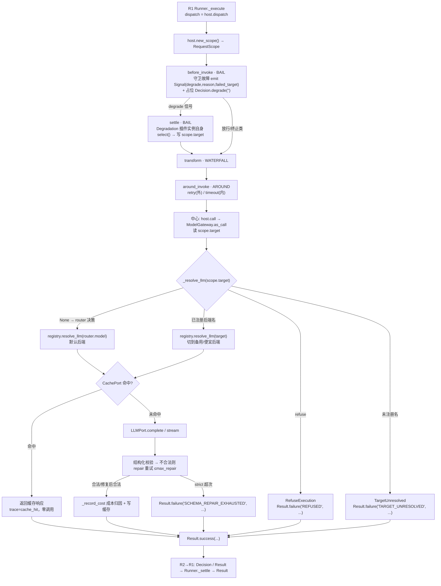

# R4：模型与推理（model）

> **当前版本**：R4 v5.0 · 架构基准 [ARCH-v5](../../../.workbuddy/specs/ARCH-v5.md)（唯一真相源）。
> **权威来源**：[《AGENT 总设计》](../../01-总览与设计/AGENT-总设计.md) §R4 C 域与 `ARCH-v5.md`；本文是模块级拆分详设，模块内闭环。
> 层：L1 能力插件 · 依赖：R1+R2 · 源码包：`src/harness/model/` · 默认适配器：`src/ports/adapters/llm.py` · 测试：`tests/r4/` · 门禁 key：`r4`。
> 状态：v5.1 设计定稿——按 ARCH-v5 完整重写。旧设计（HookMode 五泳道 / ControlState / Signal 冒泡 / DEGRADER / `degrade_target` 构造参数 / bus.emit / `ctx.meta` 与 `scope.meta` 降级裸键桥接）全部作废，不做兼容、不留残余。
> v5.0 核心是两个断点的真正修复：`ModelCapability.gateway()` 必须构造并传入 `ModelRegistry`；`_resolve_llm` 遇 `refuse` 必须真拒答、绝不回退默认模型。
> v5.1 桥接改造：降级目标由 Host 从 `scope.target` 刷新到 `RuntimeCtx.degrade_target` typed 具名字段（`_sticky_target` 保证 call 阶段降级跨 Effect 继承），`as_call()` 只读该字段；后端 `LLMResponse.error` 折叠为 `Result.failure`；`LLMRequest.task_hint` 直送路由；`scope` 经 Host 内部 `_scope_bridge` 关联，不写进 ctx。

---

## 1. 职责与边界

**做**：多 Provider 接入、模型路由、按降级目标切后端、**REFUSE 真拒答**、语义/精确缓存、结构化输出与修复重试、流式、token 计数与成本归因。
**不做**：工具执行（R5）；降级裁决（R3）——R3 决定 `scope.target`，R4 只**执行**目标：切后端或拒答；内核预算硬强制（R1）。

R4 遵守 `ARCH-v5` 三条铁律：

1. **原语即调用语义**：R4 不定义扩展点、不声明 hook kind；只在 R2 宿主已定义的扩展点（`around_invoke` 的中心、`settle` 的目标）上做消费。
2. **两层而非三层**：跨调用状态由 R3 插件实例自身持有（注册一次、长期存活，天然跨调用），请求内信号在 R2 的 `RequestScope`；R4 不持有控制信号层，只读 `scope.target`。
3. **四模块零断点**：`R1 Runner → R2 host → R3 settle → R4 gateway` 链完整可达；REFUSE 真拒答、不静默回退；生产装配有统一入口 `ModelCapability`。

---

## 2. v5.0 核心：两个断点的修复

> 以下两条是调研发现的**实际 bug**，不是设计偏好。v5 的全部网关改造围绕它们展开；`tests/r4/test_refuse.py` 与 `tests/r4/test_registry_assembly.py` 是回归门禁。

### 2.1 断点一：`ModelCapability.gateway()` 未构造/传入 `ModelRegistry`

- **旧行为**：`gateway()` 只把 `llm / router / cache` 交给 `ModelGateway`，没有 `ModelRegistry`。`_resolve_llm` 拿到降级 target 后无注册表可查，解析必然失败；网关注回默认模型，R3 选出的备用后端永远不会被调用——降级链在 R4 这一步断开。
- **新设计（必须）**：`gateway()` 确保存在一份 `ModelRegistry`（未注入时构造 `InMemoryModelRegistry`），把 `llm` / `model_router` / `model_cache` 以**统一注册名**注册进去，并作为 `registry=` 传入 `ModelGateway`。该注册表与 `host.registry` 是**同一实例**（见 §6），使 `settle` 写出的 target 与网关解析用的名字同源。装配完整性由 `R4-T08` 守护：缺 `registry`、缺 `llm/router/cache` 任一注册项即失败。

### 2.2 断点二：`_resolve_llm` 遇 `target == "refuse"` 静默回退默认模型

- **旧行为**：`_resolve_llm` 把“无法解析”和“特殊目标”一律折叠为 `return self._llm`。ladder 末级 `refuse` 被当成未注册名，默认模型继续被调用——拒答从未发生。这既是安全红线突破，也是“四模块零断点”铁律的直接违反。
- **新设计（必须）**：`_resolve_llm` 是降级执行的**唯一决策点**，返回三态 `BackendResolution`：

  | 解析结果 | 触发条件 | 网关行为 |
  |----------|----------|----------|
  | `LLMPort` | target 是已注册后端名，或 `ctx.degrade_target is None` 时按 router 决策 | 切到该后端实例发请求 |
  | `RefuseExecution` | `target == "refuse"` | 产出 `Result.failure("REFUSED", ...)`，**绝不调用任何 LLMPort** |
  | `TargetUnresolved` | target 非空、非保留名，且 `registry.resolve_llm(target) is None` | 产出 `Result.failure("TARGET_UNRESOLVED", ...)`，同样不回退 |

  `as_call()` 把该 Result 原样交回 R1 `_settle`。`R4-T09` 守护：`refuse` 场景下默认后端 `complete()` 调用计数必须为 0。

### 2.3 配套修正

1. **`as_call()` 从 `ctx.degrade_target` 读降级目标**——由 Host `_settle` 从 `scope.target` 刷新到该 typed 字段（`_sticky_target` 跨 Effect 继承），不再读 `ctx.meta` / `scope.meta` 裸键；请求内信号与裁决结果的载体是 `RequestScope`。
2. **hook 总线 `Registry` 与 `ModelRegistry` 统一**——一份注册表、一套注册名（见 §6）。
3. **完整保留 R4 领域逻辑**——缓存、路由、结构化修复、成本归因、流式均延续 v5 契约（见 §7）。

---

## 3. 设计架构与四模块联通链

`ModelGateway` 是 R4 唯一编排入口：缓存命中直接返回 → 解析 `scope.target` 切后端/拒答 → 调用 `LLMPort` → 结构化校验（不合法走修复重试）→ 成本归因 → `Result`。降级目标由 R3 `settle` 写入 `scope.target`，R4 只消费、不裁决。

**四模块零断点联通链**（逐字对齐 `ARCH-v5` §6，必须端到端测试）：

```
Runner._execute
  → dispatch = host.dispatch              (R1→R2)
  → host.hook("before_invoke").call(scope) (R2→R3 守卫，BAIL)
  → host.hook("transform").call(scope)     (R2→R3 改写，WATERFALL)
  → host.hook("around_invoke").call(scope) (R2→R3 retry/timeout，AROUND)
      中心 = ctx.invoke = call = host.call → ModelGateway.as_call (R2→R4)
  → host.hook("settle").call(scope)        (R2→R3 降级裁决，BAIL)
  → scope.target → gateway 切后端 / REFUSE 拒答 (R3→R4)
  → Decision → Runner._settle → Result      (R2→R1)
```

**逐跳职责**：

| 跳 | 模块 | 动作 |
|----|------|------|
| 1 | R1→R2 | `host.dispatch` 每次新建 `RequestScope`；R1 只认识 `dispatch/call` 两个注入点，签名不变 |
| 2 | R2→R3 | `before_invoke` 守卫（熔断/限流/舱壁/幂等/killswitch）故障 → `scope.emit(Signal("degrade", reason, failed_target))` + 占位 `Decision.degrade("")` → BAIL 短路 |
| 3 | R2→R3 | `transform` 链式改写；`RetryPolicy` 耗尽 / `Timeout` 超时 → emit `Signal("degrade", ...)`；`around_invoke` 包裹中心调用 |
| 4 | R3→R2 | `settle`（Degradation）读 `scope.signals` → 实例自身 `select()` → `Decision.degrade(target)` 并写 `scope.target` |
| 5 | R2→R4 | 中心调用 `host.call → ModelGateway.as_call()`；从 `ctx.degrade_target` 读目标（Host 从 `scope.target` 刷新，`_sticky_target` 跨 Effect 继承） |
| 6 | R4 | `_resolve_llm(degrade_target)`：切后端 / `REFUSED` 拒答 / 未注册显式报错；后端 `error` → `Result.failure`；随后缓存→调用→校验修复→记账 → `Result` |
| 7 | R2→R1 | `Result`（或 `Decision`）回到 `Runner._settle`；`_coerce_verdict` 未知 action 回退 CONTINUE 的边界保留，`_settle` 四 action 消费不变 |

**关键契约**：`as_call()` 读取的目标只有 `scope.target` 一个来源；R4 不解释“为何降级”（reason 只进 signal/trace），target 一律来自 R3 ladder 的注册名，避免自造标签导致网关找不到后端后静默回退。

---

## 4. 流程图



---

## 4.1 关键字段（v5 核心数据契约）

| 字段 | 归属 | 语义 |
|------|------|------|
| `ctx.degrade_target` | RuntimeCtx 具名字段 | Host 从 `scope.target` 刷新的降级目标，**as_call 唯一读取来源**（替代旧 `ctx.meta["__scope__"]` / `meta["degrade_target"]` 裸键桥接） |
| `Host._scope_bridge` / `_sticky_target` | Host 内部 | 按 `id(ctx)` 关联 dispatch 与 call 阶段的 scope；会话级降级目标跨 Effect 继承（B1 修复，R1 每 Effect 新建 ctx/scope） |
| `scope.target` | RequestScope | settle 写入的降级目标源头（backup/cache/refuse），由 Host 刷新到 `ctx.degrade_target` 供 R4 消费 |
| `LLMResponse.error` | DTO 具名字段 | 后端错误码/消息；as_call 折叠为 `Result.failure(code, msg)`，让 R3 重试/熔断/降级看见（E3 修复） |
| `LLMRequest.task_hint` | DTO 具名字段 | 任务类型提示，由 `effect.payload["task_hint"]` 直送路由选模型（E4 修复） |
| `REFUSE_TARGET` | R4 模块常量 | `"refuse"` 触发真拒答 `Result.failure("REFUSED")`，绝不回退默认模型 |
| `ModelRegistry` | 长生命周期 | 降级目标名→LLMPort 实例映射，与 capability 同一注册表 |

## 5. API 规范（完整接口）

### 5.1 依赖的 R2 原语（契约引用，定义见 `ARCH-v5` §2 / `src/hooks/`）

```python
class Signal:                          # 请求内信号，非冒泡、非独立层
    kind: str                          # "degrade" / "abort" / "budget" ...
    reason: str
    failed_target: str | None = None

class RequestScope:                    # 每次 call 新建；typed 协作容器，无 meta
    signals: list[Signal] = field(default_factory=list)
    target: str | None = None          # settle 写入的降级目标源头（由 Host 刷新到 ctx.degrade_target）
    last_result: Any = None            # host.call 写入本次 Result，观察插件只读
    trace: list[str] = field(default_factory=list)
    value: Any = None                  # settle 最终判决载体
    releases: list[Any] = field(default_factory=list)   # 资源释放回调，Host 每轮逆序执行
    def emit(self, signal: Signal) -> None: ...
    def release_all(self) -> None: ...

class RuntimeCtx:                      # R1 上下文，R4 只读 degrade_target
    effect: Effect; state: AgentState; session_id: str
    degrade_target: str | None = None  # 具名桥接字段（替代 meta 裸键），Host 从 scope.target 刷新
    ...

class Decision: ...                    # 统一返回：action/target/value/reason/retry/...
class Host:
    _scope_bridge: dict[int, RequestScope]   # 内部按 id(ctx) 关联 dispatch/call，不写进 ctx 或 scope
    _sticky_target: str | None              # 会话级降级目标，new_scope 继承（B1 跨 Effect 接力）
    def define(self, name, kind) -> Hook: ...
    def plugin(self, plugin) -> Host: ...
    def freeze(self) -> Host: ...
    def new_scope(self) -> RequestScope: ...
    def scope_of(self, ctx) -> RequestScope | None: ...
    async def dispatch(self, effect, ctx) -> Decision: ...   # R1 注入点，签名不变
    def call(self, inner) -> Callable: ...                   # R1 注入点，签名不变
```

**R2→R4 桥接（v5.1）**：R1 注入的 `ctx` 是 RuntimeCtx（含 typed `degrade_target`）；Host 内部用 `_scope_bridge[id(ctx)]` 关联 dispatch 与 call 阶段的 RequestScope（不写进 ctx 或 scope）；`Host.call()` 保持 R1 签名 `(effect, ctx) -> Result`，把 Result 写入 `scope.last_result`，成功/失败分别触发 `after_invoke` / `invoke_error`，返回前若有降级信号则跑 settle 刷新 `ctx.degrade_target` 与 `_sticky_target`，最后 `scope.release_all()`。`as_call()` 只读 `ctx.degrade_target`，不读 `ctx.meta` / `scope.meta` 裸键。

### 5.2 R4 端口与领域协议

```python
class LLMPort(Protocol):                       # R2 PORT_PROTOCOLS 之一，不动
    name: str
    last_usage: Usage | None                   # 流式末块后写入，网关据此结算（缺失即拒绝）
    async def complete(self, req: LLMRequest, ctx: PortCtx) -> LLMResponse: ...
    def stream(self, req: LLMRequest, ctx: PortCtx) -> AsyncIterator[str]: ...
    def stream_events(self, req, ctx) -> AsyncIterator[StreamEvent]: ...  # 可选，缺省包装

class ModelRouter(Protocol):
    name: str
    def route(self, effect: Effect, ctx: PortCtx) -> RouteDecision: ...  # reason 进 trace

class CachePort(Protocol):                     # 异步；收 LLMRequest 原文，键策略归实现
    name: str
    async def get(self, request: LLMRequest, *, version: str = "v1") -> LLMResponse | None: ...
    async def put(self, request: LLMRequest, resp: LLMResponse, *, version: str = "v1") -> None: ...
    async def invalidate(self, request: LLMRequest, *, version: str = "v1") -> None: ...

class CacheStore(Protocol):                    # 存储工具：换 Redis/DB
    name: str
    async def get(self, key: str) -> str | None: ...
    async def put(self, key: str, value: str, *, ttl: int | None = None) -> None: ...
    async def delete(self, key: str) -> None: ...
    async def scan(self, prefix: str) -> list[tuple[str, str]]: ...

class InMemoryCacheStore: ...                  # 默认存储（进程内）
class CacheEmbedder(Protocol):                 # embedding 模型：换向量后端
    name: str
    async def embed(self, text: str) -> tuple[float, ...]: ...

ExactCache(*, store: CacheStore | None = None, ttl: int | None = None)
SimilarityCache(*, threshold=0.85, store: CacheStore | None = None,
               embedder: CacheEmbedder | None = None, ttl: int | None = None)

class SchemaValidator(Protocol):              # 结构化校验器（可注入）
    name: str
    def validate(self, value: object, schema: dict) -> list[str]: ...
class MinimalSchemaValidator: ...             # 默认：最小 JSON Schema，零依赖

@dataclass(frozen=True)
class StructuredOutputSpec:
    schema: dict
    mode: Literal["constrained", "prompt", "repair"] = "repair"
    max_repair: int = 2
    strict: bool = True                        # 红线：未过校验的输出绝不标记为合法

# DTO（hooks 复用）：LLMRequest / LLMResponse / Usage / StreamEvent / PortCtx
```

### 5.3 统一注册表（模型维度协议视图）

```python
class ModelRegistry(Protocol):
    """与 hook 总线 Registry 同一实例、同一名字空间（见 §6）。
    注册语义：同名重复注册同一实例视为幂等；同名不同实例拒绝。"""
    name: str
    def register(self, name: str, provider: Provider) -> None: ...      # llm/router/cache 等具名 provider
    def register_llm(self, name: str, llm: LLMPort) -> None: ...        # 降级 target → 后端实例
    def resolve(self, name: str) -> Provider | None: ...
    def resolve_llm(self, name: str) -> LLMPort | None: ...
    def has(self, name: str) -> bool: ...

class InMemoryModelRegistry: ...              # 缺省实现：进程内字典，装配期注册、运行期解析
```

### 5.4 降级解析结果（v5 新增：拒答不回退的载体）

```python
@dataclass(frozen=True, slots=True)
class RefuseExecution:
    reason: str
    def to_result(self) -> Result:
        return Result.failure("REFUSED", self.reason)   # ok=False, error.code="REFUSED", retryable=False

@dataclass(frozen=True, slots=True)
class TargetUnresolved:
    target: str
    def to_result(self) -> Result:
        return Result.failure("TARGET_UNRESOLVED", f"degrade target not registered: {self.target}")

BackendResolution = LLMPort | RefuseExecution | TargetUnresolved
```

### 5.5 `ModelGateway`（唯一编排入口）

```python
class ModelGateway:
    def __init__(
        self, *,
        llm: LLMPort,
        router: ModelRouter | None = None,
        cache: CachePort | None = None,
        spec: StructuredOutputSpec | None = None,
        validator: SchemaValidator | None = None,
        prompt_version: str = "v1",
        cost_guard: CostGuard | None = None,
        registry: ModelRegistry,              # v5 必填：由 ModelCapability.gateway() 保证注入
    ) -> None: ...

    def _resolve_llm(
        self, request: LLMRequest, ctx: PortCtx, *, target: str | None
    ) -> BackendResolution:
        """降级执行唯一决策点：
          target == "refuse"                  → RefuseExecution（真拒答，绝不回退）
          target 已注册                        → registry.resolve_llm(target)（切后端）
          target 非空且未注册                  → 显式报错（不静默回退）
          target is None                      → router 决策 → registry 解析，缺省默认 llm
        路由理由写入 ctx.meta["model_route"] 供 trace（PortCtx.meta 动态边界，非 RequestScope.meta）。"""

    def as_call(self) -> Callable[[Effect, object], Awaitable[Result]]:
        """R1 注入的 call 适配器：Effect→LLMRequest→_resolve_llm(degrade_target)→Result。
        唯一降级目标来源：ctx.degrade_target（Host 从 scope.target 刷新并经 _sticky_target 跨 Effect 继承）；
        REFUSE → Result.failure("REFUSED")；后端 LLMResponse.error → Result.failure(code, msg)；
        不读 ctx.meta / scope.meta 降级裸键。"""

    async def complete(self, request: LLMRequest, ctx: PortCtx, *,
                       degrade_target: str | None = None) -> LLMResponse:
        """一次完整调用：先解析目标（拒答优先于缓存），再缓存→调用→校验修复→记账。
        后端 LLMResponse.error 非 None 时不校验/不缓存、照实返回（as_call 折叠为 Result.failure）。"""

    async def stream(self, request: LLMRequest, ctx: PortCtx, *,
                     degrade_target: str | None = None) -> AsyncIterator[str]: ...
    def stream_events(self, request: LLMRequest, ctx: PortCtx, *,
                      degrade_target: str | None = None) -> AsyncIterator[StreamEvent]: ...
    def _record_cost(self, response: LLMResponse, ctx: PortCtx) -> None: ...
    async def _complete_with_repair(self, response, request, ctx, *, llm) -> LLMResponse: ...
```

### 5.6 `ModelCapability`（生产装配统一入口，铁律 3）

```python
class ModelCapability:
    name = "model"; version = "5.0.0"; requires: tuple[str, ...] = ()

    def __init__(self, *, llm: LLMPort, router=None, cache=None,
                 spec=None, validator=None, cost_guard=None,
                 registry: ModelRegistry | None = None) -> None: ...

    def install(self, host: Host, reg: ModelRegistry | None = None) -> Host:
        """把 llm/model_router/model_cache 注册进统一注册表，并令 host.registry 指向它。"""

    def gateway(self) -> ModelGateway:
        """v5 断点一修复点：
        1) registry = self._registry or InMemoryModelRegistry()   # 必须存在
        2) 注册 llm / model_router / model_cache（同名同实例幂等）
        3) return ModelGateway(..., registry=registry)            # 必须传入
        """
```

### 5.7 默认 LLMPort 适配器：`OpenAICompatLLM`

```python
class OpenAICompatLLM:                        # src/ports/adapters/llm.py
    name = "openai_compat"
    last_usage: Usage | None
    def __init__(self, *, base_url: str, api_key: str, model: str,
                 client: httpx.AsyncClient | None = None) -> None: ...
    async def complete(self, req, ctx) -> LLMResponse: ...
    def stream(self, req, ctx) -> AsyncIterator[str]: ...
```

行为约定：`complete()` POST `{base_url}/chat/completions` 并写 `last_usage`；`stream()` SSE 逐块解析、末块写 `last_usage`（缺失即显式拒绝，绝不记假零成本）；错误折叠为 `Result` 语义，不抛裸异常；`api_key` 只进 Authorization 头，绝不进 trace/日志/快照（K3）；测试注入 fake `client`（MockTransport），全程离线。

---

## 6. 降级目标解析：Registry 与 ModelRegistry 的统一

**问题**：旧实现存在两份注册表——hook 总线的 `Registry`（`name → Provider`）与 R4 的 `ModelRegistry`（`name → 端点/后端实例`）。`settle` 写出的 target 来自 R3 ladder 字符串，网关却去另一张空表解析，必然失败并静默回退。

**统一方案（v5）**：

1. **一份实例、一个名字空间**：`ModelCapability.install(host)` 把注册表赋给 `host.registry`；`gateway()` 复用**同一实例**（未注入时构造 `InMemoryModelRegistry`）。hook 总线与网关从此解析同一份名字。
2. **协议视图而非第二张表**：`ModelRegistry` 是这份统一注册表的“模型维度协议视图”——`register(name, provider)` 收 `llm/model_router/model_cache` 等具名 provider，`register_llm(name, llm)` 收降级后端实例；`resolve/resolve_llm` 同源查询。
3. **命名同源**：R3 `DegradeStep.target` 字符串直接作为注册名（无枚举包装）。Degradation 插件实例自身 `select()` 写出的值必须已在统一注册表注册；ladder 末级 `refuse` 是网关内建保留名，不占用后端槽位。
4. **装配时序**（生产统一入口）：

```python
cap = ModelCapability(llm=primary, cache=ExactCache(), spec=...)  # 未注入 registry → 内部构造
host = cap.install(host)                    # host.registry == cap._registry（同一实例）
host.registry.register_llm("llm_backup", backup)   # ladder target 与注册名同源
host.registry.register_llm("llm_cheap", cheap)
gw = cap.gateway()                          # 注入同一 registry，注册 llm/router/cache
runner = Runner(dispatch=host.dispatch, call=host.call(gw.as_call()), ...)
```

5. **解析优先级**：`scope.target` 优先于 router 决策；`scope.target is None` 时才由 `router.route()` 选模型。`refuse` 与未注册名分别走 `RefuseExecution` / `TargetUnresolved`，**任何分支都不回退默认模型**（除非 `target is None` 且路由未显式指定）。

**保留名表**：

| 注册名 / target | 含义 | 解析结果 |
|-----------------|------|----------|
| `llm` | 默认后端 | `register_llm` 实例 |
| `model_router` | 路由策略 | `register` provider |
| `model_cache` | 缓存策略 | `register` provider |
| `llm_backup` / `llm_cheap` / ...（ladder 自定义） | 降级后端 | `register_llm` → 切后端 |
| `refuse` | ladder 末级拒答 | `RefuseExecution` → `Result.failure("REFUSED", ...)` |

---

## 7. R4 领域逻辑（保留的业务价值）

### 7.1 缓存（三层可插拔）

- `CachePort` 异步、收 `LLMRequest` 原文，key 策略归实现；缺省 `ExactCache`（sha256 精确匹配），可选 `SimilarityCache`（文本 difflib 或向量余弦）。
- `CacheStore` 存 JSON 字符串、支持 `ttl/scan`，缺省 `InMemoryCacheStore`；用户可注入 Redis/DB 实现。
- `CacheEmbedder` 可注入向量模型；缺省零依赖 difflib。
- 键含 `prompt_version`：`build_cache_key(request, prompt_version)`，版本变化即失效；`trace=cache_hit` 时零调用后端。
- **拒答优先于缓存**：`scope.target == "refuse"` 时先产出 `REFUSED`，不返回任何命中缓存。

### 7.2 路由

- `ModelRouter.route(effect, ctx) -> RouteDecision(model, reason)`；缺省 `RuleRouter`：按 `task_hint` 映射，带 `max_cost_per_call` 时选不超预算的最便宜已注册模型，未知回退 `default` 哨兵。
- 装配期校验显式路由目标已注册；路由理由进 `ctx.meta["model_route"]` / trace。
- router 在 `_resolve_llm` 中**真调用**（不再空转），`scope.target` 非空时以目标为准。

### 7.3 结构化输出与修复

- `StructuredOutputSpec(schema, mode, max_repair, strict)`；`SchemaValidator` 协议 + 默认 `MinimalSchemaValidator`（type/required/properties/enum/minimum），复杂 schema 由用户注入基于 `jsonschema` 的实现。
- 三处注入 `validator=`（`StructuredOutputValidator` / `ModelGateway` / `ModelCapability` 装配透传）；履约校验：`isinstance(validator, SchemaValidator)` + `name` 非空，不满足显式拒绝。
- **校验与修复同一口径**：`_complete_with_repair` 走 `self._validator.check()`，不直调模块级函数；`strict` 超次 → 拒答（`SCHEMA_REPAIR_EXHAUSTED`），非法输出绝不进业务。
- 流式路径禁用结构化校验（无法校验半截流）。

### 7.4 成本归因

- `CostRecord(run_id, agent_id, user_id, model, usage)` → `UsageLedger` 多维累计 → `CostAttributor` 具名查询（`run_cost/user_cost/model_cost/snapshot`）。
- 成本只取 `LLMPort` 响应的 `usage`，不自行估算；`CostGuard.allow/charge` 做硬闸（不得绕过）。
- 流式末块必须写 `last_usage`；缺失即显式拒绝，绝不记假零成本。

### 7.5 流式

- `stream()`：缓存命中按字符块吐缓存；否则逐块转发，`last_usage` 缺失即拒绝；消费方 `aclose()` 传播取消。
- `stream_events()`：`AsyncIterator[StreamEvent]`（TEXT_DELTA / TOOL_CALL_START / DELTA / END / HANDOFF / USAGE / DONE），`stream()` 为其文本便利视图；USAGE 事件结算成本。

---

## 8. 可插拔契约

| 注入点 | 协议 | 默认 | 校验 |
|--------|------|------|------|
| LLM 后端 | `LLMPort` | `OpenAICompatLLM` | 实现 complete/stream，写 last_usage |
| 路由 | `ModelRouter` | `RuleRouter` | 目标已注册；reason 进 trace |
| 缓存策略 | `CachePort` | `ExactCache`（可选 `SimilarityCache`） | 收 request 原文、异步、键含版本 |
| 缓存存储 | `CacheStore` | `InMemoryCacheStore` | 可换 Redis/DB，存 JSON+ttl+scan |
| 缓存模型 | `CacheEmbedder` | 无（difflib） | 可换向量 embedding，余弦相似度 |
| 结构化输出 | `StructuredOutputSpec` | repair | schema 合法 |
| 结构化校验器 | `SchemaValidator` | `MinimalSchemaValidator` | validate→错误列表；换实现后修复循环同步生效 |
| **统一注册/降级解析** | `ModelRegistry`（= hook 总线 `Registry`） | `InMemoryModelRegistry` | `gateway()` 必须构造并传入；llm/router/cache 三项必注册；target 同名同实例幂等 |
| **拒答执行** | `RefuseExecution` | 网关内建 | `refuse` → `Result.failure("REFUSED", ...)`；默认后端零调用 |
| 成本硬闸 | `CostGuard` | 无（不限制） | allow/charge，不得绕过 Budgets |
| R1 接线适配 | `ModelGateway.as_call()` | — | 从 `scope.target` 读目标；产出 `Result` 交 `_settle` |

---

## 9. 模块内闭环核对（CL-1~CL-5）

| 条件 | 实现 | 证据 |
|------|------|------|
| CL-1 契约自足 | 依赖 R1 types + R2 Hook/DTO/Registry | import 扫描 |
| CL-2 自带 fake | `tests/r4/fakes.py`（RecordingLLM/StreamLLM，不进 src） | fake 用例 |
| CL-3 自带测试 | `tests/r4/` 覆盖门禁与端到端链路 | 覆盖率报告 |
| CL-4 独立 demo | `make demo-r4` / `demo_r4` | demo 冒烟 |
| CL-5 文档自足 | 本文 + `ARCH-v5.md` + AGENT-总设计对应章节 | 文档评审 |

---

## 10. 验收标准

1. `scope.target == "refuse"` → `Result.failure("REFUSED", ...)`，默认模型 `complete()` 调用次数为 0（真拒答，不回退）；
2. 降级 target 为已注册后端名 → 真正切到该后端实例，主后端零调用；
3. `ModelCapability.gateway()` 构造并传入 `ModelRegistry`，`llm/router/cache` 与 ladder 后端名全部注册且与 `host.registry` 同源；
4. 未过 schema 校验的输出不进工具调用/业务；strict 超次拒答；
5. 缓存键含 `prompt_version`；语义缓存误命中率达标；拒答优先于缓存命中；
6. 换 `LLMPort` 实现上层零改动；成本按 per-run/user/model 正确归因；流式可中断且结算真实 usage。

---

## 11. 功能验证矩阵

| 功能点 | 用例 ID | 验证方式 | 通过标准 |
|--------|---------|---------|---------|
| 结构化校验 | R4-T01 | `pytest tests/r4/test_structured.py -q` | 非法输出触发修复，strict 超次拒答 |
| 结构化校验器可插拔 | R4-T02 | `pytest tests/r4/test_structured.py tests/r4/test_gateway.py -q` | 默认 MinimalSchemaValidator；注入后校验与修复循环、能力装配路径同步生效；非法注入拒绝 |
| 缓存（精确+语义） | R4-T03 | `pytest tests/r4/test_cache.py -q` | 命中/版本隔离/误命中率达标；`refuse` 场景不返回缓存 |
| 缓存后端可插拔 | R4-T04 | `pytest tests/r4/test_cache_backends.py -q` | 异步协议；自定义 store/embedder 注入生效 |
| 模型路由 | R4-T05 | `pytest tests/r4/test_router.py -q` | 按任务/成本选模型，决策进 trace，router 真调用 |
| 成本归因 | R4-T06 | `pytest tests/r4/test_cost.py -q` | 多维归因正确；CostGuard 真拦截 |
| 换 LLMPort | R4-T07 | `pytest tests/r4/test_adapter.py -q` | 换实现上层零改 |
| **Registry 装配完整性** | R4-T08 | `pytest tests/r4/test_registry_assembly.py -q` | `gateway()` 构造并传入 registry；llm/router/cache 三项注册齐全；与 `host.registry` 同一实例；同名同实例幂等、同名异实例拒绝 |
| **REFUSE 真拒答** | R4-T09 | `pytest tests/r4/test_refuse.py -q` | `scope.target="refuse"` → `Result.failure("REFUSED", ...)`；默认/备用 LLMPort 调用计数均为 0，绝不回退；拒答优先于缓存命中 |
| **未注册 target 不回退** | R4-T10 | 同上 | 非空未注册名 → `Result.failure("TARGET_UNRESOLVED", ...)`，不落回默认模型 |
| **降级切后端端到端** | R4-E01 | `pytest tests/r4/test_e2e_degrade.py -q` | 熔断/限流/重试耗尽 → `settle` → `scope.target` → 网关切 `llm_backup`；主后端零调用，trace 连贯 |
| 流式与事件 | R4-T11 | `pytest tests/r4/test_stream.py tests/r4/test_stream_events.py -q` | 逐块转发、取消中断、USAGE 结算；缺 last_usage 显式拒绝 |
| 缓存后端 demo | R4-D02 | `python tests/demos/demo_r4_cache_backends.py` | Redis 风格 store + 向量 embedder 离线跑通 |
| 独立闭环 | R4-D01 | `make demo-r4` + `gate_check r4` | demo 冒烟 + 门禁全绿 |

---

## 12. 门禁清单

| 门禁 | 条目 | 达标标准 | 级别 |
|------|------|---------|------|
| R4-G1 | 覆盖 | 路由/缓存/结构化/网关单测 ≥90% | G1 |
| R4-G2 | 拒答/降级 | REFUSE 真拒答（默认后端零调用）；降级真切后端；未注册 target 不回退；四门禁各 13/13、4 demo PASS | G2 |
| R4-G3 | 装配/集成 | `gateway()` 注入 `ModelRegistry`；llm/router/cache 注册完整且与 `host.registry` 同源；换 LLMPort 上层零改动 | G3 |
| R4-红线 | 断点零回退 | `refuse` 回退默认模型 → 拒绝；`as_call()` 读 `ctx.meta` / `scope.meta` 降级裸键（应读 `ctx.degrade_target`）→ 拒绝；strict 非法输出进业务 → 拒绝 | 红线 |
| R4-静态 | 无过时残留 | grep 无 `HookMode` / `ControlState` / `DEGRADER` / `degrade_target` 构造参数 / `scope.meta` / `meta.get` / `breaker_dimension` / `bulkhead_pool` / `watchdog_kind` / `effect_kind` 裸键 / `_finalize` / `_stash_degrade` / `HookBus` / `bus.emit` / `DegradeTarget`（旧词仅在"删除/旧"语境出现） | 静态 |

**门禁符号（`gate_check r4` 必须出现）**：`ModelGateway` / `as_call` / `_resolve_llm` / `scope.target` / `RefuseExecution` / `Result.failure` / `REFUSED` / `ModelRegistry` / `InMemoryModelRegistry` / `ModelCapability` / `CachePort` / `ExactCache` / `SimilarityCache` / `CacheStore` / `CacheEmbedder` / `ModelRouter` / `RouteDecision` / `SchemaValidator` / `StructuredOutputSpec` / `CostAttributor` / `CostGuard` / `LLMPort` / `OpenAICompatLLM` / `StreamEvent`。

---

*R4 模块详设 v5.1 · 派生自 ARCH-v5（唯一真相源）· 源码见 `src/harness/model/` · 测试见 `tests/r4/` · 门禁 key=r4 · v5.0: 完整重写，修复 `gateway()` 未注入 registry 与 `_resolve_llm` 静默回退两个断点，hook 总线 Registry 与 ModelRegistry 统一；v5.1: `as_call` 改读 `ctx.degrade_target` typed 桥接字段（Host 从 scope.target 刷新 + _sticky_target 跨 Effect 继承，去 meta 裸键）、`LLMResponse.error` 折叠 Result.failure、`LLMRequest.task_hint` 直送路由；保留缓存/路由/结构化修复/成本归因领域逻辑*
