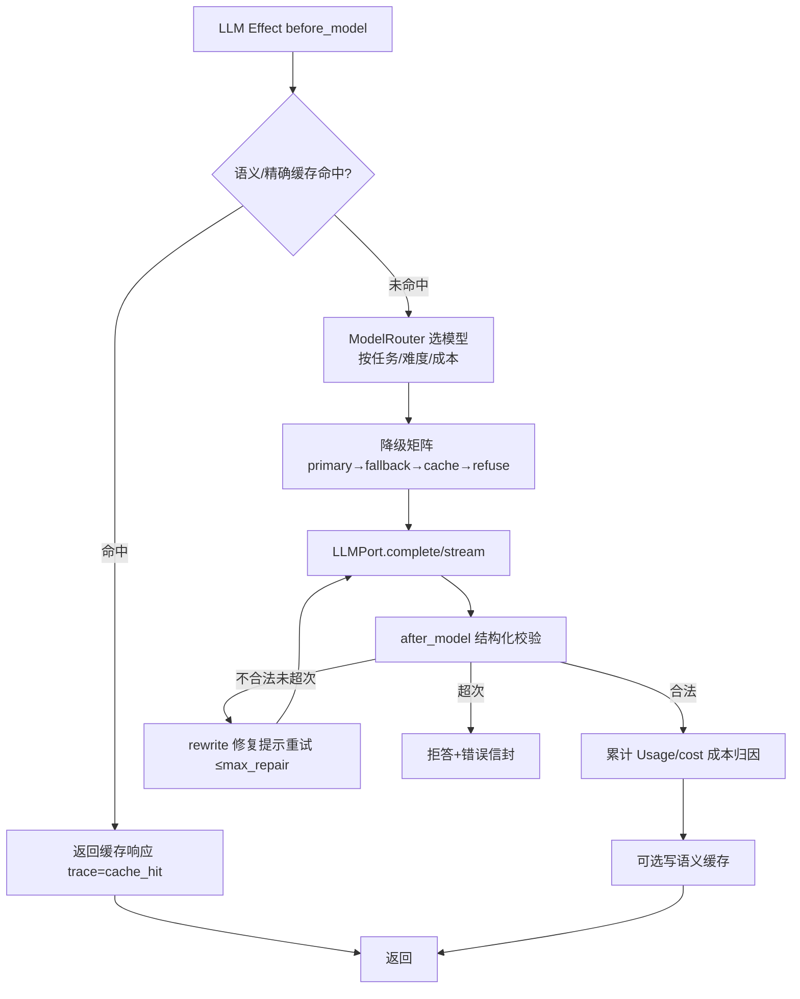

# R4：模型与推理（model）

> **实现状态**：已实现（R4 v1.3）。源码 `src/harness/model/` + 默认适配器 `src/ports/adapters/llm.py`，
> 测试 `tests/r4/` + `tests/ports/`，门禁 key `r4`。
> 独立 demo：`tests/demos/demo_r4.py`。复用 R2 的 LLMRequest/LLMResponse/Usage/LLMPort DTO 与协议。
> 路由/缓存/结构化校验修复/成本归因/成本硬闸全部落地；换 LLMPort 上层零改动。
> v1.1 补 OpenAICompatLLM 默认适配器（§6.1）+ ModelGateway.stream()；v1.2 补结构化流式事件 stream_events()（§4.1）；v1.3 缓存协议改收 LLMRequest + 默认 SimilarityCache（§4 重构说明）。

> **权威来源**：[《AGENT 总设计》](../../01-总览与设计/AGENT-总设计.md) §R4 C 域。本文为模块级拆分详设。
> 层：L1 能力插件 · 依赖：R1+R2 · 源码包：`src/harness/model/`（已实现）· 门禁 key：r4

---

## 1. 职责与边界

**做**：多 Provider 接入、模型路由、跨 provider 降级、语义/KV 缓存、结构化输出与修复重试、流式、token 计数与成本归因。
**不做**：工具执行（R5）；降级执行逻辑（R3）。R4 提供"模型维度"的路由与缓存，降级链复用 R3 的 Degradation。

## 2. 设计架构

LLM 调用经 before_invoke 链：缓存命中直接返回（省成本）→ 路由选模型 → 调用 → after_model 结构化校验（不合法则修复重试）→ 成本归因。模型降级矩阵复用 R3，目标从 provider 维度取。

## 3. 流程图



## 4. API 规范（完整接口）

```python
class LLMPort(Protocol):
    async def complete(self, req: LLMRequest, ctx: PortCtx) -> LLMResponse: ...
    last_usage: Usage | None   # 流式末块后写入，网关据此结算（缺失即拒答）
    def stream(self, req: LLMRequest, ctx: PortCtx) -> AsyncIterator[str]: ...  # PEP525 签名

class ModelRouter(Protocol):
    name: str
    def route(self, effect: Effect, ctx: PortCtx) -> RouteDecision: ...   # 返回 RouteDecision(model, reason)，reason 进 trace
class CachePort(Protocol):                          # 旧名 SemanticCache 保留为兼容别名
    name: str
    def get(self, request: LLMRequest, *, version: str = "v1") -> LLMResponse|None: ...
    def put(self, request: LLMRequest, resp: LLMResponse, *, version: str = "v1") -> None: ...
    def invalidate(self, request: LLMRequest, *, version: str = "v1") -> None: ...
    # v1.2：收 request 原文而非 sha256 key——语义缓存实现才拿得到 query 做相似度

@dataclass(frozen=True)
class StructuredOutputSpec:
    schema: dict
    mode: Literal["constrained","prompt","repair"] = "repair"
    max_repair: int = 2
    strict: bool = True

# DTO（ports/dto.py）
LLMRequest: messages / tools_catalog / model / temperature / max_tokens
LLMResponse: content / tool_calls / usage / model
Usage: prompt_tokens / completion_tokens / cost_usd
```

**缓存协议 v1.2 重构说明**（2026-11-18）：
旧协议叫 `SemanticCache.get(key: str)`，key 是网关侧 sha256 哈希——语义缓存实现拿到的是不可逆哈希，
根本算不了相似度（协议名承诺语义、参数只支持精确）。修复：
1. 协议更名 `CachePort`（中性命名，旧名 `SemanticCache` 保留为兼容别名），签名改收 `LLMRequest` 原文；
2. key 策略下沉到实现内部：`ExactCache` 仍用 sha256 精确匹配（行为不变），
   新增 `SimilarityCache` 用 difflib 归一化文本相似度（纯 Python，不依赖 R6 Embedder，开箱即用）；
3. ModelGateway 不再算 key，直接把 request 传给 cache——职责归位。
用户可用向量相似度替换 `SimilarityCache`（同为 CachePort），真正兑现"语义缓存可插拔"。

**实现映射（v1.0）**：设计契约与落地类一一对应——结构化规格 `StructuredOutputSpec`（对外字段 `schema`，
内部属性 `json_schema` 以避免遮蔽 BaseModel.schema）+ 校验器 `StructuredOutputValidator`；
缓存键 `build_cache_key`（含 prompt_version）+ `CacheKey`；路由 `ModelRouter` 协议 + 默认 `RuleRouter`（决策 `RouteDecision`）；
缓存 `CachePort` 协议（旧名 SemanticCache 兼容）+ 默认 `ExactCache`（精确）+ `SimilarityCache`（语义相似度）；成本 `CostRecord` / `UsageLedger` / `CostAttributor` / `CostGuard`；
编排 `ModelGateway`（缓存→路由→调用→校验修复→记账）；装配 `ModelCapability`。
测试用 fake LLM（`RecordingLLM` / `StreamLLM`）只放在 `tests/r4/fakes.py`，**不进 src、不进公共 API**；
真实后端由注入方实现 `LLMPort` 提供（见 §6）。

### 4.1 流式编排设计（v1.1 补齐，2026-11-18）

设计背景：`LLMPort.stream()` 是 Port 层契约（R2 §4），返回 `AsyncIterator[str]`。
R1 的 `EffectKind` 没有 STREAM，故流式请求**绕过 R1 Effect 循环**，由 R4 作为 Port 直连能力提供给外层。

**`ModelGateway.stream()` 契约（待代码实现）**：

```python
async def stream(
    self, request: LLMRequest, ctx: PortCtx
) -> AsyncIterator[str]:
    """流式补全：缓存→路由→降级前半段 + 逐块转发 + 结束时结算。"""
    ...
```

编排步骤：
1. **缓存键与命中**：与 `complete()` 共用 `build_cache_key(request, prompt_version)`。
   命中缓存 → 把缓存响应的 `content` 按字符块逐块 yield，标 `trace=cache_hit`，不调后端。
2. **路由与降级**：复用 `ModelRouter` 决策与 R3 `Degradation` 阶梯（决策进 trace）。
3. **逐块转发**：`async for chunk in self._llm.stream(request, ctx): yield chunk`。
   真后端由注入方实现（§6），框架不内置。
4. **取消传播**：消费方 `aclose()` → 生成器 `GeneratorExit` → 后端须在 `try/finally` 关闭 HTTP 流。
   这是 async generator 语义，不另造机制；`tests/r4/fakes.py` 已验证可中断。
5. **成本结算（诚实原则）**：后端 `LLMPort.last_usage` 是**协议强制成员**，流式末块后必须写入真实 usage。
   网关读取它记账；**若缺失则显式拒绝并返回错误，绝不记一笔假零成本掩盖账单缺口**。
   用户中途取消时后端同样应写入已产出 token 的 usage；确实无法结算的后端不得声称实现流式契约。
6. **结构化校验**：流式下 `StructuredOutputSpec` **禁用**（无法校验半截流）；
   若需校验，改为流式结束后对完整文本一次性校验并按需修复（属增强，非 v1 范围）。
7. **结构化流式事件**（v1.2 补齐）：`AsyncIterator[str]` 只能表达文本，无法表达工具调用开始/结束、
   handoff、状态增量——这是主流 Agent 框架的标配。为不破坏已锁定的 `stream()` 契约，
   新增并列方法 `stream_events() -> AsyncIterator[StreamEvent]`，`stream()` 降级为其文本便利视图：

   ```python
   class StreamEventKind(str, Enum):
       TEXT_DELTA = "text_delta"        # 文本增量（data: str）
       TOOL_CALL_START = "tool_call_start"   # 工具调用开始（data: {name, call_id}）
       TOOL_CALL_DELTA = "tool_call_delta"   # 工具参数增量（data: {call_id, args_delta}）
       TOOL_CALL_END = "tool_call_end"       # 工具调用完成（data: {call_id}）
       HANDOFF = "handoff"              # 角色/程序切换（data: {to}）
       USAGE = "usage"                  # 末块 usage（data: Usage）
       DONE = "done"                    # 流结束

   @dataclass(frozen=True, slots=True)
   class StreamEvent:
       kind: StreamEventKind
       data: DynamicValue = None
   ```

   `ModelGateway.stream_events()` 逐块透传后端事件并在 USAGE 事件结算；
   `ModelGateway.stream()` = 只 yield `TEXT_DELTA` 的 data（向后兼容，旧调用方零改动）。
   LLMPort 增 `stream_events()` 默认方法（基类用 `stream()` 包成 TEXT_DELTA），真后端可覆盖产出工具事件。

与 `complete()` 的关系：两条路径并列，都经过路由/降级/缓存；`complete()` 额外做结构化校验与精确记账。

## 5. 元数据与关键字段（核心字段）

| 字段 | 说明 |
|------|------|
| LLMRequest | messages/tools_catalog/model/temperature/max_tokens |
| LLMResponse | content/tool_calls/usage/model |
| 消息结构 | 统一复用 R1 `Message`（role/content/name/tool_calls 四字段）；R4 不再另造仅含两字段的 ChatMessage，避免重复且更薄的平行结构。LLMRequest.messages 的每项须能无损承载这四字段 |
| cache key | hash(messages + model + params + prompt_version) |
| 成本归因维度 | per-run/per-agent/per-user/per-model |
| StructuredOutputSpec | schema/mode/max_repair/strict |

**降级矩阵模型维度**：强→中→便宜→语义缓存答案→明确拒答；每级带 quality 分与延迟预算。路由决策进 trace。

## 6. 可插拔契约

| 注入点 | 协议 | 默认 | 校验 |
|--------|------|------|------|
| LLM 后端 | LLMPort | OpenAI-compat | 实现 complete/stream |
| 路由 | ModelRouter | 规则路由 | 返回目标已注册 |
| 缓存 | CachePort | ExactCache + SimilarityCache | 收 request 原文；键含版本；语义阈值保守 |
| 结构化输出 | StructuredOutputSpec | repair | schema 合法 |

### 6.1 默认 LLMPort 适配器：OpenAICompatLLM（v1.1，2026-11-18 补齐）

设计声明"LLM 后端默认 OpenAI-compat"（§6），但此前无默认实现类——违反 R13"四要素"中的②默认实现。
现补齐唯一默认适配器，使"开箱即用"成立：

**源码位置**：`src/ports/adapters/llm.py`（独立端口适配器包，不被 harness 业务代码 import；
框架通过 `ModelCapability(llm=...)` 注入，用户不注入时才由装配层构造默认实例）。

**契约**：

```python
class OpenAICompatLLM:
    """OpenAI-compatible HTTP 后端（需 base_url + api_key + model）。

    字段：
        name: "openai_compat"。last_usage: 最近一次调用的 usage（协议成员）。
    构造参数：
        base_url: OpenAI-compatible 端点。api_key: 密钥（不进 trace/日志）。
        model: 默认模型名。client: 可注入 httpx 客户端（测试用 fake，避免真联网）。
    """
    name = "openai_compat"
    last_usage: Usage | None

    def __init__(self, *, base_url: str, api_key: str, model: str,
                 client: httpx.AsyncClient | None = None) -> None: ...

    async def complete(self, req: LLMRequest, ctx: PortCtx) -> LLMResponse: ...
    def stream(self, req: LLMRequest, ctx: PortCtx) -> AsyncIterator[str]: ...
```

行为约定：
1. `complete()` POST `{base_url}/chat/completions`，解析 `choices[0].message.content` 与 `usage`，写入 `last_usage`。
2. `stream()` POST 同端点带 `stream=True, stream_options={"include_usage": True}`，
   逐块解析 SSE `data:` 行的 `choices[0].delta.content` 并 yield；末块 usage 写入 `last_usage`。
3. 错误（4xx/5xx、超时）折叠为 `Result` 语义的 `LLMResponse`（不向调用方抛裸异常）；
   SSE 断流由 `try/finally` 关闭响应。
4. api_key 只进 Authorization 头，绝不写入 trace / 日志 / 快照（K3 凭据管理）。
5. 无真实凭据时由测试注入 fake `client`（httpx.MockTransport），保证模块内闭环、不联网。

`src/ports/adapters/` 不在已实现模块契约锁内（R1~R4 仅 runtime/hooks/harness），
新增该类属兼容扩展。

## 7. 模块内闭环核对（CL-1~CL-5）

| 条件 | 实现 | 证据 |
|------|------|------|
| CL-1 契约自足 | 依赖 R1 types + R2 Hook + LLMPort | import 扫描 |
| CL-2 自带 fake | fake LLM（录制响应） | fake 用例 |
| CL-3 自带测试 | tests/r4/ | 覆盖率报告 |
| CL-4 独立 demo | `make demo-r4` | demo 冒烟 |
| CL-5 文档自足 | 本文 + AGENT-总设计对应章节 | 文档评审 |

## 8. 验收标准

1. 未过 schema 校验的输出不进工具调用/业务逻辑；
2. 语义缓存误命中率评测达标、键含版本；
3. 换 LLMPort 实现上层零改动；
4. 成本按 per-run/user/model 正确归因；流式取消可中断。

## 9. 功能验证矩阵

| 功能点 | 用例 ID | 验证方式 | 通过标准 |
|--------|---------|---------|---------|
| 结构化校验 | R4-T01 | `pytest tests/r4/test_structured.py -q` | 非法输出触发修复，超次拒答 |
| 缓存（精确+语义） | R4-T02 | `pytest tests/r4/test_cache.py -q` | 精确/相似度命中；版本隔离；误命中率达标 |
| 模型路由 | R4-T03 | `pytest tests/r4/test_router.py -q` | 按任务选模型，决策进 trace |
| 成本归因 | R4-T04 | `pytest tests/r4/test_cost.py -q` | 多维归因正确 |
| 换后端 | R4-T05 | `pytest tests/r4/test_adapter.py -q` | 换 LLMPort 上层零改 |
| 独立闭环 | R4-D01 | `make demo-r4` | demo 冒烟 |

## 10. 门禁清单

| 门禁 | 条目 | 达标标准 | 级别 |
|------|------|---------|------|
| R4-G1 | 覆盖 | 路由/缓存/结构化单测 ≥85% | G1 |
| R4-G2 | 结构化/缓存 | 未校验输出不进业务；误命中率达标 | G2 |
| R4-G3 | 集成 | 换 LLMPort 上层零改动 | G3 |
| R4-红线 | 成本 | 路由/重试绕过 Budgets→拒绝 | 红线 |

---
*R4 模块详设 v2.1 · 派生自 AGENT-总设计 · 已实现（代码见 src/harness/model/）*