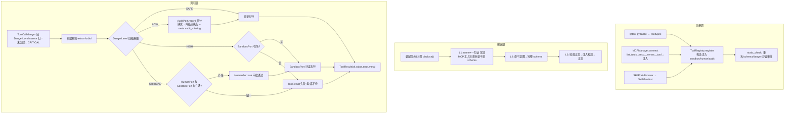

# R5：工具·MCP·技能（tools）

> **实现状态**：v2.2 代码已实现（R5 v1.0 + 装配期自动注册）。`src/harness/tools/` + `src/harness/skills/` 已落地；测试 `tests/r5/`、demo `tests/demos/demo_r5.py`、门禁 key `r5`（15/15）全部就绪。


> **权威来源**：[《AGENT 总设计》](../../01-总览与设计/AGENT-总设计.md) §R5 D+E 域 §3~§6。本文为模块级拆分详设。
> 层：L1 能力插件 · 依赖：R1+R2（+ 构造注入 R9 三 Port） · 源码包：`src/harness/tools/` + `src/harness/skills/` · 测试：`tests/r5/` · 门禁 key：`r5`。

> **✅ 回头实现清单（已勾销）**：ToolPort→ToolRegistry、MCPPort→MCPManager、SkillPort→FileSkillProvider、DisclosureIndex→ToolIndex 四个默认实现，以及装配类 ToolsCapability、WebFetchTool（D13），均已落地（总设计[附录 B.1.2](../../01-总览与设计/AGENT-总设计.md)）。

---

## 1. 职责与边界

**做**：工具定义（@tool/pydantic）、统一 ToolRegistry、MCP 发现并合并进同一合集、技能 manifest/正文、tools+skills 三级渐进披露、danger 四级路由、代码/shell/文件执行（经沙盒）、WebFetchTool 工具封装（D13，浏览器/Web 访问，正文一律过注入检测）。
**不做**：沙盒实现细节（R9 提供 SandboxPort，R5 只做路由）；R9 三 Port 的实现本体。

> **权威 danger 四级路由语义**（R9 §5 / 总设计 §R9.5，R5 照此实现，不得改写）：
> `SAFE`=直接执行 / `LOW`=AuditPort.record 审计后直执行 / `HIGH`=SandboxPort 沙盒执行 / `CRITICAL`=HumanPort.ask 审批通过后再 SandboxPort。
> 外部 danger 一律经 `DangerLevel.coerce()` 归一，未知值/None **显式回退到最严格的 CRITICAL（fail closed）**，绝不回退 SAFE。

## 2. 设计架构

**统一合集**是核心：本地 @tool、MCP 工具（`mcp__<server>__<tool>`）、Skill 正文都进同一个 Registry，运行时无差别。三级披露对统一合集投影：L1 目录常驻 / L2 schema 按需 / L3 正文按需。danger 分级驱动沙盒与审批路由。

R5 不自带沙盒/审批/审计实现：三者在 ToolRegistry 构造期注入（缺席即拒绝，见 §4/§6）。`DisclosureIndex` 协议归 R2 `protocols.py` 并登记 `PORT_PROTOCOLS["disclosure"]`，默认实现 ToolIndex 在 R5。装配类 ToolsCapability（§11）把上述组件与 R9 三 Port 组装为可插拔能力。

## 3. 流程图



## 4. API 规范（完整接口）

```python
# ---- R2 权威 DTO（src/hooks/dto.py）----
# DangerLevel(str, Enum) + coerce(value) -> DangerLevel：未知/None → CRITICAL（fail closed）
# ToolCall.danger / ToolSpec.danger / make_call(danger=...) 均为 DangerLevel
# ToolSpec  = name / description / parameters_schema / danger / source
# SkillManifest  = name / version / description / triggers          （SkillPort.discover/catalog 返回）
# DisclosurePacket = l1 / l2 / l3 / token_cost                       （DisclosureIndex.disclose 返回）

class SandboxPolicy(str, Enum):          # R5 本地策略枚举
    AUTO = "auto"; ALWAYS = "always"; NEVER = "never"

def tool(
    *,
    name: str | None = None,
    danger: DangerLevel,                 # 必填关键字（装配期强制）
    sandbox: SandboxPolicy = SandboxPolicy.AUTO,
    timeout: float = 30.0,
    retries: int = 2,
) -> Callable[[Callable[..., DynamicValue]], ToolFn]: ...   # pydantic model 即 schema

# ---- ToolPort：以 R2 protocols.py 协议为基础 ----
class ToolPort(Protocol):
    name: str
    def register(self, spec: ToolSpec, fn: Callable[..., DynamicValue]) -> None: ...
    def catalog(self, level: int = 1) -> list[ToolSpec]: ...   # level=L1/L2/L3 分级披露
    async def call(self, call: ToolCall, ctx: PortCtx) -> ToolResult: ...

class ToolRegistry:                      # ToolPort 默认实现
    # 构造注入 R9 三 Port：缺席即拒绝（不抛穿，返回 ToolResult 失败）
    def __init__(
        self, *,
        sandbox: SandboxPort | None = None,
        human: HumanPort | None = None,
        audit: AuditPort | None = None,
    ) -> None: ...
    # 协议方法（与 ToolPort 逐项一致，不破坏 LSP）
    def register(self, spec: ToolSpec, fn: Callable[..., DynamicValue]) -> None: ...
    def catalog(self, level: int = 1) -> list[ToolSpec]: ...
    async def call(self, call: ToolCall, ctx: PortCtx) -> ToolResult: ...
    # 超出协议的公共 API（不破坏 LSP）
    def bind(self, name: str, fn: Callable[..., DynamicValue]) -> None: ...   # 延迟绑定已注册工具
    def schema_of(self, name: str) -> dict[str, DynamicValue]: ...
    def static_check(self) -> list[str]: ...   # 返回问题列表；空表示通过
    def freeze(self) -> Self: ...              # 冻结注册表，之后 register 被拒
    def register_pending(self) -> list[str]: ...   # 【v2.2 增量】装配期批量注册 @tool 待注册项，返回注册名；成功即清空

# ---- 【v2.2 增量 · 2026-11-19】装配期自动注册（pending + flush）----
# tool() 除返回 ToolFn 外，把该 ToolFn 追加进模块级待注册容器（@tool 调用签名不变）。
# 装配期由 ToolRegistry.register_pending() 全量预检后批量注册，成功即清空；install() 自动调用。
# 配套公共 API：pending_tools() -> tuple[ToolFn,...]（快照）、clear_pending() -> None（测试隔离）。
#
# 硬契约（不变量）：
# 1. 时序：注册仍在装配期，不改"注册→披露→调用"顺序；运行期 call() 永不自动注册
#    （ToolCall 无 fn，且会破坏 freeze 与 danger 防伪造）。
# 2. 原子性：先全量预检（freeze 状态 + 全部重名），通过后才逐个 register；
#    预检覆盖 register 的全部失败条件，批量阶段不会抛，无半注册状态。
# 3. 重名：沿用 register 的 ValueError，一个冲突整体失败（fail-closed），不静默跳过。
# 4. 清空：成功注册后清空 pending；失败则保留，便于修正后重试。
# 5. 测试隔离：tests/r5/conftest.py 以 autouse fixture 每用例前 clear_pending()，防跨测试污染。

# ---- R9 依赖的四级路由（构造注入 + 缺席即拒绝）----
# SAFE     → 直接执行
# LOW      → AuditPort.record 审计后直执行；audit 缺席 → 降级直执行并在 meta 标 audit_missing=True
# HIGH     → SandboxPort 沙盒执行；sandbox 缺席 → 返回 ToolResult 失败（不抛穿）
# CRITICAL → HumanPort.ask 审批通过 → SandboxPort 沙盒执行；human 或 sandbox 缺席 → 返回 ToolResult 失败

# ---- MCP：以 R2 MCPPort 为准（list_tools/call_tool 均带 ctx）----
class MCPPort(Protocol):                 # R2 protocols.py 协议
    name: str
    async def list_tools(self, server: str, ctx: PortCtx) -> list[ToolSpec]: ...
    async def call_tool(
        self, server: str, tool: str, args: dict[str, DynamicValue], ctx: PortCtx,
    ) -> DynamicValue: ...
    async def ping(self, server: str, ctx: PortCtx) -> bool: ...   # 新增：健康探测

class MCPTransport(Protocol):            # 用户实现自定义 MCP 客户端的唯一接口；详见《自定义MCP客户端.md》
    name: str
    async def list_tools(self, server: str) -> list[ToolSpec]: ...   # 原始名，不加 mcp__ 前缀
    async def call_tool(self, server: str, tool: str, args: dict[str, DynamicValue]) -> DynamicValue: ...
    async def ping(self, server: str) -> bool: ...
    # 用户自定义客户端的模板/契约/履约自检见 docs/自定义MCP客户端.md；
    # 接线测试 tests/r5/test_custom_mcp_client.py 证明按接口实现即被 MCPManager 消费。

class MCPManager:                        # 实现 MCPPort；transport 构造注入
    name: str
    def __init__(self, registry: ToolRegistry, transport: MCPTransport) -> None: ...   # R13 构造签名兑现
    async def list_tools(self, server: str, ctx: PortCtx) -> list[ToolSpec]: ...
    async def call_tool(self, server: str, tool: str, args: dict[str, DynamicValue], ctx: PortCtx) -> DynamicValue: ...
    async def ping(self, server: str, ctx: PortCtx) -> bool: ...
    async def connect(self, server: str, ctx: PortCtx) -> list[ToolSpec]: ...   # fqname=mcp__<server>__<tool> 注入同一 Registry
    async def health(self, ctx: PortCtx) -> dict[str, bool]: ...   # 逐 server ping 结果（带 ctx 与 MCPPort 门面一致）

# ---- 技能与披露 ----
class SkillPort(Protocol):
    name: str
    def discover(self) -> list[SkillManifest]: ...
    def catalog(self) -> list[SkillManifest]: ...
    def body(self, name: str) -> str: ...            # L3 正文

class DisclosureIndex(Protocol):         # 协议归 R2 protocols.py + PORT_PROTOCOLS["disclosure"]
    name: str
    def disclose(self, names: list[str], skills: list[SkillManifest]) -> DisclosurePacket: ...

class ToolIndex:                         # DisclosureIndex 默认实现（src/harness/tools/index.py）
    name: str = "tool-index"
    def disclose(self, names: list[str], skills: list[SkillManifest]) -> DisclosurePacket: ...

# ---- 技能正文注入检测（R5 本地协议，不依赖 R9 的 SecurityCtx）----
# 裁决用 str,Enum（规则 5 有限取值），方法名 detect 与调用方一致（见 provider.py）。
class InjectionVerdict(str, Enum):
    CLEAN = "clean"                       # 放行正文
    INJECTED = "injected"                 # 拒绝加载该正文并记审计

class InjectionDetector(Protocol):
    name: str
    def detect(self, text: str) -> InjectionVerdict: ...

class KeywordInjectionDetector:          # 默认实现：关键词/正则启发式（fail-closed）
    name: str = "keyword_injection"
    def detect(self, text: str) -> InjectionVerdict: ...
```

## 5. 元数据与关键字段（核心字段）

| 字段 | 说明 |
|------|------|
| ToolSpec.name | 全局唯一；MCP=`mcp__<server>__<tool>`；用户工具 `x-*` 前缀 |
| ToolSpec.danger | `DangerLevel`（SAFE/LOW/HIGH/CRITICAL），装配期必填；经 `coerce()` 归一，未知→CRITICAL |
| ToolSpec.source | local/mcp/skill，审计用 |
| ToolResult.meta | danger/source/sandbox/duration_ms/approved/retryable/audit_missing |
| DisclosurePacket | L1/L2/L3/token_cost，披露成本进 trace |
| SkillManifest | name/version/description/triggers（定义于 R2 dto.py） |
| InjectionVerdict | clean/injected；技能正文（含 WebFetchTool 抓取正文）注入检测结果 |

**披露阈值**：合集 >20 条强制披露；<10 可全量注入。L1 目录有 token 上限；MCP 工具 L1 只进目录不进完整 schema（红线）。

**WebFetchTool（D13）**：R5 提供 WebFetchTool 工具封装（浏览器/Web 访问），其抓取正文视为不可信输入，披露 L3 前必须过 `InjectionDetector.detect()`，检出注入则拒绝加载正文并记审计（见 `src/harness/tools/webfetch.py`）。

## 6. 可插拔契约

| 注入点 | 协议 | 默认 | 校验 |
|--------|------|------|------|
| 工具实现 | ToolPort/@tool | ToolRegistry | danger 必填/schema 合法/高危配沙盒 |
| MCP 客户端 | MCPTransport | stdio/http | 三方法齐全；L1 只目录红线 |
| 技能 | SkillPort | 文件技能(FileSkillProvider) | 正文过注入检测 |
| 披露策略 | DisclosureIndex（R2 协议 + PORT_PROTOCOLS["disclosure"]） | ToolIndex（src/harness/tools/index.py） | token 预算；>20 强制披露 |
| 正文注入检测 | InjectionDetector（R5 本地） | KeywordInjectionDetector | 技能/WebFetch 正文必过 |
| 沙盒（R9） | SandboxPort | 构造注入，缺席即拒绝 | HIGH/CRITICAL 缺 sandbox → ToolResult 失败 |
| 审批（R9） | HumanPort | 构造注入，缺席即拒绝 | CRITICAL 缺 human → ToolResult 失败 |
| 审计（R9） | AuditPort | 构造注入，LOW 缺席降级 | LOW 缺 audit → 直执行 + meta.audit_missing |

## 7. 模块内闭环核对（CL-1~CL-5）

| 条件 | 实现 | 证据 |
|------|------|------|
| CL-1 契约自足 | 依赖 R1 types + R2 Hook + Port | import 扫描 |
| CL-2 自带 fake | tests/r5/conftest.py（FakeSandbox/Human/Audit/Injection/Fetcher/Transport）+ fake transport | fake 用例 |
| CL-3 自带测试 | tests/r5/ 覆盖门禁 | 覆盖率报告 |
| CL-4 独立 demo | `make demo-r5` | demo 冒烟 |
| CL-5 文档自足 | 本文 + AGENT-总设计对应章节 | 文档评审 |

## 8. 验收标准

1. 本地与 MCP 工具同一 Registry，catalog/call 无差别；MCP ping/health 可用，fqname 正确注册；
2. L1 不含完整 schema，超预算报错；
3. danger 四级路由（直执行/审计/沙盒/审批+沙盒）各生效；未知 danger 经 coerce 回退 CRITICAL；
4. R9 三 Port 构造注入缺席拒绝（HIGH 缺 sandbox、CRITICAL 缺 human/sandbox 返回 ToolResult 失败不抛穿；LOW 缺 audit 降级并标 audit_missing）；
5. 技能/WebFetch 正文过注入检测；ToolsCapability 装配可独立闭环；
6. 工具异常折叠为 ToolResult 不抛穿；装配期校验重名/danger/沙盒/审批。

## 9. 功能验证矩阵

| 功能点 | 用例 ID | 验证方式 | 通过标准 |
|--------|---------|---------|---------|
| @tool 定义 | R5-T01 | `pytest tests/r5/test_decorator.py -q` | schema 生成+extra=forbid+danger 必填 |
| 三级披露 | R5-T02 | `pytest tests/r5/test_index.py -q` | L1 无 schema；超预算报错 |
| danger 路由 | R5-T03 | `pytest tests/r5/test_routing.py -q` | 四级路由各生效；未知 danger 经 coerce 回退 CRITICAL |
| MCP 合并 | R5-T04 | `pytest tests/r5/test_mcp.py -q` | 注入同一 Registry 无差别；ping/health/fqname 正确 |
| 错误折叠 | R5-T05 | `pytest tests/r5/test_errors.py -q` | 异常折叠不抛穿 |
| 技能与注入检测 | R5-T06 | `pytest tests/r5/test_skills.py -q` | manifest/正文/注入检测（KeywordInjectionDetector） |
| 构造注入缺席拒绝 | R5-T07 | `pytest tests/r5/test_routing.py -q` | HIGH 缺 sandbox / CRITICAL 缺 human 或 sandbox → ToolResult 失败；LOW 缺 audit → meta.audit_missing |
| ToolsCapability 装配 | R5-T08 | `pytest tests/r5/test_capability.py -q` | registry()/manager()/index()/disclose() 可访问，闭环可测 |
| WebFetchTool（D13） | R5-T09 | `pytest tests/r5/test_webfetch.py -q` | 抓取正文过注入检测，命中即拒载 |
| 装配期自动注册（v2.2） | R5-T10 | `pytest tests/r5/test_pending.py -q` | @tool 入列/pending_tools 快照/register_pending 原子注册+清空+重名报错/freeze 拒绝/install 自动 flush |
| 独立闭环 | R5-D01 | `make demo-r5` + gate_check r5 | demo+门禁全绿 |

## 10. 门禁清单

| 门禁 | 条目 | 达标标准 | 级别 |
|------|------|---------|------|
| R5-G1 | 覆盖 | 注册/披露/调用三期 ≥95%（tools+skills 双包强制，当前 100%） | G1 |
| R5-G2 | 合并/披露 | 本地与 MCP 同一 Registry；L1 不含 schema | G2 |
| R5-G3 | 路由 | danger 四级各有用例；coerce 未知→CRITICAL | G3 |
| R5-G4 | 自动注册（v2.2） | pending 原子注册 + 重名报错 + 清空 + install 自动 flush；运行期 call 不注册 | G4 |
| R5-红线 | 安全 | CRITICAL 未审批执行/HIGH 缺 sandbox 放行；MCP schema 全量进 L1→拒绝 | 红线 |

## 11. 装配类 ToolsCapability

R5 提供统一装配类，把工具/MCP/技能/披露与 R9 三 Port 组装为一个可插拔能力（遵循 R2 `Capability` 契约）：

```python
class ToolsCapability:
    name: str = "tools"
    version: str = "5.0.0"
    requires: tuple[str, ...] = ()

    def __init__(
        self, *,
        registry: ToolRegistry | None = None,
        mcp: MCPManager | None = None,
        skills: SkillPort | None = None,
        disclosure: DisclosureIndex | None = None,
        sandbox: SandboxPort | None = None,
        human: HumanPort | None = None,
        audit: AuditPort | None = None,
    ) -> None: ...   # 构造注入；R9 三 Port 的缺席拒绝在 ToolRegistry.call 兑现
    def install(self, bus, reg) -> None: ...   # 注册各 Port/协议实例（R2 Capability 契约）；【v2.2】先调 self._registry.register_pending() 再注册各 Port
    def registry(self) -> ToolRegistry: ...
    def manager(self) -> MCPManager: ...
    def index(self) -> DisclosureIndex: ...
    def disclose(self, names: list[str]) -> DisclosurePacket: ...   # 委托 index + skills
```

> **披露触发**：v5 hooks 无 `before_model` 标准 hook。披露由装配层/R12 在调用模型前显式调用 `disclose(names)`；R5 自身闭环可独立测试，不擅自改 R2 hooks 定义。

---
*R5 模块详设 v2.2 · 派生自 AGENT-总设计 · 门禁 key=r5（15/15 全绿）*
