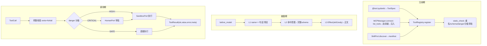

# R5：工具·MCP·技能（tools）

> **实现状态**：设计定稿，代码待实现（当前仓库已实现 R1~R4：runtime/hooks/resilience/model；本模块为设计态）。验证矩阵中的 tests/rN/ 为预留路径。


> **权威来源**：[《AGENT 总设计》](../../01-总览与设计/AGENT-总设计.md) §R5 D+E 域 §3~§6。本文为模块级拆分详设。
> 层：L1 能力插件 · 依赖：R1+R2 · 源码包：`src/harness/tools/` + skills/ · 门禁 key：`r5`（待实现）

> **⏳ 回头实现清单**：本模块负责 ToolPort→ToolRegistry、MCPPort→MCPManager、SkillPort→FileSkillProvider 三个默认实现（总设计[附录 B.1.2](../../01-总览与设计/AGENT-总设计.md)）。开发本模块时须落地并勾销。

---

## 1. 职责与边界

**做**：工具定义（@tool/pydantic）、统一 ToolRegistry、MCP 发现并合并进同一合集、技能 manifest/正文、tools+skills 三级渐进披露、danger 四级路由、代码/shell/文件执行（经沙盒）。
**不做**：沙盒实现细节（R9 提供 SandboxPort，R5 只做路由）。

## 2. 设计架构

**统一合集**是核心：本地 @tool、MCP 工具（`mcp__server__tool`）、Skill 正文都进同一个 Registry，运行时无差别。三级披露对统一合集投影：L1 目录常驻/L2 schema 按需/L3 正文按需。danger 分级驱动沙盒与审批路由。

## 3. 流程图



## 4. API 规范（完整接口）

```python
def tool(name=None, danger=DangerLevel, sandbox=SandboxPolicy.AUTO,
         timeout=30, retries=2): ...           # 装饰器，pydantic model 即 schema

@dataclass(frozen=True)
class ToolSpec:
    name: str; description: str; parameters_schema: dict
    danger: DangerLevel|None; source: Literal["local","mcp","skill"]

class ToolPort(Protocol):
    def register(self, spec, fn, *, bind=False) -> None: ...
    def catalog(self, level=1) -> list[ToolSpec]: ...
    def schema_of(self, name) -> dict: ...
    async def call(self, call: ToolCall, ctx: PortCtx) -> ToolResult: ...

class MCPTransport(Protocol):                   # 用户可接入自己的 MCP 客户端
    async def list_tools(self, server) -> list[ToolSpec]: ...
    async def call_tool(self, server, tool, args, ctx) -> DynamicValue: ...
    async def ping(self, server) -> bool: ...
class MCPManager:
    async def connect(self, server) -> list[ToolSpec]: ...   # fqname=mcp__server__tool 注入同一 Registry
    async def call(self, fqname, args, ctx=None) -> ToolResult: ...
    async def health(self) -> dict[str,bool]: ...

class SkillPort(Protocol):
    def discover(self) -> list[SkillManifest]: ...
    def catalog(self) -> list[SkillManifest]: ...
    def body(self, name) -> str: ...            # L3 正文
class DisclosureIndex(Protocol):
    def disclose(self, names, skills) -> DisclosurePacket: ...   # {L1,L2,L3,token_cost}

class ToolRegistry:   # ToolPort 默认实现（签名与上方 ToolPort 协议逐项一致）
    def register(self, spec: ToolSpec, fn: Callable[..., DynamicValue], *, bind: bool = False) -> None: ...
    def bind(self, name: str, fn: Callable[..., DynamicValue]) -> None: ...   # 延迟绑定已注册工具
    def catalog(self, level: int = 1) -> list[ToolSpec]: ...                  # 分级披露 L1/L2/L3
    def schema_of(self, name: str) -> dict[str, DynamicValue]: ...
    def static_check(self) -> list[str]: ...   # 返回问题列表；空表示通过
    def freeze(self) -> Self: ...              # 冻结注册表，之后 register 被拒
    async def call(self, call: ToolCall, ctx: PortCtx) -> ToolResult: ...
```

## 5. 元数据与关键字段（核心字段）

| 字段 | 说明 |
|------|------|
| ToolSpec.name | 全局唯一；MCP=`mcp__<server>__<tool>`；用户工具 `x-*` 前缀 |
| ToolSpec.danger | SAFE/LOW/HIGH/CRITICAL，必填 |
| ToolSpec.source | local/mcp/skill，审计用 |
| ToolResult.meta | danger/source/sandbox/duration_ms/approved/retryable |
| DisclosurePacket | L1/L2/L3/token_cost，披露成本进 trace |
| SkillManifest | name/version/描述/触发词 |

**披露阈值**：合集 >20 条强制披露；<10 可全量注入。L1 目录有 token 上限；MCP 工具 L1 只进目录不进完整 schema（红线）。

## 6. 可插拔契约

| 注入点 | 协议 | 默认 | 校验 |
|--------|------|------|------|
| 工具实现 | ToolPort/@tool | ToolRegistry | danger 必填/schema 合法/高危配沙盒 |
| MCP 客户端 | MCPTransport | stdio/http | 三方法齐全；L1 只目录红线 |
| 技能 | SkillPort | 文件技能 | 正文过注入检测 |
| 披露策略 | DisclosureIndex | ToolIndex | token 预算；>20 强制披露 |

## 7. 模块内闭环核对（CL-1~CL-5）

| 条件 | 实现 | 证据 |
|------|------|------|
| CL-1 契约自足 | 依赖 R1 types + R2 Hook + Port | import 扫描 |
| CL-2 自带 fake | tests/fakes/m4.py + fake transport | fake 用例 |
| CL-3 自带测试 | tests/r5/ 覆盖门禁 | 覆盖率报告 |
| CL-4 独立 demo | `make demo-r5` | demo 冒烟 |
| CL-5 文档自足 | 本文 + AGENT-总设计对应章节 | 文档评审 |

## 8. 验收标准

1. 本地与 MCP 工具同一 Registry，catalog/call 无差别；
2. L1 不含完整 schema，超预算报错；
3. danger 四级路由（审批/沙盒/直执行）各生效；
4. 工具异常折叠为 ToolResult 不抛穿；装配期校验重名/danger/沙盒/审批。

## 9. 功能验证矩阵

| 功能点 | 用例 ID | 验证方式 | 通过标准 |
|--------|---------|---------|---------|
| @tool 定义 | R5-T01 | `pytest tests/r5/test_decorator.py -q` | schema 生成+extra=forbid+danger 必填 |
| 三级披露 | R5-T02 | `pytest tests/r5/test_index.py -q` | L1 无 schema；超预算报错 |
| danger 路由 | R5-T03 | `pytest tests/r5/test_routing.py -q` | 四级路由各生效 |
| MCP 合并 | R5-T04 | `pytest tests/r5/test_mcp.py -q` | 注入同一 Registry 无差别 |
| 错误折叠 | R5-T05 | `pytest tests/r5/test_errors.py -q` | 异常折叠不抛穿 |
| 独立闭环 | R5-D01 | `make demo-r5` + gate_check r5 | demo+门禁全绿 |

## 10. 门禁清单

| 门禁 | 条目 | 达标标准 | 级别 |
|------|------|---------|------|
| R5-G1 | 覆盖 | 注册/披露/调用三期 ≥85% | G1 |
| R5-G2 | 合并/披露 | 本地与 MCP 同一 Registry；L1 不含 schema | G2 |
| R5-G3 | 路由 | danger 四级各有用例 | G3 |
| R5-红线 | 安全 | CRITICAL 未审批；MCP schema 全量进 L1→拒绝 | 红线 |

---
*R5 模块详设 v2.0 · 派生自 AGENT-总设计 · 门禁 key=r5（待实现）*