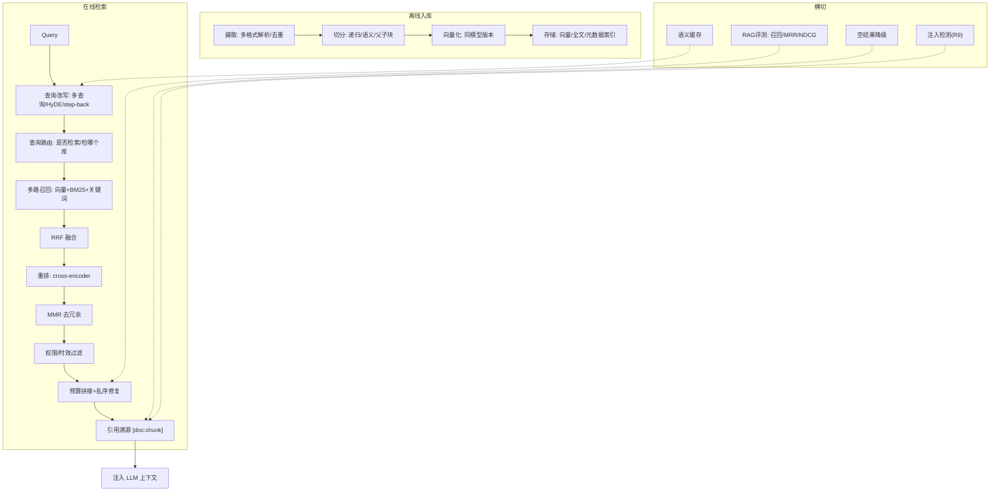

# R6：RAG 检索增强（rag）

> **实现状态**：✅ v2.1 代码已实现（2026-11-19）。`src/harness/rag/` 落地五段+三增强+横切，`RAGPipeline` 履约 `RAGPort`；测试 `tests/r6/`（覆盖率 94%）、demo `tests/demos/demo_r6.py`、门禁 key `r6`（14/14 全绿）全部就绪。总设计[附录 B.1.2](../../01-总览与设计/AGENT-总设计.md) 的 RAGPort 行已勾销移入 B.1.1。测试目录 `tests/r6/`、门禁 key `r6` 与仓库 R1~R5 约定对齐（原稿写 `tests/rag/` + "门禁 key 无"，已纠偏）。
>
> **v2.1 修订说明（只补矛盾缺口，不推翻 20 项能力/五段架构）**：① `RAGPipeline` 履约 `RAGPort` 签名（`name`/`ingest(documents, ctx)->int`/`retrieve(query, ctx)->list[DynamicValue]`），保留 `query(q)->RAGResult` 为模块内部富入口；② 澄清注入检测职责——检测器协议与默认实现复用 R5 已落地的 `InjectionDetector`/`KeywordInjectionDetector`（`src/harness/skills/provider.py`），R6 只在检索正文进入 context 前接入检测并 fail-closed，不重复定义检测器；③ 20 项分解口径统一为「入库 5 + 检索 9 + 横切 6」；④ 可插拔契约明确为 8 个注入点。


> **权威来源**：[《AGENT 总设计》](../../01-总览与设计/AGENT-总设计.md) §R6（20 项逐项参数/算法/边界/指标）。本文为模块级拆分详设。
> 层：L1 能力插件 · 依赖：R1+R2（+ 复用 R5 注入检测器） · 源码包：`src/harness/rag/`（原 M5）· 测试：`tests/r6/` · 门禁 key：`r6`

> **⏳ 回头实现清单**：本模块负责 RAGPort→RAGPipeline 默认实现（总设计[附录 B.1.2](../../01-总览与设计/AGENT-总设计.md)）。开发时须落地并勾销；实现 `RAGPort`（`PORT_PROTOCOLS["rag"]`）时签名必须与 `src/hooks/protocols.py` 逐方法一致。

---

## 1. 职责与边界

**做**：20 项链路优化（离线入库 5 层 + 在线检索 9 层 + 横切 6 层 = 20），每段是 Protocol + 默认实现，可单独替换与评测。
**不做**：把检索结果当指令执行；记忆语义（R7 复用本模块 Embedder/VectorStore）；不重复定义注入检测器（复用 R5 `InjectionDetector`，R9 只定义统一策略与输入护栏协议，检测器本体已在 R5 落地）。R6 的职责是**在检索正文进入 context 前接入检测并按裁决 fail-closed**（命中 `INJECTED` 即拒绝该片段入 context），而非自造检测算法。

## 2. 设计架构

RAG 不是单个组件，是可分层评测、逐层优化的流水线。分层是"链路优化"的前提——能定位是哪层掉了指标。核心纪律：**召回是上限，重排是逼近上限**，先修召回再修排序。

## 3. 流程图



## 4. API 规范（完整接口）

```python
class Splitter(Protocol):
    name: str
    def split(self, doc: Document) -> list[Chunk]: ...
class Embedder(Protocol):
    name: str
    async def embed(self, texts: list[str]) -> list[Vector]: ...
class VectorStore(Protocol):
    name: str
    async def upsert(self, chunks: list[Chunk]) -> None: ...
    async def search(self, vec, top_k, filters) -> list[Hit]: ...
class Retriever(Protocol):
    name: str
    async def retrieve(self, query: Query) -> list[Hit]: ...
class Reranker(Protocol):
    name: str
    def rerank(self, hits: list[Hit], query: Query) -> list[Hit]: ...
class QueryRewriter(Protocol):
    name: str
    async def rewrite(self, query: Query) -> list[Query]: ...
class PostProcessor(Protocol):
    name: str
    def filter(self, hits: list[Hit]) -> list[Hit]: ...
    def assemble(self, hits: list[Hit], budget: TokenBudget) -> RAGResult: ...

class RAGPipeline:
    """履约 RAGPort（PORT_PROTOCOLS['rag']）；签名对齐 src/hooks/protocols.py。"""
    name: str = "rag_pipeline"
    def __init__(self, splitter, embedder, store, retriever, post, *,
                 rewrite=None, rerank=None, cache=None,
                 detector=None): ...

    # ---- RAGPort 契约方法（供 R12 装配层注入 registry.register("rag", ...)）----
    async def ingest(self, documents: list[DynamicValue], ctx: PortCtx) -> int:
        """Port 入口：DynamicValue→Document 投影后入库，返回成功入库的块数。"""
    async def retrieve(self, query: str, ctx: PortCtx) -> list[DynamicValue]:
        """Port 入口：str→Query（token_budget 取自 ctx.budget_left）→ query()；
        把 hits 投影为带引用溯源（[doc:chunk]）的 DynamicValue 列表。"""

    # ---- 模块内部富入口（R6 自身/测试用，返回结构化结果）----
    async def query(self, q: Query) -> RAGResult: ...
    def with_(self, **replacements) -> RAGPipeline: ...    # 不可变替换
```

**Port / 富入口双轨说明**（v2.1 新增）：`ingest()`/`retrieve()` 是对齐 `RAGPort` 的**框架入口**——签名、参数类型、返回类型与 `src/hooks/protocols.py:RAGPort` 逐字一致，装配期用 `isinstance(pipeline, PORT_PROTOCOLS["rag"])` 履约校验；`query()` 是**富入口**，返回带 `citations`/`empty`/`tokens_used` 的 `RAGResult`，供 R6 单测与后续 R12 组装精细消费。`retrieve()` 内部委托 `query()`，只做 DTO 投影，不重复实现检索逻辑。`DynamicValue` 即 R1 `fold.py` 的宽松值类型（`Any`），`PortCtx` 见 `src/hooks/dto.py:147`，`ctx.budget_left` 用于派生 `TokenBudget`。

## 5. 元数据与关键字段（核心字段）

| 字段 | 结构 | 说明 |
|------|------|------|
| Chunk | {chunk_id,doc_id,text,tokens,meta} | meta 含标题/页码/权限标签 |
| Hit | {chunk,score,source,ts} | 检索命中 |
| Query | {text,filters,top_k,token_budget,purpose} | purpose 区分问答/记忆召回 |
| RAGResult | {context,citations,hits,empty,tokens_used} | empty=True 固定提示文本 |
| TokenBudget | int \| None（None=不限，0=无预算） | 从 R1 Budgets 派生（max_tokens−used_tokens） |
| RRF 常数 k | 60 | RRF(d)=Σ weight/(k+rank) |

**20 项能力**（口径对齐 §1，5+9+6=20）：
- 入库 5：摄取 / 切分 / 向量化 / 存储 / 索引
- 在线检索 9：改写 / 路由 / 多路召回 / RRF / 重排 / MMR / 过滤 / 预算拼接 / 引用溯源
- 横切 6：语义缓存 / 空结果降级 / 自检索 / 评测 / 增量 / 注入检测接入

内置优化可开关：rewrite / hybrid / rerank；红线不可关：引用溯源 / 预算拼接 / 空结果降级 / 注入检测接入。

**实现覆盖状态**（v2.1，2026-11-19 独立 review 后如实登记，禁止把占位当已实现）：
- ✅ **完整实现**：向量化、RRF 融合、预算拼接、引用溯源、乱序修复、空结果降级、注入检测接入、查询/入库向量同源。
- 🟡 **简化/近似实现（可注入替换升级）**：切分（递归+overlap，无语义/父子块）；存储与索引（向量点积 + meta 精确匹配，关键词通道是词面覆盖扫描、非真 BM25/倒排索引）；重排（词面覆盖近似、非真 cross-encoder，协议可注入替换）；查询改写（默认规则改写=同义词替换+子查询分解，无模型、词表可注入，已非复制占位；语义改写 HyDE/step-back 仍需注入替换，详见[设计规格](./R6-改写器加厚-设计规格.md)）；缓存（**精确缓存** InMemoryCache/CachePort，非语义相似缓存）。
- ⚪ **未实现 / 归其他模块**（设计保留能力，非当前模块缺陷）：查询路由（未实现，待 R12 装配决策）；MMR 去冗余（未实现）；权限/时效过滤的**语义判定**（当前仅做 meta 键值精确匹配与注入检测，复杂时效/权限规则归 R9）；自检索（未实现）；RAG 评测 Recall/MRR/NDCG（归 R10 EvalPort）；增量去重（当前 upsert 为追加，按 chunk_id/doc_id 覆盖语义未实现）。
- **红线保障**：引用溯源 / 预算不超 / 空结果确定性 / 注入 fail-closed 四项均真实实现并有测试；其中注入检测复用 R5 检测器，逐块检测后对融合候选统一兜底过滤（filters + 注入），跨块切断注入串属已知边界（拼接插入引用串与换行降低可利用性，评估归 R9 输入护栏统一处理）。

**注入检测接入纪律**（v2.1 澄清）：检测器协议 `InjectionDetector` 与默认实现 `KeywordInjectionDetector` 归 R5（`src/harness/skills/provider.py`），返回 `InjectionVerdict`（CLEAN/INJECTED）裁决；R9 只定义统一的输入护栏策略（哪些来源不可信），不另造检测器。R6 在 `PostProcessor.assemble` 之前对每个命中片段的正文调 `detector.detect()`，任一 `INJECTED` 即从候选中剔除（fail-closed），与 R5 skills/webfetch 的处置一致。构造参数 `detector=None` 时由装配层注入默认检测器；缺席即拒绝入 context，不存在"无检测器放行"分支。

## 6. 可插拔契约

可替换点共 **8 个**（5 段主协议 + 3 个增强协议），与 `RAGPipeline.__init__` 的 8 个构造参数一一对应；其余能力（RRF 融合/MMR/过滤/预算拼接/引用溯源/缓存/降级/注入接入）为默认实现内部步骤，不单独暴露协议——故 §1 "每段可单独替换"指这 8 个注入点。

| 注入点 | 协议 | 默认 | 校验 |
|--------|------|------|------|
| 切分 | Splitter | 递归 | 返回 Chunk 列表 |
| 向量化 | Embedder | OpenAI-compat（可注入 client） | 维度匹配 |
| 存储 | VectorStore | InMemoryVectorStore | upsert/search 齐全 |
| 召回 | Retriever | 混合（向量+词面关键词，RRF 融合） | 返回 Hit 结构；两通道同施 filters |
| 后处理 | PostProcessor | 默认（meta/注入兜底过滤+预算拼接+引用） | 不超预算、带引用 |
| 重排 | Reranker | 词面覆盖近似（可注入 cross-encoder） | 返回 Hit 结构 |
| 改写 | QueryRewriter | 规则改写（同义词替换+子查询分解，无模型，词表可注入；详见[改写器加厚设计规格](./R6-改写器加厚-设计规格.md)） | 不引入原问题没有的实体（同义词映射视为等价词） |
| 缓存 | CachePort（R6 本地协议，语义同 R4 CachePort 的精确缓存） | InMemoryCache | 命中/invalidate 生效；ingest 按 key 精准失效（本实例写入的 key 逐个失效，不清空整表，详见[缓存按 key 失效设计规格](./R6-缓存按key失效-设计规格.md)） |

> 注入检测**不是**第 9 个替换点：复用 R5 `InjectionDetector`，通过 `detector=` 构造参数传入（`RAGPipeline.__init__` 第 8 位之后的预留参数），默认由装配层给 `KeywordInjectionDetector`，缺席 fail-closed。

## 7. 模块内闭环核对（CL-1~CL-5）

| 条件 | 实现 | 证据 |
|------|------|------|
| CL-1 契约自足 | 依赖 R1 types + R2 Hook + 五段 Protocol | import 扫描 |
| CL-2 自带 fake | FakeEmbedder + InMemoryVectorStore | fake 用例 |
| CL-3 自带测试 | tests/r6/ 覆盖门禁（R6-T01~T07） | 覆盖率报告 |
| CL-4 独立 demo | `make demo-r6` 入库→查询→带引用 | demo 冒烟 |
| CL-5 文档自足 | 本文 + AGENT-总设计对应章节 | 文档评审 |

## 7.5 链路优化方法论（自查补齐）

RAG 不是一个组件，是**可分层评测、逐层优化**的流水线。核心纪律：**召回是上限，重排是逼近上限**——先修召回，再修排序，最后做生成层与成本优化。

```
答案错了 → 看 citation.hallucination_rate
  ├─ 引用无效/无支撑 → 生成层或知识库确实没有（应拒答）
  └─ 引用有效但答案错 → 模型问题，非 RAG 链路
召回不到正确文档 → 看 recall.union@{k}
  ├─ 并集就召不到 → 召回问题（切分/嵌入/改写/通道）
  └─ 并集召到但排序靠后 → 排序问题（RRF/重排/MMR）
太慢/太贵 → 改写/重排降档或跳过；重复查询开缓存
```
**重排救不了召回，生成救不了排序**——这是链路优化的基本纪律。每层可单独替换、单独评测（Recall@{k}/MRR/NDCG/引用覆盖率）。

## 7.6 关键算法参数（自查补齐）

| 层 | 参数 | 默认 | 作用 |
|----|------|------|------|
| 切分 | chunk_size / overlap / parent_child | 512 / 64 / True | 父子块兼顾精度与上下文 |
| 改写 | n_variants / synonyms（策略固定为规则改写，无 strategy 入参） | 3（最多变体数，含原串）/ 内置精简词表可注入 | 同义词替换+标点/连接词拆子句；无模型（详见[设计规格](./R6-改写器加厚-设计规格.md)） |
| 召回 | top_k_per_channel / channels | — | 向量+BM25+关键词并行 |
| RRF | k / weights | 60 / 均等 | `RRF(d)=Σ w/(k+rank)`，融合不同量纲 |
| 重排 | model / candidates / top_n | cross-encoder / 50 / 5 | 精排 top_n |
| MMR | lambda / sim_threshold | 0.7 / — | 相关性 vs 多样性权衡 |
| 拼接 | token_budget / reorder_middle | 派生 / True | 贪心装入+乱序修复（抗 lost-in-the-middle） |
| 引用 | verify | True | 校验输出引用 ID 在检索结果中存在 |

## 8. 验收标准

1. 五段各有替换用例，换任一段上层零改动；
2. 混合检索召回率高于纯向量基线；
3. 拼接不超 TokenBudget 且每片段带引用；
4. 空结果返回明确提示，模型不编造；
5. 检索文本含注入串时被 filter 拦截。

## 9. 功能验证矩阵

| 功能点 | 用例 ID | 验证方式 | 通过标准 |
|--------|---------|---------|---------|
| 八点替换 | R6-T01 | `pytest tests/r6/test_pipeline.py -q` | 换任一注入点上层零改 |
| RAGPort 履约 | R6-T01b | 同上 | `isinstance(p, PORT_PROTOCOLS["rag"])`；ingest/retrieve 签名一致 |
| 入库→检索 | R6-T02 | 同上 | 结果结构正确 |
| 混合 RRF | R6-T03 | `pytest tests/r6/test_hybrid.py -q` | 召回高于纯向量 |
| 预算拼接 | R6-T04 | `pytest tests/r6/test_budget.py -q` | 不超预算且带引用 |
| 空结果降级 | R6-T05 | `pytest tests/r6/test_fallback.py -q` | 明确提示不编造 |
| 注入检测接入 | R6-T06 | `pytest tests/r6/test_injection.py -q` | 注入串被剔除（复用 R5 检测器） |
| 检索缓存 | R6-T07 | `pytest tests/r6/test_cache.py -q` | 命中/invalidate 生效 |
| 独立闭环 | R6-D01 | `make demo-r6` | demo 冒烟 |

## 10. 门禁清单

| 门禁 | 条目 | 达标标准 | 级别 |
|------|------|---------|------|
| R6-G1 | 覆盖 | 五段替换用例 ≥85% | G1 |
| R6-G2 | 预算/降级 | 拼接不超预算；空结果/异常降级 | G2 |
| R6-G3 | 质量 | 混合召回高于纯向量基线 | G3 |
| R6-红线 | 安全 | 无溯源/空结果编造/未过注入检测→拒绝 | 红线 |

---
*R6 模块详设 v2.1 · 2026-11-19 修订（RAGPort 履约/注入职责/测试目录口径）+ 代码已实现 · 派生自 AGENT-总设计*