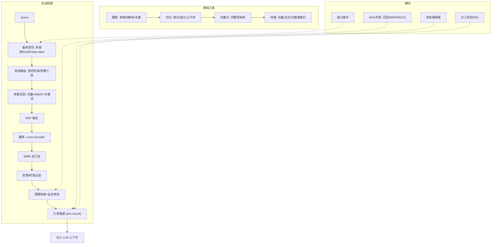

# R6：RAG 检索增强（rag）

> **实现状态**：设计定稿，代码待实现（当前仓库仅 R1/R2 已实现）。验证矩阵中的 tests/rN/ 为预留路径。


> **权威来源**：[《AGENT 总设计》](../../01-总览与设计/AGENT-总设计.md) §R6（20 项逐项参数/算法/边界/指标）。本文为模块级拆分详设。
> 层：L1 能力插件 · 依赖：R1+R2 · 源码包：`src/harness/rag/`（原 M5）· 门禁 key：无（设计态）

> **⏳ 回头实现清单**：本模块负责 RAGPort→RAGPipeline 默认实现（总设计[附录 B.1.2](../../01-总览与设计/AGENT-总设计.md)）。开发时须落地并勾销。

---

## 1. 职责与边界

**做**：20 项链路优化（离线入库 5 层 + 在线检索 12 层 + 横切 3 层），每段是 Protocol + 默认实现，可单独替换与评测。
**不做**：把检索结果当指令执行（注入检测在 R9）；记忆语义（R7 复用本模块 Embedder/VectorStore）。

## 2. 设计架构

RAG 不是单个组件，是可分层评测、逐层优化的流水线。分层是"链路优化"的前提——能定位是哪层掉了指标。核心纪律：**召回是上限，重排是逼近上限**，先修召回再修排序。

## 3. 流程图



## 4. API 规范（完整接口）

```python
class Splitter(Protocol):
    name: str
    def split(self, doc: Document) -> list[Chunk]: ...
class Embedder(Protocol):
    name: str
    async def embed(self, texts: list[str]) -> list[Vector]: ...
class VectorStore(Protocol):
    name: str
    async def upsert(self, chunks: list[Chunk]) -> None: ...
    async def search(self, vec, top_k, filters) -> list[Hit]: ...
class Retriever(Protocol):
    name: str
    async def retrieve(self, query: Query) -> list[Hit]: ...
class Reranker(Protocol):
    name: str
    def rerank(self, hits: list[Hit], query: Query) -> list[Hit]: ...
class QueryRewriter(Protocol):
    name: str
    async def rewrite(self, query: Query) -> list[Query]: ...
class PostProcessor(Protocol):
    name: str
    def filter(self, hits: list[Hit]) -> list[Hit]: ...
    def assemble(self, hits: list[Hit], budget: TokenBudget) -> RAGResult: ...

class RAGPipeline:
    def __init__(self, splitter, embedder, store, retriever, post, *,
                 rewrite=None, rerank=None, cache=None): ...
    async def ingest(self, docs: list[Document]) -> None: ...
    async def query(self, q: Query) -> RAGResult: ...
    def with_(self, **replacements) -> RAGPipeline: ...    # 不可变替换
```

## 5. 元数据与关键字段（核心字段）

| 字段 | 结构 | 说明 |
|------|------|------|
| Chunk | {chunk_id,doc_id,text,tokens,meta} | meta 含标题/页码/权限标签 |
| Hit | {chunk,score,source,ts} | 检索命中 |
| Query | {text,filters,top_k,token_budget,purpose} | purpose 区分问答/记忆召回 |
| RAGResult | {context,citations,hits,empty,tokens_used} | empty=True 固定提示文本 |
| TokenBudget | int | 从 R1 Budgets 派生 |
| RRF 常数 k | 60 | RRF(d)=Σ weight/(k+rank) |

**20 项能力**：入库（摄取/切分/向量化/存储/索引）、检索（改写/路由/多路召回/RRF/重排/MMR/过滤/预算拼接/引用/缓存/空结果降级/自检索/评测/增量/注入防御）。内置优化可开关：rewrite/hybrid/rerank；红线不可关：引用溯源/预算拼接/空结果降级/注入防御。

## 6. 可插拔契约

| 注入点 | 协议 | 默认 | 校验 |
|--------|------|------|------|
| 五段 | Splitter/Embedder/VectorStore/Retriever/PostProcessor | 递归/OpenAI/内存/混合/默认 | 方法齐全；DTO 对齐；维度匹配 |
| 重排 | Reranker | cross-encoder | 返回 Hit 结构 |
| 改写 | QueryRewriter | 多查询 | 不引入原问题没有的实体 |

## 7. 模块内闭环核对（CL-1~CL-5）

| 条件 | 实现 | 证据 |
|------|------|------|
| CL-1 契约自足 | 依赖 R1 types + R2 Hook + 五段 Protocol | import 扫描 |
| CL-2 自带 fake | FakeEmbedder + InMemoryVectorStore | fake 用例 |
| CL-3 自带测试 | tests/rag/ 覆盖门禁 | 覆盖率报告 |
| CL-4 独立 demo | `make demo-rag` 入库→查询→带引用 | demo 冒烟 |
| CL-5 文档自足 | 本文 + AGENT-总设计对应章节 | 文档评审 |

## 7.5 链路优化方法论（自查补齐）

RAG 不是一个组件，是**可分层评测、逐层优化**的流水线。核心纪律：**召回是上限，重排是逼近上限**——先修召回，再修排序，最后做生成层与成本优化。

```
答案错了 → 看 citation.hallucination_rate
  ├─ 引用无效/无支撑 → 生成层或知识库确实没有（应拒答）
  └─ 引用有效但答案错 → 模型问题，非 RAG 链路
召回不到正确文档 → 看 recall.union@{k}
  ├─ 并集就召不到 → 召回问题（切分/嵌入/改写/通道）
  └─ 并集召到但排序靠后 → 排序问题（RRF/重排/MMR）
太慢/太贵 → 改写/重排降档或跳过；重复查询开缓存
```
**重排救不了召回，生成救不了排序**——这是链路优化的基本纪律。每层可单独替换、单独评测（Recall@{k}/MRR/NDCG/引用覆盖率）。

## 7.6 关键算法参数（自查补齐）

| 层 | 参数 | 默认 | 作用 |
|----|------|------|------|
| 切分 | chunk_size / overlap / parent_child | 512 / 64 / True | 父子块兼顾精度与上下文 |
| 改写 | strategy / n_variants | multi_query / 3 | 多查询/HyDE/step-back |
| 召回 | top_k_per_channel / channels | — | 向量+BM25+关键词并行 |
| RRF | k / weights | 60 / 均等 | `RRF(d)=Σ w/(k+rank)`，融合不同量纲 |
| 重排 | model / candidates / top_n | cross-encoder / 50 / 5 | 精排 top_n |
| MMR | lambda / sim_threshold | 0.7 / — | 相关性 vs 多样性权衡 |
| 拼接 | token_budget / reorder_middle | 派生 / True | 贪心装入+乱序修复（抗 lost-in-the-middle） |
| 引用 | verify | True | 校验输出引用 ID 在检索结果中存在 |

## 8. 验收标准

1. 五段各有替换用例，换任一段上层零改动；
2. 混合检索召回率高于纯向量基线；
3. 拼接不超 TokenBudget 且每片段带引用；
4. 空结果返回明确提示，模型不编造；
5. 检索文本含注入串时被 filter 拦截。

## 9. 功能验证矩阵

| 功能点 | 用例 ID | 验证方式 | 通过标准 |
|--------|---------|---------|---------|
| 五段替换 | R6-T01 | `pytest tests/rag/test_pipeline.py -q` | 换任一段上层零改 |
| 入库→检索 | R6-T02 | 同上 | 结果结构正确 |
| 混合 RRF | R6-T03 | `pytest tests/rag/test_hybrid.py -q` | 召回高于纯向量 |
| 预算拼接 | R6-T04 | `pytest tests/rag/test_budget.py -q` | 不超预算且带引用 |
| 空结果降级 | R6-T05 | `pytest tests/rag/test_fallback.py -q` | 明确提示不编造 |
| 注入检测 | R6-T06 | `pytest tests/rag/test_injection.py -q` | 注入串被拦截 |
| 检索缓存 | R6-T07 | `pytest tests/rag/test_cache.py -q` | 命中/invalidate 生效 |
| 独立闭环 | R6-D01 | `make demo-rag` | demo 冒烟 |

## 10. 门禁清单

| 门禁 | 条目 | 达标标准 | 级别 |
|------|------|---------|------|
| R6-G1 | 覆盖 | 五段替换用例 ≥85% | G1 |
| R6-G2 | 预算/降级 | 拼接不超预算；空结果/异常降级 | G2 |
| R6-G3 | 质量 | 混合召回高于纯向量基线 | G3 |
| R6-红线 | 安全 | 无溯源/空结果编造/未过注入检测→拒绝 | 红线 |

---
*R6 模块详设 v2.0 · 派生自 AGENT-总设计 · 设计态*