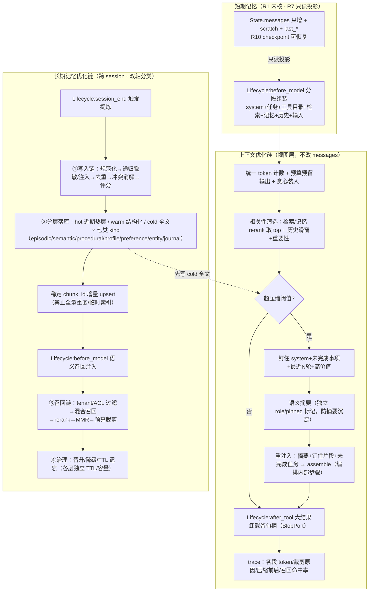

# R7：上下文与记忆（context + memory）

> **实现状态**：设计定稿 → 实现落地中（2026-11-20）。当前仓库已实现 R1~R6；本模块按[实现落地设计规格](#11-实现落地设计规格完整并入)落地（修复 4 Blocker：通知点未接线 / priority 无基础 / Offloader 错位 / MemoryPort 签名）。下文 §2/§3/§4/§6/§8 带 `【变更·2026-11-20】` 标记处为增量修订，原结论留痕见本文 §11.13。

> **【变更·2026-11-20 晚 · 完整性修订】**：用户拍板「短期记忆 + 长期记忆多分类 + 相应优化」后，本文 §1~§10 重写为**当前权威设计**，§12 给出可执行增量规格；§11 是当日早些时候的落地规格，**仅作历史留痕，与 §1~§10/§12 冲突处一律以后者为准**。四项已拍板决策：**D-1 短期记忆归 R1/R10 内核**（State.messages + scratch + last_*，checkpoint 可恢复），R7 只读投影、不另造实体；**D-2 长期记忆双轴分类**＝温度三层（hot/warm/cold）× 内容七类（episodic/semantic/procedural/profile/preference/entity/journal）；**D-3 四条优化链全覆盖**（写入 / 召回 / 上下文 / 安全与接线）；**D-4 本轮只改设计、不改代码**，代码落地另走场景6。原「hot=会话内」表述作废，改为「长期记忆近期热层」。
> **⚠️ 触发方式变更（对齐三体系）**：原设计把 before_model/after_compact/after_tool/session_end 当扩展点驱动，但按新体系 before_model/after_tool/session_end 是 **Lifecycle 通知点（纯通知、不拦截、异常隔离）**，且 `before_compact`/`after_compact` 已移出通知点清单（P7，R7 内部步骤）。上下文组装/压缩/记忆写入仍由 `ContextMemoryManager` **显式编排**，顺序由代码结构保证、不依赖通知优先级；通知点只用于挂观测/触发副作用。流程图中 `Lifecycle:<name>` 节点指向真实通知点，无对应通知点的阶段用普通文字节点。

> **权威来源**：[《AGENT 总设计》](../../01-总览与设计/AGENT-总设计.md) §R7。本文为模块级拆分详设。
> 层：L1 能力插件 · 依赖：R1+R2+R5(注入检测)+R6(Embedder/VectorStore/TokenBudget) · 源码包：`src/harness/context/` + `src/harness/memory/`（原 M7）· 门禁 key：**r7**（2026-11-20 定）

> **⏳ 回头实现清单**：本模块负责 MemoryPort→MemoryStore、StorePort→InMemoryStorePort、BlobPort→InMemoryBlobStore 三个默认实现（总设计[附录 B.1.2](../../01-总览与设计/AGENT-总设计.md)）。开发时须落地并勾销。

---

## 1. 职责与边界【变更·2026-11-20 晚 · 权威】

**做**：① 上下文工程——分段组装、Token 预算、相关性筛选、压缩 compaction、重注入、大结果卸载、可重放视图；② **长期记忆**——温度三层 hot/warm/cold × 内容七类 episodic/semantic/procedural/profile/preference/entity/journal，含写入提炼/去重/冲突消解/重要性评分/召回重排/遗忘/晋升降级的完整优化链。
**不做**：
- **短期记忆不属于 R7**——短期记忆 = `State.messages`（只增）+ `scratch` + `last_*`，归 R1 内核持有、R10 checkpoint 可恢复；R7 只读投影短期视图，不得另建 SessionBuffer、不得改 messages。
- 披露执行（R5，R7 提供上下文段）。
- 生产运行时接线（R12 阶段 A 负责装配；R7 提供 `ContextMemoryManager` 入口与通知点订阅契约）。

**权威口径（唯一）**：短期记忆/长期记忆的归属、生命周期与边界以本文 §12.1 + 总设 R1.5/R10.1/R7.1 为准；`能力域全景.md` G1/G2 与之对齐。

## 2. 设计架构【变更·2026-11-20 晚 · 权威】

上下文窗口是稀缺 RAM（context rot：越长质量越差），本模块像 OS 管理内存：分段组装 + 配额 + 相关性筛选 + 阈值压缩 + 语义摘要 + 重注入 + 大结果卸载，全程视图层投影（不改 messages，保证回放确定性）。

记忆采用**双轴模型**（解决原「hot=会话内」与长期记忆归属打架）：
- **温度轴 tier**（物理/检索属性）：hot 近期热层（短 TTL、高频召回、内存/Redis 目标）、warm 结构化层（主检索、向量索引、PG+pgvector 目标）、cold 全文归档（长 TTL、低频、对象存储目标）。**三层都是长期记忆**，hot 不是短期记忆。
- **内容轴 kind**（语义属性，七类）：episodic 情节、semantic 事实、procedural 流程、profile 用户画像、preference 偏好约束、entity 实体知识、journal 工作日志与决策。各类有独立提炼规则与召回场景（§12.2）。

**优化链四条**（缺一不可，详见 §12.3~§12.6）：写入链（提炼→脱敏/注入→去重→冲突消解→评分→分层落库→增量 upsert）、召回链（scope 过滤→混合召回→rerank→MMR→预算裁剪→注入检测）、上下文链（统一 token→预算贪心→相关性筛选→压缩钉住→语义摘要→重注入→卸载→可重放）、安全与接线链（tenant/ACL 双向校验 + 递归检测 + R12 装配 + 回放一致性）。

**顺序铁律保留**：会话边界 `commit_and_compact()` 先写 cold 全文再压缩，由代码结构固定、trace 快照锁定；通知点为纯通知（不拦截、无 priority），压缩/记忆写入走显式编排。

## 3. 流程图

【变更·2026-11-20 晚】节点约定：`Lifecycle:<name>` 指向 16 通知点中的真实通知点；压缩系列（compact/重注入）在新体系无对应通知点（P7 已移除 before_compact/after_compact），用普通文字节点表示 R7 内部编排步骤。**短期记忆与长期记忆分列两栏，边界可见**。



> 说明：短期记忆栏只有只读箭头指向上下文组装，**R7 不持有也不修改短期记忆实体**；四条优化链编号①②③④对应 §12.3~§12.6。

## 4. API 规范（完整接口）【变更·2026-11-20 晚 · 权威签名】

> **精确签名以本章 §4 + §12.2 为准**；§11.7.3 是历史快照（三类 kind / 五字段 MemoryItem），**不得据此实现**。当前 `src/harness/memory/types.py` 亦是旧版（三类、五字段、无 scope），字段扩展属场景6 coding 待办，本轮只改设计不改代码。
>
> **协议定性**：`Reinjector`/`TokenCounter`/`BlobPort` 均为 context 包**内部协议**，不进 `PORT_PROTOCOLS`（Port 种类仍为 14，符合 D-2）；`MemoryScope` 是 DTO，不是 Port。三者遵守协议四要素（协议 + 默认实现 + 归属 + install 入口），install 入口见 §6 契约表「归属/install」列与 §12.6。

```python
# 【变更·2026-11-20 晚】TokenBudget 从 R6 导入（唯一已定义处 harness/rag/types.py:116），不重定义
class ContextAssembler(Protocol):
    name: str
    def assemble(self, sections: list[ContextSection], budget: TokenBudget) -> list[Message]: ...
class CompactionPolicy(Protocol):
    name: str
    def should_compact(self, state: AgentState) -> bool: ...
    def compact(self, messages: tuple[Message,...]) -> tuple[Message,...]: ...  # 返回新 tuple，不改 state.messages
# 【新增】重注入：把摘要+钉住片段+未完成任务回注下一轮上下文（编排内部步骤，无通知点）
class Reinjector(Protocol):
    name: str
    def reinject(self, view: tuple[Message,...], summary: Message | None, tasks: tuple[str,...], budget: TokenBudget) -> tuple[Message,...]: ...  # 回注后按预算二次裁剪，禁止绕过预算
# 【新增】统一 token 计数：assemble 与 compaction 必须共用同一口径（禁止 len(str) 与 len/4 两套）
class TokenCounter(Protocol):
    name: str
    def count(self, text: str) -> int: ...

# BlobPort（卸载存储，语义正确）
class BlobPort(Protocol):
    name: str
    async def put(self, value: DynamicValue) -> str: ...           # 返回句柄 store://id
    async def get(self, handle: str) -> DynamicValue | None: ...  # 句柄必须可读
    async def delete(self, handle: str) -> None: ...
class Offloader(Protocol):
    name: str
    async def offload(self, value: DynamicValue, store: BlobPort) -> str: ...

# MemoryPort（参数名 namespace、ctx: PortCtx 标注、含 recall，与 R2 protocols.py 对齐）
class MemoryPort(Protocol):
    name: str
    async def read(self, namespace: str, key: str, ctx: PortCtx) -> DynamicValue: ...
    async def write(self, namespace: str, key: str, value: DynamicValue, ctx: PortCtx) -> None: ...
    async def forget(self, namespace: str, key: str, ctx: PortCtx) -> None: ...
    async def recall(self, query: "MemoryQuery", ctx: PortCtx) -> list["MemoryItem"]: ...

# 【变更·2026-11-20 晚】DTO 扩展：稳定 id / tenant / 评分字段 / 七类 kind
@dataclass(frozen=True)
class MemoryItem:
    item_id: str                      # 【新增】稳定标识（KV 与向量索引同源；禁止 enumerate 临时索引）
    kind: MemoryKind                  # 七类之一（见 §12.2）
    content: str
    importance: float                 # 【新增语义】由评分器算出，参与召回 rerank（非恒定 1.0）
    confidence: float                 # 【新增】冲突消解与召回排序依据
    ts: int                           # 【修正】真实写入时刻（禁止硬编码 0）
    tier: MemoryTier                  # 【新增】温度层，与 kind 正交
    scope: MemoryScope                # 【新增】tenant/user/session 可见域，双向校验
    source: str
    access_count: int = 0             # 【新增】晋升降级依据
@dataclass(frozen=True)
class MemoryQuery:                    # R7 自有召回查询 DTO，不复用 R6 Query
    text: str; top_k: int = 5; tier: MemoryTier | None = None; kind: MemoryKind | None = None
    scope: MemoryScope | None = None  # 【新增】tenant/ACL 过滤，缺省也要走默认 scope
@dataclass(frozen=True)
class MemoryScope:                    # 【新增】隔离域（tenant 必填，user/session 可选）
    tenant: str; user: str | None = None; session: str | None = None
@dataclass(frozen=True)
class ContextSection:
    name: str; content: str; quota: int; priority: int; trim_policy: str
```

## 5. 元数据与关键字段（核心字段）【变更·2026-11-20 晚 · 权威】

| 字段 | 说明 |
|------|------|
| ContextSection | name/content/quota/priority/trim_policy |
| CompactionPolicy 参数 | trigger_tokens(窗口70%)/trigger_turns(12)/keep_recent(4)/pin_patterns；摘要用独立 role 或 pinned 标记，禁止摘要 role=system 沉淀 |
| TokenCounter | 【新增】assemble/compaction 共用统一 token 计数口径（真实 tokenizer 或单一估算口径），配额与预算同单位 |
| Reinjector | 【新增】摘要+钉住片段+未完成任务的回注契约 |
| MemoryTier | hot 近期热层（短 TTL）/ warm 结构化层（主检索）/ cold 全文归档（长 TTL）——**三层均属长期记忆**，目标后端内存/Redis/PG+pgvector/对象存储，当前默认内存 |
| MemoryKind | 【扩展为七类】episodic 情节 / semantic 事实 / procedural 流程 / profile 用户画像 / preference 偏好约束 / entity 实体知识 / journal 工作日志与决策 |
| MemoryItem | 【扩展】item_id 稳定标识 / importance 评分 / confidence 置信度 / ts 真实写入时刻 / tier / scope / access_count |
| MemoryScope | 【新增】tenant 必填 + user/session 可选；写入与召回双向校验 |
| offload 句柄 | store://id + 摘要，模型按需再读 |

**分层策略（修正）**：hot/warm/cold 是长期记忆的三个物理/检索层，**各有独立 TTL 与容量上限**；访问频次高/importance 高者晋升（warm→hot 回温），低频/低分者降级（hot→warm→cold 沉降），TTL 过期 + 显式 forget + 冲突消解后遗忘。写入内容递归净化（含 dict/list 内的字符串），secret 与注入串 fail-closed。**短期记忆不在此列**——它归 R1/R10。

## 6. 可插拔契约【变更·2026-11-20 晚 · 权威 · 补归属/install】

> 四要素纪律（R13 §2）：每个注入点 = 协议 + 默认实现 + 归属 + install 入口。**Reinjector/TokenCounter 为 context 包内部协议，不进 PORT_PROTOCOLS（14 Port 不变）**，其 install 入口 = `ContextMemoryManager.__init__` 构造注入 + `with_()` 不可变替换（依赖由 5 个扩为 **7 个**：assembler/compaction/**reinjector**/**token_counter**/offloader/memory/blob）。

| 注入点 | 协议 | 默认 | 归属 | install 入口 | 校验 |
|--------|------|------|------|-------------|------|
| 组装 | ContextAssembler | DefaultContextAssembler | context 包 | `ContextMemoryManager.__init__` | system 不可覆盖；超预算降级裁剪 |
| 压缩 | CompactionPolicy | DefaultCompactionPolicy | context 包 | 同上 | 钉住进度与未完成任务；不改 messages；摘要不沉淀 |
| 重注入 | Reinjector | DefaultReinjector | context 包 | 同上（构造 + with_） | 摘要+钉住+未完成任务按 budget 二次装入，不绕过预算 |
| token 计数 | TokenCounter | DefaultTokenCounter | context 包 | 同上（构造 + with_） | assemble/compaction 同口径 |
| 卸载 | Offloader → BlobPort | DefaultOffloader / InMemoryBlobStore | context 包 | 同上 | 句柄必须可读（put/get/delete） |
| 记忆 | MemoryPort | MemoryStore（双轴分层 + 七类） | memory 包 | 同上（memory 参数） | 递归注入/secret 检测；tenant 双向校验；完整召回链 |
| 快照 | StorePort | InMemoryStorePort | memory 包 | Runner(store=...)（R1/R10） | save/load round-trip；与 memory 分离（短期 vs 长期） |
| 编排 | ContextMemoryManager | 默认装配 | context 包 | R12 阶段 A 生产装配显式构造 | 显式调用；先 cold 后 compact；视图可重放 |

> **【变更·2026-11-20】生产装配待办（交 R12，R7 文档仅登记不实现）**：`ContextMemoryManager` 目前只有 demo/测试显式构造，真实 Agent 运行时不会自动触发上下文组装/压缩/记忆写入。R12 阶段 A 必须显式登记并落地"接入 `ContextMemoryManager` + 挂 `session_end` / `before_model` 通知点"这一待办，避免 R7 成为"实现了但没接线"的孤岛。本模块不实现 R12 装配；通知点为纯通知（返回值不消费），触发副作用在订阅者实现内完成。

## 7. 模块内闭环核对（CL-1~CL-5）

| 条件 | 实现 | 证据 |
|------|------|------|
| CL-1 契约自足 | 依赖 R1 types + R2 AOP/Lifecycle 契约 + R6 Embedder/Store | import 扫描 |
| CL-2 自带 fake | fake MemoryPort/Store | fake 用例 |
| CL-3 自带测试 | tests/r7/ | 覆盖率报告 |
| CL-4 独立 demo | `make demo-r7` | demo 冒烟 |
| CL-5 文档自足 | 本文 + AGENT-总设计对应章节 | 文档评审 |

## 8. 验收标准【变更·2026-11-20 晚 · 权威】

1. 超阈值触发压缩、钉住消息保留、语义摘要不沉淀、压缩视图供 assemble 使用（压缩为编排内部步骤，无通知点）；
2. **短期记忆边界**：R7 不新建短期记忆实体、不改 messages；视图为 state 的纯函数投影可重放；
3. **长期记忆七类 × 三层**：每类有独立提炼规则，每层有独立 TTL/容量；晋升/降级/遗忘各有用例；
4. **四条优化链**：写入链（去重/冲突/评分/脱敏）、召回链（混合召回/rerank/MMR/预算裁剪）、上下文链（统一 token/贪心装入/重注入/卸载）、安全与接线链（tenant 双向校验 + R12 装配点登记）各有可判定用例；
5. 顺序确定性（编排器代码结构保证，trace 快照断言：先写 cold 再压缩）；
6. secret（含容器嵌套值）与注入串不进记忆；跨 tenant 召回不可串味。

## 9. 功能验证矩阵【变更·2026-11-20 晚 · 补齐七类/四链用例】

| 功能点 | 用例 ID | 验证方式 | 通过标准 |
|--------|---------|---------|---------|
| 上下文组装 | R7-T01 | `pytest tests/r7/test_assembly.py -q` | 分段配额+system 不被覆盖+超预算降级裁剪 |
| 压缩触发 | R7-T02 | `pytest tests/r7/test_compaction.py -q` | 阈值触发+钉住保留+摘要不沉淀+state 不变 |
| 大结果卸载 | R7-T03 | `pytest tests/r7/test_offload.py -q` | BlobPort 句柄可读+删除后 None |
| 记忆分层+召回 | R7-T04 | `pytest tests/r7/test_memory.py -q` | 七类×三层+晋升/降级/遗忘+独立 TTL+recall |
| DTO/secret 红线 | R7-T05 | `pytest tests/r7/test_types.py -q` | 不可变+secret 递归拒绝+稳定 item_id |
| 显式编排接线 | R7-T06 | `pytest tests/r7/test_wiring.py -q` | 注入替换+默认可用+trace 跨 with_ 保留 |
| 顺序确定性 | R7-T07 | `pytest tests/r7/test_ordering.py -q`（场景6新建，当前未建） | trace 快照：write.cold 先于 compact |
| **写入优化链** | R7-T08 | `pytest tests/r7/test_write_chain.py -q`（场景6新建，当前未建） | 去重/冲突消解/评分/递归脱敏各有用例 |
| **召回优化链** | R7-T09 | `pytest tests/r7/test_recall_chain.py -q`（场景6新建，当前未建） | 稳定 chunk_id 增量 upsert+tenant 过滤+rerank+MMR |
| **上下文优化链** | R7-T10 | `pytest tests/r7/test_context_chain.py -q`（场景6新建，当前未建） | 统一 token 计数+贪心装入+重注入+可重放视图 |
| **安全与接线** | R7-T11 | `pytest tests/r7/test_security_wiring.py -q`（场景6新建，当前未建） | 租户隔离+嵌套 secret 拒绝；R12 装配点做**文档契约断言**（R12 未实现，不跑运行时） |
| 独立闭环 | R7-D01 | `make demo-r7` | demo 打印 PASS |

> **用例现状（诚实标注）**：`tests/r7/` 当前实存 test_assembly/compaction/offload/memory/types/wiring 六个 + conftest.py；R7-T07~T11 五个文件**待场景6新建**。本表是目标验收口径，不宣称当前已通过。

## 10. 门禁清单【变更·2026-11-20 晚 · gate key = r7】

> **门禁工具对齐说明**：`gate_check.py` 的 G5 已于 2026-11-18 删除，**本文不再设 R7-G5**；下表分级沿用工具实际语义（G0 契约符号 / G1 覆盖+mypy+docstring / G2 behavior / G3 integration / G4 文档八要素 / 红线），「优化链」作为 G2/G3 的新增 behavior/integration 条目落地，不另造级别。标注「场景6补工具」的条目需在 coding 阶段同步改 `gate_check.py` 的 `MODULES["r7"].symbols/behavior/integration` 与 `ast_scan.py scan_r7`，否则门禁查不到。

| 门禁 | 条目 | 达标标准 | 级别 |
|------|------|---------|------|
| R7-G0 | 契约符号 | 既有 18 符号 + 新增 Reinjector/TokenCounter/DefaultReinjector/DefaultTokenCounter/MemoryScope/ScopeResolver 符号 import 成功（**场景6补 gate_check 符号表**） | G0 |
| R7-G1 | 覆盖 | context+memory 组装/压缩/卸载/记忆/四链 ≥85% | G1 |
| R7-G2 | 压缩/记忆/四链 | 阈值触发+钉住+摘要不沉淀；七类×三层独立 TTL；写入链去重/冲突/评分、召回链 scope/rerank/MMR、上下文链统一计数/重注入（**场景6补 behavior 用例表**） | G2 |
| R7-G3 | 集成 | 先写 cold 再压缩顺序确定（trace 快照）；压缩视图纯函数可重放；tenant 跨租户串味拒绝（**场景6补 integration 用例表**） | G3 |
| R7-G4 | 装配文档 | demo_r7 PASS；文档八要素完整；R12 装配点已登记（文档断言） | G4 |
| R7-红线 | 一致 | 压缩改 messages / secret 进记忆（含嵌套）/ 注入串放行 / 跨 tenant 串味 → 拒绝 | 红线 |

## 11. 实现落地设计规格（完整并入）

> **⚠️ 历史留痕声明（2026-11-20 晚）**：本章是当日早些时候为修复 4 Blocker 而并入的落地规格，**已被本文 §1~§10 + §12 的完整性修订覆盖**。冲突点一律以新章节为准：① §11.2/§11.5 的"三层三类"→ 七类（§12.2）；② §11.7.3 的 MemoryItem 字段 → §4 扩展版（item_id/confidence/tier/scope/access_count）；③ §11.5 FR-9 的"支持晋升/降级/TTL 遗忘"→ §12.4 的独立 TTL + 完整写入链；④ §11.10 U-2 的"新接口分离"仍成立。保留本章仅为可追溯，勿据此实现。

> 本章由独立文件 `R7-上下文与记忆-实现落地设计规格.md` 完整并入（2026-11-20 合并），派生自 `overviews/2026-11-20/20261120-0429-R7审查到扩展体系重构.md`。本章为本文 §1~§10 设计定稿的落地规格（补充设计，不推翻）。**原规格 §1~§14 依次对应本章 §11.1~§11.14**，正文中的 §N 引用指原规格章节（即本章 §11.N）。

**状态**: 已确认（用户拍板决策 D1/D2/D3 + 第二轮 Q1/Q2/Q3）
**范围**: 把设计态的 R7（上下文组装/压缩/卸载 + 三层三类记忆）落地为可验收的 R1~R7 风格模块：协议+默认实现+fake+测试+demo+门禁，并修复审查发现的 4 个致命断点。
**技术栈摘要**: Python 3.13 / pydantic v2 + 标准库 / 内存默认实现（PG+pgvector、Redis 留可注入接口）/ .venv pytest+mypy+pyright
**变更类型**: 补充设计（§11.13 记录对 R7 详设 / 总设计 / R2 协议的增量变更）

### 11.1 设计意图（Design Intent）

- **一句话意图**：在不改动 R1/R2 稳定内核的前提下，让 R7 的上下文与记忆能力**自闭环可调用、可替换、可验收**——把"流程图上画了但内核不触发"的悬空设计，改成"显式方法调用、顺序由代码结构保证"的落地形态。
- **设计原则**（可判定）：
  1. **不动内核**：R1 Runner、R2 的 AOP/Lifecycle 机制零改动；触发全部走 R7 编排器显式方法。
  2. **四要素齐全**：每个注入点 = 协议 + 默认实现 + 归属 + install/装配，缺一不可（继承 R2 纪律）。
  3. **顺序即结构**："先写 cold 全文再压缩"由编排器方法体代码顺序保证，不靠通知点优先级（通知点为纯通知，无 priority 语义）。
  4. **接口自洽**：所有签名与源码逐字对齐（含 `namespace` 参数名、句柄可读语义），不复刻设计稿里的笔误。
  5. **与 R6 同构**：模块布局/DTO 风格/门禁结构仿 R6，但不复用 R6 的 `Query`/`RAGResult` 作为记忆召回 DTO。
- **价值排序 / 冲突裁决**：可落地性 > 与原设计字面一致；内核稳定 > 流程图保真；接口自洽 > 最小改动。
- **反意图**：不改 R1/R2 内核、不引入通知点的拦截/priority 机制（通知点为纯通知）、不引入 PG/Redis 真实依赖、不复用 R6 的查询 DTO 于记忆域。
- **与既有设计意图的关系**：沿用"上下文如 OS 内存 + 记忆三层三类"的领域模型；改变"触发方式"（扩展点驱动→显式编排，通知点仅挂观测/副作用）与"Offload 存储 Port"（StorePort→BlobPort），理由见 §11.6/§11.13，影响面已核（R1/R2 零改源码，R2 协议仅加 1 个可选方法）。

### 11.2 背景与目标

- **现状**：R7 全设计态——`src/harness/context/`、`src/harness/memory/` 不存在；`tests/r7/`、`demo_r7`、`gate_r7` 全缺；`MemoryPort`/`StorePort` 协议已在 `src/hooks/protocols.py:164-196` 定义但无默认实现（B.1.2 待实现清单）。审查发现 4 Blocker（见 §11.13）。
- **动机**：不修则 R7 无法进入实现阶段——流程图触发点全悬空、Offload 句柄语义不成立、签名与协议不符。
- **影响面**：新建 2 个源码包；改 R2 协议（`MemoryPort` 加 1 个 additive 方法 `recall`；`BlobPort` 仿 R6 `CachePort` 定位为 context 包内部协议，**不进** `PORT_PROTOCOLS`，14 Port 数量不变）4 处同步；改门禁 3 处（gate_check/ast_scan/Makefile）；改文档 4 处（R7 详设/总设计 B.1.2/README/R13）；pyproject coverage source。
- **成功标准**：`make demo-r7` 打印 PASS；`make gate-r7` 全绿（覆盖≥85%）；全量 pytest/mypy strict/pyright 零回归；审查 4 Blocker 逐条勾销。

### 11.3 范围与边界

- **范围内**：ContextAssembler/CompactionPolicy/Offloader 三协议+默认实现；ContextMemoryManager 编排器；MemoryPort(`read/write/forget/recall`)+StorePort(`save/load`)+BlobPort(`put/get/delete`) 三协议+内存默认；MemoryItem/MemoryTier/MemoryKind/ContextSection 等 DTO；先写 cold 再压缩的顺序保证；注入检测+secret 不写；三层三类骨架；测试/demo/门禁/文档同步。
- **范围外**：PG+pgvector/Redis 真实后端（只留可注入接口）；通知点拦截/priority 机制（通知点为纯通知）；Secret 检测器实现（复用 R5 注入检测器 + 关键字段黑名单，同上生产级 secret 扫描）；R8+ 模块。
- **反向排除**：不改 `State.messages`（压缩只产视图）；不改写 R1/R2 的任何生产源码逻辑（R2 仅加协议方法声明与导出）；不在记忆内容里写 secret 明文或注入串。

### 11.4 技术栈（Tech Stack）

| 类别 | 选型（含版本） | 选型理由 / 约束 |
|---|---|---|
| 语言 / 运行时 | Python 3.13 | 项目既定 |
| 核心库 | pydantic v2（`_Strict` 严格 DTO 基类，仿 R6 `types.py`）+ `dataclasses` | R6 既定风格；`MemoryItem`/`ContextSection` 设计稿要求 frozen dataclass，沿用 |
| 存储 | 内存实现（`InMemoryStorePort` / `InMemoryBlobStore` / `InMemoryMemoryTiers`）；PG+pgvector / Redis 仅注入接口 | YAGNI：无真实后端依赖，可替换 |
| 测试工具 | .venv pytest + pytest-cov + mypy --strict + pyright | 项目既定（系统 python 缺工具，降级登记） |
| 注入检测 | R5 `harness.skills` 的 `InjectionDetector`/`KeywordInjectionDetector` | 复用既有，不自造（R6/R5 先例） |

- **既有约束**：`from __future__ import annotations`、模块 docstring（G1 强制）、显式 `__all__`、`@runtime_checkable Protocol`、魔法值具名常量。
- **新增依赖**：无（全部标准库 + 项目内复用）。
- **未定项**：无（→ §11.10 均已拍板）。

### 11.5 需求清单（编号、可测、可追溯）

- **FR-1 ContextSection DTO**：frozen dataclass，字段 `name/content/quota/priority/trim_policy`；`trim_policy` 取值具名常量。验收：`tests/r7/test_types.py` 断言字段与不可变。
- **FR-2 ContextAssembler**：协议 `name: str` + `assemble(sections: list[ContextSection], budget: TokenBudget) -> list[Message]`（`TokenBudget` 从 `harness.rag.types` 导入，见 §11.10 U-1）；默认实现按 priority 排序、按 quota 限额、system 段不可被覆盖（同名 system 段冲突时保留先到者）。验收：`test_assembly.py` 分段配额 + system 不被覆盖。
- **FR-3 CompactionPolicy**：协议 `should_compact(state) -> bool`（阈值：token ≥ 窗口 70% 或轮次 ≥ 12）+ `compact(messages: tuple[Message,...]) -> tuple[Message,...]`；钉住 system + 最近 4 轮 + `pin_patterns` 命中项；摘要其余；**返回新 tuple，不改 state.messages**。验收：`test_compaction.py` 阈值触发 + 钉住保留 + 原 state 不变。
- **FR-4 顺序保证（D2）**：`ContextMemoryManager.commit_and_compact(state, transcript, ctx: PortCtx | None = None)` 方法体内先 `memory.write_cold(...)` 再 `compact(...)`，顺序由代码结构固定；`test_ordering.py` 用 trace 快照断言 write.cold 事件在 compact 之前。**`MemoryStore.write_cold` 为同步方法（返回 None，非 coroutine），调用处不加 `await`。** 验收：R7-G3。
- **FR-5 BlobPort（D2决策）**：新协议 `name/put(value)->handle/get(handle)->value|None/delete(handle)`；`InMemoryBlobStore` 默认实现，句柄 `store://<id>`；`Offloader.offload(value, store: BlobPort) -> str` 返回句柄且可 `get` 读回。验收：`test_offload.py` 句柄可读 + delete 后 None。
- **FR-6 MemoryPort 签名对齐（B4）**：`read/write/forget(namespace: str, key: str, ...)` 与 `src/hooks/protocols.py:168-178` 逐字一致（含 `ctx: PortCtx` 标注）；默认实现 `MemoryStore` 履约 `isinstance(ms, PORT_PROTOCOLS["memory"])`。验收：`test_memory.py` 履约断言。
- **FR-7 MemoryPort.recall（D3）**：新增 `recall(query, ctx) -> list[MemoryItem]` 到协议（R2 四处同步见 §11.13）；用 R7 自有 `MemoryQuery`（§11.10 U-2）DTO，不复用 R6 `Query`；默认实现经注入的 Embedder+VectorStore 做语义召回，返回带 `importance/kind` 的 `MemoryItem`。验收：`test_memory.py` 召回返回具名项 + 履约。
- **FR-8 StorePort 默认（B.1.2 勾销）**：`InMemoryStorePort` 履约 `save/load`（`session_id -> snapshot`），`isinstance(isp, PORT_PROTOCOLS["store"])`。验收：`test_memory.py` 履约 + 存取 round-trip。
- **FR-9 记忆三层三类（D3范围）**：`MemoryTier`(hot/warm/cold)、`MemoryKind`(episodic/semantic/procedural) 具名枚举；`MemoryItem` frozen dataclass；`MemoryStore` 内分层存储，支持晋升/降级/TTL 遗忘；注入检测（复用 R5）+ secret 黑名单字段拒绝写入。验收：`test_memory.py` 晋升/降级/遗忘用例；`test_types.py` secret 红线。
- **FR-10 编排器装配入口**：`ContextMemoryManager` 为 R7 统一入口，构造注入 assembler/compaction/offloader/memory/blob 共 5 个依赖（None 用默认；StorePort 是独立默认实现、不由编排器注入）；`with_` 不可变替换（仿 R6）。验收：`test_wiring.py` 注入替换 + 默认可用。
- **NFR-1 不改内核**：R1/R2 生产源码零改（R2 仅协议声明+导出加行）。验收：git diff 核对 `src/runtime/`、`src/hooks/` 内核实现无改动。
- **NFR-2 覆盖率**：context+memory 两包行覆盖 ≥85%（gate_r7 G1）。验收：`gate_check.py --module r7` 退出码 0。
- **NFR-3 类型/门禁**：`mypy --strict src` 0 error、pyright 0 error、AST 无禁止 import。验收：S4 verify + ast_scan r7。
- **NFR-4 红线**：压缩不改 messages、secret 不进记忆、注入串 fail-closed。验收：`test_types.py`/`test_injection.py` + R7-红线门禁。

### 11.6 Approaches（必备节）

| 决策点 | 方案 | 做法 | 优点 | 取舍 | 结论 |
|---|---|---|---|---|---|
| **D1 触发机制** | A 显式编排器 | ContextMemoryManager 显式方法调用各能力，顺序由代码保证 | 不动内核、可测、可落地 | 流程图需改文字（hook→显式） | **采用** |
| | B 内核加通知点 dispatch | 在 Runner/网关发 before_model 等通知+priority | 贴合原流程图 | 改 R1/R2 稳定内核、影响面大；通知点为纯通知无 priority 语义 | 否决 |
| | C 挂 transform 增强器 | 做 capability 挂现有 Refiner 转换点 | 复用现有增强点 | Refiner 是 invoke 级变换、与会话边界语义不符 | 否决 |
| **D2 Offload 存储** | A 新增 BlobPort | 专用 `put/get/delete` Port + 内存默认 | 语义正确、句柄可读、可替换后端 | 新增一个协议 | **采用** |
| | B 复用 StorePort | 大值塞进 session snapshot | 零新增协议 | session_id 键语义错位、无 forget、句柄不可独立读 | 否决 |
| | C 复用 R6 VectorStore | 大值当 chunk 存 | 复用现成 | 向量库非句柄存储、无 delete 契约 | 否决 |
| **D3 语义召回接法** | A MemoryPort 加 recall + R7 自有 DTO | 协议加方法（四处同步），`MemoryQuery` 独立定义 | 接口内聚、与 R6 解耦 | 改 R2 协议（additive） | **采用** |
| | B 复用 R6 Query/RAGResult | 直接引 R6 查询类型 | 零新 DTO | 用户否决（要与其他模块分离）、丢失 importance/kind | 否决 |
| | C MemoryStore 内部组合 R6 | 注入 Embedder+VectorStore 自_recall | 实现内聚 | 接口无召回入口、外部调不到 | 部分采用（A 的内部实现用此嵌入） |

**选择回溯 §11.1**：D1 选 A 因"内核稳定 > 流程图保真"；D2 选 A 因"接口自洽 > 最小改动"；D3 选 A 因用户明确"新接口分离"且 additive 不破坏既有调用方。

### 11.7 架构设计

#### 11.7.1 架构总览
```
装配层(ContextMemoryManager) ← 显式调用，不靠内核
   ├─ assemble(state/sections, budget) → ContextAssembler → list[Message]
   ├─ commit_and_compact(state, transcript):
   │      ① memory.write_cold(transcript)   ← 同步方法，不加 await；顺序由代码固定
   │      ② compaction.compact(state.messages)    → 视图 tuple（不改 state）
   └─ recall(query, ctx) → memory.recall → list[MemoryItem]   # 另有 offload(value, ctx)→str（替代原 after_tool hook）
                                │ 内部用注入的 Embedder+VectorStore 做语义召回
能力层（协议 + 默认 + 归属 + install）
   context: ContextAssembler/CompactionPolicy/Offloader
   memory:  MemoryPort/StorePort/BlobPort
   DTO:     ContextSection / MemoryItem / MemoryTier / MemoryKind / MemoryQuery
内核层: R1 Runner / R2 AOPContainer·LifecycleBus —— 零改动
```
箭头均对应 FR-2/3/4/5/6/7/10。

#### 11.7.2 分层与模块职责
- 内核层：R1/R2 不改。
- 能力层：`src/harness/context/`（组装/压缩/卸载/编排）、`src/harness/memory/`（Port 默认实现+分层）。
- 装配层：`ContextMemoryManager` 即 R7 的 composition root；生产 Agent 装配（R12/R13）后续接入时调它，本次不实现 R12/R13。

#### 11.7.3 模块契约（精确签名）
```python
# src/harness/context/types.py
@dataclass(frozen=True) class ContextSection:
    name: str; content: str; quota: int; priority: int; trim_policy: str

# src/harness/memory/types.py
class MemoryTier(str, Enum): HOT="hot"; WARM="warm"; COLD="cold"
class MemoryKind(str, Enum): EPISODIC="episodic"; SEMANTIC="semantic"; PROCEDURAL="procedural"
@dataclass(frozen=True) class MemoryItem:
    kind: MemoryKind; content: str; importance: float; ts: int; source: str
@dataclass(frozen=True) class MemoryQuery:   # R7 自有，不复用 R6 Query
    text: str; top_k: int = 5; tier: MemoryTier | None = None; kind: MemoryKind | None = None

# src/harness/context/assembler.py
class ContextAssembler(Protocol):
    name: str
    def assemble(self, sections: list[ContextSection], budget: TokenBudget) -> list[Message]: ...

# src/harness/context/compaction.py
class CompactionPolicy(Protocol):
    name: str
    def should_compact(self, state: AgentState) -> bool: ...
    def compact(self, messages: tuple[Message, ...]) -> tuple[Message, ...]: ...

# src/harness/context/offloader.py
class BlobPort(Protocol):
    name: str
    async def put(self, value: DynamicValue) -> str: ...
    async def get(self, handle: str) -> DynamicValue | None: ...
    async def delete(self, handle: str) -> None: ...
class Offloader(Protocol):
    name: str
    async def offload(self, value: DynamicValue, store: BlobPort) -> str: ...

# src/hooks/protocols.py（FR-7 additive）
class MemoryPort(Protocol):
    name: str
    async def read(self, namespace: str, key: str, ctx: PortCtx) -> DynamicValue: ...
    async def write(self, namespace: str, key: str, value: DynamicValue, ctx: PortCtx) -> None: ...
    async def forget(self, namespace: str, key: str, ctx: PortCtx) -> None: ...
    async def recall(self, query: "MemoryQuery", ctx: PortCtx) -> list["MemoryItem"]: ...  # TYPE_CHECKING 前向引用
# 注意：BlobPort 定义在 src/harness/context/offloader.py（context 包内部协议，仿 R6 CachePort），
#       不进 PORT_PROTOCOLS；MemoryPort 仍占 PORT_PROTOCOLS["memory"]，14 Port 数量不变。
```

#### 11.7.4 数据流
输入 transcript → `commit_and_compact` → ① cold 全文写 MemoryStore → ② compact 产视图 → 视图供下一轮 assemble；召回走 `recall(MemoryQuery)` → Embedder.embed → VectorStore.search → `list[MemoryItem]` 注入上下文段。

#### 11.7.5 装配入口（composition root）
`ContextMemoryManager(...)` 构造注入 5 个依赖（assembler/compaction/offloader/memory/blob，None 用默认），`with_` 不可变替换——即 R7 装配入口；R12/R13 后续接。

#### 11.7.6 接线四问（设计预填，S4 逐条核实）
1. 谁调用它？→ demo_r7 + tests/r7 显式调 `ContextMemoryManager`（生产 Agent 由 R12 接，本次不实现）。**【变更·2026-11-20】R12 接线待办（本规格仅登记不实现）**：R12 阶段 A 必须显式列出"接入 `ContextMemoryManager` + 挂 `session_end` / `before_model` / `after_tool`（大结果卸载触发点）通知点（纯通知，触发副作用在订阅者内完成）"，避免 R7 成为"实现了但没接线"的孤岛。
2. 它调用谁？→ Embedder/VectorStore（R6，可注入默认）、R5 InjectionDetector（默认）；均已存在。
3. 信号谁消费？→ 无内核事件依赖（显式返回值消费），断点 1/2 从根上消除。
4. 数据流闭环？→ transcript→cold→compact 视图→assemble→上下文，闭环。

### 11.8 其他关键设计维度

- **11.8.1 术语**【历史·已被 §12.2 覆盖】：namespace（MemoryPort 键空间，与源码一致，不用 ns）；handle（`store://<id>`，BlobPort 句柄）；cold/warm/hot 三层（**均属长期记忆，非会话内**）；episodic/semantic/procedural 三类（**现扩为七类，见 §12.2**）。
- **11.8.2 数据与存储**：内存默认（dict）；`MemoryStore` 内部三 dict（hot/warm/cold）+ TTL 时间戳；`InMemoryStorePort` 的 snapshot 须可确定性 JSON 序列化。
- **11.8.3 错误与降级**：句柄不存在→`get` 返 None；注入串→拒绝写入（fail-closed）；secret 字段（key 含 secret/token/password/api_key）→拒绝写入；无 Embedder 时 recall 退化为按 importance 排序返回（显式行为）。
- **11.8.4 依赖**：仅项目内 R5/R6；无外部系统。
- **11.8.5 可观测性**：trace 快照记 write.cold / compact / recall 事件顺序（供 FR-4 断言）。
- **11.8.6 兼容与迁移**：`MemoryPort` 加 `recall` 是 additive（见 §11.13 契约四同步）；不删字段不改语义，旧实现若只实现三方法将在装配期履约失败——此为可接受的 breaking-adjacent，因 B.1.2 清单里 MemoryStore 尚未实现、无既有生产实现受影响。

### 11.9 样例之外覆盖
用户未用"比如/例如"举例，本节不适用。

### 11.10 未决假设清单（必备节）

| # | 未决问题 | 当前结论 / 倾向 | 状态 | 决策人 |
|---|---|---|---|---|
| U-1 | TokenBudget 归属 | 从 `harness.rag.types` 导入（唯一已定义处 `types.py:116`），不重定义、不引入 R1 `Budgets` | 已解决（事实：源码唯一定义） | 主控 |
| U-2 | recall 签名 DTO（用户选"新接口分离"） | 定义 R7 自有 `MemoryQuery`（text/top_k/tier/kind）+ 返回 `list[MemoryItem]`；R2 协议用 `TYPE_CHECKING` 前向引用避免反向依赖 harness 层 | 已解决（用户拍板"设计新接口与其他模块分离"） | 用户 |
| U-3 | 触发机制 | R7 自闭环显式编排 | 已解决 | 用户 |
| U-4 | Offload 存储 | 新增 BlobPort | 已解决 | 用户 |
| U-5 | 顺序保证 | 编排器方法内固定顺序 | 已解决 | 用户 |
| U-6 | 实现范围 | 全量骨架+内存默认 | 已解决 | 用户 |
| U-7 | recall 对 MemoryPort 是 additive，若日后有第三方仅实现三方法的适配器会履约失败 | 接受：无既有生产实现（B.1.2 待实现），装配期暴露优于运行期静默 | 已解决（登记影响面） | 主控 |

**无未决项带洞进代码**——可进入 S3。

### 11.11 约束与红线
- 安全：secret 不写记忆、注入串 fail-closed（复用 R5 detector）；密钥脱敏（`security-redlines.md`）。
- 兼容：R1/R2 生产源码逻辑零改；MemoryPort additive 方法已登记。
- 测试策略：行为测试为主（履约/顺序/句柄/分层），覆盖率 ≥85%（`test-strategy.md`）。

### 11.12 验收标准与证据

| 要求 | 验证方式 | 达标口径 |
|---|---|---|
| FR-1/2 | test_types.py / test_assembly.py | 测试绿 |
| FR-3 | test_compaction.py | 阈值+钉住+state 不变 |
| FR-4 | test_ordering.py trace 快照 | write.cold 先于 compact |
| FR-5 | test_offload.py | 句柄可读+删除后 None |
| FR-6/7/8 | test_memory.py `isinstance(..., PORT_PROTOCOLS[...])` | 三 Port 履约 |
| FR-9 | test_memory.py / test_types.py | 晋升/降级/遗忘 + secret 拒绝 |
| FR-10 | test_wiring.py | 注入替换+默认可用 |
| NFR-1 | git diff src/runtime src/hooks（内核实现） | 无改动 |
| NFR-2 | make gate-r7 | 覆盖≥85%、退出码 0 |
| NFR-3 | mypy --strict src / pyright / ast_scan r7 | 0 error |
| NFR-4 | R7-红线门禁 | 拒绝用例通过 |

### 11.13 变更记录（补充设计必填）

| 变更点 | 原结论 | 新结论 | 理由 | 影响范围 |
|---|---|---|---|---|
| 触发方式（详设§2/§3/验收1/3；总设 R7.3） | before_model/after_compact/after_tool/session_end 扩展点驱动 + priority 保证顺序 | ContextMemoryManager 显式方法，顺序由代码结构保证；before_model/after_tool/session_end 为 Lifecycle 通知点（纯通知），before_compact/after_compact 已移出通知点清单（P7） | B1/B2：原扩展点无 dispatch、priority 无实现基础；通知点为纯通知无 priority 语义 | R7 详设+总设 R7.3 文字；内核零改 |
| Offload 存储（详设§4/§5/§6；总设 R7.4/7.5/7.6） | offload(value, store: StorePort)->str，句柄 store://id | 新增 BlobPort（put/get/delete，context 内部协议，不进 PORT_PROTOCOLS），Offloader 依赖 BlobPort | B3：StorePort 是会话快照存取，语义错位、句柄不可读 | R7 详设+总设；src/harness/context/offloader.py（新建）；R13 契约表 |
| MemoryPort 签名（详设§4；总设 R7.4） | `read(self, ns, key, ctx)` 等，无类型标注 | `read(self, namespace, key, ctx: PortCtx)` 逐字对齐源码 + 新增 `recall` | B4 参数名不符 + D3 语义召回接口落点 | 详设+总设+R2 文档+protocols.py+hooks/__init__.py 四处同步 |
| 门禁状态（详设 header/§7-10） | "门禁 key：无（设计态）"但验收矩阵假定入口存在 | header 改 gate key=r7，补齐 tests/r7/demo/gate | S5：自相矛盾 | Makefile/gate_check/ast_scan/pyproject/coverage |

### 11.14 下游交接
- 下一场景：场景6 设计驱动重构（S3 TDD → S4 自省 → S5 独立 review）。
- 计划头 `Spec:` 指向本文 `docs/02-模块详设/Agent/R7-上下文与记忆.md`（原独立规格文件已并入本章）。
- 未决清单已清空（§11.10 全已解决），可进代码。

---

## 12. 完整性增量规格（2026-11-20 晚 · 用户拍板后权威）

> 来源：用户拍板（短期记忆归 R1/R10 / 长期七类 / 四链全覆盖）+ `overviews/2026-11-20/5b4f7ead-R7记忆与上下文设计优化审查.questions.md`。本章是 §1~§10 的可执行展开；不与 §11 对标，§11 为历史。

### 12.1 短期记忆 / 长期记忆边界（B1 修复）

| 维度 | 短期记忆 | 长期记忆 |
|------|---------|---------|
| 归属 | **R1 内核 + R10 checkpoint** | **R7 MemoryPort** |
| 实体 | `State.messages`（只增）、`scratch`、`last_*` | `MemoryItem`（§4 扩展版） |
| 生命周期 | 单 run / session；checkpoint 可恢复 | 跨 session 持久；分层 TTL |
| 可见性 | 会话内全部 | 按 `MemoryScope`（tenant/user/session）过滤 |
| R7 权限 | **只读投影**（产短期视图供 assemble） | 读写/召回/治理全权 |
| 禁止 | R7 不得新建 SessionBuffer、不得改 messages、不得把短期态写进长期库冒充记忆 | R10 不得把 memory 混入 checkpoint |

> 判定口径：任何新增"会话内缓冲"类实体一律先判是否属 R1/R10；若确需在 R7 持有（如工具大结果句柄），走 BlobPort 而非记忆层。原 `hot=会话内` 表述作废，hot 是长期记忆近期热层。

### 12.2 长期记忆双轴分类（B1/S1 修复）

**温度轴 tier**（物理/检索属性，三层长期）：

| tier | 语义 | 目标后端 | 默认 TTL | 容量 | 晋升/降级 |
|------|------|---------|---------|------|----------|
| HOT | 近期热层，高频召回 | 内存 / Redis | 短（小时级） | 小 | access_count 高/importance 高 → 留热 |
| WARM | 结构化主检索层 | PG + pgvector | 中（周/月级） | 中 | 低频 → 沉降 COLD；高频 → 回温 HOT |
| COLD | 全文归档，低频审计 | 对象存储 | 长 / 永久 | 大 | 频繁访问 → 回温 WARM |

**内容轴 kind**（语义属性，七类，每类独立提炼规则与召回场景）：

| kind | 内容 | 提炼规则 | 召回场景 |
|------|------|---------|---------|
| episodic | 情节：发生过什么 | 会话事件、任务里程碑、工具调用结果摘要 | 「上次做了什么」「那次失败原因」 |
| semantic | 事实：知道什么 | 去重的稳定事实、结论、领域知识 | 问答、事实核查 |
| procedural | 流程：怎么做 | 成功路径、工具序列、可复用 recipe | 同类任务复用 |
| profile | 用户画像：稳定身份属性 | 角色、领域、长期目标（显式或高置信推断） | 个性化措辞与默认约束 |
| preference | 偏好约束：风格/格式/禁忌 | 显式偏好、反复出现的约束 | 输出风格对齐 |
| entity | 实体知识：人/项目/工具/概念 | 实体卡（名称+属性+关系） | 指代消解、背景补充 |
| journal | 工作日志与决策 | 每日/每次会话的决策与理由 | 回溯决策依据 |

> 双轴正交（**判定维度正交，非统计独立**）：一条 MemoryItem 必属**某一 tier × 某一 kind**；**kind 由提炼阶段按内容语义判定后稳定，tier 由访问与评分驱动迁移**。初始 tier 可依 kind 给默认值（如 preference/profile 默认 WARM、journal/episodic 默认 COLD 全文 + HOT 摘要指针），但**初始层只是默认落点，不破坏维度正交**——任何 kind 都可因访问/评分升迁或沉降。禁止把 tier 当内容类型、把 kind 当温度层。

**七类互斥判定优先级（消除 episodic↔journal、semantic↔entity 重叠）**：提炼时按序判定，命中即停——
1. `preference`：含显式偏好词（"要/不要/总是/禁止"）或同类约束出现 ≥3 次；
2. `profile`：稳定的身份/角色/领域属性（显式陈述或置信度 ≥0.9 的推断）；
3. `entity`：以具名实体为中心的属性/关系（有明确实体名 + 属性三元组）；
4. `procedural`：可复用的成功步骤序列（≥2 步且可重放）；
5. `journal`：带时间戳的决策及其理由（"决定了 X 因为 Y"）；
6. `episodic`：一次性事件/经历（无复用意图、无决策结构）；
7. `semantic`：兜底——去 abstractions 后的稳定事实/结论。
> 数值口径：近重复向量相似度阈值 0.92（余弦）；profile 高置信推断阈值 0.9；preference 反复出现阈值 3 次。working memory 归短期（R1/R10），skill memory 归 procedural（步骤序列）。

### 12.3 写入优化链（B4/B5 修复）

`规范化 → 递归脱敏/注入检测 → 去重 → 冲突消解 → importance 评分 → 分层落库 → 增量 upsert`

1. **规范化**：统一编码/空白；按 kind 走对应提炼规则（§12.2）。
2. **递归脱敏/注入检测**：对 `DynamicValue` 递归遍历（含 dict/list 嵌套字符串），复用 R5 `InjectionDetector`；secret 模式化识别（key 与 value 双向，覆盖 `private_key`/`credential` 等），命中 fail-closed。
3. **去重**：`item_id` 稳定哈希（tenant+kind+规范化内容）；近重复走向量相似阈值，高相似合并而非追加。
4. **冲突消解**：同实体同属性冲突时按 `confidence`（来源权重 × 时效 × 显式度）裁决；低置信旧项降级保留或遗忘，不静默覆盖。
5. **importance 评分**：`importance = 0.35·信息量 + 0.25·复用度 + 0.20·时效 + 0.20·来源权重`（各项归一 0~1），归一化到 0~1，**参与召回排序**（禁止恒定 1.0）。`access_count` 不进初始评分（新项为 0），但每次命中后 `importance ← min(1, importance + 0.02·log(1+access_count))` 重算，作为晋升/降级的驱动。
6. **分层落库**：按 kind 默认层（§12.2）× importance 修正定初始 tier；各层独立 TTL/容量；`ts` 用真实写入时刻（禁止硬编码 0）。
7. **增量 upsert**：向量索引用稳定 `chunk_id = item_id + embedding_version`；禁止全量重嵌与 enumerate 临时索引；`upsert` 按 id 覆盖语义（修复 R6 内存库仅追加的缺口）。

> **write_cold 与写入链的关系（消除顺序铁律歧义）**：`commit_and_compact()` 的 `write_cold(transcript)` 是**原文落盘的保底步骤**（先存全文防细节丢失），**独立于写入链的提炼产物**——原文以 COLD/EPISODIC 原样落盘，不经过去重/评分；随后 session_end 订阅者按写入链从 transcript 提炼出七类结构化项。二者都写 COLD，靠 `source` 字段区分（`cold:transcript` vs `refined:<kind>`）；顺序仍是"先原文落盘，再压缩视图"，提炼可与压缩并行但不得早于原文落盘。

### 12.4 召回优化链（B5/B8 修复）

`scope 过滤 → 混合召回 → rerank → MMR 去冗余 → 预算裁剪 → 注入检测 → 上下文段`

1. **scope 过滤**：`MemoryQuery.scope` 与 `MemoryItem.scope` 双向匹配（tenant 必填），跨 tenant 不可见。
2. **混合召回**：向量相似 + 关键词/元数据通道并行（复用 R6 retriever 口径），kind/tier 过滤前置。
3. **rerank**：`score = 0.5·相关性 + 0.2·importance + 0.15·recency + 0.15·confidence`（**加权和而非连乘**，避免四项 0.5 连乘得 0.06 失去区分度）；R7 **自实现** PostProcessor 口径（不依赖 R6 尚未实现的 reranker）；无 rerank 实现时显式降级为单路向量排序并记 trace。
4. **MMR 去冗余**：`MMR = λ·sim(-query, item) - (1-λ)·max_sim(item, selected)`，λ=0.7；余弦相似度，阈值 0.92 视为重复项剔除。**R7 自实现，不依赖 R6**（全景 H11 RAG 侧仍缺，两处独立）。
5. **预算裁剪**：按 TokenBudget 贪心装入，超出丢弃低分项（非整段丢弃）。
6. **注入检测**：召回正文进上下文前再过一次 R5 检测（尽管写入已检，防止历史脏数据）。
7. **上下文段**：以 `ContextSection(name="memory")` 注入，优先级低于 system/任务、高于历史。

### 12.5 上下文优化链（B7 修复）

1. **统一 token 计数**：`TokenCounter` 为 assemble/compaction 唯一口径；配额与预算同单位（禁止 `len(str)` 与 `len/4` 并存）。
2. **预算分配**：预留输出 token；按优先级 × 价值贪心装入；system 硬保留但设上限（超长 system 不得突破总预算）；超预算段降级裁剪而非整段丢弃。
3. **相关性筛选**：检索/记忆按 rerank 分数取 top；历史按滑窗 + 重要性保留（不写回 messages）。
4. **压缩**：token/轮次/时效阈值触发；钉住 system + 未完成事项 + 最近 N 轮 + 高价值；**钉住集合设配额上限**（system 外钉住总量 ≤ 预算 30%，超限按 importance 淘汰低分钉住项）；其余走**语义摘要**（非拼角色名），摘要用独立 role 或 pinned 标记，**禁止 role=system 导致永久钉住**。
5. **重注入**：`Reinjector.reinject(view, summary, tasks, budget)` 把摘要 + 钉住片段 + 未完成任务回注；**重注入不绕过预算**——回注内容按 budget 二次裁剪，产物作为**下一轮 assemble 的输入段**，而非本轮再叠加（消除流程图 BUD→RI 无回环的歧义）。
6. **大结果卸载**：工具结果返回时（after_tool 通知），BlobPort 句柄 + 摘要占位，按需再读，句柄有效性校验。
7. **渐进披露**：工具/技能 L1 目录 / L2 schema / L3 正文（与 R5 对齐）。
8. **可重放 + 可观测**：压缩视图为 `state → view` 纯函数投影（可重建、不写回 messages），回放期同 fingerprint 必得同视图；trace 记录各段 token、裁剪原因、压缩前后 token、召回命中率。

### 12.6 安全与接线链（B8 修复）

1. **租户/ACL（路径已定死，无未决）**：`MemoryScope`（§4，DTO 非 Port）在写入/召回/forget 三处双向校验。**tenant 传递路径唯一方案：经 `PortCtx.meta["scope"]` 传入**（`hooks/dto.py:164-166` 已有 `meta` 字段，符合 D-2 的 `x-*` 扩展口径），由 R12 装配层在构造 PortCtx 时强制注入；**不改 R2 的 PortCtx 结构（R1/R2 零改铁律）**。解析函数 `ScopeResolver.resolve(ctx) -> MemoryScope`：**meta 缺 scope 时降级 `tenant="default"`（仅 demo/测试向后兼容）**，scope 格式非法或 tenant 为空 → fail-closed 拒绝。`MemoryQuery.scope` 缺省时取 `ScopeResolver.resolve(ctx)`；**调用方显式传 scope 时，其 tenant 必须等于 `meta["scope"]` 的 tenant，否则 fail-closed 拒绝**（防止从 Query 侧绕过 R12 强制注入）。禁止显式传空 tenant。生产环境由 R12 装配层强制注入真实 tenant，缺省 tenant 不得出现在生产 trace。
2. **递归检测**：secret/注入检测覆盖嵌套容器值（dict/list/tuple），不只对 `str`。
3. **R12 装配点登记**：`ContextMemoryManager` 必须由生产装配显式构造；三个通知点只发**纯通知**（返回值不消费、无 priority），订阅者收到后**显式调用**编排器方法——`session_end` → `commit_and_compact()`（写 cold + 触发提炼）、`before_model` → `assemble()` + `recall()`（召回注入与组装）、`after_tool`（工具结果返回时）→ `offload()`；副作用全在订阅者内经显式方法完成，与"显式编排、内核零改"铁律一致。
4. **回放一致性**：压缩视图不进 checkpoint 状态，但重建规则进 `State.version`（R10 fingerprint 对齐）；R7 门禁增加"同 state 两次投影一致"断言。

### 12.7 新增 FR（可追溯）

| FR | 需求 | 验收 |
|----|------|------|
| FR-11 | Reinjector/TokenCounter 两内部协议 + 默认实现 + 7 依赖 install（MemoryScope 为 DTO） | `test_context_chain.py` |
| FR-12 | 七类 kind × 三层 tier 双轴 + 独立 TTL/容量 | `test_memory.py` |
| FR-13 | 写入链五步（去重/冲突/评分/递归脱敏/增量 upsert） | `test_write_chain.py` |
| FR-14 | 召回链五步（scope/混合/rerank/MMR/预算） | `test_recall_chain.py` |
| FR-15 | 租户双向校验 + 嵌套 secret 拒绝 | `test_security_wiring.py` |
| FR-16 | 压缩视图纯函数可重放 + 摘要不沉淀 | `test_context_chain.py` |

### 12.8 变更记录（补充设计必填）

| 变更点 | 原结论 | 新结论 | 理由 | 影响范围 |
|--------|--------|--------|------|---------|
| 短期记忆归属 | hot=会话内，归 R7 三层 | R1/R10 持有，R7 只读投影；hot 改近期热层 | 三处口径打架，与 checkpoint 边界冲突 | 详设 §1/§2/§5/§12.1；总设 R1.5/R10.1/R7.1；全景 G1 |
| 长期记忆分类 | 三类 kind | 七类 kind（+profile/preference/entity/journal） | 用户要"好几种分类"；G9 落点 | 详设 §4/§5/§12.2；全景 G4/G9 |
| 优化链 | 仅流程图节点，无实现口径 | 四条链各给 5~8 步可执行契约 + FR + 用例 | 命名即实现的空壳 | 详设 §12.3~§12.7；§8/§9/§10 |
| 安全/接线 | namespace 仅键空间、无租户 | MemoryScope 双向校验 + R12 装配点登记 | 跨租户串味无防线、生产零接线 | 详设 §12.6；总设 R7.6；全景 K8 |

---
*R7 模块详设 · 2026-11-20 晚完整性修订（§1~§10 权威 + §12 增量规格；§11 历史留痕）· gate key=r7 · 四项拍板决策已固化 · 代码落地待拷问通过后另走场景6*