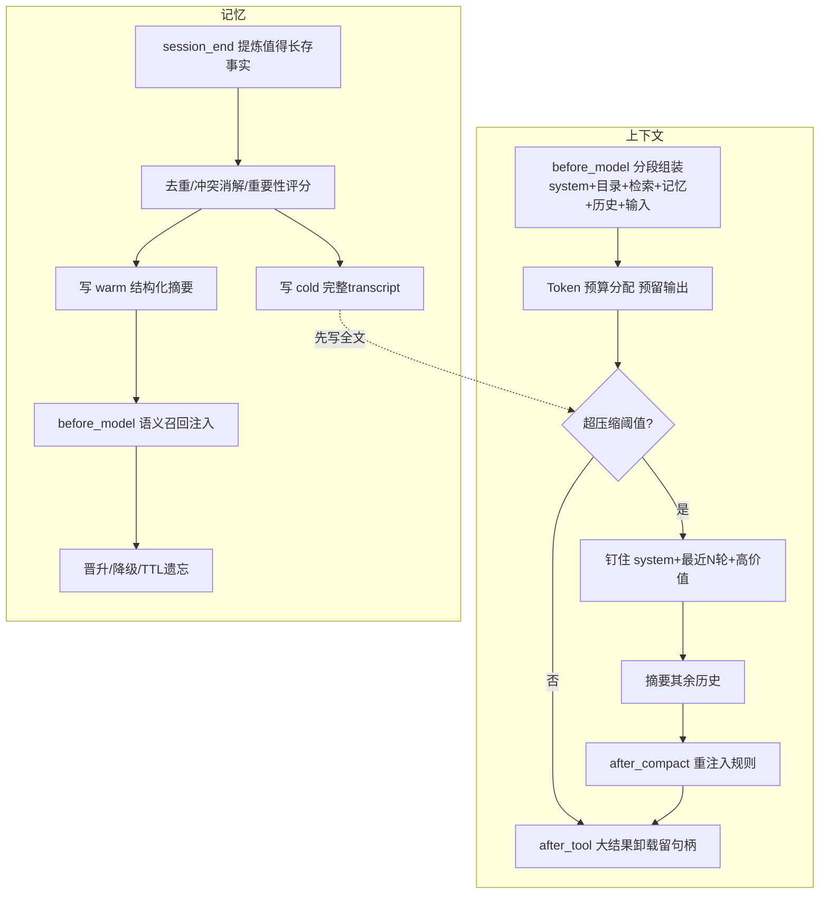

# R7：上下文与记忆（context + memory）

> **实现状态**：设计定稿，代码待实现（当前仓库已实现 R1~R4：runtime/hooks/resilience/model；本模块为设计态）。验证矩阵中的 tests/rN/ 为预留路径。


> **权威来源**：[《AGENT 总设计》](../../01-总览与设计/AGENT-总设计.md) §R7。本文为模块级拆分详设。
> 层：L1 能力插件 · 依赖：R1+R2+R6（复用 Embedder/Store）· 源码包：`src/harness/context/` + memory/（原 M7）· 门禁 key：无（设计态）

> **⏳ 回头实现清单**：本模块负责 MemoryPort→MemoryStore、StorePort→InMemoryStorePort 两个默认实现（总设计[附录 B.1.2](../../01-总览与设计/AGENT-总设计.md)）。开发时须落地并勾销。

---

## 1. 职责与边界

**做**：上下文组装/压缩 compaction/大结果卸载 offloading；长期记忆 hot/warm/cold 三层 × episodic/semantic/procedural 三类、写入提炼/召回/遗忘/晋升。
**不做**：改 State.messages（裁剪是视图层，messages 只增不减）；披露执行（R5，R7 提供上下文段）。

## 2. 设计架构

上下文窗口是稀缺 RAM（context rot：越长质量越差），本模块像 OS 管理内存：分段组装 + 配额 + 阈值压缩 + 大结果卸载。记忆分三层（hot 会话内/warm 结构化摘要/cold 全文归档），写入与压缩都在会话边界触发，**顺序必须是先写 cold 全文再压缩**（靠 hook priority 保证）。

## 3. 流程图



## 4. API 规范（完整接口）

```python
class ContextAssembler(Protocol):
    name: str
    def assemble(self, sections: list[ContextSection], budget: TokenBudget) -> list[Message]: ...
class CompactionPolicy(Protocol):
    name: str
    def should_compact(self, state: AgentState) -> bool: ...
    def compact(self, messages: tuple[Message,...]) -> tuple[Message,...]: ...
class Offloader(Protocol):
    name: str
    async def offload(self, value: DynamicValue, store: StorePort) -> str: ...   # 返回句柄
class MemoryPort(Protocol):
    async def read(self, ns, key, ctx) -> DynamicValue: ...
    async def write(self, ns, key, value, ctx) -> None: ...
    async def forget(self, ns, key, ctx) -> None: ...

@dataclass(frozen=True)
class MemoryItem:
    kind: Literal["episodic","semantic","procedural"]
    content: str; importance: float; ts: int; source: str
@dataclass(frozen=True)
class ContextSection:
    name: str; content: str; quota: int; priority: int; trim_policy: str
```

## 5. 元数据与关键字段（核心字段）

| 字段 | 说明 |
|------|------|
| ContextSection | name/content/quota/priority/trim_policy |
| CompactionPolicy 参数 | trigger_tokens(窗口70%)/trigger_turns(12)/keep_recent(4)/pin_patterns |
| MemoryTier | hot(Redis/短TTL)/warm(PG+pgvector/结构化)/cold(对象存储/全文) |
| MemoryItem.kind | episodic 情节/semantic 事实/procedural 流程 |
| offload 句柄 | store://id + 摘要，模型按需再读 |

**分层策略**：hot→warm→cold 沉降，cold 频繁访问可回温；TTL 过期 + 显式 forget + 冲突消解。写入内容按不可信输入净化，secret 不写。

## 6. 可插拔契约

| 注入点 | 协议 | 默认 | 校验 |
|--------|------|------|------|
| 组装 | ContextAssembler | 默认分段 | system 段不可被覆盖 |
| 压缩 | CompactionPolicy | 阈值摘要 | 压缩后保留进度与未完成任务 |
| 卸载 | Offloader | 阈值卸载 | 句柄必须可读 |
| 记忆 | MemoryPort | 内存/向量 | 写入过注入检测；secret 不写 |

## 7. 模块内闭环核对（CL-1~CL-5）

| 条件 | 实现 | 证据 |
|------|------|------|
| CL-1 契约自足 | 依赖 R1 types + R2 Hook + R6 Embedder/Store | import 扫描 |
| CL-2 自带 fake | fake MemoryPort/Store | fake 用例 |
| CL-3 自带测试 | tests/r7/ | 覆盖率报告 |
| CL-4 独立 demo | `make demo-r7` | demo 冒烟 |
| CL-5 文档自足 | 本文 + AGENT-总设计对应章节 | 文档评审 |

## 8. 验收标准

1. 超阈值触发压缩，钉住消息保留，after_compact 重注入规则；
2. 分层晋升/降级/遗忘各有用例；
3. 先写 cold 再压缩的顺序确定性（priority 保证）；
4. 压缩不改 messages；secret 不进记忆。

## 9. 功能验证矩阵

| 功能点 | 用例 ID | 验证方式 | 通过标准 |
|--------|---------|---------|---------|
| 上下文组装 | R7-T01 | `pytest tests/r7/test_assembly.py -q` | 分段配额+system 不被覆盖 |
| 压缩触发 | R7-T02 | `pytest tests/r7/test_compaction.py -q` | 阈值触发+钉住保留 |
| 大结果卸载 | R7-T03 | `pytest tests/r7/test_offload.py -q` | 句柄可读 |
| 记忆分层 | R7-T04 | `pytest tests/r7/test_memory.py -q` | 晋升/降级/遗忘 |
| 顺序确定性 | R7-T05 | trace 快照 | 先写 cold 再压缩 |
| 独立闭环 | R7-D01 | `make demo-r7` | demo 冒烟 |

## 10. 门禁清单

| 门禁 | 条目 | 达标标准 | 级别 |
|------|------|---------|------|
| R7-G1 | 覆盖 | 组装/压缩/卸载/记忆 ≥85% | G1 |
| R7-G2 | 压缩/记忆 | 阈值触发+钉住；分层策略用例 | G2 |
| R7-G3 | 集成 | 先写 cold 再压缩顺序确定 | G3 |
| R7-红线 | 一致 | 压缩改 messages/secret 进记忆→拒绝 | 红线 |

---
*R7 模块详设 v2.0 · 派生自 AGENT-总设计 · 设计态*