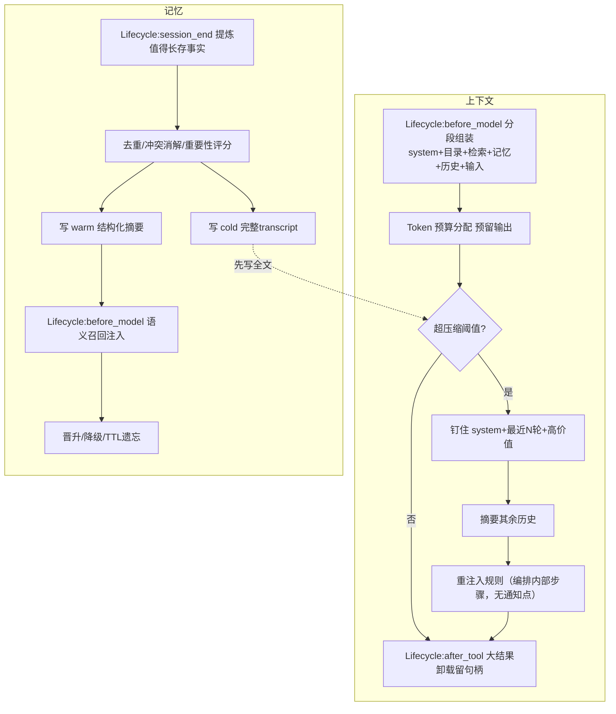

# R7：上下文与记忆（context + memory）

> **实现状态**：设计定稿 → 实现落地中（2026-11-20）。当前仓库已实现 R1~R6；本模块按[实现落地设计规格](./R7-上下文与记忆-实现落地设计规格.md)落地（修复 4 Blocker：通知点未接线 / priority 无基础 / Offloader 错位 / MemoryPort 签名）。下文 §2/§3/§4/§6/§8 带 `【变更·2026-11-20】` 标记处为增量修订，原结论留痕见规格 §13。
> **⚠️ 触发方式变更（对齐三体系）**：原设计把 before_model/after_compact/after_tool/session_end 当扩展点驱动，但按新体系 before_model/after_tool/session_end 是 **Lifecycle 通知点（纯通知、不拦截、异常隔离）**，且 `before_compact`/`after_compact` 已移出通知点清单（P7，R7 内部步骤）。上下文组装/压缩/记忆写入仍由 `ContextMemoryManager` **显式编排**，顺序由代码结构保证、不依赖通知优先级；通知点只用于挂观测/触发副作用。流程图中 `Lifecycle:<name>` 节点指向真实通知点，无对应通知点的阶段用普通文字节点。

> **权威来源**：[《AGENT 总设计》](../../01-总览与设计/AGENT-总设计.md) §R7。本文为模块级拆分详设。
> 层：L1 能力插件 · 依赖：R1+R2+R5(注入检测)+R6(Embedder/VectorStore/TokenBudget) · 源码包：`src/harness/context/` + `src/harness/memory/`（原 M7）· 门禁 key：**r7**（2026-11-20 定）

> **⏳ 回头实现清单**：本模块负责 MemoryPort→MemoryStore、StorePort→InMemoryStorePort、BlobPort→InMemoryBlobStore 三个默认实现（总设计[附录 B.1.2](../../01-总览与设计/AGENT-总设计.md)）。开发时须落地并勾销。

---

## 1. 职责与边界

**做**：上下文组装/压缩 compaction/大结果卸载 offloading；长期记忆 hot/warm/cold 三层 × episodic/semantic/procedural 三类、写入提炼/召回/遗忘/晋升。
**不做**：改 State.messages（裁剪是视图层，messages 只增不减）；披露执行（R5，R7 提供上下文段）。

## 2. 设计架构

上下文窗口是稀缺 RAM（context rot：越长质量越差），本模块像 OS 管理内存：分段组装 + 配额 + 阈值压缩 + 大结果卸载。记忆分三层（hot 会话内/warm 结构化摘要/cold 全文归档），写入与压缩都在会话边界触发，**顺序必须是先写 cold 全文再压缩**。

【变更·2026-11-20】触发方式与顺序保证修正：原设计写"靠 hook priority 保证"，但通知点是纯通知（不拦截、无 priority 概念），且 `before_compact`/`after_compact` 已移出通知点清单（P7；见规格 §13）。现改为 `ContextMemoryManager` 显式编排——`commit_and_compact()` 方法体内先 `memory.write_cold(...)` 再 `compact()`，顺序由代码结构固定，单测用 trace 快照锁定。**`MemoryStore.write_cold` 是同步方法（返回 None，非 coroutine），调用处不加 `await`**。下文流程图 `Lifecycle:<name>` 指向真实通知点，无对应通知点的阶段为普通文字节点。

## 3. 流程图

【变更·2026-11-20】节点约定：`Lifecycle:<name>` 指向 16 通知点中的真实通知点；压缩系列（compact/重注入）在新体系无对应通知点（P7 已移除 before_compact/after_compact），用普通文字节点表示 R7 内部编排步骤。



## 4. API 规范（完整接口）【变更·2026-11-20：对齐源码签名 + 新增 BlobPort/recall】

> 精确签名以[实现落地设计规格 §7.3](./R7-上下文与记忆-实现落地设计规格.md) 为准。以下为要点（变更处标注）。

```python
# TokenBudget 从 R6 导入（唯一已定义处 harness/rag/types.py:116），不重定义
class ContextAssembler(Protocol):
    name: str
    def assemble(self, sections: list[ContextSection], budget: TokenBudget) -> list[Message]: ...
class CompactionPolicy(Protocol):
    name: str
    def should_compact(self, state: AgentState) -> bool: ...
    def compact(self, messages: tuple[Message,...]) -> tuple[Message,...]: ...  # 返回新 tuple，不改 state.messages

# 【变更】原 offload 依赖 StorePort（会话快照存取，语义错位）→ 新增 BlobPort
class BlobPort(Protocol):
    name: str
    async def put(self, value: DynamicValue) -> str: ...           # 返回句柄 store://id
    async def get(self, handle: str) -> DynamicValue | None: ...  # 句柄必须可读
    async def delete(self, handle: str) -> None: ...
class Offloader(Protocol):
    name: str
    async def offload(self, value: DynamicValue, store: BlobPort) -> str: ...

# 【变更】参数名 ns→namespace、补全 ctx: PortCtx 标注、新增 recall（与 R2 protocols.py 逐字对齐）
class MemoryPort(Protocol):
    name: str
    async def read(self, namespace: str, key: str, ctx: PortCtx) -> DynamicValue: ...
    async def write(self, namespace: str, key: str, value: DynamicValue, ctx: PortCtx) -> None: ...
    async def forget(self, namespace: str, key: str, ctx: PortCtx) -> None: ...
    async def recall(self, query: "MemoryQuery", ctx: PortCtx) -> list["MemoryItem"]: ...  # R7 自有 DTO，不复用 R6 Query

@dataclass(frozen=True)
class MemoryItem:
    kind: MemoryKind       # 【变更】Literal → MemoryKind 枚举
    content: str; importance: float; ts: int; source: str
@dataclass(frozen=True)
class MemoryQuery:         # 【新增】R7 自有召回查询 DTO
    text: str; top_k: int = 5; tier: MemoryTier | None = None; kind: MemoryKind | None = None
@dataclass(frozen=True)
class ContextSection:
    name: str; content: str; quota: int; priority: int; trim_policy: str
```

## 5. 元数据与关键字段（核心字段）

| 字段 | 说明 |
|------|------|
| ContextSection | name/content/quota/priority/trim_policy |
| CompactionPolicy 参数 | trigger_tokens(窗口70%)/trigger_turns(12)/keep_recent(4)/pin_patterns |
| MemoryTier | hot(Redis/短TTL)/warm(PG+pgvector/结构化)/cold(对象存储/全文) |
| MemoryItem.kind | episodic 情节/semantic 事实/procedural 流程 |
| offload 句柄 | store://id + 摘要，模型按需再读 |

**分层策略**：hot→warm→cold 沉降，cold 频繁访问可回温；TTL 过期 + 显式 forget + 冲突消解。写入内容按不可信输入净化，secret 不写。

## 6. 可插拔契约【变更·2026-11-20：卸载存储改 BlobPort，记忆加 recall】

| 注入点 | 协议 | 默认 | 校验 |
|--------|------|------|------|
| 组装 | ContextAssembler | 默认分段 | system 段不可被覆盖 |
| 压缩 | CompactionPolicy | 阈值摘要 | 压缩后保留进度与未完成任务；不改 messages |
| 卸载 | Offloader → **BlobPort** | 阈值卸载 / InMemoryBlobStore | 句柄必须可读（put/get/delete） |
| 记忆 | MemoryPort | MemoryStore（内存分层） | 写入过注入检测（R5）；secret 不写；recall 语义召回 |
| 快照 | StorePort | InMemoryStorePort | save/load round-trip，快照可 JSON 序列化 |
| 编排 | ContextMemoryManager | 默认装配 | 显式调用；先 cold 后 compact 顺序固定 |

> **【变更·2026-11-20】生产装配待办（交 R12，R7 文档仅登记不实现）**：`ContextMemoryManager` 目前只有 demo/测试显式构造，真实 Agent 运行时不会自动触发上下文组装/压缩/记忆写入。R12 阶段 A 必须显式登记并落地"接入 `ContextMemoryManager` + 挂 `session_end` / `before_model` 通知点"这一待办，避免 R7 成为"实现了但没接线"的孤岛。本模块不实现 R12 装配；通知点为纯通知（返回值不消费），触发副作用在订阅者实现内完成。

## 7. 模块内闭环核对（CL-1~CL-5）

| 条件 | 实现 | 证据 |
|------|------|------|
| CL-1 契约自足 | 依赖 R1 types + R2 AOP/Lifecycle 契约 + R6 Embedder/Store | import 扫描 |
| CL-2 自带 fake | fake MemoryPort/Store | fake 用例 |
| CL-3 自带测试 | tests/r7/ | 覆盖率报告 |
| CL-4 独立 demo | `make demo-r7` | demo 冒烟 |
| CL-5 文档自足 | 本文 + AGENT-总设计对应章节 | 文档评审 |

## 8. 验收标准【变更·2026-11-20】

1. 超阈值触发压缩、钉住消息保留、压缩视图供 assemble 使用（压缩为编排内部步骤，无通知点）；
2. 分层晋升/降级/遗忘各有用例；
3. 顺序确定性（编排器代码结构保证，trace 快照断言：先写 cold 再压缩）；
4. 压缩不改 messages；secret 不进记忆。

## 9. 功能验证矩阵【变更·2026-11-20：补齐测试用例名】

| 功能点 | 用例 ID | 验证方式 | 通过标准 |
|--------|---------|---------|---------|
| 上下文组装 | R7-T01 | `pytest tests/r7/test_assembly.py -q` | 分段配额+system 不被覆盖 |
| 压缩触发 | R7-T02 | `pytest tests/r7/test_compaction.py -q` | 阈值触发+钉住保留+state 不变 |
| 大结果卸载 | R7-T03 | `pytest tests/r7/test_offload.py -q` | BlobPort 句柄可读+删除后 None |
| 记忆分层+召回 | R7-T04 | `pytest tests/r7/test_memory.py -q` | 晋升/降级/遗忘+三 Port 履约+recall |
| DTO/secret 红线 | R7-T05 | `pytest tests/r7/test_types.py -q` | 不可变+secret 拒绝 |
| 显式编排接线 | R7-T06 | `pytest tests/r7/test_wiring.py -q` | 注入替换+默认可用 |
| 顺序确定性 | R7-T07 | `pytest tests/r7/test_ordering.py -q` | trace 快照：write.cold 先于 compact |
| 独立闭环 | R7-D01 | `make demo-r7` | demo 打印 PASS |

## 10. 门禁清单【变更·2026-11-20：gate key = r7】

| 门禁 | 条目 | 达标标准 | 级别 |
|------|------|---------|------|
| R7-G0 | 契约符号 | 22+ 符号 import 成功；三默认类（MemoryStore/InMemoryStorePort/InMemoryBlobStore）生产源码存在 | G0 |
| R7-G1 | 覆盖 | context+memory 组装/压缩/卸载/记忆 ≥85% | G1 |
| R7-G2 | 压缩/记忆 | 阈值触发+钉住；分层策略用例 | G2 |
| R7-G3 | 集成 | 先写 cold 再压缩顺序确定（trace 快照） | G3 |
| R7-G4 | 装配 | demo_r7 PASS；文档八要素完整 | G4 |
| R7-红线 | 一致 | 压缩改 messages/secret 进记忆/注入串放行→拒绝 | 红线 |

---
*R7 模块详设 · 派生自 AGENT-总设计与《扩展体系重构规格（2026-11-20）》P7/P10 · 门禁 key=r7 · 本次变更：三处 write_cold 去 await（同步方法）；§8 验收标准改"压缩视图供 assemble 使用 / 顺序确定性由编排器代码结构保证 + trace 快照断言"并加变更标记；流程图节点改 Lifecycle:<name>（compact 系列改普通文字节点）；生产装配待办（接 ContextMemoryManager + 挂 session_end/before_model）登记交 R12；压缩仍走显式编排（P7），before_compact/after_compact 不在通知点清单*