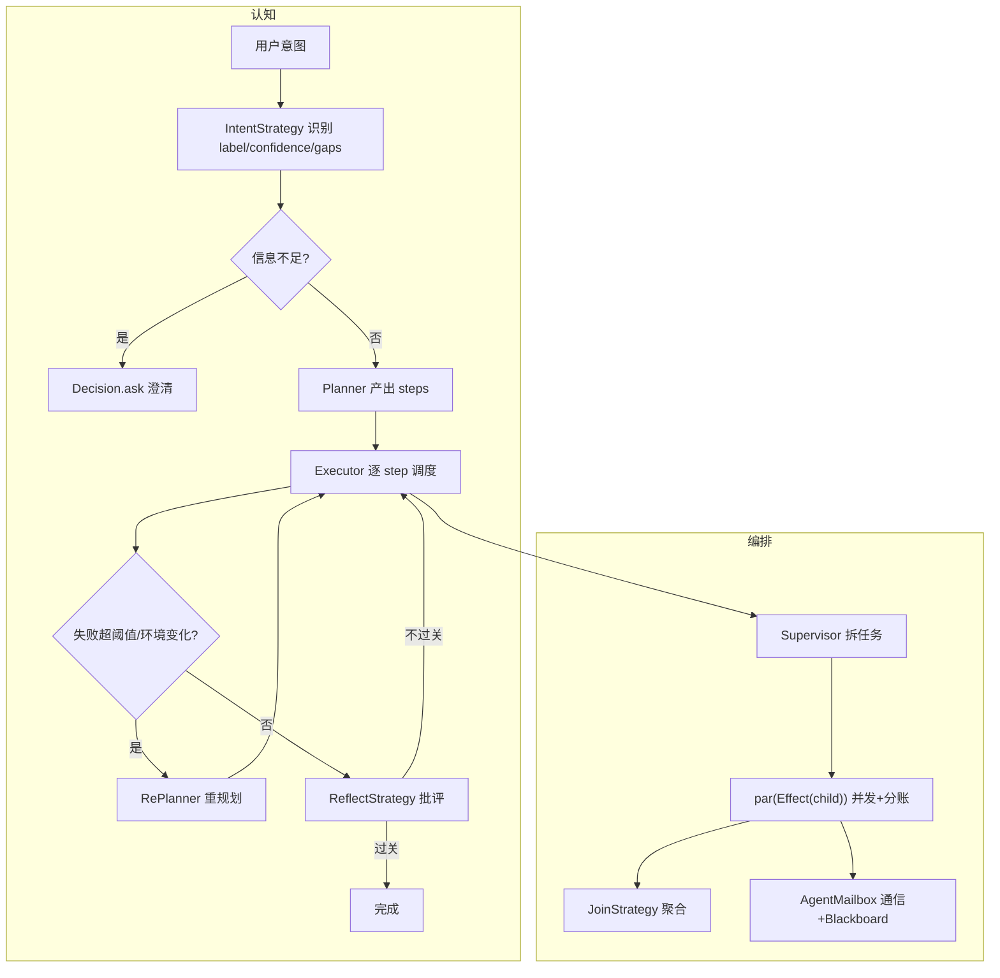

# R8：认知与多 Agent 编排（cognition + archs）

> **实现状态**：设计定稿，代码待实现（当前仓库已实现 R1~R4：runtime/hooks/resilience/model；本模块为设计态）。验证矩阵中的 tests/rN/ 为预留路径。


> **权威来源**：[《AGENT 总设计》](../../01-总览与设计/AGENT-总设计.md) §R8。本文为模块级拆分详设。
> 层：L1/L2 · 依赖：R1+R2 · 源码包：`src/harness/cognition/` + archs/（原 M6+M10）· 门禁 key：无（设计态）

---

## 1. 职责与边界

**做**：认知服务（意图/澄清/规划/重规划/执行器/反思/进度追踪）；多 Agent 编排原语（child 派生/并发上限/join/预算分账/通信/黑板/handoff/supervisor 的内核机制）。
**不做**：执行循环（R1）；10 内置架构与 7 组合算子的逐个详设（已拆到 [R12](./R12-内置架构与组合.md)）——本章只给认知服务与架构归约。

## 2. 设计架构

认知模块是可独立调用的服务（内部走 Effect/Hook），内置架构只是装配品。多 Agent 与单 Agent 共用同一解释器：`Effect(child)` → Runner 递归创建子 Session，子 trace 挂父 span，预算从父切分。铁律：**架构即 Program，可任意嵌套**。

## 3. 流程图



## 4. API 规范（完整接口）

```python
class IntentStrategy(Protocol):
    name: str
    async def recognize(self, text, ctx) -> IntentResult: ...   # label/confidence/gaps
class ReflectStrategy(Protocol):
    name: str
    async def critique(self, draft, goal, ctx) -> Critique: ...  # passed/score/comments
class Planner(Protocol):
    name: str
    async def plan(self, goal, ctx) -> tuple[Step,...]: ...
class RePlanner(Protocol):
    name: str
    async def replan(self, goal, steps, failures, ctx) -> tuple[Step,...]: ...
class Executor(Protocol):
    name: str
    async def execute(self, step, ctx) -> StepResult: ...

class Arch(Protocol):
    name: str
    version: str
    def static_check(self) -> StaticCheckReport: ...
    def compile(self) -> Program: ...

# 10 内置架构（全部返回 Program）
ReAct / ToolUse / PlanExecute / Reflection / Router / RouterSkill /
Supervisor / Handoff / Blackboard / Graph /（+ 组合算子支撑嵌套）
# 组合算子
seq / par / branch / race / retry / map_state / budget
```

## 5. 元数据与关键字段（核心字段）

| 字段 | 说明 |
|------|------|
| IntentResult | label/confidence(0~1)/gaps（信息缺口触发澄清） |
| Critique | passed/score/comments |
| Step | 可执行步骤（明确动作+校验条件） |
| ChildHandle | child_session_id/budget 分账/trace 父 span |
| JoinStrategy | all/any/majority/reduce + timeout |
| StaticCheckReport | errors/arch/version/ports_required/budgets_resolved |

**10 架构归约**：ToolUse=并行 Effect；ReAct=自循环；PlanExecute=状态机游标；Reflection=budget 轮换；Router=branch；RouterSkill=分流+skill 正文(R5)；Supervisor=par(child)+join；Handoff=换 program+hops；Blackboard=共享 scratch；Graph=声明式编译+static_check；+组合算子嵌套。

## 6. 可插拔契约

| 注入点 | 协议 | 默认 | 校验 |
|--------|------|------|------|
| 意图/反思/规划 | IntentStrategy 等 | LLM 分类/critic/分解 | 返回结构完整；缺 name 拒绝 |
| 子 Agent | ChildSpec | ReAct 子 | 并发上限/预算分账 |
| 架构 | Arch | 10 内置（详见 R12） | static_check 查悬空边/环/缺 port |

## 7. 模块内闭环核对（CL-1~CL-5）

| 条件 | 实现 | 证据 |
|------|------|------|
| CL-1 契约自足 | 依赖 R1 types + R2 Hook + 认知协议 | import 扫描 |
| CL-2 自带 fake | FakeLLMPort + fake classifier | fake 用例 |
| CL-3 自带测试 | tests/r8、tests/r12 | 覆盖率报告 |
| CL-4 独立 demo | `make demo-arch` | demo 冒烟 |
| CL-5 文档自足 | 本文 + AGENT-总设计对应章节 | 文档评审 |

## 8. 验收标准

1. 认知服务 + 10 架构各有端到端用例；
2. 装配期检查：悬空边/环/不可达/缺 port/预算冲突；
3. 同 Arch 多次 compile 行为一致，算子不改原对象；
4. 嵌套组合 Router→Graph→ReAct 跑通，换架构零改动。

## 9. 功能验证矩阵

| 功能点 | 用例 ID | 验证方式 | 通过标准 |
|--------|---------|---------|---------|
| 意图识别 | R8-T01 | `pytest tests/r8/test_intent.py -q` | 分类+置信度+gaps |
| 规划执行 | R8-T02 | `pytest tests/r8/test_plan.py -q` | steps 游标正确 |
| 反思轮换 | R8-T03 | `pytest tests/r8/test_reflect.py -q` | max_rounds 处结束 |
| 10 架构 | R8-T04 | `pytest tests/r12/test_archs.py -q` | 各端到端通过 |
| 组合算子 | R8-T05 | `pytest tests/r12/test_compose.py -q` | seq/par/branch/budget 生效 |
| 嵌套组合 | R8-T06 | 同上 | 三层嵌套跑通 |
| 装配检查 | R8-T07 | `pytest tests/r12/test_static.py -q` | 悬空边/环装配期报错 |
| 独立闭环 | R8-D01 | `make demo-arch` | demo 冒烟 |

## 10. 门禁清单

| 门禁 | 条目 | 达标标准 | 级别 |
|------|------|---------|------|
| R8-G1 | 覆盖 | 认知+10 架构端到端 ≥85% | G1 |
| R8-G2 | 装配检查/幂等 | 悬空边/环/缺 port 装配期报错；compile 幂等 | G2 |
| R8-G3 | 嵌套 | 三层嵌套；换架构零改动 | G3 |
| R8-红线 | 纪律 | 架构内直接 IO/自数轮次→拒绝 | 红线 |

---
*R8 模块详设 v2.0 · 派生自 AGENT-总设计 · 设计态*