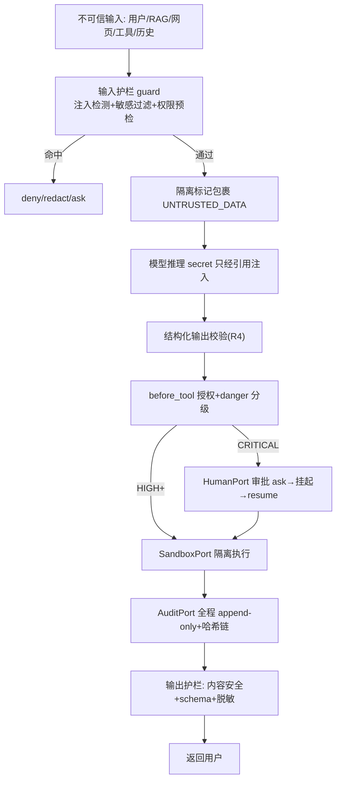

# R9：安全与 HITL（security）

> **实现状态**：设计定稿，代码待实现（当前仓库仅 R1/R2 已实现）。验证矩阵中的 tests/rN/ 为预留路径。


> **权威来源**：[《AGENT 总设计》](../../01-总览与设计/AGENT-总设计.md) §R9。本文为模块级拆分详设。
> 层：L1（横切）· 依赖：R1+R2 · 源码包：`src/harness/security/`（原 M8）· 门禁 key：无（设计态）

> **⏳ 回头实现清单**：本模块负责 SandboxPort→LocalSandbox、AuditPort→AuditLogger、HumanPort→ConsoleHumanPort 三个默认实现（总设计[附录 B.1.2](../../01-总览与设计/AGENT-总设计.md)）。开发时须落地并勾销。

---

## 1. 职责与边界

**做**：身份授权、凭据隔离、两级护栏、提示注入防御、沙盒、审计、数据隔离/PII、合规；HITL 审批流、澄清、计划干预、通知、接管。
**不做**：沙盒内具体执行环境（外部 SandboxPort 实现，R9 定义契约与路由）。

## 2. 设计架构

纵深防御：模型级安全是必要不充分条件，harness 提供独立执行期强制层。每层独立强制，一个 hook 的 allow 不能覆盖 deny（取最严格）。核心原则：**工具/检索/网页/技能正文一律不可信**，注入防御在进上下文前（before_model guard）。审计覆盖全部事件且与事件日志同源可回放。

## 3. 流程图



## 4. API 规范（完整接口）

```python
class Guardrail(Protocol):
    name: str; direction: Literal["input","output"]
    def check(self, data: DynamicValue, ctx: HookCtx) -> Verdict: ...   # allow/redact/deny/ask
class InjectionDetector(Protocol):
    name: str
    def inspect(self, text: str, ctx: SecurityCtx) -> SafetyReport: ...  # safe/suspicious/malicious
class SandboxPort(Protocol):
    async def run(self, fn, args, ctx) -> DynamicValue: ...
class AuditPort(Protocol):
    def record(self, event: AuditEvent, ctx: PortCtx) -> None: ...
class HumanPort(Protocol):
    async def ask(self, question, options, ctx) -> str: ...
class ApprovalFlow:
    def __init__(self, trigger_danger="CRITICAL", timeout=300, resume_strategy="exact"): ...
```

## 5. 元数据与关键字段（核心字段）

| 字段 | 说明 |
|------|------|
| DangerLevel | SAFE/LOW/HIGH/CRITICAL → 直执行/审计/沙盒/沙盒+审批 |
| SafetyReport | safe/suspicious/malicious + 命中规则 |
| AuditEvent | who/when/action/cost/data_touched/rationale（append-only+哈希链） |
| secret_refs | 引用（如 `${API_KEY}`），绝不存明文 |
| PII 字段 | patterns/direction(input/output/log)/strategy(mask/redact/hash) |

**注入防御范围**：RAG 内容(R6)/网页(R5)/工具返回(R5)/历史记忆(R7)/技能正文(R5) 都视为不可信，隔离标记 + 注入检测（规则库+模型判别+启发式）。

## 6. 可插拔契约

| 注入点 | 协议 | 默认 | 校验 |
|--------|------|------|------|
| 护栏 | Guardrail | 规则库+模型判别 | 命中策略明确 |
| 注入检测 | InjectionDetector | 规则+启发式 | 不可信输入必过 |
| 沙盒 | SandboxPort | 进程隔离 | 资源限额/网络白名单 |
| 审批 | HumanPort | 终端 | 挂起态跨周期有效 |
| 审计 | AuditPort | 本地日志 | 不可旁路/防篡改 |

## 7. 模块内闭环核对（CL-1~CL-5）

| 条件 | 实现 | 证据 |
|------|------|------|
| CL-1 契约自足 | 依赖 R1 types + R2 Hook + 安全协议 | import 扫描 |
| CL-2 自带 fake | fake SandboxPort/AuditPort/HumanPort | fake 用例 |
| CL-3 自带测试 | tests/r9/ | 覆盖率报告 |
| CL-4 独立 demo | `make demo-sec` | demo 冒烟 |
| CL-5 文档自足 | 本文 + AGENT-总设计对应章节 | 文档评审 |

## 8. 验收标准

1. 检索/工具/技能正文含指令串时被拦截；
2. 挂起→跨周期恢复→精确续跑；
3. 审计覆盖率 100%，哈希链可验证；
4. secret 不进上下文/trace/记忆/checkpoint；CRITICAL 未审批不执行。

## 9. 功能验证矩阵

| 功能点 | 用例 ID | 验证方式 | 通过标准 |
|--------|---------|---------|---------|
| 输入护栏 | R9-T01 | `pytest tests/r9/test_guardrail.py -q` | 注入/敏感串拦截 |
| 注入防御 | R9-T02 | 同上 | 工具/检索结果含指令被拦截 |
| 沙盒路由 | R9-T03 | `pytest tests/r9/test_sandbox.py -q` | HIGH+ 进沙盒 |
| 审批流 | R9-T04 | `pytest tests/r9/test_approval.py -q` | 挂起→恢复→续跑 |
| 审计 | R9-T05 | `pytest tests/r9/test_audit.py -q` | 覆盖 100%+哈希链 |
| secret 隔离 | R9-T06 | `pytest tests/r9/test_secret.py -q` | 明文不进任何持久化 |
| 独立闭环 | R9-D01 | `make demo-sec` | demo 冒烟 |

## 10. 门禁清单

| 门禁 | 条目 | 达标标准 | 级别 |
|------|------|---------|------|
| R9-G1 | 覆盖 | 护栏/注入/沙盒/审批/审计 ≥85% | G1 |
| R9-G2 | 注入/审批 | 注入串拦截；挂起跨周期恢复 | G2 |
| R9-G3 | 审计 | 覆盖率 100%，哈希链可验证 | G3 |
| R9-红线 | 安全 | secret 进上下文/trace/记忆；CRITICAL 未审批；审计可旁路→拒绝 | 红线 |

---
*R9 模块详设 v2.0 · 派生自 AGENT-总设计 · 设计态*