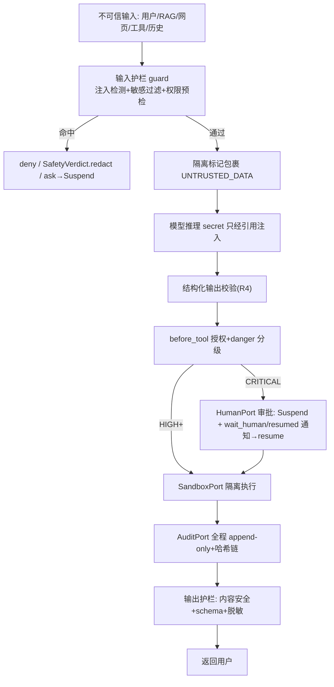

# R9：安全与 HITL（security）

> **实现状态**：已实现（src/harness/security/；tests/r9；tests/demos/demo_r9.py；门禁 r9 14/14）。


> **权威来源**：[《AGENT 总设计》](../../01-总览与设计/AGENT-总设计.md) §R9。本文为模块级拆分详设。
> 层：L1（横切）· 依赖：R1+R2 · 源码包：`src/harness/security/`（原 M8）· 门禁 key：r9

> **✅ 回头清单已勾销**：LocalSandbox/AuditLogger/ConsoleHumanPort 三个默认实现已落地 src/harness/security/ports.py（B.1.2 对应行已移 B.1.1）。

---

## 1. 职责与边界

**做**：身份授权、凭据隔离、两级护栏、提示注入防御、沙盒、审计、数据隔离/PII、合规；HITL 审批流、澄清、计划干预、通知、接管。
**不做**：沙盒内具体执行环境（外部 SandboxPort 实现，R9 定义契约与路由）。

## 2. 设计架构

纵深防御：模型级安全是必要不充分条件，harness 提供独立执行期强制层。每层独立强制，一道护栏（`③ injection_guard` call 装饰器，位于 `compose/call.py` / ⑥安全组件；R9 Guardrail 复用 `harness.skills.KeywordInjectionDetector` 单检测器）的 allow 不能覆盖 deny（取最严格）。核心原则：**工具/检索/网页/技能正文一律不可信**，注入防御在进上下文前由注入检测护栏强制（`before_model` 为 Lifecycle 通知点，只通知不拦截；真正的拦截由 `③ injection_guard` 装饰器 / ⑥安全组件在调用层完成）。审计覆盖全部事件且与事件日志同源可回放。

## 3. 流程图



## 4. API 规范（完整接口）

```python
# ---- 安全域 DTO（已实现 src/harness/security/types.py）----
@dataclass(frozen=True, slots=True)
class SecurityCtx:
    """安全检查上下文：Invocation（组合层）/ Notice（Lifecycle 只读投影）面向安全域的具名投影，避免检测器直接依赖 R2 全量上下文。

    字段：
        session_id / run_id: 会话与 run 标识（审计关联）。
        source: 内容来源（"user"/"tool"/"rag"/"memory"/"skill"/"web"）——注入防御按来源分策。
        direction: "input"/"output"——护栏方向。
        danger: DangerLevel——当前操作的危险级别。
        trust: bool——内容是否来自可信内核（False 则必须过注入检测）。
        meta: dict[str, DynamicValue]——扩展元数据（规则 3 动态边界）。
    构造：由 R9 护栏组件从 Invocation 投影生成（from_invocation 类方法）；Lifecycle 侧可从 Notice（Invocation 只读投影）经 from_notice 生成，不改 Invocation/Notice 本身。
    """
    session_id: str
    run_id: str
    source: Literal["user","tool","rag","memory","skill","web"]
    direction: Literal["input","output"]
    danger: DangerLevel
    trust: bool
    meta: dict[str, DynamicValue] = field(default_factory=dict)

@dataclass(frozen=True, slots=True)
class SafetyVerdict:
    """安全域护栏判定结果：allow/redact/deny/ask 四态（D-1：与组合层通用 Verdict(allowed, reason) 区分，改用本名）。

    字段：
        action: 四态之一。redacted: redact 时的替换文本（掩码/脱敏产物）。
        reason: 判定原因（进 trace）。rule: 命中的规则 id（无则空）。
    ask 语义：返回 ask 不直接拦截，由框架产 Suspend(question, options) 并挂 wait_human/resumed 两个通知点；
    redact 语义：经本类 redacted 字段返回脱敏内容，不复用组合层通用 Verdict。
    """
    action: Literal["allow","redact","deny","ask"]
    redacted: DynamicValue = None
    reason: str = ""
    rule: str = ""

@dataclass(frozen=True, slots=True)
class SafetyReport:
    """注入检测结果：safe/suspicious/malicious 三级。

    字段：
        level: 三级之一。rules_hit: 命中的规则 id 列表。
        confidence: 0~1 判别置信度。evidence: 命中片段（脱敏后，供审计）。
    """
    level: Literal["safe","suspicious","malicious"]
    rules_hit: tuple[str, ...] = ()
    confidence: float = 0.0
    evidence: str = ""

@dataclass(frozen=True, slots=True)
class AuditEvent:
    """审计条目（append-only + 哈希链）。

    字段：who/when/action/cost/data_touched/rationale + prev_hash/hash（哈希链）。
    """
    who: str; when: int; action: str; cost: float
    data_touched: tuple[str, ...]; rationale: str
    prev_hash: str = ""; hash: str = ""

class Guardrail(Protocol):                        # 作为 ③call 装饰器 / ⑥安全组件接入调用链
    name: str; direction: Literal["input","output"]
    # 参数为 Invocation（组合层主路径）或 SecurityCtx（安全域投影）；返回 SafetyVerdict
    def check(self, data: DynamicValue, ctx: Invocation | SecurityCtx) -> SafetyVerdict: ...   # allow/redact/deny/ask; ask→Suspend
class InjectionDetector(Protocol):
    name: str
    def inspect(self, text: str, ctx: SecurityCtx) -> SafetyReport: ...  # safe/suspicious/malicious
class SandboxPort(Protocol):
    async def run(self, fn, args, ctx) -> DynamicValue: ...
class AuditPort(Protocol):
    async def record(self, event: dict[str, DynamicValue], ctx: PortCtx) -> None: ...  # 依 src/compose/ports.py 签名
class HumanPort(Protocol):
    async def ask(self, question, options, ctx) -> str: ...
class ApprovalFlow:
    def __init__(self, trigger_danger="CRITICAL", timeout=300, resume_strategy="exact"):
        """挂起→审批→resume 状态机；resume_strategy=exact 表示从挂起点精确恢复（A5）。
        timeout 到点按拒答处理，不静默放行。"""
        ...
```

## 5. 元数据与关键字段（核心字段）

| 字段 | 说明 |
|------|------|
| DangerLevel | SAFE/LOW/HIGH/CRITICAL → 直执行/审计/沙盒/沙盒+审批 |
| SafetyReport | safe/suspicious/malicious + 命中规则 |
| AuditEvent | who/when/action/cost/data_touched/rationale（append-only+哈希链） |
| secret_refs | 引用（如 `${API_KEY}`），绝不存明文 |
| PII 字段 | patterns/direction(input/output/log)/strategy(mask/redact/hash) |

**注入防御范围**：RAG 内容(R6)/网页(R5)/工具返回(R5)/历史记忆(R7)/技能正文(R5) 都视为不可信，隔离标记 + 注入检测（规则库+模型判别+启发式）。

## 6. 可插拔契约

| 注入点 | 协议 | 默认 | 校验 |
|--------|------|------|------|
| 护栏 | Guardrail | 规则库+模型判别 | 命中策略明确 |
| 注入检测 | InjectionDetector | `KeywordInjectionDetector`（单检测器复用，已实现） | 不可信输入必过 |
| 沙盒 | SandboxPort | `LocalSandbox`（已实现） | 资源限额/网络白名单 |
| 审批 | HumanPort | `ConsoleHumanPort`（已实现） | 挂起态跨周期有效 |
| 审计 | AuditPort | `AuditLogger`（已实现） | 不可旁路/防篡改 |

## 7. 模块内闭环核对（CL-1~CL-5）

| 条件 | 实现 | 证据 |
|------|------|------|
| CL-1 契约自足 | 依赖 R1 types + compose call/notify + 安全协议 | import 扫描 |
| CL-2 自带 fake | fake SandboxPort/AuditPort/HumanPort | fake 用例 |
| CL-3 自带测试 | tests/r9/（已落地） | 覆盖率报告 |
| CL-4 独立 demo | `make demo-r9` | demo 冒烟 |
| CL-5 文档自足 | 本文 + AGENT-总设计对应章节 | 文档评审 |

## 8. 验收标准

1. 检索/工具/技能正文含指令串时被拦截；
2. 挂起→跨周期恢复→精确续跑；
3. 审计覆盖率 100%，哈希链可验证；
4. secret 不进上下文/trace/记忆/checkpoint；CRITICAL 未审批不执行。

## 9. 功能验证矩阵

| 功能点 | 用例 ID | 验证方式 | 通过标准 |
|--------|---------|---------|---------|
| 输入护栏 | R9-T01 | `pytest tests/r9/test_guardrail.py -q` | 注入/敏感串拦截 |
| 注入防御 | R9-T02 | 同上 | 工具/检索结果含指令被拦截 |
| 沙盒路由 | R9-T03 | `pytest tests/r9/test_sandbox.py -q` | HIGH+ 进沙盒 |
| 审批流 | R9-T04 | `pytest tests/r9/test_approval.py -q` | 挂起→恢复→续跑 |
| 审计 | R9-T05 | `pytest tests/r9/test_audit.py -q` | 覆盖 100%+哈希链 |
| secret 隔离 | R9-T06 | `pytest tests/r9/test_secret.py -q` | 明文不进任何持久化 |
| 独立闭环 | R9-D01 | `make demo-r9` | demo 冒烟 |

## 10. 门禁清单

| 门禁 | 条目 | 达标标准 | 级别 |
|------|------|---------|------|
| R9-G1 | 覆盖 | 护栏/注入/沙盒/审批/审计 ≥85% | G1 |
| R9-G2 | 注入/审批 | 注入串拦截；挂起跨周期恢复 | G2 |
| R9-G3 | 审计 | 覆盖率 100%，哈希链可验证 | G3 |
| R9-红线 | 安全 | secret 进上下文/trace/记忆；CRITICAL 未审批；审计可旁路→拒绝 | 红线 |

---

## 11. 实现落点（2026-11-23）

**源码**：
- `src/harness/security/types.py`：SecurityCtx / SafetyVerdict / SafetyReport / AuditEvent 四个真实 dataclass；SafetyReport 由 `InjectionVerdict` 派生。
- `src/harness/security/guard.py`：RuleGuardrail + `inspect_untrusted`，复用 `harness.skills.KeywordInjectionDetector` 单检测器（不另立检测器）；`SafetyReport` 由 `InjectionVerdict` 派生。
- `src/harness/security/ports.py`：LocalSandbox / AuditLogger / ConsoleHumanPort 三个默认实现（B.1.2 对应行已移 B.1.1）。
- `src/harness/security/approval.py`：ApprovalFlow（trigger_danger / timeout / resume_strategy；timeout → deny）。
- `src/harness/security/capability.py`：SecurityCapability（注册 sandbox / audit / human 三端口）；ToolsCapability 注入三端口到 ToolRegistry。
- 审计链：`verify_hash_chain` 可校验 AuditEvent 哈希链。
- 测试与 demo：`tests/r9/`（含 test_guardrail / sandbox / approval / audit / wiring）、`tests/demos/demo_r9.py`；门禁 r9 14/14。

**四项既定决策（实现已遵循）**：
1. **确定性默认**：规则护栏 + 默认三端口实现开箱即用，不依赖外部系统。
2. **单检测器复用**：注入检测统一复用 `harness.skills.KeywordInjectionDetector`，R9 不重复实现检测器。
3. **R1 EventStore 复用**：审计与事件日志同源可回放，不另建事件日志底座。
4. **全量落地**：三默认实现 + 审批流 + 能力注册一次性交付，B.1.2 清单已勾销。

---
*R9 模块详设 v2.1 · 已实现（src/harness/security/，11-23）*