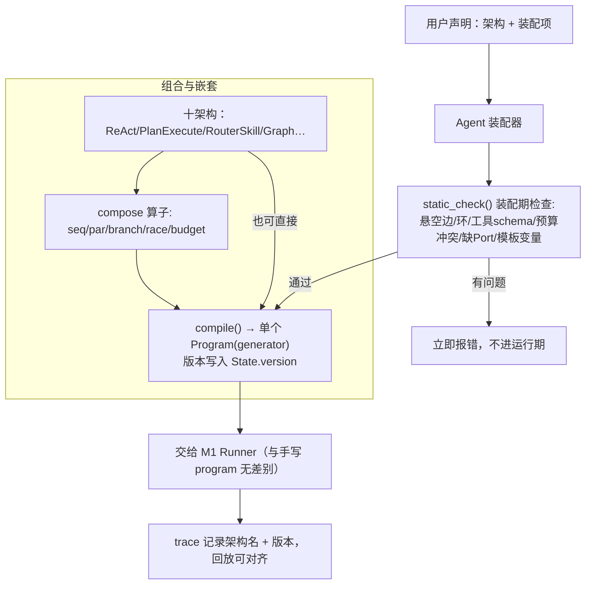

# 模块 M10：架构与组合（archs/ + compose/）

> 阅读前提：[《M1-核心运行时》](./M1-核心运行时.md)（Program/Budgets）、[《M6-认知模块集》](./M6-认知模块集.md)（认知服务原料）、[《门禁体系》](../03-流程与规范/门禁体系.md)。
> 本模块是**用户唯一入口**：所有架构、组合算子、Agent 装配器都在这里。

---

## 1. 职责与边界

**做**：10 种内置架构（预制 Program + 装配器 + 装配期 `static_check()`）；函数式组合算子（seq / par / branch / race / retry / map_state / budget）；`Agent` 装配器（.use/.filter/.pipe/.hook/.rag/.memory/.telemetry/.registry）。

**不做**：执行循环（M1）；链路调度（M2）；外部能力实现（M3~M9）；把架构做成硬编码调度器（架构只是产出 Effect 的 generator）。

**铁律**：所有架构的终态都是 `Program`（generator），因此**可任意嵌套**；运行时对架构一无所知。

## 2. 完整链路描述



**十架构归约表**（全部收敛到同一解释循环）：

| 架构 | 归约结果 | 依赖的模块 |
|------|---------|-----------|
| ① ToolUse | 一批 `Effect(tool, batch)` 并行收结果 | M4 |
| ② ReAct | program 自循环，无 tool_calls 时 Done | M3/M4 |
| ③ PlanExecute | 规划产 steps → phase 状态机 + 游标 | M6 |
| ④ Reflection | 起草→反思批评→重写，`Budgets.max_rounds` | M6/M1 |
| ⑤ Router | `branch(意图识别, arms)` 选 arm | M6 |
| ⑥ RouterSkill | 分流 + `Effect(skill, part=body)` 正文加载 | M6/M11（正文履约） |
| ⑦ Supervisor | 规划拆任务 → `par([Effect(child)…])` → join | M6 |
| ⑧ Handoff | 换 program 指针 + `Budgets.max_hops` | M1 |
| ⑨ Blackboard | par(children) × 多轮共享 scratchpad | M1/M6 |
| ⑩ Graph/DAG | 声明式节点+条件边 → 编译成 program，static_check 查悬空边/环 | —— |

## 3. 设计原语

| 原语 | 一句话定义 |
|------|-----------|
| `Program` | generator：`State → yield Effect* → Done` |
| `Arch` | 架构对象：构造参数 + `compile() -> Program` + `static_check()` |
| `compose 算子` | 对 Program 的纯函数变换（不改变运行时） |
| `Agent Builder` | 装配器：聚合 program/chains/ports/可选模块，产出 Session |
| `StaticCheckReport` | 装配期检查结果（错误清单 + 版本摘要） |

## 4. 接口定义与实现

```python
# ---- 架构：统一协议 ----
class Arch(Protocol):
    def static_check(self) -> StaticCheckReport: ...
    def compile(self) -> Program: ...

# ---- 代表性构造签名 ----
ReAct(tools: list[ToolSpec], *, llm: str | None = None)
ToolUse(tools: list[ToolSpec], *, parallel: bool = True)
PlanExecute(planner: Planner, executor: Executor, *, replanner: RePlanner | None = None)
Reflection(reflector: Reflector, *, max_rounds: int = 3)      # 值交给 Budgets
Router(classifier: IntentRecognizer | Callable, arms: dict[str, Arch], *,
       default: str | None = None, min_confidence: float = 0.0)   # 置信度不足走 default 臂
RouterSkill(classifier: ..., routes: dict[str, Arch | Skill], default: str)
Supervisor(planner: Planner, child_spec: ChildSpec, *, max_children: int = 8)
Handoff(roles: dict[str, Arch], *, max_hops: int = 5)
Blackboard(agents: list[Arch], *, rounds: int = 3)
Graph()  # .node(...) / .edge(..., cond=...) / .exit(...) / .static_check() / .compile()

# ---- 组合算子（全部返回新 Program，不改原对象） ----
seq(a, b) ; par([...]) ; branch(fn, arms) ; race([...])
retry(n, *, backoff) ; map_state(lens) ; budget(**limits)

# ---- Agent 装配器（用户入口） ----
class Agent:
    def __init__(self, program: Program | Arch): ...
    def use(self, *mw: Middleware) -> Self: ...
    def filter(self, f: Filter, *, at: MountPoint) -> Self: ...
    def pipe(self, p: Pipe, *, at: MountPoint) -> Self: ...
    def hook(self, *h: Hook) -> Self: ...
    def rag(self, pipeline: RAGPipeline | None) -> Self: ...
    def memory(self, port: MemoryPort | None) -> Self: ...
    def telemetry(self, port: TelemetryPort | None) -> Self: ...
    def registry(self, r: PortRegistry) -> Self: ...
    def build(self) -> Session: ...          # 内部执行 static_check + compile
```

**换架构零成本示例**（框架核心卖点）：

```python
# 上层代码不变，只换 program= 参数
Agent(program=ReAct(tools=tools), ...).build()
Agent(program=Graph().node(...).compile(), ...).build()

# 换 LLM 只改注册表一行
registry.register("llm", OllamaLLM(base_url="http://localhost:11434"))

# 嵌套：Router 的一个 arm 是整个 DAG，外层包预算
budget(max_cost_usd=2)(branch(intent_fn, {"report": graph.compile(), "chat": ReAct(...)}))
```

## 5. API 规范

- **装配期检查**：`build()` 内必须跑 `static_check()`——悬空边/环、不可达节点、工具 schema 非法、预算冲突、缺 Port、prompt 模板变量缺失，全部在装配期报错（红线）。
- **版本纪律**：架构名 + 版本写入 `State.version` 并进 trace，保证回放可对齐。
- **compile 幂等**：同一 Arch 多次 compile 产出的 Program 行为一致；`compose` 算子返回新对象不改原 program。
- **架构可嵌套**：任何 Arch / Program 都能作为另一个的 arm、node、child，无特殊适配层。
- **预算统一**：max_rounds / max_hops / max_children 等一律映射到 M1 `Budgets`，架构内不许自带计数器（M6 红线的延伸）。
- **缺席即降级**：`.rag()` / `.memory()` 等可选装配项不调用时框架照常运行（见场景指南）。
- **注入形态收敛为三类**：① 协议替换（Port / 认知服务整体换实现）；② 链路注入（middleware / filter / pipe / hook 四泳道）；③ 构造参数（Arch 构造器；阈值、prompt 模板等配置走这里，由 `static_check()` 兜底）。不得为单个模块另发明配置注入口。
- **约束随注入走**：任何自定义实现（classifier / planner / filter / port）必须遵守所属层红线——结构化输出、预算交 Budgets、错误信封、`missing` 不猜测；装配期 `static_check()` 拒绝明显违约的注入（如缺 `name`、工具 schema 非法）。

## 6. 关键字段

**StaticCheckReport**：`{errors: list[str], arch, version, ports_required, budgets_resolved}`。
**GraphNode**：`{id, program, inputs, outputs}`。
**Edge**：`{src, dst, cond: Callable[[AgentState], bool] | None}`。
**AgentSpec**：`{program_version, chains_version, ports_version, optional_modules[]}`（进 trace）。

## 7. 依赖关系

- **依赖**：M1（Program/Budgets/Effect）、M2（链路装配）、M3（PortRegistry）、M4（工具）、M5（RAG 可选装配）、M6（认知服务）、M7/M8/M9（可选装配项）、M11（RouterSkill 的技能正文加载）。
- **被依赖**：全部项目画像的最终入口；M9 的架构级回归以 `Arch` 为单位；M11 的正文加载在 RouterSkill 中被消费。
- **边界提醒**：RouterSkill 只做"分流 + 选中"，`Effect(skill, part=body)` 的履约（清单/版本/正文）在 M11；架构自身不实现技能注册。

## 8. 验收标准与门禁

**验收标准**：① 十种架构各有一个端到端用例（fake port）跑通；② 换架构时上层装配代码零改动；③ 嵌套组合（Router→DAG→ReAct）成功；④ `static_check()` 能检出悬空边/环/缺 port/预算冲突；⑤ 同一 Arch 多次 compile 行为一致；⑥ `State.version` 与 trace 中的架构版本一致。

**门禁清单**：

| 门禁 | 条目 | 达标标准 | 级别 |
|------|------|---------|------|
| M10-G1 | 质量覆盖 | archs/compose/builder 覆盖率 ≥ 85%，mypy strict 通过 | G1 |
| M10-G2 | 装配期检查 | 悬空边/环/不可达/缺port/预算冲突各有用例，全部装配期报错 | G2 |
| M10-G2 | compile 幂等 | 同 Arch 多次 compile 行为一致；算子不改原对象 | G2 |
| M10-G3 | 集成 | 十架构端到端全绿；换架构零改动用例；嵌套组合用例 | G3 |
| M10-红线 | 纪律 | 运行期才发现图错误 → 拒绝；架构内直接 IO → 拒绝；绕过 Budgets 自数轮次 → 拒绝 | 红线 |

## 9. 功能验证矩阵（十架构逐个可验证）

| 功能点 | 用例 ID | 验证方式 | 通过标准 |
|--------|---------|---------|---------|
| ① ToolUse | M10-T01 | `pytest tests/m10/test_archs.py -q -k tooluse` | 一批工具并行执行、结果按序回填 |
| ② ReAct | M10-T02 | 同上 `-k react` | 循环到无 tool_calls 即 Done |
| ③ PlanExecute | M10-T03 | 同上 `-k plan` | steps 逐个执行、游标正确 |
| ④ Reflection | M10-T04 | 同上 `-k reflection` | 不过关重写、max_rounds 处强制结束 |
| ⑤ Router | M10-T05 | 同上 `-k router` | 分类命中正确 arm |
| ⑥ RouterSkill | M10-T06 | 与 M11 联测 `tests/m11/test_router_skill.py` | 技能正文按需加载且只加载一次（履约在 M11） |
| ⑦ Supervisor | M10-T07 | 同上 `-k supervisor` | child 并行数不超限、join 结果完整 |
| ⑧ Handoff | M10-T08 | 同上 `-k handoff` | 控制权移交、hops 上限生效 |
| ⑨ Blackboard | M10-T09 | 同上 `-k blackboard` | 多轮共享黑板内容一致 |
| ⑩ Graph/DAG | M10-T10 | 同上 `-k graph` | 条件边正确、static_check 检出悬空边/环 |
| 组合算子 | M10-T11 | `pytest tests/m10/test_compose.py -q` | seq/par/branch/race/retry/budget 各自生效 |
| 嵌套组合 | M10-T12 | 同上 | Router→DAG→ReAct 三层嵌套跑通 |
| 换架构零成本 | M10-T13 | 装配快照测试 | 仅 program 参数变化，其余装配代码逐行相同 |
| Router 兜底臂 | M10-T14 | `pytest tests/m10/test_archs.py -q -k router_default` | 置信度低于 `min_confidence` 走 `default` 臂；自定义 classifier 替换后契约不破 |
| 独立闭环 | M10-D01 | `make demo-m10` + `python tests/tools/gate_check.py --module m10` | demo 冒烟通过 + G0~G4 全绿 |

**闭环核对**：契约自足 ✓ / 自带 fake ✓（FakeLLMPort/FakeToolPort）/ 自带测试 ✓（tests/m10/）/ 独立 demo ✓ / 文档自足 ✓。

---
*M10 文档版本：v0.3 · 2026-11-16 · v0.3 明确 RouterSkill 正文加载由 M11 履约*
