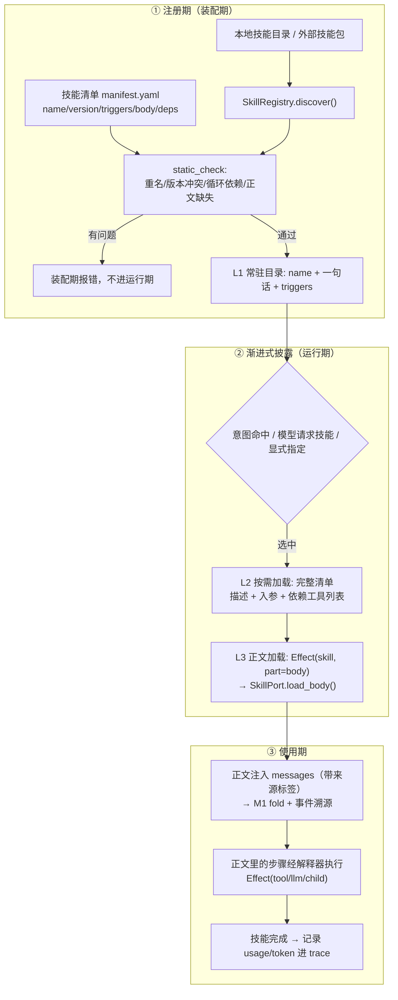

# 模块 M11：技能系统与渐进式披露（harness/skills/）

> 阅读前提：[《M3-端口协议层》](./M3-端口协议层.md)（`skill` port 命名空间、统一 Result 信封）、[《M4-工具系统》](./M4-工具系统.md)（ToolIndex 三级披露）、[《门禁体系》](../03-流程与规范/门禁体系.md)。
> 适用判断：[《模块协作与场景适用指南》](../01-总览与设计/模块协作与场景适用指南.md)——单一任务助手无需本模块；**多技能入口 / 技能正文很长 / 常驻工具数 > 20** 才启用。

---

## 1. 职责与边界

**做**：技能清单（Skill Manifest：name/version/description/触发条件/正文/依赖）；技能发现与注册表（SkillRegistry，落地 M3 `skill` port）；版本管理与生命周期（注册/校验/加载/卸载/升级）；渐进式披露一等机制（L1 目录 / L2 完整清单 / L3 正文）；`Effect(skill, part=body)` 的正文加载执行者（M1 已声明该 Effect kind、M10 RouterSkill 已引用，但此前无归属）；技能组合（一个技能引用其他技能 / 工具）。

**不做**：工具装饰器与 MCP 传输（M4）；解释循环与 Effect 分发（M1/M2）；外部能力实现（M3）；技能正文里的业务逻辑（正文是"说明 + 步骤"，真正执行仍靠 `Effect(tool/llm/child)` 走 M1）。

**为什么独立成模块**：技能与工具是两种不同原语——工具是"一个可调用的函数"（有 schema、有 danger 分级），技能是"一段按需注入的能力说明 + 编排脚本"（有版本、有触发条件、有正文）。把技能塞进 M4 会让工具注册表混入非函数对象；把 `Effect(skill)` 留在 M10 会让运行时引用一个无人履约的端口。M11 补齐这条断链，并把散落在 M4（`ToolIndex.load_body`）与设计方案 §3.3 的"渐进式披露"提升为一等机制。

**核心约定**：**本地技能、外部技能包、RouterSkill 的路由目标在运行时无差别**——同一 `SkillPort`、同一披露阶梯、同一版本语义。

## 2. 完整链路描述

三条链路，全部经由 M1 解释器 / M2 链路：



- **注册期**：技能以 manifest 描述、目录/包发现，`static_check()` 在装配期拒绝重名、版本冲突、循环依赖与缺失正文（红线）。
- **披露期**：常驻上下文只有"技能名 + 一句话 + 触发词"；完整清单在命中意图时注入，正文只在真正要用时通过 `Effect(skill)` 加载（RouterSkill 底座）。
- **使用期**：正文是**注入的说明文本**，不是可执行代码；其中声明的步骤仍拆成标准 Effect 交解释器执行，技能自身不绕过链路与预算。

## 3. 设计原语

| 原语 | 一句话定义 |
|------|-----------|
| `SkillManifest` | 技能的装配期描述（name/version/description/triggers/body/deps） |
| `Skill` | 运行期技能对象：清单 + 正文 + 已解析依赖 |
| `SkillRegistry` | 实现 M3 的 `skill` Port：发现、注册、按版本解析、生命周期 |
| `SkillPort` | M3 已登记命名空间的端口契约（本模块给出完整方法集） |
| `DisclosureIndex` | 三级披露索引，与 M4 `ToolIndex` 对齐：L1 目录 / L2 清单 / L3 正文 |
| `Effect(skill, part)` | M1 的 SKILL Effect：本模块履约，`part ∈ {manifest, body}` |
| `SkillResult` | 统一结果信封（复用 M3 `Result`），正文/清单装进 `data` |

## 4. 接口定义与实现

```python
# ---- ① 技能清单（装配期） ----
class SkillManifest(BaseModel):
    name: str                                   # 全局唯一，snake_case
    version: str                                # semver，进 trace
    description: str                            # 一句话（L1 目录载体）
    triggers: tuple[str, ...] = ()              # 命中词/意图标签（供 M6 或显式指定）
    body: str | BodyRef                         # L3 正文：内联文本或外部引用
    deps: tuple[str, ...] = ()                  # 依赖的技能/工具名，装配期查悬空
    max_tokens: int | None = None               # 正文注入预算，超限裁剪/拒绝
    model_config = ConfigDict(extra="forbid")

# ---- ② 技能端口（落地 M3 的 skill 命名空间） ----
class SkillPort(Protocol):
    def discover(self, source: str) -> list[SkillManifest]: ...     # 目录/包发现
    def register(self, manifest: SkillManifest) -> None: ...        # 注册 + 版本
    def catalog(self) -> list[SkillManifest]: ...                   # L1
    def load_manifest(self, name: str, version: str | None) -> SkillManifest: ...  # L2
    def load_body(self, name: str, version: str | None) -> str: ... # L3
    def resolve(self, name: str, version: str | None = None) -> Skill: ...
    def static_check(self) -> list[str]: ...                        # 装配期错误清单

class SkillRegistry(SkillPort): ...

# ---- ③ 披露索引（与 M4 ToolIndex 对齐的阶梯） ----
class DisclosureIndex:
    """L1 常驻 / L2 清单 / L3 正文；覆盖 skill 与工具长文档。"""
    def catalog(self) -> list[SkillManifest]: ...                    # L1
    def select(self, name: str) -> SkillManifest: ...               # L2（意图命中）
    def body(self, name: str, *, part: Literal["body"] = "body") -> str: ...  # L3

# ---- ④ Effect 履约（M1 已声明 SKILL kind，这里补齐执行者） ----
# Effect(kind=SKILL, payload={"name": "...", "version": "...", "part": "body"})
#   → M2 链路 dispatch → SkillPort.load_body() → Result(data=正文) → fold 注入
```

## 5. API 规范

- **命名与版本**：`name` 全局唯一 snake_case；`version` 用 semver；同名多版本共存，`resolve(name, version=None)` 默认取最新稳定版；重名同版本注册直接失败（红线）。
- **`Effect(skill, part)` 契约**：`part="manifest"` 走 L2（返回清单），`part="body"` 走 L3（返回正文）；payload 必带 `name`，`version` 可选；缺 `name` 或未知 `part` 装配期/运行期均折叠为结构化错误，不抛穿。
- **依赖纪律**：`deps` 只允许引用技能名或已注册工具名；循环依赖、悬空依赖在 `static_check()` 阶段拒绝（红线）；禁止运行期动态发现新依赖（保证可回放）。
- **正文注入**：正文以带来源标签的消息注入（`source = skill://name@version`），进 trace；正文里的步骤不改变 Program 的纯函数性质——它只是数据，执行仍经 M1 Effect。
- **披露阈值**：技能数 > 20 或任一正文 `max_tokens` 超阈值强制启用三级披露；少量短技能可 `index=False` 全量注入（与 M4 披露开关对齐）。
- **正文即不可信输入**：外部技能包正文按 prompt 注入风险处理——加载时经 ON_INPUT 同款净化（复用 M8 策略），正文不得含"忽略系统指令"类内容；审计 hook 记录来源与版本。
- **预算归属**：正文 token 与技能调用成本计入 M1 `Budgets.max_cost_usd`；技能不自带计数器（M6 红线延伸）。
- **缺席即降级**：未装配 SkillPort 时 `Effect(skill)` → `PortMissing` 错误信封，链路 filter 可 `skip` + fallback（提示"技能不可用"），框架照常运行。
- **注入形态收敛**：技能来源（本地目录 / 外部包 / RouterSkill 目标）via 协议替换；触发与披露策略 via 构造参数 + `static_check()` 兜底；不新增第四种注入口（遵循 M10 §5 三类收敛）。

## 6. 关键字段

**SkillManifest / Skill**：

| 字段 | 说明 |
|------|------|
| name / version | 唯一标识 + semver（L1 目录载体 + trace 溯源） |
| description / triggers | 一句话描述 + 触发词（L1 常驻，暴露给 M6 意图识别） |
| body / body_ref | L3 正文（内联或外部引用） |
| deps | 依赖的技能/工具名，装配期查悬空与循环 |
| max_tokens | 正文注入预算，超限裁剪/拒绝 |

**SkillResult**（复用 M3 `Result`）：`{ok, data, usage, error}`；`data` 装 SkillManifest（L2）或正文字符串（L3）；`error` 为 `{code, message, retryable}`。

**SkillDisclosureEvent**：`{name, version, level, token_cost, source}` —— 每次披露进 trace，供 M9 计量与归因。

## 7. 依赖关系

- **依赖**：M3 `skill` Port 命名空间 + `Result`/DTO；M1 `Effect(SKILL)` / `Budgets` / fold；M2 `BEFORE_LLM` 挂载点（正文注入与 filter）；M4 `ToolIndex`（披露阶梯对齐，共享 `max_tokens` 预算口径）；M6 意图识别（触发信号）、M8 输入净化（正文当作不可信输入）。
- **被依赖**：M10 RouterSkill（`Effect(skill, part=body)` 正文加载的执行底座）；所有"多技能入口"项目画像；M9（披露 token 计量进 trace）。
- **边界划清**：M4 管"工具函数"（ToolRegistry / @tool / MCP）；M11 管"能力说明包"（manifest / 版本 / 正文）。M4 的 `ToolIndex.load_body()` 接口位由 M11 履约；工具长文档的 L3 披露也走 M11 的 `DisclosureIndex`。

## 8. 验收标准与门禁

**验收标准**：① 技能 manifest 经发现注册后，L1/L2/L3 三级披露各自触发条件与 token 上限有断言；② `Effect(skill, part=body)` 命中后正文正确注入 messages 且带来源标签；③ 重名/版本冲突/循环依赖/悬空依赖/缺失正文全部装配期报错；④ RouterSkill 选中技能后正文按需加载且同一技能单次会话只加载一次；⑤ 未装配 SkillPort 时 Effect 折叠为错误信封并经 filter 降级，不崩溃；⑥ 外部技能包正文中的注入样本被拦截且不产生越权 Effect；⑦ 披露 token 计入预算并进 trace。

**门禁清单**（制度见《门禁体系》）：

| 门禁 | 条目 | 达标标准 | 级别 |
|------|------|---------|------|
| M11-G1 | 质量覆盖 | registry / disclosure / effect 履约单测覆盖率 ≥ 85%，mypy strict 通过 | G1 |
| M11-G2 | 装配期检查 | 重名/版本冲突/循环依赖/悬空依赖/缺正文各有用例，全部装配期报错 | G2 |
| M11-G2 | 披露语义 | L1/L2/L3 触发条件、token 上限、单次加载各有断言 | G2 |
| M11-G3 | 集成 | 与 RouterSkill 联测正文按需加载；与 M8 联测正文注入拦截；错误信封合规 | G3 |
| M11-红线 | 安全与纪律 | 正文含"忽略系统指令"未被拦截 → 拒绝；运行期动态发现依赖 → 拒绝；技能自带计数器 → 拒绝；Effect(skill) 抛穿运行时 → 拒绝 | 红线 |

**闭环核对**：契约自足 ✓（SkillPort 在 M3 命名空间已登记，方法集本文档补齐）/ 自带 fake ✓（FakeSkillPort / 本地目录源）/ 自带测试 ✓（tests/m11/）/ 独立 demo ✓（`make demo-m11`：注册 2 个技能 + 1 个 RouterSkill，跑通 L1→L2→L3 与正文注入）/ 文档自足 ✓。

## 9. 功能验证矩阵（可执行的完整性验证）

| 功能点 | 用例 ID | 验证方式 | 通过标准 |
|--------|---------|---------|---------|
| manifest 发现与注册 | M11-T01 | `pytest tests/m11/test_registry.py -q` | 目录/包发现正确入表，版本语义解析正确 |
| 装配期 static_check | M11-T02 | 同上 | 重名/版本冲突/循环依赖/悬空依赖/缺正文即报错 |
| 三级渐进式披露 | M11-T03 | `pytest tests/m11/test_disclosure.py -q` | L1/L2/L3 触发条件与 token 上限各有断言 |
| Effect(skill) 正文加载 | M11-T04 | `pytest tests/m11/test_effect.py -q` | part=body 命中后正文注入带来源标签，单次会话只加载一次 |
| 技能组合与依赖解析 | M11-T05 | `pytest tests/m11/test_registry.py -q -k deps` | 合法依赖解析成功，循环/悬空被拒 |
| 正文注入安全 | M11-T06 | 与 M8 联测 `tests/m11/test_injection.py` | 注入样本被拦，不产生越权 Effect |
| 缺席降级 | M11-T07 | `pytest tests/m11/test_effect.py -q -k missing` | PortMissing 折叠错误信封，filter skip 后继续 |
| 预算与 trace | M11-T08 | `pytest tests/m11/test_disclosure.py -q -k budget` | 披露 token 计入 Budgets，事件进 trace |
| 披露红线 | M11-T09 | `python tests/tools/ast_scan.py --module m11` | 无运行期动态发现依赖、无技能自带计数器 |
| RouterSkill 集成 | M11-T10 | 与 M10 联测 `tests/m11/test_router_skill.py` | 选中技能正文按需加载且只加载一次 |
| 独立闭环 | M11-D01 | `make demo-m11` + `gate_check --module m11` | 2 技能 + 1 RouterSkill 跑通披露闭环，G0~G4 全绿 |

---
*M11 文档版本：v0.1 · 2026-11-16 · 新增模块：补齐技能管理与渐进式披露（此前散落于 M1 Effect 声明、M3 port 命名空间、M4 ToolIndex、M10 RouterSkill，无统一归属）*
