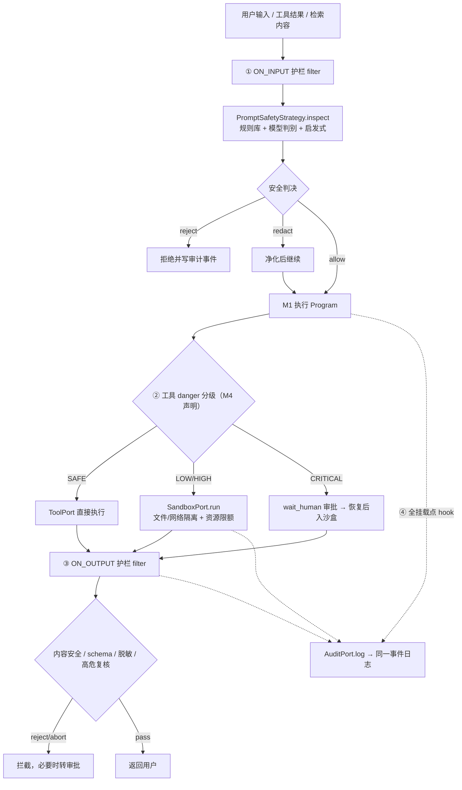

# 模块 M8：安全体系（harness/security/）

> 阅读前提：[《M2-链路系统》](./M2-链路系统.md)（filter/hook 挂载）、[《M4-工具系统》](./M4-工具系统.md)（danger 分级）、[《门禁体系》](../03-流程与规范/门禁体系.md)。
> 适用判断：[《模块协作与场景适用指南》](../01-总览与设计/模块协作与场景适用指南.md)——纯只读 API 工具不需要沙盒；存在写操作/不可逆操作才需要 HITL 与审计。

---

## 1. 职责与边界

**做**：进出两级护栏（ON_INPUT / ON_OUTPUT filter 实现）；沙盒自动路由与执行策略（SandboxPort）；审计（全挂载点 hook + AuditPort）；prompt 安全检测策略（PromptSafetyStrategy，可插拔）。

**不做**：执行工具（ToolPort/M4）；链路调度（M2）；身份系统与密钥管理（由部署层提供，本模块只消费）；把策略做成硬编码（全部 Protocol 化）。

**总原则**：**一切来自模型输入、工具返回值、RAG 检索内容的数据都是不可信数据，"数据 ≠ 指令"**；高危操作默认沙盒，失败即拒绝（fail-closed）。

## 2. 完整链路描述



## 3. 设计原语

| 原语 | 一句话定义 |
|------|-----------|
| `Guardrail` | 挂在 ON_INPUT/ON_OUTPUT 的 filter 实现 |
| `PromptSafetyStrategy` | 注入检测策略接口（规则/模型/启发式，可组合） |
| `SafetyReport` | 检测结果：level、命中模式、建议动作 |
| `SandboxPort / SandboxSpec` | 沙盒执行接口与隔离规格 |
| `AuditEvent` | 审计事件：谁在何时让 agent 做了什么、花了多少、动了哪些数据 |
| `SecurityPolicyRouter` | danger → （直接/沙盒/审批）的路由表（M4 声明、本模块执行） |

## 4. 接口定义与实现

```python
class PromptSafetyStrategy(Protocol):
    def inspect(self, text: str, ctx: SecurityContext) -> SafetyReport: ...
        # 内置：RuleStrategy（注入/越狱模式库）、ModelStrategy（判别模型）、
        #       HeuristicStrategy（工具结果含指令样本检测），可组合成链

class InputGuardrail(Filter):
    def __init__(self, strategies: list[PromptSafetyStrategy]): ...
    def check(self, ctx: ChainCtx, phase) -> Verdict: ...   # allow / redact / reject

class OutputGuardrail(Filter):
    def __init__(self, *, redact_pii: bool = True, schema: type | None = None): ...
    def check(self, ctx: ChainCtx, phase) -> Verdict: ...

class SandboxPort(Protocol):
    async def run(self, call: ToolCall, spec: SandboxSpec,
                  ctx: PortCtx) -> ToolResult: ...

class AuditPort(Protocol):
    async def log(self, event: AuditEvent) -> None: ...
        # 默认 JsonlAudit：写进 M1 同一事件日志（回放时安全上下文可复现）
```

**内置默认实现**：`RuleStrategy + HeuristicStrategy` 组合的 `DefaultInputGuardrail`、
`PiiRedactOutputGuardrail`、`LocalProcessSandbox`（文件系统虚拟根 + 出站白名单 + CPU/内存/时长限额，
可选容器/微 VM 后端）、`JsonlAudit`。

## 5. API 规范

- **路由表（M4 声明 → M8 执行）**：SAFE 直接 / LOW 沙盒 / HIGH 沙盒+审计 / CRITICAL 沙盒+`wait_human`。
  未声明 danger 的工具注册期拒绝；未配 SandboxPort 却注册 HIGH/CRITICAL → 注册期拒绝（fail-closed）。
- **策略链**：`InputGuardrail([RuleStrategy(), HeuristicStrategy(), ModelStrategy()])` 按序执行，任一 reject 即拦截；策略可热插拔、须带 `name` 进 trace。
- **不可信输入原则**：RAG 内容、工具返回值、网页、用户输入统一走 `inspect()`；不得把检索结果里的"指令"交给 Program 执行。
- **审计完整性**：每次 LLM/工具/护栏/审批/沙盒事件都进事件日志；审计事件**不可绕过**（hook 异常会被记录但不影响主流程，参考 M2）。
- **脱敏**：输出侧 PII/密钥默认值脱敏；审计事件中的敏感字段只存哈希。
- **失败即拒绝**：策略服务/沙盒/审批服务不可用时，高危路径一律 reject，不放行（fail-closed 红线）。

## 6. 关键字段

**SafetyReport**：`{level: safe|suspicious|malicious, matched: list[str], action: allow|redact|reject, strategy}`。
**SandboxSpec**：`{fs_roots, net_allowlist, cpu_ms, mem_mb, timeout_s, backend}`。
**AuditEvent**：`{actor, session_id, step, action, target, verdict, cost_usd, ts, trace_id}`。
**SecurityContext**：`{source(user|tool|rag|web), mount, session_id, danger}`。

## 7. 依赖关系

- **依赖**：M2（filter/hook 挂载点、Verdict）、M3（SandboxPort/AuditPort 契约）、M4（ToolSpec.danger）、M1（事件日志、wait_human）。
- **被依赖**：M4（路由执行）、M5（检索结果注入检测）、M9（审计事件采集）。

## 8. 验收标准与门禁

**验收标准**：① 注入样本集（直接注入/间接注入/越狱）被 ON_INPUT 拦截；② danger 四级路由各生效，HIGH/CRITICAL 必进沙盒；③ 沙盒逃逸用例（越界文件、非白名单网络、超限资源）全部被阻断；④ 每次高危操作的审计事件完整且与事件日志一致；⑤ 策略服务不可用时高危路径拒绝而非放行。

**门禁清单**：

| 门禁 | 条目 | 达标标准 | 级别 |
|------|------|---------|------|
| M8-G1 | 质量覆盖 | guardrail/sandbox/audit 覆盖率 ≥ 90%（安全模块从高），mypy strict 通过 | G1 |
| M8-G2 | 检测有效性 | 内置注入样本集 100% 拦截；合法输入误杀率 < 1% | G2 |
| M8-G2 | 沙盒隔离 | 文件系统越界/网络白名单/资源限额各有用例，全部阻断 | G2 |
| M8-G3 | 集成 | 四级 danger 路由端到端用例；审计事件与事件日志逐条对齐 | G3 |
| M8-红线 | fail-closed | 高危工具未走沙盒 → 拒绝；审计可绕过 → 拒绝；策略/沙盒不可用时放行 → 拒绝 | 红线 |

## 9. 功能验证矩阵

| 功能点 | 用例 ID | 验证方式 | 通过标准 |
|--------|---------|---------|---------|
| 输入护栏（直接/间接注入） | M8-T01 | `pytest tests/m8/test_guardrail.py -q` | 样本集 100% 拦截、误杀率 < 1% |
| 输出护栏（脱敏/schema） | M8-T02 | 同上 | PII/密钥脱敏、非法结构 reject |
| prompt 安全策略可插拔 | M8-T03 | 同上 | 增删策略不改护栏调用方代码 |
| danger 四级路由 | M8-T04 | `pytest tests/m8/test_routing.py -q` | SAFE 直执行；LOW/HIGH 进沙盒；CRITICAL 触发审批 |
| 沙盒隔离 | M8-T05 | `pytest tests/m8/test_sandbox.py -q` | 越界文件/非白名单网络/超限资源全部阻断 |
| 审计完整性 | M8-T06 | `pytest tests/m8/test_audit.py -q` | 每次高危操作事件完整且与事件日志一致 |
| fail-closed | M8-T07 | 注入故障（停掉策略服务/沙盒） | 高危路径一律拒绝，无放行 |
| 独立闭环 | M8-D01 | `make demo-m8` + `python tools/gate_check.py --module m8` | demo 冒烟通过 + G0~G4 全绿 |

**闭环核对**：契约自足 ✓ / 自带 fake ✓（FakeSandbox/JsonlAudit）/ 自带测试 ✓（tests/m8/）/ 独立 demo ✓ / 文档自足 ✓。

---
*M8 文档版本：v0.1 · 2026-11-15*
