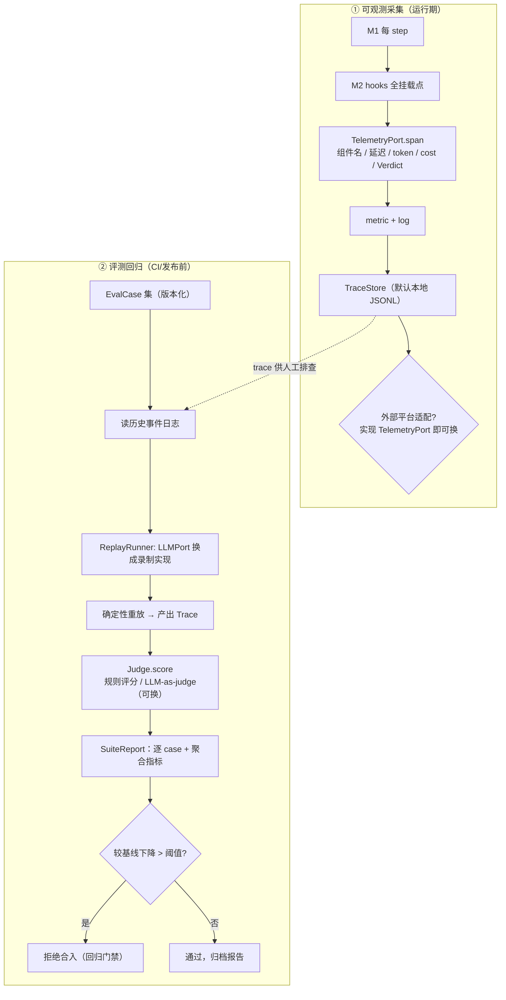

# 模块 M9：可观测与评测（harness/observability/ + harness/eval/）

> 阅读前提：[《M1-核心运行时》](./M1-核心运行时.md)（事件日志/回放）、[《M2-链路系统》](./M2-链路系统.md)（hooks 采集）、[《门禁体系》](../03-流程与规范/门禁体系.md)。
> 适用判断：[《模块协作与场景适用指南》](../01-总览与设计/模块协作与场景适用指南.md)——可观测 P0 就该挂（调试刚需）；评测在开始迭代 prompt/模型之后才产生价值。

---

## 1. 职责与边界

**做**：TelemetryPort / EvalPort 的完整实现与外部平台适配（Langfuse / LangSmith / 自建）；全链路 trace / 指标 / 日志；LLM-as-judge；**基于事件日志的回归重放**（评测底座）。

**不做**：自己定义流程（复用 M1 事件日志）；在评测里调用真实 LLM 产生随机结果（重放必须用录制实现）；门禁制度本身（门禁体系）。

**核心洞察**：**评测 = 把 LLMPort 换成录制实现，重放历史事件**。可观测与评测共用同一底座，不做两遍。

## 2. 完整链路描述



## 3. 设计原语

| 原语 | 一句话定义 |
|------|-----------|
| `Span / Trace` | 一次调用 / 一次完整 run 的追踪结构 |
| `EvalCase` | 单个评测用例：输入 + 期望/评分标准 + 版本 |
| `Score / SuiteReport` | 单 case 得分 / 套件报告（含基线对比） |
| `Judge` | 评分器接口（规则 / LLM-as-judge / 人工，可替换） |
| `ReplayRunner` | 用录制 LLMPort 重放事件日志的 runner |
| `TraceStore` | trace 的读写接口（默认 JSONL，可换平台） |

## 4. 接口定义与实现

```python
class TelemetryPort(Protocol):                 # M3 定契约，本模块给实现
    @contextmanager
    def span(self, name: str, ctx: PortCtx): ...
    def metric(self, name: str, value: float, tags: dict = {}): ...
    def log(self, event: dict): ...

class Judge(Protocol):
    async def score(self, case: EvalCase, trace: Trace) -> Score: ...

class EvalPort(Protocol):
    async def run_case(self, case: EvalCase) -> EvalResult: ...
    async def regression(self, suite: str, *, baseline: str | None = None) -> SuiteReport: ...

class ReplayRunner:
    def __init__(self, event_store: EventStore, recorded_llm: LLMPort): ...
    async def replay(self, session_id: str) -> Trace: ...   # 确定性重放，零真实调用

class TraceStore(Protocol):
    def put(self, trace: Trace) -> None: ...
    def get(self, run_id: str) -> Trace: ...
```

**内置默认实现**：`JsonlTelemetry`（本地 JSONL + 基础指标：token/延迟/成本/成功率）、
`RuleJudge`（规则评分）、`RecordingLLMPort`（回放用）、`LocalEvalRunner`、`JsonlTraceStore`。
外部平台 = 实现 `TelemetryPort` / `EvalPort` 注册，上层零改动。

## 5. API 规范

- **组件留名**：trace 中必须含每个 middleware/filter/pipe/hook 的 name（M2 红线由本模块验证）。
- **脱敏**：trace 与日志中的 PII/密钥只存哈希；原始值不落盘。
- **评测集版本化**：EvalCase 与基线报告带版本号，进 PR 证据；用例只增不改语义。
- **重放确定性**：`ReplayRunner` 禁止调用真实 LLM；同一事件日志两次重放产出逐字节一致的 Trace（红线）。
- **回归阈值即门禁**：聚合指标较基线下降超过阈值（默认 5%）→ CI 拒绝合入。
- **成本可归属**：每个 span 的 token/cost 归属到 session/step/port，供 M1 预算与 M8 审计对齐。

## 6. 关键字段

**Span**：`{span_id, parent_id, name, component, start_ts, duration_ms, tokens, cost_usd, status, error}`。
**Trace**：`{run_id, session_id, spans[], total_tokens, total_cost, verdicts[]}`。
**EvalCase**：`{case_id, version, input, expect, rubric, tags}`。
**Score**：`{case_id, value, max, reasons[], judge}`。
**SuiteReport**：`{suite, version, baseline, delta, cases[], passed, threshold}`。

## 7. 依赖关系

- **依赖**：M1（事件日志、EventStore）、M2（hooks 采集点）、M3（Port 契约与注册表）。
- **被依赖**：门禁体系（G2/G3 的运行证据、回归门禁）、M8（审计事件一致性校验）、M10（架构级回归）。

## 8. 验收标准与门禁

**验收标准**：① 一次 run 的 trace 含全部链路组件名、token/cost 可归属；② 同一事件日志两次重放 Trace 逐字节一致；③ 换外部 TelemetryPort 后上层零改动；④ 回归套件能检出人为注入的退化并拒绝；⑤ trace 中无 PII 原文。

**门禁清单**：

| 门禁 | 条目 | 达标标准 | 级别 |
|------|------|---------|------|
| M9-G1 | 质量覆盖 | telemetry/eval/replay 覆盖率 ≥ 85%，mypy strict 通过 | G1 |
| M9-G2 | 重放确定性 | 两次重放 Trace 哈希一致；录制实现之外零网络调用 | G2 |
| M9-G2 | trace 完整性 | 组件留名 100%、token/cost 归属正确、无 PII 原文 | G2 |
| M9-G3 | 集成 | 外部平台适配契约测试通过；回归退化检出用例生效 | G3 |
| M9-红线 | 纪律 | 评测直接调真实 LLM → 拒绝；trace 缺组件名 → 拒绝；PII 原文落盘 → 拒绝 | 红线 |

## 9. 功能验证矩阵

| 功能点 | 用例 ID | 验证方式 | 通过标准 |
|--------|---------|---------|---------|
| 全链路 trace 采集 | M9-T01 | `pytest tests/m9/test_telemetry.py -q` | span 覆盖全部组件，字段完整 |
| 指标与成本归属 | M9-T02 | 同上 | token/cost 与 M1 预算扣减逐项对齐 |
| 外部平台替换 | M9-T03 | 同上 | 注册新 TelemetryPort 后上层零改动 |
| 确定性重放 | M9-T04 | `pytest tests/m9/test_replay.py -q` | 两次重放 Trace 哈希一致、零真实 LLM 调用 |
| Judge 可替换 | M9-T05 | `pytest tests/m9/test_eval.py -q` | 规则/模型 Judge 切换不影响报告结构 |
| 回归退化检出 | M9-T06 | 同上（人为注入退化） | 下降超阈值 → SuiteReport.passed=false |
| 脱敏 | M9-T07 | 扫描 JSONL 产物 | 无 PII / 密钥原文 |
| 独立闭环 | M9-D01 | `make demo-m9` + `python tools/gate_check.py --module m9` | demo 冒烟通过 + G0~G4 全绿 |

**闭环核对**：契约自足 ✓ / 自带 fake ✓（RecordingLLMPort/JsonlTraceStore）/ 自带测试 ✓（tests/m9/）/ 独立 demo ✓ / 文档自足 ✓。

---
*M9 文档版本：v0.1 · 2026-11-15*
