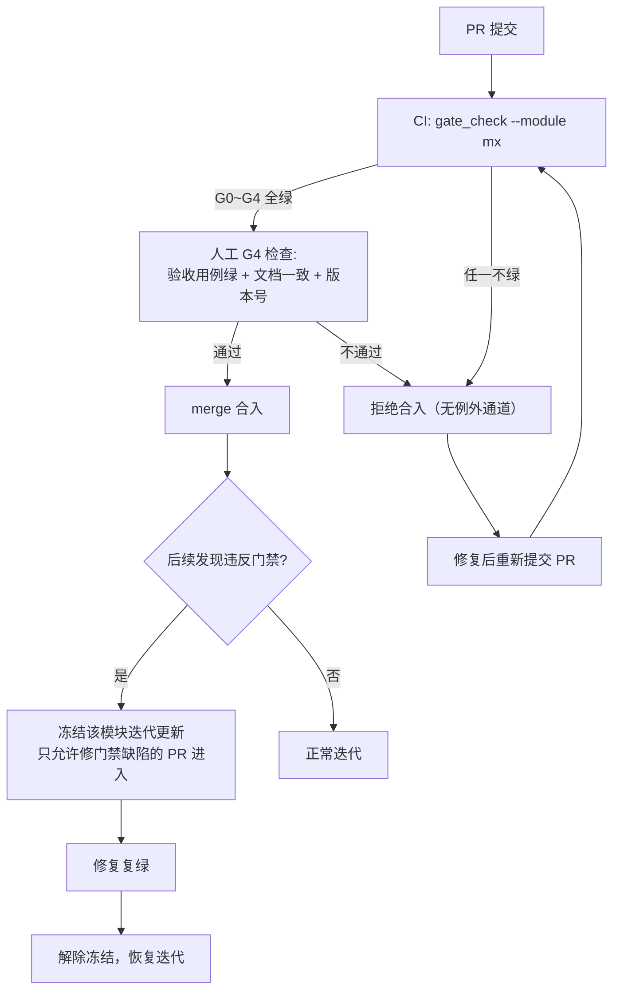

# 门禁体系（开发流程强管控）

> 适用对象：**本项目全部开发活动**——写码、合入、迭代、发版，无一例外。
> 配套：[《大纲：模块拆分全景》](../01-总览与设计/大纲-模块拆分全景.md)、各模块文档 §8 的专属门禁清单。
> 原出处：《模块拆分规划》§7（本文档为其独立拆分页）。

---

## 0. 定位与铁律

**本门禁体系是本项目的开发流程管控机制。**

> **门禁不绿 → 不得合入；违反红线 → 冻结该模块迭代更新，只许修复、不许加功能，修复复绿后才恢复迭代。效力高于任何排期压力。**

设立理由：框架的核心卖点是"换架构零成本、换 LLM 一行配置、评测回放同底座"——这些卖点依赖契约稳定与内核确定性。没有门禁，契约会被随手破坏，框架就退化成"一堆能跑但没人敢改的代码"。

---

## 1. 闭环五条件（CL-1~CL-5）

每个模块必须**单独闭环**——缺一条不算完成，不进入下一里程碑：

| 编号 | 条件 | 检查方式 |
|------|------|---------|
| CL-1 | **契约自足**：对外只依赖 Protocol/DTO（`runtime/types.py` 与本模块 Protocol），不依赖其他模块的具体实现 | import 扫描脚本 |
| CL-2 | **自带 fake**：仓库内提供本模块全部外部依赖的 fake 实现（fake_dispatch / fake_llm / fake_store…） | CI 跑 fake 用例 |
| CL-3 | **自带测试**：tests/ 与模块同目录交付，覆盖本模块门禁清单全部条目 | 覆盖率报告 |
| CL-4 | **独立 demo**：一条命令跑通本模块最小闭环（`make demo-m1` / `demo-m4`…） | CI 冒烟 |
| CL-5 | **文档自足**：拆分文档八要素齐全（含本模块的门禁清单），新人只读本文档 + 模块文档即可开发 | 文档评审 |

## 2. 门禁分级（G0~G4）

全部为**合入前置条件**，任何一级不绿即拒绝：

| 级别 | 名称 | 内容 | 谁执行 |
|------|------|------|--------|
| G0 | 契约门禁 | Protocol/DTO 破坏性变更必须过架构评审；装配期静态检查（悬空边/环/缺 port）必须可运行 | 架构评审 + CI |
| G1 | 质量门禁 | 单测覆盖率达标、类型检查（mypy strict）通过、lint 通过、公共 API 均有 docstring | CI 自动 |
| G2 | 行为门禁 | 确定性/回放一致性、错误处置语义、注册顺序确定性等本模块行为断言 | CI 自动 |
| G3 | 集成门禁 | 与上下游契约测试、trace 完整性检查、独立 demo 冒烟 | CI 自动 |
| G4 | 发布门禁 | 模块验收标准全部用例绿 + 拆分文档与实现一致 + 版本号更新 | 人工检查清单 |

## 3. 各模块门禁清单位置

门禁条目**随模块文档走**（一个模块一个文档，门禁属于该模块），本体系只定义制度：

| 模块 | 门禁清单位置 | 红线摘要 |
|------|-------------|---------|
| M1 | [M1 文档 §8](../02-模块详设/M1-核心运行时.md) | Program 内出现时间/随机/网络调用（破坏确定性） |
| M2 | [M2 文档 §8](../02-模块详设/M2-链路系统.md) | 组件不留名进 trace、middleware 未声明短路 |
| M3 | [M3 文档 §8](../02-模块详设/M3-端口协议层.md) | 适配器持有会话状态、错误信封结构不合规 |
| M4 | [M4 文档 §8](../02-模块详设/M4-工具系统.md) | 工具未声明 danger、MCP 工具全量注入上下文 |
| M5 | [M5 文档 §8](../02-模块详设/M5-RAG子系统.md) | 检索结果无溯源、空结果编造、上下文超预算 |
| M6 | [M6 文档 §8](../02-模块详设/M6-认知模块集.md) | 服务自己数 rounds/hops、信息不足不澄清强行执行 |
| M7 | [M7 文档 §8](../02-模块详设/M7-记忆与会话.md) | 跨租户召回、运行中隐式写记忆、恢复不一致仍继续 |
| M8 | [M8 文档 §8](../02-模块详设/M8-安全体系.md) | 高危工具未走沙盒、审计可绕过、策略不可用时放行 |
| M9 | [M9 文档 §8](../02-模块详设/M9-可观测与评测.md) | 评测调真实 LLM、trace 缺组件名、PII 原文落盘 |
| M10 | [M10 文档 §8](../02-模块详设/M10-架构与组合.md) | 运行期才发现图错误、架构内直接 IO、绕过 Budgets |
| M11 | [M11 文档 §8](../02-模块详设/M11-技能系统与渐进式披露.md) | 正文注入未净化、运行期动态发现依赖、技能自带计数器、Effect(skill) 抛穿 |
| 全部 | [《验证执行手册》](./验证执行手册.md) | 三条标准命令 + 四类证据 + 红线扫描的统一执行契约 |

## 4. 执行机制

1. **CI 强制**：`python tests/tools/gate_check.py --module m1|m2|...` 一键跑本模块全部门禁；PR 流水线不绿则 merge 按钮关闭（branch protection）。
2. **PR 门禁清单**：PR 模板内置 checklist——覆盖 CL-1~CL-5 与 G0~G4，逐条勾选并附运行证据（CI 链接）。
3. **违反处置**：
   - 门禁不绿 → **拒绝合入**，不设例外通道（无 skip 标志）。
   - 已合入后新发现的违反 → **立即冻结该模块的迭代更新**：只允许修门禁相关缺陷的 PR 进入该模块，修复合入并复绿后才解除冻结。
   - 门禁条目本身的增删改 → 视同契约变更，必须架构评审并更新本文档版本号。
4. **门禁即文档**：每个后续模块（M7~M11）的拆分文档必须包含同等格式的闭环五条件核对与门禁清单表，缺门禁清单的模块不开工、不排期。

## 5. 与开发节奏的关系

- 门禁作用于**每个模块**，而非整个项目批次：M4 门禁不绿，不影响 M5 继续开发——但违反门禁的模块自身冻结迭代。
- 里程碑（P0~P3）的前置条件是该批次内所有模块门禁全绿，见[大纲 §6](../01-总览与设计/大纲-模块拆分全景.md)。

---
*门禁体系版本：v0.2 · 2026-11-16 · 门禁索引新增 M11；里程碑注记详见大纲（含 P2.5）*
