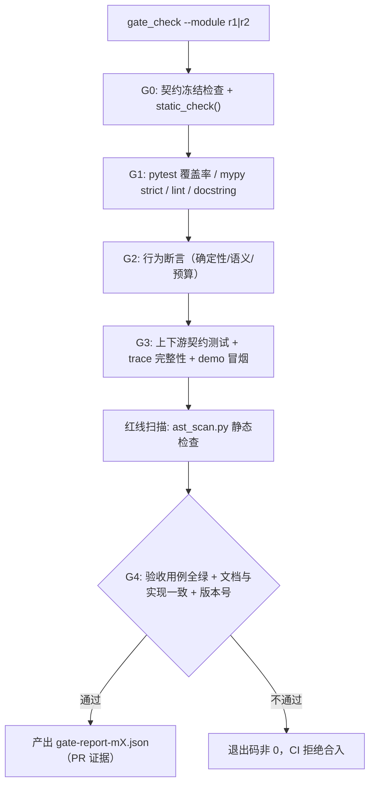

# 验证执行手册（M1~M11 全模块）

> 定位：本手册定义**每个模块如何被独立验证功能完整**。
> 配套：[《门禁体系》](./门禁体系.md)（制度）、[《AGENT 总设计》](../01-总览与设计/AGENT-总设计.md)（SSOT，迁移路线见附录 D）。
> 原则：**一个模块 = 一套测试 + 一个 demo + 一次门禁 + 一份证据**。没有证据不算验证。

---

## 1. 目录契约（每个模块必须遵守）

```
src/                                                    # 顶层包，只放核心实现，import 形如 `from runtime import ...`
└── runtime/  chains/  ports/  harness/  archs/  compose/     # 实现
tests/                                                  # 所有验证代码的唯一公共目录，位于 src 之外
├── m1/ … m11/              # 每模块自己的测试（CL-3）
├── integration/            # 跨模块契约测试（G3）
├── fakes/                  # 全部 fake 依赖集中管理（CL-2）
│   ├── __init__.py         # 跨模块共用替身
│   ├── m3.py               # M3 端口适配器替身
│   └── m4.py               # M4 工具系统替身
├── demos/                  # 一条命令跑通最小闭环（CL-4）
│   └── demo_m1.py … demo_m11.py
└── tools/
    ├── gate_check.py       # 门禁执行器
    └── ast_scan.py         # 红线静态扫描
Makefile                    # make demo-mX / test-mX / gate-mX
└── .github/workflows/gate.yml
```

## 2. 三条标准命令（所有模块一致）

```bash
make demo-mX                                    # 独立闭环冒烟（CL-4）
pytest tests/mX -q --cov=<模块>                 # 功能用例 + 覆盖率（G1/G2）
python tests/tools/gate_check.py --module r1|r2          # 一次跑完 G0~G4 + 红线扫描（合入前置）
```

`gate_check.py` 内部流程：



## 3. 验证矩阵格式（各模块文档 §9）

统一四列，逐功能点可追溯到用例：

| 列 | 含义 |
|----|------|
| 功能点 | 从模块「职责与边界」逐条拆出的可观察能力 |
| 用例 ID | `M<n>-T<nn>`（测试）/ `M<n>-D01`（独立闭环） |
| 验证方式 | 具体 pytest 命令 / demo / 静态扫描 |
| 通过标准 | 可判定真假的客观条件（数值、哈希一致、100% 等） |

**完整性判定**：模块文档 §9 的功能点必须覆盖 §1 全部职责 + §5 全部 API 规范 + §8 全部验收标准，缺一条即验证不完整，门禁 G2 不绿。

## 4. 十三模块验证命令总表

| 模块 | 独立 demo | 功能测试 | 红线扫描重点 | 门禁关键指标 |
|------|----------|---------|-------------|-------------|
| R1 运行时 | `make demo-r1` | `pytest tests/r1 -q` | Program 纯函数 | 事件日志哈希一致、回放全等 |
| R2 插件总线 | `make demo-r2` | `pytest tests/r2 -q` | 全部组件留名 | 四 mode 编排、八判决生效、trace 完整 |
| R3~R13 | 待实现（预留 `make demo-rN` / `pytest tests/rN -q`） | — | 各模块门禁 | 代码落地后按模块文档验证矩阵补齐 |

> 注：旧 M1~M10 的 demo/test 路径已随 R1/R2 代码重写废弃；未实现模块路径为预留，不得在代码中引用。

每个模块的完整用例清单见对应文档 **§9 功能验证矩阵**；红线定义见各文档 §8 门禁清单。

## 5. 证据与 CI

**PR 必须附四类证据**（缺一 G4 不绿）：

1. `gate-report-mX.json`（gate_check 产出，含各级别结果）
2. 覆盖率报告（G1 阈值）
3. demo 冒烟输出（CL-4）
4. 若涉及 trace/评测：trace 快照或 SuiteReport 基线对比

**branch protection（强制，无 skip 通道）**：

```yaml
# .github/workflows/gate.yml（示意）
name: gates
on: [pull_request]
jobs:
  gate:
    runs-on: ubuntu-latest
    strategy:
      matrix:
        module: [m1, m2, m3, m4, m5, m6, m7, m8, m9, m10, m11]
    steps:
      - uses: actions/checkout@v4
      - run: python tests/tools/gate_check.py --module ${{ matrix.module }}
      - uses: actions/upload-artifact@v4
        with: { name: gate-${{ matrix.module }}, path: gate-report-*.json }
```

- 只跑变更模块及其依赖下游（增量），但**红线扫描始终全模块跑**。
- 违反门禁 → 拒绝合入；已合入后发现违反 → 冻结该模块迭代，只许修门禁缺陷（见门禁体系 §4）。

## 6. 完成定义（Definition of Done）

一个模块"功能完整"必须同时满足：

- [ ] 文档八要素齐全（职责边界 / 链路描述+流程图 / 原语 / 接口 / API 规范 / 关键字段 / 依赖 / 验收门禁）
- [ ] §9 验证矩阵覆盖全部功能点，每条有命令与客观通过标准
- [ ] 三条标准命令全部通过（demo / pytest / gate_check）
- [ ] 红线静态扫描通过，覆盖率达标
- [ ] `gate-report-mX.json` 归档，版本号与文档一致
- [ ] 独立闭环：拔掉其他模块（用 fakes）仍能跑通本模块

**不满足任一条 → 该模块不算完成，不进入下一里程碑；违反门禁 → 冻结迭代。**

---
*验证执行手册版本：v0.2 · 2026-11-16 · 覆盖模块 M1~M11（新增 M11 技能披露验证契约）*
