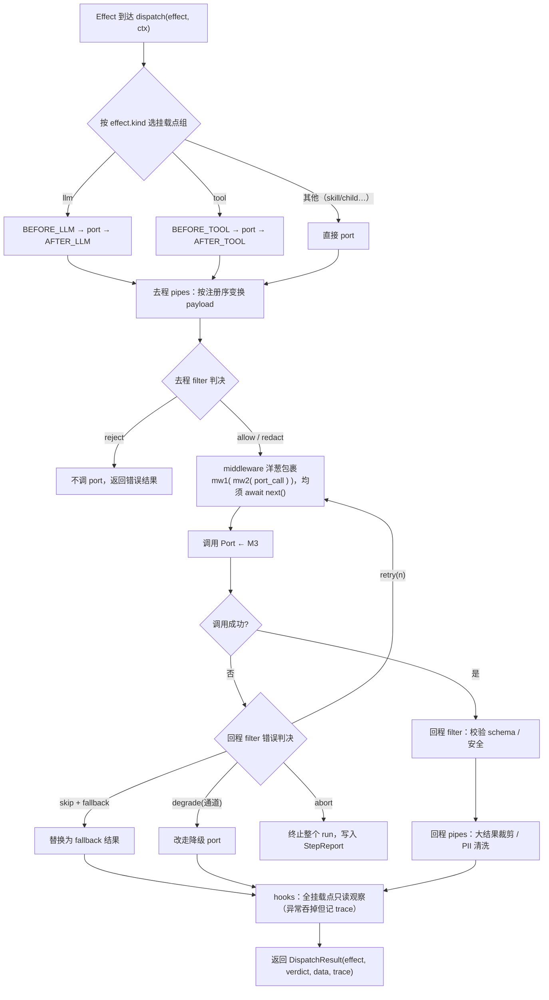

# 模块 M2：链路系统（chains/）

> 阅读前提：[《Agent框架设计方案》](./Agent框架设计方案.md) §2、原语类型见 [《M1-核心运行时》](./M1-核心运行时.md)、制度见[《门禁体系》](./门禁体系.md)。
> 本文档自足：读完即可开发本模块。

---

## 1. 职责与边界

**做**：定义七个挂载点；实现四泳道（middleware/hooks/filter/pipes）的统一管道；Verdict 判决模型；链路注册与装配 API。

**不做**：具体护栏/审计/重试策略的实现（属 M8/M9）；执行 Port（M3）。
链路是**纯编排层**：它决定"谁能过、数据怎么变形、错误怎么处置"，自己不碰外部世界。

## 2. 完整链路描述

一次 `dispatch(effect)` 的内部时序：

```
dispatch(effect, ctx)
  ├─ 1. 按 effect.kind 选择挂载点组：
  │       llm   → BEFORE_LLM → [port] → AFTER_LLM
  │       tool  → BEFORE_TOOL → [port] → AFTER_TOOL
  │       other → 直接 [port]
  ├─ 2. 去程 pipes：按注册序变换 payload（如上下文压缩、消息规范化）
  ├─ 3. 去程 filter：按注册序判决：
  │       allow → 继续；redact → 替换数据继续；reject → 不调 port，返回错误结果
  ├─ 4. middleware 洋葱包裹：mw1( mw2( port_call ) )，每个 mw 必须 await next()
  ├─ 5. 回程 filter：校验结果（schema/安全），可 redact/abort
  ├─ 6. 回程 pipes：结果变换（大结果裁剪、PII 清洗）
  ├─ 7. hooks：全挂载点只读观察（trace/审计采集），异常不影响主流程
  └─ 8. 返回 DispatchResult(effect, verdict, data, trace)
```

dispatch 全流程图：



错误处置——filter 的 Verdict 携带**步骤级错误策略**：

```
Port 报错 → 回程 filter 判决：
  retry(n, backoff)   → 重新走第 4 步（计数在 ctx.attempt）
  skip + fallback     → 用 fallback 数据作为结果，流程继续
  degrade(通道)       → 改走降级 port（如主模型挂了切备用模型）
  abort(reason)       → 整个 run 终止，写入 StepReport
```

与其他模块的协同（链路是全框架唯一"必经之路"）：

- **护栏模块** = ON_INPUT / ON_OUTPUT 上的 filter（M8 落地）；
- **审计模块** = 全挂载点 hook 采集（M8/M9 落地）；
- **成本/重试/熔断** = 全挂载点 middleware（M9 落地）；
- **上下文压缩** = ON_STATE / BEFORE_LLM 上的 pipe（M7 落地）。

## 3. 设计原语

| 原语 | 一句话定义 |
|------|-----------|
| `MountPoint` | 7 个固定插槽：ON_INPUT / BEFORE_LLM / AFTER_LLM / BEFORE_TOOL / AFTER_TOOL / ON_STATE / ON_OUTPUT |
| `Verdict` | filter 的判决：allow / redact / retry / skip / degrade / abort |
| `ChainCtx` | 一次 dispatch 的上下文（effect、state 视图、attempt、budget 余额、trace） |
| `Middleware` | 洋葱模型包裹器 `async (ctx, next)` |
| `Filter` | 判决器 `check(ctx) -> Verdict` |
| `Pipe` | 纯变换器 `transform(data, ctx) -> data` |
| `Hook` | 只读观察者 `on_event(ChainEvent, ctx)` |

## 4. 接口定义与实现

```python
class MountPoint(str, Enum):
    ON_INPUT = "on_input"; BEFORE_LLM = "before_llm"; AFTER_LLM = "after_llm"
    BEFORE_TOOL = "before_tool"; AFTER_TOOL = "after_tool"
    ON_STATE = "on_state"; ON_OUTPUT = "on_output"

@dataclass(frozen=True)
class Verdict:
    action: Literal["allow", "redact", "retry", "skip", "degrade", "abort"]
    data: Any = None            # redact 的新数据 / skip 的 fallback / degrade 的目标 port
    retry: int = 0              # retry 的剩余次数
    backoff: float = 0.0
    reason: str = ""

class Middleware(Protocol):
    async def __call__(self, ctx: ChainCtx, nxt: NextFn) -> None: ...
class Filter(Protocol):
    def check(self, ctx: ChainCtx, phase: Literal["request", "response"]) -> Verdict: ...
class Pipe(Protocol):
    def transform(self, data: Any, ctx: ChainCtx) -> Any: ...
class Hook(Protocol):
    async def on_event(self, event: ChainEvent, ctx: ChainCtx) -> None: ...

class Chains:
    """链路注册表 + 调度器。Runner 注入的 dispatch 即 Chains.dispatch。"""
    def use(self, mw: Middleware, *, at: MountPoint | None = None) -> Self: ...
    def filter(self, f: Filter, *, at: MountPoint) -> Self: ...
    def pipe(self, p: Pipe, *, at: MountPoint) -> Self: ...
    def hook(self, h: Hook) -> Self: ...                      # hook 全挂载点生效
    def freeze(self) -> None: ...                             # 装配期检查：非法挂载点/空管道告警
    async def dispatch(self, effect: Effect, ctx: ChainCtx) -> DispatchResult: ...
```

## 5. API 规范

- **注册顺序即执行顺序**：同挂载点按注册序排列；middleware 构成洋葱（先注册在外层）。
- **首个 reject 生效**：去程 filter 一旦 reject，后续 filter 与 port 均不执行。
- **middleware 必须调用 `await nxt()`**；不调用即短路（框架会告警——短路是高级用法）。
- **hook 异常吞掉**：观察者故障绝不影响主流程，但记入 trace（含 hook 名）。
- **每个组件必须有 `name` 属性**，强制进 trace——拒绝黑盒魔法。
- **freeze()** 在 Agent 装配结束时调用：校验挂载点合法性、middleware 数量、port 引用存在性。

**用法示例**：

```python
chains = (Chains()
    .pipe(ContextCompaction(), at=MountPoint.BEFORE_LLM)
    .use(Timeout(30), at=MountPoint.BEFORE_LLM)
    .use(RetryMiddleware(3, backoff=1.0))
    .filter(InputGuardrail(strategy=HeuristicInjection()), at=MountPoint.ON_INPUT)
    .filter(OutputSchemaFilter(), at=MountPoint.ON_OUTPUT)
    .pipe(ToolResultTrim(max_chars=2000), at=MountPoint.AFTER_TOOL)
    .hook(TracingHook()))
```

## 6. 关键字段

**ChainCtx**：

| 字段 | 类型 | 说明 |
|------|------|------|
| effect | Effect | 当前待执行的声明 |
| state_view | 只读 AgentState | 供 filter/pipes 判断（只读视图，禁止改） |
| mount | MountPoint | 当前所处挂载点 |
| attempt | int | 本 effect 第几次尝试（retry 用） |
| budget_left | Budgets 快照 | middleware 可据此主动熔断 |
| trace | TraceSpan | 链路 span，每个组件留名 |
| meta | dict | 组件间传递的临时数据（不进 State） |

**ChainEvent**（hook 收到）：`{mount, phase(request/response), effect, data, error, ts, component}`。

## 7. 依赖关系

- **依赖**：`runtime/types.py`（Effect 等，见 M1 文档）；不依赖 M3。
- **被依赖**：M1（注入 dispatch）、M8（护栏即 filter 实现）、M9（TelemetryHook）。

## 8. 验收标准与门禁

**验收标准**（= 门禁 G3 的行为用例来源）：

1. 四泳道在 7 挂载点全部可注册生效；
2. reject/retry/skip/degrade/abort 五种判决各自生效；
3. hook 异常不影响主流程；
4. 同配置 dispatch 顺序确定；
5. trace 中每个组件留名。

**门禁清单**（制度见[《门禁体系》](./门禁体系.md)，下表为 M2 专属，逐条硬性）：

| 门禁 | 条目 | 达标标准 | 级别 |
|------|------|---------|------|
| M2-G1 | 覆盖率 | 四泳道 × 七挂载点组合矩阵用例全过，覆盖率 ≥ 90% | G1 |
| M2-G2 | 判决语义 | allow/redact/retry/skip/degrade/abort 各有独立生效用例 | G2 |
| M2-G2 | 隔离 | hook 抛异常不影响主流程（注入故障用例） | G2 |
| M2-G2 | 顺序 | 同配置 dispatch 的组件执行顺序确定（快照测试） | G2 |
| M2-G3 | 留名 | 一次 dispatch 后 trace 中出现全部 middleware/filter/pipe/hook 的 name | G3 |
| M2-红线 | 透明 | 无 name 属性的链路组件 → 拒绝；middleware 短路（未调 next）未显式声明 → 拒绝 | 红线 |

**闭环核对**：契约自足 ✓ / 自带 fake ✓（fake port 函数）/ 自带测试 ✓（tests/chains/）/
独立 demo ✓（`make demo-m2`：一条命令演示五判决与链路时序）/ 文档自足 ✓（本文档）。

---
*M2 文档版本：v0.1 · 2026-11-13 · 拆分自《模块拆分规划》v0.2*
