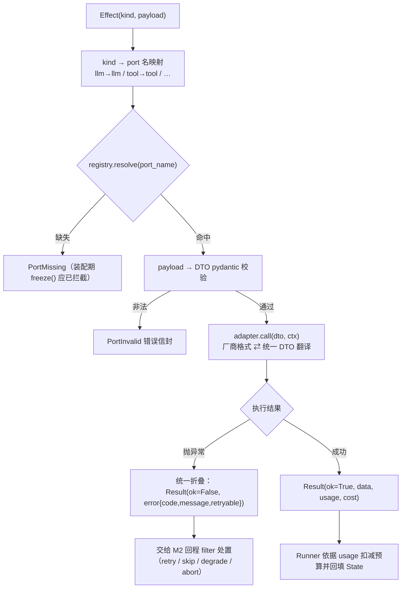

# 模块 M3：端口协议层与最小适配器（ports/ + harness/adapters/）

> 阅读前提：[《Agent框架设计方案》](./Agent框架设计方案.md) §3、原语类型见 [《M1-核心运行时》](./M1-核心运行时.md)、制度见[《门禁体系》](./门禁体系.md)。
> 本文档自足：读完即可开发本模块。

---

## 1. 职责与边界

**做**：定义全部 Port 协议（契约）；定义跨模块 DTO（LLMRequest/ToolResult 等）；PortRegistry（按名解析适配器）；P0 必需的最小默认适配器（LLM、Tool 最小注册表、Telemetry JSONL、Human 本地终端）。

**不做**：完整工具系统（@tool pydantic / 渐进式披露 / MCP → M4）；RAG/记忆/沙盒/评测实现（M5~M9，但**接口在本模块一次定齐**）。

## 2. 完整链路描述

一次 `ports.call(effect)` 的内部时序：

```
call(effect, ctx)
  ├─ 1. kind → port 名映射：llm→"llm" / tool→"tool" / child→"child"...
  ├─ 2. registry.resolve(port_name) → 适配器实例（缺失 → PortMissing）
  ├─ 3. payload → DTO 校验（pydantic 校验入参，错误归类 PortInvalid）
  ├─ 4. adapter.call(dto, ctx) → Result DTO
  ├─ 5. 适配器内部异常统一折叠：→ Result(ok=False, error=PortError(code, msg))
  │      （异常绝不抛穿运行时；处置交给 M2 的回程 filter）
  └─ 6. 返回 Result（含 usage/cost 元数据，供预算扣减）
```

Port 调用全流程图：



child 的特殊性：`Effect("child")` 不直接映射 port，而是 Runner 递归创建子 Session
（同一 M1 解释器），子会话的 TelemetryPort 挂到父 trace 下——**多 Agent 与单 Agent 共用同一套底座**。

## 3. 设计原语

| 原语 | 一句话定义 |
|------|-----------|
| `XxxPort` | 每类外部能力一个 Protocol；运行时只认协议不认实现 |
| `PortRegistry` | 名字 → 适配器的注册表；装配期缺 port 即报错 |
| DTO | 跨模块数据契约（LLMRequest / LLMResponse / ToolCall / ToolResult…），pydantic 定义 |
| `Result` | Port 调用结果的统一信封：数据 + usage/cost + 错误 |

## 4. 接口定义与实现

```python
# ---- DTO（pydantic，全框架统一） ----
class LLMRequest(BaseModel):
    messages: list[Message]
    tools_catalog: list[ToolSpec] | None = None   # 一级披露目录
    model: str | None = None; temperature: float | None = None
    max_tokens: int | None = None
class ToolCall(BaseModel):
    call_id: str; name: str; args: dict
class LLMResponse(BaseModel):
    content: str | None; tool_calls: list[ToolCall] = []
    usage: Usage; model: str
class ToolResult(BaseModel):
    call_id: str; ok: bool
    value: Any | None = None; error: str | None = None
    meta: dict = {}                                # 沙盒标记/耗时/来源等
class Usage(BaseModel):
    prompt_tokens: int; completion_tokens: int; cost_usd: float

# ---- 协议族（P0 必需四个，其余接口同批定齐） ----
class LLMPort(Protocol):
    async def complete(self, req: LLMRequest, ctx: PortCtx) -> LLMResponse: ...
    async def stream(self, req: LLMRequest, ctx: PortCtx) -> AsyncIterator[str]: ...

class ToolPort(Protocol):
    def register(self, spec: ToolSpec, fn: Callable) -> None: ...
    def catalog(self) -> list[ToolSpec]: ...        # 一级披露目录
    async def call(self, call: ToolCall, ctx: PortCtx) -> ToolResult: ...

class TelemetryPort(Protocol):
    @contextmanager
    def span(self, name: str, ctx: PortCtx): ...
    def metric(self, name: str, value: float, tags: dict = {}): ...
    def log(self, event: dict): ...

class HumanPort(Protocol):
    async def ask(self, question: str, options: list[str] | None,
                  ctx: PortCtx) -> str: ...         # wait_human 的落地

# ---- 注册表 ----
class PortRegistry:
    def register(self, name: str, adapter: Any) -> None: ...
    def resolve(self, name: str) -> Any: ...        # 缺失 → PortMissing
```

**P0 内置默认适配器**：`OpenAICompatLLM`（任何 OpenAI 兼容端点）、
`InMemoryToolRegistry`（名称→可调用+手写 schema；@tool 装饰器 M4 再升级）、
`JsonlTelemetry`（本地 JSONL trace）、`ConsoleHuman`（终端问答）。
全部可被用户实现整体替换——替换方式 = `registry.register("llm", MyAdapter())`。

## 5. API 规范

- **port 名固定命名空间**：内置 `llm / tool / skill / memory / store / sandbox / audit / telemetry / eval / human / mcp / rag`；用户自定义 port 必须带前缀 `x-<名字>`，避免冲突。
- **错误信封约定**：Port 层异常一律折叠为 `Result(ok=False, error=...)`，error 为结构化
  `{code, message, retryable}`——`retryable=True` 是 M2 retry 判决的依据。
- **DTO 演进规则**：字段只增不改语义；废弃字段先标记 deprecated 至少一个 minor 版本。
- **适配器无状态**：所有会话上下文经 `ctx: PortCtx`（session_id、trace、budget）传入，适配器不持有会话状态。

## 6. 关键字段

**ToolSpec**（工具目录条目，一级披露载体）：

| 字段 | 类型 | 说明 |
|------|------|------|
| name | str | 全局唯一，MCP 工具为 `mcp__<server>__<tool>` |
| description | str | 一句话描述（常驻上下文的那行字） |
| parameters_schema | dict | JSON Schema（M4 前手写，M4 起由 pydantic 生成） |
| danger | Literal[SAFE,LOW,HIGH,CRITICAL] | 沙盒/审批路由依据 |
| source | Literal[local, mcp, skill] | 来源，审计用 |

**Result**（统一信封）：

| 字段 | 类型 | 说明 |
|------|------|------|
| ok | bool | 成功与否（工具业务失败也算"成功返回"，ok=True + value 里的业务错误码） |
| data | Any | LLMResponse / ToolResult / str... |
| usage | Usage \| None | token 与成本，Runner 据此扣预算 |
| error | PortError \| None | {code, message, retryable} |

**PortCtx**：`{session_id, trace_span, budget_left, run_id}` —— 适配器获取上下文的唯一途径。

## 7. 依赖关系

- **依赖**：`runtime/types.py`（见 M1 文档）；不依赖 M1 解释器逻辑、不依赖 M2。
- **被依赖**：M1（注入 call）；M4~M9 的默认实现全部落在本模块的 harness/adapters 侧。

## 8. 验收标准与门禁

**验收标准**（= 门禁 G3 的行为用例来源）：

1. PortRegistry 缺 port 在装配期报错；
2. OpenAICompatLLM 对接真实端点跑通一次 ReAct；
3. 适配器异常折叠为 Result 且 retryable 标注正确；
4. JsonlTelemetry 产出的 trace 含全部链路组件名。

**门禁清单**（制度见[《门禁体系》](./门禁体系.md)，下表为 M3 专属，逐条硬性）：

| 门禁 | 条目 | 达标标准 | 级别 |
|------|------|---------|------|
| M3-G0 | 契约冻结 | Port 协议与 DTO 定稿；破坏性变更走评审并记版本 | G0 |
| M3-G1 | 质量覆盖 | DTO 校验单测全过；适配器覆盖率 ≥ 85% | G1 |
| M3-G3 | 装配期 | 缺 port 在 freeze() 时报错（含缺失清单） | G3 |
| M3-G3 | 错误信封 | 适配器异常 100% 折叠为 `Result{ok, error{code,message,retryable}}`，retryable 标注正确 | G3 |
| M3-G3 | 真实端点 | OpenAICompatLLM smoke 测试通过（离线 CI 打 skip 标） | G3 |
| M3-红线 | 无状态 | 适配器持有会话状态/全局单例 → 拒绝；error 非 {code,message,retryable} 结构 → 拒绝 | 红线 |

**闭环核对**：契约自足 ✓ / 自带 fake ✓（fake_llm/fake_tool/JSONL 落盘）/ 自带测试 ✓（tests/ports/）/
独立 demo ✓（`make demo-m3`：本地 echo 工具 + 假 LLM 跑通一次调用）/ 文档自足 ✓（本文档）。

---
*M3 文档版本：v0.1 · 2026-11-13 · 拆分自《模块拆分规划》v0.2*
