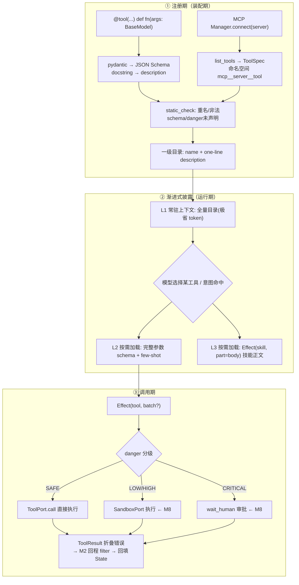

# 模块 M4：工具系统（harness/tools/）

> 阅读前提：[《M3-端口协议层》](./M3-端口协议层.md)（ToolPort/ToolSpec 契约）、[《门禁体系》](./门禁体系.md)。
> 适用判断：[《模块协作与场景适用指南》](./模块协作与场景适用指南.md)——工具数 < 10 时，M3 的最小注册表已够，本模块可不启用。

---

## 1. 职责与边界

**做**：`@tool` 装饰器（pydantic 即 schema）；完整 ToolRegistry（实现 M3 的 ToolPort）；渐进式披露 ToolIndex（三级加载）；MCP Manager（外部工具发现 → 注入统一工具合集）。

**不做**：执行工具本身（ToolPort.call 的沙盒路由在 M8）；Skill 正文管理（M10）；工具的业务逻辑（用户代码）。

核心约定：**本地 @tool 工具与 MCP 工具在运行时无差别**——同一 Registry、同一链路、同一 danger 分级、同一披露机制。

## 2. 完整链路描述

三条链路，全部汇入 M1 解释器：



- **注册期**：`@tool` 装饰时生成 schema，装配期 `static_check()` 校验；MCP 工具连接后以 `mcp__<server>__<tool>` 命名注入同一 Registry。
- **披露期**：上下文中常驻的只有"工具名 + 一句话"；完整 schema 与技能正文在被选中时才注入（RouterSkill 架构的底座）。
- **调用期**：工具异常不抛穿运行时，统一折叠成 `ToolResult(ok=False)`；danger 分级驱动沙盒/审批路由。

## 3. 设计原语

| 原语 | 一句话定义 |
|------|-----------|
| `@tool` | 装饰器：pydantic model → schema，docstring → description，声明 danger |
| `ToolSpec` | M3 定义的目录条目（name/description/schema/danger/source） |
| `ToolIndex` | 三级披露索引：L1 目录 / L2 完整 schema / L3 技能正文 |
| `MCPManager` | 连接 MCP server、发现工具、注入 Registry、健康检查 |
| `ToolResult` | 统一结果信封（M3 DTO），错误折叠为结构化 error |

## 4. 接口定义与实现

```python
# ---- ① @tool 装饰器 ----
class DangerLevel(str, Enum):
    SAFE = "safe"; LOW = "low"; HIGH = "high"; CRITICAL = "critical"

@tool(
    name="transfer",
    danger=DangerLevel.CRITICAL,        # 必填，缺失即注册期失败（M4 红线）
    sandbox=SandboxPolicy.AUTO,         # LOW 及以上自动沙盒
    timeout=30, retries=2,
)
class TransferArgs(BaseModel):          # pydantic → JSON Schema
    from_account: str = Field(..., description="转出账户")
    amount: Decimal = Field(..., gt=0)
    model_config = ConfigDict(extra="forbid")   # 默认拒绝未声明字段

def transfer(args: TransferArgs, ctx: ToolContext) -> ToolResult:
    """转账给指定账户。"""             # docstring → description
    ...
```

```python
# ---- ② 完整 Registry（实现 M3 的 ToolPort） ----
class ToolRegistry(ToolPort):
    def register(self, spec: ToolSpec, fn: Callable) -> None: ...
    def catalog(self, level: int = 1) -> list[ToolSpec]: ...   # 一级披露目录
    def schema_of(self, name: str) -> dict: ...                  # L2 按需取
    async def call(self, call: ToolCall, ctx: PortCtx) -> ToolResult: ...
    def static_check(self) -> list[str]: ...                    # 装配期错误清单

class ToolIndex:
    """三级披露：<10 个工具可降级为全量注入"""
    def catalog(self) -> list[ToolSpec]: ...                    # L1
    def load_schema(self, names: list[str]) -> list[dict]: ...  # L2
    def load_body(self, skill: str) -> str: ...                 # L3

# ---- ③ MCP Manager ----
class MCPManager:
    def __init__(self, registry: ToolRegistry, transport: MCPTransport): ...
    async def connect(self, server: str) -> None: ...          # 发现并注入工具（仅目录）
    async def call(self, fqname: str, args: dict) -> ToolResult: ...
    async def health(self) -> dict: ...                        # 掉线 → M2 熔断重连
```

## 5. API 规范

- **命名**：本地工具 snake_case；MCP 工具强制 `mcp__<server>__<tool>`；重名注册直接失败。
- **danger 分级路由表**（本模块声明，M8 执行）：

| danger | 路由 | 典型例子 |
|--------|------|---------|
| SAFE | ToolPort 直接执行 | 查天气、读只读报表 |
| LOW | SandboxPort（文件/网络隔离） | 写临时文件、读取指定 URL |
| HIGH | SandboxPort + 审计 hook | 执行模型生成的代码 |
| CRITICAL | SandboxPort + `wait_human` 审批 | 转账、删除数据、对外发送 |

- **未声明 danger** → 注册期拒绝（红线）；未配 SandboxPort 却注册 HIGH/CRITICAL → 注册期拒绝（宁可不跑不裸奔）。
- **异常折叠**：工具异常 → `ToolResult(ok=False, error=结构化)`，交 M2 回程 filter 判决，绝不抛穿运行时。
- **pydantic 约定**：`extra="forbid"` 默认开启；Field(description) 用于生成参数说明；工具函数同步/异步均可。
- **披露阈值**：工具数 > 20 强制启用 ToolIndex 三级；< 10 可全量注入（API 提供 `index=False` 降级开关）。

## 6. 关键字段

**ToolSpec**（M3 定义，本模块填充）：

| 字段 | 说明 |
|------|------|
| name / description | 唯一名 + 一句话（L1 目录载体） |
| parameters_schema | pydantic 生成的 JSON Schema（L2 载体） |
| danger / source | 路由依据；`local` 或 `mcp` |

**ToolCall / ToolResult**（M3 DTO）：`{call_id, name, args}` / `{call_id, ok, value, error, meta}`；
`meta` 带 `sandbox`、`duration_ms`、`source` 供审计。

**ToolIndexEntry**：`{name, level, loaded_at, token_cost}` —— 披露成本进 trace。

## 7. 依赖关系

- **依赖**：M3 `ToolPort` / `ToolSpec` / `ToolCall` / `ToolResult`；M1 `Effect(tool)`；M2 `BEFORE_TOOL/AFTER_TOOL` 链路。
- **被依赖**：M8（danger → 沙盒/审批路由）、M10（RouterSkill 的 `Effect(skill, part=body)`）。

## 8. 验收标准与门禁

**验收标准**：① `@tool` 自动产出正确 schema 并能对真实 LLM 完成一次 function calling；② MCP 连接后工具出现在目录里且调用链路与本地工具一致；③ 三级披露在 20+ 工具场景下目录 token 占用显著低于全量注入；④ HIGH/CRITICAL 工具自动走沙盒/审批；⑤ 工具异常折叠不抛穿。

**门禁清单**（制度见《门禁体系》）：

| 门禁 | 条目 | 达标标准 | 级别 |
|------|------|---------|------|
| M4-G1 | 质量覆盖 | 装饰器/Registry/MCP 单测覆盖率 ≥ 85%，mypy strict 通过 | G1 |
| M4-G2 | schema 正确性 | 每个 pydantic 字段（含 gt/枚举/嵌套）正确映射为 JSON Schema 的用例 | G2 |
| M4-G2 | 披露 | L1/L2/L3 各级加载触发条件与 token 上限各有断言 | G2 |
| M4-G3 | 集成 | 本地工具与 MCP 工具在同一 Registry 调用成功；danger 四级路由各有用例 | G3 |
| M4-红线 | 安全 | 工具未声明 danger → 拒绝；MCP 工具全量注入上下文 → 拒绝；工具异常抛穿运行时 → 拒绝 | 红线 |

**闭环核对**：契约自足 ✓ / 自带 fake ✓（FakeLLMPort/FakeSandbox）/ 自带测试 ✓（tests/tools/）/
独立 demo ✓（`make demo-m4`：注册 3 个工具 + 1 个假 MCP server，跑通调用）/ 文档自足 ✓。

## 9. 功能验证矩阵（可执行的完整性验证）

| 功能点 | 用例 ID | 验证方式 | 通过标准 |
|--------|---------|---------|---------|
| @tool → JSON Schema | M4-T01 | `pytest tests/m4/test_decorator.py -q` | pydantic 字段（含 gt/枚举/嵌套）映射正确 |
| 装配期 static_check | M4-T02 | 同上 | 重名 / 非法 schema / danger 缺失即报错 |
| 三级渐进式披露 | M4-T03 | `pytest tests/m4/test_index.py -q` | L1/L2/L3 触发条件与 token 上限各有断言 |
| MCP 工具注入 | M4-T04 | `pytest tests/m4/test_mcp.py -q` | 命名空间正确、与本地工具在同一 Registry 调用 |
| danger 四级路由 | M4-T05 | 与 M8 联测 `tests/m8/test_routing.py` | SAFE 直执行、LOW/HIGH 沙盒、CRITICAL 审批 |
| 工具异常折叠 | M4-T06 | `pytest tests/m4/test_errors.py -q` | 异常不抛穿，交 M2 回程 filter |
| 披露红线 | M4-T07 | `python tools/ast_scan.py --module m4` | MCP 工具未全量注入上下文 |
| 独立闭环 | M4-D01 | `make demo-m4` + `gate_check --module m4` | 3 个本地工具 + 1 个假 MCP server 跑通，G0~G4 全绿 |

---
*M4 文档版本：v0.2 · 2026-11-15 · v0.2 补功能验证矩阵*
