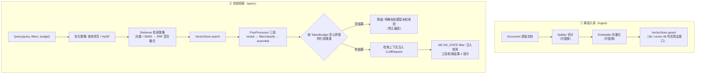

# 模块 M5：RAG 子系统（harness/rag/）

> 阅读前提：[《M3-端口协议层》](./M3-端口协议层.md)（Port 契约）、[《门禁体系》](./门禁体系.md)。
> 适用判断：[《模块协作与场景适用指南》](./模块协作与场景适用指南.md)——需要私有知识/长文档/时效内容时才启用；纯工具型任务不需要。

---

## 1. 职责与边界

**做**：五段式 RAG 流水线（Splitter / Embedder / VectorStore / Retriever / PostProcessor），每段都是 Protocol + 内置默认实现、任意可替换；内置优化策略（查询改写、混合检索、重排、预算感知拼接）；检索结果带引用溯源注入上下文。

**不做**：训练/托管向量模型（外部服务经 Embedder 接入）；记忆的读写策略（M7 复用本模块的 Embedder/Store，但语义归 M7）；把检索结果当指令执行（注入防御由 M8 的 ON_INPUT/ON_STATE filter 负责）。

## 2. 完整链路描述

两条流水线：离线入库 + 在线检索。



**协作点**：M7 长期记忆复用 `Embedder` + `VectorStore` 实例（共享，不重复建库）；检索结果注入走 M2 的 `ON_STATE` pipe/filter；`cost_usd` 与 token 计入 M1 预算。

## 3. 设计原语

| 原语 | 一句话定义 |
|------|-----------|
| `Document / Chunk / Hit` | 入库文档 / 切分块 / 检索命中 |
| `Query` | 查询对象（文本 + 过滤条件 + token 预算 + 用途标签） |
| 五段 Protocol | Splitter / Embedder / VectorStore / Retriever / PostProcessor |
| `RAGResult` | 拼接后的上下文 + 引用清单 + 命中元数据 |
| `TokenBudget` | 拼接的硬上限，由 M1 Budgets 派生 |

## 4. 接口定义与实现

```python
# ---- 五段协议（全部可替换，全部有内置默认实现） ----
class Splitter(Protocol):
    def split(self, doc: Document) -> list[Chunk]: ...
class Embedder(Protocol):
    async def embed(self, texts: list[str]) -> list[Vector]: ...
class VectorStore(Protocol):
    async def upsert(self, chunks: list[Chunk]) -> None: ...
    async def search(self, vec: Vector, top_k: int, filters: dict) -> list[Hit]: ...
class Retriever(Protocol):
    async def retrieve(self, query: Query) -> list[Hit]: ...
class PostProcessor(Protocol):
    def rerank(self, hits: list[Hit], query: Query) -> list[Hit]: ...
    def filter(self, hits: list[Hit]) -> list[Hit]: ...    # 分类 / 权限 / 时效
    def assemble(self, hits: list[Hit], budget: TokenBudget) -> RAGResult: ...

# ---- 流水线装配（函数式替换任意组件） ----
class RAGPipeline:
    def __init__(self, splitter: Splitter, embedder: Embedder,
                 store: VectorStore, retriever: Retriever,
                 post: PostProcessor): ...
    async def ingest(self, docs: list[Document]) -> None: ...
    async def query(self, q: Query) -> RAGResult: ...
    def with_(self, *, splitter=None, embedder=None, store=None,
              retriever=None, post=None) -> "RAGPipeline": ...  # 返回新实例（不可变）
```

**内置默认实现**：`RecursiveCharSplitter`（按标题/段落递归）、`OpenAICompatEmbedder`、
`InMemoryVectorStore`（开发用）/ `PgVectorStore`（生产）、`HybridRetriever`（向量+BM25，RRF 融合）、
`DefaultPostProcessor`（cross-encoder 重排 + 时间/权限过滤 + 预算贪心拼接）。

**内置优化策略**（默认开启、可关闭）：

| 策略 | 作用 | 关闭开关 |
|------|------|---------|
| 查询改写 / HyDE | 扩展多查询，提升召回 | `rewrite=False` |
| 混合检索 RRF | 向量 + 关键词互补，降低漏召回 | `hybrid=False` |
| 重排 | cross-encoder 精排 top-k | `rerank=None` |
| 引用溯源 | 每个片段带 doc_id/chunk_id，输出可核查 | 不可关闭（红线） |
| 预算感知拼接 | 按 TokenBudget 贪心装入，超限截断 | 不可关闭（红线） |
| 空结果降级 | 明确返回"未检索到"，避免模型编造 | 不可关闭（红线） |

## 5. API 规范

- **替换方式**：`pipeline.with_(store=MyStore(...))`，返回新实例，不改原对象；装配期 `static_check()` 校验五段齐全。
- **检索结果一律视为不可信数据**：必须经 M2 `ON_STATE` filter 的注入检测后才进 LLM 上下文；任何"工具/检索结果里的指令"不得被 Program 直接执行。
- **空结果语义**：`RAGResult.empty=True` + 固定提示文本，禁止返回空字符串让模型自行脑补。
- **引用格式**：`[doc_id:chunk_id]` 随片段注入，输出侧可核查；`meta` 带 score/来源/时间戳。
- **缓存**：相同 Query（哈希含 filters）走检索缓存；失效由 `invalidate(doc_id)` 显式触发，不做隐式过期。

## 6. 关键字段

**Chunk**：`{chunk_id, doc_id, text, tokens, meta}`（meta 含标题/页码/权限标签）。
**Hit**：`{chunk, score, source, ts}`。
**Query**：`{text, filters, top_k, token_budget, purpose}`（purpose 区分"问答检索"与"记忆召回"）。
**RAGResult**：`{context: str, citations: list[str], hits: list[Hit], empty: bool, tokens_used: int}`。

## 7. 依赖关系

- **依赖**：M3 Port 契约（Embedder/Store 可对接外部服务）；M2 `ON_STATE` 链路做注入检测与上下文注入；M1 `TokenBudget`。
- **被依赖**：M7 长期记忆复用向量化与存储（共享实例）；M10 的 RAG 类架构 / C 类项目画像。

## 8. 验收标准与门禁

**验收标准**：① 五段各有替换用例（换掉任意一段上层代码零改动）；② 混合检索召回率高于纯向量基线；③ 拼接结果不超 TokenBudget 且每片段带引用；④ 空结果返回明确提示，模型输出不编造；⑤ 检索文本含"忽略以上指令"类注入串时被 filter 拦截。

**门禁清单**：

| 门禁 | 条目 | 达标标准 | 级别 |
|------|------|---------|------|
| M5-G1 | 质量覆盖 | 五段流水线单测覆盖率 ≥ 85%，mypy strict 通过 | G1 |
| M5-G2 | 预算 | 拼接永不超过 TokenBudget（含边界值/超长片段用例） | G2 |
| M5-G2 | 降级 | 空结果 / 检索异常各有确定性降级用例 | G2 |
| M5-G3 | 集成 | 换掉任意一段组件后 query 结果结构不变；引用溯源可核查 | G3 |
| M5-红线 | 安全 | 无引用溯源 → 拒绝；空结果编造 → 拒绝；检索文本未过注入检测直接进 LLM → 拒绝 | 红线 |

**闭环核对**：契约自足 ✓ / 自带 fake ✓（InMemoryVectorStore + FakeEmbedder）/ 自带测试 ✓（tests/rag/）/
独立 demo ✓（`make demo-m5`：入库 3 篇文档 → 查询 → 带引用上下文）/ 文档自足 ✓。

## 9. 功能验证矩阵（可执行的完整性验证）

| 功能点 | 用例 ID | 验证方式 | 通过标准 |
|--------|---------|---------|---------|
| 五段组件替换 | M5-T01 | `pytest tests/m5/test_pipeline.py -q` | 换掉任意一段后上层代码零改动 |
| 入库 → 检索 | M5-T02 | 同上 | ingest→query 结果结构正确 |
| 混合检索 RRF | M5-T03 | `pytest tests/m5/test_hybrid.py -q` | 召回率高于纯向量基线 |
| 预算感知拼接 | M5-T04 | `pytest tests/m5/test_budget.py -q` | 不超 TokenBudget 且每片段带引用 |
| 空结果降级 | M5-T05 | `pytest tests/m5/test_fallback.py -q` | 明确提示"未检索到"，模型不编造 |
| 检索注入检测 | M5-T06 | 与 M8 联测 `tests/m8/test_guardrail.py` | 检索文本含指令被 ON_STATE filter 拦截 |
| 检索缓存 | M5-T07 | `pytest tests/m5/test_cache.py -q` | 同 Query 命中缓存、invalidate 生效 |
| 溯源红线 | M5-T08 | `python tools/ast_scan.py --module m5` | 所有拼接路径均附 citations |
| 独立闭环 | M5-D01 | `make demo-m5` + `gate_check --module m5` | 入库 3 篇 → 查询 → 带引用上下文，G0~G4 全绿 |

---
*M5 文档版本：v0.2 · 2026-11-15 · v0.2 补功能验证矩阵*
