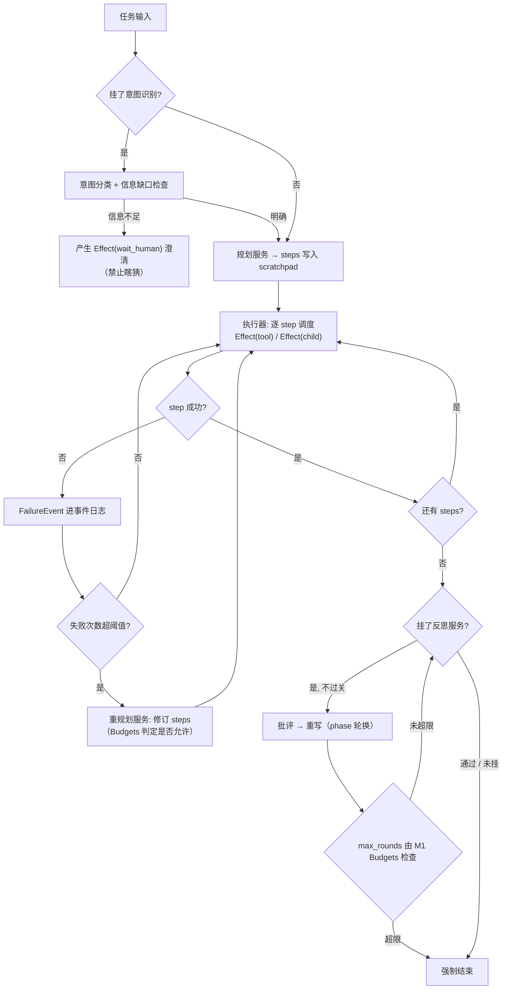

# 模块 M6：认知模块集（harness/cognition/）

> 阅读前提：[《M1-核心运行时》](./M1-核心运行时.md)（Budgets/scratchpad）、[《M3-端口协议层》](./M3-端口协议层.md)（LLMPort）、[《门禁体系》](./门禁体系.md)。
> 适用判断：[《模块协作与场景适用指南》](./模块协作与场景适用指南.md)——单任务 ReAct 助手不需要本模块全部服务；多技能入口才用意图识别，可分解任务才用规划/子 Agent。

---

## 1. 职责与边界

**做**：六个**可独立调用的服务**——意图识别 / 规划 / 重规划 / 执行器 / 反思 / 子 Agent 管理。它们是内置架构（M10）的"原料"，本身不是架构。

**不做**：架构调度（Program 由 M10 组装）；自己数 rounds/hops（一律交 M1 Budgets，见红线）；直接调外部 SDK（统一经 LLMPort）。

关键设计：服务之间**不互相 import**，通过 `State.scratchpad` 的约定键与"失败事件"通信——规划写 `steps`，执行器写 `step_results`，失败事件触发重规划，反思读草稿写 `critique`。

## 2. 完整链路描述

以 PlanExecute（规划→执行→反思→重规划）为例：



**子 Agent 管理链路**：Supervisor 架构 `par([Effect("child")...])` → ChildManager 派发 → 并发上限由 `Budgets.max_parallel_children` 控制 → join 聚合结果 → 子会话预算从父预算分账 → 子会话 trace 挂父 span。

## 3. 设计原语

| 原语 | 一句话定义 |
|------|-----------|
| `Intent` | 意图标签 + 置信度 + 缺口清单 |
| `Step` | 规划产出的可执行步骤（含依赖、预期产物） |
| `Critique` | 反思产出：pass / revise + 具体批评意见 |
| `FailureEvent` | 执行器失败的结构化事件（重规划的触发器） |
| `ChildHandle` | 子会话句柄：id、预算分账、join 结果 |
| `CognitionService` | 统一服务协议：`(State, ctx) -> 结构化结果` |

## 4. 接口定义与实现

```python
class IntentRecognizer(Protocol):
    async def recognize(self, state: AgentState) -> Intent: ...
        # 信息不足时返回 Intent(missing=[...])，由架构产生 wait_human

class Planner(Protocol):
    async def plan(self, goal: str, state: AgentState) -> list[Step]: ...

class RePlanner(Protocol):
    async def replan(self, steps: list[Step], failures: list[FailureEvent],
                     state: AgentState) -> list[Step]: ...

class Executor(Protocol):
    async def run_step(self, step: Step, state: AgentState) -> StepResult: ...
        # 内部产生 Effect(tool) / Effect(child)，失败产出 FailureEvent

class Reflector(Protocol):
    async def critique(self, draft: str, state: AgentState) -> Critique: ...

class ChildManager(Protocol):
    async def spawn(self, spec: ChildSpec) -> list[ChildHandle]: ...
    async def join(self, handles: list[ChildHandle]) -> list[ChildResult]: ...
    async def cancel(self, handle: ChildHandle) -> None: ...
```

内置默认实现全部基于 `LLMPort` + 结构化输出（pydantic schema 校验），例如 `LLMPlanner` 用一次
`Effect("llm")` 产出 `list[Step]`，schema 不合法由 M2 的 `AFTER_LLM` filter 判决重试。

## 5. API 规范

- **scratchpad 约定键**（跨服务唯一通信方式）：`goal` / `steps` / `cursor` / `step_results` / `draft` / `critique` / `phase` / `children`。
- **结构化输出强制**：所有服务返回 pydantic 对象，禁止返回裸字符串让调用方自己解析；schema 校验失败的处置交 M2 filter（retry/abort）。
- **预算纪律（红线）**：`max_rounds`（反思）、`max_hops`（移交）、`max_parallel_children`（子 Agent）**一律由 M1 Budgets 统一判定**，服务内不得自带计数器。
- **澄清优先**：意图识别发现信息缺口 → 返回 `missing`，架构产生 `Effect("wait_human")`，禁止猜测补全后强行执行。
- **失败事件化**：执行器失败写 `FailureEvent` 进事件日志（可回放），重规划消费事件而非读取私有状态。
- **服务可缺席**：未挂反思就没有批评/重写循环；未挂重规划就失败即上报——框架的缺省行为明确。

## 6. 关键字段

**Intent**：`{label, confidence, missing: list[str], raw}`。
**Step**：`{id, title, depends_on: list[str], expect: str, danger: DangerLevel}`。
**Critique**：`{verdict: pass|revise, comments: list[str], score: float}`。
**FailureEvent**：`{step_id, code, message, retryable, ts}`。
**ChildSpec / ChildHandle**：`{program, budget_share, tools}` / `{child_id, session_id, budget_share, status}`。

## 7. 依赖关系

- **依赖**：M1 `AgentState/Budgets/Effect`、M3 `LLMPort`、M2 `AFTER_LLM` filter（结构化输出校验）与 hooks（失败事件可观测）。
- **被依赖**：M10 内置架构——PlanExecute（规划+执行器+重规划）、Reflection（反思）、Router/RouterSkill（意图识别）、Supervisor/Handoff/Blackboard（子 Agent 管理）。

## 8. 验收标准与门禁

**验收标准**：① 六个服务各自可用 fake LLMPort 独立跑通（不依赖其他服务）；② 规划→执行→失败→重规划完整闭环可回放；③ 反思在 `max_rounds` 处强制结束；④ 信息缺口触发 `wait_human` 澄清而非强行执行；⑤ 子 Agent 并发数不超 `max_parallel_children`，预算分账正确。

**门禁清单**：

| 门禁 | 条目 | 达标标准 | 级别 |
|------|------|---------|------|
| M6-G1 | 质量覆盖 | 六服务单测覆盖率 ≥ 85%，结构化输出校验用例齐全 | G1 |
| M6-G2 | 预算纪律 | 反思/子agent/移交的终止条件全部由 Budgets 驱动，服务内无计数器的静态扫描 | G2 |
| M6-G2 | 澄清 | 每个 `missing` 场景都产生 wait_human，无"猜测补全"路径 | G2 |
| M6-G3 | 集成 | 用 fake LLMPort 跑通 PlanExecute 全链路；ChildManager join 聚合正确 | G3 |
| M6-红线 | 纪律 | 服务自己数 rounds/hops → 拒绝；返回裸字符串 → 拒绝；失败不写事件 → 拒绝 | 红线 |

**闭环核对**：契约自足 ✓ / 自带 fake ✓（FakeLLMPort + 固定 steps）/ 自带测试 ✓（tests/cognition/）/
独立 demo ✓（`make demo-m6`：规划 3 步 → 故意失败 1 步 → 重规划 → 完成）/ 文档自足 ✓。

## 9. 功能验证矩阵（可执行的完整性验证）

| 功能点 | 用例 ID | 验证方式 | 通过标准 |
|--------|---------|---------|---------|
| 意图识别 + 澄清 | M6-T01 | `pytest tests/m6/test_intent.py -q` | 信息缺口 → wait_human，无猜测补全路径 |
| 规划 / 重规划 | M6-T02 | `pytest tests/m6/test_plan.py -q` | 失败事件触发修订 steps，可回放 |
| 执行器 | M6-T03 | `pytest tests/m6/test_executor.py -q` | 逐 step 调度、失败写 FailureEvent |
| 反思 | M6-T04 | `pytest tests/m6/test_reflection.py -q` | 不过关重写、max_rounds 由 Budgets 终止 |
| 子 Agent 管理 | M6-T05 | `pytest tests/m6/test_children.py -q` | 并发不超限、预算分账、join 完整 |
| 服务可独立 | M6-T06 | fake LLMPort 隔离测试 | 六服务各自跑通，不依赖其他服务 |
| 预算红线 | M6-T07 | `python tools/ast_scan.py --module m6` | 服务内无 rounds/hops 计数器 |
| 独立闭环 | M6-D01 | `make demo-m6` + `gate_check --module m6` | 规划 3 步→故意失败→重规划→完成，G0~G4 全绿 |

---
*M6 文档版本：v0.2 · 2026-11-15 · v0.2 补功能验证矩阵*
