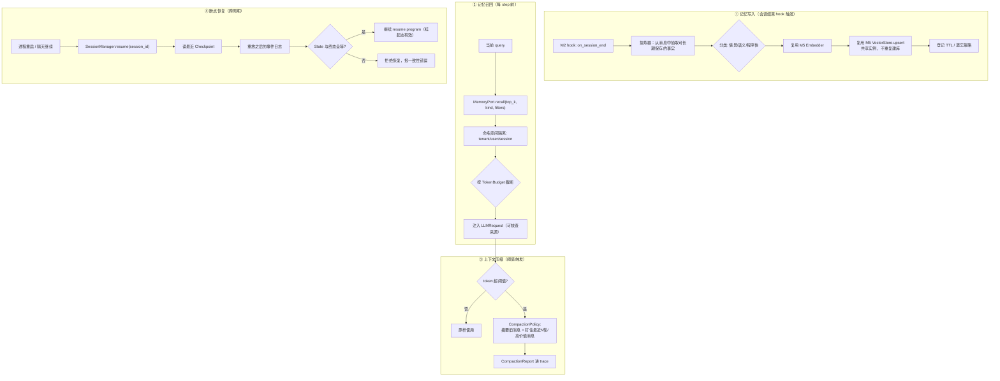

# 模块 M7：记忆与会话（harness/memory/ + harness/session/）

> 阅读前提：[《M1-核心运行时》](./M1-核心运行时.md)（State/事件溯源）、[《M5-RAG子系统》](./M5-RAG子系统.md)（Embedder/Store 复用）、[《门禁体系》](./门禁体系.md)。
> 适用判断：[《模块协作与场景适用指南》](./模块协作与场景适用指南.md)——跨会话个性化、长期任务才需要长期记忆层；单轮工具调用不需要。

---

## 1. 职责与边界

**做**：短期记忆（会话 scratchpad 随 checkpoint 持久化）；长期记忆三类（情景/语义/程序性）的读写与遗忘；上下文组装与压缩策略；会话管理与**跨周期断点恢复**。

**不做**：向量化与存储实现（复用 M5 的 Embedder/VectorStore）；记忆的"值得保存"判断逻辑（由会话结束 hook 决定，本模块只提供接口）；沙盒与审计（M8）。

## 2. 完整链路描述



## 3. 设计原语

| 原语 | 一句话定义 |
|------|-----------|
| `MemoryItem` | 长期记忆最小单元（正文、类别、命名空间、TTL） |
| `MemoryKind` | episodic（事件）/ semantic（事实）/ procedural（做法） |
| `Session` | M1 聚合根；本模块负责创建/挂起/恢复/列举 |
| `Checkpoint` | 某 step 的完整 State 快照 + 事件序号 |
| `CompactionPolicy` | 上下文压缩策略（可替换），产出 CompactionReport |
| `EventStore` | append-only 事件日志存储，恢复的唯一依据 |

## 4. 接口定义与实现

```python
class MemoryPort(Protocol):
    async def write(self, kind: MemoryKind, item: MemoryItem, ctx: PortCtx) -> str: ...
    async def recall(self, query: str, *, kind: MemoryKind | None = None,
                     top_k: int = 5, ctx: PortCtx) -> list[MemoryItem]: ...
    async def forget(self, item_id: str) -> None: ...          # 显式遗忘 / TTL 过期清理

class SessionManager(Protocol):
    def create(self, spec: SessionSpec) -> Session: ...
    def suspend(self, session_id: str) -> Checkpoint: ...      # wait_human/挂起时必存
    def resume(self, session_id: str) -> Session: ...          # checkpoint + 事件重放
    def list(self, *, tenant: str, user: str) -> list[SessionMeta]: ...

class CompactionPolicy(Protocol):
    def compact(self, messages: tuple[Message, ...],
                budget: TokenBudget) -> tuple[tuple[Message, ...], CompactionReport]: ...

class ContextAssembler:
    """组装顺序：system + 工具目录(L1) + 检索上下文 + 记忆 + 历史 + 当前输入"""
    def assemble(self, state: AgentState, *, recall: bool = True) -> LLMRequest: ...
```

**内置默认实现**：`VectorMemory`（复用 M5 的 InMemory/PgVectorStore）、`SqliteEventStore`、
`SqliteCheckpointStore`、`SummaryCompactionPolicy`（旧消息摘要 + pinned 保留）、`DefaultContextAssembler`。

## 5. API 规范

- **命名空间隔离（红线级）**：所有记忆键带 `tenant/user/session` 三元组，`recall` 必须带同等 filters，跨租户召回直接报错。
- **写入 hook 化**：长期记忆只能由 `on_session_end` hook 触发写入，运行中不隐式写入（避免回放不确定性）。
- **压缩纪律**：钉住（pinned）消息不可被压缩丢弃（最近 N 轮 + 用户显式标记）；压缩产出 `CompactionReport` 进 trace。
- **恢复幂等**：`resume()` 从 checkpoint + 事件重放得到与终态全等的 State；不一致则拒绝恢复（fail-closed）。
- **遗忘**：显式 `forget` 与 TTL 过期双通道；TTL 由装配配置给定，不做隐式随机过期。
- **预算**：召回与压缩都受 `TokenBudget` 约束，超限截断并记 trace。

## 6. 关键字段

**MemoryItem**：`{item_id, kind, text, namespace{tenant,user,session}, meta, created_at, ttl}`。
**Session**：`{session_id, program_version, state, event_seq, status(active/suspended/done), checkpoint_seq}`。
**Checkpoint**：`{seq, state_snapshot, ts, cost_usd}`。
**CompactionReport**：`{before_tokens, after_tokens, summarized, pinned_kept}`。

## 7. 依赖关系

- **依赖**：M1（State/Event/Checkpoint 挂点）、M2（on_session_end hook、ON_STATE pipe）、M3（StorePort）、M5（Embedder/VectorStore 共享实例）。
- **被依赖**：M9（事件日志 = 评测重放底座）、M10（跨会话架构）。

## 8. 验收标准与门禁

**验收标准**：① 会话结束后事实被写入长期记忆，新会话可召回；② 重启进程后 `resume()` 得到全等 State 并从断点继续；③ 压缩后 pinned 消息全部保留且不超预算；④ `forget`/TTL 生效，召回不再返回；⑤ 跨租户召回被拒绝。

**门禁清单**：

| 门禁 | 条目 | 达标标准 | 级别 |
|------|------|---------|------|
| M7-G1 | 质量覆盖 | memory/session/compaction 覆盖率 ≥ 85%，mypy strict 通过 | G1 |
| M7-G2 | 恢复一致性 | checkpoint + 重放后 State 全等（含挂起态）用例 | G2 |
| M7-G2 | 压缩 | pinned 保留率 100%，输出不超 TokenBudget 的边界用例 | G2 |
| M7-G3 | 集成 | 进程重启跨周期恢复成功；召回结果注入 LLMRequest 结构正确 | G3 |
| M7-红线 | 隔离与确定性 | 跨租户召回 → 拒绝；运行中隐式写长期记忆 → 拒绝；恢复不一致仍继续 → 拒绝 | 红线 |

## 9. 功能验证矩阵（可执行的完整性验证）

| 功能点 | 用例 ID | 验证方式 | 通过标准 |
|--------|---------|---------|---------|
| 长期记忆写入/召回 | M7-T01 | `pytest tests/m7/test_memory.py -q` | 写入后新会话召回命中，且带完整 namespace |
| 三类记忆分类 | M7-T02 | 同上 | episodic/semantic/procedural 各自分类正确 |
| 遗忘与 TTL | M7-T03 | 同上 | forget 与过期后召回不再返回 |
| 会话挂起/恢复 | M7-T04 | `pytest tests/m7/test_session.py -q` | suspend→resume 后 State 全等、从断点继续 |
| 跨周期恢复 | M7-T05 | `make demo-m7`（起子进程模拟重启） | 新进程 resume 成功且输出与终态一致 |
| 上下文压缩 | M7-T06 | `pytest tests/m7/test_compaction.py -q` | pinned 100% 保留、tokens ≤ budget |
| 命名空间隔离 | M7-T07 | 同上 | 跨租户 recall 抛错 |
| 独立闭环 | M7-D01 | `make demo-m7` + `python tools/gate_check.py --module m7` | demo 冒烟通过 + G0~G4 全绿 |

**闭环核对**：契约自足 ✓ / 自带 fake ✓（InMemoryStore/Sqlite 临时库）/ 自带测试 ✓（tests/m7/）/ 独立 demo ✓ / 文档自足 ✓。

---
*M7 文档版本：v0.1 · 2026-11-15*
