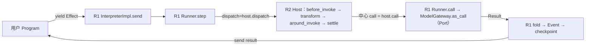

# R1 / R2 代码阅读指南（快速版）

> 目标：**15 分钟读完核心，30 分钟读完全部**。
> 范围：`src/runtime/`（R1 核心运行时，6 文件）+ `src/hooks/`（R2 插件宿主，核心 `v5.py`），共约 1800 行。
> 方法：**先读一条主线的 5 个函数，再补类型，最后看协议**。不要按文件顺序从头读到尾。

---

## 一、先建立心智模型（1 分钟）

```
用户写一个 generator（Program）→ 它 yield Effect（只声明，不执行）
        ↓
Runner.step() 是唯一执行循环：驱动 generator → dispatch → call → fold → 记 Event
        ↓
R2 Host 作为 dispatch/call 注入：把"每步经过什么插件"收敛到 6 个扩展点的 tap 链
```

一句话记住：**R1 负责"循环怎么转"，R2 负责"每步经过什么"，两者靠依赖注入拼起来，互不 import 对方实现。**

---

## 二、15 分钟主线（按这个顺序读，别按文件顺序）

### 第 1 站：`runtime/interpreter.py`（85 行，全读）— 4 分钟

这是最该先读的文件，短小且是"引擎的心脏"。

- `InterpreterImpl.send()`（58-84 行）：**核心中的核心**。生成器第一次 `next()` 启动，之后 `send(value)` 把上次结果回填；产出 `EffectBatch` 或 `DONE`。
- `_expand()`（29-41 行）：`batch=True` 的 Effect 按 `payload['calls']` 展开成多个独立 Effect。
- 关键不变量：解释器**不做任何 IO**，只做确定性推进；非 generator、yield 非 Effect 都抛 `ProgramInvalid`，内部异常包成 `ProgramCrashed`。

### 第 2 站：`runtime/fold.py` 的 `fold()`（79-120 行）— 3 分钟

- 唯一的状态变更入口：读 `_message_for()`（57-76）看 LLM/TOOL Effect 怎么变成消息。
- `fold()` 四件事：① 生成消息 ② 特殊 kind（SKILL/CHILD/WAIT_HUMAN）写托管字段 ③ 累计 usage ④ 按 `payload['budget']` 统一扣预算。
- 关键不变量：**纯函数**——只依赖入参，返回新 State；Program 不许自己数轮次。

### 第 3 站：`runtime/runner.py` 的 `step()`（166-262 行）— 5 分钟

这是最长的方法，但也是整个框架的"主动脉"。**只顺着 else 分支的正常路径读一遍**：

```
预算预检(184) → interpreter.send(192) → 注入 trace_id(206) →
终端判定(215-220: END/wait_human) → 并发 _execute(223) →
fold(241) → 记 Event(248) → checkpoint(257)
```

- 重点看 `_execute()`（121-146）：dispatch 返回 None 就调 call；返回 Result 直接用；异常一律折叠成 Result，不抛穿。
- 看 `run/resume/_loop`（264-286）：`run` 反复 `step` 到终态；`resume` 重建解释器+重放到断点。
- 可跳过：`_replay()`（95-113）和 `_child()`（148-164）第一遍略读，第二遍再看。

### 第 4 站：`hooks/types.py` 的 Decision + `hooks/v5.py` 的 HookKind（2 分钟）

- `HookKind`（`v5.py`）：五种调用语义——Bail/Waterfall/Loop/Parallel/Around；**宿主在定义扩展点时选定 kind，插件不声明 mode**。v5.1 起 `Hook.call(scope, effect, ...)` 把 effect 直送回调：BAIL/LOOP/PARALLEL `fn(scope, effect)`、WATERFALL `fn(value, effect)`、AROUND `fn(next, scope, effect)`。
- `DecisionAction`（`types.py`）+ 各 `@classmethod` 构造器：hook 的返回动作。
- 关键：Decision 是 hook 与内核之间的**唯一协议**，定义 8 种 action；R1 内核当前消费 continue/deny/abort/fallback 4 种，rewrite/ask/retry/degrade 由 R3/R4 的扩展点与插件实例自身持有的状态落地。

### 第 5 站：`hooks/v5.py` 的 `Host.dispatch()` / `Host.call()`（2 分钟）

- `Host.dispatch()`：每次调用 `new_scope()`（继承 `_sticky_target`），依次跑 `before_invoke`（BAIL 短路）→ `transform`（WATERFALL 改写）→ `settle`（BAIL 裁决）；守卫故障写入 `RequestScope.signals`，`settle` 把降级目标写 `scope.target` 并刷新 `ctx.degrade_target` / `_sticky_target`（B1 跨 Effect 继承）。`effect` 作为参数直送每个回调，装配期配置由插件构造参数私有持有。
- `Host.call()`：用 `around_invoke`（AROUND）包裹真实 Port 调用，tap 签名为 `fn(next, scope, effect)`——`next` 是下一层回调，中心 `core` 由 R1 注入的 `call` 指回 `ModelGateway.as_call`；成功/失败分别触发 `after_invoke` / `invoke_error` 观察，返回前 `scope.release_all()` 逆序释放资源。
- 看 `Hook._call_around()` 理解"洋葱"：tap 收到的 `next` 回调就是下一层，最内层 `core` 才真正执行 IO。
- 关键不变量：**宿主自己不碰 IO**——真正执行在 R1 注入的 `call`；`RequestScope` 只有 typed 协作字段（signals/target/last_result/trace/value/releases，**无 meta**），effect 走回调直送、装配配置走构造注入，防止入参被任意插件篡改。

**读完这 5 站，你已经理解了整个框架 80% 的运行机制。**

---

## 三、补类型（10 分钟）

### `runtime/types.py` — 只精读这几段

| 行 | 内容 | 为什么重要 |
|----|------|-----------|
| 64-71 | `EffectKind` | 6 种 Effect，架构的全部 IO 都归到这 6 种 + `x-*` |
| 108-124 | `Result` / `PortError` / `Usage` | 统一信封，异常以数据形态流动 |
| 128-175 | `Budgets` | 6 维预算、`exceeded()`/`consume()`，内核硬强制 |
| 192-243 | `AgentState` | 不可变状态；`get/set/with_` 三方法 + 托管字段映射 |
| 284-315 | `Effect` / `DONE` / `Program` | 三大原语 |
| 318-358 | `Event` / `Session` | 事件溯源 + 为什么存 `program_factory` 而非 generator |
| 405-449 | `_plain` / `canonical` / `fingerprint` / `checkpoint` | 确定性序列化——回放一致的基础 |

- 可跳过：`Message`、`StepReport`、`RunResult`（纯字段容器）；`restore_*`（497-522，恢复时再看）。

### `hooks/dto.py`（约 100 行）

- pydantic 严格 DTO：`LLMRequest/Response`、`ToolCall/Result/Spec`、`Usage`、`PortCtx`。
- 只需知道：跨模块传的是这些类型，`extra="forbid"` 拒绝未知字段。有 `make_call()` 便捷函数。

---

## 四、扫协议（5 分钟，知道有什么即可）

### `hooks/protocols.py`（147 行）

- 13 个 Port 协议（LLMPort/ToolPort/MemoryPort/...）：**只看方法签名**，理解"运行时只认 Protocol 不认实现"。
- `PORT_PROTOCOLS` 字典（141-146）：port 名 → 协议类型，装配期校验用。
- 这些是**接口契约**，当前没有实现代码（实现属于 R4~R11，待写）。

### `runtime/errors.py`（约 45 行）

- 5 个异常类，各有 `code`。记住：异常不抛穿，折叠成 `Result.failure(code, ...)`。

---

## 五、R1 与 R2 怎么拼起来（关键的一张图）



- 拼装点在 `Runner(dispatch=host.dispatch, call=host.call(my_call), ...)`，dispatch/call 签名不变。
- `host.plugin(plugin)` 注册插件（内部调 `plugin.apply(host)`，插件再用 `host.hook(name).tap(name, fn)` 订阅扩展点）；`host.freeze()` 做装配期校验留名与依赖端口。

---

## 六、验证你读懂了（跑这 4 条）

```bash
# 1. R1 独立闭环（解释循环/确定性/回放/挂起）
.venv/Scripts/python.exe tests/demos/demo_r1.py

# 2. R2 五种 HookKind 编排 + 与 R1 集成
.venv/Scripts/python.exe tests/demos/demo_r2.py

# 3. 全部测试（40 项）
.venv/Scripts/python.exe -m pytest tests/r1 tests/r2 -q -c pyproject.toml

# 4. 门禁（各 13/13）
.venv/Scripts/python.exe tests/tools/gate_check.py --module r1
.venv/Scripts/python.exe tests/tools/gate_check.py --module r2
```

两个 demo 是最好的"可执行文档"——先看 demo 里的 `react_program` 和 `dispatch/call`，再回头看源码，会快很多。

---

## 七、按文件速查表

| 文件 | 行数 | 必读度 | 一句话 |
|------|------|--------|--------|
| `runtime/interpreter.py` | 85 | ★★★ 全读 | 生成器推进器 + batch 展开 |
| `runtime/fold.py` | 129 | ★★★ fold 函数 | 纯函数状态变更 + 预算扣减 |
| `runtime/runner.py` | 309 | ★★★ step 方法 | 唯一执行循环，主动脉 |
| `hooks/types.py` | ~280 | ★★★ Decision | Decision/DecisionAction/Registry 类型 |
| `hooks/v5.py` | ~308 | ★★★ Host | 5 种 HookKind + Host/RequestScope/Plugin（无独立 Policy 层，跨调用状态在插件实例自身） |
| `runtime/types.py` | 523 | ★★ 指定段落 | 原语定义 + 确定性序列化 |
| `hooks/dto.py` | ~100 | ★★ 扫读 | pydantic 数据契约 |
| `hooks/protocols.py` | 147 | ★ 看签名 | 13 个 Port 接口 |
| `runtime/errors.py` | ~45 | ★ 扫读 | 5 个异常码 |
| `runtime/__init__.py` / `hooks/__init__.py` | 各 ~40 | 查 API 时看 | 公共导出 |

---

## 八、读代码时牢记的 6 条纪律

1. **Program 是纯函数**——不能有时间/随机/网络（AST 扫描强制）。
2. **Effect 只声明不执行**——IO 只在 Runner 的 `call` 发生。
3. **State 不可变**——任何修改产生新对象，`fold` 是唯一入口。
4. **墙钟不进运行时**——`Event.ts` 用的是逻辑时钟 step。
5. **异常不抛穿**——一律折叠成 `Result.failure()`。
6. **唯一扩展点 Plugin.apply(host) + 5 种 HookKind**——插件只实现 `apply(host)` 并用 `host.hook(name).tap(...)` 订阅，没有 middleware/filter/pipe 三套 API。

---

*代码阅读指南 v2.1 · 对应 R1/R2 v5.1 架构（Host/HookKind/Plugin.apply/RequestScope typed 字段；effect 回调直送、装配配置构造注入、无 meta 容器；跨调用状态由插件实例自身持有，无独立 Policy 层）*
