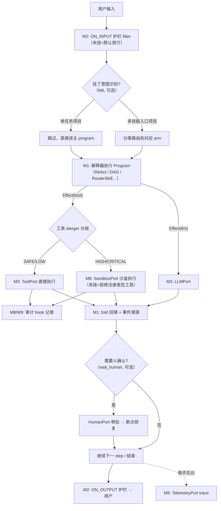

# 模块协作与场景适用指南

> 回答三个问题：**模块之间怎么合作？每个模块在什么场景下才被用到？这个框架是否值得做？**
> 核心理念一句话：**模块是菜单，不是套餐。** 最小内核只有 M1+M2+M3，其余全部按需装配；
> 任何模块缺席时框架照常运行（有明确 fallback），不存在"必须全装才能跑"。

---

## 1. 协作总图：一次请求里谁调用谁



协作的**总规则**只有三条：

1. **M1 是唯一的调度者**：所有模块都通过"挂载到 M2 链路"或"实现 M3 Port"参与，M1 不直接认识任何一个可选模块。
2. **模块间不互相 import**：记忆复用 RAG 的向量库、护栏消费审计事件，都是通过"实现同一个 Port 接口"完成的，不点对点调用。
3. **缺席即降级**：每个可选模块都有定义好的缺省行为（见 §3 表格），缺了不报错，只是能力变弱。

---

## 2. 模块协作矩阵（谁和谁产生关系）

| 协作对 | 协作点 | 触发时机 |
|--------|--------|---------|
| M1 ↔ M2 | 每个 Effect 经过链路分发 | 每个 step 必经（内核关系） |
| M1 ↔ M3 | Port 调用 + usage 扣预算 | 每次 LLM/工具调用 |
| M1 ↔ M6 | 规划/反思/重规划产出的 steps 被写进 scratchpad，由 PlanExecute 等架构消费 | 使用相关架构时 |
| M1 ↔ M9 | 事件日志 = 评测重放的底座 | 挂 TelemetryPort 后每步发生 |
| M2 ↔ M8 | 护栏 = ON_INPUT/ON_OUTPUT filter；审计 = hook | 挂载即生效 |
| M3 ↔ M4 | ToolRegistry（M4）实现 ToolPort 协议 | 工具系统就绪后替换最小注册表 |
| M7 ↔ M5 | 长期记忆复用 RAG 的 Embedder/VectorStore | 两者都启用时（共享实例，不重复建库） |
| M6 ↔ M8 | 执行器失败事件触发重规划；高危 step 触发 wait_human | PlanExecute 类项目 |
| M4 ↔ M8 | 工具的 danger 分级决定沙盒路由 | 注册工具时声明，运行时自动路由 |

---

## 3. 逐模块适用场景（重点：什么时候**不需要**）

下表是本指南的核心。**"触发信号"= 出现这个信号你才装它；"缺席降级"= 不装时框架的行为。**

| 模块 | 触发信号（什么时候需要） | 不需要它的情况 | 缺席降级 |
|------|------------------------|---------------|---------|
| **M1 运行时** | 永远需要（内核） | 无 | —— |
| **M2 链路** | 永远需要（内核）；但四个泳道可全空 | 无 | 空管道 = 直通 |
| **M3 端口** | 永远需要；最小集 = LLMPort + ToolPort 两个 | 无 | 缺 port 装配期报错 |
| **意图识别（M6）** | ① Router/RouterSkill 多技能入口 ② 用户输入意图混杂 ③ 信息不足需要澄清提问 | 单一任务的 ReAct 助手（模型自己知道该干嘛） | 主 program 直接接管 |
| **沙箱（M8）** | 工具会写文件、执行代码、发网络请求且参数来自模型输出 | 工具全是只读 API（查天气、查库存、读报表） | **注册期拒绝** danger≥HIGH 且未配沙盒的工具（宁可不跑也不裸奔） |
| **RAG（M5）** | 需要私有知识/长文档/时效性内容 | 纯工具型任务（模型参数知识+工具结果已够） | Effect("llm") 不带检索上下文 |
| **HITL 审批（M8）** | 存在不可逆操作（转账/删除/对外发送） | 全部操作可逆且低危 | CRITICAL 工具注册被拒（与沙盒同规则） |
| **记忆（M7）** | 跨会话个性化、长期任务、用户偏好沉淀 | 单轮工具调用、无状态处理 | scratchpad 仍随会话持久化，仅无长期层 |
| **评测（M9）** | 开始迭代 prompt/模型/工具之后（第一次改版前就该有） | 一次性 demo、不再迭代的脚本 | 手工测试 |
| **可观测（M9）** | 建议 P0 就挂（调试刚需，成本极低） | 无 | JsonlTelemetry 本地兜底 |
| **MCP（M4）** | 要接外部生态工具且不想自己写适配 | 工具全是自己写的内部函数 | 不注册 mcp port 即可 |
| **渐进式披露（M4）** | 工具数 > 20 或 skill 正文很长（token 压力） | 工具 < 10 个，全量注入更简单 | 全量注入目录 |
| **多 Agent（M6/M10）** | 任务可分解且子任务并行收益大；需要不同角色不同工具集 | 单 Agent 一条链能解决的事 | 单 Session 运行 |

**识别"过度设计"的三个信号**（反过来用这张表）：
项目里唯一用到的架构是 ReAct、工具不到 10 个、没有不可逆操作——那你不需要这个框架的大部分模块，一个 200 行的循环脚本就够了。

---

## 4. 五种项目画像 → 该装哪些模块

### 画像 A：单轮问答/分类机器人（客服路由、表单填写）
**模块**：M1 + M2 + M3(LLM) + 意图识别 + Router 架构。
**不装**：RAG、沙盒、记忆、多 Agent。
**特征**：甚至可以没有工具——Router 直接把分类结果交给下游系统。

### 画像 B：工具型助手（查数据、操作内部系统）
**模块**：A + ToolPort + 若干 @tool + ReAct 架构 + TelemetryPort。
**不装**：RAG、沙盒（只读工具）、记忆。
**特征**：这是最常见的第一阶段；本框架 P0 里程碑正好覆盖。

### 画像 C：知识库问答（企业文档、客服知识）
**模块**：B + RAG 五段流水线 + 引用溯源 + ON_OUTPUT 脱敏 filter。
**特征**：RAG 是主角，工具退居其次；评测（检索命中率）从这里开始变重要。

### 画像 D：企业生产 Agent（有写操作、有合规要求）
**模块**：C + 沙盒 + HITL 审批 + 审计 + 两级护栏 + 评测回归 + 断点恢复 + 记忆。
**特征**：**只有这个画像才需要接近全量的模块**；门禁体系（G0~G4）也是从这里开始产生真实价值。

### 画像 E：多 Agent 协作系统（深度研究、复杂流水线）
**模块**：D + Supervisor/Handoff/Blackboard 架构 + 子 Agent 管理 + 预算分账。
**特征**：在 D 的地基上叠加，不要跳过 D 直接做 E——没有护栏和审计的多 Agent 是事故放大器。

装配代码示意（画像 B 全貌，其余画像只是增删 `.rag()` / `.sandbox()` 链）：

```python
agent = (
    Agent(program=ReAct(tools=[query_order, query_stock]))
    .use(Timeout(30), RetryMiddleware(2), CostMeter())        # M2 middleware
    .hook(TracingHook())                                       # M9
    .filter(InputGuardrail(basic=True), at=MountPoint.ON_INPUT)  # M2 filter
    .registry(Registry().register("llm", OpenAICompatLLM(...)))
)   # 没有 .rag() / .sandbox() / .memory() —— 它们缺席，框架照常运行
```

---

## 5. 框架是否值得做：诚实的评估

### 5.1 值得做的三个前提（满足越多越值得）

1. **你要跑多种架构**：今天 ReAct、明天 PlanExecute、后天 DAG——如果永远只有一种架构，直接用厂商 SDK 包一层就够了，框架的"架构即数据"设计毫无用武之地。
2. **你需要工程化纪律**：评测回归、审计合规、断点恢复、多模型降级——这些是框架 Port/事件溯源设计真正省钱的点；玩具项目用不上。
3. **你要支持多项目/多团队复用**：框架的价值 = 被复用次数。如果只有一个项目用，"配置约定"比"框架"更轻。

### 5.2 诚实的风险

- **生态竞争**：LangGraph、OpenAI Agents SDK 等已占据心智；本框架的差异化必须靠"Effect 统一解释器 + 架构可声明 + 评测回放同底座"这三点讲清楚，而不是功能清单。
- **维护成本**：框架是长期负债——十种架构、九个 Port 的兼容性维护是持续投入，P0 之前要有"内核自用半年再决定开源"的心理准备。
- **抽象税**：对简单项目，框架的 Port/链路/装配是额外复杂度（这也是 §3 存在的意义——让最小装配足够小）。

### 5.3 结论建议

- **如果 5.1 三条中≥2 条成立**：值得做，且按本目录文档的路线走——先 P0（M1~M3 + ReAct）在自己真实项目里跑 1~2 个月，用门禁体系保证质量，验证"换架构零成本、换 LLM 一行配置"这两个核心卖点后再扩展。
- **如果三条都不成立**：不做框架，做一个 300 行的"ReAct 循环 + pydantic 工具注册"脚本，把它当学习项目，收获 80% 的经验、20% 的维护成本。
- **中间态**：只做 M1+M2+M3 内核并保持可独立发布（npm/pip 包），让"最小内核"先活下来——内核有价值，外围随时能长；反过来则不行。

---

*文档版本：v0.1 · 2026-11-13 · 姊妹篇：《模块拆分规划》（M0）、《门禁体系》制度、M1/M2/M3 模块详设*
